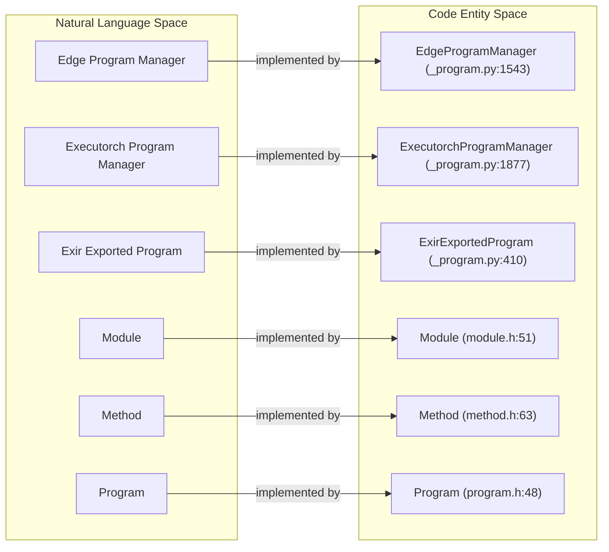
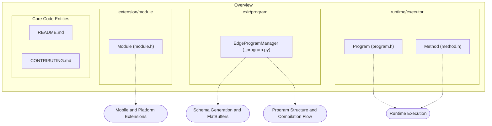
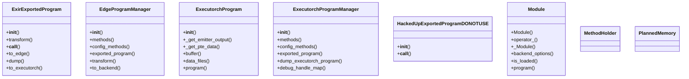
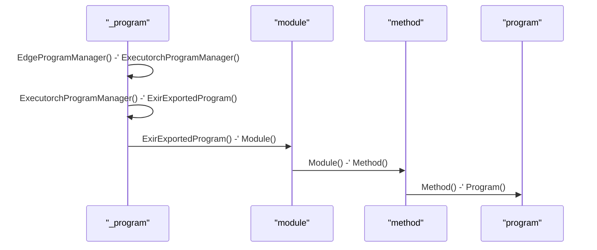

# 3-Source Context Packet (`git` + `CBM` + `llm-wiki`) for `1-overview` — Overview

- **Target Wiki File**: `wiki/1-overview.md`
- **Archetype**: `Parent Hub Page`
- **Parent Page**: `None (Top-Level Chapter)`
- **Summary**: Architectural specification and implementation reference for Overview (10 relevant source files). Primary code entities: `Module`, `MethodHolder`, `PlannedMemory`, `EdgeProgramManager`, `__init__`.
- **Valid `[[wikilink]]` Neighbours**: `[[1.1-getting-started|Getting Started]]`, `[[1.2-export-api-and-recipe-system|Export API and Recipe System]]`

## 1. Relevant Source Files (`git` + `CBM`, use verbatim in `<details>`)
- `[extension/module/module.h](extension/module/module.h)`
- `[exir/program/_program.py](exir/program/_program.py)`
- `[runtime/executor/program.h](runtime/executor/program.h)`
- `[runtime/executor/method.h](runtime/executor/method.h)`
- `[README.md](README.md)`
- `[CONTRIBUTING.md](CONTRIBUTING.md)`
- `[docs/source/intro-how-it-works.md](docs/source/intro-how-it-works.md)`
- `[docs/source/intro-overview.md](docs/source/intro-overview.md)`
- `[docs/source/intro-section.md](docs/source/intro-section.md)`
- `[docs/source/getting-started-architecture.md](docs/source/getting-started-architecture.md)`

## 2. Grounded Code Symbols (`CBM`, use verbatim for `[file:start-end]()` pill citations)
- `EdgeProgramManager` (Class) @ `[exir/program/_program.py:1543-1874]()` [fan-in=4, fan-out=0] — Package of one or more `ExportedPrograms` in Edge dialect. Designed to simplify lowering to ExecuTorch. See: https://pytorch.org/executorch/main/ir-exir Allows 
- `ExecutorchProgramManager` (Class) @ `[exir/program/_program.py:1877-2072]()` [fan-in=1, fan-out=0] — Package of one or more `ExportedPrograms` in Execution dialect. Designed to simplify lowering to ExecuTorch. See: https://pytorch.org/executorch/main/ir-exir Wh
- `ExirExportedProgram` (Class) @ `[exir/program/_program.py:410-494]()` [fan-in=5, fan-out=0] — 
- `Module` (Class) @ `[extension/module/module.h:51-791]()` [fan-in=0, fan-out=0] — /** * A facade class for loading programs and executing methods within them. */
- `Method` (Class) @ `[runtime/executor/method.h:63-451]()` [fan-in=0, fan-out=0] — /** * An executable method of an executorch program. Maps to a python method like * `forward()` on the original nn.Module. */
- `Program` (Class) @ `[runtime/executor/program.h:48-354]()` [fan-in=0, fan-out=0] — /** * A deserialized ExecuTorch program binary. */
- `ExecutorchProgram` (Class) @ `[exir/program/_program.py:498-639]()` [fan-in=1, fan-out=0] — 
- `HackedUpExportedProgramDONOTUSE` (Class) @ `[exir/program/_program.py:325-406]()` [fan-in=1, fan-out=0] — 
- `MethodHolder` (Class) @ `[extension/module/module.h:752-757]()` [fan-in=0, fan-out=0] — 
- `PlannedMemory` (Class) @ `[extension/module/module.h:730-739]()` [fan-in=0, fan-out=0] — 
- `StepState` (Class) @ `[runtime/executor/method.h:328-331]()` [fan-in=0, fan-out=0] — 
- `MutableSubsegment` (Class) @ `[runtime/executor/program.h:303-306]()` [fan-in=0, fan-out=0] — 
- `to_edge_transform_and_lower` (Function) @ `[exir/program/_program.py:1317-1455]()` [fan-in=38, fan-out=6] — :func:`to_edge_transform_and_lower` constructs an EdgeProgramManager from a set of exported programs in ATen dialect. It differs fundamentally from to_edge in t
- `graph_module` (Method) @ `[exir/program/_program.py:612-613]()` [fan-in=31, fan-out=0] — (self)
- `load_forward` (Method) @ `[extension/module/module.h:360-363]()` [fan-in=27, fan-out=0] — ( torch::executor::EventTracer* event_tracer)
- `to_edge` (Method) @ `[exir/program/_program.py:432-440]()` [fan-in=11, fan-out=1] — # TODO(ycao): Change this to a composable function.
- `_transform` (Function) @ `[exir/program/_program.py:140-164]()` [fan-in=6, fan-out=1] — Transforms the program according to the provided passes. Args: self: The ExportedProgram instance to transform *passes: A sequence of passes to apply to the pro
- `_gen_edge_manager_for_partitioners` (Function) @ `[exir/program/_program.py:1151-1286]()` [fan-in=1, fan-out=8] — Generates EdgeProgramManager for subsequent lowering to the partitioners specified by partitioner. The EdgeProgramManager is generated from aten_programs. Parti
- `_generate_edge_program` (Function) @ `[exir/program/_program.py:809-894]()` [fan-in=2, fan-out=3] — Args: config: The configuration for the edge program. program: The exported program to be converted to an edge program. core_aten_ops_exception_list: A list of 
- `lift_constant_tensor_pass` (Function) @ `[exir/program/_program.py:249-314]()` [fan-in=3, fan-out=0] — Takes an ExportedProgram and returns the ExportedProgram modified in-place, with the constant tensors as buffers.
- `runtime` (Method) @ `[extension/module/module.h:725-727]()` [fan-in=0, fan-out=16] — 
- `_transform_with_pass_manager` (Function) @ `[exir/program/_program.py:167-197]()` [fan-in=2, fan-out=1] — Transforms the program using the provided pass_manager. Args: self: The ExportedProgram instance to transform pass_manager: An instance of PassManager to apply 

## 3. Grounded Source Code Excerpts (`git` Working Tree)
### `EdgeProgramManager` in `[exir/program/_program.py:1543-1558]()`
```python
class EdgeProgramManager:
    """
    Package of one or more `ExportedPrograms` in Edge dialect. Designed to simplify
    lowering to ExecuTorch. See: https://pytorch.org/executorch/main/ir-exir

    Allows easy applications of transforms across a collection of exported programs
    including the delegation of subgraphs.

    Manages the second link in the lowering chain of ATen -> Edge -> ExecuTorch.
    """

    def __init__(
        self,
        edge_programs: Union[ExportedProgram, Dict[str, ExportedProgram]],
        constant_methods: Optional[Dict[str, Any]] = None,
        compile_config: Optional[EdgeCompileConfig] = None,
```

### `ExecutorchProgramManager` in `[exir/program/_program.py:1877-1892]()`
```python
class ExecutorchProgramManager:
    """
    Package of one or more `ExportedPrograms` in Execution dialect. Designed to simplify
    lowering to ExecuTorch. See: https://pytorch.org/executorch/main/ir-exir

    When the ExecutorchProgramManager is constructed the ExportedPrograms in execution dialect
    are used to form the executorch binary (in a process called emission) and then serialized
    to a buffer.

    Manages the final link in the lowering chain of ATen -> Edge -> ExecuTorch.
    """

    def __init__(
        self,
        execution_programs: Dict[str, ExportedProgram],
        config_methods: Optional[Dict[str, Any]] = None,
```

### `ExirExportedProgram` in `[exir/program/_program.py:410-425]()`
```python
class ExirExportedProgram:
    def __init__(
        self,
        exported_program: ExportedProgram,
        after_to_edge_passes: bool,
        compile_config: Optional[EdgeCompileConfig] = None,
    ):
        self.exported_program = exported_program

        # Add a flag to denote whehter to_edge is called on this program
        # to detect misusage of directly calling to_executorch without to_edge
        self.after_to_edge_passes = after_to_edge_passes
        self.compile_config = compile_config or EdgeCompileConfig()

    def transform(self, *passes: PassType) -> "ExirExportedProgram":
        self.exported_program = _transform(self.exported_program, *passes)
```

### `Module` in `[extension/module/module.h:51-66]()`
```cpp
class Module {
 public:
  /**
   * Enum to define loading behavior.
   */
  enum class LoadMode {
    /// Load the whole file as a buffer.
    File,
    /// Use mmap to load pages into memory.
    Mmap,
    /// Use memory locking and handle errors.
    MmapUseMlock,
    /// Use memory locking and ignore errors.
    MmapUseMlockIgnoreErrors,
    /// Use mmap with madvise(MADV_WILLNEED | MADV_SEQUENTIAL) hints.
    MmapUseMadvise,
```

### `Method` in `[runtime/executor/method.h:63-78]()`
```cpp
class Method final {
 public:
  /**
   * Move ctor. Takes ownership of resources previously owned by `rhs`,
   * and leaves `rhs` in an uninitialized state.
   */
  Method(Method&& rhs) noexcept
      : step_state_(rhs.step_state_),
        program_(rhs.program_),
        memory_manager_(rhs.memory_manager_),
        temp_allocator_(rhs.temp_allocator_),
        serialization_plan_(rhs.serialization_plan_),
        event_tracer_(rhs.event_tracer_),
        n_value_(rhs.n_value_),
        values_(rhs.values_),
        input_set_(rhs.input_set_),
```


## 4. Linked Official Docs (`llm-wiki` / `RAG`)
- **Program Structure and Compilation Flow** (`wiki/3.1-program-structure-and-compilation-flow.md`, score=73.116, shared_symbols=['EdgeProgramManager', 'ExirExportedProgram', 'Module', 'to_edge', 'to_edge_transform_and_lower', 'transform']): # Program Structure and Compilation Flow ↑ [[3-exir-core-system|EXIR Core System]] > Architectural specification and implementation reference for Program Structure and Compilation Flow (12 relevant source files). Primary code entities: `CaptureConfig`, `EdgeCompileConfig`, `ExecutorchBackendConfig`, `EdgeProgramManager`, `__init__`. <details> <summary>Rel
- **Export API and Recipe System** (`wiki/1.2-export-api-and-recipe-system.md`, score=62.483, shared_symbols=['EdgeProgramManager', 'ExirExportedProgram', 'Module', 'to_edge', 'transform']): # Export API and Recipe System ↑ [[1-overview|Overview]] > Architectural specification and implementation reference for Export API and Recipe System (37 relevant source files). Primary code entities: `AOQuantizationConfig`, `ExportRecipe`, `_assert_scalar_fields_agree`, `_collect_lowering_fields`, `ExportSession`. <details> <summary>Relevant source files<
- **EXIR Core System** (`wiki/3-exir-core-system.md`, score=58.344, shared_symbols=['Module', 'to_edge', 'to_edge_transform_and_lower']): # EXIR Core System > Architectural specification and implementation reference for EXIR Core System (40 relevant source files). Primary code entities: `EdgeProgramManager`, `__init__`, `config_methods`, `exported_program`, `MemoryPlanningPass`. <details> <summary>Relevant source files</summary> The following files were used as context for generating this w
- **ExecuTorch DeepWiki** (`wiki/index.md`, score=54.097, shared_symbols=[]): # ExecuTorch DeepWiki Generated from `home-jason-Project-deepwiki-executorch` at commit `b3b565b5b62f` (2026-11-15T15:02:11+00:00). ## Pages - [[1-overview|Overview]] — Architectural specification and implementation reference for Overview (10 relevant source files). Primary code entities: `Module`, `MethodHolder`, `PlannedMemory`, `EdgeProgramManager`, `_
- **Memory Planning and Allocation** (`wiki/3.3-memory-planning-and-allocation.md`, score=53.582, shared_symbols=['EdgeProgramManager', 'Module']): # Memory Planning and Allocation ↑ [[3-exir-core-system|EXIR Core System]] > Architectural specification and implementation reference for Memory Planning and Allocation (5 relevant source files). Primary code entities: `MemoryPlanningPass`, `__init__`, `_set_alloc_node_spec`, `call`, `AddressSpaceOverflowException`. <details> <summary>Relevant source file
- **Graph Transformation Pass System** (`wiki/3.2-graph-transformation-pass-system.md`, score=35.058, shared_symbols=['EdgeProgramManager', 'Module']): # Graph Transformation Pass System ↑ [[3-exir-core-system|EXIR Core System]] > Architectural specification and implementation reference for Graph Transformation Pass System (30 relevant source files). Primary code entities: `MemoryPlanningPass`, `__init__`, `_set_alloc_node_spec`, `call`, `DSInfo`. <details> <summary>Relevant source files</summary> The f

## 5. Pre-Verified DeepWiki v1.9.9.5 Mermaid Diagrams
### Natural Language Space <-> Code Entity Space


### Subsystem Architecture Flowchart


### Class Hierarchy Diagram


### Call Sequence Diagram


## 6. DeepWiki v1.9.9.5 Authoring Checklist for `wiki/1-overview.md`
1. Keep YAML frontmatter at top (`id`, `title`, `parent`, `sources`, `linked_docs`, `bridge_symbols`).
2. Keep `<details><summary>Relevant source files</summary>` block immediately after `# Title`.
3. Start with `## Purpose and Scope`, then numbered `## 1. ...`, `## 2. ...` sections separated by `---`.
4. Include at least 2 ```mermaid``` diagrams (including a `Natural Language Space` <-> `Code Entity Space` mapping).
5. Cite code entities inline using `[path/to/file.ext:start-end]()` and end every `##` section with `Sources: [file:start-end]()`.
6. Run `deepwiki_cli.py build --enrich-only ...` and `deepwiki_cli.py validate ...` after editing.
