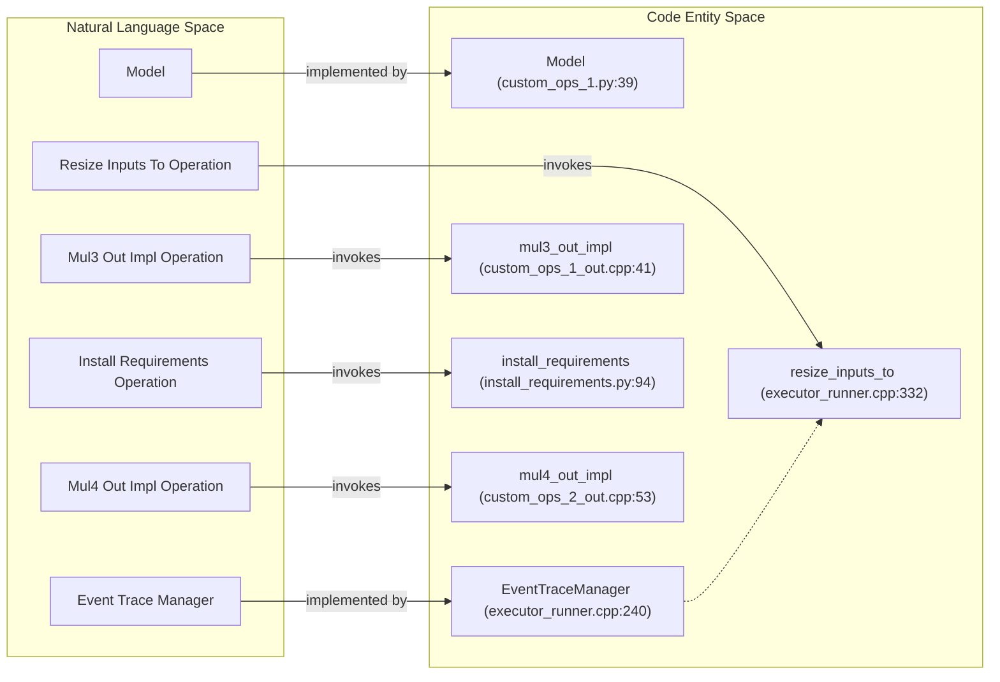
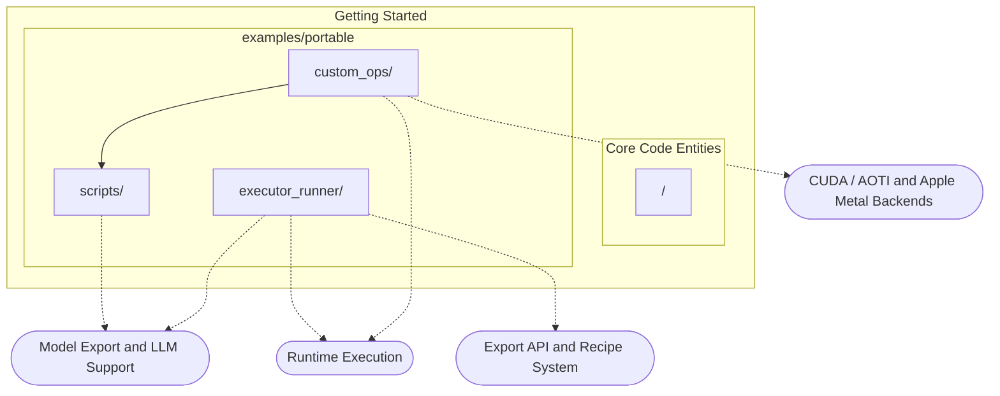
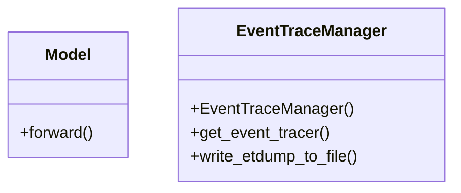
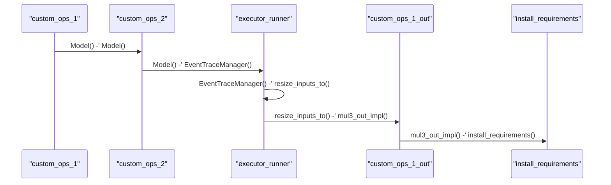

# 3-Source Context Packet (`git` + `CBM` + `llm-wiki`) for `1.1-getting-started` — Getting Started

- **Target Wiki File**: `wiki/1.1-getting-started.md`
- **Archetype**: `Leaf Technical Spec Page`
- **Parent Page**: `1-overview`
- **Summary**: Architectural specification and implementation reference for Getting Started (22 relevant source files). Primary code entities: `cu134_requirements`, `get_torch_url`, `get_torchao_version`, `install_optional_example_requirements`, `EventTraceManager`.
- **Valid `[[wikilink]]` Neighbours**: `[[1-overview|Overview]]`, `[[1.2-export-api-and-recipe-system|Export API and Recipe System]]`, `[[2.3-schema-generation-and-flatbuffers|Schema Generation and FlatBuffers]]`, `[[3-exir-core-system|EXIR Core System]]`, `[[3.1-program-structure-and-compilation-flow|Program Structure and Compilation Flow]]`, `[[3.2-graph-transformation-pass-system|Graph Transformation Pass System]]`, `[[3.3-memory-planning-and-allocation|Memory Planning and Allocation]]`, `[[3.4-program-emission-and-serialization|Program Emission and Serialization]]`

## 1. Relevant Source Files (`git` + `CBM`, use verbatim in `<details>`)
- `[install_requirements.py](install_requirements.py)`
- `[examples/portable/executor_runner/executor_runner.cpp](examples/portable/executor_runner/executor_runner.cpp)`
- `[install_executorch.py](install_executorch.py)`
- `[examples/portable/custom_ops/custom_ops_1.py](examples/portable/custom_ops/custom_ops_1.py)`
- `[examples/portable/custom_ops/custom_ops_2.py](examples/portable/custom_ops/custom_ops_2.py)`
- `[examples/portable/custom_ops/custom_ops_1_out.cpp](examples/portable/custom_ops/custom_ops_1_out.cpp)`
- `[examples/portable/custom_ops/custom_ops_2.cpp](examples/portable/custom_ops/custom_ops_2.cpp)`
- `[examples/portable/custom_ops/custom_ops_2_out.cpp](examples/portable/custom_ops/custom_ops_2_out.cpp)`
- `[examples/portable/custom_ops/targets.bzl](examples/portable/custom_ops/targets.bzl)`
- `[examples/portable/executor_runner/targets.bzl](examples/portable/executor_runner/targets.bzl)`
- `[examples/portable/scripts/export_and_delegate.py](examples/portable/scripts/export_and_delegate.py)`
- `[examples/portable/scripts/export.py](examples/portable/scripts/export.py)`
- `[docs/source/getting-started-architecture.md](docs/source/getting-started-architecture.md)`
- `[docs/source/getting-started-setup.rst](docs/source/getting-started-setup.rst)`
- `[docs/source/getting-started.md](docs/source/getting-started.md)`
- `[docs/source/using-executorch-android.md](docs/source/using-executorch-android.md)`
- `[docs/source/using-executorch-building-from-source.md](docs/source/using-executorch-building-from-source.md)`
- `[docs/source/using-executorch-cpp.md](docs/source/using-executorch-cpp.md)`
- `[examples/portable/custom_ops/BUCK](examples/portable/custom_ops/BUCK)`
- `[examples/portable/custom_ops/CMakeLists.txt](examples/portable/custom_ops/CMakeLists.txt)`
- `[examples/portable/executor_runner/BUCK](examples/portable/executor_runner/BUCK)`
- `[examples/portable/scripts/BUCK](examples/portable/scripts/BUCK)`

## 2. Grounded Code Symbols (`CBM`, use verbatim for `[file:start-end]()` pill citations)
- `Model` (Class) @ `[examples/portable/custom_ops/custom_ops_1.py:39-41]()` [fan-in=1, fan-out=0] — # example model
- `Model` (Class) @ `[examples/portable/custom_ops/custom_ops_2.py:19-21]()` [fan-in=1, fan-out=0] — # example model
- `EventTraceManager` (Class) @ `[examples/portable/executor_runner/executor_runner.cpp:240-287]()` [fan-in=0, fan-out=0] — /// Helper to manage resources for ETDump generation
- `resize_inputs_to` (Function) @ `[examples/portable/executor_runner/executor_runner.cpp:332-381]()` [fan-in=1, fan-out=5] — /** * Resize the method's inputs to the shapes given by --input_shapes. * * Without this, a model exported with dynamic shapes can only ever be run at * its upp
- `mul3_out_impl` (Function) @ `[examples/portable/custom_ops/custom_ops_1_out.cpp:41-52]()` [fan-in=0, fan-out=2] — // mul3.out(Tensor input, *, Tensor(a!) output) -> Tensor(a!) // ExecuTorch-compatible function signature, with a KernelRuntimeContext.
- `install_requirements` (Function) @ `[install_requirements.py:94-210]()` [fan-in=2, fan-out=6] — (use_pytorch_nightly)
- `mul4_out_impl` (Function) @ `[examples/portable/custom_ops/custom_ops_2_out.cpp:53-59]()` [fan-in=0, fan-out=2] — // mul4.out(Tensor input, *, Tensor(a!) output) -> Tensor(a!) // ExecuTorch-compatible function signature, with a KernelRuntimeContext.
- `pushd` (Function) @ `[install_executorch.py:32-39]()` [fan-in=0, fan-out=0] — Change the current directory to new_dir and yield. When exiting the context, change back to the original directory.
- `install_optional_example_requirements` (Function) @ `[install_requirements.py:213-267]()` [fan-in=3, fan-out=3] — (use_pytorch_nightly)
- `mul4_impl` (Function) @ `[examples/portable/custom_ops/custom_ops_2.cpp:18-24]()` [fan-in=0, fan-out=1] — // mul4(Tensor input) -> Tensor
- `get_event_tracer` (Method) @ `[examples/portable/executor_runner/executor_runner.cpp:248-250]()` [fan-in=3, fan-out=1] — ()
- `export_and_lower_partitioned_graph` (Function) @ `[examples/portable/scripts/export_and_delegate.py:105-153]()` [fan-in=0, fan-out=2] — Model: input -> torch.mm -> torch.add -> torch.sub -> torch.mm -> torch.add -> output AddMulPartitionerDemo is a graph partitioner that tag the lowered nodes, i
- `export_and_lower_the_whole_graph` (Function) @ `[examples/portable/scripts/export_and_delegate.py:156-190]()` [fan-in=0, fan-out=2] — AddMulModule: input -> torch.mm -> torch.add -> output this module can be lowered to the demo backend as a delegate input -> [lowered module (delegate)] -> outp
- `export_composite_module_with_lower_graph` (Function) @ `[examples/portable/scripts/export_and_delegate.py:39-102]()` [fan-in=0, fan-out=2] — AddMulModule: input -> torch.mm -> torch.add -> output this module can be lowered to the demo backend as a delegate input -> [lowered module (delegate)] -> outp
- `get_torch_url` (Function) @ `[install_requirements.py:58-62]()` [fan-in=2, fan-out=2] — ()
- `torchao_from_source` (Function) @ `[install_requirements.py:41-45]()` [fan-in=3, fan-out=0] — ()
- `try_load_file` (Function) @ `[examples/portable/executor_runner/executor_runner.cpp:290-305]()` [fan-in=1, fan-out=3] — (const std::filesystem::path& path)
- `cu134_requirements` (Function) @ `[install_requirements.py:65-76]()` [fan-in=2, fan-out=1] — (torch_url, include_domains=False)
- `get_torchao_version` (Function) @ `[install_requirements.py:48-55]()` [fan-in=2, fan-out=1] — (torch_url)
- `write_etdump_to_file` (Method) @ `[examples/portable/executor_runner/executor_runner.cpp:252-283]()` [fan-in=1, fan-out=2] — ()
- `load_input_files` (Function) @ `[examples/portable/executor_runner/executor_runner.cpp:157-194]()` [fan-in=1, fan-out=2] — ( const std::vector<std::string>& file_paths, std::vector<std::string>& inputs_storage, std::vector<std::pair<
- `check_preconditions` (Function) @ `[examples/portable/custom_ops/custom_ops_1_out.cpp:19-36]()` [fan-in=1, fan-out=3] — (const Tensor& in, Tensor& out)

## 3. Grounded Source Code Excerpts (`git` Working Tree)
### `Model` in `[examples/portable/custom_ops/custom_ops_1.py:39-41]()`
```python
class Model(torch.nn.Module):
    def forward(self, a):
        return torch.ops.my_ops.mul3.default(a)
```

### `Model` in `[examples/portable/custom_ops/custom_ops_2.py:19-21]()`
```python
class Model(torch.nn.Module):
    def forward(self, a):
        return torch.ops.my_ops.mul4.default(a)
```

### `EventTraceManager` in `[examples/portable/executor_runner/executor_runner.cpp:240-255]()`
```cpp
class EventTraceManager {
 public:
  EventTraceManager() : event_tracer_ptr_(nullptr) {
#ifdef ET_EVENT_TRACER_ENABLED
    event_tracer_ptr_ = std::make_shared<executorch::etdump::ETDumpGen>();
#endif // ET_EVENT_TRACER_ENABLED
  }

  EventTracer* get_event_tracer() const {
    return event_tracer_ptr_.get();
  };

  Error write_etdump_to_file() const {
    EventTracer* const event_tracer_ptr = get_event_tracer();
    if (!event_tracer_ptr) {
      return Error::NotSupported;
```

### `resize_inputs_to` in `[examples/portable/executor_runner/executor_runner.cpp:332-347]()`
```cpp
void resize_inputs_to(Method& method, const std::string& shapes_spec) {
  std::vector<std::string> specs;
  std::stringstream shape_list(shapes_spec);
  std::string spec;
  while (std::getline(shape_list, spec, ',')) {
    specs.push_back(spec);
  }
  // getline drops a trailing empty field, which is a legitimate "skip the last
  // input" entry, so put it back.
  if (!shapes_spec.empty() && shapes_spec.back() == ',') {
    specs.emplace_back();
  }

  ET_CHECK_MSG(
      specs.size() == method.inputs_size(),
      "--input_shapes has %zu entries but the method has %zu inputs; pass one "
```

### `mul3_out_impl` in `[examples/portable/custom_ops/custom_ops_1_out.cpp:41-52]()`
```cpp
Tensor& mul3_out_impl(
    ET_UNUSED KernelRuntimeContext& ctx,
    const Tensor& in,
    Tensor& out) {
  check_preconditions(in, out);
  float* out_data = out.mutable_data_ptr<float>();
  const float* in_data = in.const_data_ptr<float>();
  for (size_t out_idx = 0; out_idx < out.numel(); ++out_idx) {
    out_data[out_idx] = in_data[out_idx] * 3;
  }
  return out;
}
```


## 4. Linked Official Docs (`llm-wiki` / `RAG`)
- **Export API and Recipe System** (`wiki/1.2-export-api-and-recipe-system.md`, score=127.196, shared_symbols=['Model']): # Export API and Recipe System ↑ [[1-overview|Overview]] > Architectural specification and implementation reference for Export API and Recipe System (37 relevant source files). Primary code entities: `AOQuantizationConfig`, `ExportRecipe`, `_assert_scalar_fields_agree`, `_collect_lowering_fields`, `ExportSession`. <details> <summary>Relevant source files<
- **Runtime Execution** (`wiki/8-runtime-execution.md`, score=127.196, shared_symbols=['Model']): # Runtime Execution > Architectural specification and implementation reference for Runtime Execution (39 relevant source files). Primary code entities: `ET_CHECK_MSG`, `execute`, `execute_instruction`, `experimental_reset_execution`, `ArrayRef`. <details> <summary>Relevant source files</summary> The following files were used as context for generating this
- **Model Export and LLM Support** (`wiki/6-model-export-and-llm-support.md`, score=127.196, shared_symbols=['Model']): # Model Export and LLM Support > Architectural specification and implementation reference for Model Export and LLM Support (40 relevant source files). Primary code entities: `MuseGlimmerImageSpan`, `MuseGlimmerPreparationSpec`, `MuseGlimmerPreparedInput`, `Backing`, `RequestHandle`. <details> <summary>Relevant source files</summary> The following files we
- **ExecuTorch DeepWiki** (`wiki/index.md`, score=103.228, shared_symbols=[]): # ExecuTorch DeepWiki Generated from `home-jason-Project-deepwiki-executorch` at commit `b3b565b5b62f` (2026-11-15T15:02:11+00:00). ## Pages - [[1-overview|Overview]] — Architectural specification and implementation reference for Overview (10 relevant source files). Primary code entities: `Module`, `MethodHolder`, `PlannedMemory`, `EdgeProgramManager`, `_
- **Overview** (`wiki/1-overview.md`, score=79.301, shared_symbols=['Model', 'get_event_tracer']): # Overview > Architectural specification and implementation reference for Overview (10 relevant source files). Primary code entities: `Module`, `MethodHolder`, `PlannedMemory`, `EdgeProgramManager`, `__init__`. <details> <summary>Relevant source files</summary> The following files were used as context for generating this wiki page: - [extension/module/mo
- **Core Runtime Architecture** (`wiki/8.1-core-runtime-architecture.md`, score=63.603, shared_symbols=['Model']): # Core Runtime Architecture ↑ [[8-runtime-execution|Runtime Execution]] > Architectural specification and implementation reference for Core Runtime Architecture (38 relevant source files). Primary code entities: `ET_CHECK_MSG`, `execute`, `execute_instruction`, `experimental_reset_execution`, `ArrayRef`. <details> <summary>Relevant source files</summary> 

## 5. Pre-Verified DeepWiki v1.9.9.5 Mermaid Diagrams
### Natural Language Space <-> Code Entity Space


### Subsystem Architecture Flowchart


### Class Hierarchy Diagram


### Call Sequence Diagram


## 6. DeepWiki v1.9.9.5 Authoring Checklist for `wiki/1.1-getting-started.md`
1. Keep YAML frontmatter at top (`id`, `title`, `parent`, `sources`, `linked_docs`, `bridge_symbols`).
2. Keep `<details><summary>Relevant source files</summary>` block immediately after `# Title`.
3. Start with `## Purpose and Scope`, then numbered `## 1. ...`, `## 2. ...` sections separated by `---`.
4. Include at least 2 ```mermaid``` diagrams (including a `Natural Language Space` <-> `Code Entity Space` mapping).
5. Cite code entities inline using `[path/to/file.ext:start-end]()` and end every `##` section with `Sources: [file:start-end]()`.
6. Run `deepwiki_cli.py build --enrich-only ...` and `deepwiki_cli.py validate ...` after editing.
