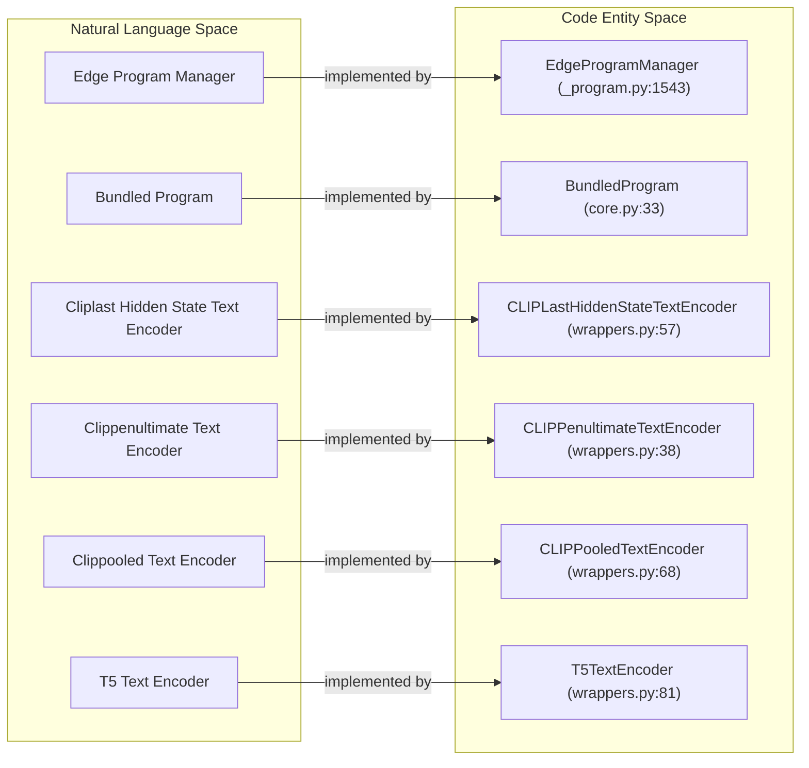
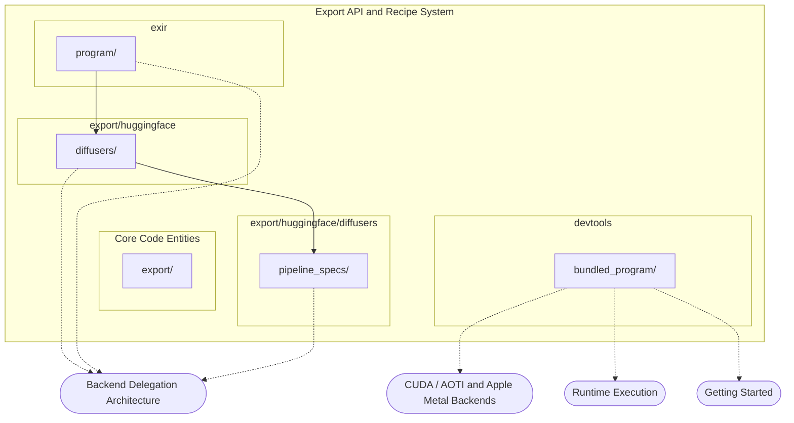
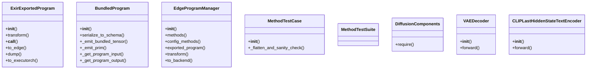
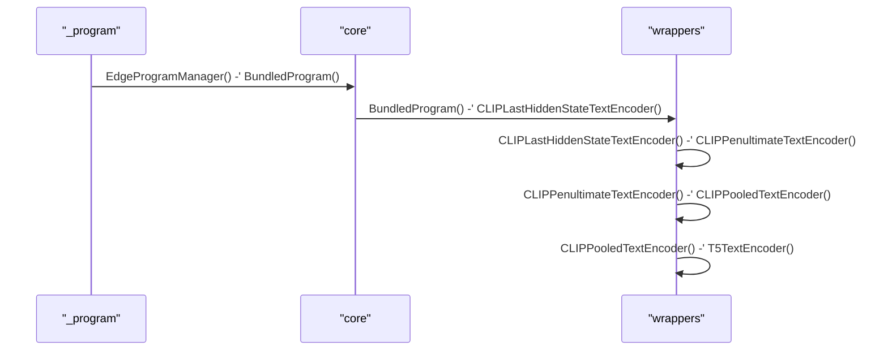

# 3-Source Context Packet (`git` + `CBM` + `llm-wiki`) for `1.2-export-api-and-recipe-system` — Export API and Recipe System

- **Target Wiki File**: `wiki/1.2-export-api-and-recipe-system.md`
- **Archetype**: `Leaf Technical Spec Page`
- **Parent Page**: `1-overview`
- **Summary**: Architectural specification and implementation reference for Export API and Recipe System (37 relevant source files). Primary code entities: `AOQuantizationConfig`, `ExportRecipe`, `_assert_scalar_fields_agree`, `_collect_lowering_fields`, `ExportSession`.
- **Valid `[[wikilink]]` Neighbours**: `[[1-overview|Overview]]`, `[[1.1-getting-started|Getting Started]]`, `[[2.3-schema-generation-and-flatbuffers|Schema Generation and FlatBuffers]]`, `[[3-exir-core-system|EXIR Core System]]`, `[[3.1-program-structure-and-compilation-flow|Program Structure and Compilation Flow]]`, `[[3.2-graph-transformation-pass-system|Graph Transformation Pass System]]`, `[[3.3-memory-planning-and-allocation|Memory Planning and Allocation]]`, `[[3.4-program-emission-and-serialization|Program Emission and Serialization]]`

## 1. Relevant Source Files (`git` + `CBM`, use verbatim in `<details>`)
- `[export/recipe.py](export/recipe.py)`
- `[export/export.py](export/export.py)`
- `[export/stages.py](export/stages.py)`
- `[export/huggingface/diffusers/wrappers.py](export/huggingface/diffusers/wrappers.py)`
- `[export/recipe_registry.py](export/recipe_registry.py)`
- `[devtools/bundled_program/bundled_program.cpp](devtools/bundled_program/bundled_program.cpp)`
- `[exir/program/_program.py](exir/program/_program.py)`
- `[export/huggingface/diffusers/config.py](export/huggingface/diffusers/config.py)`
- `[export/huggingface/diffusers/pipeline_specs/base.py](export/huggingface/diffusers/pipeline_specs/base.py)`
- `[export/recipe_provider.py](export/recipe_provider.py)`
- `[export/huggingface/diffusers/pipeline_specs/flux.py](export/huggingface/diffusers/pipeline_specs/flux.py)`
- `[devtools/bundled_program/core.py](devtools/bundled_program/core.py)`
- `[export/huggingface/diffusers/pipeline_specs/sd15.py](export/huggingface/diffusers/pipeline_specs/sd15.py)`
- `[export/huggingface/diffusers/pipeline_specs/sdxl.py](export/huggingface/diffusers/pipeline_specs/sdxl.py)`
- `[export/huggingface/diffusers/export.py](export/huggingface/diffusers/export.py)`
- `[export/huggingface/diffusers/pipeline_specs/_stable_diffusion.py](export/huggingface/diffusers/pipeline_specs/_stable_diffusion.py)`
- `[export/__init__.py](export/__init__.py)`
- `[export/huggingface/__init__.py](export/huggingface/__init__.py)`
- `[export/huggingface/diffusers/backends.py](export/huggingface/diffusers/backends.py)`
- `[export/types.py](export/types.py)`
- `[export/huggingface/diffusers/pipeline_discovery.py](export/huggingface/diffusers/pipeline_discovery.py)`
- `[devtools/bundled_program/config.py](devtools/bundled_program/config.py)`
- `[export/huggingface/diffusers/__init__.py](export/huggingface/diffusers/__init__.py)`
- `[export/target_recipes.py](export/target_recipes.py)`
- `[devtools/bundled_program/bundled_program.h](devtools/bundled_program/bundled_program.h)`
- `[export/huggingface/diffusers/pipeline_specs/__init__.py](export/huggingface/diffusers/pipeline_specs/__init__.py)`
- `[devtools/bundled_program/schema/bundled_program_schema.py](devtools/bundled_program/schema/bundled_program_schema.py)`
- `[export/utils.py](export/utils.py)`
- `[docs/source/export-overview.md](docs/source/export-overview.md)`
- `[docs/source/export-to-executorch-api-reference.rst](docs/source/export-to-executorch-api-reference.rst)`

## 2. Grounded Code Symbols (`CBM`, use verbatim for `[file:start-end]()` pill citations)
- `EdgeProgramManager` (Class) @ `[exir/program/_program.py:1543-1874]()` [fan-in=4, fan-out=0] — Package of one or more `ExportedPrograms` in Edge dialect. Designed to simplify lowering to ExecuTorch. See: https://pytorch.org/executorch/main/ir-exir Allows 
- `BundledProgram` (Class) @ `[devtools/bundled_program/core.py:33-395]()` [fan-in=4, fan-out=0] — Bundled program contains all information needed to execute and verify the program on device. Public Attributes: method_test_suites: All test suites for verifyin
- `CLIPLastHiddenStateTextEncoder` (Class) @ `[export/huggingface/diffusers/wrappers.py:57-65]()` [fan-in=2, fan-out=0] — Return the final CLIP hidden state used by Stable Diffusion 1.x.
- `CLIPPenultimateTextEncoder` (Class) @ `[export/huggingface/diffusers/wrappers.py:38-54]()` [fan-in=2, fan-out=0] — Return CLIP's penultimate hidden state and optional projected pool.
- `CLIPPooledTextEncoder` (Class) @ `[export/huggingface/diffusers/wrappers.py:68-78]()` [fan-in=2, fan-out=0] — Return the pooled CLIP representation used by FLUX.
- `T5TextEncoder` (Class) @ `[export/huggingface/diffusers/wrappers.py:81-89]()` [fan-in=2, fan-out=0] — Return T5's final hidden state.
- `ExportSession` (Class) @ `[export/export.py:112-759]()` [fan-in=1, fan-out=0] — Manages the export process for ExecuTorch models. This class handles the export process through a pipeline of stages: 1. (Optional) Quantize - Apply post-traini
- `DiffusionComponents` (Class) @ `[export/huggingface/diffusers/pipeline_specs/base.py:25-36]()` [fan-in=3, fan-out=0] — Components loaded from one Diffusers pipeline.
- `AOQuantizationConfig` (Class) @ `[export/recipe.py:119-129]()` [fan-in=1, fan-out=0] — Configuration for torchao quantization with optional filter function. Attributes: ao_base_config: The AOBaseConfig for quantization filter_fn: Optional filter f
- `LoweringRecipe` (Class) @ `[export/recipe.py:203-238]()` [fan-in=1, fan-out=0] — Configuration recipe for lowering and partitioning. This class holds the configuration parameters for lowering a model to backend-specific representations. Attr
- `QuantizationRecipe` (Class) @ `[export/recipe.py:133-199]()` [fan-in=1, fan-out=0] — Configuration recipe for quantization. This class holds the configuration parameters for quantizing a model, supporting both post-training quantization (PTQ) an
- `_CombineAccumulator` (Class) @ `[export/recipe.py:242-270]()` [fan-in=1, fan-out=0] — Private accumulator used by ExportRecipe._collect_recipe_fields.
- `BoundedFluxPosEmbed` (Class) @ `[export/huggingface/diffusers/wrappers.py:92-134]()` [fan-in=1, fan-out=0] — Select precomputed FLUX RoPE values for static or bounded dynamic IDs.
- `FluxDenoiser` (Class) @ `[export/huggingface/diffusers/wrappers.py:153-180]()` [fan-in=1, fan-out=0] — Flatten the keyword-heavy Diffusers FLUX transformer interface.
- `ExecutorchStage` (Class) @ `[export/stages.py:364-403]()` [fan-in=1, fan-out=0] — Convert to ExecutorchProgramManager.
- `QuantizeStage` (Class) @ `[export/stages.py:496-674]()` [fan-in=1, fan-out=0] — Optional stage: Perform post-training quantization on the model.
- `SourceTransformStage` (Class) @ `[export/stages.py:406-493]()` [fan-in=1, fan-out=0] — Apply source transformations and optional AO quantization to the model. Each source transform must return the nn.Module to use.
- `TorchExportStage` (Class) @ `[export/stages.py:143-215]()` [fan-in=1, fan-out=0] — Purpose: Export PyTorch model to ExportedProgram.
- `ExportRecipe` (Class) @ `[export/recipe.py:277-741]()` [fan-in=0, fan-out=0] — Configuration recipe for the export process. This class holds the configuration parameters for exporting a model, including compilation and transformation optio
- `Mode` (Class) @ `[export/recipe.py:105-115]()` [fan-in=0, fan-out=0] — Export mode enumeration. Attributes: DEBUG: Debug mode with additional checks and information RELEASE: Release mode optimized for performance
- `RecipeType` (Class) @ `[export/recipe.py:87-102]()` [fan-in=0, fan-out=0] — Base recipe type class that backends can extend to define their own recipe types. Backends should create their own enum classes that inherit from RecipeType:
- `RecipeTypeMeta` (Class) @ `[export/recipe.py:81-84]()` [fan-in=0, fan-out=0] — Metaclass that combines EnumMeta and ABCMeta

## 3. Grounded Source Code Excerpts (`git` Working Tree)
### `EdgeProgramManager` in `[exir/program/_program.py:1543-1558]()`
```python
class EdgeProgramManager:
    """
    Package of one or more `ExportedPrograms` in Edge dialect. Designed to simplify
    lowering to ExecuTorch. See: https://pytorch.org/executorch/main/ir-exir

    Allows easy applications of transforms across a collection of exported programs
    including the delegation of subgraphs.

    Manages the second link in the lowering chain of ATen -> Edge -> ExecuTorch.
    """

    def __init__(
        self,
        edge_programs: Union[ExportedProgram, Dict[str, ExportedProgram]],
        constant_methods: Optional[Dict[str, Any]] = None,
        compile_config: Optional[EdgeCompileConfig] = None,
```

### `BundledProgram` in `[devtools/bundled_program/core.py:33-48]()`
```python
class BundledProgram:
    """
    Bundled program contains all information needed to execute and verify the program on device.

    Public Attributes:
        method_test_suites: All test suites for verifying methods.
        executorch_program: ExecutorchProgram-like variable, containing the Program to be verified by method_test_suites, including
                            ExecutorchProgram, MultiMethodExecutorchProgram or ExecutorchProgramManager.
    """

    def __init__(
        self,
        executorch_program: Optional[
            Union[
                ExecutorchProgram,
                ExecutorchProgramManager,
```

### `CLIPLastHiddenStateTextEncoder` in `[export/huggingface/diffusers/wrappers.py:57-65]()`
```python
class CLIPLastHiddenStateTextEncoder(torch.nn.Module):
    """Return the final CLIP hidden state used by Stable Diffusion 1.x."""

    def __init__(self, model: torch.nn.Module) -> None:
        super().__init__()
        self.model = model

    def forward(self, input_ids: torch.Tensor) -> torch.Tensor:
        return self.model(input_ids).last_hidden_state
```

### `CLIPPenultimateTextEncoder` in `[export/huggingface/diffusers/wrappers.py:38-53]()`
```python
class CLIPPenultimateTextEncoder(torch.nn.Module):
    """Return CLIP's penultimate hidden state and optional projected pool."""

    def __init__(self, model: torch.nn.Module, *, return_pooled: bool) -> None:
        super().__init__()
        self.model = model
        self.return_pooled = return_pooled

    def forward(self, input_ids: torch.Tensor):
        output = self.model(input_ids, output_hidden_states=True)
        hidden = output.hidden_states[-2]
        if not self.return_pooled:
            return hidden
        pooled = getattr(output, "text_embeds", None)
        if pooled is None:
            pooled = output.pooler_output
```

### `CLIPPooledTextEncoder` in `[export/huggingface/diffusers/wrappers.py:68-78]()`
```python
class CLIPPooledTextEncoder(torch.nn.Module):
    """Return the pooled CLIP representation used by FLUX."""

    def __init__(self, model: torch.nn.Module) -> None:
        super().__init__()
        self.model = model

    def forward(self, input_ids: torch.Tensor) -> torch.Tensor:
        output = self.model(input_ids)
        pooled = getattr(output, "pooler_output", None)
        return output[1] if pooled is None else pooled
```


## 4. Linked Official Docs (`llm-wiki` / `RAG`)
- **Getting Started** (`wiki/1.1-getting-started.md`, score=106.348, shared_symbols=['EdgeProgramManager']): # Getting Started ↑ [[1-overview|Overview]] > Architectural specification and implementation reference for Getting Started (22 relevant source files). Primary code entities: `cu134_requirements`, `get_torch_url`, `get_torchao_version`, `install_optional_example_requirements`, `EventTraceManager`. <details> <summary>Relevant source files</summary> The fol
- **CUDA / AOTI and Apple Metal Backends** (`wiki/5.7-cuda-aoti-and-apple-metal-backends.md`, score=104.848, shared_symbols=[]): # CUDA / AOTI and Apple Metal Backends ↑ [[5-backend-delegation-architecture|Backend Delegation Architecture]] > Architectural specification and implementation reference for CUDA / AOTI and Apple Metal Backends (40 relevant source files). Primary code entities: `empty`, `empty_like`, `empty_strided`, `DeviceTraits<c10::DeviceType::CPU>`, `allocate`. <deta
- **ARM TOSA and Ethos-U Backend** (`wiki/5.4-arm-tosa-and-ethos-u-backend.md`, score=104.848, shared_symbols=[]): # ARM TOSA and Ethos-U Backend ↑ [[5-backend-delegation-architecture|Backend Delegation Architecture]] > Architectural specification and implementation reference for ARM TOSA and Ethos-U Backend (40 relevant source files). Primary code entities: `TosaArg`, `__init__`, `__process_list`, `__process_node`, `InsertTableOpsPass`. <details> <summary>Relevant so
- **ExecuTorch DeepWiki** (`wiki/index.md`, score=93.091, shared_symbols=[]): # ExecuTorch DeepWiki Generated from `home-jason-Project-deepwiki-executorch` at commit `b3b565b5b62f` (2026-11-15T15:02:11+00:00). ## Pages - [[1-overview|Overview]] — Architectural specification and implementation reference for Overview (10 relevant source files). Primary code entities: `Module`, `MethodHolder`, `PlannedMemory`, `EdgeProgramManager`, `_
- **LLM Runner Framework** (`wiki/6.2-llm-runner-framework.md`, score=80.659, shared_symbols=[]): # LLM Runner Framework ↑ [[6-model-export-and-llm-support|Model Export and LLM Support]] > Architectural specification and implementation reference for LLM Runner Framework (36 relevant source files). Primary code entities: `check_vocab_size`, `read_int_method`, `read_int_tensor_method`, `read_required_positive_int`, `MultimodalPrefiller`. <details> <summ
- **Overview** (`wiki/1-overview.md`, score=79.842, shared_symbols=['EdgeProgramManager', 'ExirExportedProgram']): # Overview > Architectural specification and implementation reference for Overview (10 relevant source files). Primary code entities: `Module`, `MethodHolder`, `PlannedMemory`, `EdgeProgramManager`, `__init__`. <details> <summary>Relevant source files</summary> The following files were used as context for generating this wiki page: - [extension/module/mo

## 5. Pre-Verified DeepWiki v1.9.9.5 Mermaid Diagrams
### Natural Language Space <-> Code Entity Space


### Subsystem Architecture Flowchart


### Class Hierarchy Diagram


### Call Sequence Diagram


## 6. DeepWiki v1.9.9.5 Authoring Checklist for `wiki/1.2-export-api-and-recipe-system.md`
1. Keep YAML frontmatter at top (`id`, `title`, `parent`, `sources`, `linked_docs`, `bridge_symbols`).
2. Keep `<details><summary>Relevant source files</summary>` block immediately after `# Title`.
3. Start with `## Purpose and Scope`, then numbered `## 1. ...`, `## 2. ...` sections separated by `---`.
4. Include at least 2 ```mermaid``` diagrams (including a `Natural Language Space` <-> `Code Entity Space` mapping).
5. Cite code entities inline using `[path/to/file.ext:start-end]()` and end every `##` section with `Sources: [file:start-end]()`.
6. Run `deepwiki_cli.py build --enrich-only ...` and `deepwiki_cli.py validate ...` after editing.
