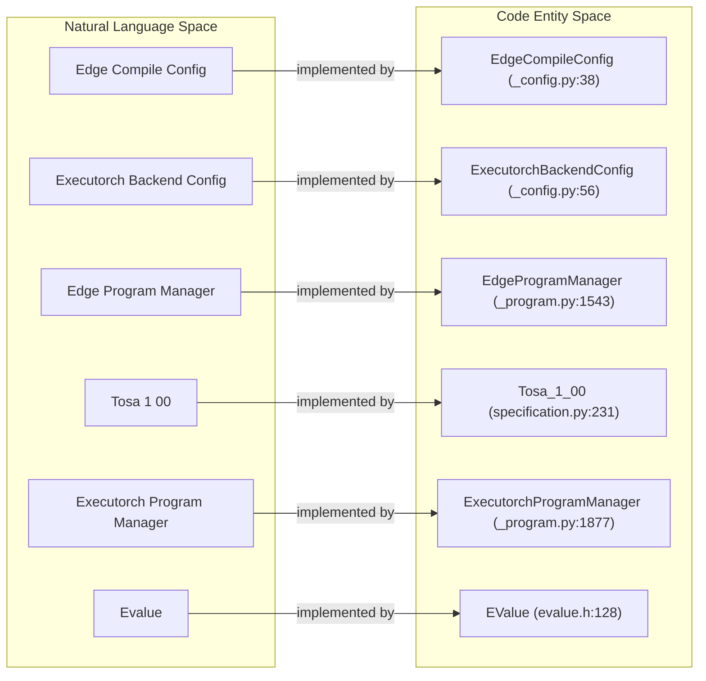
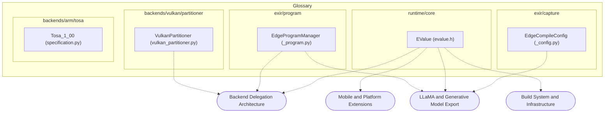
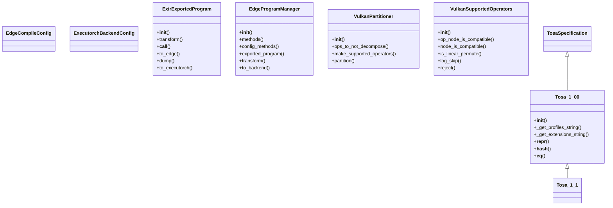
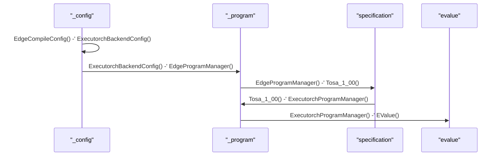

# 3-Source Context Packet (`git` + `CBM` + `llm-wiki`) for `10-glossary` — Glossary

- **Target Wiki File**: `wiki/10-glossary.md`
- **Archetype**: `Glossary Page`
- **Parent Page**: `None (Top-Level Chapter)`
- **Summary**: Architectural specification and implementation reference for Glossary (10 relevant source files). Primary code entities: `CaptureConfig`, `EdgeCompileConfig`, `ExecutorchBackendConfig`, `BoxedEvalueList`, `checkUnwrappedVals`.
- **Valid `[[wikilink]]` Neighbours**: `[[1-overview|Overview]]`, `[[1.1-getting-started|Getting Started]]`, `[[1.2-export-api-and-recipe-system|Export API and Recipe System]]`, `[[2.2-kernel-libraries-and-selective-build|Kernel Libraries and Selective Build]]`, `[[2.3-schema-generation-and-flatbuffers|Schema Generation and FlatBuffers]]`, `[[3.4-program-emission-and-serialization|Program Emission and Serialization]]`, `[[3.5-verification-and-dialect-system|Verification and Dialect System]]`, `[[4-quantization-systems|Quantization Systems]]`

## 1. Relevant Source Files (`git` + `CBM`, use verbatim in `<details>`)
- `[exir/capture/_config.py](exir/capture/_config.py)`
- `[runtime/core/evalue.h](runtime/core/evalue.h)`
- `[exir/program/_program.py](exir/program/_program.py)`
- `[backends/vulkan/partitioner/vulkan_partitioner.py](backends/vulkan/partitioner/vulkan_partitioner.py)`
- `[backends/arm/tosa/specification.py](backends/arm/tosa/specification.py)`
- `[runtime/executor/program.h](runtime/executor/program.h)`
- `[runtime/executor/method.h](runtime/executor/method.h)`
- `[devtools/etdump/etdump_flatcc.h](devtools/etdump/etdump_flatcc.h)`
- `[docs/source/ir-exir.md](docs/source/ir-exir.md)`
- `[docs/source/backends-overview.md](docs/source/backends-overview.md)`

## 2. Grounded Code Symbols (`CBM`, use verbatim for `[file:start-end]()` pill citations)
- `EdgeCompileConfig` (Class) @ `[exir/capture/_config.py:38-51]()` [fan-in=58, fan-out=0] — 
- `ExecutorchBackendConfig` (Class) @ `[exir/capture/_config.py:56-140]()` [fan-in=31, fan-out=0] — 
- `EdgeProgramManager` (Class) @ `[exir/program/_program.py:1543-1874]()` [fan-in=4, fan-out=0] — Package of one or more `ExportedPrograms` in Edge dialect. Designed to simplify lowering to ExecuTorch. See: https://pytorch.org/executorch/main/ir-exir Allows 
- `Tosa_1_00` (Class) @ `[backends/arm/tosa/specification.py:231-385]()` [fan-in=2, fan-out=0] — Provide TOSA 1.00 profile and extension semantics. This variant validates profiles (``INT``, ``FP``), the optional ``8k`` level, and allowed extensions based on
- `ExecutorchProgramManager` (Class) @ `[exir/program/_program.py:1877-2072]()` [fan-in=1, fan-out=0] — Package of one or more `ExportedPrograms` in Execution dialect. Designed to simplify lowering to ExecuTorch. See: https://pytorch.org/executorch/main/ir-exir Wh
- `EValue` (Class) @ `[runtime/core/evalue.h:128-705]()` [fan-in=0, fan-out=0] — // Aggregate typing system similar to IValue only slimmed down with less // functionality, no dependencies on atomic, and fewer supported types to better // sui
- `ExirExportedProgram` (Class) @ `[exir/program/_program.py:410-494]()` [fan-in=5, fan-out=0] — 
- `TosaLoweringContext` (Class) @ `[backends/arm/tosa/specification.py:410-460]()` [fan-in=0, fan-out=0] — Manage the TOSA specification context for lowering. For now, only the active ``TosaSpecification`` is tracked, but this can be extended to carry additional lowe
- `TosaSpecification` (Class) @ `[backends/arm/tosa/specification.py:88-228]()` [fan-in=0, fan-out=0] — Represent a TOSA specification. A specification includes a semantic version, one or more profiles, and optional extensions and levels (for example ``8k``). The 
- `Program` (Class) @ `[runtime/executor/program.h:48-354]()` [fan-in=0, fan-out=0] — /** * A deserialized ExecuTorch program binary. */
- `Method` (Class) @ `[runtime/executor/method.h:63-451]()` [fan-in=0, fan-out=0] — /** * An executable method of an executorch program. Maps to a python method like * `forward()` on the original nn.Module. */
- `VulkanPartitioner` (Class) @ `[backends/vulkan/partitioner/vulkan_partitioner.py:470-619]()` [fan-in=3, fan-out=0] — 
- `VulkanSupportedOperators` (Class) @ `[backends/vulkan/partitioner/vulkan_partitioner.py:70-376]()` [fan-in=1, fan-out=0] — 
- `ExecutorchProgram` (Class) @ `[exir/program/_program.py:498-639]()` [fan-in=1, fan-out=0] — 
- `HackedUpExportedProgramDONOTUSE` (Class) @ `[exir/program/_program.py:325-406]()` [fan-in=1, fan-out=0] — 
- `Tosa_1_1` (Class) @ `[backends/arm/tosa/specification.py:388-407]()` [fan-in=1, fan-out=0] — 
- `CaptureConfig` (Class) @ `[exir/capture/_config.py:24-33]()` [fan-in=0, fan-out=0] — 
- `BoxedEvalueList` (Class) @ `[runtime/core/evalue.h:57-115]()` [fan-in=0, fan-out=0] — 
- `Payload` (Class) @ `[runtime/core/evalue.h:129-155]()` [fan-in=0, fan-out=0] — 
- `TriviallyCopyablePayload` (Class) @ `[runtime/core/evalue.h:133-147]()` [fan-in=0, fan-out=0] — 
- `evalue_to_const_ref_overload_return` (Class) @ `[runtime/core/evalue.h:25-27]()` [fan-in=0, fan-out=0] — 
- `evalue_to_const_ref_overload_return<executorch::aten::Tensor>` (Class) @ `[runtime/core/evalue.h:30-32]()` [fan-in=0, fan-out=0] — 

## 3. Grounded Source Code Excerpts (`git` Working Tree)
### `EdgeCompileConfig` in `[exir/capture/_config.py:38-51]()`
```python
class EdgeCompileConfig:
    # TODO(qihan): remove ability to opt out
    _check_ir_validity: bool = True
    # TODO(gasoonjia): remove this
    _skip_dim_order: bool = False
    # Allow core ATen ops check to be skipped for certain ops, but continue with the rest of the checks.
    # Note: only use this for core ATen ops that are missing decompositions. This is temporary,
    # enabling verification on the rest of the program until decomposition coverage is improved.
    _core_aten_ops_exception_list: List[torch._ops.OpOverload] = field(
        default_factory=list
    )
    # Allow ops to be preserved in the graph, i.e., prevent them from being decomposed.
    # These may be core or non-core ATen ops; custom ops should not be here.
    preserve_ops: List[torch.torch._ops.OpOverload] = field(default_factory=list)
```

### `ExecutorchBackendConfig` in `[exir/capture/_config.py:56-71]()`
```python
class ExecutorchBackendConfig:
    passes: List[PassType] = field(default_factory=list)

    # A single memory planning pass can be defined for all the programs in the
    # EdgeProgramManager or can be defined per program.
    memory_planning_pass: Union[PassType, Dict[str, PassType]] = MemoryPlanningPass()

    # A single propagate device config can be defined for all the programs in the
    # EdgeProgramManager or can be defined per program.
    propagate_device_config: Union[
        PropagateDeviceConfig, Dict[str, PropagateDeviceConfig]
    ] = field(default_factory=PropagateDeviceConfig)

    to_out_var_pass: PassType = ToOutVarPass(ignore_to_out_var_failure=False)
    dynamic_memory_planning_mode: DynamicMemoryPlanningMode = (
        DynamicMemoryPlanningMode.UPPER_BOUND
```

### `EdgeProgramManager` in `[exir/program/_program.py:1543-1558]()`
```python
class EdgeProgramManager:
    """
    Package of one or more `ExportedPrograms` in Edge dialect. Designed to simplify
    lowering to ExecuTorch. See: https://pytorch.org/executorch/main/ir-exir

    Allows easy applications of transforms across a collection of exported programs
    including the delegation of subgraphs.

    Manages the second link in the lowering chain of ATen -> Edge -> ExecuTorch.
    """

    def __init__(
        self,
        edge_programs: Union[ExportedProgram, Dict[str, ExportedProgram]],
        constant_methods: Optional[Dict[str, Any]] = None,
        compile_config: Optional[EdgeCompileConfig] = None,
```

### `Tosa_1_00` in `[backends/arm/tosa/specification.py:231-246]()`
```python
class Tosa_1_00(TosaSpecification):
    """Provide TOSA 1.00 profile and extension semantics.

    This variant validates profiles (``INT``, ``FP``), the optional ``8k`` level,
    and allowed extensions based on the selected profiles.

    Attributes:
        profiles (List[str]): Selected profiles, e.g., ``["INT"]`` or ``["INT", "FP"]``.
        level_8k (bool): True if the ``8k`` level is enabled.
        extensions (List[str]): Enabled extensions valid for the chosen profiles.

    """

    profiles: List[str]
    level_8k: bool
    extensions: List[str]
```

### `ExecutorchProgramManager` in `[exir/program/_program.py:1877-1892]()`
```python
class ExecutorchProgramManager:
    """
    Package of one or more `ExportedPrograms` in Execution dialect. Designed to simplify
    lowering to ExecuTorch. See: https://pytorch.org/executorch/main/ir-exir

    When the ExecutorchProgramManager is constructed the ExportedPrograms in execution dialect
    are used to form the executorch binary (in a process called emission) and then serialized
    to a buffer.

    Manages the final link in the lowering chain of ATen -> Edge -> ExecuTorch.
    """

    def __init__(
        self,
        execution_programs: Dict[str, ExportedProgram],
        config_methods: Optional[Dict[str, Any]] = None,
```


## 4. Linked Official Docs (`llm-wiki` / `RAG`)
- **ExecuTorch DeepWiki** (`wiki/index.md`, score=100.752, shared_symbols=[]): # ExecuTorch DeepWiki Generated from `home-jason-Project-deepwiki-executorch` at commit `b3b565b5b62f` (2026-11-15T15:02:11+00:00). ## Pages - [[1-overview|Overview]] — Architectural specification and implementation reference for Overview (10 relevant source files). Primary code entities: `Module`, `MethodHolder`, `PlannedMemory`, `EdgeProgramManager`, `_
- **Overview** (`wiki/1-overview.md`, score=100.64, shared_symbols=['EdgeCompileConfig', 'EdgeProgramManager', 'ExecutorchBackendConfig', 'ExirExportedProgram', 'to_edge', 'to_edge_transform_and_lower']): # Overview > Architectural specification and implementation reference for Overview (10 relevant source files). Primary code entities: `Module`, `MethodHolder`, `PlannedMemory`, `EdgeProgramManager`, `__init__`. <details> <summary>Relevant source files</summary> The following files were used as context for generating this wiki page: - [extension/module/mo
- **Program Structure and Compilation Flow** (`wiki/3.1-program-structure-and-compilation-flow.md`, score=91.044, shared_symbols=['EdgeCompileConfig', 'EdgeProgramManager', 'ExecutorchBackendConfig', 'ExirExportedProgram', 'to_edge', 'to_edge_transform_and_lower']): # Program Structure and Compilation Flow ↑ [[3-exir-core-system|EXIR Core System]] > Architectural specification and implementation reference for Program Structure and Compilation Flow (12 relevant source files). Primary code entities: `CaptureConfig`, `EdgeCompileConfig`, `ExecutorchBackendConfig`, `EdgeProgramManager`, `__init__`. <details> <summary>Rel
- **Partitioning and Operator Support** (`wiki/5.1-partitioning-and-operator-support.md`, score=76.669, shared_symbols=['EdgeProgramManager']): # Partitioning and Operator Support ↑ [[5-backend-delegation-architecture|Backend Delegation Architecture]] > Architectural specification and implementation reference for Partitioning and Operator Support (17 relevant source files). Primary code entities: `MethodProgramsPartitionerSpec`, `_`, `_create_partitions`, `_create_partitions_in_graph_module`, `Gro
- **Backend Delegation Architecture** (`wiki/5-backend-delegation-architecture.md`, score=73.357, shared_symbols=[]): # Backend Delegation Architecture > Architectural specification and implementation reference for Backend Delegation Architecture (40 relevant source files). Primary code entities: `CommandBuffer`, `begin`, `bind_descriptors`, `bind_pipeline`, `NodeVisitor`. <details> <summary>Relevant source files</summary> The following files were used as context for gen
- **Export API and Recipe System** (`wiki/1.2-export-api-and-recipe-system.md`, score=59.909, shared_symbols=['EdgeCompileConfig', 'EdgeProgramManager', 'ExirExportedProgram', 'to_edge']): # Export API and Recipe System ↑ [[1-overview|Overview]] > Architectural specification and implementation reference for Export API and Recipe System (37 relevant source files). Primary code entities: `AOQuantizationConfig`, `ExportRecipe`, `_assert_scalar_fields_agree`, `_collect_lowering_fields`, `ExportSession`. <details> <summary>Relevant source files<

## 5. Pre-Verified DeepWiki v1.9.9.5 Mermaid Diagrams
### Natural Language Space <-> Code Entity Space


### Subsystem Architecture Flowchart


### Class Hierarchy Diagram


### Call Sequence Diagram


## 6. DeepWiki v1.9.9.5 Authoring Checklist for `wiki/10-glossary.md`
1. Keep YAML frontmatter at top (`id`, `title`, `parent`, `sources`, `linked_docs`, `bridge_symbols`).
2. Keep `<details><summary>Relevant source files</summary>` block immediately after `# Title`.
3. Start with `## Purpose and Scope`, then numbered `## 1. ...`, `## 2. ...` sections separated by `---`.
4. Include at least 2 ```mermaid``` diagrams (including a `Natural Language Space` <-> `Code Entity Space` mapping).
5. Cite code entities inline using `[path/to/file.ext:start-end]()` and end every `##` section with `Sources: [file:start-end]()`.
6. Run `deepwiki_cli.py build --enrich-only ...` and `deepwiki_cli.py validate ...` after editing.
