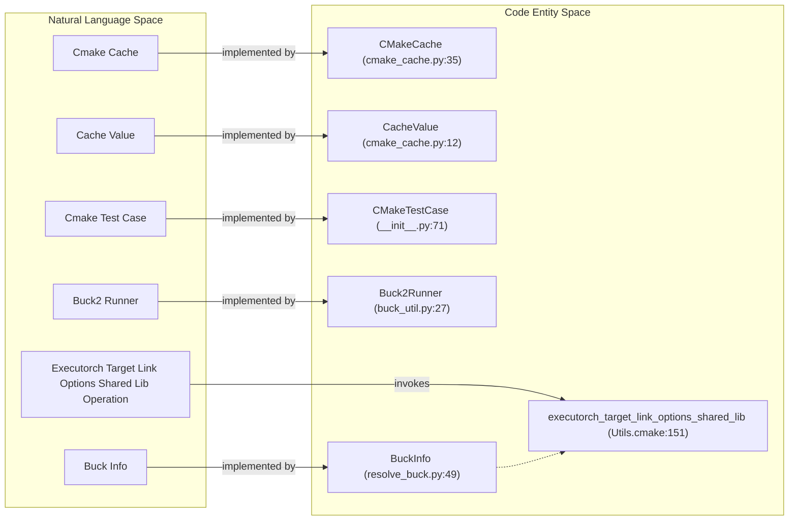
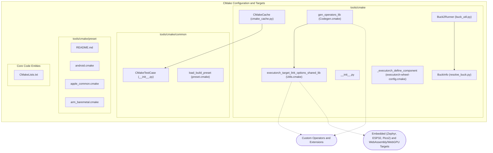
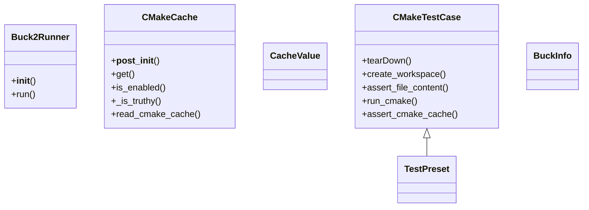
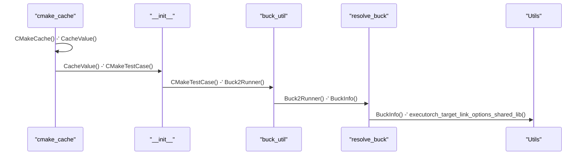

# 3-Source Context Packet (`git` + `CBM` + `llm-wiki`) for `2.1-cmake-configuration-and-targets` — CMake Configuration and Targets

- **Target Wiki File**: `wiki/2.1-cmake-configuration-and-targets.md`
- **Archetype**: `Leaf Technical Spec Page`
- **Parent Page**: `2-build-system-and-infrastructure`
- **Summary**: Architectural specification and implementation reference for CMake Configuration and Targets (17 relevant source files). Primary code entities: `CMakeCache`, `__post_init__`, `_is_truthy`, `get`, `_executorch_add_windows_anchor`.
- **Valid `[[wikilink]]` Neighbours**: `[[2-build-system-and-infrastructure|Build System and Infrastructure]]`, `[[1.1-getting-started|Getting Started]]`, `[[1.2-export-api-and-recipe-system|Export API and Recipe System]]`, `[[2.2-kernel-libraries-and-selective-build|Kernel Libraries and Selective Build]]`, `[[2.3-schema-generation-and-flatbuffers|Schema Generation and FlatBuffers]]`, `[[3.4-program-emission-and-serialization|Program Emission and Serialization]]`, `[[3.5-verification-and-dialect-system|Verification and Dialect System]]`, `[[4-quantization-systems|Quantization Systems]]`

## 1. Relevant Source Files (`git` + `CBM`, use verbatim in `<details>`)
- `[tools/cmake/cmake_cache.py](tools/cmake/cmake_cache.py)`
- `[tools/cmake/Utils.cmake](tools/cmake/Utils.cmake)`
- `[tools/cmake/common/__init__.py](tools/cmake/common/__init__.py)`
- `[tools/cmake/Codegen.cmake](tools/cmake/Codegen.cmake)`
- `[tools/cmake/buck_util.py](tools/cmake/buck_util.py)`
- `[tools/cmake/__init__.py](tools/cmake/__init__.py)`
- `[tools/cmake/resolve_buck.py](tools/cmake/resolve_buck.py)`
- `[tools/cmake/common/preset.cmake](tools/cmake/common/preset.cmake)`
- `[tools/cmake/executorch-wheel-config.cmake](tools/cmake/executorch-wheel-config.cmake)`
- `[tools/cmake/preset/README.md](tools/cmake/preset/README.md)`
- `[docs/source/using-executorch-building-from-source.md](docs/source/using-executorch-building-from-source.md)`
- `[CMakeLists.txt](CMakeLists.txt)`
- `[tools/cmake/Test.cmake](tools/cmake/Test.cmake)`
- `[tools/cmake/executorch-config.cmake](tools/cmake/executorch-config.cmake)`
- `[tools/cmake/preset/android.cmake](tools/cmake/preset/android.cmake)`
- `[tools/cmake/preset/apple_common.cmake](tools/cmake/preset/apple_common.cmake)`
- `[tools/cmake/preset/arm_baremetal.cmake](tools/cmake/preset/arm_baremetal.cmake)`

## 2. Grounded Code Symbols (`CBM`, use verbatim for `[file:start-end]()` pill citations)
- `CMakeCache` (Class) @ `[tools/cmake/cmake_cache.py:35-72]()` [fan-in=0, fan-out=0] — 
- `CacheValue` (Class) @ `[tools/cmake/cmake_cache.py:12-14]()` [fan-in=0, fan-out=0] — 
- `CMakeTestCase` (Class) @ `[tools/cmake/common/__init__.py:71-143]()` [fan-in=0, fan-out=0] — 
- `Buck2Runner` (Class) @ `[tools/cmake/buck_util.py:27-42]()` [fan-in=0, fan-out=0] — 
- `BuckInfo` (Class) @ `[tools/cmake/resolve_buck.py:49-50]()` [fan-in=0, fan-out=0] — 
- `executorch_target_link_options_shared_lib` (Function) @ `[tools/cmake/Utils.cmake:151-196]()` [fan-in=2, fan-out=0] — # Ensure that the load-time constructor functions run. By default, the linker # would remove them since there are no other references to them.
- `gen_operators_lib` (Function) @ `[tools/cmake/Codegen.cmake:361-498]()` [fan-in=1, fan-out=0] — # Generate a runtime lib for registering operators in Executorch # # SHARED opts this library into being a shared object. It is opt-in because most # callers wa
- `gen_selected_prim_ops_lib` (Function) @ `[tools/cmake/Codegen.cmake:157-227]()` [fan-in=1, fan-out=0] — # Generate a prim ops registration library. By default the library includes only # operators from SELECTED_OPS_YAML. INCLUDE_ALL_OPS disables prim-op selective 
- `generate_bindings_for_kernels` (Function) @ `[tools/cmake/Codegen.cmake:234-313]()` [fan-in=1, fan-out=0] — # Codegen for registering kernels. Kernels are defined in functions_yaml and # custom_ops_yaml. # # Invoked as generate_bindings_for_kernels( LIB_NAME lib_name 
- `_executorch_add_windows_anchor` (Function) @ `[tools/cmake/Utils.cmake:523-541]()` [fan-in=0, fan-out=0] — # Mark a library as one the wheel ships, so it finds its siblings wherever it # ends up. In the wheel all of these land in one directory, so "$ORIGIN" is the # 
- `add_torch_to_cmake_prefix_path` (Function) @ `[tools/cmake/Utils.cmake:264-271]()` [fan-in=0, fan-out=0] — # Add the Torch CMake configuration to CMAKE_PREFIX_PATH so that find_package # can find Torch.
- `executorch_add_pybind_module` (Function) @ `[tools/cmake/Utils.cmake:764-792]()` [fan-in=0, fan-out=0] — # These Python extensions remain SHARED because other ET targets link them. On # Unix, create them without the embedding library required by # pybind11_add_modu
- `executorch_add_shared_library` (Function) @ `[tools/cmake/Utils.cmake:726-758]()` [fan-in=0, fan-out=0] — # Create and install a shared library composed from dependency libraries. The # target links the provided dependencies and carries the project's SONAME # policy
- `executorch_kernel_link_options` (Function) @ `[tools/cmake/Utils.cmake:51-59]()` [fan-in=0, fan-out=0] — # This is the funtion to use -Wl, --whole-archive to link static library NB: # target_link_options is broken for this case, it only append the interface link # 
- `executorch_macos_kernel_link_options` (Function) @ `[tools/cmake/Utils.cmake:62-67]()` [fan-in=0, fan-out=0] — # Same as executorch_kernel_link_options but it's for MacOS linker
- `executorch_move_interface_include_directories_to_build_time_only` (Function) @ `[tools/cmake/Utils.cmake:315-331]()` [fan-in=0, fan-out=0] — # Modify ${targetName}'s INTERFACE_INCLUDE_DIRECTORIES by wrapping each entry in # $<BUILD_INTERFACE:...> so that they work with CMake EXPORT.
- `executorch_msvc_kernel_link_options` (Function) @ `[tools/cmake/Utils.cmake:70-75]()` [fan-in=0, fan-out=0] — # Same as executorch_kernel_link_options but it's for MSVC linker
- `executorch_target_copy_mlx_metallib` (Function) @ `[tools/cmake/Utils.cmake:361-379]()` [fan-in=0, fan-out=0] — # ----------------------------------------------------------------------------- # MLX metallib distribution helper # -------------------------------------------
- `executorch_target_link_shared_runtime` (Function) @ `[tools/cmake/Utils.cmake:394-396]()` [fan-in=0, fan-out=0] — # Make a target resolve the ExecuTorch runtime from libexecutorch.so. # # Naming the shared runtime as an ordinary dependency is not enough. CMake # orders link
- `executorch_target_retain_shared_library` (Function) @ `[tools/cmake/Utils.cmake:405-503]()` [fan-in=0, fan-out=0] — # Put a shared library on a consumer's link line and keep it there. # # A library whose only purpose is to run a static initializer, such as a backend # or an o
- `executorch_target_shared_runtime_path` (Function) @ `[tools/cmake/Utils.cmake:609-678]()` [fan-in=0, fan-out=0] — # Give a target a runtime search path that reaches libexecutorch.so in both # layouts it can end up in. # # The two layouts put the runtime in different places.
- `executorch_target_soname_policy` (Function) @ `[tools/cmake/Utils.cmake:692-721]()` [fan-in=0, fan-out=0] — # Apply the SONAME policy for a library the project ships. # # A distribution package needs a versioned SONAME: it installs # libexecutorch.so.1 into a system d

## 3. Grounded Source Code Excerpts (`git` Working Tree)
### `CMakeCache` in `[tools/cmake/cmake_cache.py:35-50]()`
```python
class CMakeCache:
    # The path to the CMakeCache.txt file.
    cache_path: str

    def __post_init__(self):
        self.cache = CMakeCache.read_cmake_cache(cache_path=self.cache_path)

    def get(self, var: str) -> Optional[CacheValue]:
        return self.cache.get(var)

    def is_enabled(self, var: str, fallback: bool = False) -> bool:
        definition = self.get(var)
        if definition is None:
            return fallback
        return CMakeCache._is_truthy(definition.value)
```

### `CacheValue` in `[tools/cmake/cmake_cache.py:12-14]()`
```python
class CacheValue:
    value_type: str
    value: str
```

### `CMakeTestCase` in `[tools/cmake/common/__init__.py:71-86]()`
```python
class CMakeTestCase(unittest.TestCase):

    def tearDown(self) -> None:
        super().tearDown()

        if self.workspace and not _keep_workspace():
            shutil.rmtree(self.workspace)
            self.assertFalse(os.path.exists(self.workspace))

    def create_workspace(self, tree: Dict[Any, Any]) -> None:
        self.workspace = tempfile.mkdtemp()
        if _keep_workspace():
            print("created workspace", self.workspace)

        # Copy testable tree
        this_file_dir = os.path.dirname(os.path.abspath(__file__))
```

### `Buck2Runner` in `[tools/cmake/buck_util.py:27-42]()`
```python
class Buck2Runner:
    def __init__(self, tool_path: str) -> None:
        self._path = tool_path

    def run(self, args: Sequence[str]) -> list[str]:
        """Runs buck2 with the given args and returns its stdout as a sequence of lines."""
        try:
            cp: subprocess.CompletedProcess = subprocess.run(
                [self._path] + args,  # type: ignore[operator]
                capture_output=True,
                cwd=repo_root_dir(),
                check=True,
            )
            return [line.strip().decode("utf-8") for line in cp.stdout.splitlines()]
        except subprocess.CalledProcessError as ex:
            raise RuntimeError(ex.stderr.decode("utf-8")) from ex
```

### `executorch_target_link_options_shared_lib` in `[tools/cmake/Utils.cmake:151-166]()`
```cmake
function(executorch_target_link_options_shared_lib target_name)
  # A shared library cannot be retained with --whole-archive: that flag only
  # governs how an archive's members are pulled in, so the library is still
  # subject to --as-needed and gets dropped along with its registration
  # constructor. Export scoped --no-as-needed retention instead, which is what
  # actually keeps a registration-only shared library on the link line.
  get_target_property(_target_type ${target_name} TYPE)
  # A Windows DLL is retained by its anchor, which
  # executorch_target_shipped_runtime_path adds together with the /INCLUDE its
  # consumers need; a DLL without one has nothing to reference.
  if(_target_type STREQUAL "SHARED_LIBRARY" AND MSVC)
    return()
  endif()
  # A shared library is never an archive, so the archive handling below does not
  # apply to one on any platform. On Apple it actively harms: -force_load on a
  # shared library makes every consumer absorb a copy of its contents, which put
```


## 4. Linked Official Docs (`llm-wiki` / `RAG`)
- **Build System and Infrastructure** (`wiki/2-build-system-and-infrastructure.md`, score=152.045, shared_symbols=[]): # Build System and Infrastructure > Architectural specification and implementation reference for Build System and Infrastructure (38 relevant source files). Primary code entities: `CMakeCache`, `__post_init__`, `_is_truthy`, `get`, `_executorch_add_windows_anchor`. <details> <summary>Relevant source files</summary> The following files were used as context
- **ExecuTorch DeepWiki** (`wiki/index.md`, score=127.934, shared_symbols=[]): # ExecuTorch DeepWiki Generated from `home-jason-Project-deepwiki-executorch` at commit `b3b565b5b62f` (2026-11-15T15:02:11+00:00). ## Pages - [[1-overview|Overview]] — Architectural specification and implementation reference for Overview (10 relevant source files). Primary code entities: `Module`, `MethodHolder`, `PlannedMemory`, `EdgeProgramManager`, `_
- **Schema Generation and FlatBuffers** (`wiki/2.3-schema-generation-and-flatbuffers.md`, score=104.88, shared_symbols=[]): # Schema Generation and FlatBuffers ↑ [[2-build-system-and-infrastructure|Build System and Infrastructure]] > Architectural specification and implementation reference for Schema Generation and FlatBuffers (36 relevant source files). Primary code entities: `Call`, `Sample`, `SampleSet`, `_SetDecoder`, `PTEFile`. <details> <summary>Relevant source files</su
- **Python Bindings and Dependencies** (`wiki/2.4-python-bindings-and-dependencies.md`, score=104.88, shared_symbols=[]): # Python Bindings and Dependencies ↑ [[2-build-system-and-infrastructure|Build System and Infrastructure]] > Architectural specification and implementation reference for Python Bindings and Dependencies (15 relevant source files). Primary code entities: `BorrowedInput`, `torch_storage`, `validate`, `PyExecuTorchResult`, `DLPackHolder`. <details> <summary>
- **Custom Operators and Extensions** (`wiki/6.3-custom-operators-and-extensions.md`, score=104.88, shared_symbols=[]): # Custom Operators and Extensions ↑ [[6-model-export-and-llm-support|Model Export and LLM Support]] > Architectural specification and implementation reference for Custom Operators and Extensions (39 relevant source files). Primary code entities: `gated_delta_rule_out_boxed`, `ChunkScratch`, `elems`, `view`, `MaybeQuantizedMatrixData`. <details> <summary>R
- **Buck2 and Shim Build Layer** (`wiki/2.5-buck2-and-shim-build-layer.md`, score=104.193, shared_symbols=[]): # Buck2 and Shim Build Layer ↑ [[2-build-system-and-infrastructure|Build System and Infrastructure]] > Architectural specification and implementation reference for Buck2 and Shim Build Layer (30 relevant source files). Primary code entities: `ggml_ci_labels`, `define_common_targets`, `_extract_prim_ops_from_lists`, `_get_headers`, `_get_prim_ops_registry_t

## 5. Pre-Verified DeepWiki v1.9.9.5 Mermaid Diagrams
### Natural Language Space <-> Code Entity Space


### Subsystem Architecture Flowchart


### Class Hierarchy Diagram


### Call Sequence Diagram


## 6. DeepWiki v1.9.9.5 Authoring Checklist for `wiki/2.1-cmake-configuration-and-targets.md`
1. Keep YAML frontmatter at top (`id`, `title`, `parent`, `sources`, `linked_docs`, `bridge_symbols`).
2. Keep `<details><summary>Relevant source files</summary>` block immediately after `# Title`.
3. Start with `## Purpose and Scope`, then numbered `## 1. ...`, `## 2. ...` sections separated by `---`.
4. Include at least 2 ```mermaid``` diagrams (including a `Natural Language Space` <-> `Code Entity Space` mapping).
5. Cite code entities inline using `[path/to/file.ext:start-end]()` and end every `##` section with `Sources: [file:start-end]()`.
6. Run `deepwiki_cli.py build --enrich-only ...` and `deepwiki_cli.py validate ...` after editing.
