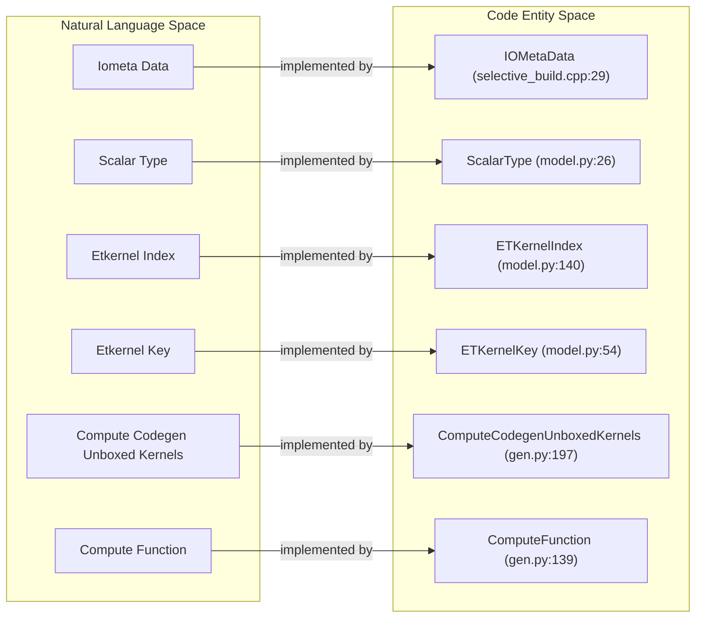
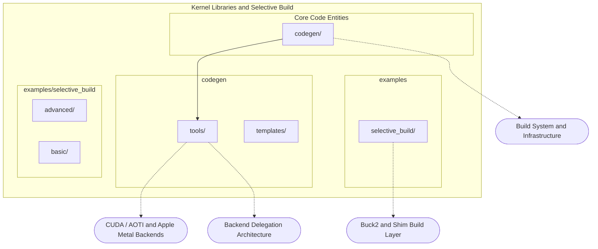
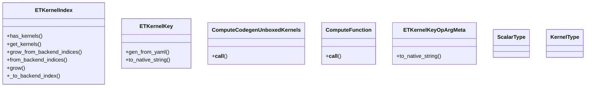
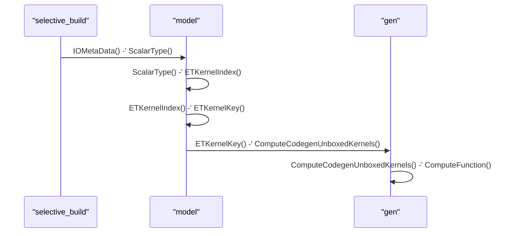

# 3-Source Context Packet (`git` + `CBM` + `llm-wiki`) for `2.2-kernel-libraries-and-selective-build` — Kernel Libraries and Selective Build

- **Target Wiki File**: `wiki/2.2-kernel-libraries-and-selective-build.md`
- **Archetype**: `Leaf Technical Spec Page`
- **Parent Page**: `2-build-system-and-infrastructure`
- **Summary**: Architectural specification and implementation reference for Kernel Libraries and Selective Build (31 relevant source files). Primary code entities: `KernelType`, `ScalarType`, `_dump_yaml`, `_get_et_kernel_metadata_from_ops_yaml`, `IOMetaData`.
- **Valid `[[wikilink]]` Neighbours**: `[[2-build-system-and-infrastructure|Build System and Infrastructure]]`, `[[1.2-export-api-and-recipe-system|Export API and Recipe System]]`, `[[2.3-schema-generation-and-flatbuffers|Schema Generation and FlatBuffers]]`, `[[3-exir-core-system|EXIR Core System]]`, `[[3.1-program-structure-and-compilation-flow|Program Structure and Compilation Flow]]`, `[[3.2-graph-transformation-pass-system|Graph Transformation Pass System]]`, `[[3.3-memory-planning-and-allocation|Memory Planning and Allocation]]`, `[[3.4-program-emission-and-serialization|Program Emission and Serialization]]`

## 1. Relevant Source Files (`git` + `CBM`, use verbatim in `<details>`)
- `[codegen/tools/gen_oplist.py](codegen/tools/gen_oplist.py)`
- `[codegen/tools/selective_build.cpp](codegen/tools/selective_build.cpp)`
- `[codegen/gen.py](codegen/gen.py)`
- `[codegen/tools/merge_yaml.py](codegen/tools/merge_yaml.py)`
- `[codegen/model.py](codegen/model.py)`
- `[codegen/tools/gen_all_oplist.py](codegen/tools/gen_all_oplist.py)`
- `[codegen/tools/combine_prim_ops_headers.py](codegen/tools/combine_prim_ops_headers.py)`
- `[codegen/tools/gen_max_kernel_num.py](codegen/tools/gen_max_kernel_num.py)`
- `[codegen/tools/__init__.py](codegen/tools/__init__.py)`
- `[codegen/tools/gen_ops_def.py](codegen/tools/gen_ops_def.py)`
- `[codegen/tools/gen_selected_prim_ops.py](codegen/tools/gen_selected_prim_ops.py)`
- `[codegen/tools/gen_selected_op_variants.py](codegen/tools/gen_selected_op_variants.py)`
- `[codegen/tools/yaml_util.py](codegen/tools/yaml_util.py)`
- `[codegen/tools/targets.bzl](codegen/tools/targets.bzl)`
- `[codegen/templates/Functions.h](codegen/templates/Functions.h)`
- `[codegen/parse.py](codegen/parse.py)`
- `[codegen/templates/NativeFunctions.h](codegen/templates/NativeFunctions.h)`
- `[codegen/templates/RegisterCodegenUnboxedKernels.cpp](codegen/templates/RegisterCodegenUnboxedKernels.cpp)`
- `[codegen/templates/RegisterDispatchKeyCustomOps.cpp](codegen/templates/RegisterDispatchKeyCustomOps.cpp)`
- `[codegen/templates/RegisterKernels.cpp](codegen/templates/RegisterKernels.cpp)`
- `[codegen/templates/RegisterKernels.h](codegen/templates/RegisterKernels.h)`
- `[codegen/templates/RegisterSchema.cpp](codegen/templates/RegisterSchema.cpp)`
- `[codegen/templates/aten_interned_strings.h](codegen/templates/aten_interned_strings.h)`
- `[examples/selective_build/targets.bzl](examples/selective_build/targets.bzl)`
- `[examples/selective_build/README.md](examples/selective_build/README.md)`
- `[docs/source/kernel-library-selective-build.md](docs/source/kernel-library-selective-build.md)`
- `[codegen/tools/BUCK](codegen/tools/BUCK)`
- `[codegen/tools/CMakeLists.txt](codegen/tools/CMakeLists.txt)`
- `[examples/selective_build/BUCK](examples/selective_build/BUCK)`
- `[examples/selective_build/advanced/CMakeLists.txt](examples/selective_build/advanced/CMakeLists.txt)`

## 2. Grounded Code Symbols (`CBM`, use verbatim for `[file:start-end]()` pill citations)
- `IOMetaData` (Class) @ `[codegen/tools/selective_build.cpp:29-52]()` [fan-in=0, fan-out=0] — // Metadata for kernel call io variables. // dtype and dim_order will exist only if corresponding variable is Tensor.
- `ScalarType` (Class) @ `[codegen/model.py:26-34]()` [fan-in=0, fan-out=0] — # TODO: Duplicated Subset from codegen.tool.gen_oplist, remove declaration in codegen
- `ETKernelIndex` (Class) @ `[codegen/model.py:140-220]()` [fan-in=4, fan-out=0] — 
- `ETKernelKey` (Class) @ `[codegen/model.py:54-136]()` [fan-in=4, fan-out=0] — 
- `ComputeCodegenUnboxedKernels` (Class) @ `[codegen/gen.py:197-321]()` [fan-in=1, fan-out=0] — 
- `ComputeFunction` (Class) @ `[codegen/gen.py:139-192]()` [fan-in=1, fan-out=0] — 
- `ETKernelKeyOpArgMeta` (Class) @ `[codegen/model.py:41-50]()` [fan-in=1, fan-out=0] — 
- `KernelType` (Class) @ `[codegen/tools/gen_oplist.py:83-86]()` [fan-in=0, fan-out=0] — 
- `ScalarType` (Class) @ `[codegen/tools/gen_oplist.py:60-80]()` [fan-in=0, fan-out=0] — 
- `KernelIOMetaDataComparsion` (Class) @ `[codegen/tools/selective_build.cpp:54-78]()` [fan-in=0, fan-out=0] — 
- `BlankLineDumper` (Class) @ `[codegen/tools/merge_yaml.py:21-26]()` [fan-in=0, fan-out=0] — 
- `BlankLineDumper` (Class) @ `[codegen/tools/yaml_util.py:10-15]()` [fan-in=0, fan-out=0] — 
- `_get_io_metadata_for_program_operators` (Function) @ `[codegen/tools/selective_build.cpp:242-278]()` [fan-in=0, fan-out=7] — // expose IO metadatas for all operators in given program
- `generate` (Function) @ `[codegen/gen.py:869-968]()` [fan-in=1, fan-out=4] — Generates the operator headers and registration sources into install_dir. The arguments match main()'s command-line flags; source_path is the directory holding 
- `gen_oplist` (Function) @ `[codegen/tools/gen_oplist.py:216-286]()` [fan-in=4, fan-out=6] — ( output_path: Path, model_file_path: Optional[str] = None, ops_schema_yaml_path: Optional[str] = None, root_o
- `_sig_decl_wrapper` (Function) @ `[codegen/gen.py:82-95]()` [fan-in=2, fan-out=0] — A wrapper function to basically get `sig.decl(include_context=True)`. For ATen kernel, the codegen has no idea about ET contextArg, so we use this wrapper to ad
- `gen_headers` (Function) @ `[codegen/gen.py:479-579]()` [fan-in=1, fan-out=2] — Generate headers. Args: native_functions (Sequence[NativeFunction]): a collection of NativeFunction for ATen ops. gen_custom_ops_header (bool): whether we shoul
- `parse_yaml_files` (Function) @ `[codegen/gen.py:799-866]()` [fan-in=1, fan-out=2] — Parses functions.yaml and custom_ops.yaml files. Args: tags_yaml_path: Path to a tags.yaml file to satisfy codegen parsing. It is not optional. aten_yaml_path: 
- `gen_all_oplist` (Function) @ `[codegen/tools/gen_all_oplist.py:145-178]()` [fan-in=1, fan-out=3] — Combines selected_operators.yaml files into output_dir/selected_operators.yaml. Each entry of model_file_paths is a selected_operators.yaml or a directory conta
- `gen_functions_declarations` (Function) @ `[codegen/gen.py:394-445]()` [fan-in=1, fan-out=1] — Generates namespace separated C++ function API inline declaration/definitions. Native functions are grouped by namespaces and the generated code is wrapped insi
- `static_dispatch` (Function) @ `[codegen/gen.py:98-133]()` [fan-in=1, fan-out=1] — For a given `NativeFunction`, find out the corresponding native function and dispatch to it. If zero or more than one native function exists, error out. A simpl
- `translate_native_yaml` (Function) @ `[codegen/gen.py:643-739]()` [fan-in=1, fan-out=1] — Translates Executorch DSL dialect to use the same syntax as native_functions.yaml. The major difference is that Executorch DSL dialect supports "op" key, where 

## 3. Grounded Source Code Excerpts (`git` Working Tree)
### `IOMetaData` in `[codegen/tools/selective_build.cpp:29-44]()`
```cpp
struct IOMetaData {
  int kernel_type;
  int dtype;
  std::vector<unsigned int> dim_order;

  // Create tensor metadata. It records tensor's dtype and dim order.
  explicit IOMetaData(const executorch_flatbuffer::Tensor* t)
      : kernel_type(
            static_cast<int>(executorch_flatbuffer::KernelTypes::Tensor)),
        dtype(static_cast<int>(t->scalar_type())) {
    for (size_t i = 0; i < t->dim_order()->size(); i++) {
      dim_order.push_back(static_cast<unsigned int>(t->dim_order()->Get(i)));
    }
  }

  // Create metadata for non-tensor variable.
```

### `ScalarType` in `[codegen/model.py:26-34]()`
```python
class ScalarType(IntEnum):
    Byte = 0
    Char = 1
    Short = 2
    Int = 3
    Long = 4
    Float = 6
    Double = 7
    Bool = 11
```

### `ETKernelIndex` in `[codegen/model.py:140-155]()`
```python
class ETKernelIndex:
    index: dict[OperatorName, dict[ETKernelKey, BackendMetadata]]

    def has_kernels(self, g: NativeFunction | NativeFunctionsGroup) -> bool:
        m = self.get_kernels(g)
        return m is not None

    def get_kernels(
        self, g: NativeFunction | NativeFunctionsGroup
    ) -> dict[ETKernelKey, BackendMetadata]:
        if isinstance(g, NativeFunction):
            f = g
        elif isinstance(g, NativeFunctionsGroup):
            f = g.functional
        else:
            assert_never(g)
```

### `ETKernelKey` in `[codegen/model.py:54-69]()`
```python
class ETKernelKey:
    # Field undefined is default = True
    arg_meta: tuple[ETKernelKeyOpArgMeta, ...] = ()

    # Indicator for this kernel being used as a catch all
    default: bool = False

    version: int = KERNEL_KEY_VERSION

    @staticmethod
    def gen_from_yaml(
        args: dict[str, tuple[str, str]],
        type_alias_map: dict[str, list[str]],  # TODO: Support unwrapped str val
        dim_order_alias_map: dict[str, list[int]],
    ) -> list[ETKernelKey]:
        """Generate ETKernelKeys from arg kernel specs
```

### `ComputeCodegenUnboxedKernels` in `[codegen/gen.py:197-212]()`
```python
class ComputeCodegenUnboxedKernels:
    selector: SelectiveBuilder

    use_aten_lib: bool

    add_exception_boundary: bool

    @method_with_nested_native_function
    def __call__(
        self,
        unbox_kernel_entry: tuple[NativeFunction, tuple[ETKernelKey, BackendMetadata]],
    ) -> str:
        f: NativeFunction = unbox_kernel_entry[0]
        kernel_key: ETKernelKey | list[ETKernelKey] = unbox_kernel_entry[1][0]
        kernel_meta: BackendMetadata = unbox_kernel_entry[1][1]
```


## 4. Linked Official Docs (`llm-wiki` / `RAG`)
- **Build System and Infrastructure** (`wiki/2-build-system-and-infrastructure.md`, score=121.837, shared_symbols=['ETKernelIndex', 'ETKernelKey']): # Build System and Infrastructure > Architectural specification and implementation reference for Build System and Infrastructure (38 relevant source files). Primary code entities: `CMakeCache`, `__post_init__`, `_is_truthy`, `get`, `_executorch_add_windows_anchor`. <details> <summary>Relevant source files</summary> The following files were used as context
- **ExecuTorch DeepWiki** (`wiki/index.md`, score=104.0, shared_symbols=[]): # ExecuTorch DeepWiki Generated from `home-jason-Project-deepwiki-executorch` at commit `b3b565b5b62f` (2026-11-15T15:02:11+00:00). ## Pages - [[1-overview|Overview]] — Architectural specification and implementation reference for Overview (10 relevant source files). Primary code entities: `Module`, `MethodHolder`, `PlannedMemory`, `EdgeProgramManager`, `_
- **CMake Configuration and Targets** (`wiki/2.1-cmake-configuration-and-targets.md`, score=101.535, shared_symbols=[]): # CMake Configuration and Targets ↑ [[2-build-system-and-infrastructure|Build System and Infrastructure]] > Architectural specification and implementation reference for CMake Configuration and Targets (17 relevant source files). Primary code entities: `CMakeCache`, `__post_init__`, `_is_truthy`, `get`, `_executorch_add_windows_anchor`. <details> <summary>
- **Schema Generation and FlatBuffers** (`wiki/2.3-schema-generation-and-flatbuffers.md`, score=101.535, shared_symbols=[]): # Schema Generation and FlatBuffers ↑ [[2-build-system-and-infrastructure|Build System and Infrastructure]] > Architectural specification and implementation reference for Schema Generation and FlatBuffers (36 relevant source files). Primary code entities: `Call`, `Sample`, `SampleSet`, `_SetDecoder`, `PTEFile`. <details> <summary>Relevant source files</su
- **Python Bindings and Dependencies** (`wiki/2.4-python-bindings-and-dependencies.md`, score=101.535, shared_symbols=[]): # Python Bindings and Dependencies ↑ [[2-build-system-and-infrastructure|Build System and Infrastructure]] > Architectural specification and implementation reference for Python Bindings and Dependencies (15 relevant source files). Primary code entities: `BorrowedInput`, `torch_storage`, `validate`, `PyExecuTorchResult`, `DLPackHolder`. <details> <summary>
- **Kernel Registration and Dispatch** (`wiki/8.2-kernel-registration-and-dispatch.md`, score=92.594, shared_symbols=[]): # Kernel Registration and Dispatch ↑ [[8-runtime-execution|Runtime Execution]] > Architectural specification and implementation reference for Kernel Registration and Dispatch (36 relevant source files). Primary code entities: `KernelRuntimeContext`, `allocate_temp`, `fail`, `Kernel`, `KernelKey`. <details> <summary>Relevant source files</summary> The fol

## 5. Pre-Verified DeepWiki v1.9.9.5 Mermaid Diagrams
### Natural Language Space <-> Code Entity Space


### Subsystem Architecture Flowchart


### Class Hierarchy Diagram


### Call Sequence Diagram


## 6. DeepWiki v1.9.9.5 Authoring Checklist for `wiki/2.2-kernel-libraries-and-selective-build.md`
1. Keep YAML frontmatter at top (`id`, `title`, `parent`, `sources`, `linked_docs`, `bridge_symbols`).
2. Keep `<details><summary>Relevant source files</summary>` block immediately after `# Title`.
3. Start with `## Purpose and Scope`, then numbered `## 1. ...`, `## 2. ...` sections separated by `---`.
4. Include at least 2 ```mermaid``` diagrams (including a `Natural Language Space` <-> `Code Entity Space` mapping).
5. Cite code entities inline using `[path/to/file.ext:start-end]()` and end every `##` section with `Sources: [file:start-end]()`.
6. Run `deepwiki_cli.py build --enrich-only ...` and `deepwiki_cli.py validate ...` after editing.
