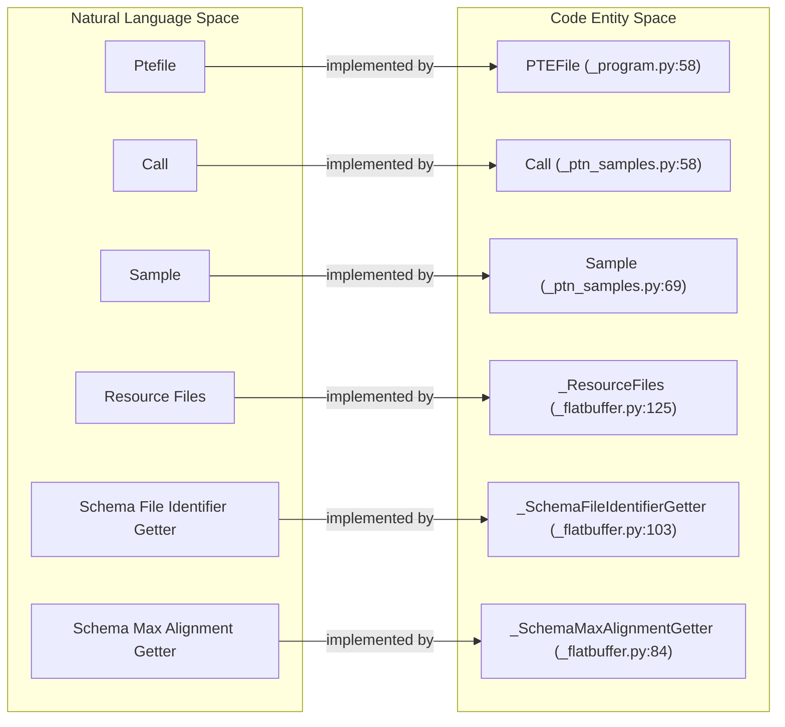
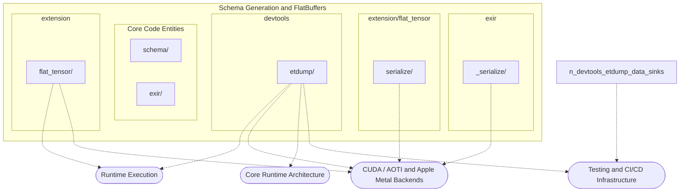
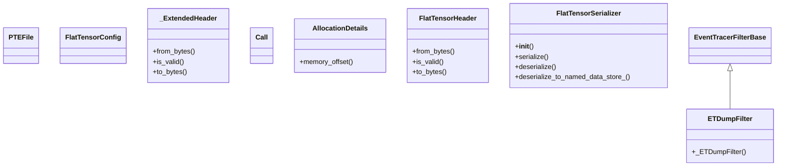
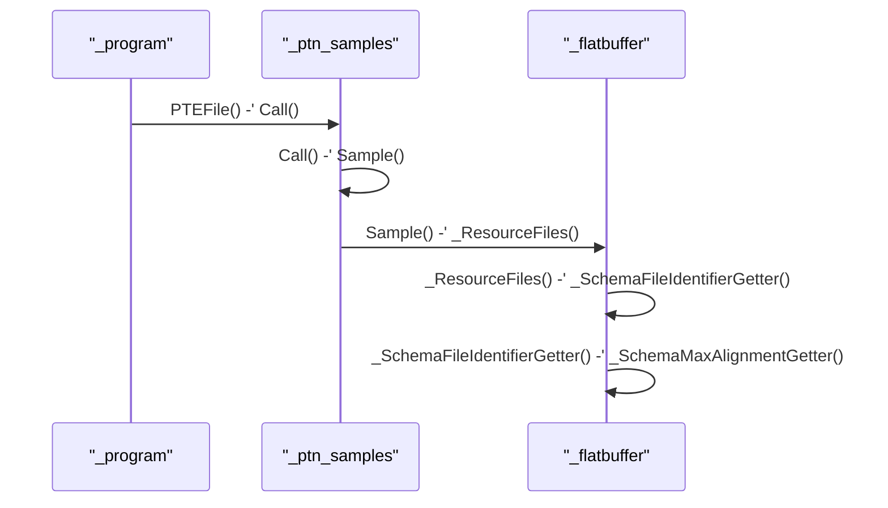

# 3-Source Context Packet (`git` + `CBM` + `llm-wiki`) for `2.3-schema-generation-and-flatbuffers` — Schema Generation and FlatBuffers

- **Target Wiki File**: `wiki/2.3-schema-generation-and-flatbuffers.md`
- **Archetype**: `Leaf Technical Spec Page`
- **Parent Page**: `2-build-system-and-infrastructure`
- **Summary**: Architectural specification and implementation reference for Schema Generation and FlatBuffers (36 relevant source files). Primary code entities: `Call`, `Sample`, `SampleSet`, `_SetDecoder`, `PTEFile`.
- **Valid `[[wikilink]]` Neighbours**: `[[2-build-system-and-infrastructure|Build System and Infrastructure]]`, `[[1.1-getting-started|Getting Started]]`, `[[1.2-export-api-and-recipe-system|Export API and Recipe System]]`, `[[2.2-kernel-libraries-and-selective-build|Kernel Libraries and Selective Build]]`, `[[3-exir-core-system|EXIR Core System]]`, `[[3.1-program-structure-and-compilation-flow|Program Structure and Compilation Flow]]`, `[[3.2-graph-transformation-pass-system|Graph Transformation Pass System]]`, `[[3.3-memory-planning-and-allocation|Memory Planning and Allocation]]`

## 1. Relevant Source Files (`git` + `CBM`, use verbatim in `<details>`)
- `[exir/_serialize/_ptn_samples.py](exir/_serialize/_ptn_samples.py)`
- `[exir/_serialize/_program.py](exir/_serialize/_program.py)`
- `[exir/_serialize/_named_data_store.py](exir/_serialize/_named_data_store.py)`
- `[exir/_serialize/_flatbuffer.py](exir/_serialize/_flatbuffer.py)`
- `[exir/_serialize/_flatbuffer_program.py](exir/_serialize/_flatbuffer_program.py)`
- `[exir/_serialize/_cord.py](exir/_serialize/_cord.py)`
- `[schema/extended_header.h](schema/extended_header.h)`
- `[exir/_serialize/_dataclass.py](exir/_serialize/_dataclass.py)`
- `[exir/_serialize/data_serializer.py](exir/_serialize/data_serializer.py)`
- `[schema/CMakeLists.txt](schema/CMakeLists.txt)`
- `[schema/extended_header.cpp](schema/extended_header.cpp)`
- `[schema/targets.bzl](schema/targets.bzl)`
- `[exir/_serialize/_ptn.py](exir/_serialize/_ptn.py)`
- `[exir/_serialize/__init__.py](exir/_serialize/__init__.py)`
- `[exir/_serialize/generate_program.py](exir/_serialize/generate_program.py)`
- `[exir/_serialize/_serialize.py](exir/_serialize/_serialize.py)`
- `[exir/_serialize/bindings.cpp](exir/_serialize/bindings.cpp)`
- `[extension/flat_tensor/serialize/serialize.py](extension/flat_tensor/serialize/serialize.py)`
- `[devtools/etdump/etdump_flatcc.cpp](devtools/etdump/etdump_flatcc.cpp)`
- `[exir/schema.py](exir/schema.py)`
- `[devtools/etdump/schema_flatcc.py](devtools/etdump/schema_flatcc.py)`
- `[extension/flat_tensor/flat_tensor_data_map.cpp](extension/flat_tensor/flat_tensor_data_map.cpp)`
- `[devtools/etdump/etdump_flatcc.h](devtools/etdump/etdump_flatcc.h)`
- `[extension/flat_tensor/flat_tensor_data_map.h](extension/flat_tensor/flat_tensor_data_map.h)`
- `[devtools/etdump/etdump_filter.h](devtools/etdump/etdump_filter.h)`
- `[devtools/etdump/data_sinks/buffer_data_sink.h](devtools/etdump/data_sinks/buffer_data_sink.h)`
- `[devtools/etdump/data_sinks/file_data_sink.h](devtools/etdump/data_sinks/file_data_sink.h)`
- `[extension/flat_tensor/serialize/flat_tensor_schema.py](extension/flat_tensor/serialize/flat_tensor_schema.py)`
- `[schema/README.md](schema/README.md)`
- `[extension/flat_tensor/README.md](extension/flat_tensor/README.md)`

## 2. Grounded Code Symbols (`CBM`, use verbatim for `[file:start-end]()` pill citations)
- `PTEFile` (Class) @ `[exir/_serialize/_program.py:58-67]()` [fan-in=10, fan-out=0] — Wraps together the data required to serialize into a PTE file.
- `Call` (Class) @ `[exir/_serialize/_ptn_samples.py:58-65]()` [fan-in=2, fan-out=0] — One call of a method: positional inputs, and optionally what it produced.
- `Sample` (Class) @ `[exir/_serialize/_ptn_samples.py:69-73]()` [fan-in=1, fan-out=0] — Calls run in order from the program's initial state, with no reset between.
- `_ResourceFiles` (Class) @ `[exir/_serialize/_flatbuffer.py:125-153]()` [fan-in=1, fan-out=0] — Manages a collection of python resources that will be written to files.
- `_SchemaFileIdentifierGetter` (Class) @ `[exir/_serialize/_flatbuffer.py:103-122]()` [fan-in=1, fan-out=0] — Finds the file_identifier value in flatbuffer schemas.
- `_SchemaMaxAlignmentGetter` (Class) @ `[exir/_serialize/_flatbuffer.py:84-100]()` [fan-in=1, fan-out=0] — Finds the largest (force_align: N) N value in flatbuffer schemas.
- `NamedDataStore` (Class) @ `[exir/_serialize/_named_data_store.py:57-358]()` [fan-in=1, fan-out=0] — NamedDataStore manages the data that delegates want to share. Backends add bytes to the store under a unique key. These bytes can be retrieved at runtime using 
- `NamedDataStoreOutput` (Class) @ `[exir/_serialize/_named_data_store.py:39-54]()` [fan-in=1, fan-out=0] — Holds named data for serialization. Note: a DataEntry contains the index into `buffers`, the alignment and a tensor layout, if applicable. Attributes: buffers: 
- `Cord` (Class) @ `[exir/_serialize/_cord.py:94-140]()` [fan-in=0, fan-out=0] — A `bytes`-like sequence of bytes, stored non-contiguously. Users can use a Cord to assemble large files and data blobs using references to and slices of other d
- `FileBackedData` (Class) @ `[exir/_serialize/_cord.py:16-88]()` [fan-in=0, fan-out=0] — A byte buffer that stays on disk until explicitly closed.
- `AlignedData` (Class) @ `[exir/_serialize/data_serializer.py:45-53]()` [fan-in=1, fan-out=0] — Data and its required alignment for serialization.
- `ExtendedHeader` (Class) @ `[schema/extended_header.h:22-82]()` [fan-in=0, fan-out=0] — /** * An extended, ExecuTorch-specific header that may be embedded in the * serialized Program data header. * * For details see //executorch/docs/source/pte-fil
- `DataEntry` (Class) @ `[exir/_serialize/data_serializer.py:11-24]()` [fan-in=0, fan-out=0] — Represents a single blob in `DataPayload`, specifying its location and metadata. Attributes: buffer_index: The index inside `DataPayload.buffers` that this Data
- `DataPayload` (Class) @ `[exir/_serialize/data_serializer.py:28-41]()` [fan-in=0, fan-out=0] — Contains the data and metadata required for serialization. Having an index-based arrangement instead of embedding the buffers in DataEntry allows the caller to 
- `DataSerializer` (Class) @ `[exir/_serialize/data_serializer.py:83-120]()` [fan-in=0, fan-out=0] — Serializes and deserializes data. Data can be referenced by a unique key. This base class enables serialization into different formats. See executorch/extension
- `FlatTensorSerializer` (Class) @ `[extension/flat_tensor/serialize/serialize.py:259-429]()` [fan-in=2, fan-out=0] — A concrete implementation of the DataSerializer interface that serializes and deserializes data to/from the FlatTensor format.
- `_ExtendedHeader` (Class) @ `[exir/_serialize/_program.py:130-245]()` [fan-in=2, fan-out=0] — 
- `ExtraTensorInfo` (Class) @ `[exir/schema.py:57-66]()` [fan-in=1, fan-out=0] — Check program.fbs for explanations of this enum.
- `SampleSet` (Class) @ `[exir/_serialize/_ptn_samples.py:77-81]()` [fan-in=1, fan-out=0] — 
- `_SetDecoder` (Class) @ `[exir/_serialize/_ptn_samples.py:251-323]()` [fan-in=1, fan-out=0] — 
- `_SchemaInfo` (Class) @ `[exir/_serialize/_flatbuffer.py:157-173]()` [fan-in=1, fan-out=0] — 
- `NonConstBufferDevice` (Class) @ `[exir/schema.py:279-287]()` [fan-in=0, fan-out=0] — Maps a non-constant buffer to the device where it should be allocated.

## 3. Grounded Source Code Excerpts (`git` Working Tree)
### `PTEFile` in `[exir/_serialize/_program.py:58-67]()`
```python
class PTEFile:
    """
    Wraps together the data required to serialize into a PTE file.
    """

    program: Program
    # TODO(lfq): add constant data (currently restored in the program)
    # TODO(lfq): update this to List[bytes]
    mutable_data: Optional[List[Buffer]] = None
    named_data: Optional[NamedDataStoreOutput] = None
```

### `Call` in `[exir/_serialize/_ptn_samples.py:58-65]()`
```python
class Call:
    """One call of a method: positional inputs, and optionally what it produced."""

    method: str
    inputs: list[Value]
    outputs: list[Value] | None = None
    intermediates: dict[str, torch.Tensor] | None = None
    tol: Tolerance | None = None
```

### `Sample` in `[exir/_serialize/_ptn_samples.py:69-73]()`
```python
class Sample:
    """Calls run in order from the program's initial state, with no reset between."""

    calls: list[Call]
    tol: Tolerance | None = None
```

### `_ResourceFiles` in `[exir/_serialize/_flatbuffer.py:125-140]()`
```python
class _ResourceFiles:
    """Manages a collection of python resources that will be written to files."""

    def __init__(self, resource_names: Sequence[str]) -> None:
        """Load the resources with the provided names."""
        # Map each name to its contents.
        self._files: Dict[str, bytes] = {}
        for name in resource_names:
            self._files[name] = importlib.resources.read_binary(__package__, name)

    def patch_files(self, patch_fn: Callable[[bytes], bytes]) -> None:
        """Uses the provided patching function to update the contents of all
        files. `patch_fn` takes the current contents of a file as input and
        returns the new contents.
        """
        for name in self._files.keys():
```

### `_SchemaFileIdentifierGetter` in `[exir/_serialize/_flatbuffer.py:103-118]()`
```python
class _SchemaFileIdentifierGetter:
    """Finds the file_identifier value in flatbuffer schemas."""

    def __init__(self) -> None:
        self.file_identifier: Optional[bytes] = None

    def __call__(self, schema: bytes) -> bytes:
        identifiers = re.findall(rb'file_identifier\s+"([^"]+)"', schema)
        for file_identifier in identifiers:
            if len(file_identifier) != 4:
                raise ValueError(
                    f"Invalid file_identifier length {len(file_identifier)} in schema"
                )
            if self.file_identifier is None:
                self.file_identifier = file_identifier
            elif self.file_identifier != file_identifier:
```


## 4. Linked Official Docs (`llm-wiki` / `RAG`)
- **Program Emission and Serialization** (`wiki/3.4-program-emission-and-serialization.md`, score=136.505, shared_symbols=['BackendDelegateDataReference', 'ExtraTensorInfo', 'PTEFile', 'Tensor']): # Program Emission and Serialization ↑ [[3-exir-core-system|EXIR Core System]] > Architectural specification and implementation reference for Program Emission and Serialization (35 relevant source files). Primary code entities: `_AbstractValue`, `_Emitter`, `__init__`, `_add_debug_handle`, `Call`. <details> <summary>Relevant source files</summary> The fo
- **Kernel Libraries and Selective Build** (`wiki/2.2-kernel-libraries-and-selective-build.md`, score=81.555, shared_symbols=['Bool', 'Call', 'Tensor']): # Kernel Libraries and Selective Build ↑ [[2-build-system-and-infrastructure|Build System and Infrastructure]] > Architectural specification and implementation reference for Kernel Libraries and Selective Build (31 relevant source files). Primary code entities: `KernelType`, `ScalarType`, `_dump_yaml`, `_get_et_kernel_metadata_from_ops_yaml`, `IOMetaData`.
- **CMake Configuration and Targets** (`wiki/2.1-cmake-configuration-and-targets.md`, score=78.555, shared_symbols=['Call']): # CMake Configuration and Targets ↑ [[2-build-system-and-infrastructure|Build System and Infrastructure]] > Architectural specification and implementation reference for CMake Configuration and Targets (17 relevant source files). Primary code entities: `CMakeCache`, `__post_init__`, `_is_truthy`, `get`, `_executorch_add_windows_anchor`. <details> <summary>
- **Python Bindings and Dependencies** (`wiki/2.4-python-bindings-and-dependencies.md`, score=78.555, shared_symbols=['Tensor']): # Python Bindings and Dependencies ↑ [[2-build-system-and-infrastructure|Build System and Infrastructure]] > Architectural specification and implementation reference for Python Bindings and Dependencies (15 relevant source files). Primary code entities: `BorrowedInput`, `torch_storage`, `validate`, `PyExecuTorchResult`, `DLPackHolder`. <details> <summary>
- **Build System and Infrastructure** (`wiki/2-build-system-and-infrastructure.md`, score=73.041, shared_symbols=['PTEFile', 'Tensor']): # Build System and Infrastructure > Architectural specification and implementation reference for Build System and Infrastructure (38 relevant source files). Primary code entities: `CMakeCache`, `__post_init__`, `_is_truthy`, `get`, `_executorch_add_windows_anchor`. <details> <summary>Relevant source files</summary> The following files were used as context
- **ExecuTorch DeepWiki** (`wiki/index.md`, score=68.486, shared_symbols=[]): # ExecuTorch DeepWiki Generated from `home-jason-Project-deepwiki-executorch` at commit `b3b565b5b62f` (2026-11-15T15:02:11+00:00). ## Pages - [[1-overview|Overview]] — Architectural specification and implementation reference for Overview (10 relevant source files). Primary code entities: `Module`, `MethodHolder`, `PlannedMemory`, `EdgeProgramManager`, `_

## 5. Pre-Verified DeepWiki v1.9.9.5 Mermaid Diagrams
### Natural Language Space <-> Code Entity Space


### Subsystem Architecture Flowchart


### Class Hierarchy Diagram


### Call Sequence Diagram


## 6. DeepWiki v1.9.9.5 Authoring Checklist for `wiki/2.3-schema-generation-and-flatbuffers.md`
1. Keep YAML frontmatter at top (`id`, `title`, `parent`, `sources`, `linked_docs`, `bridge_symbols`).
2. Keep `<details><summary>Relevant source files</summary>` block immediately after `# Title`.
3. Start with `## Purpose and Scope`, then numbered `## 1. ...`, `## 2. ...` sections separated by `---`.
4. Include at least 2 ```mermaid``` diagrams (including a `Natural Language Space` <-> `Code Entity Space` mapping).
5. Cite code entities inline using `[path/to/file.ext:start-end]()` and end every `##` section with `Sources: [file:start-end]()`.
6. Run `deepwiki_cli.py build --enrich-only ...` and `deepwiki_cli.py validate ...` after editing.
