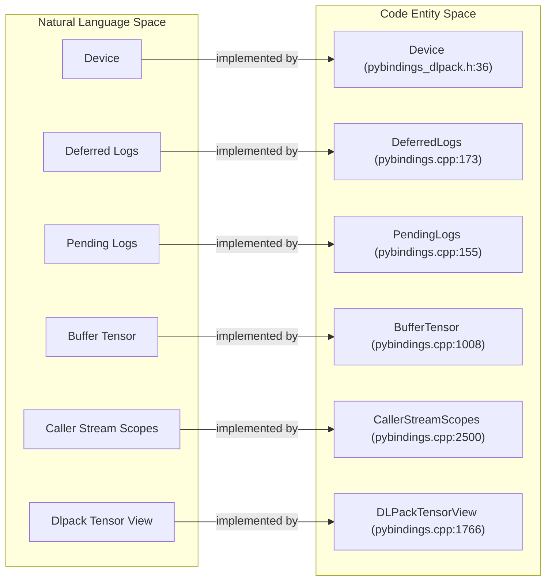
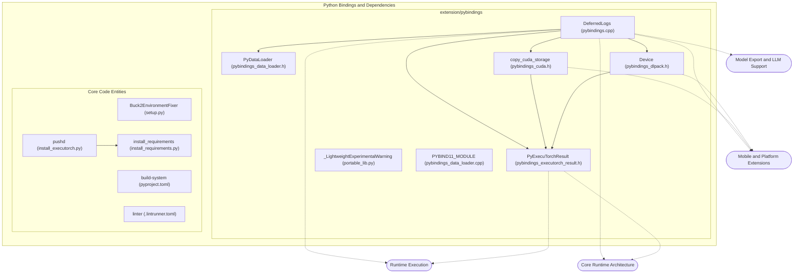
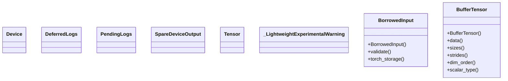
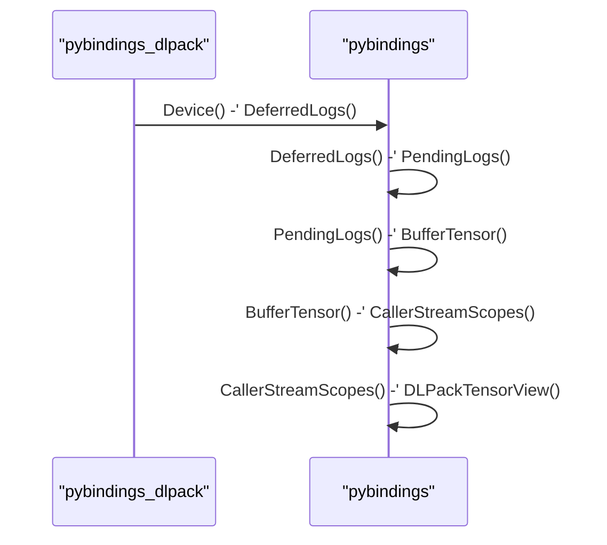

# 3-Source Context Packet (`git` + `CBM` + `llm-wiki`) for `2.4-python-bindings-and-dependencies` — Python Bindings and Dependencies

- **Target Wiki File**: `wiki/2.4-python-bindings-and-dependencies.md`
- **Archetype**: `Leaf Technical Spec Page`
- **Parent Page**: `2-build-system-and-infrastructure`
- **Summary**: Architectural specification and implementation reference for Python Bindings and Dependencies (15 relevant source files). Primary code entities: `BorrowedInput`, `torch_storage`, `validate`, `PyExecuTorchResult`, `DLPackHolder`.
- **Valid `[[wikilink]]` Neighbours**: `[[2-build-system-and-infrastructure|Build System and Infrastructure]]`, `[[1.1-getting-started|Getting Started]]`, `[[1.2-export-api-and-recipe-system|Export API and Recipe System]]`, `[[2.2-kernel-libraries-and-selective-build|Kernel Libraries and Selective Build]]`, `[[2.3-schema-generation-and-flatbuffers|Schema Generation and FlatBuffers]]`, `[[3.4-program-emission-and-serialization|Program Emission and Serialization]]`, `[[3.5-verification-and-dialect-system|Verification and Dialect System]]`, `[[4-quantization-systems|Quantization Systems]]`

## 1. Relevant Source Files (`git` + `CBM`, use verbatim in `<details>`)
- `[extension/pybindings/pybindings.cpp](extension/pybindings/pybindings.cpp)`
- `[extension/pybindings/pybindings_executorch_result.h](extension/pybindings/pybindings_executorch_result.h)`
- `[extension/pybindings/pybindings_data_loader.h](extension/pybindings/pybindings_data_loader.h)`
- `[extension/pybindings/pybindings_dlpack.h](extension/pybindings/pybindings_dlpack.h)`
- `[extension/pybindings/portable_lib.py](extension/pybindings/portable_lib.py)`
- `[extension/pybindings/pybindings_cuda.h](extension/pybindings/pybindings_cuda.h)`
- `[setup.py](setup.py)`
- `[pyproject.toml](pyproject.toml)`
- `[install_requirements.py](install_requirements.py)`
- `[.lintrunner.toml](.lintrunner.toml)`
- `[extension/pybindings/pybindings_data_loader.cpp](extension/pybindings/pybindings_data_loader.cpp)`
- `[install_executorch.py](install_executorch.py)`
- `[extension/pybindings/README.md](extension/pybindings/README.md)`
- `[docs/source/runtime-python-api-reference.rst](docs/source/runtime-python-api-reference.rst)`
- `[extension/pybindings/BUCK](extension/pybindings/BUCK)`

## 2. Grounded Code Symbols (`CBM`, use verbatim for `[file:start-end]()` pill citations)
- `Device` (Class) @ `[extension/pybindings/pybindings_dlpack.h:36-39]()` [fan-in=11, fan-out=0] — 
- `DeferredLogs` (Class) @ `[extension/pybindings/pybindings.cpp:173-189]()` [fan-in=2, fan-out=0] — // Lines that Python's stderr must show but that were logged where Python cannot // be called: outside any binding call, or on a daemon thread. Python's main //
- `PendingLogs` (Class) @ `[extension/pybindings/pybindings.cpp:155-160]()` [fan-in=1, fan-out=0] — // The lines kept for the current binding call; emit_log_message says when a // line is kept. Past the capacity the oldest are counted rather than kept, // sinc
- `BufferTensor` (Class) @ `[extension/pybindings/pybindings.cpp:1008-1338]()` [fan-in=0, fan-out=0] — /** Holds a Python buffer export and presents its metadata to ExecuTorch. */
- `CallerStreamScopes` (Class) @ `[extension/pybindings/pybindings.cpp:2500-2530]()` [fan-in=0, fan-out=0] — // A thread's active stream scopes, innermost last. They live here rather than // in the scope objects, so a scope that ends out of order, or is dropped on // a
- `DLPackTensorView` (Class) @ `[extension/pybindings/pybindings.cpp:1766-2139]()` [fan-in=0, fan-out=0] — /** A borrowed tensor view obtained through the producer's DLPack protocol, * or from a DLPack capsule passed directly. */
- `ObjectLock` (Class) @ `[extension/pybindings/pybindings.cpp:883-893]()` [fan-in=0, fan-out=0] — // Python tensor adapters can release the GIL while holding native state. // Recursive locking also covers compound calls that invoke other methods.
- `ProgramMemory` (Class) @ `[extension/pybindings/pybindings.cpp:4171-4321]()` [fan-in=0, fan-out=0] — /// A wrapper/util class for executorch memory allocations/manager.
- `ProgramState` (Class) @ `[extension/pybindings/pybindings.cpp:3072-3107]()` [fan-in=0, fan-out=0] — // Program points to DataLoader so bundle them up into a struct to ensure that // it stays alive.
- `PyCallerStreamScope` (Class) @ `[extension/pybindings/pybindings.cpp:2535-2673]()` [fan-in=0, fan-out=0] — // Selects a CUDA stream for the delegates of a Python with-block. Scopes are // told apart by a number that is never reused, unlike a guard's address.
- `PyCudaStream` (Class) @ `[extension/pybindings/pybindings.cpp:2418-2495]()` [fan-in=0, fan-out=0] — // A stream made by executorch.runtime.cuda.Stream. Selection and destruction // share one lock, so no thread can destroy it while any thread has it selected.
- `PyMethodMeta` (Class) @ `[extension/pybindings/pybindings.cpp:3188-3282]()` [fan-in=0, fan-out=0] — /// Expose a subset of MethodMeta information to python.
- `PyTensorInfo` (Class) @ `[extension/pybindings/pybindings.cpp:3110-3185]()` [fan-in=0, fan-out=0] — /// Expose a subset of TensorInfo information to python.
- `RuntimeErrorScope` (Class) @ `[extension/pybindings/pybindings.cpp:707-729]()` [fan-in=0, fan-out=0] — // Starts every binding call with no runtime errors recorded, and gives an // outer call its own back when a nested call returns. The outermost call owns // the
- `TorchTensorView` (Class) @ `[extension/pybindings/pybindings.cpp:1501-1667]()` [fan-in=0, fan-out=0] — /** A torch.Tensor input read through its public Python API, copied only to * change its layout. */
- `PyExecuTorchResult` (Class) @ `[extension/pybindings/pybindings_executorch_result.h:153-703]()` [fan-in=0, fan-out=0] — /** Tensor result returned by portable Python bindings. */
- `PyExecuTorchResultFlatBuffer` (Class) @ `[extension/pybindings/pybindings_executorch_result.h:706-718]()` [fan-in=0, fan-out=0] — /** Contiguous buffer facade used to construct a strided torch.Tensor result. */
- `PyDataLoader` (Class) @ `[extension/pybindings/pybindings_data_loader.h:53-73]()` [fan-in=0, fan-out=0] — /// Pybind11 wrapper for DataLoader. Use shared_ptr holder type in pybind11.
- `SharedPtrDataLoader` (Class) @ `[extension/pybindings/pybindings_data_loader.h:24-50]()` [fan-in=0, fan-out=0] — /// DataLoader wrapper holding a shared_ptr, allowing sharing between Python /// and C++ while Module takes ownership via unique_ptr.
- `ManagedTensorVersioned` (Class) @ `[extension/pybindings/pybindings_dlpack.h:69-75]()` [fan-in=0, fan-out=0] — // DLPack 1.0 capsules carry this struct, named "dltensor_versioned".
- `Buck2EnvironmentFixer` (Class) @ `[setup.py:2543-2565]()` [fan-in=0, fan-out=0] — Removes HOME from the environment when running as root. This script is sometimes run as root in docker containers. buck2 doesn't allow running as root unless $H
- `BuiltExtension` (Class) @ `[setup.py:1634-1715]()` [fan-in=0, fan-out=0] — An extension that installs a python extension that was built by cmake.

## 3. Grounded Source Code Excerpts (`git` Working Tree)
### `Device` in `[extension/pybindings/pybindings_dlpack.h:36-39]()`
```cpp
struct Device {
  DeviceType device_type;
  int32_t device_id;
};
```

### `DeferredLogs` in `[extension/pybindings/pybindings.cpp:173-188]()`
```cpp
struct DeferredLogs final {
  std::mutex mutex;
  std::condition_variable writer_changed;
  PendingLogs logs;
  PendingLogs main_thread_logs;
  bool main_thread_write_scheduled = false;
  // Numbers the writer's batches, so that a thread can tell whether the lines
  // it handed over are written.
  uint64_t batch = 1;
  uint64_t batches_written = 0;
  bool writer_running = false;
  // Exit waits while the writer takes the GIL, since a Python that has
  // finished exiting crashes on a new thread state and may have freed the
  // writer's saved one.
  bool writer_entering = false;
  bool exiting = false;
```

### `PendingLogs` in `[extension/pybindings/pybindings.cpp:155-160]()`
```cpp
struct PendingLogs final {
  bool direct = false;
  bool daemon = false;
  std::string lines;
  size_t dropped = 0;
};
```

### `BufferTensor` in `[extension/pybindings/pybindings.cpp:1008-1023]()`
```cpp
class BufferTensor final {
 public:
  BufferTensor(
      const py::handle& value,
      const MethodMeta& method_meta,
      size_t input_index)
      : buffer_(py::reinterpret_borrow<py::buffer>(value)),
        info_(buffer_.request()) {
    check_rank();
    const auto input_meta = method_meta.input_tensor_meta(input_index);
    THROW_IF_ERROR(input_meta.error(), "not a tensor input");
    const bool raw_bfloat16 =
        input_meta->scalar_type() == executorch::aten::ScalarType::BFloat16 &&
        info_.ndim == 1 &&
        scalar_type_from_buffer(info_) == executorch::aten::ScalarType::Byte;
    if (raw_bfloat16) {
```

### `CallerStreamScopes` in `[extension/pybindings/pybindings.cpp:2500-2515]()`
```cpp
struct CallerStreamScopes {
  struct Entry {
    uint64_t id;
    std::shared_ptr<PyCudaStream> owner;
    std::unique_ptr<executorch::extension::cuda::CallerStreamGuard> guard;
    // Refused or abandoned; ends as soon as every scope above it has ended.
    bool retired = false;
  };
  std::vector<Entry> active;

  // A guard restores the selection it replaced, so scopes end innermost first.
  void pop_finished() {
    do {
      Entry entry = std::move(active.back());
      active.pop_back();
      entry.guard.reset();
```


## 4. Linked Official Docs (`llm-wiki` / `RAG`)
- **Build System and Infrastructure** (`wiki/2-build-system-and-infrastructure.md`, score=125.742, shared_symbols=['Tensor']): # Build System and Infrastructure > Architectural specification and implementation reference for Build System and Infrastructure (38 relevant source files). Primary code entities: `CMakeCache`, `__post_init__`, `_is_truthy`, `get`, `_executorch_add_windows_anchor`. <details> <summary>Relevant source files</summary> The following files were used as context
- **Kernel Libraries and Selective Build** (`wiki/2.2-kernel-libraries-and-selective-build.md`, score=83.929, shared_symbols=['PyExecuTorchResult', 'Tensor']): # Kernel Libraries and Selective Build ↑ [[2-build-system-and-infrastructure|Build System and Infrastructure]] > Architectural specification and implementation reference for Kernel Libraries and Selective Build (31 relevant source files). Primary code entities: `KernelType`, `ScalarType`, `_dump_yaml`, `_get_et_kernel_metadata_from_ops_yaml`, `IOMetaData`.
- **Schema Generation and FlatBuffers** (`wiki/2.3-schema-generation-and-flatbuffers.md`, score=83.929, shared_symbols=['PyExecuTorchResult', 'Tensor']): # Schema Generation and FlatBuffers ↑ [[2-build-system-and-infrastructure|Build System and Infrastructure]] > Architectural specification and implementation reference for Schema Generation and FlatBuffers (36 relevant source files). Primary code entities: `Call`, `Sample`, `SampleSet`, `_SetDecoder`, `PTEFile`. <details> <summary>Relevant source files</su
- **CMake Configuration and Targets** (`wiki/2.1-cmake-configuration-and-targets.md`, score=82.429, shared_symbols=['PyExecuTorchResult']): # CMake Configuration and Targets ↑ [[2-build-system-and-infrastructure|Build System and Infrastructure]] > Architectural specification and implementation reference for CMake Configuration and Targets (17 relevant source files). Primary code entities: `CMakeCache`, `__post_init__`, `_is_truthy`, `get`, `_executorch_add_windows_anchor`. <details> <summary>
- **Embedded (Zephyr, ESP32, Pico2) and WebAssembly/WebGPU Targets** (`wiki/9.4-embedded-and-web-targets.md`, score=69.655, shared_symbols=['Tensor']): # Embedded (Zephyr, ESP32, Pico2) and WebAssembly/WebGPU Targets ↑ [[9-mobile-and-platform-extensions|Mobile and Platform Extensions]] > Architectural specification and implementation reference for Embedded (Zephyr, ESP32, Pico2) and WebAssembly/WebGPU Targets (40 relevant source files). Primary code entities: `BindingSpec`, `ComputePipelineBundle`, `opera
- **ExecuTorch DeepWiki** (`wiki/index.md`, score=69.007, shared_symbols=[]): # ExecuTorch DeepWiki Generated from `home-jason-Project-deepwiki-executorch` at commit `b3b565b5b62f` (2026-11-15T15:02:11+00:00). ## Pages - [[1-overview|Overview]] — Architectural specification and implementation reference for Overview (10 relevant source files). Primary code entities: `Module`, `MethodHolder`, `PlannedMemory`, `EdgeProgramManager`, `_

## 5. Pre-Verified DeepWiki v1.9.9.5 Mermaid Diagrams
### Natural Language Space <-> Code Entity Space


### Subsystem Architecture Flowchart


### Class Hierarchy Diagram


### Call Sequence Diagram


## 6. DeepWiki v1.9.9.5 Authoring Checklist for `wiki/2.4-python-bindings-and-dependencies.md`
1. Keep YAML frontmatter at top (`id`, `title`, `parent`, `sources`, `linked_docs`, `bridge_symbols`).
2. Keep `<details><summary>Relevant source files</summary>` block immediately after `# Title`.
3. Start with `## Purpose and Scope`, then numbered `## 1. ...`, `## 2. ...` sections separated by `---`.
4. Include at least 2 ```mermaid``` diagrams (including a `Natural Language Space` <-> `Code Entity Space` mapping).
5. Cite code entities inline using `[path/to/file.ext:start-end]()` and end every `##` section with `Sources: [file:start-end]()`.
6. Run `deepwiki_cli.py build --enrich-only ...` and `deepwiki_cli.py validate ...` after editing.
