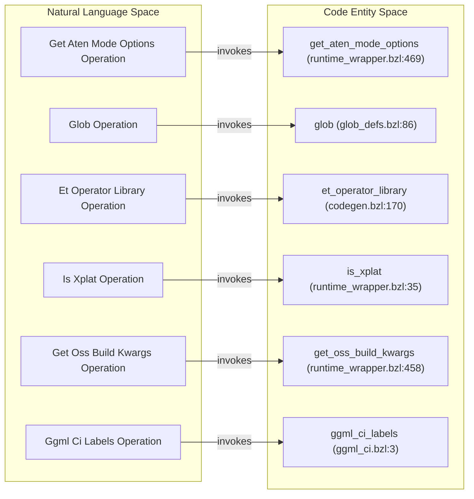
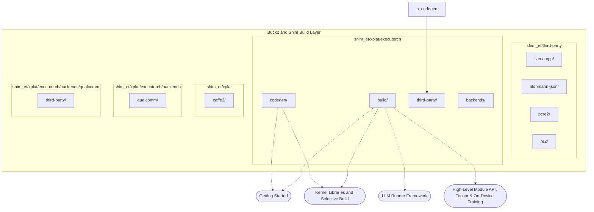
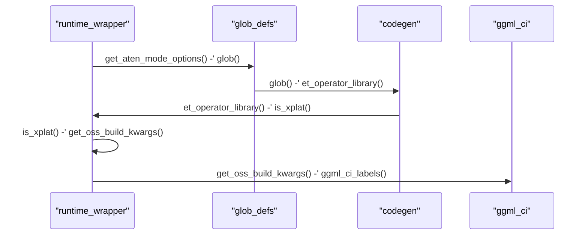

# 3-Source Context Packet (`git` + `CBM` + `llm-wiki`) for `2.5-buck2-and-shim-build-layer` — Buck2 and Shim Build Layer

- **Target Wiki File**: `wiki/2.5-buck2-and-shim-build-layer.md`
- **Archetype**: `Leaf Technical Spec Page`
- **Parent Page**: `2-build-system-and-infrastructure`
- **Summary**: Architectural specification and implementation reference for Buck2 and Shim Build Layer (30 relevant source files). Primary code entities: `ggml_ci_labels`, `define_common_targets`, `_extract_prim_ops_from_lists`, `_get_headers`, `_get_prim_ops_registry_target`.
- **Valid `[[wikilink]]` Neighbours**: `[[2-build-system-and-infrastructure|Build System and Infrastructure]]`, `[[1.1-getting-started|Getting Started]]`, `[[1.2-export-api-and-recipe-system|Export API and Recipe System]]`, `[[2.2-kernel-libraries-and-selective-build|Kernel Libraries and Selective Build]]`, `[[2.3-schema-generation-and-flatbuffers|Schema Generation and FlatBuffers]]`, `[[3.4-program-emission-and-serialization|Program Emission and Serialization]]`, `[[3.5-verification-and-dialect-system|Verification and Dialect System]]`, `[[4-quantization-systems|Quantization Systems]]`

## 1. Relevant Source Files (`git` + `CBM`, use verbatim in `<details>`)
- `[shim_et/third-party/llama.cpp/ggml_ci.bzl](shim_et/third-party/llama.cpp/ggml_ci.bzl)`
- `[shim_et/third-party/nlohmann-json/targets.bzl](shim_et/third-party/nlohmann-json/targets.bzl)`
- `[shim_et/third-party/pcre2/targets.bzl](shim_et/third-party/pcre2/targets.bzl)`
- `[shim_et/third-party/re2/targets.bzl](shim_et/third-party/re2/targets.bzl)`
- `[shim_et/xplat/executorch/codegen/codegen.bzl](shim_et/xplat/executorch/codegen/codegen.bzl)`
- `[shim_et/xplat/caffe2/pt_defs.bzl](shim_et/xplat/caffe2/pt_defs.bzl)`
- `[shim_et/xplat/executorch/build/runtime_wrapper.bzl](shim_et/xplat/executorch/build/runtime_wrapper.bzl)`
- `[shim_et/xplat/executorch/build/env_interface.bzl](shim_et/xplat/executorch/build/env_interface.bzl)`
- `[shim_et/xplat/executorch/third-party/glob_defs.bzl](shim_et/xplat/executorch/third-party/glob_defs.bzl)`
- `[shim_et/xplat/executorch/backends/backends.bzl](shim_et/xplat/executorch/backends/backends.bzl)`
- `[shim_et/xplat/executorch/build/type_defs.bzl](shim_et/xplat/executorch/build/type_defs.bzl)`
- `[shim_et/xplat/executorch/build/selects.bzl](shim_et/xplat/executorch/build/selects.bzl)`
- `[shim_et/xplat/executorch/backends/qualcomm/qnn_version.bzl](shim_et/xplat/executorch/backends/qualcomm/qnn_version.bzl)`
- `[shim_et/xplat/executorch/backends/qualcomm/third-party/third_party_libs.bzl](shim_et/xplat/executorch/backends/qualcomm/third-party/third_party_libs.bzl)`
- `[shim_et/xplat/executorch/backends/xnnpack/third-party/third_party_libs.bzl](shim_et/xplat/executorch/backends/xnnpack/third-party/third_party_libs.bzl)`
- `[shim_et/xplat/executorch/kernels/optimized/lib_defs.bzl](shim_et/xplat/executorch/kernels/optimized/lib_defs.bzl)`
- `[shim_et/xplat/executorch/extension/pybindings/pybindings.bzl](shim_et/xplat/executorch/extension/pybindings/pybindings.bzl)`
- `[shim_et/xplat/executorch/runtime/core/targets.bzl](shim_et/xplat/executorch/runtime/core/targets.bzl)`
- `[shim_et/xplat/executorch/kernels/prim_ops/selective_build.bzl](shim_et/xplat/executorch/kernels/prim_ops/selective_build.bzl)`
- `[shim_et/xplat/executorch/kernels/optimized/op_registration_util.bzl](shim_et/xplat/executorch/kernels/optimized/op_registration_util.bzl)`
- `[shim_et/xplat/executorch/kernels/portable/op_registration_util.bzl](shim_et/xplat/executorch/kernels/portable/op_registration_util.bzl)`
- `[codegen/targets.bzl](codegen/targets.bzl)`
- `[shim_et/README.md](shim_et/README.md)`
- `[runtime/core/portable_type/c10/README.md](runtime/core/portable_type/c10/README.md)`
- `[shim_et/BUCK](shim_et/BUCK)`
- `[shim_et/third-party/nlohmann-json/BUCK](shim_et/third-party/nlohmann-json/BUCK)`
- `[shim_et/third-party/pcre2/BUCK](shim_et/third-party/pcre2/BUCK)`
- `[shim_et/third-party/re2/BUCK](shim_et/third-party/re2/BUCK)`
- `[shim_et/xplat/caffe2/android/BUCK](shim_et/xplat/caffe2/android/BUCK)`
- `[runtime/core/portable_type/c10/c10/BUCK](runtime/core/portable_type/c10/c10/BUCK)`

## 2. Grounded Code Symbols (`CBM`, use verbatim for `[file:start-end]()` pill citations)
- `get_aten_mode_options` (Function) @ `[shim_et/xplat/executorch/build/runtime_wrapper.bzl:469-470]()` [fan-in=24, fan-out=0] — ()
- `glob` (Function) @ `[shim_et/xplat/executorch/third-party/glob_defs.bzl:86-92]()` [fan-in=23, fan-out=0] — (include, exclude = (), **kwargs)
- `et_operator_library` (Function) @ `[shim_et/xplat/executorch/codegen/codegen.bzl:170-258]()` [fan-in=5, fan-out=0] — # Hide the dependency to caffe2 internally.
- `is_xplat` (Function) @ `[shim_et/xplat/executorch/build/runtime_wrapper.bzl:35-36]()` [fan-in=10, fan-out=0] — ()
- `get_oss_build_kwargs` (Function) @ `[shim_et/xplat/executorch/build/runtime_wrapper.bzl:458-467]()` [fan-in=9, fan-out=0] — ()
- `ggml_ci_labels` (Function) @ `[shim_et/third-party/llama.cpp/ggml_ci.bzl:3-4]()` [fan-in=1, fan-out=0] — # Open-source builds have no Meta CI configuration, so targets that link a ggml # GPU backend set get no CI labels.
- `executorch_generated_lib` (Function) @ `[shim_et/xplat/executorch/codegen/codegen.bzl:814-1138]()` [fan-in=7, fan-out=0] — ( name, functions_yaml_target = None, custom_ops_yaml_target = None, fallback_yaml_target = None, define_stati
- `qnn_third_party_dep` (Function) @ `[shim_et/xplat/executorch/backends/qualcomm/third-party/third_party_libs.bzl:30-33]()` [fan-in=7, fan-out=0] — (name)
- `executorch_ops_check` (Function) @ `[shim_et/xplat/executorch/codegen/codegen.bzl:1148-1166]()` [fan-in=0, fan-out=0] — # Util macro that takes in a binary or a shared library, find targets ending with `_et_oplist` in the transitive closure of deps, # get the `selected_operators.
- `_patch_executorch_genrule_cmd` (Function) @ `[shim_et/xplat/executorch/build/env_interface.bzl:175-206]()` [fan-in=0, fan-out=0] — # buildifier: disable=unused-variable
- `glob_private_headers` (Function) @ `[shim_et/xplat/executorch/third-party/glob_defs.bzl:79-84]()` [fan-in=0, fan-out=0] — # Using a flat list will trigger build errors on Android. # cxx_library will generate an apple_library on iOS, a cxx_library on Android. # Those rules have diff
- `third_party_dep` (Function) @ `[shim_et/xplat/executorch/backends/xnnpack/third-party/third_party_libs.bzl:22-30]()` [fan-in=6, fan-out=0] — (name)
- `define_libs` (Function) @ `[shim_et/xplat/executorch/kernels/optimized/lib_defs.bzl:77-154]()` [fan-in=0, fan-out=0] — # TODO(ssjia): Enable -DCPU_CAPABILITY_AVX2 in fbcode, which requires sleef.
- `get_vec_preprocessor_flags` (Function) @ `[shim_et/xplat/executorch/kernels/optimized/lib_defs.bzl:19-35]()` [fan-in=0, fan-out=0] — # This oopy from kernels/optimized/lib_defs.bzl is not necessary. # This file really needs to be removed
- `define_common_targets` (Function) @ `[shim_et/third-party/nlohmann-json/targets.bzl:3-10]()` [fan-in=0, fan-out=0] — ()
- `exir_custom_ops_aot_lib` (Function) @ `[shim_et/xplat/executorch/codegen/codegen.bzl:440-512]()` [fan-in=1, fan-out=0] — ( name, yaml_target = None, visibility = [], kernels = [], deps = [], compiler_flags = [], define_static_targe
- `subdir_glob` (Function) @ `[shim_et/xplat/executorch/third-party/glob_defs.bzl:8-42]()` [fan-in=2, fan-out=0] — (glob_specs, exclude = None, prefix = \"\")
- `define_common_targets` (Function) @ `[shim_et/third-party/pcre2/targets.bzl:3-9]()` [fan-in=0, fan-out=0] — ()
- `define_common_targets` (Function) @ `[shim_et/third-party/re2/targets.bzl:3-9]()` [fan-in=0, fan-out=0] — ()
- `get_pt_ops_deps` (Function) @ `[shim_et/xplat/caffe2/pt_defs.bzl:1-2]()` [fan-in=0, fan-out=0] — (name, train, deps)
- `get_qnn_library_version` (Function) @ `[shim_et/xplat/executorch/backends/qualcomm/qnn_version.bzl:1-2]()` [fan-in=2, fan-out=0] — ()
- `_extract_prim_ops_from_lists` (Function) @ `[shim_et/xplat/executorch/codegen/codegen.bzl:117-167]()` [fan-in=0, fan-out=0] — (ops, ops_dict)

## 3. Grounded Source Code Excerpts (`git` Working Tree)
### `glob` in `[shim_et/xplat/executorch/third-party/glob_defs.bzl:86-92]()`
```python
def glob(include, exclude = (), **kwargs):
    buildfile = native.read_config("buildfile", "name", "BUCK")
    subpkgs = [
        target[:-len(buildfile)] + "**/*"
        for target in native.glob(["*/**/" + buildfile])
    ]
    return native.glob(include, exclude = list(exclude) + subpkgs, **kwargs)
```

### `et_operator_library` in `[shim_et/xplat/executorch/codegen/codegen.bzl:170-185]()`
```python
def et_operator_library(
        name,
        ops = [],
        ops_dict = {},
        model = None,
        include_all_operators = False,
        ops_schema_yaml_target = None,
        server_generated_yaml_target = None,
        **kwargs):
    # Check if we should extract prim ops from the operator lists
    # Note that selective build for prim ops doesnt support model or ops_schema_yaml_target or server_generated_yaml_target
    # TODO: Add support for selective build for prim ops with model or ops_schema_yaml_target or server_generated_yaml_target
    should_extract_prim_ops = (ops or ops_dict) and not (model or ops_schema_yaml_target or server_generated_yaml_target or include_all_operators)

    if should_extract_prim_ops:
        # Extract prim ops from ops and ops_dict
```

### `get_oss_build_kwargs` in `[shim_et/xplat/executorch/build/runtime_wrapper.bzl:458-467]()`
```python
def get_oss_build_kwargs():
    if env.is_oss:
        return {
            "link_style": "static",
            "linker_flags": [
                # platform/system.h uses dladdr() on mac and linux
                "-ldl",
            ],
        }
    return {}
```

### `executorch_generated_lib` in `[shim_et/xplat/executorch/codegen/codegen.bzl:814-829]()`
```python
def executorch_generated_lib(
        name,
        functions_yaml_target = None,
        custom_ops_yaml_target = None,
        fallback_yaml_target = None,
        define_static_targets = False,
        custom_ops_aten_kernel_deps = [],
        custom_ops_requires_runtime_registration = True,
        custom_ops_requires_aot_registration = True,
        visibility = [],
        aten_mode = False,
        manual_registration = False,
        use_default_aten_ops_lib = True,
        deps = [],
        xplat_deps = [],
        fbcode_deps = [],
```

### `qnn_third_party_dep` in `[shim_et/xplat/executorch/backends/qualcomm/third-party/third_party_libs.bzl:30-33]()`
```python
def qnn_third_party_dep(name):
    if name not in _QNN_THIRD_PARTY_LIBS:
        fail("Cannot find QNN third party library " + name + ", please register it in _QNN_THIRD_PARTY_LIBS first!")
    return _QNN_THIRD_PARTY_LIBS[name][1] if runtime.is_oss else _QNN_THIRD_PARTY_LIBS[name][0]
```


## 4. Linked Official Docs (`llm-wiki` / `RAG`)
- **Build System and Infrastructure** (`wiki/2-build-system-and-infrastructure.md`, score=175.788, shared_symbols=['et_operator_library', 'get_aten_mode_options', 'glob', 'is_xplat']): # Build System and Infrastructure > Architectural specification and implementation reference for Build System and Infrastructure (38 relevant source files). Primary code entities: `CMakeCache`, `__post_init__`, `_is_truthy`, `get`, `_executorch_add_windows_anchor`. <details> <summary>Relevant source files</summary> The following files were used as context
- **Schema Generation and FlatBuffers** (`wiki/2.3-schema-generation-and-flatbuffers.md`, score=159.98, shared_symbols=[]): # Schema Generation and FlatBuffers ↑ [[2-build-system-and-infrastructure|Build System and Infrastructure]] > Architectural specification and implementation reference for Schema Generation and FlatBuffers (36 relevant source files). Primary code entities: `Call`, `Sample`, `SampleSet`, `_SetDecoder`, `PTEFile`. <details> <summary>Relevant source files</su
- **Python Bindings and Dependencies** (`wiki/2.4-python-bindings-and-dependencies.md`, score=159.98, shared_symbols=[]): # Python Bindings and Dependencies ↑ [[2-build-system-and-infrastructure|Build System and Infrastructure]] > Architectural specification and implementation reference for Python Bindings and Dependencies (15 relevant source files). Primary code entities: `BorrowedInput`, `torch_storage`, `validate`, `PyExecuTorchResult`, `DLPackHolder`. <details> <summary>
- **Getting Started** (`wiki/1.1-getting-started.md`, score=159.98, shared_symbols=[]): # Getting Started ↑ [[1-overview|Overview]] > Architectural specification and implementation reference for Getting Started (22 relevant source files). Primary code entities: `cu134_requirements`, `get_torch_url`, `get_torchao_version`, `install_optional_example_requirements`, `EventTraceManager`. <details> <summary>Relevant source files</summary> The fol
- **ExecuTorch DeepWiki** (`wiki/index.md`, score=136.478, shared_symbols=[]): # ExecuTorch DeepWiki Generated from `home-jason-Project-deepwiki-executorch` at commit `b3b565b5b62f` (2026-11-15T15:02:11+00:00). ## Pages - [[1-overview|Overview]] — Architectural specification and implementation reference for Overview (10 relevant source files). Primary code entities: `Module`, `MethodHolder`, `PlannedMemory`, `EdgeProgramManager`, `_
- **CMake Configuration and Targets** (`wiki/2.1-cmake-configuration-and-targets.md`, score=115.557, shared_symbols=[]): # CMake Configuration and Targets ↑ [[2-build-system-and-infrastructure|Build System and Infrastructure]] > Architectural specification and implementation reference for CMake Configuration and Targets (17 relevant source files). Primary code entities: `CMakeCache`, `__post_init__`, `_is_truthy`, `get`, `_executorch_add_windows_anchor`. <details> <summary>

## 5. Pre-Verified DeepWiki v1.9.9.5 Mermaid Diagrams
### Natural Language Space <-> Code Entity Space


### Subsystem Architecture Flowchart


### Call Sequence Diagram


## 6. DeepWiki v1.9.9.5 Authoring Checklist for `wiki/2.5-buck2-and-shim-build-layer.md`
1. Keep YAML frontmatter at top (`id`, `title`, `parent`, `sources`, `linked_docs`, `bridge_symbols`).
2. Keep `<details><summary>Relevant source files</summary>` block immediately after `# Title`.
3. Start with `## Purpose and Scope`, then numbered `## 1. ...`, `## 2. ...` sections separated by `---`.
4. Include at least 2 ```mermaid``` diagrams (including a `Natural Language Space` <-> `Code Entity Space` mapping).
5. Cite code entities inline using `[path/to/file.ext:start-end]()` and end every `##` section with `Sources: [file:start-end]()`.
6. Run `deepwiki_cli.py build --enrich-only ...` and `deepwiki_cli.py validate ...` after editing.
