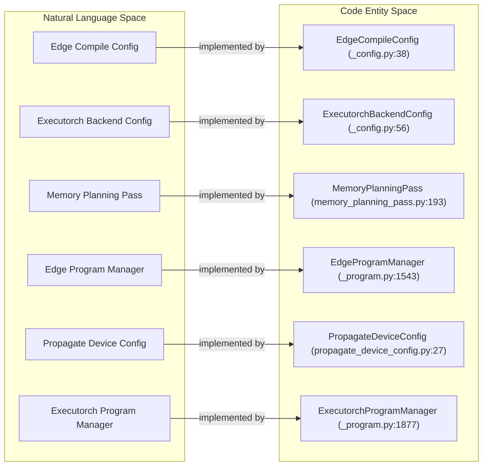
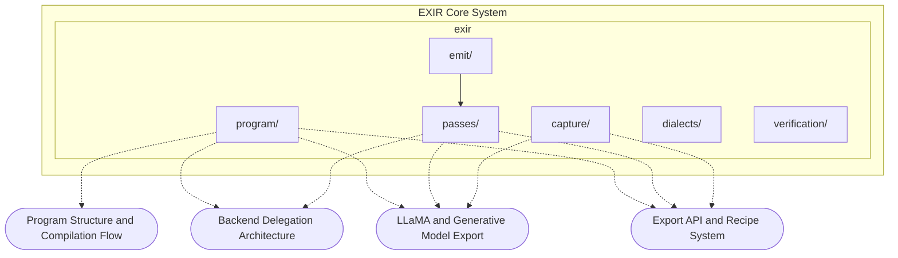
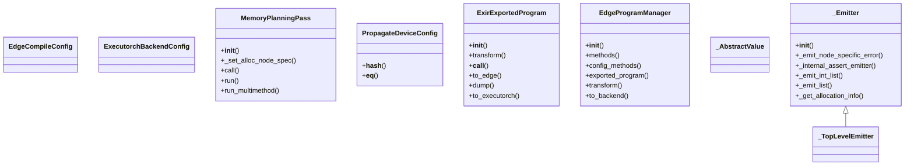
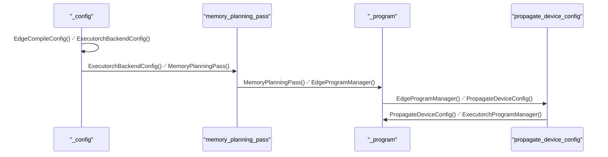

# 3-Source Context Packet (`git` + `CBM` + `llm-wiki`) for `3-exir-core-system` — EXIR Core System

- **Target Wiki File**: `wiki/3-exir-core-system.md`
- **Archetype**: `Parent Hub Page`
- **Parent Page**: `None (Top-Level Chapter)`
- **Summary**: Architectural specification and implementation reference for EXIR Core System (40 relevant source files). Primary code entities: `EdgeProgramManager`, `__init__`, `config_methods`, `exported_program`, `MemoryPlanningPass`.
- **Valid `[[wikilink]]` Neighbours**: `[[1-overview|Overview]]`, `[[3.1-program-structure-and-compilation-flow|Program Structure and Compilation Flow]]`, `[[3.2-graph-transformation-pass-system|Graph Transformation Pass System]]`, `[[3.3-memory-planning-and-allocation|Memory Planning and Allocation]]`, `[[3.4-program-emission-and-serialization|Program Emission and Serialization]]`, `[[3.5-verification-and-dialect-system|Verification and Dialect System]]`, `[[1.1-getting-started|Getting Started]]`, `[[1.2-export-api-and-recipe-system|Export API and Recipe System]]`

## 1. Relevant Source Files (`git` + `CBM`, use verbatim in `<details>`)
- `[exir/program/_program.py](exir/program/_program.py)`
- `[exir/passes/memory_planning_pass.py](exir/passes/memory_planning_pass.py)`
- `[exir/passes/dynamic_shape_prop_pass.py](exir/passes/dynamic_shape_prop_pass.py)`
- `[exir/passes/propagate_device_pass.py](exir/passes/propagate_device_pass.py)`
- `[exir/passes/insert_write_back_for_buffers_pass.py](exir/passes/insert_write_back_for_buffers_pass.py)`
- `[exir/passes/__init__.py](exir/passes/__init__.py)`
- `[exir/capture/_config.py](exir/capture/_config.py)`
- `[exir/passes/constant_prop_pass.py](exir/passes/constant_prop_pass.py)`
- `[exir/passes/cse_pass.py](exir/passes/cse_pass.py)`
- `[exir/passes/_quant_patterns_and_replacements.py](exir/passes/_quant_patterns_and_replacements.py)`
- `[exir/passes/replace_complex_with_real_pass.py](exir/passes/replace_complex_with_real_pass.py)`
- `[exir/passes/delegate_scratch_pass.py](exir/passes/delegate_scratch_pass.py)`
- `[exir/passes/const_prop_pass.py](exir/passes/const_prop_pass.py)`
- `[exir/emit/_emitter.py](exir/emit/_emitter.py)`
- `[exir/passes/legalize_portable_dim_order_pass.py](exir/passes/legalize_portable_dim_order_pass.py)`
- `[exir/passes/quantize_io_pass.py](exir/passes/quantize_io_pass.py)`
- `[exir/passes/debug_handle_generator_pass.py](exir/passes/debug_handle_generator_pass.py)`
- `[exir/passes/memory_format_ops_pass.py](exir/passes/memory_format_ops_pass.py)`
- `[exir/passes/fold_redundant_qdq_pass.py](exir/passes/fold_redundant_qdq_pass.py)`
- `[exir/program/_fake_program.py](exir/program/_fake_program.py)`
- `[exir/passes/init_mutable_pass.py](exir/passes/init_mutable_pass.py)`
- `[exir/program/__init__.py](exir/program/__init__.py)`
- `[exir/passes/executorch_prim_ops_registry.py](exir/passes/executorch_prim_ops_registry.py)`
- `[exir/passes/propagate_device_config.py](exir/passes/propagate_device_config.py)`
- `[exir/passes/pass_registry.py](exir/passes/pass_registry.py)`
- `[exir/passes/replace_view_copy_with_view_pass.py](exir/passes/replace_view_copy_with_view_pass.py)`
- `[exir/passes/normalize_view_copy_base_pass.py](exir/passes/normalize_view_copy_base_pass.py)`
- `[exir/passes/quant_fusion_pass.py](exir/passes/quant_fusion_pass.py)`
- `[docs/source/compiler-backend-dialect.md](docs/source/compiler-backend-dialect.md)`
- `[docs/source/compiler-custom-compiler-passes.md](docs/source/compiler-custom-compiler-passes.md)`

## 2. Grounded Code Symbols (`CBM`, use verbatim for `[file:start-end]()` pill citations)
- `EdgeCompileConfig` (Class) @ `[exir/capture/_config.py:38-51]()` [fan-in=58, fan-out=0] — 
- `ExecutorchBackendConfig` (Class) @ `[exir/capture/_config.py:56-140]()` [fan-in=31, fan-out=0] — 
- `MemoryPlanningPass` (Class) @ `[exir/passes/memory_planning_pass.py:193-372]()` [fan-in=25, fan-out=0] — 
- `EdgeProgramManager` (Class) @ `[exir/program/_program.py:1543-1874]()` [fan-in=4, fan-out=0] — Package of one or more `ExportedPrograms` in Edge dialect. Designed to simplify lowering to ExecuTorch. See: https://pytorch.org/executorch/main/ir-exir Allows 
- `PropagateDeviceConfig` (Class) @ `[exir/passes/propagate_device_config.py:27-133]()` [fan-in=9, fan-out=0] — Controls whether the runtime copies method inputs, outputs and constants across the device boundary. Memory planning reserves buffers for graph inputs and outpu
- `ExecutorchProgramManager` (Class) @ `[exir/program/_program.py:1877-2072]()` [fan-in=1, fan-out=0] — Package of one or more `ExportedPrograms` in Execution dialect. Designed to simplify lowering to ExecuTorch. See: https://pytorch.org/executorch/main/ir-exir Wh
- `DSInfo` (Class) @ `[exir/passes/dynamic_shape_prop_pass.py:32-40]()` [fan-in=1, fan-out=0] — Dynamic shape information we are tracking for each dynamic shape symbol.
- `_AbstractValue` (Class) @ `[exir/emit/_emitter.py:168-175]()` [fan-in=3, fan-out=0] — Represents an already emitted EValue
- `_Emitter` (Class) @ `[exir/emit/_emitter.py:217-1964]()` [fan-in=3, fan-out=0] — An abstract interpreter (https://wiki.mozilla.org/Abstract_Interpretation) used to emit the given traced torch.fx.GraphModule to the flatbuffer schema.
- `_AliasIndex` (Class) @ `[exir/passes/insert_write_back_for_buffers_pass.py:185-217]()` [fan-in=1, fan-out=0] — Alias closures over the graph. The undirected adjacency (each node joined to the inputs its value may alias) is built once, and each closure is a breadth-first 
- `ExirExportedProgram` (Class) @ `[exir/program/_program.py:410-494]()` [fan-in=5, fan-out=0] — 
- `DynamicShapePropPass` (Class) @ `[exir/passes/dynamic_shape_prop_pass.py:43-301]()` [fan-in=0, fan-out=0] — In general, for each op, this pass propagate dynamic shape information from op inputs to op outputs. For cond/map nodes, we need pass dynamic shape information 
- `PropagateDevicePass` (Class) @ `[exir/passes/propagate_device_pass.py:282-890]()` [fan-in=0, fan-out=0] — After to_backend, walk the graph and insert H2D/D2H copy ops at delegate boundaries based on partitioner-assigned device info. When a delegate has a target_devi
- `_Rewriter` (Class) @ `[exir/passes/replace_complex_with_real_pass.py:161-216]()` [fan-in=1, fan-out=0] — Builds, in graph order, the real replacement of every node that reads or writes a complex tensor.
- `CSEPass` (Class) @ `[exir/passes/cse_pass.py:16-201]()` [fan-in=0, fan-out=0] — Common Subexpression Elimination using structural hashing (value numbering). Deduplicates operations with identical computation structure, replacing redundant c
- `DelegateScratchSpecPass` (Class) @ `[exir/passes/delegate_scratch_pass.py:40-100]()` [fan-in=0, fan-out=0] — Materializes the scratch buffers a backend asked for in ``preprocess``. Each ``DelegateScratchSpec`` becomes a one-dimensional ``uint8`` ``TensorSpec`` on the d
- `ReplaceComplexWithRealPass` (Class) @ `[exir/passes/replace_complex_with_real_pass.py:426-482]()` [fan-in=0, fan-out=0] — Replace complex tensors with real tensors that hold their real and imaginary parts in a last dim of size 2, and the ops on them with ops on real numbers, in an 
- `_EmitterState` (Class) @ `[exir/emit/_emitter.py:139-164]()` [fan-in=0, fan-out=0] — State of a single emitter. Local to at least the entry point, and may be local to a subgraph of an entry point originating from control flow.
- `_ProgramState` (Class) @ `[exir/emit/_emitter.py:104-135]()` [fan-in=0, fan-out=0] — State shared between all methods of a program and the graph module it represents. Initialized once within emit_program and then shared across each entry point a
- `_TopLevelEmitter` (Class) @ `[exir/emit/_emitter.py:1967-2235]()` [fan-in=0, fan-out=0] — An emitter that manages the root level operations within a graph module. Exists as a separate class so that 'Emitter' can handle the special behavior of 'placeh
- `ConstPropPass` (Class) @ `[exir/passes/const_prop_pass.py:22-84]()` [fan-in=0, fan-out=0] — Performs constant folding and constant propagation.
- `LegalizePortableDimOrderPass` (Class) @ `[exir/passes/legalize_portable_dim_order_pass.py:74-173]()` [fan-in=0, fan-out=0] — Insert dim-order copies before portable ops that need another layout. Runs during ``edge -> executorch`` lowering on leftover edge ops whose portable kernels re

## 3. Grounded Source Code Excerpts (`git` Working Tree)
### `EdgeCompileConfig` in `[exir/capture/_config.py:38-51]()`
```python
class EdgeCompileConfig:
    # TODO(qihan): remove ability to opt out
    _check_ir_validity: bool = True
    # TODO(gasoonjia): remove this
    _skip_dim_order: bool = False
    # Allow core ATen ops check to be skipped for certain ops, but continue with the rest of the checks.
    # Note: only use this for core ATen ops that are missing decompositions. This is temporary,
    # enabling verification on the rest of the program until decomposition coverage is improved.
    _core_aten_ops_exception_list: List[torch._ops.OpOverload] = field(
        default_factory=list
    )
    # Allow ops to be preserved in the graph, i.e., prevent them from being decomposed.
    # These may be core or non-core ATen ops; custom ops should not be here.
    preserve_ops: List[torch.torch._ops.OpOverload] = field(default_factory=list)
```

### `ExecutorchBackendConfig` in `[exir/capture/_config.py:56-71]()`
```python
class ExecutorchBackendConfig:
    passes: List[PassType] = field(default_factory=list)

    # A single memory planning pass can be defined for all the programs in the
    # EdgeProgramManager or can be defined per program.
    memory_planning_pass: Union[PassType, Dict[str, PassType]] = MemoryPlanningPass()

    # A single propagate device config can be defined for all the programs in the
    # EdgeProgramManager or can be defined per program.
    propagate_device_config: Union[
        PropagateDeviceConfig, Dict[str, PropagateDeviceConfig]
    ] = field(default_factory=PropagateDeviceConfig)

    to_out_var_pass: PassType = ToOutVarPass(ignore_to_out_var_failure=False)
    dynamic_memory_planning_mode: DynamicMemoryPlanningMode = (
        DynamicMemoryPlanningMode.UPPER_BOUND
```

### `MemoryPlanningPass` in `[exir/passes/memory_planning_pass.py:193-208]()`
```python
class MemoryPlanningPass(PassBase):
    def __init__(
        self,
        memory_planning_algo: Optional[Callable[..., List[int]]] = None,
        allow_lifetime_and_storage_overlap: bool = False,
        alloc_graph_input: bool = True,
        alloc_graph_output: bool = True,
        alloc_mutable_buffers: bool = True,
        share_mutable_buffers: bool = False,
        alignment: int = ALIGNMENT,
    ) -> None:
        r"""
        alloc_graph_input/alloc_graph_output will have 4 different combinations
        to control if the memory planning algorithm need allocate memory for
        the graph input/output. The default behavior is the algorithm will allocate
        memory for both graph input and output.
```

### `EdgeProgramManager` in `[exir/program/_program.py:1543-1558]()`
```python
class EdgeProgramManager:
    """
    Package of one or more `ExportedPrograms` in Edge dialect. Designed to simplify
    lowering to ExecuTorch. See: https://pytorch.org/executorch/main/ir-exir

    Allows easy applications of transforms across a collection of exported programs
    including the delegation of subgraphs.

    Manages the second link in the lowering chain of ATen -> Edge -> ExecuTorch.
    """

    def __init__(
        self,
        edge_programs: Union[ExportedProgram, Dict[str, ExportedProgram]],
        constant_methods: Optional[Dict[str, Any]] = None,
        compile_config: Optional[EdgeCompileConfig] = None,
```

### `PropagateDeviceConfig` in `[exir/passes/propagate_device_config.py:27-42]()`
```python
class PropagateDeviceConfig:
    """Controls whether the runtime copies method inputs, outputs and constants across the device boundary.

    Memory planning reserves buffers for graph inputs and outputs by default. A program that skips
    the input copy must use ``alloc_graph_input=False``. Unplanning the outputs as well, as below,
    copies the least::

        ExecutorchBackendConfig(
            propagate_device_config=PropagateDeviceConfig(
                skip_h2d_for_method_inputs=True,
                skip_d2h_for_method_outputs=True,
            ),
            enable_non_cpu_memory_planning=True,
            memory_planning_pass=MemoryPlanningPass(
                alloc_graph_input=False, alloc_graph_output=False
            ),
```


## 4. Linked Official Docs (`llm-wiki` / `RAG`)
- **Graph Transformation Pass System** (`wiki/3.2-graph-transformation-pass-system.md`, score=118.121, shared_symbols=['EdgeCompileConfig', 'EdgeProgramManager', 'ExecutorchBackendConfig', 'MemoryPlanningPass', 'PropagateDeviceConfig']): # Graph Transformation Pass System ↑ [[3-exir-core-system|EXIR Core System]] > Architectural specification and implementation reference for Graph Transformation Pass System (30 relevant source files). Primary code entities: `MemoryPlanningPass`, `__init__`, `_set_alloc_node_spec`, `call`, `DSInfo`. <details> <summary>Relevant source files</summary> The f
- **Program Structure and Compilation Flow** (`wiki/3.1-program-structure-and-compilation-flow.md`, score=107.982, shared_symbols=['EdgeCompileConfig', 'EdgeProgramManager', 'ExecutorchBackendConfig', 'ExirExportedProgram', 'MemoryPlanningPass', 'PropagateDeviceConfig', '_AbstractValue', '_Emitter']): # Program Structure and Compilation Flow ↑ [[3-exir-core-system|EXIR Core System]] > Architectural specification and implementation reference for Program Structure and Compilation Flow (12 relevant source files). Primary code entities: `CaptureConfig`, `EdgeCompileConfig`, `ExecutorchBackendConfig`, `EdgeProgramManager`, `__init__`. <details> <summary>Rel
- **ExecuTorch DeepWiki** (`wiki/index.md`, score=94.067, shared_symbols=[]): # ExecuTorch DeepWiki Generated from `home-jason-Project-deepwiki-executorch` at commit `b3b565b5b62f` (2026-11-15T15:02:11+00:00). ## Pages - [[1-overview|Overview]] — Architectural specification and implementation reference for Overview (10 relevant source files). Primary code entities: `Module`, `MethodHolder`, `PlannedMemory`, `EdgeProgramManager`, `_
- **Memory Planning and Allocation** (`wiki/3.3-memory-planning-and-allocation.md`, score=84.277, shared_symbols=['EdgeCompileConfig', 'EdgeProgramManager', 'ExecutorchBackendConfig', 'MemoryPlanningPass', '_AbstractValue', '_Emitter']): # Memory Planning and Allocation ↑ [[3-exir-core-system|EXIR Core System]] > Architectural specification and implementation reference for Memory Planning and Allocation (5 relevant source files). Primary code entities: `MemoryPlanningPass`, `__init__`, `_set_alloc_node_spec`, `call`, `AddressSpaceOverflowException`. <details> <summary>Relevant source file
- **Program Emission and Serialization** (`wiki/3.4-program-emission-and-serialization.md`, score=82.793, shared_symbols=['EdgeCompileConfig', 'EdgeProgramManager', 'ExecutorchBackendConfig']): # Program Emission and Serialization ↑ [[3-exir-core-system|EXIR Core System]] > Architectural specification and implementation reference for Program Emission and Serialization (35 relevant source files). Primary code entities: `_AbstractValue`, `_Emitter`, `__init__`, `_add_debug_handle`, `Call`. <details> <summary>Relevant source files</summary> The fo
- **Verification and Dialect System** (`wiki/3.5-verification-and-dialect-system.md`, score=67.897, shared_symbols=['EdgeCompileConfig', 'EdgeProgramManager', 'ExecutorchBackendConfig', 'MemoryPlanningPass', '_AbstractValue', '_Emitter']): # Verification and Dialect System ↑ [[3-exir-core-system|EXIR Core System]] > Architectural specification and implementation reference for Verification and Dialect System (34 relevant source files). Primary code entities: `Interpreter`, `__init__`, `call_kernel`, `get_constant_tensors`, `EdgeOpArgValidator`. <details> <summary>Relevant source files</summa

## 5. Pre-Verified DeepWiki v1.9.9.5 Mermaid Diagrams
### Natural Language Space <-> Code Entity Space


### Subsystem Architecture Flowchart


### Class Hierarchy Diagram


### Call Sequence Diagram


## 6. DeepWiki v1.9.9.5 Authoring Checklist for `wiki/3-exir-core-system.md`
1. Keep YAML frontmatter at top (`id`, `title`, `parent`, `sources`, `linked_docs`, `bridge_symbols`).
2. Keep `<details><summary>Relevant source files</summary>` block immediately after `# Title`.
3. Start with `## Purpose and Scope`, then numbered `## 1. ...`, `## 2. ...` sections separated by `---`.
4. Include at least 2 ```mermaid``` diagrams (including a `Natural Language Space` <-> `Code Entity Space` mapping).
5. Cite code entities inline using `[path/to/file.ext:start-end]()` and end every `##` section with `Sources: [file:start-end]()`.
6. Run `deepwiki_cli.py build --enrich-only ...` and `deepwiki_cli.py validate ...` after editing.
