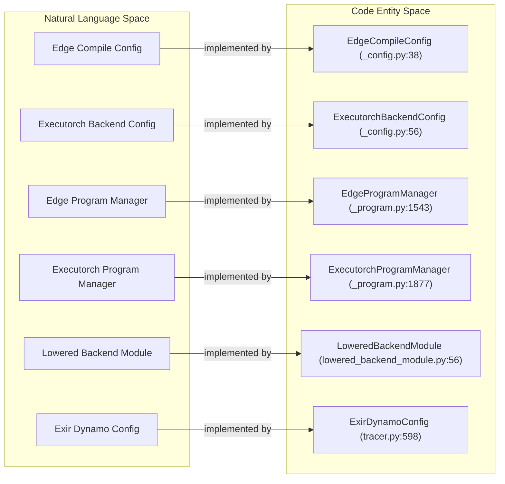
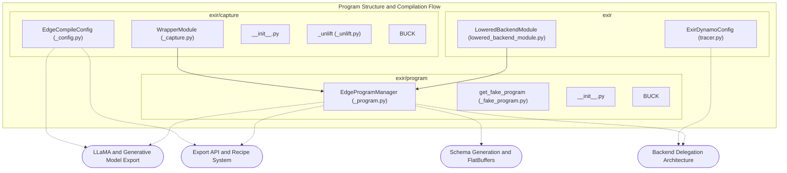
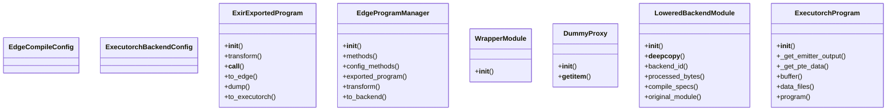
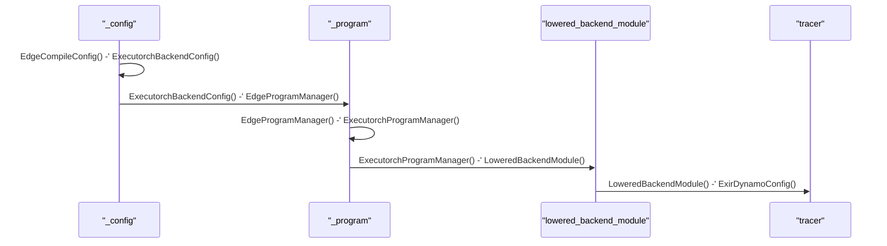

# 3-Source Context Packet (`git` + `CBM` + `llm-wiki`) for `3.1-program-structure-and-compilation-flow` — Program Structure and Compilation Flow

- **Target Wiki File**: `wiki/3.1-program-structure-and-compilation-flow.md`
- **Archetype**: `Leaf Technical Spec Page`
- **Parent Page**: `3-exir-core-system`
- **Summary**: Architectural specification and implementation reference for Program Structure and Compilation Flow (12 relevant source files). Primary code entities: `CaptureConfig`, `EdgeCompileConfig`, `ExecutorchBackendConfig`, `EdgeProgramManager`, `__init__`.
- **Valid `[[wikilink]]` Neighbours**: `[[3-exir-core-system|EXIR Core System]]`, `[[1.1-getting-started|Getting Started]]`, `[[1.2-export-api-and-recipe-system|Export API and Recipe System]]`, `[[2.2-kernel-libraries-and-selective-build|Kernel Libraries and Selective Build]]`, `[[2.3-schema-generation-and-flatbuffers|Schema Generation and FlatBuffers]]`, `[[3.4-program-emission-and-serialization|Program Emission and Serialization]]`, `[[3.5-verification-and-dialect-system|Verification and Dialect System]]`, `[[4-quantization-systems|Quantization Systems]]`

## 1. Relevant Source Files (`git` + `CBM`, use verbatim in `<details>`)
- `[exir/capture/_config.py](exir/capture/_config.py)`
- `[exir/program/_program.py](exir/program/_program.py)`
- `[exir/lowered_backend_module.py](exir/lowered_backend_module.py)`
- `[exir/tracer.py](exir/tracer.py)`
- `[exir/capture/_capture.py](exir/capture/_capture.py)`
- `[exir/program/_fake_program.py](exir/program/_fake_program.py)`
- `[exir/program/__init__.py](exir/program/__init__.py)`
- `[exir/capture/__init__.py](exir/capture/__init__.py)`
- `[exir/capture/_unlift.py](exir/capture/_unlift.py)`
- `[docs/source/ir-exir.md](docs/source/ir-exir.md)`
- `[exir/program/BUCK](exir/program/BUCK)`
- `[exir/capture/BUCK](exir/capture/BUCK)`

## 2. Grounded Code Symbols (`CBM`, use verbatim for `[file:start-end]()` pill citations)
- `EdgeCompileConfig` (Class) @ `[exir/capture/_config.py:38-51]()` [fan-in=58, fan-out=0] — 
- `ExecutorchBackendConfig` (Class) @ `[exir/capture/_config.py:56-140]()` [fan-in=31, fan-out=0] — 
- `EdgeProgramManager` (Class) @ `[exir/program/_program.py:1543-1874]()` [fan-in=4, fan-out=0] — Package of one or more `ExportedPrograms` in Edge dialect. Designed to simplify lowering to ExecuTorch. See: https://pytorch.org/executorch/main/ir-exir Allows 
- `ExecutorchProgramManager` (Class) @ `[exir/program/_program.py:1877-2072]()` [fan-in=1, fan-out=0] — Package of one or more `ExportedPrograms` in Execution dialect. Designed to simplify lowering to ExecuTorch. See: https://pytorch.org/executorch/main/ir-exir Wh
- `LoweredBackendModule` (Class) @ `[exir/lowered_backend_module.py:56-389]()` [fan-in=1, fan-out=0] — A subclass of nn.Module that is generated for modules containing delegated functions. This is can be created by calling `to_backend`.
- `ExirDynamoConfig` (Class) @ `[exir/tracer.py:598-605]()` [fan-in=1, fan-out=0] — Manage Exir-specific configurations of Dynamo.
- `PythonTensor` (Class) @ `[exir/tracer.py:229-385]()` [fan-in=1, fan-out=0] — A wrapper tensor subclass used in the DispatchTracer to keep track of proxies to construct the FX graph. Wrapping something in PythonTensor implicitly detaches 
- `ExirExportedProgram` (Class) @ `[exir/program/_program.py:410-494]()` [fan-in=5, fan-out=0] — 
- `WrapperModule` (Class) @ `[exir/capture/_capture.py:163-166]()` [fan-in=3, fan-out=0] — 
- `DummyProxy` (Class) @ `[exir/tracer.py:217-226]()` [fan-in=2, fan-out=0] — 
- `ExecutorchProgram` (Class) @ `[exir/program/_program.py:498-639]()` [fan-in=1, fan-out=0] — 
- `HackedUpExportedProgramDONOTUSE` (Class) @ `[exir/program/_program.py:325-406]()` [fan-in=1, fan-out=0] — 
- `DispatchTracer` (Class) @ `[exir/tracer.py:407-558]()` [fan-in=1, fan-out=0] — 
- `CaptureConfig` (Class) @ `[exir/capture/_config.py:24-33]()` [fan-in=0, fan-out=0] — 
- `to_edge_transform_and_lower` (Function) @ `[exir/program/_program.py:1317-1455]()` [fan-in=38, fan-out=6] — :func:`to_edge_transform_and_lower` constructs an EdgeProgramManager from a set of exported programs in ATen dialect. It differs fundamentally from to_edge in t
- `graph_module` (Method) @ `[exir/program/_program.py:612-613]()` [fan-in=31, fan-out=0] — (self)
- `original_module` (Method) @ `[exir/lowered_backend_module.py:151-155]()` [fan-in=17, fan-out=0] — Returns the original EXIR module
- `to_edge` (Method) @ `[exir/program/_program.py:432-440]()` [fan-in=11, fan-out=1] — # TODO(ycao): Change this to a composable function.
- `get_lowered_submodules` (Function) @ `[exir/lowered_backend_module.py:990-1005]()` [fan-in=8, fan-out=0] — Returns a list of lowered modules that are in the given graph (does not look into submodules). Specifically, the returned value is a list containing a tuple of 
- `_transform` (Function) @ `[exir/program/_program.py:140-164]()` [fan-in=6, fan-out=1] — Transforms the program according to the provided passes. Args: self: The ExportedProgram instance to transform *passes: A sequence of passes to apply to the pro
- `_gen_edge_manager_for_partitioners` (Function) @ `[exir/program/_program.py:1151-1286]()` [fan-in=1, fan-out=8] — Generates EdgeProgramManager for subsequent lowering to the partitioners specified by partitioner. The EdgeProgramManager is generated from aten_programs. Parti
- `_generate_edge_program` (Function) @ `[exir/program/_program.py:809-894]()` [fan-in=2, fan-out=3] — Args: config: The configuration for the edge program. program: The exported program to be converted to an edge program. core_aten_ops_exception_list: A list of 

## 3. Grounded Source Code Excerpts (`git` Working Tree)
### `EdgeCompileConfig` in `[exir/capture/_config.py:38-51]()`
```python
class EdgeCompileConfig:
    # TODO(qihan): remove ability to opt out
    _check_ir_validity: bool = True
    # TODO(gasoonjia): remove this
    _skip_dim_order: bool = False
    # Allow core ATen ops check to be skipped for certain ops, but continue with the rest of the checks.
    # Note: only use this for core ATen ops that are missing decompositions. This is temporary,
    # enabling verification on the rest of the program until decomposition coverage is improved.
    _core_aten_ops_exception_list: List[torch._ops.OpOverload] = field(
        default_factory=list
    )
    # Allow ops to be preserved in the graph, i.e., prevent them from being decomposed.
    # These may be core or non-core ATen ops; custom ops should not be here.
    preserve_ops: List[torch.torch._ops.OpOverload] = field(default_factory=list)
```

### `ExecutorchBackendConfig` in `[exir/capture/_config.py:56-71]()`
```python
class ExecutorchBackendConfig:
    passes: List[PassType] = field(default_factory=list)

    # A single memory planning pass can be defined for all the programs in the
    # EdgeProgramManager or can be defined per program.
    memory_planning_pass: Union[PassType, Dict[str, PassType]] = MemoryPlanningPass()

    # A single propagate device config can be defined for all the programs in the
    # EdgeProgramManager or can be defined per program.
    propagate_device_config: Union[
        PropagateDeviceConfig, Dict[str, PropagateDeviceConfig]
    ] = field(default_factory=PropagateDeviceConfig)

    to_out_var_pass: PassType = ToOutVarPass(ignore_to_out_var_failure=False)
    dynamic_memory_planning_mode: DynamicMemoryPlanningMode = (
        DynamicMemoryPlanningMode.UPPER_BOUND
```

### `EdgeProgramManager` in `[exir/program/_program.py:1543-1558]()`
```python
class EdgeProgramManager:
    """
    Package of one or more `ExportedPrograms` in Edge dialect. Designed to simplify
    lowering to ExecuTorch. See: https://pytorch.org/executorch/main/ir-exir

    Allows easy applications of transforms across a collection of exported programs
    including the delegation of subgraphs.

    Manages the second link in the lowering chain of ATen -> Edge -> ExecuTorch.
    """

    def __init__(
        self,
        edge_programs: Union[ExportedProgram, Dict[str, ExportedProgram]],
        constant_methods: Optional[Dict[str, Any]] = None,
        compile_config: Optional[EdgeCompileConfig] = None,
```

### `ExecutorchProgramManager` in `[exir/program/_program.py:1877-1892]()`
```python
class ExecutorchProgramManager:
    """
    Package of one or more `ExportedPrograms` in Execution dialect. Designed to simplify
    lowering to ExecuTorch. See: https://pytorch.org/executorch/main/ir-exir

    When the ExecutorchProgramManager is constructed the ExportedPrograms in execution dialect
    are used to form the executorch binary (in a process called emission) and then serialized
    to a buffer.

    Manages the final link in the lowering chain of ATen -> Edge -> ExecuTorch.
    """

    def __init__(
        self,
        execution_programs: Dict[str, ExportedProgram],
        config_methods: Optional[Dict[str, Any]] = None,
```

### `LoweredBackendModule` in `[exir/lowered_backend_module.py:56-71]()`
```python
class LoweredBackendModule(torch.nn.Module):
    """
    A subclass of nn.Module that is generated for modules containing
    delegated functions. This is can be created by calling `to_backend`.
    """

    _backend_id: str  # The backend's name
    _processed_bytes: bytes  # The delegate blobs created from backend.preprocess
    _compile_specs: List[
        CompileSpec
    ]  # A list of backend-specific objects with static metadata to configure the "compilation" process.
    _original_exported_program: ExportedProgram  # The original EXIR module
    _named_data_store_output: Optional[
        NamedDataStoreOutput
    ]  # Named Data serialized by the backend
    _scratch_specs: List[
```


## 4. Linked Official Docs (`llm-wiki` / `RAG`)
- **EXIR Core System** (`wiki/3-exir-core-system.md`, score=101.063, shared_symbols=['EdgeCompileConfig', 'ExecutorchBackendConfig', 'to_edge', 'to_edge_transform_and_lower']): # EXIR Core System > Architectural specification and implementation reference for EXIR Core System (40 relevant source files). Primary code entities: `EdgeProgramManager`, `__init__`, `config_methods`, `exported_program`, `MemoryPlanningPass`. <details> <summary>Relevant source files</summary> The following files were used as context for generating this w
- **Overview** (`wiki/1-overview.md`, score=99.773, shared_symbols=['EdgeCompileConfig', 'EdgeProgramManager', 'ExecutorchBackendConfig', 'ExirExportedProgram', 'to_edge', 'to_edge_transform_and_lower', 'transform']): # Overview > Architectural specification and implementation reference for Overview (10 relevant source files). Primary code entities: `Module`, `MethodHolder`, `PlannedMemory`, `EdgeProgramManager`, `__init__`. <details> <summary>Relevant source files</summary> The following files were used as context for generating this wiki page: - [extension/module/mo
- **Glossary** (`wiki/10-glossary.md`, score=85.211, shared_symbols=['EdgeCompileConfig', 'ExecutorchBackendConfig', 'to_edge', 'to_edge_transform_and_lower']): # Glossary > Architectural specification and implementation reference for Glossary (10 relevant source files). Primary code entities: `CaptureConfig`, `EdgeCompileConfig`, `ExecutorchBackendConfig`, `BoxedEvalueList`, `checkUnwrappedVals`. <details> <summary>Relevant source files</summary> The following files were used as context for generating this wiki 
- **ExecuTorch DeepWiki** (`wiki/index.md`, score=83.171, shared_symbols=[]): # ExecuTorch DeepWiki Generated from `home-jason-Project-deepwiki-executorch` at commit `b3b565b5b62f` (2026-11-15T15:02:11+00:00). ## Pages - [[1-overview|Overview]] — Architectural specification and implementation reference for Overview (10 relevant source files). Primary code entities: `Module`, `MethodHolder`, `PlannedMemory`, `EdgeProgramManager`, `_
- **Graph Transformation Pass System** (`wiki/3.2-graph-transformation-pass-system.md`, score=80.477, shared_symbols=['EdgeCompileConfig', 'EdgeProgramManager', 'ExecutorchBackendConfig']): # Graph Transformation Pass System ↑ [[3-exir-core-system|EXIR Core System]] > Architectural specification and implementation reference for Graph Transformation Pass System (30 relevant source files). Primary code entities: `MemoryPlanningPass`, `__init__`, `_set_alloc_node_spec`, `call`, `DSInfo`. <details> <summary>Relevant source files</summary> The f
- **Memory Planning and Allocation** (`wiki/3.3-memory-planning-and-allocation.md`, score=65.646, shared_symbols=['EdgeCompileConfig', 'EdgeProgramManager', 'ExecutorchBackendConfig']): # Memory Planning and Allocation ↑ [[3-exir-core-system|EXIR Core System]] > Architectural specification and implementation reference for Memory Planning and Allocation (5 relevant source files). Primary code entities: `MemoryPlanningPass`, `__init__`, `_set_alloc_node_spec`, `call`, `AddressSpaceOverflowException`. <details> <summary>Relevant source file

## 5. Pre-Verified DeepWiki v1.9.9.5 Mermaid Diagrams
### Natural Language Space <-> Code Entity Space


### Subsystem Architecture Flowchart


### Class Hierarchy Diagram


### Call Sequence Diagram


## 6. DeepWiki v1.9.9.5 Authoring Checklist for `wiki/3.1-program-structure-and-compilation-flow.md`
1. Keep YAML frontmatter at top (`id`, `title`, `parent`, `sources`, `linked_docs`, `bridge_symbols`).
2. Keep `<details><summary>Relevant source files</summary>` block immediately after `# Title`.
3. Start with `## Purpose and Scope`, then numbered `## 1. ...`, `## 2. ...` sections separated by `---`.
4. Include at least 2 ```mermaid``` diagrams (including a `Natural Language Space` <-> `Code Entity Space` mapping).
5. Cite code entities inline using `[path/to/file.ext:start-end]()` and end every `##` section with `Sources: [file:start-end]()`.
6. Run `deepwiki_cli.py build --enrich-only ...` and `deepwiki_cli.py validate ...` after editing.
