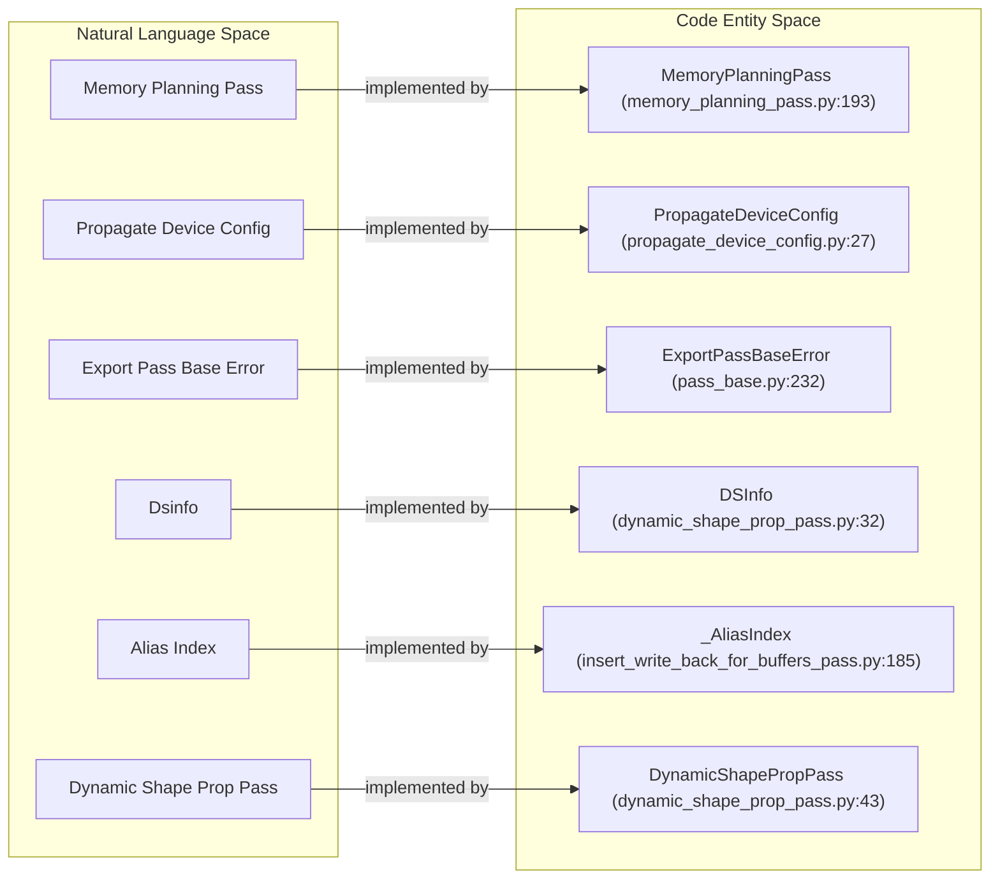
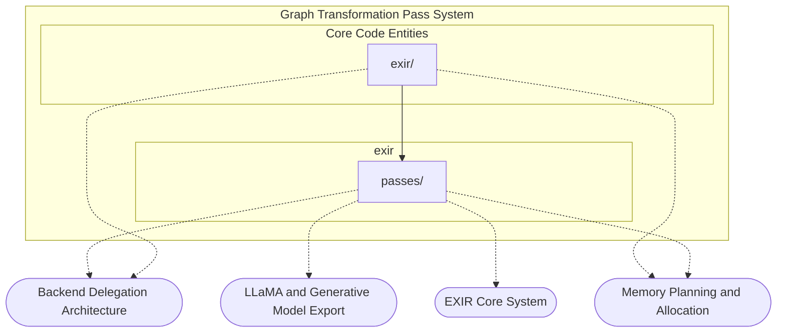
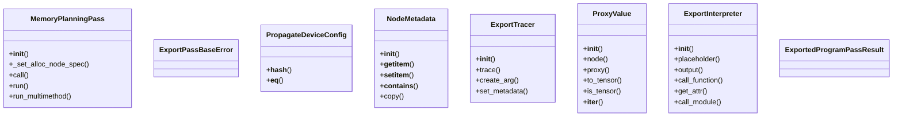
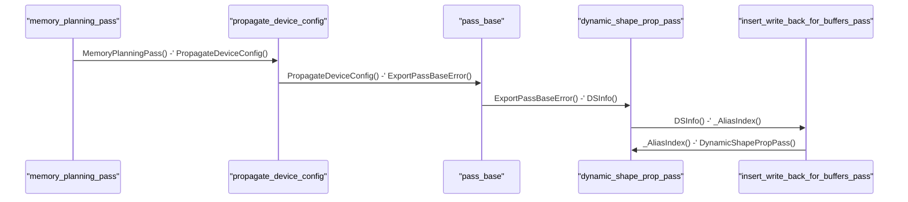

# 3-Source Context Packet (`git` + `CBM` + `llm-wiki`) for `3.2-graph-transformation-pass-system` — Graph Transformation Pass System

- **Target Wiki File**: `wiki/3.2-graph-transformation-pass-system.md`
- **Archetype**: `Leaf Technical Spec Page`
- **Parent Page**: `3-exir-core-system`
- **Summary**: Architectural specification and implementation reference for Graph Transformation Pass System (30 relevant source files). Primary code entities: `MemoryPlanningPass`, `__init__`, `_set_alloc_node_spec`, `call`, `DSInfo`.
- **Valid `[[wikilink]]` Neighbours**: `[[3-exir-core-system|EXIR Core System]]`, `[[1.1-getting-started|Getting Started]]`, `[[1.2-export-api-and-recipe-system|Export API and Recipe System]]`, `[[2.2-kernel-libraries-and-selective-build|Kernel Libraries and Selective Build]]`, `[[2.3-schema-generation-and-flatbuffers|Schema Generation and FlatBuffers]]`, `[[3.4-program-emission-and-serialization|Program Emission and Serialization]]`, `[[3.5-verification-and-dialect-system|Verification and Dialect System]]`, `[[4-quantization-systems|Quantization Systems]]`

## 1. Relevant Source Files (`git` + `CBM`, use verbatim in `<details>`)
- `[exir/passes/memory_planning_pass.py](exir/passes/memory_planning_pass.py)`
- `[exir/passes/dynamic_shape_prop_pass.py](exir/passes/dynamic_shape_prop_pass.py)`
- `[exir/passes/propagate_device_pass.py](exir/passes/propagate_device_pass.py)`
- `[exir/passes/insert_write_back_for_buffers_pass.py](exir/passes/insert_write_back_for_buffers_pass.py)`
- `[exir/passes/__init__.py](exir/passes/__init__.py)`
- `[exir/passes/constant_prop_pass.py](exir/passes/constant_prop_pass.py)`
- `[exir/passes/cse_pass.py](exir/passes/cse_pass.py)`
- `[exir/passes/_quant_patterns_and_replacements.py](exir/passes/_quant_patterns_and_replacements.py)`
- `[exir/passes/replace_complex_with_real_pass.py](exir/passes/replace_complex_with_real_pass.py)`
- `[exir/passes/delegate_scratch_pass.py](exir/passes/delegate_scratch_pass.py)`
- `[exir/passes/const_prop_pass.py](exir/passes/const_prop_pass.py)`
- `[exir/passes/legalize_portable_dim_order_pass.py](exir/passes/legalize_portable_dim_order_pass.py)`
- `[exir/passes/quantize_io_pass.py](exir/passes/quantize_io_pass.py)`
- `[exir/passes/debug_handle_generator_pass.py](exir/passes/debug_handle_generator_pass.py)`
- `[exir/passes/memory_format_ops_pass.py](exir/passes/memory_format_ops_pass.py)`
- `[exir/passes/fold_redundant_qdq_pass.py](exir/passes/fold_redundant_qdq_pass.py)`
- `[exir/passes/init_mutable_pass.py](exir/passes/init_mutable_pass.py)`
- `[exir/pass_base.py](exir/pass_base.py)`
- `[exir/passes/executorch_prim_ops_registry.py](exir/passes/executorch_prim_ops_registry.py)`
- `[exir/passes/propagate_device_config.py](exir/passes/propagate_device_config.py)`
- `[exir/passes/pass_registry.py](exir/passes/pass_registry.py)`
- `[exir/passes/replace_view_copy_with_view_pass.py](exir/passes/replace_view_copy_with_view_pass.py)`
- `[exir/passes/normalize_view_copy_base_pass.py](exir/passes/normalize_view_copy_base_pass.py)`
- `[exir/passes/quant_fusion_pass.py](exir/passes/quant_fusion_pass.py)`
- `[exir/passes/convert_constant_dim_order_pass.py](exir/passes/convert_constant_dim_order_pass.py)`
- `[exir/passes/normalize_transpose_pass.py](exir/passes/normalize_transpose_pass.py)`
- `[exir/passes/_device_copy_ops_registry.py](exir/passes/_device_copy_ops_registry.py)`
- `[exir/passes/dim_order_ops_registry.py](exir/passes/dim_order_ops_registry.py)`
- `[docs/source/compiler-custom-compiler-passes.md](docs/source/compiler-custom-compiler-passes.md)`
- `[exir/passes/BUCK](exir/passes/BUCK)`

## 2. Grounded Code Symbols (`CBM`, use verbatim for `[file:start-end]()` pill citations)
- `MemoryPlanningPass` (Class) @ `[exir/passes/memory_planning_pass.py:193-372]()` [fan-in=25, fan-out=0] — 
- `PropagateDeviceConfig` (Class) @ `[exir/passes/propagate_device_config.py:27-133]()` [fan-in=9, fan-out=0] — Controls whether the runtime copies method inputs, outputs and constants across the device boundary. Memory planning reserves buffers for graph inputs and outpu
- `ExportPassBaseError` (Class) @ `[exir/pass_base.py:232-233]()` [fan-in=12, fan-out=0] — 
- `DSInfo` (Class) @ `[exir/passes/dynamic_shape_prop_pass.py:32-40]()` [fan-in=1, fan-out=0] — Dynamic shape information we are tracking for each dynamic shape symbol.
- `_AliasIndex` (Class) @ `[exir/passes/insert_write_back_for_buffers_pass.py:185-217]()` [fan-in=1, fan-out=0] — Alias closures over the graph. The undirected adjacency (each node joined to the inputs its value may alias) is built once, and each closure is a breadth-first 
- `DynamicShapePropPass` (Class) @ `[exir/passes/dynamic_shape_prop_pass.py:43-301]()` [fan-in=0, fan-out=0] — In general, for each op, this pass propagate dynamic shape information from op inputs to op outputs. For cond/map nodes, we need pass dynamic shape information 
- `PropagateDevicePass` (Class) @ `[exir/passes/propagate_device_pass.py:282-890]()` [fan-in=0, fan-out=0] — After to_backend, walk the graph and insert H2D/D2H copy ops at delegate boundaries based on partitioner-assigned device info. When a delegate has a target_devi
- `_Rewriter` (Class) @ `[exir/passes/replace_complex_with_real_pass.py:161-216]()` [fan-in=1, fan-out=0] — Builds, in graph order, the real replacement of every node that reads or writes a complex tensor.
- `CSEPass` (Class) @ `[exir/passes/cse_pass.py:16-201]()` [fan-in=0, fan-out=0] — Common Subexpression Elimination using structural hashing (value numbering). Deduplicates operations with identical computation structure, replacing redundant c
- `DelegateScratchSpecPass` (Class) @ `[exir/passes/delegate_scratch_pass.py:40-100]()` [fan-in=0, fan-out=0] — Materializes the scratch buffers a backend asked for in ``preprocess``. Each ``DelegateScratchSpec`` becomes a one-dimensional ``uint8`` ``TensorSpec`` on the d
- `ReplaceComplexWithRealPass` (Class) @ `[exir/passes/replace_complex_with_real_pass.py:426-482]()` [fan-in=0, fan-out=0] — Replace complex tensors with real tensors that hold their real and imaginary parts in a last dim of size 2, and the ops on them with ops on real numbers, in an 
- `ConstPropPass` (Class) @ `[exir/passes/const_prop_pass.py:22-84]()` [fan-in=0, fan-out=0] — Performs constant folding and constant propagation.
- `LegalizePortableDimOrderPass` (Class) @ `[exir/passes/legalize_portable_dim_order_pass.py:74-173]()` [fan-in=0, fan-out=0] — Insert dim-order copies before portable ops that need another layout. Runs during ``edge -> executorch`` lowering on leftover edge ops whose portable kernels re
- `ExportInterpreter` (Class) @ `[exir/pass_base.py:999-1047]()` [fan-in=1, fan-out=0] — Interpreter to callback on any ExportPassBase functions
- `NodeMetadata` (Class) @ `[exir/pass_base.py:151-167]()` [fan-in=6, fan-out=0] — 
- `FoldRedundantDequantizeQuantizePass` (Class) @ `[exir/passes/fold_redundant_qdq_pass.py:14-36]()` [fan-in=0, fan-out=0] — Fold adjacent ``dequantize -> quantize`` pairs using the shared qparam matcher. Decomposition can erase a quantized no-op, such as eval-mode dropout, leaving it
- `DimOrderOpsRevertPass` (Class) @ `[exir/passes/memory_format_ops_pass.py:142-187]()` [fan-in=0, fan-out=0] — This pass is to revert the dim_order ops back to the memory format ops.
- `MemoryFormatOpsPass` (Class) @ `[exir/passes/memory_format_ops_pass.py:72-139]()` [fan-in=0, fan-out=0] — This pass replaces ops which takes torch.memory_format as an argument with 'equivalent' op which takes dim_order. This is towards the larger ExecuTorch goal to 
- `ReplaceEmptyLikePass` (Class) @ `[exir/passes/memory_format_ops_pass.py:25-69]()` [fan-in=0, fan-out=0] — Replaces aten.empty_like with aten.empty.memory_format. It runs after view ops have become copies and no-op views are removed, so a preserve_format buffer gets 
- `ExportedProgramPassBase` (Class) @ `[exir/pass_base.py:301-373]()` [fan-in=0, fan-out=0] — Base interface for implementing passes that operate on ExportedProgram.
- `_ExportPassBase` (Class) @ `[exir/pass_base.py:376-985]()` [fan-in=0, fan-out=0] — Interpreter-based pass class to help users maintain the IR spec while writing transformations.
- `InitializedMutableBufferPass` (Class) @ `[exir/passes/init_mutable_pass.py:13-32]()` [fan-in=0, fan-out=0] — If a buffer has a name that within a specified list, set meta["et_init_buffer"] to True, which provides the mutable buffer with an initialized state. As an exam

## 3. Grounded Source Code Excerpts (`git` Working Tree)
### `MemoryPlanningPass` in `[exir/passes/memory_planning_pass.py:193-208]()`
```python
class MemoryPlanningPass(PassBase):
    def __init__(
        self,
        memory_planning_algo: Optional[Callable[..., List[int]]] = None,
        allow_lifetime_and_storage_overlap: bool = False,
        alloc_graph_input: bool = True,
        alloc_graph_output: bool = True,
        alloc_mutable_buffers: bool = True,
        share_mutable_buffers: bool = False,
        alignment: int = ALIGNMENT,
    ) -> None:
        r"""
        alloc_graph_input/alloc_graph_output will have 4 different combinations
        to control if the memory planning algorithm need allocate memory for
        the graph input/output. The default behavior is the algorithm will allocate
        memory for both graph input and output.
```

### `PropagateDeviceConfig` in `[exir/passes/propagate_device_config.py:27-42]()`
```python
class PropagateDeviceConfig:
    """Controls whether the runtime copies method inputs, outputs and constants across the device boundary.

    Memory planning reserves buffers for graph inputs and outputs by default. A program that skips
    the input copy must use ``alloc_graph_input=False``. Unplanning the outputs as well, as below,
    copies the least::

        ExecutorchBackendConfig(
            propagate_device_config=PropagateDeviceConfig(
                skip_h2d_for_method_inputs=True,
                skip_d2h_for_method_outputs=True,
            ),
            enable_non_cpu_memory_planning=True,
            memory_planning_pass=MemoryPlanningPass(
                alloc_graph_input=False, alloc_graph_output=False
            ),
```

### `DSInfo` in `[exir/passes/dynamic_shape_prop_pass.py:32-40]()`
```python
class DSInfo:
    """
    Dynamic shape information we are tracking for each dynamic shape symbol.
    """

    # the output of format_node() for the node introducing the symbol
    node_debug_str: str
    # upper bound value or None for fully dynamic memory planning
    ubval: Optional[int]
```

### `_AliasIndex` in `[exir/passes/insert_write_back_for_buffers_pass.py:185-200]()`
```python
class _AliasIndex:
    """
    Alias closures over the graph. The undirected adjacency (each node joined
    to the inputs its value may alias) is built once, and each closure is a
    breadth-first walk cached per seed. The closure is symmetric on purpose:
    the base of a view must count as an alias of the view's value, since a
    mutation of the base is a mutation of the view once
    ReplaceViewCopyWithViewPass has run.
    """

    def __init__(self, nodes: List[torch.fx.Node]) -> None:
        self._adjacency: Dict[torch.fx.Node, List[torch.fx.Node]] = {}
        for node in nodes:
            for arg in _aliasing_inputs(node):
                self._adjacency.setdefault(node, []).append(arg)
                self._adjacency.setdefault(arg, []).append(node)
```

### `DynamicShapePropPass` in `[exir/passes/dynamic_shape_prop_pass.py:43-58]()`
```python
class DynamicShapePropPass(ExportPass):
    """
    In general, for each op, this pass propagate dynamic shape information from
    op inputs to op outputs.

    For cond/map nodes, we need pass dynamic shape information to submodules'
    placeholder nodes, propagate the dynamic shape information thru the graphs
    of the submodules, and finally set the node's dynamic shape info based on
    submodules' output nodes' dynamic shape info.
    """

    def __init__(
        self, mode: DynamicMemoryPlanningMode = DynamicMemoryPlanningMode.UPPER_BOUND
    ):
        """
        mode controls how we do memory planning for dynamic shape tensors.
```


## 4. Linked Official Docs (`llm-wiki` / `RAG`)
- **EXIR Core System** (`wiki/3-exir-core-system.md`, score=157.394, shared_symbols=['ExportPassBaseError', 'MemoryPlanningPass', 'PropagateDeviceConfig']): # EXIR Core System > Architectural specification and implementation reference for EXIR Core System (40 relevant source files). Primary code entities: `EdgeProgramManager`, `__init__`, `config_methods`, `exported_program`, `MemoryPlanningPass`. <details> <summary>Relevant source files</summary> The following files were used as context for generating this w
- **ExecuTorch DeepWiki** (`wiki/index.md`, score=101.743, shared_symbols=[]): # ExecuTorch DeepWiki Generated from `home-jason-Project-deepwiki-executorch` at commit `b3b565b5b62f` (2026-11-15T15:02:11+00:00). ## Pages - [[1-overview|Overview]] — Architectural specification and implementation reference for Overview (10 relevant source files). Primary code entities: `Module`, `MethodHolder`, `PlannedMemory`, `EdgeProgramManager`, `_
- **Memory Planning and Allocation** (`wiki/3.3-memory-planning-and-allocation.md`, score=97.113, shared_symbols=['MemoryPlanningPass']): # Memory Planning and Allocation ↑ [[3-exir-core-system|EXIR Core System]] > Architectural specification and implementation reference for Memory Planning and Allocation (5 relevant source files). Primary code entities: `MemoryPlanningPass`, `__init__`, `_set_alloc_node_spec`, `call`, `AddressSpaceOverflowException`. <details> <summary>Relevant source file
- **Program Emission and Serialization** (`wiki/3.4-program-emission-and-serialization.md`, score=90.488, shared_symbols=[]): # Program Emission and Serialization ↑ [[3-exir-core-system|EXIR Core System]] > Architectural specification and implementation reference for Program Emission and Serialization (35 relevant source files). Primary code entities: `_AbstractValue`, `_Emitter`, `__init__`, `_add_debug_handle`, `Call`. <details> <summary>Relevant source files</summary> The fo
- **Backend Delegation Architecture** (`wiki/5-backend-delegation-architecture.md`, score=90.488, shared_symbols=[]): # Backend Delegation Architecture > Architectural specification and implementation reference for Backend Delegation Architecture (40 relevant source files). Primary code entities: `CommandBuffer`, `begin`, `bind_descriptors`, `bind_pipeline`, `NodeVisitor`. <details> <summary>Relevant source files</summary> The following files were used as context for gen
- **ARM TOSA and Ethos-U Backend** (`wiki/5.4-arm-tosa-and-ethos-u-backend.md`, score=90.488, shared_symbols=[]): # ARM TOSA and Ethos-U Backend ↑ [[5-backend-delegation-architecture|Backend Delegation Architecture]] > Architectural specification and implementation reference for ARM TOSA and Ethos-U Backend (40 relevant source files). Primary code entities: `TosaArg`, `__init__`, `__process_list`, `__process_node`, `InsertTableOpsPass`. <details> <summary>Relevant so

## 5. Pre-Verified DeepWiki v1.9.9.5 Mermaid Diagrams
### Natural Language Space <-> Code Entity Space


### Subsystem Architecture Flowchart


### Class Hierarchy Diagram


### Call Sequence Diagram


## 6. DeepWiki v1.9.9.5 Authoring Checklist for `wiki/3.2-graph-transformation-pass-system.md`
1. Keep YAML frontmatter at top (`id`, `title`, `parent`, `sources`, `linked_docs`, `bridge_symbols`).
2. Keep `<details><summary>Relevant source files</summary>` block immediately after `# Title`.
3. Start with `## Purpose and Scope`, then numbered `## 1. ...`, `## 2. ...` sections separated by `---`.
4. Include at least 2 ```mermaid``` diagrams (including a `Natural Language Space` <-> `Code Entity Space` mapping).
5. Cite code entities inline using `[path/to/file.ext:start-end]()` and end every `##` section with `Sources: [file:start-end]()`.
6. Run `deepwiki_cli.py build --enrich-only ...` and `deepwiki_cli.py validate ...` after editing.
