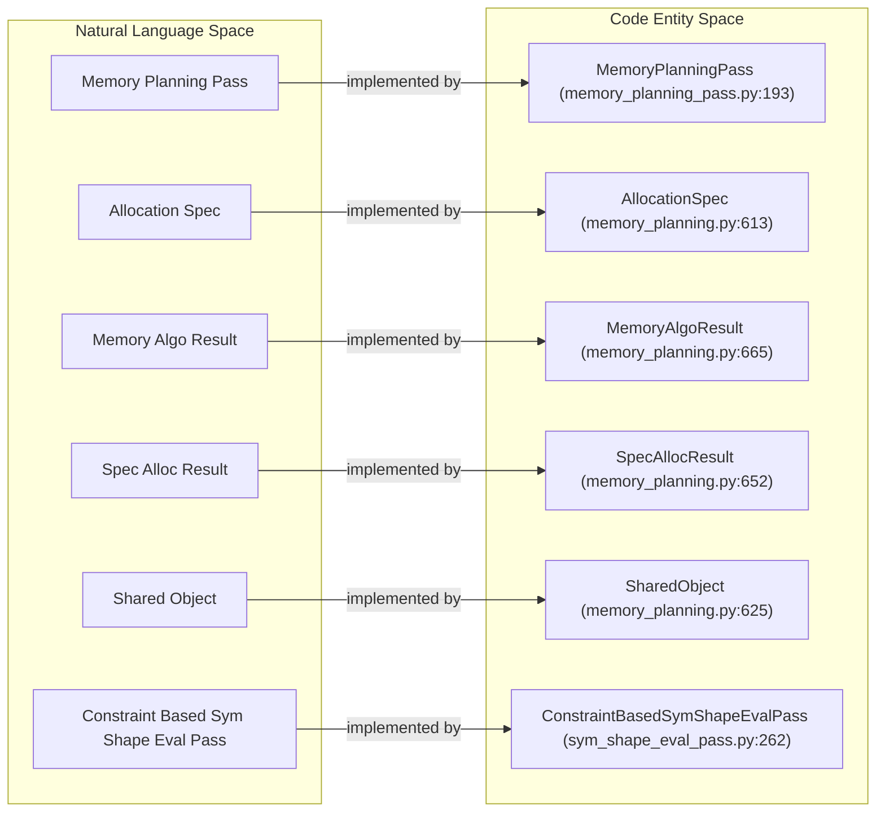
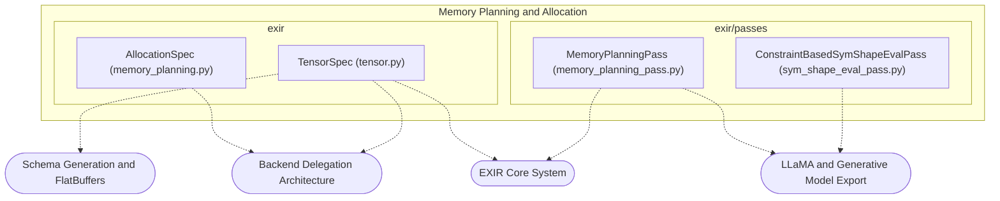
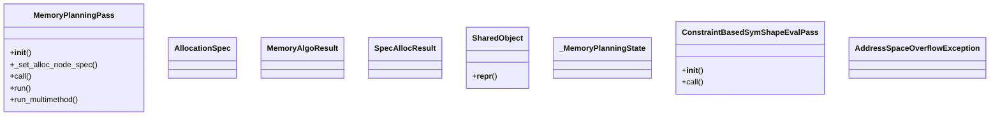
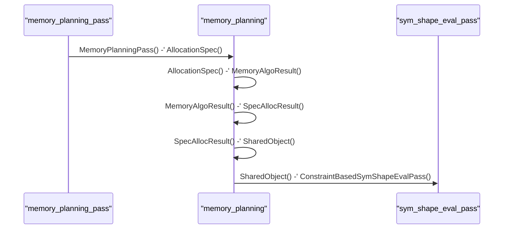

# 3-Source Context Packet (`git` + `CBM` + `llm-wiki`) for `3.3-memory-planning-and-allocation` — Memory Planning and Allocation

- **Target Wiki File**: `wiki/3.3-memory-planning-and-allocation.md`
- **Archetype**: `Leaf Technical Spec Page`
- **Parent Page**: `3-exir-core-system`
- **Summary**: Architectural specification and implementation reference for Memory Planning and Allocation (5 relevant source files). Primary code entities: `MemoryPlanningPass`, `__init__`, `_set_alloc_node_spec`, `call`, `AddressSpaceOverflowException`.
- **Valid `[[wikilink]]` Neighbours**: `[[3-exir-core-system|EXIR Core System]]`, `[[1.1-getting-started|Getting Started]]`, `[[1.2-export-api-and-recipe-system|Export API and Recipe System]]`, `[[2.2-kernel-libraries-and-selective-build|Kernel Libraries and Selective Build]]`, `[[2.3-schema-generation-and-flatbuffers|Schema Generation and FlatBuffers]]`, `[[3.4-program-emission-and-serialization|Program Emission and Serialization]]`, `[[3.5-verification-and-dialect-system|Verification and Dialect System]]`, `[[4-quantization-systems|Quantization Systems]]`

## 1. Relevant Source Files (`git` + `CBM`, use verbatim in `<details>`)
- `[exir/passes/memory_planning_pass.py](exir/passes/memory_planning_pass.py)`
- `[exir/tensor.py](exir/tensor.py)`
- `[exir/memory_planning.py](exir/memory_planning.py)`
- `[exir/passes/sym_shape_eval_pass.py](exir/passes/sym_shape_eval_pass.py)`
- `[docs/source/compiler-memory-planning.md](docs/source/compiler-memory-planning.md)`

## 2. Grounded Code Symbols (`CBM`, use verbatim for `[file:start-end]()` pill citations)
- `MemoryPlanningPass` (Class) @ `[exir/passes/memory_planning_pass.py:193-372]()` [fan-in=25, fan-out=0] — 
- `AllocationSpec` (Class) @ `[exir/memory_planning.py:613-621]()` [fan-in=2, fan-out=0] — AllocationSpec is used to represent the allocation of a tensor.
- `MemoryAlgoResult` (Class) @ `[exir/memory_planning.py:665-673]()` [fan-in=2, fan-out=0] — This is the result returned by a memory planning algorithm that is invoked by memory_planning_algorithm_suite. It contains the allocation decisions of that algo
- `SpecAllocResult` (Class) @ `[exir/memory_planning.py:652-661]()` [fan-in=2, fan-out=0] — These are the values that a memory plannig algorithm assigns to a spec. These are not directly written back into the spec object, but are used to track the allo
- `SharedObject` (Class) @ `[exir/memory_planning.py:625-648]()` [fan-in=1, fan-out=0] — r""" We define the concept of shared object, which represents a segment in the memory buffer that can be shared by multiple tensors. In order to check if a shar
- `ConstraintBasedSymShapeEvalPass` (Class) @ `[exir/passes/sym_shape_eval_pass.py:262-312]()` [fan-in=1, fan-out=0] — If we enable dynamic shape tracing, a tensor's shape may become a symbolic formula. We should convert those symbolic formula to concrete value for static/upperb
- `TensorSpec` (Class) @ `[exir/tensor.py:183-333]()` [fan-in=0, fan-out=0] — Captures the metadata for a given Tensor (ex. scalar type, storage, etc.).
- `Verifier` (Class) @ `[exir/memory_planning.py:50-325]()` [fan-in=0, fan-out=0] — Verify if the outcome of a memory planning algorithm makes sense. E.g., make sure tensors having overlapping lifetime does not have overlapping storage/buffer.
- `HintBasedSymShapeEvalPass` (Class) @ `[exir/passes/sym_shape_eval_pass.py:180-259]()` [fan-in=0, fan-out=0] — .. warning:: 'HintBasedSymShapeEvalPass` is deprecated and will be removed in a future version of ExecuTorch. Please use `ConstraintBasedSymShapeEvalPass` inste
- `_MemoryPlanningState` (Class) @ `[exir/passes/memory_planning_pass.py:187-190]()` [fan-in=1, fan-out=0] — 
- `AddressSpaceOverflowException` (Class) @ `[exir/tensor.py:24-25]()` [fan-in=1, fan-out=0] — 
- `MemoryPlanningAlgorithmSuite` (Class) @ `[exir/memory_planning.py:1058-1135]()` [fan-in=0, fan-out=0] — 
- `from_tensor` (Method) @ `[exir/tensor.py:232-252]()` [fan-in=19, fan-out=2] — (cls, tensor: torch.Tensor, const: bool = False)
- `collect_specs_from_nodes` (Function) @ `[exir/memory_planning.py:464-567]()` [fan-in=3, fan-out=7] — r""" Collect specs from the passed in nodes. Do filtering as controlled by arguments. Arguments: ignore_graph_input: ignore graph input tensors from placeholder
- `_is_mutable_buffer` (Function) @ `[exir/memory_planning.py:377-393]()` [fan-in=5, fan-out=0] — Check if the node is mutable buffer according to the provided graph signature.
- `apply_algo` (Function) @ `[exir/memory_planning.py:1464-1598]()` [fan-in=1, fan-out=8] — Recursively apply algo to graph_module and its submodules for control flow. Partitions specs by device type and device idx, and runs the memory planning algorit
- `get_node_tensor_specs` (Function) @ `[exir/memory_planning.py:799-831]()` [fan-in=5, fan-out=0] — r""" Return the list of the tensor specs for the node or empty list if the node has no tensor specs. A delegate call's scratch buffers are included. They are no
- `pick_shared_obj` (Function) @ `[exir/memory_planning.py:703-796]()` [fan-in=1, fan-out=6] — r""" Pick the available shared object to which to assign this spec, or create a new one Algorithm details Previous: Look at every spec in chronological order. F
- `update_all_tensors_lifetime` (Function) @ `[exir/memory_planning.py:570-609]()` [fan-in=1, fan-out=6] — r""" Set the lifetime for all the tensors encountered in the Fx graph.
- `run` (Method) @ `[exir/passes/memory_planning_pass.py:280-344]()` [fan-in=1, fan-out=4] — A pass for memory planning. The actual algorithm used will be picked by memory_planning_algo
- `verify_graph_input_output` (Method) @ `[exir/memory_planning.py:236-325]()` [fan-in=0, fan-out=6] — r""" alloc_graph_input / alloc_graph_output indicates if memory for graph input/output is allocated by the compiler. If not, the runtime will set them using buf
- `verify_storage_reuse` (Method) @ `[exir/memory_planning.py:169-234]()` [fan-in=0, fan-out=6] — 'allow_lifetime_and_storage_overlap' allows tensors to overlap in both lifetime and storage. If is it False, and two tensors have both overlapping lifetime and 

## 3. Grounded Source Code Excerpts (`git` Working Tree)
### `MemoryPlanningPass` in `[exir/passes/memory_planning_pass.py:193-208]()`
```python
class MemoryPlanningPass(PassBase):
    def __init__(
        self,
        memory_planning_algo: Optional[Callable[..., List[int]]] = None,
        allow_lifetime_and_storage_overlap: bool = False,
        alloc_graph_input: bool = True,
        alloc_graph_output: bool = True,
        alloc_mutable_buffers: bool = True,
        share_mutable_buffers: bool = False,
        alignment: int = ALIGNMENT,
    ) -> None:
        r"""
        alloc_graph_input/alloc_graph_output will have 4 different combinations
        to control if the memory planning algorithm need allocate memory for
        the graph input/output. The default behavior is the algorithm will allocate
        memory for both graph input and output.
```

### `AllocationSpec` in `[exir/memory_planning.py:613-621]()`
```python
class AllocationSpec:
    """
    AllocationSpec is used to represent the allocation of a tensor.
    """

    # The offset of the tensor in the shared object/pool.
    offset: int
    # TensorSpec
    spec: TensorSpec
```

### `MemoryAlgoResult` in `[exir/memory_planning.py:665-673]()`
```python
class MemoryAlgoResult:
    """This is the result returned by a memory planning algorithm that is
    invoked by memory_planning_algorithm_suite. It contains the allocation
    decisions of that algorithm for all the specs, and the size of the buffer
    that was used for different memory hierarchies.
    """

    spec_dict: Dict[TensorSpec, SpecAllocResult]
    bufsizes: List[int]
```

### `SpecAllocResult` in `[exir/memory_planning.py:652-661]()`
```python
class SpecAllocResult:
    """These are the values that a memory plannig algorithm assigns to a spec.
    These are not directly written back into the spec object, but are used to
    track the allocation decisions and assigned back to the spec object in the
    end, based on which algorithm is picked as the best performing one.
    """

    mem_id: int
    mem_obj_id: int
    mem_offset: int
```

### `SharedObject` in `[exir/memory_planning.py:625-640]()`
```python
class SharedObject:
    r"""
    We define the concept of shared object, which represents a segment
    in the memory buffer that can be shared by multiple tensors. In order to
    check if a shared object is available for a tensor, we maintain the
    last_used_index attribute. The shared object will be available for nodes
    with index greater than last_used_index.
    """

    # index of the shared object in the list of shared objects, used as a unique id
    idx: int
    # offset in the memory buffer
    offset: int
    # size of this shared object in bytes
    size: int
    # When the object is first created
```


## 4. Linked Official Docs (`llm-wiki` / `RAG`)
- **EXIR Core System** (`wiki/3-exir-core-system.md`, score=146.703, shared_symbols=['MemoryPlanningPass', 'from_tensor']): # EXIR Core System > Architectural specification and implementation reference for EXIR Core System (40 relevant source files). Primary code entities: `EdgeProgramManager`, `__init__`, `config_methods`, `exported_program`, `MemoryPlanningPass`. <details> <summary>Relevant source files</summary> The following files were used as context for generating this w
- **Graph Transformation Pass System** (`wiki/3.2-graph-transformation-pass-system.md`, score=130.657, shared_symbols=['MemoryPlanningPass']): # Graph Transformation Pass System ↑ [[3-exir-core-system|EXIR Core System]] > Architectural specification and implementation reference for Graph Transformation Pass System (30 relevant source files). Primary code entities: `MemoryPlanningPass`, `__init__`, `_set_alloc_node_spec`, `call`, `DSInfo`. <details> <summary>Relevant source files</summary> The f
- **ExecuTorch DeepWiki** (`wiki/index.md`, score=128.897, shared_symbols=[]): # ExecuTorch DeepWiki Generated from `home-jason-Project-deepwiki-executorch` at commit `b3b565b5b62f` (2026-11-15T15:02:11+00:00). ## Pages - [[1-overview|Overview]] — Architectural specification and implementation reference for Overview (10 relevant source files). Primary code entities: `Module`, `MethodHolder`, `PlannedMemory`, `EdgeProgramManager`, `_
- **Memory Planning** (`raw/executorch/compiler-memory-planning.md`, score=114.127, shared_symbols=['MemoryPlanningPass']): # Memory Planning Audience: Backend integrators and embedded developers who are interested in customizing the regions of memory ExecuTorch programs operate in. ## Overview MemoryPlanning is the very last action taken before taking an `ExportedProgram` and undergoing emission to an ExecuTorch program. During this process, ExecuTorch takes the size and life
- **Program Structure and Compilation Flow** (`wiki/3.1-program-structure-and-compilation-flow.md`, score=106.728, shared_symbols=['MemoryPlanningPass']): # Program Structure and Compilation Flow ↑ [[3-exir-core-system|EXIR Core System]] > Architectural specification and implementation reference for Program Structure and Compilation Flow (12 relevant source files). Primary code entities: `CaptureConfig`, `EdgeCompileConfig`, `ExecutorchBackendConfig`, `EdgeProgramManager`, `__init__`. <details> <summary>Rel
- **Program Emission and Serialization** (`wiki/3.4-program-emission-and-serialization.md`, score=105.228, shared_symbols=[]): # Program Emission and Serialization ↑ [[3-exir-core-system|EXIR Core System]] > Architectural specification and implementation reference for Program Emission and Serialization (35 relevant source files). Primary code entities: `_AbstractValue`, `_Emitter`, `__init__`, `_add_debug_handle`, `Call`. <details> <summary>Relevant source files</summary> The fo

## 5. Pre-Verified DeepWiki v1.9.9.5 Mermaid Diagrams
### Natural Language Space <-> Code Entity Space


### Subsystem Architecture Flowchart


### Class Hierarchy Diagram


### Call Sequence Diagram


## 6. DeepWiki v1.9.9.5 Authoring Checklist for `wiki/3.3-memory-planning-and-allocation.md`
1. Keep YAML frontmatter at top (`id`, `title`, `parent`, `sources`, `linked_docs`, `bridge_symbols`).
2. Keep `<details><summary>Relevant source files</summary>` block immediately after `# Title`.
3. Start with `## Purpose and Scope`, then numbered `## 1. ...`, `## 2. ...` sections separated by `---`.
4. Include at least 2 ```mermaid``` diagrams (including a `Natural Language Space` <-> `Code Entity Space` mapping).
5. Cite code entities inline using `[path/to/file.ext:start-end]()` and end every `##` section with `Sources: [file:start-end]()`.
6. Run `deepwiki_cli.py build --enrich-only ...` and `deepwiki_cli.py validate ...` after editing.
