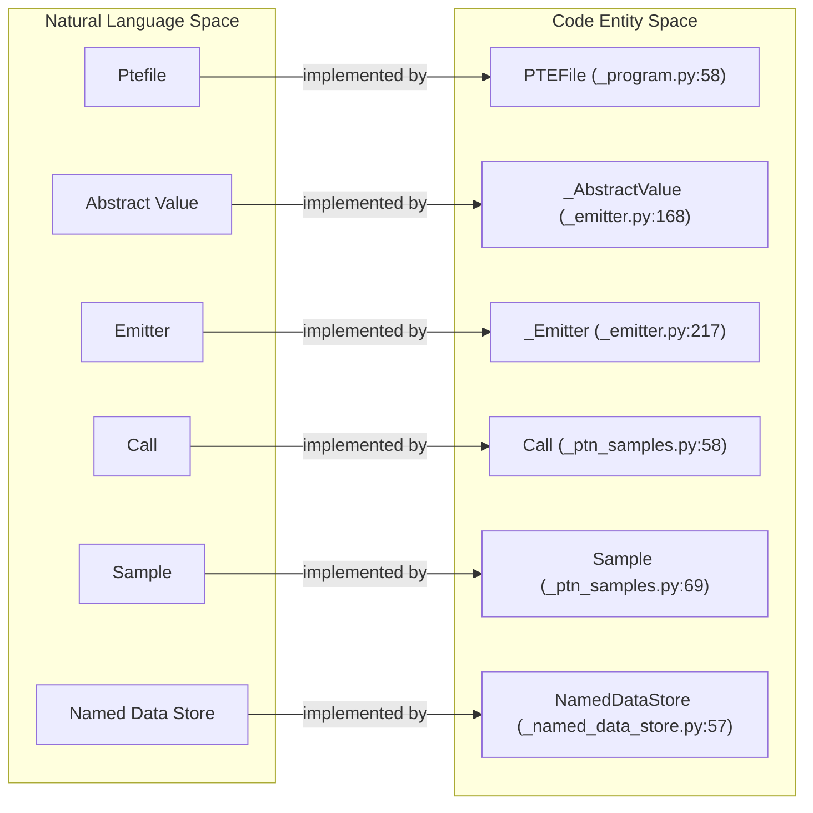
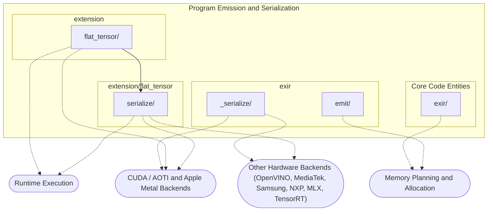
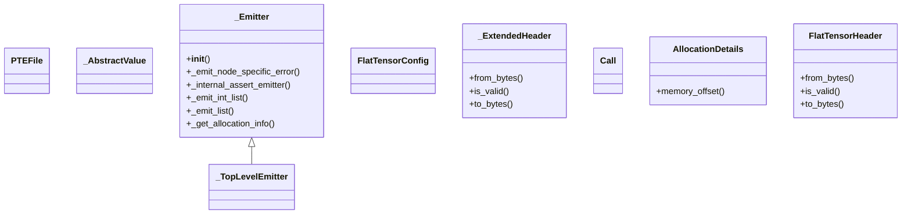
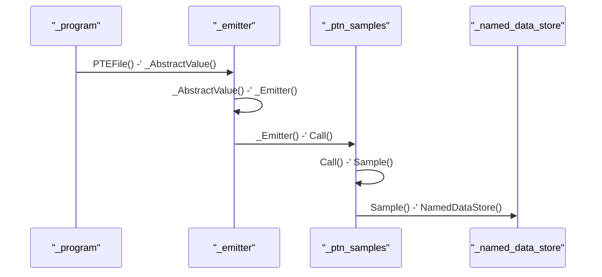

# 3-Source Context Packet (`git` + `CBM` + `llm-wiki`) for `3.4-program-emission-and-serialization` — Program Emission and Serialization

- **Target Wiki File**: `wiki/3.4-program-emission-and-serialization.md`
- **Archetype**: `Leaf Technical Spec Page`
- **Parent Page**: `3-exir-core-system`
- **Summary**: Architectural specification and implementation reference for Program Emission and Serialization (35 relevant source files). Primary code entities: `_AbstractValue`, `_Emitter`, `__init__`, `_add_debug_handle`, `Call`.
- **Valid `[[wikilink]]` Neighbours**: `[[3-exir-core-system|EXIR Core System]]`, `[[1.1-getting-started|Getting Started]]`, `[[1.2-export-api-and-recipe-system|Export API and Recipe System]]`, `[[2.2-kernel-libraries-and-selective-build|Kernel Libraries and Selective Build]]`, `[[2.3-schema-generation-and-flatbuffers|Schema Generation and FlatBuffers]]`, `[[3.1-program-structure-and-compilation-flow|Program Structure and Compilation Flow]]`, `[[3.2-graph-transformation-pass-system|Graph Transformation Pass System]]`, `[[3.3-memory-planning-and-allocation|Memory Planning and Allocation]]`

## 1. Relevant Source Files (`git` + `CBM`, use verbatim in `<details>`)
- `[exir/emit/_emitter.py](exir/emit/_emitter.py)`
- `[exir/_serialize/_ptn_samples.py](exir/_serialize/_ptn_samples.py)`
- `[exir/_serialize/_program.py](exir/_serialize/_program.py)`
- `[exir/_serialize/_named_data_store.py](exir/_serialize/_named_data_store.py)`
- `[exir/_serialize/_flatbuffer.py](exir/_serialize/_flatbuffer.py)`
- `[exir/_serialize/_flatbuffer_program.py](exir/_serialize/_flatbuffer_program.py)`
- `[exir/_serialize/_cord.py](exir/_serialize/_cord.py)`
- `[exir/emit/_emit_program.py](exir/emit/_emit_program.py)`
- `[exir/_serialize/_dataclass.py](exir/_serialize/_dataclass.py)`
- `[exir/_serialize/data_serializer.py](exir/_serialize/data_serializer.py)`
- `[exir/emit/__init__.py](exir/emit/__init__.py)`
- `[exir/_serialize/_ptn.py](exir/_serialize/_ptn.py)`
- `[exir/_serialize/__init__.py](exir/_serialize/__init__.py)`
- `[exir/_serialize/generate_program.py](exir/_serialize/generate_program.py)`
- `[exir/_serialize/_serialize.py](exir/_serialize/_serialize.py)`
- `[exir/_serialize/bindings.cpp](exir/_serialize/bindings.cpp)`
- `[extension/flat_tensor/serialize/serialize.py](extension/flat_tensor/serialize/serialize.py)`
- `[exir/schema.py](exir/schema.py)`
- `[extension/flat_tensor/flat_tensor_data_map.cpp](extension/flat_tensor/flat_tensor_data_map.cpp)`
- `[extension/flat_tensor/flat_tensor_data_map.h](extension/flat_tensor/flat_tensor_data_map.h)`
- `[extension/flat_tensor/serialize/flat_tensor_schema.py](extension/flat_tensor/serialize/flat_tensor_schema.py)`
- `[extension/flat_tensor/serialize/flat_tensor_header.h](extension/flat_tensor/serialize/flat_tensor_header.h)`
- `[extension/flat_tensor/serialize/serialize.cpp](extension/flat_tensor/serialize/serialize.cpp)`
- `[exir/_serialize/padding.py](exir/_serialize/padding.py)`
- `[extension/flat_tensor/targets.bzl](extension/flat_tensor/targets.bzl)`
- `[extension/flat_tensor/__init__.py](extension/flat_tensor/__init__.py)`
- `[extension/flat_tensor/serialize/flat_tensor_header.cpp](extension/flat_tensor/serialize/flat_tensor_header.cpp)`
- `[extension/flat_tensor/serialize/CMakeLists.txt](extension/flat_tensor/serialize/CMakeLists.txt)`
- `[extension/flat_tensor/README.md](extension/flat_tensor/README.md)`
- `[exir/emit/BUCK](exir/emit/BUCK)`

## 2. Grounded Code Symbols (`CBM`, use verbatim for `[file:start-end]()` pill citations)
- `PTEFile` (Class) @ `[exir/_serialize/_program.py:58-67]()` [fan-in=10, fan-out=0] — Wraps together the data required to serialize into a PTE file.
- `_AbstractValue` (Class) @ `[exir/emit/_emitter.py:168-175]()` [fan-in=3, fan-out=0] — Represents an already emitted EValue
- `_Emitter` (Class) @ `[exir/emit/_emitter.py:217-1964]()` [fan-in=3, fan-out=0] — An abstract interpreter (https://wiki.mozilla.org/Abstract_Interpretation) used to emit the given traced torch.fx.GraphModule to the flatbuffer schema.
- `Call` (Class) @ `[exir/_serialize/_ptn_samples.py:58-65]()` [fan-in=2, fan-out=0] — One call of a method: positional inputs, and optionally what it produced.
- `Sample` (Class) @ `[exir/_serialize/_ptn_samples.py:69-73]()` [fan-in=1, fan-out=0] — Calls run in order from the program's initial state, with no reset between.
- `NamedDataStore` (Class) @ `[exir/_serialize/_named_data_store.py:57-358]()` [fan-in=1, fan-out=0] — NamedDataStore manages the data that delegates want to share. Backends add bytes to the store under a unique key. These bytes can be retrieved at runtime using 
- `NamedDataStoreOutput` (Class) @ `[exir/_serialize/_named_data_store.py:39-54]()` [fan-in=1, fan-out=0] — Holds named data for serialization. Note: a DataEntry contains the index into `buffers`, the alignment and a tensor layout, if applicable. Attributes: buffers: 
- `_ResourceFiles` (Class) @ `[exir/_serialize/_flatbuffer.py:125-153]()` [fan-in=1, fan-out=0] — Manages a collection of python resources that will be written to files.
- `_SchemaFileIdentifierGetter` (Class) @ `[exir/_serialize/_flatbuffer.py:103-122]()` [fan-in=1, fan-out=0] — Finds the file_identifier value in flatbuffer schemas.
- `_SchemaMaxAlignmentGetter` (Class) @ `[exir/_serialize/_flatbuffer.py:84-100]()` [fan-in=1, fan-out=0] — Finds the largest (force_align: N) N value in flatbuffer schemas.
- `_EmitterState` (Class) @ `[exir/emit/_emitter.py:139-164]()` [fan-in=0, fan-out=0] — State of a single emitter. Local to at least the entry point, and may be local to a subgraph of an entry point originating from control flow.
- `_ProgramState` (Class) @ `[exir/emit/_emitter.py:104-135]()` [fan-in=0, fan-out=0] — State shared between all methods of a program and the graph module it represents. Initialized once within emit_program and then shared across each entry point a
- `_TopLevelEmitter` (Class) @ `[exir/emit/_emitter.py:1967-2235]()` [fan-in=0, fan-out=0] — An emitter that manages the root level operations within a graph module. Exists as a separate class so that 'Emitter' can handle the special behavior of 'placeh
- `EmitterOutput` (Class) @ `[exir/emit/_emit_program.py:28-60]()` [fan-in=1, fan-out=0] — The outputs of program emission. Contains the executorch program object as well as a mapping of instruction ids to debug handles.
- `AlignedData` (Class) @ `[exir/_serialize/data_serializer.py:45-53]()` [fan-in=1, fan-out=0] — Data and its required alignment for serialization.
- `Cord` (Class) @ `[exir/_serialize/_cord.py:94-140]()` [fan-in=0, fan-out=0] — A `bytes`-like sequence of bytes, stored non-contiguously. Users can use a Cord to assemble large files and data blobs using references to and slices of other d
- `FileBackedData` (Class) @ `[exir/_serialize/_cord.py:16-88]()` [fan-in=0, fan-out=0] — A byte buffer that stays on disk until explicitly closed.
- `DataEntry` (Class) @ `[exir/_serialize/data_serializer.py:11-24]()` [fan-in=0, fan-out=0] — Represents a single blob in `DataPayload`, specifying its location and metadata. Attributes: buffer_index: The index inside `DataPayload.buffers` that this Data
- `DataPayload` (Class) @ `[exir/_serialize/data_serializer.py:28-41]()` [fan-in=0, fan-out=0] — Contains the data and metadata required for serialization. Having an index-based arrangement instead of embedding the buffers in DataEntry allows the caller to 
- `DataSerializer` (Class) @ `[exir/_serialize/data_serializer.py:83-120]()` [fan-in=0, fan-out=0] — Serializes and deserializes data. Data can be referenced by a unique key. This base class enables serialization into different formats. See executorch/extension
- `FlatTensorSerializer` (Class) @ `[extension/flat_tensor/serialize/serialize.py:259-429]()` [fan-in=2, fan-out=0] — A concrete implementation of the DataSerializer interface that serializes and deserializes data to/from the FlatTensor format.
- `ExtraTensorInfo` (Class) @ `[exir/schema.py:57-66]()` [fan-in=1, fan-out=0] — Check program.fbs for explanations of this enum.

## 3. Grounded Source Code Excerpts (`git` Working Tree)
### `PTEFile` in `[exir/_serialize/_program.py:58-67]()`
```python
class PTEFile:
    """
    Wraps together the data required to serialize into a PTE file.
    """

    program: Program
    # TODO(lfq): add constant data (currently restored in the program)
    # TODO(lfq): update this to List[bytes]
    mutable_data: Optional[List[Buffer]] = None
    named_data: Optional[NamedDataStoreOutput] = None
```

### `_AbstractValue` in `[exir/emit/_emitter.py:168-175]()`
```python
class _AbstractValue:
    """Represents an already emitted EValue"""

    # Index in the values table of this EValue.
    id: int

    # Used for sanity checks for functions that expect to only receive AbstractValues.
    tensor: Optional[Tensor]
```

### `_Emitter` in `[exir/emit/_emitter.py:217-232]()`
```python
class _Emitter(torch.fx.Interpreter):
    """An abstract interpreter (https://wiki.mozilla.org/Abstract_Interpretation) used to emit the
    given traced torch.fx.GraphModule to the flatbuffer schema."""

    # pyre-ignore[13]: Attribute `node` is never initialized.
    node: torch.fx.Node

    def __init__(
        self,
        graph_module: torch.fx.GraphModule,
        emitter_state: _EmitterState,
        program_state: _ProgramState,
        instruction_start_offset: int = 0,
        binding_input_values: Optional[List[_AbstractValue]] = None,
        binding_output_values: Optional[List[_AbstractValue]] = None,
    ) -> None:
```

### `Call` in `[exir/_serialize/_ptn_samples.py:58-65]()`
```python
class Call:
    """One call of a method: positional inputs, and optionally what it produced."""

    method: str
    inputs: list[Value]
    outputs: list[Value] | None = None
    intermediates: dict[str, torch.Tensor] | None = None
    tol: Tolerance | None = None
```

### `Sample` in `[exir/_serialize/_ptn_samples.py:69-73]()`
```python
class Sample:
    """Calls run in order from the program's initial state, with no reset between."""

    calls: list[Call]
    tol: Tolerance | None = None
```


## 4. Linked Official Docs (`llm-wiki` / `RAG`)
- **Schema Generation and FlatBuffers** (`wiki/2.3-schema-generation-and-flatbuffers.md`, score=132.204, shared_symbols=['BackendDelegateDataReference', 'ExtraTensorInfo', 'FlatTensorConfig', 'PTEFile', 'Tensor']): # Schema Generation and FlatBuffers ↑ [[2-build-system-and-infrastructure|Build System and Infrastructure]] > Architectural specification and implementation reference for Schema Generation and FlatBuffers (36 relevant source files). Primary code entities: `Call`, `Sample`, `SampleSet`, `_SetDecoder`, `PTEFile`. <details> <summary>Relevant source files</su
- **EXIR Core System** (`wiki/3-exir-core-system.md`, score=85.786, shared_symbols=['PTEFile', 'Tensor']): # EXIR Core System > Architectural specification and implementation reference for EXIR Core System (40 relevant source files). Primary code entities: `EdgeProgramManager`, `__init__`, `config_methods`, `exported_program`, `MemoryPlanningPass`. <details> <summary>Relevant source files</summary> The following files were used as context for generating this w
- **ExecuTorch DeepWiki** (`wiki/index.md`, score=80.831, shared_symbols=[]): # ExecuTorch DeepWiki Generated from `home-jason-Project-deepwiki-executorch` at commit `b3b565b5b62f` (2026-11-15T15:02:11+00:00). ## Pages - [[1-overview|Overview]] — Architectural specification and implementation reference for Overview (10 relevant source files). Primary code entities: `Module`, `MethodHolder`, `PlannedMemory`, `EdgeProgramManager`, `_
- **Memory Planning and Allocation** (`wiki/3.3-memory-planning-and-allocation.md`, score=74.692, shared_symbols=['Tensor', '_AbstractValue', '_Emitter']): # Memory Planning and Allocation ↑ [[3-exir-core-system|EXIR Core System]] > Architectural specification and implementation reference for Memory Planning and Allocation (5 relevant source files). Primary code entities: `MemoryPlanningPass`, `__init__`, `_set_alloc_node_spec`, `call`, `AddressSpaceOverflowException`. <details> <summary>Relevant source file
- **Program Structure and Compilation Flow** (`wiki/3.1-program-structure-and-compilation-flow.md`, score=73.192, shared_symbols=['_AbstractValue', '_Emitter']): # Program Structure and Compilation Flow ↑ [[3-exir-core-system|EXIR Core System]] > Architectural specification and implementation reference for Program Structure and Compilation Flow (12 relevant source files). Primary code entities: `CaptureConfig`, `EdgeCompileConfig`, `ExecutorchBackendConfig`, `EdgeProgramManager`, `__init__`. <details> <summary>Rel
- **Performance Benchmarking and Profiling** (`wiki/7.3-performance-benchmarking-and-profiling.md`, score=70.425, shared_symbols=['PTEFile']): # Performance Benchmarking and Profiling ↑ [[7-testing-and-cicd-infrastructure|Testing and CI/CD Infrastructure]] > Architectural specification and implementation reference for Performance Benchmarking and Profiling (36 relevant source files). Primary code entities: `Allocator`, `MemAllocation`, `MemEvent`, `ProfileData`, `ETDumpGen`. <details> <summary>R

## 5. Pre-Verified DeepWiki v1.9.9.5 Mermaid Diagrams
### Natural Language Space <-> Code Entity Space


### Subsystem Architecture Flowchart


### Class Hierarchy Diagram


### Call Sequence Diagram


## 6. DeepWiki v1.9.9.5 Authoring Checklist for `wiki/3.4-program-emission-and-serialization.md`
1. Keep YAML frontmatter at top (`id`, `title`, `parent`, `sources`, `linked_docs`, `bridge_symbols`).
2. Keep `<details><summary>Relevant source files</summary>` block immediately after `# Title`.
3. Start with `## Purpose and Scope`, then numbered `## 1. ...`, `## 2. ...` sections separated by `---`.
4. Include at least 2 ```mermaid``` diagrams (including a `Natural Language Space` <-> `Code Entity Space` mapping).
5. Cite code entities inline using `[path/to/file.ext:start-end]()` and end every `##` section with `Sources: [file:start-end]()`.
6. Run `deepwiki_cli.py build --enrich-only ...` and `deepwiki_cli.py validate ...` after editing.
