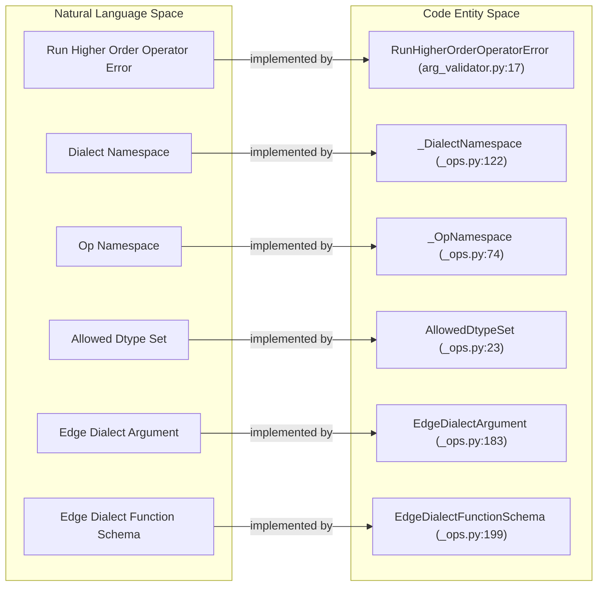
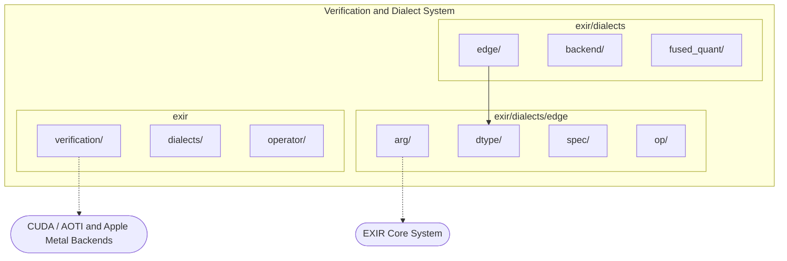
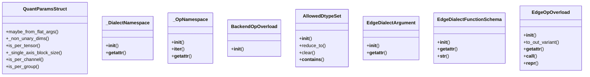
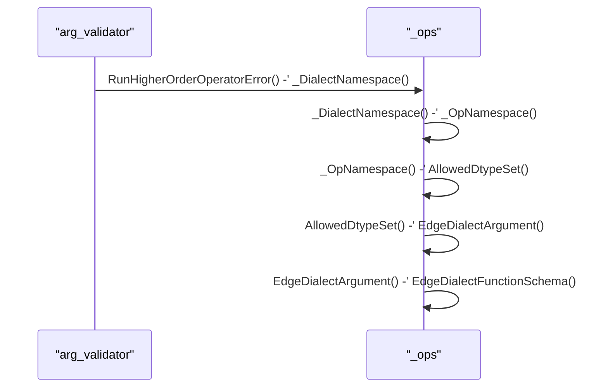

# 3-Source Context Packet (`git` + `CBM` + `llm-wiki`) for `3.5-verification-and-dialect-system` — Verification and Dialect System

- **Target Wiki File**: `wiki/3.5-verification-and-dialect-system.md`
- **Archetype**: `Leaf Technical Spec Page`
- **Parent Page**: `3-exir-core-system`
- **Summary**: Architectural specification and implementation reference for Verification and Dialect System (34 relevant source files). Primary code entities: `Interpreter`, `__init__`, `call_kernel`, `get_constant_tensors`, `EdgeOpArgValidator`.
- **Valid `[[wikilink]]` Neighbours**: `[[3-exir-core-system|EXIR Core System]]`, `[[1.1-getting-started|Getting Started]]`, `[[1.2-export-api-and-recipe-system|Export API and Recipe System]]`, `[[2.2-kernel-libraries-and-selective-build|Kernel Libraries and Selective Build]]`, `[[2.3-schema-generation-and-flatbuffers|Schema Generation and FlatBuffers]]`, `[[3.4-program-emission-and-serialization|Program Emission and Serialization]]`, `[[3.1-program-structure-and-compilation-flow|Program Structure and Compilation Flow]]`, `[[3.2-graph-transformation-pass-system|Graph Transformation Pass System]]`

## 1. Relevant Source Files (`git` + `CBM`, use verbatim in `<details>`)
- `[exir/verification/interpreter.py](exir/verification/interpreter.py)`
- `[exir/verification/arg_validator.py](exir/verification/arg_validator.py)`
- `[exir/verification/verifier.py](exir/verification/verifier.py)`
- `[exir/verification/bindings.cpp](exir/verification/bindings.cpp)`
- `[exir/dialects/_ops.py](exir/dialects/_ops.py)`
- `[exir/dialects/edge/_ops.py](exir/dialects/edge/_ops.py)`
- `[exir/dialects/edge/arg/model.py](exir/dialects/edge/arg/model.py)`
- `[exir/dialects/backend/_ops.py](exir/dialects/backend/_ops.py)`
- `[exir/dialects/fused_quant/ops.py](exir/dialects/fused_quant/ops.py)`
- `[exir/verification/dev_html.py](exir/verification/dev_html.py)`
- `[exir/verification/targets.bzl](exir/verification/targets.bzl)`
- `[exir/dialects/edge/dtype/runner.py](exir/dialects/edge/dtype/runner.py)`
- `[exir/dialects/edge/arg/type.py](exir/dialects/edge/arg/type.py)`
- `[exir/dialects/edge/spec/gen.py](exir/dialects/edge/spec/gen.py)`
- `[exir/dialects/__init__.py](exir/dialects/__init__.py)`
- `[exir/operator/convert.py](exir/operator/convert.py)`
- `[exir/dialects/edge/spec/utils.py](exir/dialects/edge/spec/utils.py)`
- `[exir/operator/manip.py](exir/operator/manip.py)`
- `[exir/dialects/edge/dtype/supported.py](exir/dialects/edge/dtype/supported.py)`
- `[exir/dialects/edge/op/api.py](exir/dialects/edge/op/api.py)`
- `[exir/dialects/edge/dtype/utils.py](exir/dialects/edge/dtype/utils.py)`
- `[exir/dialects/edge/op/sample_input.py](exir/dialects/edge/op/sample_input.py)`
- `[exir/dialects/fused_quant/__init__.py](exir/dialects/fused_quant/__init__.py)`
- `[exir/dialects/fused_quant/ops_utils.py](exir/dialects/fused_quant/ops_utils.py)`
- `[exir/dialects/edge/spec/targets.bzl](exir/dialects/edge/spec/targets.bzl)`
- `[exir/dialects/fused_quant/targets.bzl](exir/dialects/fused_quant/targets.bzl)`
- `[exir/operator/util.py](exir/operator/util.py)`
- `[docs/source/ir-exir.md](docs/source/ir-exir.md)`
- `[exir/verification/BUCK](exir/verification/BUCK)`
- `[exir/dialects/BUCK](exir/dialects/BUCK)`

## 2. Grounded Code Symbols (`CBM`, use verbatim for `[file:start-end]()` pill citations)
- `RunHigherOrderOperatorError` (Class) @ `[exir/verification/arg_validator.py:17-25]()` [fan-in=1, fan-out=0] — Raised when an we try to run delegate or other HigherOrderOperator in a graph module. E.g., %executorch_call_delegate : [#users=1] = call_function[ target=torch
- `_DialectNamespace` (Class) @ `[exir/dialects/_ops.py:122-143]()` [fan-in=1, fan-out=0] — Dialect namespace. Currently the dialects are: - ATen Dialect: core ATen ops and overloads, see torch._ops._OpNamespace - Edge Dialect: ATen ops with explicit T
- `_OpNamespace` (Class) @ `[exir/dialects/_ops.py:74-119]()` [fan-in=1, fan-out=0] — EXIR Dialect op namespace object. Contains ops and overloads registered into PyTorch dispatcher.
- `AllowedDtypeSet` (Class) @ `[exir/dialects/edge/_ops.py:23-65]()` [fan-in=1, fan-out=0] — All legal dtypes for current type alias. This class is a wrapper of Set[torch.dtype]. Normally it is a set of all legal types listed in edge/edge.yaml file for 
- `EdgeDialectArgument` (Class) @ `[exir/dialects/edge/_ops.py:183-196]()` [fan-in=1, fan-out=0] — Argument class for EdgeDialect ops. Wraps around torch._C.Argument with dtype constraints. Redirects all `getattr` calls to torch._C.Argument.
- `EdgeDialectFunctionSchema` (Class) @ `[exir/dialects/edge/_ops.py:199-288]()` [fan-in=1, fan-out=0] — FunctionSchema class for EdgeDialect ops. Wraps around torch._C.FunctionSchema with Tensor dtype constraints. In constructor, walk through all Tensor arguments 
- `EdgeOpOverload` (Class) @ `[exir/dialects/edge/_ops.py:291-339]()` [fan-in=1, fan-out=0] — OpOverload for edge ops. Contains API to find the out variant of this operator overload.
- `FunctionDtypeConstraint` (Class) @ `[exir/dialects/edge/_ops.py:68-164]()` [fan-in=1, fan-out=0] — Dtype constraint for each EdgeDialect ops. Arguments: essential_tensor_io_names: All names of essential tensor inputs and outputs. optional_tensor_io_names: All
- `QuantParamsStruct` (Class) @ `[exir/dialects/fused_quant/ops.py:51-240]()` [fan-in=2, fan-out=0] — Quantization parameters as a dataclass for convenient access. Type Parameters: _TensorType: The type of scale and zero_point, either torch.Tensor or fx.Node. Gr
- `EdgeOpArgValidator` (Class) @ `[exir/verification/arg_validator.py:29-148]()` [fan-in=0, fan-out=0] — # pyre-ignore[13]: Attribute `node` is never initialized.
- `BackendOpOverload` (Class) @ `[exir/dialects/backend/_ops.py:18-73]()` [fan-in=1, fan-out=0] — OpOverload for backend ops. A Backend operator is a custom op that doesn't show up in ATen dialect. Therefore it must be replacing an existing node or a pattern
- `EdgeOpOverloadPacket` (Class) @ `[exir/dialects/edge/_ops.py:342-405]()` [fan-in=0, fan-out=0] — OpOverloadPacket for edge ops. Wraps torch._ops.OpOverloadPacket and overrides __getattr__ to return OpOverload for Edge ops. The main difference between an Edg
- `BackendOpOverloadPacket` (Class) @ `[exir/dialects/backend/_ops.py:76-123]()` [fan-in=0, fan-out=0] — OpOverloadPacket for backend ops. Wraps EdgeOpOverloadPacket and overrides __getattr__ to return OpOverload for backend ops.
- `Return` (Class) @ `[exir/dialects/edge/arg/model.py:213-238]()` [fan-in=0, fan-out=0] — Model for returns of operators
- `Uninitialized` (Class) @ `[exir/verification/interpreter.py:45-46]()` [fan-in=1, fan-out=0] — 
- `Interpreter` (Class) @ `[exir/verification/interpreter.py:128-425]()` [fan-in=0, fan-out=0] — 
- `OutArg` (Class) @ `[exir/dialects/edge/arg/model.py:203-210]()` [fan-in=1, fan-out=0] — 
- `DataBuffer` (Class) @ `[exir/verification/bindings.cpp:24-46]()` [fan-in=0, fan-out=0] — 
- `EXIRATenDialectVerifierBase` (Class) @ `[exir/verification/verifier.py:84-104]()` [fan-in=0, fan-out=0] — 
- `_Ops` (Class) @ `[exir/dialects/_ops.py:146-162]()` [fan-in=0, fan-out=0] — 
- `ArgMode` (Class) @ `[exir/dialects/edge/arg/model.py:16-18]()` [fan-in=0, fan-out=0] — 
- `BaseArg` (Class) @ `[exir/dialects/edge/arg/model.py:21-174]()` [fan-in=0, fan-out=0] — 

## 3. Grounded Source Code Excerpts (`git` Working Tree)
### `RunHigherOrderOperatorError` in `[exir/verification/arg_validator.py:17-25]()`
```python
class RunHigherOrderOperatorError(Exception):
    """
    Raised when an we try to run delegate or other HigherOrderOperator in a graph module.
    E.g., %executorch_call_delegate : [#users=1] = call_function[
        target=torch.ops.higher_order.executorch_call_delegate](args = (%lowered_module_0, %arg0_1), kwargs = {})
    """

    def __init__(self, message: str) -> None:
        super().__init__(message)
```

### `_DialectNamespace` in `[exir/dialects/_ops.py:122-137]()`
```python
class _DialectNamespace(types.ModuleType):
    """
    Dialect namespace. Currently the dialects are:
    - ATen Dialect: core ATen ops and overloads, see torch._ops._OpNamespace
    - Edge Dialect: ATen ops with explicit Tensor dtype
    - Backend Dialect: backend ops only meaningful to the backend we are lowering into
    - Execution Dialect: memory planning ready, all out-variants
    """

    def __init__(self, dialect_name):
        super().__init__("exir.ops" + "." + dialect_name)
        self._dialect_name = dialect_name
        self._dir = []

    def __getattr__(self, name):
        if name in self.__dict__:
```

### `_OpNamespace` in `[exir/dialects/_ops.py:74-89]()`
```python
class _OpNamespace(types.ModuleType):
    """
    EXIR Dialect op namespace object. Contains ops and overloads registered into PyTorch dispatcher.
    """

    def __init__(self, dialect, name):
        super().__init__(f"exir.ops.{dialect}.{name}")
        self._dialect = dialect
        if dialect == "backend" and name not in _BACKEND_OP_LIB:
            raise RuntimeError(f"{name} op library does not belong to backend ops.")
        self._name = name
        self._dir = []
        self._op_namespace = getattr(torch.ops, name)

    def __iter__(self):
        return iter(self._dir)
```

### `AllowedDtypeSet` in `[exir/dialects/edge/_ops.py:23-38]()`
```python
class AllowedDtypeSet:
    """All legal dtypes for current type alias.

    This class is a wrapper of Set[torch.dtype]. Normally it is a set of all legal types listed in
    edge/edge.yaml file for each type alias. If one of the argument under the type alias receiving
    its actual type, AllowedDtypeSet will be degenerated to the set of only the actual type.

    TODO(gasoonjia): Prevent users from misusing.

    Public Attributes:
        types: a set of all allowed dtypes listed in edge/edge.yaml.

    Private Attributes:
        _reduced_type: the actual type this type alias currently represents. 0 means unrestricted,
                       each type in self.types is legal.
```

### `EdgeDialectArgument` in `[exir/dialects/edge/_ops.py:183-196]()`
```python
class EdgeDialectArgument:
    """Argument class for EdgeDialect ops.
    Wraps around torch._C.Argument with dtype constraints.
    Redirects all `getattr` calls to torch._C.Argument.
    """

    def __init__(self, argument: torch._C.Argument, allowed_types: Set[torch.dtype]):
        self.argument = argument
        self.allowed_types = allowed_types

    def __getattr__(self, name):
        if name == "allowed_types":  # arg.allowed_types
            return self.allowed_types
        return getattr(self.argument, name)
```


## 4. Linked Official Docs (`llm-wiki` / `RAG`)
- **EXIR Core System** (`wiki/3-exir-core-system.md`, score=128.649, shared_symbols=['_make_qp', '_validate_qparams']): # EXIR Core System > Architectural specification and implementation reference for EXIR Core System (40 relevant source files). Primary code entities: `EdgeProgramManager`, `__init__`, `config_methods`, `exported_program`, `MemoryPlanningPass`. <details> <summary>Relevant source files</summary> The following files were used as context for generating this w
- **Program Structure and Compilation Flow** (`wiki/3.1-program-structure-and-compilation-flow.md`, score=97.858, shared_symbols=[]): # Program Structure and Compilation Flow ↑ [[3-exir-core-system|EXIR Core System]] > Architectural specification and implementation reference for Program Structure and Compilation Flow (12 relevant source files). Primary code entities: `CaptureConfig`, `EdgeCompileConfig`, `ExecutorchBackendConfig`, `EdgeProgramManager`, `__init__`. <details> <summary>Rel
- **Memory Planning and Allocation** (`wiki/3.3-memory-planning-and-allocation.md`, score=97.858, shared_symbols=[]): # Memory Planning and Allocation ↑ [[3-exir-core-system|EXIR Core System]] > Architectural specification and implementation reference for Memory Planning and Allocation (5 relevant source files). Primary code entities: `MemoryPlanningPass`, `__init__`, `_set_alloc_node_spec`, `call`, `AddressSpaceOverflowException`. <details> <summary>Relevant source file
- **Program Emission and Serialization** (`wiki/3.4-program-emission-and-serialization.md`, score=97.858, shared_symbols=[]): # Program Emission and Serialization ↑ [[3-exir-core-system|EXIR Core System]] > Architectural specification and implementation reference for Program Emission and Serialization (35 relevant source files). Primary code entities: `_AbstractValue`, `_Emitter`, `__init__`, `_add_debug_handle`, `Call`. <details> <summary>Relevant source files</summary> The fo
- **ExecuTorch DeepWiki** (`wiki/index.md`, score=96.499, shared_symbols=[]): # ExecuTorch DeepWiki Generated from `home-jason-Project-deepwiki-executorch` at commit `b3b565b5b62f` (2026-11-15T15:02:11+00:00). ## Pages - [[1-overview|Overview]] — Architectural specification and implementation reference for Overview (10 relevant source files). Primary code entities: `Module`, `MethodHolder`, `PlannedMemory`, `EdgeProgramManager`, `_
- **Export IR Specification** (`raw/executorch/ir-exir.md`, score=93.228, shared_symbols=[]): # Export IR Specification Export IR is an intermediate representation (IR) for the result of `torch.export`. To read more on the details of Export IR, please read this [document](https://pytorch.org/docs/stable/export/ir_spec.html). The Exported IR is a specification that consists of the following parts: 1. A definition of computation graph model. 2. Set 

## 5. Pre-Verified DeepWiki v1.9.9.5 Mermaid Diagrams
### Natural Language Space <-> Code Entity Space


### Subsystem Architecture Flowchart


### Class Hierarchy Diagram


### Call Sequence Diagram


## 6. DeepWiki v1.9.9.5 Authoring Checklist for `wiki/3.5-verification-and-dialect-system.md`
1. Keep YAML frontmatter at top (`id`, `title`, `parent`, `sources`, `linked_docs`, `bridge_symbols`).
2. Keep `<details><summary>Relevant source files</summary>` block immediately after `# Title`.
3. Start with `## Purpose and Scope`, then numbered `## 1. ...`, `## 2. ...` sections separated by `---`.
4. Include at least 2 ```mermaid``` diagrams (including a `Natural Language Space` <-> `Code Entity Space` mapping).
5. Cite code entities inline using `[path/to/file.ext:start-end]()` and end every `##` section with `Sources: [file:start-end]()`.
6. Run `deepwiki_cli.py build --enrich-only ...` and `deepwiki_cli.py validate ...` after editing.
