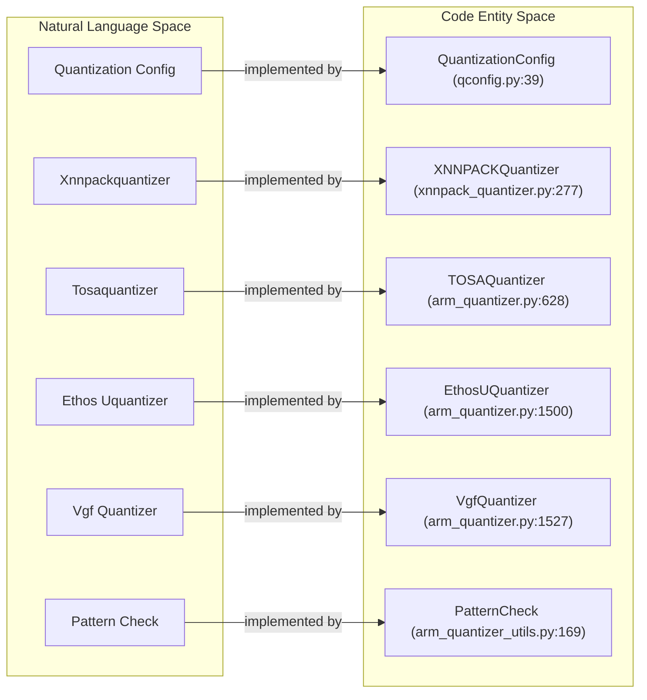
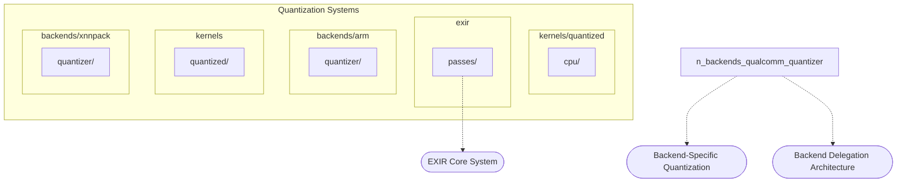
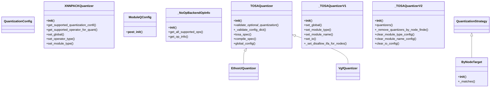
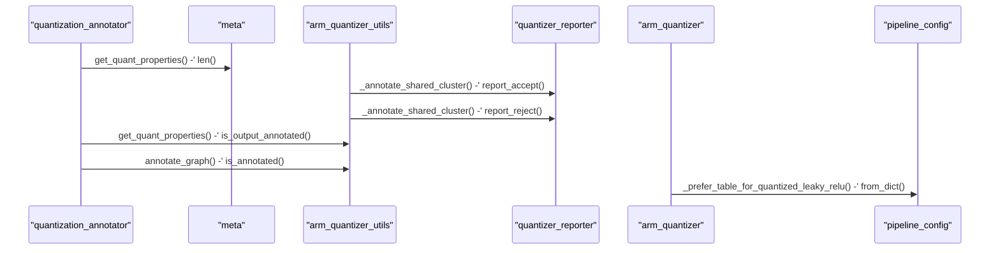

# 3-Source Context Packet (`git` + `CBM` + `llm-wiki`) for `4-quantization-systems` — Quantization Systems

- **Target Wiki File**: `wiki/4-quantization-systems.md`
- **Archetype**: `Parent Hub Page`
- **Parent Page**: `None (Top-Level Chapter)`
- **Summary**: Architectural specification and implementation reference for Quantization Systems (38 relevant source files). Primary code entities: `NeonQuantizeTraits<int8_t>`, `clamp_scalar`, `narrow_and_saturate`, `store`, `QuantizeInputs`.
- **Valid `[[wikilink]]` Neighbours**: `[[1-overview|Overview]]`, `[[4.1-quantization-framework-and-patterns|Quantization Framework and Patterns]]`, `[[4.2-backend-specific-quantization|Backend-Specific Quantization]]`, `[[1.1-getting-started|Getting Started]]`, `[[1.2-export-api-and-recipe-system|Export API and Recipe System]]`, `[[2.2-kernel-libraries-and-selective-build|Kernel Libraries and Selective Build]]`, `[[2.3-schema-generation-and-flatbuffers|Schema Generation and FlatBuffers]]`, `[[3.4-program-emission-and-serialization|Program Emission and Serialization]]`

## 1. Relevant Source Files (`git` + `CBM`, use verbatim in `<details>`)
- `[kernels/quantized/cpu/op_quantize.cpp](kernels/quantized/cpu/op_quantize.cpp)`
- `[exir/passes/quantize_io_pass.py](exir/passes/quantize_io_pass.py)`
- `[backends/arm/quantizer/arm_quantizer_utils.py](backends/arm/quantizer/arm_quantizer_utils.py)`
- `[backends/arm/quantizer/arm_quantizer.py](backends/arm/quantizer/arm_quantizer.py)`
- `[kernels/quantized/__init__.py](kernels/quantized/__init__.py)`
- `[backends/xnnpack/quantizer/xnnpack_quantizer.py](backends/xnnpack/quantizer/xnnpack_quantizer.py)`
- `[exir/passes/quant_fusion_pass.py](exir/passes/quant_fusion_pass.py)`
- `[backends/arm/quantizer/quantization_annotator.py](backends/arm/quantizer/quantization_annotator.py)`
- `[kernels/quantized/cpu/embeddingxb.cpp](kernels/quantized/cpu/embeddingxb.cpp)`
- `[kernels/quantized/cpu/op_dequantize.cpp](kernels/quantized/cpu/op_dequantize.cpp)`
- `[backends/arm/quantizer/quantization_config.py](backends/arm/quantizer/quantization_config.py)`
- `[kernels/quantized/cpu/op_add.cpp](kernels/quantized/cpu/op_add.cpp)`
- `[kernels/quantized/cpu/op_choose_qparams.cpp](kernels/quantized/cpu/op_choose_qparams.cpp)`
- `[kernels/quantized/cpu/embeddingxb.h](kernels/quantized/cpu/embeddingxb.h)`
- `[kernels/quantized/cpu/op_embedding.cpp](kernels/quantized/cpu/op_embedding.cpp)`
- `[backends/qualcomm/quantizer/qconfig.py](backends/qualcomm/quantizer/qconfig.py)`
- `[kernels/quantized/targets.bzl](kernels/quantized/targets.bzl)`
- `[kernels/quantized/cpu/op_embedding2b.cpp](kernels/quantized/cpu/op_embedding2b.cpp)`
- `[backends/arm/quantizer/quantizer_support.py](backends/arm/quantizer/quantizer_support.py)`
- `[kernels/quantized/cpu/op_embedding4b.cpp](kernels/quantized/cpu/op_embedding4b.cpp)`
- `[kernels/quantized/cpu/op_mixed_linear.cpp](kernels/quantized/cpu/op_mixed_linear.cpp)`
- `[kernels/quantized/cpu/op_mixed_mm.cpp](kernels/quantized/cpu/op_mixed_mm.cpp)`
- `[backends/qualcomm/quantizer/quantizer.py](backends/qualcomm/quantizer/quantizer.py)`
- `[backends/qualcomm/quantizer/backend_opinfo_adapter.py](backends/qualcomm/quantizer/backend_opinfo_adapter.py)`
- `[kernels/quantized/cpu/targets.bzl](kernels/quantized/cpu/targets.bzl)`
- `[backends/xnnpack/quantizer/xnnpack_quantizer_utils.py](backends/xnnpack/quantizer/xnnpack_quantizer_utils.py)`
- `[backends/qualcomm/quantizer/quant_recipe.py](backends/qualcomm/quantizer/quant_recipe.py)`
- `[backends/qualcomm/quantizer/rules.py](backends/qualcomm/quantizer/rules.py)`
- `[kernels/quantized/README.md](kernels/quantized/README.md)`
- `[backends/qualcomm/quantizer/README.md](backends/qualcomm/quantizer/README.md)`

## 2. Grounded Code Symbols (`CBM`, use verbatim for `[file:start-end]()` pill citations)
- `QuantizationConfig` (Class) @ `[backends/qualcomm/quantizer/qconfig.py:39-45]()` [fan-in=17, fan-out=0] — 
- `XNNPACKQuantizer` (Class) @ `[backends/xnnpack/quantizer/xnnpack_quantizer.py:277-464]()` [fan-in=7, fan-out=0] — 
- `TOSAQuantizer` (Class) @ `[backends/arm/quantizer/arm_quantizer.py:628-1067]()` [fan-in=1, fan-out=0] — Manage quantization annotations for TOSA-compatible backends. .. warning:: The composable quantizer is now the default implementation. Setting ``use_composable_
- `EthosUQuantizer` (Class) @ `[backends/arm/quantizer/arm_quantizer.py:1500-1524]()` [fan-in=0, fan-out=0] — Quantizer supported by the Arm Ethos-U backend. .. warning:: The composable quantizer is now the default implementation. Setting ``use_composable_quantizer=Fals
- `VgfQuantizer` (Class) @ `[backends/arm/quantizer/arm_quantizer.py:1527-1579]()` [fan-in=0, fan-out=0] — Quantizer supported by the Arm Vgf backend. .. warning:: The composable quantizer is now the default implementation. Setting ``use_composable_quantizer=False`` 
- `PatternCheck` (Class) @ `[backends/arm/quantizer/arm_quantizer_utils.py:169-223]()` [fan-in=0, fan-out=0] — Base class for pattern checks. PatternChecks are used to define which patterns are supported for quantization and to validate quantization configuration constra
- `PatternQuantizer` (Class) @ `[backends/arm/quantizer/arm_quantizer_utils.py:238-411]()` [fan-in=0, fan-out=0] — Quantizes a graph according to an OperatorConfig. Args: quantization_config (QuantizationConfig): The quantization config to use for annotation. node_finder (No
- `SharedQspecQuantizer` (Class) @ `[backends/arm/quantizer/arm_quantizer_utils.py:428-829]()` [fan-in=0, fan-out=0] — Assures that specific ops share quantization parameters on all inputs/outputs.
- `_OpQuantProperties` (Class) @ `[backends/arm/quantizer/quantization_annotator.py:68-81]()` [fan-in=1, fan-out=0] — Collect input/output quantization properties for a node. Attributes: quant_inputs (List[_QuantProperty]): Quantization specs for inputs indexed by argument posi
- `_QuantProperty` (Class) @ `[backends/arm/quantizer/quantization_annotator.py:59-65]()` [fan-in=1, fan-out=0] — Specify how the input/output at 'index' must be quantized.
- `QuantizationConfig` (Class) @ `[backends/arm/quantizer/quantization_config.py:149-385]()` [fan-in=0, fan-out=0] — Provide a container for quantization specs. Hold optional specs for input/output activations, weights, and bias, and expose validated accessors. Attributes: inp
- `TOSAQuantizationConfig` (Class) @ `[backends/arm/quantizer/quantization_config.py:388-549]()` [fan-in=0, fan-out=0] — Configures quantization, while enforcing TOSA specific constraints.
- `VGFQuantizationConfig` (Class) @ `[backends/arm/quantizer/quantization_config.py:552-605]()` [fan-in=0, fan-out=0] — Configure quantization for VGF-specific lowering paths.
- `ByNodeTarget` (Class) @ `[backends/qualcomm/quantizer/quant_recipe.py:148-183]()` [fan-in=2, fan-out=0] — Strategy that assigns quantization config to nodes based on their op target. Useful for applying quantization to specific operations such as `aten.conv2d` or `a
- `QuantizeInputs` (Class) @ `[exir/passes/quantize_io_pass.py:205-266]()` [fan-in=1, fan-out=0] — 
- `QuantizeOutputs` (Class) @ `[exir/passes/quantize_io_pass.py:269-324]()` [fan-in=1, fan-out=0] — 
- `_TOSAQuantizerV1` (Class) @ `[backends/arm/quantizer/arm_quantizer.py:1070-1256]()` [fan-in=1, fan-out=0] — 
- `_TOSAQuantizerV2` (Class) @ `[backends/arm/quantizer/arm_quantizer.py:1259-1497]()` [fan-in=1, fan-out=0] — 
- `PowTensorTensorPositiveBaseCheck` (Class) @ `[backends/arm/quantizer/quantizer_support.py:74-99]()` [fan-in=0, fan-out=0] — Allow Tensor/Tensor pow only when the base is proven strictly positive. The INT lowering rewrites pow(x, y) as exp(y * log(x)). That rewrite must not be selecte
- `QnnQuantizer` (Class) @ `[backends/qualcomm/quantizer/quantizer.py:338-840]()` [fan-in=1, fan-out=0] — QnnQuantizer is a quantization annotator designed for QNN backends. It utilizes the rules_map found in the respective {backend}_rules.py file, which is a dictio
- `ByNameRegex` (Class) @ `[backends/qualcomm/quantizer/quant_recipe.py:186-227]()` [fan-in=1, fan-out=0] — Strategy that assigns quantization config to nodes whose module stack matches given regex patterns. Useful for targeting layers by name patterns (e.g., "layers.
- `NeonQuantizeTraits<int8_t>` (Class) @ `[kernels/quantized/cpu/op_quantize.cpp:154-169]()` [fan-in=0, fan-out=0] — 

## 3. Grounded Source Code Excerpts (`git` Working Tree)
### `QuantizationConfig` in `[backends/qualcomm/quantizer/qconfig.py:39-45]()`
```python
class QuantizationConfig:
    input_activation: Optional[QuantizationSpec]
    output_activation: Optional[QuantizationSpec]
    weight: Optional[QuantizationSpec]
    bias: Optional[QuantizationSpec | Callable]
    block_size: Optional[Tuple] = None
    per_channel_embedding: bool = False
```

### `XNNPACKQuantizer` in `[backends/xnnpack/quantizer/xnnpack_quantizer.py:277-292]()`
```python
class XNNPACKQuantizer(Quantizer):
    supported_config_and_operators = _get_supported_config_and_operators()
    SUPPORTED_PATTERNS = [
        QuantPattern("conv_bn_relu", False, True, CONV_TARGETS),
        QuantPattern("conv_bn", False, True, CONV_TARGETS),
        QuantPattern("conv_transpose_bn_relu", False, True, CONV_TRANSPOSE_TARGETS),
        QuantPattern("conv_transpose_bn", False, True, CONV_TRANSPOSE_TARGETS),
        QuantPattern("linear_relu", False, False, LINEAR_TARGETS),
        QuantPattern("linear", True, False, LINEAR_TARGETS),
        QuantPattern("conv", True, False, CONV_TARGETS),
        QuantPattern("conv_transpose", True, False, CONV_TRANSPOSE_TARGETS),
        QuantPattern("conv_relu", False, False, CONV_TARGETS),
        QuantPattern("conv_transpose_relu", False, False, CONV_TRANSPOSE_TARGETS),
        QuantPattern("adaptive_avg_pool2d", False, False, ADAPTIVE_AVG_POOL2D_TARGETS),
        QuantPattern("add_relu", False, False, ADD_TARGETS),
        QuantPattern("add", False, False, ADD_TARGETS),
```

### `TOSAQuantizer` in `[backends/arm/quantizer/arm_quantizer.py:628-643]()`
```python
class TOSAQuantizer(Quantizer):
    """Manage quantization annotations for TOSA-compatible backends.

    .. warning::
        The composable quantizer is now the default implementation. Setting
        ``use_composable_quantizer=False`` is deprecated and will be removed in
        two minor releases.

    """

    def __init__(
        self,
        compile_spec_or_tosa_spec,
        use_composable_quantizer: bool = True,
    ) -> None:
        """Create a TOSA quantizer from a TOSA spec or Arm compile spec.
```

### `EthosUQuantizer` in `[backends/arm/quantizer/arm_quantizer.py:1500-1515]()`
```python
class EthosUQuantizer(TOSAQuantizer):
    """Quantizer supported by the Arm Ethos-U backend.

    .. warning::
        The composable quantizer is now the default implementation. Setting
        ``use_composable_quantizer=False`` is deprecated and will be removed in
        two minor releases.

    Args:
        compile_spec (EthosUCompileSpec): Backend compile specification for
            Ethos-U targets.
        use_composable_quantizer (bool): Whether to use the composable
            quantizer implementation. Setting this to ``False`` is deprecated
            and will be removed in two minor releases. See
            [issue #17701](https://github.com/pytorch/executorch/issues/17701)
            for details.
```

### `VgfQuantizer` in `[backends/arm/quantizer/arm_quantizer.py:1527-1542]()`
```python
class VgfQuantizer(TOSAQuantizer):
    """Quantizer supported by the Arm Vgf backend.

    .. warning::
        The composable quantizer is now the default implementation. Setting
        ``use_composable_quantizer=False`` is deprecated and will be removed in
        two minor releases.

    Args:
        compile_spec (VgfCompileSpec): Backend compile specification for Vgf
            targets.
        use_composable_quantizer (bool): Whether to use the composable
            quantizer implementation. Setting this to ``False`` is deprecated
            and will be removed in two minor releases. See
            [issue #17701](https://github.com/pytorch/executorch/issues/17701)
            for details.
```


## 4. Linked Official Docs (`llm-wiki` / `RAG`)
- **Backend-Specific Quantization** (`wiki/4.2-backend-specific-quantization.md`, score=123.735, shared_symbols=['QuantizationConfig', 'XNNPACKQuantizer', 'get_symmetric_quantization_config']): # Backend-Specific Quantization ↑ [[4-quantization-systems|Quantization Systems]] > Architectural specification and implementation reference for Backend-Specific Quantization (35 relevant source files). Primary code entities: `NodeFinder`, `find_nodes`, `PatternCheck`, `check_pattern`, `EthosUQuantizer`. <details> <summary>Relevant source files</summary> 
- **ExecuTorch DeepWiki** (`wiki/index.md`, score=110.365, shared_symbols=[]): # ExecuTorch DeepWiki Generated from `home-jason-Project-deepwiki-executorch` at commit `b3b565b5b62f` (2026-11-15T15:02:11+00:00). ## Pages - [[1-overview|Overview]] — Architectural specification and implementation reference for Overview (10 relevant source files). Primary code entities: `Module`, `MethodHolder`, `PlannedMemory`, `EdgeProgramManager`, `_
- **Quantization Framework and Patterns** (`wiki/4.1-quantization-framework-and-patterns.md`, score=96.267, shared_symbols=[]): # Quantization Framework and Patterns ↑ [[4-quantization-systems|Quantization Systems]] > Architectural specification and implementation reference for Quantization Framework and Patterns (35 relevant source files). Primary code entities: `CanonicalizeViewCopyPermutePass`, `__init__`, `_collect_chains`, `_fuse_pair`, `NeonQuantizeTraits<int8_t>`. <details>
- **Cadence DSP Backend** (`wiki/5.5-cadence-dsp-backend.md`, score=84.181, shared_symbols=['QuantizationConfig']): # Cadence DSP Backend ↑ [[5-backend-delegation-architecture|Backend Delegation Architecture]] > Architectural specification and implementation reference for Cadence DSP Backend (36 relevant source files). Primary code entities: `QuantFusionPass`, `__init__`, `call`, `QuantizedInputWrapper`, `MemoryPlanningAlgo`. <details> <summary>Relevant source files</s
- **Backend Delegation Architecture** (`wiki/5-backend-delegation-architecture.md`, score=72.543, shared_symbols=[]): # Backend Delegation Architecture > Architectural specification and implementation reference for Backend Delegation Architecture (40 relevant source files). Primary code entities: `CommandBuffer`, `begin`, `bind_descriptors`, `bind_pipeline`, `NodeVisitor`. <details> <summary>Relevant source files</summary> The following files were used as context for gen
- **Overview** (`wiki/1-overview.md`, score=70.353, shared_symbols=[]): # Overview > Architectural specification and implementation reference for Overview (10 relevant source files). Primary code entities: `Module`, `MethodHolder`, `PlannedMemory`, `EdgeProgramManager`, `__init__`. <details> <summary>Relevant source files</summary> The following files were used as context for generating this wiki page: - [extension/module/mo

## 5. Pre-Verified DeepWiki v1.9.9.5 Mermaid Diagrams
### Natural Language Space <-> Code Entity Space


### Subsystem Architecture Flowchart


### Class Hierarchy Diagram


### Call Sequence Diagram


## 6. DeepWiki v1.9.9.5 Authoring Checklist for `wiki/4-quantization-systems.md`
1. Keep YAML frontmatter at top (`id`, `title`, `parent`, `sources`, `linked_docs`, `bridge_symbols`).
2. Keep `<details><summary>Relevant source files</summary>` block immediately after `# Title`.
3. Start with `## Purpose and Scope`, then numbered `## 1. ...`, `## 2. ...` sections separated by `---`.
4. Include at least 2 ```mermaid``` diagrams (including a `Natural Language Space` <-> `Code Entity Space` mapping).
5. Cite code entities inline using `[path/to/file.ext:start-end]()` and end every `##` section with `Sources: [file:start-end]()`.
6. Run `deepwiki_cli.py build --enrich-only ...` and `deepwiki_cli.py validate ...` after editing.
