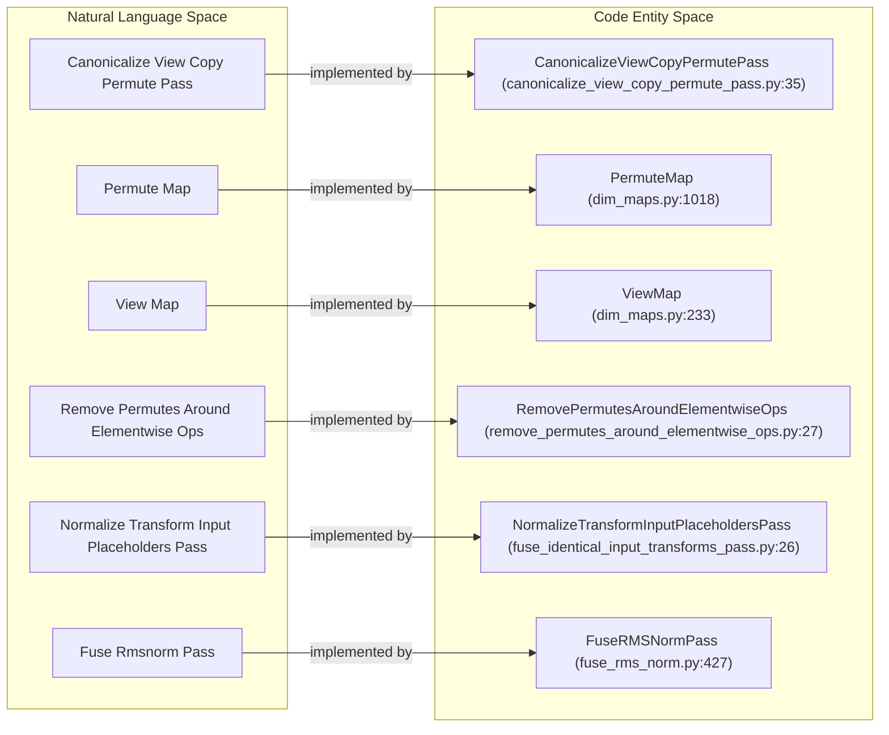
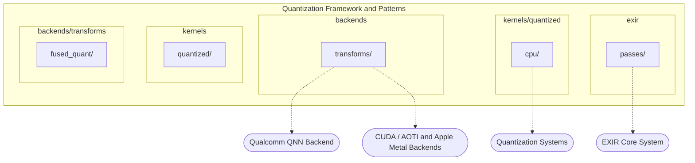
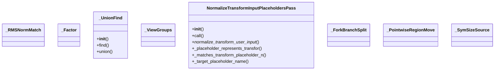
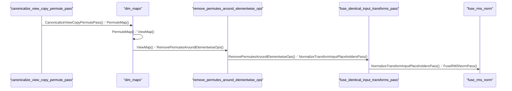

# 3-Source Context Packet (`git` + `CBM` + `llm-wiki`) for `4.1-quantization-framework-and-patterns` — Quantization Framework and Patterns

- **Target Wiki File**: `wiki/4.1-quantization-framework-and-patterns.md`
- **Archetype**: `Leaf Technical Spec Page`
- **Parent Page**: `4-quantization-systems`
- **Summary**: Architectural specification and implementation reference for Quantization Framework and Patterns (35 relevant source files). Primary code entities: `CanonicalizeViewCopyPermutePass`, `__init__`, `_collect_chains`, `_fuse_pair`, `NeonQuantizeTraits<int8_t>`.
- **Valid `[[wikilink]]` Neighbours**: `[[4-quantization-systems|Quantization Systems]]`, `[[1.1-getting-started|Getting Started]]`, `[[1.2-export-api-and-recipe-system|Export API and Recipe System]]`, `[[2.2-kernel-libraries-and-selective-build|Kernel Libraries and Selective Build]]`, `[[2.3-schema-generation-and-flatbuffers|Schema Generation and FlatBuffers]]`, `[[3.4-program-emission-and-serialization|Program Emission and Serialization]]`, `[[3.5-verification-and-dialect-system|Verification and Dialect System]]`, `[[3-exir-core-system|EXIR Core System]]`

## 1. Relevant Source Files (`git` + `CBM`, use verbatim in `<details>`)
- `[backends/transforms/canonicalize_view_copy_permute_pass.py](backends/transforms/canonicalize_view_copy_permute_pass.py)`
- `[kernels/quantized/cpu/op_quantize.cpp](kernels/quantized/cpu/op_quantize.cpp)`
- `[exir/passes/quantize_io_pass.py](exir/passes/quantize_io_pass.py)`
- `[kernels/quantized/__init__.py](kernels/quantized/__init__.py)`
- `[backends/transforms/dim_maps.py](backends/transforms/dim_maps.py)`
- `[exir/passes/quant_fusion_pass.py](exir/passes/quant_fusion_pass.py)`
- `[backends/transforms/addmm_mm_to_linear.py](backends/transforms/addmm_mm_to_linear.py)`
- `[backends/transforms/remove_permutes_around_elementwise_ops.py](backends/transforms/remove_permutes_around_elementwise_ops.py)`
- `[kernels/quantized/cpu/embeddingxb.cpp](kernels/quantized/cpu/embeddingxb.cpp)`
- `[kernels/quantized/cpu/op_dequantize.cpp](kernels/quantized/cpu/op_dequantize.cpp)`
- `[backends/transforms/fuse_rms_norm.py](backends/transforms/fuse_rms_norm.py)`
- `[backends/transforms/symbolic_shape_utils.py](backends/transforms/symbolic_shape_utils.py)`
- `[backends/transforms/advance_quantize_op_above_def_chain.py](backends/transforms/advance_quantize_op_above_def_chain.py)`
- `[backends/transforms/fuse_identical_input_transforms_pass.py](backends/transforms/fuse_identical_input_transforms_pass.py)`
- `[backends/transforms/convert_conv1d_to_conv2d_pass.py](backends/transforms/convert_conv1d_to_conv2d_pass.py)`
- `[kernels/quantized/cpu/op_add.cpp](kernels/quantized/cpu/op_add.cpp)`
- `[kernels/quantized/cpu/op_choose_qparams.cpp](kernels/quantized/cpu/op_choose_qparams.cpp)`
- `[backends/transforms/propagate_view_copy_permute_pass.py](backends/transforms/propagate_view_copy_permute_pass.py)`
- `[kernels/quantized/cpu/embeddingxb.h](kernels/quantized/cpu/embeddingxb.h)`
- `[kernels/quantized/cpu/op_embedding.cpp](kernels/quantized/cpu/op_embedding.cpp)`
- `[backends/transforms/advance_quantize_op_above_def_in_branch.py](backends/transforms/advance_quantize_op_above_def_in_branch.py)`
- `[backends/transforms/permute_pass_utils.py](backends/transforms/permute_pass_utils.py)`
- `[backends/transforms/convert_dtype_pass.py](backends/transforms/convert_dtype_pass.py)`
- `[kernels/quantized/targets.bzl](kernels/quantized/targets.bzl)`
- `[backends/transforms/decompose_sdpa.py](backends/transforms/decompose_sdpa.py)`
- `[backends/transforms/aten_to_dialect_pass.py](backends/transforms/aten_to_dialect_pass.py)`
- `[kernels/quantized/cpu/op_embedding2b.cpp](kernels/quantized/cpu/op_embedding2b.cpp)`
- `[backends/transforms/fused_quant/decompose_fused_quant.py](backends/transforms/fused_quant/decompose_fused_quant.py)`
- `[kernels/quantized/README.md](kernels/quantized/README.md)`
- `[docs/source/quantization-overview.md](docs/source/quantization-overview.md)`

## 2. Grounded Code Symbols (`CBM`, use verbatim for `[file:start-end]()` pill citations)
- `CanonicalizeViewCopyPermutePass` (Class) @ `[backends/transforms/canonicalize_view_copy_permute_pass.py:35-507]()` [fan-in=0, fan-out=0] — Canonicalize view/permute chains. The pass repeatedly fuses adjacent compatible ops and swaps adjacent view/permute pairs when the swap exposes more fusing.
- `PermuteMap` (Class) @ `[backends/transforms/dim_maps.py:1018-1096]()` [fan-in=0, fan-out=0] — Maps dims to equivalent dims before and after a permute.
- `ViewMap` (Class) @ `[backends/transforms/dim_maps.py:233-1015]()` [fan-in=0, fan-out=0] — Maps dims before and after a view operator. The map models a view by expanding both shapes into ordered prime-factor streams and finding the permutation between
- `RemovePermutesAroundElementwiseOps` (Class) @ `[backends/transforms/remove_permutes_around_elementwise_ops.py:27-1119]()` [fan-in=0, fan-out=0] — Looks for subgraphs of elementwise ops sandwiched between permutes and removes those permutes if possible. Allows special handling for certain non-elementwise o
- `NormalizeTransformInputPlaceholdersPass` (Class) @ `[backends/transforms/fuse_identical_input_transforms_pass.py:26-113]()` [fan-in=1, fan-out=0] — Normalize placeholder names for lifted transform inputs.
- `FuseRMSNormPass` (Class) @ `[backends/transforms/fuse_rms_norm.py:427-540]()` [fan-in=0, fan-out=0] — Fuse weighted and scale-free FP32 RMSNorm decompositions into aten.rms_norm. Supports rsqrt and pow(-0.5) inverse roots on the last dimension. Leading dimension
- `AdvanceQuantizeOpAboveDefChainPass` (Class) @ `[backends/transforms/advance_quantize_op_above_def_chain.py:28-270]()` [fan-in=0, fan-out=0] — Advances a quantize op above data-movement ops to reduce data volume. Handles two cases: 1. Linear chain: if the input to a quantize op is a chain of trivially 
- `FuseIdenticalInputTransformsPass` (Class) @ `[backends/transforms/fuse_identical_input_transforms_pass.py:116-461]()` [fan-in=0, fan-out=0] — Sink identical input transforms through pointwise ops with multiple inputs. Note that this is only valid for data movement transforms; most operators cannot be 
- `ConvertConv1dToConv2dPass` (Class) @ `[backends/transforms/convert_conv1d_to_conv2d_pass.py:22-322]()` [fan-in=0, fan-out=0] — Express Conv1d as Conv2d with a unit-height spatial dimension. At the top level, only convolutions with lifted parameter, buffer, or constant weights are conver
- `PropagateViewCopyPermuteDownPass` (Class) @ `[backends/transforms/propagate_view_copy_permute_pass.py:1034-1601]()` [fan-in=0, fan-out=0] — Implements PropagateViewCopyPermutePass for downward propagation: - Next propagation nodes are the users of the current node - Previous propagation nodes are th
- `PropagateViewCopyPermutePass` (Class) @ `[backends/transforms/propagate_view_copy_permute_pass.py:86-662]()` [fan-in=0, fan-out=0] — Abstract implementation of a permute/view_copy propagation pass. To be used for upwards/downwards propagation by implementing the abstract methods for the direc
- `PropagateViewCopyPermuteUpPass` (Class) @ `[backends/transforms/propagate_view_copy_permute_pass.py:665-1031]()` [fan-in=0, fan-out=0] — Implements PropagateViewCopyPermutePass for upwards propagation: - Next propagation nodes are the input of the current node - Previous propagation nodes are the
- `_RMSNormMatch` (Class) @ `[backends/transforms/fuse_rms_norm.py:68-73]()` [fan-in=3, fan-out=0] — 
- `QuantizeInputs` (Class) @ `[exir/passes/quantize_io_pass.py:205-266]()` [fan-in=1, fan-out=0] — 
- `QuantizeOutputs` (Class) @ `[exir/passes/quantize_io_pass.py:269-324]()` [fan-in=1, fan-out=0] — 
- `AdvanceQuantizeOpAboveDefInBranchPass` (Class) @ `[backends/transforms/advance_quantize_op_above_def_in_branch.py:27-202]()` [fan-in=0, fan-out=0] — If the graph is branched with the following pattern: I = ... S1 = slice(I) Q1 = quantize(S1) S2 = slice(I) Q2 = quantize(S2) S3 = slice(I) Q3 = quantize(S3) ...
- `_Factor` (Class) @ `[backends/transforms/dim_maps.py:23-25]()` [fan-in=1, fan-out=0] — 
- `_UnionFind` (Class) @ `[backends/transforms/dim_maps.py:216-230]()` [fan-in=1, fan-out=0] — 
- `_ViewGroups` (Class) @ `[backends/transforms/dim_maps.py:29-33]()` [fan-in=1, fan-out=0] — 
- `FuseOpPairsAcrossBranchesPass` (Class) @ `[backends/transforms/permute_pass_utils.py:210-297]()` [fan-in=0, fan-out=0] — Base class for passes that fuse op pairs across branches.
- `HierarchicalInplacePassInterface` (Class) @ `[backends/transforms/permute_pass_utils.py:161-185]()` [fan-in=0, fan-out=0] — A base class for passes that apply in-place modification to the graph module and its submodules.
- `QuantFusionPass` (Class) @ `[exir/passes/quant_fusion_pass.py:124-161]()` [fan-in=1, fan-out=0] — 

## 3. Grounded Source Code Excerpts (`git` Working Tree)
### `CanonicalizeViewCopyPermutePass` in `[backends/transforms/canonicalize_view_copy_permute_pass.py:35-50]()`
```python
class CanonicalizeViewCopyPermutePass(ExportPass):
    """Canonicalize view/permute chains.

    The pass repeatedly fuses adjacent compatible ops and swaps adjacent
    view/permute pairs when the swap exposes more fusing.

    """

    _passes_required_after: Set[Type[ExportPass]] = set()
    _recompile_before_retrace = True

    _VIEW_TARGET = exir_ops.edge.aten.view_copy.default
    _PERMUTE_TARGET = exir_ops.edge.aten.permute_copy.default

    def __init__(self, permute_targets: Iterable[Any] | None = None) -> None:
        super().__init__()
```

### `PermuteMap` in `[backends/transforms/dim_maps.py:1018-1033]()`
```python
class PermuteMap:
    """Maps dims to equivalent dims before and after a permute."""

    def __init__(self, permute_node: Node) -> None:
        permute_dims = permute_node.args[1]
        assert isinstance(permute_dims, Sequence) and not isinstance(
            permute_dims, (str, bytes)
        )
        normalized = _normalize_permutation(
            cast(Sequence[int], permute_dims), len(cast(Sequence[int], permute_dims))
        )
        if normalized is None:
            raise ValueError(f"Invalid permute dims: {permute_dims}")
        self.permute_dims = normalized

    def map_dims(self, dims: int | Sequence[int]) -> list[int]:
```

### `ViewMap` in `[backends/transforms/dim_maps.py:233-248]()`
```python
class ViewMap:
    """Maps dims before and after a view operator.

    The map models a view by expanding both shapes into ordered prime-factor
    streams and finding the permutation between them. Singleton dims are not counted.
    For example, the view from [4, 3, 10] to [2, 2, 1, 5, 3, 2] is represented as:

        Source:        [4, 3, 10]
        Source primes: [2, 2, 3, 2, 5]
        Permutation:   [0, 1, 4, 2, 3]
        Target primes: [2, 2, 5, 3, 2]
        Target:        [2, 2, 1, 5, 3, 2]

    Dim mappings are derived by unioning factors into groups where
    - factors from the same source axis belong to the same group;
       e.g. [2,2] [3] [2,5]
```

### `RemovePermutesAroundElementwiseOps` in `[backends/transforms/remove_permutes_around_elementwise_ops.py:27-42]()`
```python
class RemovePermutesAroundElementwiseOps(ExportPass):
    """
    Looks for subgraphs of elementwise ops sandwiched between permutes and removes those
    permutes if possible.
    Allows special handling for certain non-elementwise ops that can be easily updated
    based on the permute's parameter such as mean, cat, and slice.
    The repeat_interleave idiom (unsqueeze -> expand_copy -> merging view_copy) is
    recognised as a single rank-preserving unit; see _interleave_triple.
    """

    @dataclass()
    class Subgraph:
        start_permute: list[int]
        end_permute: list[int]
        # Nodes in the subgraph, does not include permutes.
        nodes: set[torch.fx.Node] = field(default_factory=set)
```

### `NormalizeTransformInputPlaceholdersPass` in `[backends/transforms/fuse_identical_input_transforms_pass.py:26-41]()`
```python
class NormalizeTransformInputPlaceholdersPass(ExportPass):
    """Normalize placeholder names for lifted transform inputs."""

    def __init__(
        self,
        exported_program: ExportedProgram | None = None,
        permute_targets: Iterable[Any] | None = None,
    ) -> None:
        super().__init__()
        self.exported_program = exported_program
        self._targets = {FuseIdenticalInputTransformsPass._VIEW_TARGET} | frozenset(
            permute_targets or (FuseIdenticalInputTransformsPass._PERMUTE_TARGET,)
        )

    def call(self, graph_module: GraphModule) -> PassResult:
        return PassResult(
```


## 4. Linked Official Docs (`llm-wiki` / `RAG`)
- **Quantization Systems** (`wiki/4-quantization-systems.md`, score=227.893, shared_symbols=['_concrete_shape', 'store']): # Quantization Systems > Architectural specification and implementation reference for Quantization Systems (38 relevant source files). Primary code entities: `NeonQuantizeTraits<int8_t>`, `clamp_scalar`, `narrow_and_saturate`, `store`, `QuantizeInputs`. <details> <summary>Relevant source files</summary> The following files were used as context for generat
- **XNNPACK CPU Backend** (`wiki/5.6-xnnpack-cpu-backend.md`, score=174.09, shared_symbols=[]): # XNNPACK CPU Backend ↑ [[5-backend-delegation-architecture|Backend Delegation Architecture]] > Architectural specification and implementation reference for XNNPACK CPU Backend (36 relevant source files). Primary code entities: `ChannelsLastTaggedReshapePass`, `_is_nhwc`, `call`, `can_be_converted_to_nhwc`, `InputTypeToIndex`. <details> <summary>Relevant 
- **Backend-Specific Quantization** (`wiki/4.2-backend-specific-quantization.md`, score=169.517, shared_symbols=[]): # Backend-Specific Quantization ↑ [[4-quantization-systems|Quantization Systems]] > Architectural specification and implementation reference for Backend-Specific Quantization (35 relevant source files). Primary code entities: `NodeFinder`, `find_nodes`, `PatternCheck`, `check_pattern`, `EthosUQuantizer`. <details> <summary>Relevant source files</summary> 
- **EXIR Core System** (`wiki/3-exir-core-system.md`, score=169.517, shared_symbols=[]): # EXIR Core System > Architectural specification and implementation reference for EXIR Core System (40 relevant source files). Primary code entities: `EdgeProgramManager`, `__init__`, `config_methods`, `exported_program`, `MemoryPlanningPass`. <details> <summary>Relevant source files</summary> The following files were used as context for generating this w
- **Graph Transformation Pass System** (`wiki/3.2-graph-transformation-pass-system.md`, score=169.517, shared_symbols=[]): # Graph Transformation Pass System ↑ [[3-exir-core-system|EXIR Core System]] > Architectural specification and implementation reference for Graph Transformation Pass System (30 relevant source files). Primary code entities: `MemoryPlanningPass`, `__init__`, `_set_alloc_node_spec`, `call`, `DSInfo`. <details> <summary>Relevant source files</summary> The f
- **ExecuTorch DeepWiki** (`wiki/index.md`, score=162.7, shared_symbols=[]): # ExecuTorch DeepWiki Generated from `home-jason-Project-deepwiki-executorch` at commit `b3b565b5b62f` (2026-11-15T15:02:11+00:00). ## Pages - [[1-overview|Overview]] — Architectural specification and implementation reference for Overview (10 relevant source files). Primary code entities: `Module`, `MethodHolder`, `PlannedMemory`, `EdgeProgramManager`, `_

## 5. Pre-Verified DeepWiki v1.9.9.5 Mermaid Diagrams
### Natural Language Space <-> Code Entity Space


### Subsystem Architecture Flowchart


### Class Hierarchy Diagram


### Call Sequence Diagram


## 6. DeepWiki v1.9.9.5 Authoring Checklist for `wiki/4.1-quantization-framework-and-patterns.md`
1. Keep YAML frontmatter at top (`id`, `title`, `parent`, `sources`, `linked_docs`, `bridge_symbols`).
2. Keep `<details><summary>Relevant source files</summary>` block immediately after `# Title`.
3. Start with `## Purpose and Scope`, then numbered `## 1. ...`, `## 2. ...` sections separated by `---`.
4. Include at least 2 ```mermaid``` diagrams (including a `Natural Language Space` <-> `Code Entity Space` mapping).
5. Cite code entities inline using `[path/to/file.ext:start-end]()` and end every `##` section with `Sources: [file:start-end]()`.
6. Run `deepwiki_cli.py build --enrich-only ...` and `deepwiki_cli.py validate ...` after editing.
