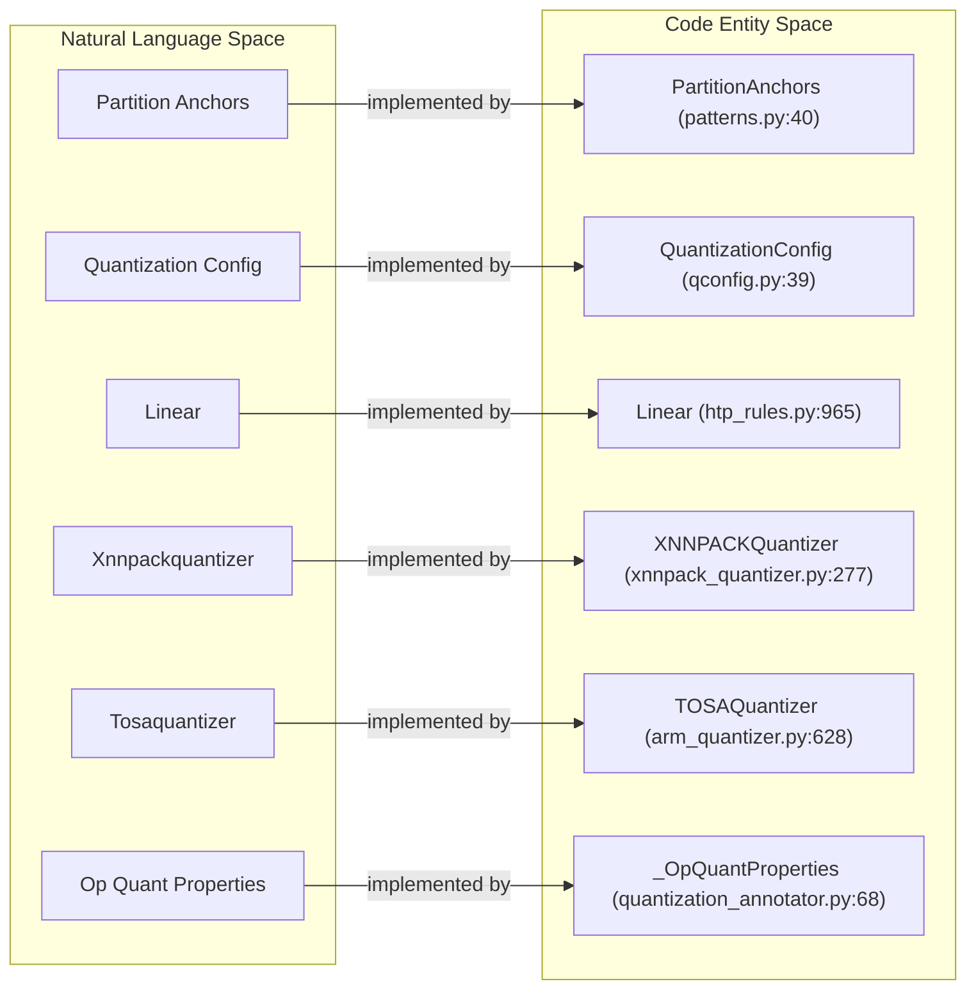
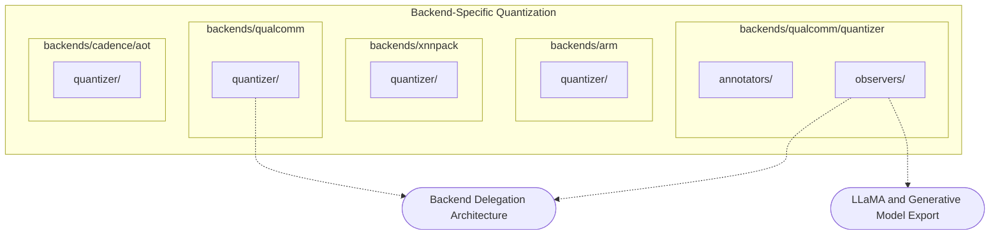
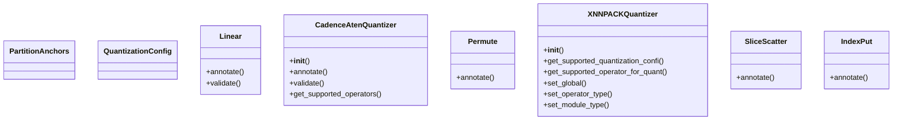
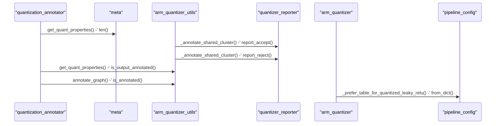

# 3-Source Context Packet (`git` + `CBM` + `llm-wiki`) for `4.2-backend-specific-quantization` — Backend-Specific Quantization

- **Target Wiki File**: `wiki/4.2-backend-specific-quantization.md`
- **Archetype**: `Leaf Technical Spec Page`
- **Parent Page**: `4-quantization-systems`
- **Summary**: Architectural specification and implementation reference for Backend-Specific Quantization (35 relevant source files). Primary code entities: `NodeFinder`, `find_nodes`, `PatternCheck`, `check_pattern`, `EthosUQuantizer`.
- **Valid `[[wikilink]]` Neighbours**: `[[4-quantization-systems|Quantization Systems]]`, `[[1.1-getting-started|Getting Started]]`, `[[1.2-export-api-and-recipe-system|Export API and Recipe System]]`, `[[2.2-kernel-libraries-and-selective-build|Kernel Libraries and Selective Build]]`, `[[2.3-schema-generation-and-flatbuffers|Schema Generation and FlatBuffers]]`, `[[3.4-program-emission-and-serialization|Program Emission and Serialization]]`, `[[3.5-verification-and-dialect-system|Verification and Dialect System]]`, `[[4.1-quantization-framework-and-patterns|Quantization Framework and Patterns]]`

## 1. Relevant Source Files (`git` + `CBM`, use verbatim in `<details>`)
- `[backends/arm/quantizer/arm_quantizer_utils.py](backends/arm/quantizer/arm_quantizer_utils.py)`
- `[backends/arm/quantizer/arm_quantizer.py](backends/arm/quantizer/arm_quantizer.py)`
- `[backends/xnnpack/quantizer/xnnpack_quantizer.py](backends/xnnpack/quantizer/xnnpack_quantizer.py)`
- `[backends/arm/quantizer/quantization_annotator.py](backends/arm/quantizer/quantization_annotator.py)`
- `[backends/arm/quantizer/quantization_config.py](backends/arm/quantizer/quantization_config.py)`
- `[backends/qualcomm/quantizer/qconfig.py](backends/qualcomm/quantizer/qconfig.py)`
- `[backends/arm/quantizer/quantizer_support.py](backends/arm/quantizer/quantizer_support.py)`
- `[backends/qualcomm/quantizer/quantizer.py](backends/qualcomm/quantizer/quantizer.py)`
- `[backends/qualcomm/quantizer/backend_opinfo_adapter.py](backends/qualcomm/quantizer/backend_opinfo_adapter.py)`
- `[backends/xnnpack/quantizer/xnnpack_quantizer_utils.py](backends/xnnpack/quantizer/xnnpack_quantizer_utils.py)`
- `[backends/qualcomm/quantizer/quant_recipe.py](backends/qualcomm/quantizer/quant_recipe.py)`
- `[backends/qualcomm/quantizer/rules.py](backends/qualcomm/quantizer/rules.py)`
- `[backends/qualcomm/quantizer/annotators/htp_rules.py](backends/qualcomm/quantizer/annotators/htp_rules.py)`
- `[backends/qualcomm/quantizer/validators.py](backends/qualcomm/quantizer/validators.py)`
- `[backends/qualcomm/quantizer/annotators/lpai_rules.py](backends/qualcomm/quantizer/annotators/lpai_rules.py)`
- `[backends/qualcomm/quantizer/observers/per_channel_param_observer.py](backends/qualcomm/quantizer/observers/per_channel_param_observer.py)`
- `[backends/qualcomm/quantizer/observers/concat_observer.py](backends/qualcomm/quantizer/observers/concat_observer.py)`
- `[backends/qualcomm/quantizer/observers/per_block_param_observer.py](backends/qualcomm/quantizer/observers/per_block_param_observer.py)`
- `[backends/cadence/aot/quantizer/quantizer.py](backends/cadence/aot/quantizer/quantizer.py)`
- `[backends/vulkan/quantizer/vulkan_quantizer.py](backends/vulkan/quantizer/vulkan_quantizer.py)`
- `[backends/cadence/aot/quantizer/fusion_pass.py](backends/cadence/aot/quantizer/fusion_pass.py)`
- `[backends/apple/coreml/quantizer/_coreml_quantizer.py](backends/apple/coreml/quantizer/_coreml_quantizer.py)`
- `[backends/arm/quantizer/__init__.py](backends/arm/quantizer/__init__.py)`
- `[backends/qualcomm/quantizer/conv_bn.py](backends/qualcomm/quantizer/conv_bn.py)`
- `[backends/apple/coreml/quantizer/_coreml_quantizer_utils.py](backends/apple/coreml/quantizer/_coreml_quantizer_utils.py)`
- `[backends/apple/coreml/quantizer/_annotation_config.py](backends/apple/coreml/quantizer/_annotation_config.py)`
- `[backends/qualcomm/quantizer/custom_annotation.py](backends/qualcomm/quantizer/custom_annotation.py)`
- `[backends/cadence/aot/quantizer/patterns.py](backends/cadence/aot/quantizer/patterns.py)`
- `[backends/qualcomm/quantizer/README.md](backends/qualcomm/quantizer/README.md)`
- `[backends/xnnpack/quantizer/BUCK](backends/xnnpack/quantizer/BUCK)`

## 2. Grounded Code Symbols (`CBM`, use verbatim for `[file:start-end]()` pill citations)
- `PartitionAnchors` (Class) @ `[backends/cadence/aot/quantizer/patterns.py:40-71]()` [fan-in=20, fan-out=0] — All fields except output are lists of (node, args_index) pair, where node is from the given partition and node.args[args_index] is an input to the partition. As
- `QuantizationConfig` (Class) @ `[backends/qualcomm/quantizer/qconfig.py:39-45]()` [fan-in=17, fan-out=0] — 
- `Linear` (Class) @ `[backends/qualcomm/quantizer/annotators/htp_rules.py:965-1044]()` [fan-in=15, fan-out=0] — 
- `XNNPACKQuantizer` (Class) @ `[backends/xnnpack/quantizer/xnnpack_quantizer.py:277-464]()` [fan-in=7, fan-out=0] — 
- `TOSAQuantizer` (Class) @ `[backends/arm/quantizer/arm_quantizer.py:628-1067]()` [fan-in=1, fan-out=0] — Manage quantization annotations for TOSA-compatible backends. .. warning:: The composable quantizer is now the default implementation. Setting ``use_composable_
- `_OpQuantProperties` (Class) @ `[backends/arm/quantizer/quantization_annotator.py:68-81]()` [fan-in=1, fan-out=0] — Collect input/output quantization properties for a node. Attributes: quant_inputs (List[_QuantProperty]): Quantization specs for inputs indexed by argument posi
- `_QuantProperty` (Class) @ `[backends/arm/quantizer/quantization_annotator.py:59-65]()` [fan-in=1, fan-out=0] — Specify how the input/output at 'index' must be quantized.
- `CadenceAtenQuantizer` (Class) @ `[backends/cadence/aot/quantizer/quantizer.py:237-338]()` [fan-in=10, fan-out=0] — 
- `EthosUQuantizer` (Class) @ `[backends/arm/quantizer/arm_quantizer.py:1500-1524]()` [fan-in=0, fan-out=0] — Quantizer supported by the Arm Ethos-U backend. .. warning:: The composable quantizer is now the default implementation. Setting ``use_composable_quantizer=Fals
- `VgfQuantizer` (Class) @ `[backends/arm/quantizer/arm_quantizer.py:1527-1579]()` [fan-in=0, fan-out=0] — Quantizer supported by the Arm Vgf backend. .. warning:: The composable quantizer is now the default implementation. Setting ``use_composable_quantizer=False`` 
- `PatternCheck` (Class) @ `[backends/arm/quantizer/arm_quantizer_utils.py:169-223]()` [fan-in=0, fan-out=0] — Base class for pattern checks. PatternChecks are used to define which patterns are supported for quantization and to validate quantization configuration constra
- `PatternQuantizer` (Class) @ `[backends/arm/quantizer/arm_quantizer_utils.py:238-411]()` [fan-in=0, fan-out=0] — Quantizes a graph according to an OperatorConfig. Args: quantization_config (QuantizationConfig): The quantization config to use for annotation. node_finder (No
- `SharedQspecQuantizer` (Class) @ `[backends/arm/quantizer/arm_quantizer_utils.py:428-829]()` [fan-in=0, fan-out=0] — Assures that specific ops share quantization parameters on all inputs/outputs.
- `Permute` (Class) @ `[backends/qualcomm/quantizer/annotators/htp_rules.py:1247-1252]()` [fan-in=8, fan-out=0] — 
- `ByNodeTarget` (Class) @ `[backends/qualcomm/quantizer/quant_recipe.py:148-183]()` [fan-in=2, fan-out=0] — Strategy that assigns quantization config to nodes based on their op target. Useful for applying quantization to specific operations such as `aten.conv2d` or `a
- `QnnQuantizer` (Class) @ `[backends/qualcomm/quantizer/quantizer.py:338-840]()` [fan-in=1, fan-out=0] — QnnQuantizer is a quantization annotator designed for QNN backends. It utilizes the rules_map found in the respective {backend}_rules.py file, which is a dictio
- `QuantizationConfig` (Class) @ `[backends/arm/quantizer/quantization_config.py:149-385]()` [fan-in=0, fan-out=0] — Provide a container for quantization specs. Hold optional specs for input/output activations, weights, and bias, and expose validated accessors. Attributes: inp
- `TOSAQuantizationConfig` (Class) @ `[backends/arm/quantizer/quantization_config.py:388-549]()` [fan-in=0, fan-out=0] — Configures quantization, while enforcing TOSA specific constraints.
- `VGFQuantizationConfig` (Class) @ `[backends/arm/quantizer/quantization_config.py:552-605]()` [fan-in=0, fan-out=0] — Configure quantization for VGF-specific lowering paths.
- `PowTensorTensorPositiveBaseCheck` (Class) @ `[backends/arm/quantizer/quantizer_support.py:74-99]()` [fan-in=0, fan-out=0] — Allow Tensor/Tensor pow only when the base is proven strictly positive. The INT lowering rewrites pow(x, y) as exp(y * log(x)). That rewrite must not be selecte
- `ByNameRegex` (Class) @ `[backends/qualcomm/quantizer/quant_recipe.py:186-227]()` [fan-in=1, fan-out=0] — Strategy that assigns quantization config to nodes whose module stack matches given regex patterns. Useful for targeting layers by name patterns (e.g., "layers.
- `QuantDtype` (Class) @ `[backends/qualcomm/quantizer/quantizer.py:99-111]()` [fan-in=0, fan-out=0] — bits of activation and bits of weight

## 3. Grounded Source Code Excerpts (`git` Working Tree)
### `PartitionAnchors` in `[backends/cadence/aot/quantizer/patterns.py:40-55]()`
```python
class PartitionAnchors:
    """
    All fields except output are lists of (node, args_index) pair, where node is from
    the given partition and node.args[args_index] is an input to the partition. Assumes
    a single output.

    Quantizer uses inputs, weights and biases for quantization annotation. The others
    field contains tensor inputs that aren't quantized, and the literals fields contains
    is used for other types of input values as well as handling default parameters.
    """

    # Inputs can share quantization parameters
    inputs: List[
        Union[
            Tuple[fx.Node, Union[int, Tuple[int, int]]],
            Tuple[
```

### `QuantizationConfig` in `[backends/qualcomm/quantizer/qconfig.py:39-45]()`
```python
class QuantizationConfig:
    input_activation: Optional[QuantizationSpec]
    output_activation: Optional[QuantizationSpec]
    weight: Optional[QuantizationSpec]
    bias: Optional[QuantizationSpec | Callable]
    block_size: Optional[Tuple] = None
    per_channel_embedding: bool = False
```

### `Linear` in `[backends/qualcomm/quantizer/annotators/htp_rules.py:965-980]()`
```python
class Linear(GeneralOpDef):
    @staticmethod
    def annotate(node: Node, quantization_config: QuantizationConfig) -> None:
        if _is_annotated([node]):
            return

        # block quantization
        if quantization_config.block_size is not None:
            quantization_config.weight.observer_or_fake_quant_ctr.p.keywords.update(
                {QCOM_BLOCK_SIZE: quantization_config.block_size}
            )

        input_qspec_map = {}
        act_node = node.args[0]
        assert isinstance(act_node, Node)
        input_spec = quantization_config.input_activation
```

### `XNNPACKQuantizer` in `[backends/xnnpack/quantizer/xnnpack_quantizer.py:277-292]()`
```python
class XNNPACKQuantizer(Quantizer):
    supported_config_and_operators = _get_supported_config_and_operators()
    SUPPORTED_PATTERNS = [
        QuantPattern("conv_bn_relu", False, True, CONV_TARGETS),
        QuantPattern("conv_bn", False, True, CONV_TARGETS),
        QuantPattern("conv_transpose_bn_relu", False, True, CONV_TRANSPOSE_TARGETS),
        QuantPattern("conv_transpose_bn", False, True, CONV_TRANSPOSE_TARGETS),
        QuantPattern("linear_relu", False, False, LINEAR_TARGETS),
        QuantPattern("linear", True, False, LINEAR_TARGETS),
        QuantPattern("conv", True, False, CONV_TARGETS),
        QuantPattern("conv_transpose", True, False, CONV_TRANSPOSE_TARGETS),
        QuantPattern("conv_relu", False, False, CONV_TARGETS),
        QuantPattern("conv_transpose_relu", False, False, CONV_TRANSPOSE_TARGETS),
        QuantPattern("adaptive_avg_pool2d", False, False, ADAPTIVE_AVG_POOL2D_TARGETS),
        QuantPattern("add_relu", False, False, ADD_TARGETS),
        QuantPattern("add", False, False, ADD_TARGETS),
```

### `TOSAQuantizer` in `[backends/arm/quantizer/arm_quantizer.py:628-643]()`
```python
class TOSAQuantizer(Quantizer):
    """Manage quantization annotations for TOSA-compatible backends.

    .. warning::
        The composable quantizer is now the default implementation. Setting
        ``use_composable_quantizer=False`` is deprecated and will be removed in
        two minor releases.

    """

    def __init__(
        self,
        compile_spec_or_tosa_spec,
        use_composable_quantizer: bool = True,
    ) -> None:
        """Create a TOSA quantizer from a TOSA spec or Arm compile spec.
```


## 4. Linked Official Docs (`llm-wiki` / `RAG`)
- **Quantization Systems** (`wiki/4-quantization-systems.md`, score=148.376, shared_symbols=['Linear', 'PartitionAnchors', 'QuantizationConfig', 'XNNPACKQuantizer']): # Quantization Systems > Architectural specification and implementation reference for Quantization Systems (38 relevant source files). Primary code entities: `NeonQuantizeTraits<int8_t>`, `clamp_scalar`, `narrow_and_saturate`, `store`, `QuantizeInputs`. <details> <summary>Relevant source files</summary> The following files were used as context for generat
- **Cadence DSP Backend** (`wiki/5.5-cadence-dsp-backend.md`, score=125.126, shared_symbols=['CadenceAtenQuantizer', 'PartitionAnchors', 'QuantizationConfig']): # Cadence DSP Backend ↑ [[5-backend-delegation-architecture|Backend Delegation Architecture]] > Architectural specification and implementation reference for Cadence DSP Backend (36 relevant source files). Primary code entities: `QuantFusionPass`, `__init__`, `call`, `QuantizedInputWrapper`, `MemoryPlanningAlgo`. <details> <summary>Relevant source files</s
- **Quantization Framework and Patterns** (`wiki/4.1-quantization-framework-and-patterns.md`, score=97.706, shared_symbols=['Permute']): # Quantization Framework and Patterns ↑ [[4-quantization-systems|Quantization Systems]] > Architectural specification and implementation reference for Quantization Framework and Patterns (35 relevant source files). Primary code entities: `CanonicalizeViewCopyPermutePass`, `__init__`, `_collect_chains`, `_fuse_pair`, `NeonQuantizeTraits<int8_t>`. <details>
- **Backend Delegation Architecture** (`wiki/5-backend-delegation-architecture.md`, score=90.741, shared_symbols=['PartitionAnchors']): # Backend Delegation Architecture > Architectural specification and implementation reference for Backend Delegation Architecture (40 relevant source files). Primary code entities: `CommandBuffer`, `begin`, `bind_descriptors`, `bind_pipeline`, `NodeVisitor`. <details> <summary>Relevant source files</summary> The following files were used as context for gen
- **ExecuTorch DeepWiki** (`wiki/index.md`, score=88.91, shared_symbols=[]): # ExecuTorch DeepWiki Generated from `home-jason-Project-deepwiki-executorch` at commit `b3b565b5b62f` (2026-11-15T15:02:11+00:00). ## Pages - [[1-overview|Overview]] — Architectural specification and implementation reference for Overview (10 relevant source files). Primary code entities: `Module`, `MethodHolder`, `PlannedMemory`, `EdgeProgramManager`, `_
- **ARM TOSA and Ethos-U Backend** (`wiki/5.4-arm-tosa-and-ethos-u-backend.md`, score=81.632, shared_symbols=['PixelShuffle']): # ARM TOSA and Ethos-U Backend ↑ [[5-backend-delegation-architecture|Backend Delegation Architecture]] > Architectural specification and implementation reference for ARM TOSA and Ethos-U Backend (40 relevant source files). Primary code entities: `TosaArg`, `__init__`, `__process_list`, `__process_node`, `InsertTableOpsPass`. <details> <summary>Relevant so

## 5. Pre-Verified DeepWiki v1.9.9.5 Mermaid Diagrams
### Natural Language Space <-> Code Entity Space


### Subsystem Architecture Flowchart


### Class Hierarchy Diagram


### Call Sequence Diagram


## 6. DeepWiki v1.9.9.5 Authoring Checklist for `wiki/4.2-backend-specific-quantization.md`
1. Keep YAML frontmatter at top (`id`, `title`, `parent`, `sources`, `linked_docs`, `bridge_symbols`).
2. Keep `<details><summary>Relevant source files</summary>` block immediately after `# Title`.
3. Start with `## Purpose and Scope`, then numbered `## 1. ...`, `## 2. ...` sections separated by `---`.
4. Include at least 2 ```mermaid``` diagrams (including a `Natural Language Space` <-> `Code Entity Space` mapping).
5. Cite code entities inline using `[path/to/file.ext:start-end]()` and end every `##` section with `Sources: [file:start-end]()`.
6. Run `deepwiki_cli.py build --enrich-only ...` and `deepwiki_cli.py validate ...` after editing.
