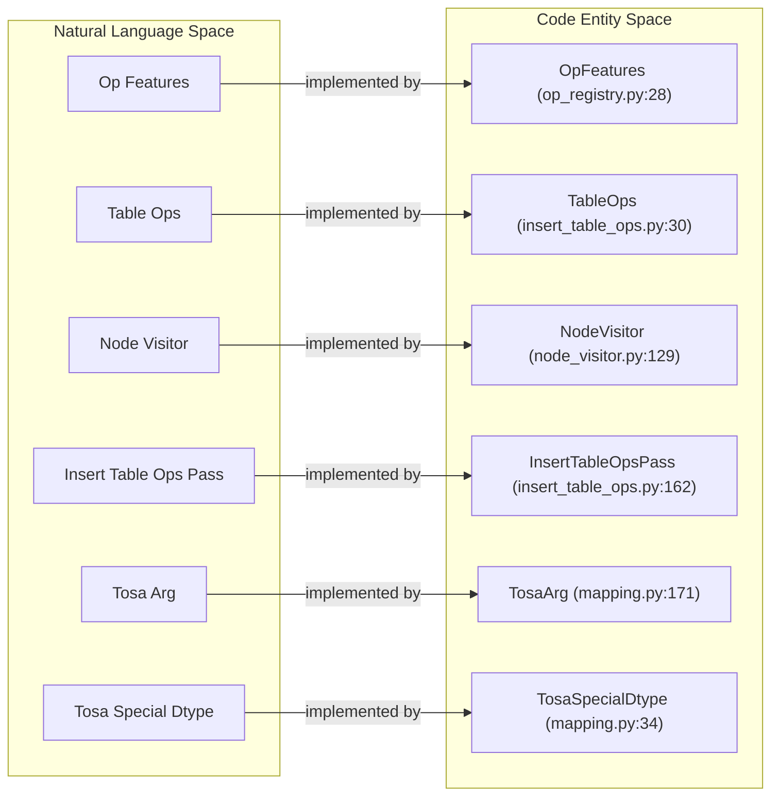
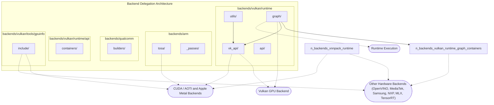
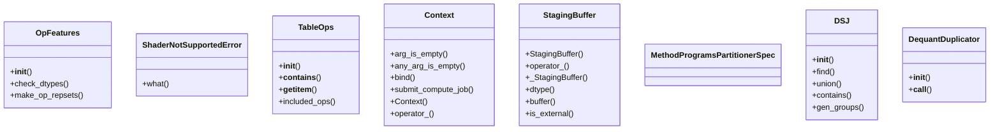
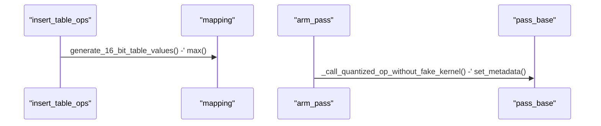

# 3-Source Context Packet (`git` + `CBM` + `llm-wiki`) for `5-backend-delegation-architecture` — Backend Delegation Architecture

- **Target Wiki File**: `wiki/5-backend-delegation-architecture.md`
- **Archetype**: `Parent Hub Page`
- **Parent Page**: `None (Top-Level Chapter)`
- **Summary**: Architectural specification and implementation reference for Backend Delegation Architecture (40 relevant source files). Primary code entities: `CommandBuffer`, `begin`, `bind_descriptors`, `bind_pipeline`, `NodeVisitor`.
- **Valid `[[wikilink]]` Neighbours**: `[[1-overview|Overview]]`, `[[5.1-partitioning-and-operator-support|Partitioning and Operator Support]]`, `[[5.2-vulkan-gpu-backend|Vulkan GPU Backend]]`, `[[5.3-qualcomm-qnn-backend|Qualcomm QNN Backend]]`, `[[5.4-arm-tosa-and-ethos-u-backend|ARM TOSA and Ethos-U Backend]]`, `[[5.5-cadence-dsp-backend|Cadence DSP Backend]]`, `[[5.6-xnnpack-cpu-backend|XNNPACK CPU Backend]]`, `[[5.7-cuda-aoti-and-apple-metal-backends|CUDA / AOTI and Apple Metal Backends]]`, `[[5.8-other-backends|Other Hardware Backends (OpenVINO, MediaTek, Samsung, NXP, MLX, TensorRT)]]`

## 1. Relevant Source Files (`git` + `CBM`, use verbatim in `<details>`)
- `[backends/vulkan/runtime/vk_api/Command.cpp](backends/vulkan/runtime/vk_api/Command.cpp)`
- `[backends/qualcomm/builders/node_visitor.py](backends/qualcomm/builders/node_visitor.py)`
- `[backends/arm/tosa/mapping.py](backends/arm/tosa/mapping.py)`
- `[backends/arm/_passes/insert_table_ops.py](backends/arm/_passes/insert_table_ops.py)`
- `[backends/vulkan/runtime/utils/VecUtils.h](backends/vulkan/runtime/utils/VecUtils.h)`
- `[backends/vulkan/runtime/graph/ComputeGraph.h](backends/vulkan/runtime/graph/ComputeGraph.h)`
- `[backends/vulkan/runtime/vk_api/DispatchGrid.cpp](backends/vulkan/runtime/vk_api/DispatchGrid.cpp)`
- `[backends/vulkan/runtime/api/containers/StagingBuffer.h](backends/vulkan/runtime/api/containers/StagingBuffer.h)`
- `[backends/vulkan/tools/gpuinfo/include/stats.h](backends/vulkan/tools/gpuinfo/include/stats.h)`
- `[backends/vulkan/runtime/graph/ops/utils/ShaderNameUtils.cpp](backends/vulkan/runtime/graph/ops/utils/ShaderNameUtils.cpp)`
- `[exir/backend/backend_api.py](exir/backend/backend_api.py)`
- `[backends/vulkan/op_registry.py](backends/vulkan/op_registry.py)`
- `[exir/backend/canonical_partitioners/group_partitioner.py](exir/backend/canonical_partitioners/group_partitioner.py)`
- `[backends/arm/_passes/arm_pass.py](backends/arm/_passes/arm_pass.py)`
- `[backends/vulkan/runtime/api/Context.h](backends/vulkan/runtime/api/Context.h)`
- `[exir/backend/canonical_partitioners/config_partitioner.py](exir/backend/canonical_partitioners/config_partitioner.py)`
- `[backends/vulkan/runtime/vk_api/Exception.h](backends/vulkan/runtime/vk_api/Exception.h)`
- `[exir/backend/backend_details.py](exir/backend/backend_details.py)`
- `[exir/backend/operator_support.py](exir/backend/operator_support.py)`
- `[backends/vulkan/runtime/graph/containers/PushConstantData.h](backends/vulkan/runtime/graph/containers/PushConstantData.h)`
- `[exir/backend/partitioner.py](exir/backend/partitioner.py)`
- `[backends/vulkan/runtime/graph/ComputeGraph.cpp](backends/vulkan/runtime/graph/ComputeGraph.cpp)`
- `[backends/xnnpack/operators/node_visitor.py](backends/xnnpack/operators/node_visitor.py)`
- `[exir/backend/canonical_partitioners/all_node_partitioner.py](exir/backend/canonical_partitioners/all_node_partitioner.py)`
- `[exir/backend/compile_spec_schema.py](exir/backend/compile_spec_schema.py)`
- `[exir/backend/canonical_partitioners/duplicate_dequant_node_pass.py](exir/backend/canonical_partitioners/duplicate_dequant_node_pass.py)`
- `[backends/xnnpack/runtime/XNNWeightsCache.h](backends/xnnpack/runtime/XNNWeightsCache.h)`
- `[runtime/backend/backend_init_context.h](runtime/backend/backend_init_context.h)`
- `[backends/arm/MODELS.md](backends/arm/MODELS.md)`
- `[backends/arm/README.md](backends/arm/README.md)`

## 2. Grounded Code Symbols (`CBM`, use verbatim for `[file:start-end]()` pill citations)
- `OpFeatures` (Class) @ `[backends/vulkan/op_registry.py:28-129]()` [fan-in=92, fan-out=0] — 
- `TableOps` (Class) @ `[backends/arm/_passes/insert_table_ops.py:30-159]()` [fan-in=1, fan-out=0] — Helper class for finding the corresponding table operator for a given Node.
- `NodeVisitor` (Class) @ `[backends/qualcomm/builders/node_visitor.py:129-614]()` [fan-in=0, fan-out=0] — Node visitor pattern for visiting nodes in an edge IR graph
- `InsertTableOpsPass` (Class) @ `[backends/arm/_passes/insert_table_ops.py:162-431]()` [fan-in=0, fan-out=0] — For ops in self.table_ops they need to be serialized as a TOSA TABLE. This pass replaces these edge ops with a tosa._table(input: Tensor, target_str: str) where
- `TosaArg` (Class) @ `[backends/arm/tosa/mapping.py:171-338]()` [fan-in=0, fan-out=0] — Capture and normalize TOSA operator arguments. Use this to convert FX nodes, sequences, and numeric literals into a consistent structure suitable for TOSA seria
- `TosaSpecialDtype` (Class) @ `[backends/arm/tosa/mapping.py:34-79]()` [fan-in=0, fan-out=0] — Special TOSA dtypes not natively expressed in PyTorch.
- `ComputeGraph` (Class) @ `[backends/vulkan/runtime/graph/ComputeGraph.h:166-1340]()` [fan-in=0, fan-out=0] — /* * This is the core data structure used to execute Vulkan models in graph mode. * As opposed to ATen/eager mode where a command buffer is encoded every * infe
- `TmpTensor` (Class) @ `[backends/vulkan/runtime/graph/ComputeGraph.h:100-152]()` [fan-in=0, fan-out=0] — /* * This struct is used to recycle the memory of temporary tensors that are * created during the execution of a node. Upon construction, this struct will * che
- `MethodProgramsPartitionerSpec` (Class) @ `[exir/backend/backend_api.py:672-680]()` [fan-in=1, fan-out=0] — Since single dispatch for to_backend requires the first argument to be a valid class, we create the following dataclass spec to hold the dictionaries mapping th
- `_DependencyViewer` (Class) @ `[exir/backend/canonical_partitioners/group_partitioner.py:30-71]()` [fan-in=1, fan-out=0] — Transitive users and inputs of nodes, as bitmasks over node positions. A whole partition can then be checked for cycles with a few integer operations. Nodes mus
- `DSJ` (Class) @ `[exir/backend/canonical_partitioners/config_partitioner.py:111-137]()` [fan-in=1, fan-out=0] — Disjoint set union data structure used to find connected components in the graph.
- `ArmOpTargetedPass` (Class) @ `[backends/arm/_passes/arm_pass.py:250-319]()` [fan-in=0, fan-out=0] — Base class for passes that only transform selected operators. Subclasses set ``target_ops`` to the call_function targets they can transform. If the current grap
- `ArmPass` (Class) @ `[backends/arm/_passes/arm_pass.py:27-247]()` [fan-in=0, fan-out=0] — Base class for Arm passes.
- `GroupBasedPartitioner` (Class) @ `[exir/backend/canonical_partitioners/group_partitioner.py:74-495]()` [fan-in=0, fan-out=0] — A specialized partitioner that extends the CapabilityBasedPartitioner from PyTorch FX. GroupBasedPartitioner allows for explicit grouping of nodes into partitio
- `PartitionerConfig` (Class) @ `[exir/backend/canonical_partitioners/config_partitioner.py:45-108]()` [fan-in=0, fan-out=0] — Class used to represent a PartitionerConfig. PartitionerConfig is used by config-based partitioner to partition identify nodes to be delegated. User overrides t
- `BackendDetails` (Class) @ `[exir/backend/backend_details.py:99-206]()` [fan-in=0, fan-out=0] — A base interface to lower the implementation to the according backend. With the decorators, this interface will be static, abstract and all inheritances are enf
- `DelegateScratchSpec` (Class) @ `[exir/backend/backend_details.py:27-52]()` [fan-in=0, fan-out=0] — A scratch buffer the delegate needs for the duration of one execute() call. The memory planner places these in the arena and may reuse the bytes for anything wh
- `Partitioner` (Class) @ `[exir/backend/partitioner.py:37-152]()` [fan-in=1, fan-out=0] — Defines a callable interface for partitioning an exported program for backend delegation. A partitioner implementation would receive an exported program, determ
- `PushConstantDataInfo` (Class) @ `[backends/vulkan/runtime/graph/containers/PushConstantData.h:25-80]()` [fan-in=0, fan-out=0] — /* * Represents a push constant data entry * Which is either shared pointer to a tensor's uniform data with an attribute * Or data with a maximum size of 16 byt
- `DontPartition` (Class) @ `[exir/backend/operator_support.py:38-62]()` [fan-in=0, fan-out=0] — Operator check to skip partitioning ops based on their target. The target can be an EdgeOverloadOp (exir_ops.edge.aten.*), OverloadOp (torch.ops.aten.*), or a s
- `DontPartitionModule` (Class) @ `[exir/backend/operator_support.py:84-127]()` [fan-in=0, fan-out=0] — Operator check to skip partitioning modules. You can pass either the module name, i.e. the class name of the module, or the name of the instance that you want t
- `DontPartitionName` (Class) @ `[exir/backend/operator_support.py:65-81]()` [fan-in=0, fan-out=0] — Operator check to skip partitioning ops based on their name, which can be found by for example node.name or print-outs of a GraphModule. Set `exact` to False to

## 3. Grounded Source Code Excerpts (`git` Working Tree)
### `OpFeatures` in `[backends/vulkan/op_registry.py:28-43]()`
```python
class OpFeatures:
    __slots__ = [
        # Dtype-related slots:
        "inputs_dtypes",  # DtypeSetList for input tensor dtype constraints
        "outputs_dtypes",  # DtypeSetList for output tensor dtype constraints
        # Storage-related slots:
        # Sets of possible (storage types, memory layouts) to use for the input tensor(s)
        "inputs_storage",
        # Sets of possible (storage types, memory layouts) to use for the output tensor(s)
        "outputs_storage",
        # bool indicating if the operator has a resize function, which allows it to
        # support models with dynamic shape
        "supports_resize",
        # bool indicating if the operator supports tensors with more than 4 dimensions
        "supports_highdim",
        # bool indicating if the operator handles its own prepacking. If this is True,
```

### `TableOps` in `[backends/arm/_passes/insert_table_ops.py:30-45]()`
```python
class TableOps:
    """Helper class for finding the corresponding table operator for a given
    Node.
    """

    # Targets that follow a straigtforward one-to-one mapping to their table op
    unary_table_ops: Dict[EdgeOpOverload, Callable[[torch.Tensor], torch.Tensor]] = {
        exir_ops.edge.aten.ceil.default: torch.ceil,
        exir_ops.edge.aten.erf.default: torch.erf,
        exir_ops.edge.aten.exp.default: torch.exp,
        exir_ops.edge.aten.expm1.default: torch.expm1,
        exir_ops.edge.aten.erfinv.default: torch.erfinv,
        exir_ops.edge.aten.floor.default: torch.floor,
        exir_ops.edge.aten.log.default: torch.log,
        exir_ops.edge.aten.log1p.default: torch.log1p,
        exir_ops.edge.aten.log10.default: torch.log10,
```

### `NodeVisitor` in `[backends/qualcomm/builders/node_visitor.py:129-144]()`
```python
class NodeVisitor:
    """
    Node visitor pattern for visiting nodes in an edge IR graph
    """

    def __init__(
        self,
        external_ids,
        edge_program: torch.export.ExportedProgram,
        enable_tensor_dump,
        is_qnn_partitioner=True,
        backend_type=None,
    ) -> None:
        # is_qnn_partitioner: True for the real qnn_partitioner / qnn_preprocess
        # flows, where external_ids is built from the program being processed so
        # graph-input ids resolve correctly.
```

### `InsertTableOpsPass` in `[backends/arm/_passes/insert_table_ops.py:162-177]()`
```python
class InsertTableOpsPass(ArmPass):
    """For ops in self.table_ops they need to be serialized as a TOSA TABLE.

    This pass replaces these edge ops with a tosa._table(input: Tensor,
    target_str: str) where target_str == str(node.target). When lowering the
    _table node target_str will be used to find the corresponding torch operator
    which will be used to produce the table values in operators/op_table.py.

    """

    _passes_required_after: Set[Type[ExportPass]] = set()

    def __init__(self, exported_program: ExportedProgram) -> None:
        super().__init__()
        self.exported_program = exported_program
        self.table_ops = TableOps(exported_program)
```

### `TosaArg` in `[backends/arm/tosa/mapping.py:171-186]()`
```python
class TosaArg:
    """Capture and normalize TOSA operator arguments.

    Use this to convert FX nodes, sequences, and numeric literals into a
    consistent structure suitable for TOSA serialization.

    Attributes:
        name (str): Node name when argument is a ``torch.fx.Node``; empty
            otherwise.
        dtype (ts.DType | None): Inferred dtype when available.
        shape (tuple[int, ...] | None): Inferred shape when available.
        special (list | None): Captured list when the argument is a sequence.
        number (float | int | None): Captured numeric value when provided.
        multiple_output_name (list[str]): Output node names when node has multiple outputs; empty otherwise.

    """
```


## 4. Linked Official Docs (`llm-wiki` / `RAG`)
- **Vulkan GPU Backend** (`wiki/5.2-vulkan-gpu-backend.md`, score=116.696, shared_symbols=['OpFeatures', 'PushConstantDataInfo']): # Vulkan GPU Backend ↑ [[5-backend-delegation-architecture|Backend Delegation Architecture]] > Architectural specification and implementation reference for Vulkan GPU Backend (40 relevant source files). Primary code entities: `CommandBuffer`, `begin`, `bind_descriptors`, `bind_pipeline`, `OpFeatures`. <details> <summary>Relevant source files</summary> Th
- **ExecuTorch DeepWiki** (`wiki/index.md`, score=115.388, shared_symbols=[]): # ExecuTorch DeepWiki Generated from `home-jason-Project-deepwiki-executorch` at commit `b3b565b5b62f` (2026-11-15T15:02:11+00:00). ## Pages - [[1-overview|Overview]] — Architectural specification and implementation reference for Overview (10 relevant source files). Primary code entities: `Module`, `MethodHolder`, `PlannedMemory`, `EdgeProgramManager`, `_
- **ARM TOSA and Ethos-U Backend** (`wiki/5.4-arm-tosa-and-ethos-u-backend.md`, score=114.803, shared_symbols=[]): # ARM TOSA and Ethos-U Backend ↑ [[5-backend-delegation-architecture|Backend Delegation Architecture]] > Architectural specification and implementation reference for ARM TOSA and Ethos-U Backend (40 relevant source files). Primary code entities: `TosaArg`, `__init__`, `__process_list`, `__process_node`, `InsertTableOpsPass`. <details> <summary>Relevant so
- **Partitioning and Operator Support** (`wiki/5.1-partitioning-and-operator-support.md`, score=106.346, shared_symbols=[]): # Partitioning and Operator Support ↑ [[5-backend-delegation-architecture|Backend Delegation Architecture]] > Architectural specification and implementation reference for Partitioning and Operator Support (17 relevant source files). Primary code entities: `MethodProgramsPartitionerSpec`, `_`, `_create_partitions`, `_create_partitions_in_graph_module`, `Gro
- **Other Hardware Backends (OpenVINO, MediaTek, Samsung, NXP, MLX, TensorRT)** (`wiki/5.8-other-backends.md`, score=97.168, shared_symbols=[]): # Other Hardware Backends (OpenVINO, MediaTek, Samsung, NXP, MLX, TensorRT) ↑ [[5-backend-delegation-architecture|Backend Delegation Architecture]] > Architectural specification and implementation reference for Other Hardware Backends (OpenVINO, MediaTek, Samsung, NXP, MLX, TensorRT) (40 relevant source files). Primary code entities: `ConstantData`, `add`,
- **Qualcomm QNN Backend** (`wiki/5.3-qualcomm-qnn-backend.md`, score=69.286, shared_symbols=[]): # Qualcomm QNN Backend ↑ [[5-backend-delegation-architecture|Backend Delegation Architecture]] > Architectural specification and implementation reference for Qualcomm QNN Backend (40 relevant source files). Primary code entities: `NodeVisitor`, `__init__`, `define_custom_tensor_wrapper`, `define_node`, `ConvertMhaToSha`. <details> <summary>Relevant source

## 5. Pre-Verified DeepWiki v1.9.9.5 Mermaid Diagrams
### Natural Language Space <-> Code Entity Space


### Subsystem Architecture Flowchart


### Class Hierarchy Diagram


### Call Sequence Diagram


## 6. DeepWiki v1.9.9.5 Authoring Checklist for `wiki/5-backend-delegation-architecture.md`
1. Keep YAML frontmatter at top (`id`, `title`, `parent`, `sources`, `linked_docs`, `bridge_symbols`).
2. Keep `<details><summary>Relevant source files</summary>` block immediately after `# Title`.
3. Start with `## Purpose and Scope`, then numbered `## 1. ...`, `## 2. ...` sections separated by `---`.
4. Include at least 2 ```mermaid``` diagrams (including a `Natural Language Space` <-> `Code Entity Space` mapping).
5. Cite code entities inline using `[path/to/file.ext:start-end]()` and end every `##` section with `Sources: [file:start-end]()`.
6. Run `deepwiki_cli.py build --enrich-only ...` and `deepwiki_cli.py validate ...` after editing.
