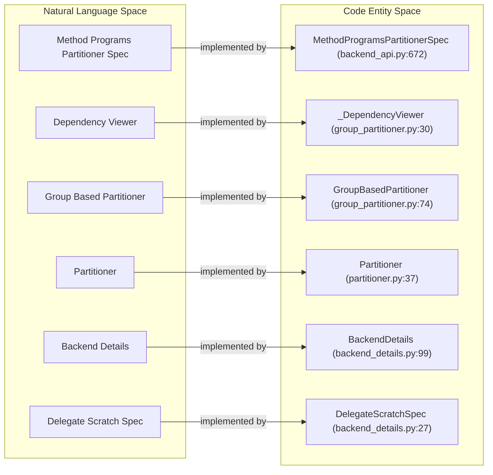
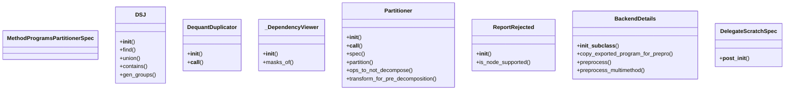
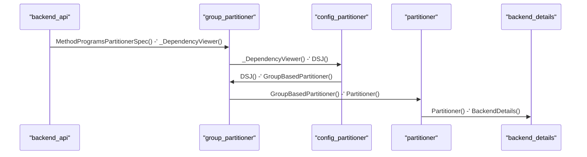

# 3-Source Context Packet (`git` + `CBM` + `llm-wiki`) for `5.1-partitioning-and-operator-support` — Partitioning and Operator Support

- **Target Wiki File**: `wiki/5.1-partitioning-and-operator-support.md`
- **Archetype**: `Leaf Technical Spec Page`
- **Parent Page**: `5-backend-delegation-architecture`
- **Summary**: Architectural specification and implementation reference for Partitioning and Operator Support (17 relevant source files). Primary code entities: `MethodProgramsPartitionerSpec`, `_`, `_create_partitions`, `_create_partitions_in_graph_module`, `GroupBasedPartitioner`.
- **Valid `[[wikilink]]` Neighbours**: `[[5-backend-delegation-architecture|Backend Delegation Architecture]]`, `[[1.1-getting-started|Getting Started]]`, `[[1.2-export-api-and-recipe-system|Export API and Recipe System]]`, `[[2.2-kernel-libraries-and-selective-build|Kernel Libraries and Selective Build]]`, `[[2.3-schema-generation-and-flatbuffers|Schema Generation and FlatBuffers]]`, `[[3.4-program-emission-and-serialization|Program Emission and Serialization]]`, `[[3.5-verification-and-dialect-system|Verification and Dialect System]]`, `[[4-quantization-systems|Quantization Systems]]`

## 1. Relevant Source Files (`git` + `CBM`, use verbatim in `<details>`)
- `[exir/backend/backend_api.py](exir/backend/backend_api.py)`
- `[exir/backend/canonical_partitioners/group_partitioner.py](exir/backend/canonical_partitioners/group_partitioner.py)`
- `[exir/backend/canonical_partitioners/config_partitioner.py](exir/backend/canonical_partitioners/config_partitioner.py)`
- `[exir/backend/backend_details.py](exir/backend/backend_details.py)`
- `[exir/backend/operator_support.py](exir/backend/operator_support.py)`
- `[exir/backend/partitioner.py](exir/backend/partitioner.py)`
- `[exir/backend/canonical_partitioners/all_node_partitioner.py](exir/backend/canonical_partitioners/all_node_partitioner.py)`
- `[exir/backend/compile_spec_schema.py](exir/backend/compile_spec_schema.py)`
- `[exir/backend/canonical_partitioners/duplicate_dequant_node_pass.py](exir/backend/canonical_partitioners/duplicate_dequant_node_pass.py)`
- `[exir/backend/canonical_partitioners/duplicate_constant_node_pass.py](exir/backend/canonical_partitioners/duplicate_constant_node_pass.py)`
- `[exir/backend/targets.bzl](exir/backend/targets.bzl)`
- `[exir/backend/utils.py](exir/backend/utils.py)`
- `[exir/backend/canonical_partitioners/pattern_op_partitioner.py](exir/backend/canonical_partitioners/pattern_op_partitioner.py)`
- `[docs/source/compiler-delegate-and-partitioner.md](docs/source/compiler-delegate-and-partitioner.md)`
- `[docs/source/backends-overview.md](docs/source/backends-overview.md)`
- `[exir/backend/BUCK](exir/backend/BUCK)`
- `[exir/backend/canonical_partitioners/BUCK](exir/backend/canonical_partitioners/BUCK)`

## 2. Grounded Code Symbols (`CBM`, use verbatim for `[file:start-end]()` pill citations)
- `MethodProgramsPartitionerSpec` (Class) @ `[exir/backend/backend_api.py:672-680]()` [fan-in=1, fan-out=0] — Since single dispatch for to_backend requires the first argument to be a valid class, we create the following dataclass spec to hold the dictionaries mapping th
- `_DependencyViewer` (Class) @ `[exir/backend/canonical_partitioners/group_partitioner.py:30-71]()` [fan-in=1, fan-out=0] — Transitive users and inputs of nodes, as bitmasks over node positions. A whole partition can then be checked for cycles with a few integer operations. Nodes mus
- `DSJ` (Class) @ `[exir/backend/canonical_partitioners/config_partitioner.py:111-137]()` [fan-in=1, fan-out=0] — Disjoint set union data structure used to find connected components in the graph.
- `GroupBasedPartitioner` (Class) @ `[exir/backend/canonical_partitioners/group_partitioner.py:74-495]()` [fan-in=0, fan-out=0] — A specialized partitioner that extends the CapabilityBasedPartitioner from PyTorch FX. GroupBasedPartitioner allows for explicit grouping of nodes into partitio
- `Partitioner` (Class) @ `[exir/backend/partitioner.py:37-152]()` [fan-in=1, fan-out=0] — Defines a callable interface for partitioning an exported program for backend delegation. A partitioner implementation would receive an exported program, determ
- `BackendDetails` (Class) @ `[exir/backend/backend_details.py:99-206]()` [fan-in=0, fan-out=0] — A base interface to lower the implementation to the according backend. With the decorators, this interface will be static, abstract and all inheritances are enf
- `DelegateScratchSpec` (Class) @ `[exir/backend/backend_details.py:27-52]()` [fan-in=0, fan-out=0] — A scratch buffer the delegate needs for the duration of one execute() call. The memory planner places these in the arena and may reuse the bytes for anything wh
- `PartitionerConfig` (Class) @ `[exir/backend/canonical_partitioners/config_partitioner.py:45-108]()` [fan-in=0, fan-out=0] — Class used to represent a PartitionerConfig. PartitionerConfig is used by config-based partitioner to partition identify nodes to be delegated. User overrides t
- `DontPartition` (Class) @ `[exir/backend/operator_support.py:38-62]()` [fan-in=0, fan-out=0] — Operator check to skip partitioning ops based on their target. The target can be an EdgeOverloadOp (exir_ops.edge.aten.*), OverloadOp (torch.ops.aten.*), or a s
- `DontPartitionModule` (Class) @ `[exir/backend/operator_support.py:84-127]()` [fan-in=0, fan-out=0] — Operator check to skip partitioning modules. You can pass either the module name, i.e. the class name of the module, or the name of the instance that you want t
- `DontPartitionName` (Class) @ `[exir/backend/operator_support.py:65-81]()` [fan-in=0, fan-out=0] — Operator check to skip partitioning ops based on their name, which can be found by for example node.name or print-outs of a GraphModule. Set `exact` to False to
- `PartitionResult` (Class) @ `[exir/backend/partitioner.py:26-34]()` [fan-in=0, fan-out=0] — tagged_exported_program: the graph with nodes that intend to be delegated containing a "DelegationSpec" metadata partition_tags: A dictionary that will be used 
- `ReportRejected` (Class) @ `[exir/backend/utils.py:683-700]()` [fan-in=1, fan-out=0] — Class for wrapping a OperatorSupportBase, reporting rejects with the specified message to `reporter`.
- `DuplicateDequantNodePass` (Class) @ `[exir/backend/canonical_partitioners/duplicate_dequant_node_pass.py:50-111]()` [fan-in=0, fan-out=0] — Duplicates all of the dequantize. This is such that all quantized ops have their own unique dequant nodes. Since quantized ops are represented as dq -> op -> q.
- `DelegateMappingBuilder` (Class) @ `[exir/backend/utils.py:474-585]()` [fan-in=0, fan-out=0] — # TODO - style: use templated types
- `WhyNoPartition` (Class) @ `[exir/backend/utils.py:588-613]()` [fan-in=0, fan-out=0] — Simple helper class for partitioners to log why a node was not lowered. Example usage: # In your backend partitioner file(s) why = WhyNoPartition(logger=your_ba
- `WhyNoPartitionReporter` (Class) @ `[exir/backend/utils.py:616-680]()` [fan-in=0, fan-out=0] — Helper class for partitioners to gather why nodes were not lowered in a single report. If a node is reported multiple times, only the first report is included. 
- `PreprocessResult` (Class) @ `[exir/backend/backend_details.py:56-85]()` [fan-in=0, fan-out=0] — 
- `ConfigerationBasedPartitioner` (Class) @ `[exir/backend/canonical_partitioners/config_partitioner.py:140-262]()` [fan-in=0, fan-out=0] — 
- `DequantDuplicator` (Class) @ `[exir/backend/canonical_partitioners/duplicate_dequant_node_pass.py:20-47]()` [fan-in=1, fan-out=0] — 
- `DontSupportBase` (Class) @ `[exir/backend/operator_support.py:22-35]()` [fan-in=0, fan-out=0] — 
- `DelegationSpec` (Class) @ `[exir/backend/partitioner.py:20-22]()` [fan-in=0, fan-out=0] — 

## 3. Grounded Source Code Excerpts (`git` Working Tree)
### `MethodProgramsPartitionerSpec` in `[exir/backend/backend_api.py:672-680]()`
```python
class MethodProgramsPartitionerSpec:
    """
    Since single dispatch for to_backend requires the first argument to be a
    valid class, we create the following dataclass spec to hold the dictionaries
    mapping the method name to the corresponding program, partitioner
    """

    method_to_edge_program: Mapping[str, ExportedProgram]
    method_to_partitioner: Mapping[str, Partitioner]
```

### `_DependencyViewer` in `[exir/backend/canonical_partitioners/group_partitioner.py:30-45]()`
```python
class _DependencyViewer:
    """Transitive users and inputs of nodes, as bitmasks over node positions.

    A whole partition can then be checked for cycles with a few integer
    operations. Nodes must be in topological order, as FX graphs keep them.
    """

    def __init__(self, graph_module: GraphModule, nodes):
        all_nodes = self.nodes = list(graph_module.graph.nodes)
        self.positions = {node: i for i, node in enumerate(all_nodes)}
        self.downstreams = {}
        self.upstreams = {}
        # Only these can be on a path between two of the nodes. A mask costs
        # one bit per position up to its highest node, so skipping the others
        # saves memory where most nodes are far from every partition.
        downstream_nodes = _reachable(nodes, lambda node: node.users)
```

### `DSJ` in `[exir/backend/canonical_partitioners/config_partitioner.py:111-126]()`
```python
class DSJ:
    """
    Disjoint set union data structure used to find connected components in the graph.
    """

    def __init__(self):
        self.parent = {}

    def find(self, x):
        self.parent.setdefault(x, x)
        if self.parent[x] != x:
            self.parent[x] = self.find(self.parent[x])
        return self.parent[x]

    def union(self, x, y):
        self.parent[self.find(x)] = self.find(y)
```

### `GroupBasedPartitioner` in `[exir/backend/canonical_partitioners/group_partitioner.py:74-89]()`
```python
class GroupBasedPartitioner(CapabilityBasedPartitioner):
    """
    A specialized partitioner that extends the CapabilityBasedPartitioner from PyTorch FX.

    GroupBasedPartitioner allows for explicit grouping of nodes into partitions based on
    predefined node groups, while also supporting automatic partitioning for nodes not
    included in any group. Nodes are only allowed to be in one group.

    Features:
    - Explicit Node Grouping: Allows specifying groups of nodes that should be kept together
      in the same partition.
    - Automatic Partitioning: Nodes not included in any explicit group are automatically
      partitioned based on operator support.
    - Cycle Prevention: Ensures that partitioning doesn't create cycles in the execution graph.
    - Single Node Partition Control: Options to allow or disallow single-node partitions,
      with exceptions for specific operations.
```

### `Partitioner` in `[exir/backend/partitioner.py:37-52]()`
```python
class Partitioner(ABC):
    """
    Defines a callable interface for partitioning an exported program for
    backend delegation.
    A partitioner implementation would receive an exported program, determine what portions of
    the it can be delegated to certain backend (though a partitioner can target multiple
    backends as well), and return the PartitionResult including:
    - the same input module with specific nodes in the input graph tagged for delegation
    - the "partition_tags" to indicate how the tag is mapped to Delegation Spec.

    The nodes that intend to be delegated must be tagged (by setting
    node.meta["delegation_tag"]) and this tag must be provided in the
    `partition_tags` dictionary mapping to an instance of
    DelegationSpec(backend_id, method_compilation_spec). Each tag must represent
    a distinct submodule that we intend on lowering and should be fully contained.
```


## 4. Linked Official Docs (`llm-wiki` / `RAG`)
- **Backend Delegation Architecture** (`wiki/5-backend-delegation-architecture.md`, score=131.196, shared_symbols=['CompileSpec']): # Backend Delegation Architecture > Architectural specification and implementation reference for Backend Delegation Architecture (40 relevant source files). Primary code entities: `CommandBuffer`, `begin`, `bind_descriptors`, `bind_pipeline`, `NodeVisitor`. <details> <summary>Relevant source files</summary> The following files were used as context for gen
- **ExecuTorch DeepWiki** (`wiki/index.md`, score=106.053, shared_symbols=[]): # ExecuTorch DeepWiki Generated from `home-jason-Project-deepwiki-executorch` at commit `b3b565b5b62f` (2026-11-15T15:02:11+00:00). ## Pages - [[1-overview|Overview]] — Architectural specification and implementation reference for Overview (10 relevant source files). Primary code entities: `Module`, `MethodHolder`, `PlannedMemory`, `EdgeProgramManager`, `_
- **Vulkan GPU Backend** (`wiki/5.2-vulkan-gpu-backend.md`, score=89.879, shared_symbols=[]): # Vulkan GPU Backend ↑ [[5-backend-delegation-architecture|Backend Delegation Architecture]] > Architectural specification and implementation reference for Vulkan GPU Backend (40 relevant source files). Primary code entities: `CommandBuffer`, `begin`, `bind_descriptors`, `bind_pipeline`, `OpFeatures`. <details> <summary>Relevant source files</summary> Th
- **Qualcomm QNN Backend** (`wiki/5.3-qualcomm-qnn-backend.md`, score=89.879, shared_symbols=[]): # Qualcomm QNN Backend ↑ [[5-backend-delegation-architecture|Backend Delegation Architecture]] > Architectural specification and implementation reference for Qualcomm QNN Backend (40 relevant source files). Primary code entities: `NodeVisitor`, `__init__`, `define_custom_tensor_wrapper`, `define_node`, `ConvertMhaToSha`. <details> <summary>Relevant source
- **ARM TOSA and Ethos-U Backend** (`wiki/5.4-arm-tosa-and-ethos-u-backend.md`, score=89.879, shared_symbols=[]): # ARM TOSA and Ethos-U Backend ↑ [[5-backend-delegation-architecture|Backend Delegation Architecture]] > Architectural specification and implementation reference for ARM TOSA and Ethos-U Backend (40 relevant source files). Primary code entities: `TosaArg`, `__init__`, `__process_list`, `__process_node`, `InsertTableOpsPass`. <details> <summary>Relevant so
- **Other Hardware Backends (OpenVINO, MediaTek, Samsung, NXP, MLX, TensorRT)** (`wiki/5.8-other-backends.md`, score=84.522, shared_symbols=['CompileSpec']): # Other Hardware Backends (OpenVINO, MediaTek, Samsung, NXP, MLX, TensorRT) ↑ [[5-backend-delegation-architecture|Backend Delegation Architecture]] > Architectural specification and implementation reference for Other Hardware Backends (OpenVINO, MediaTek, Samsung, NXP, MLX, TensorRT) (40 relevant source files). Primary code entities: `ConstantData`, `add`,

## 5. Pre-Verified DeepWiki v1.9.9.5 Mermaid Diagrams
### Natural Language Space <-> Code Entity Space


### Subsystem Architecture Flowchart

```mermaid
flowchart TD
  subgraph sub_this["Partitioning and Operator Support"]
    subgraph sg_0["exir/backend"]
      n_exir_backend_backend_api_py["MethodProgramsPartitionerSpec (backend_api.py)"]
      n_exir_backend_backend_details_py["BackendDetails (backend_details.py)"]
      n_exir_backend_operator_support_py["DontPartition (operator_support.py)"]
      n_exir_backend_partitioner_py["Partitioner (partitioner.py)"]
      n_exir_backend_compile_spec_schema_py["CompileSpec (compile_spec_schema.py)"]
      n_exir_backend_targets_bzl["define_common_targets (targets.bzl)"]
      n_exir_backend_utils_py["ReportRejected (utils.py)"]
    end
    subgraph sg_1["exir/backend/canonical_partitioners"]
      n_exir_backend_canonical_partitioners_group_partit["_DependencyViewer (group_partitioner.py)"]
      n_exir_backend_canonical_partitioners_config_parti["DSJ (config_partitioner.py)"]
      n_exir_backend_canonical_partitioners_all_node_par["AllNodePartitioner (all_node_partitioner.py)"]
      n_exir_backend_canonical_partitioners_duplicate_de["DuplicateDequantNodePass (duplicate_dequant_node_pass.py)"]
      n_exir_backend_canonical_partitioners_duplicate_co["duplicate_constant_nodes (duplicate_constant_node_pass.py)"]
      n_exir_backend_canonical_partitioners_pattern_op_p["generate_pattern_op_partitions (pattern_op_partitioner.py)"]
      n_exir_backend_canonical_partitioners_BUCK["BUCK"]
    end
  end
  n_page_5_2_vulkan_gpu_backend(["Vulkan GPU Backend"])
  n_page_5_backend_delegation_architecture(["Backend Delegation Architecture"])
  n_exir_backend_backend_api_py --> n_exir_backend_backend_details_py
  n_exir_backend_backend_api_py -.-> n_page_5_backend_delegation_architecture
  n_exir_backend_utils_py -.-> n_page_5_backend_delegation_architecture
  n_exir_backend_canonical_partitioners_group_partit -.-> n_page_5_2_vulkan_gpu_backend
```


### Class Hierarchy Diagram


### Call Sequence Diagram


## 6. DeepWiki v1.9.9.5 Authoring Checklist for `wiki/5.1-partitioning-and-operator-support.md`
1. Keep YAML frontmatter at top (`id`, `title`, `parent`, `sources`, `linked_docs`, `bridge_symbols`).
2. Keep `<details><summary>Relevant source files</summary>` block immediately after `# Title`.
3. Start with `## Purpose and Scope`, then numbered `## 1. ...`, `## 2. ...` sections separated by `---`.
4. Include at least 2 ```mermaid``` diagrams (including a `Natural Language Space` <-> `Code Entity Space` mapping).
5. Cite code entities inline using `[path/to/file.ext:start-end]()` and end every `##` section with `Sources: [file:start-end]()`.
6. Run `deepwiki_cli.py build --enrich-only ...` and `deepwiki_cli.py validate ...` after editing.
