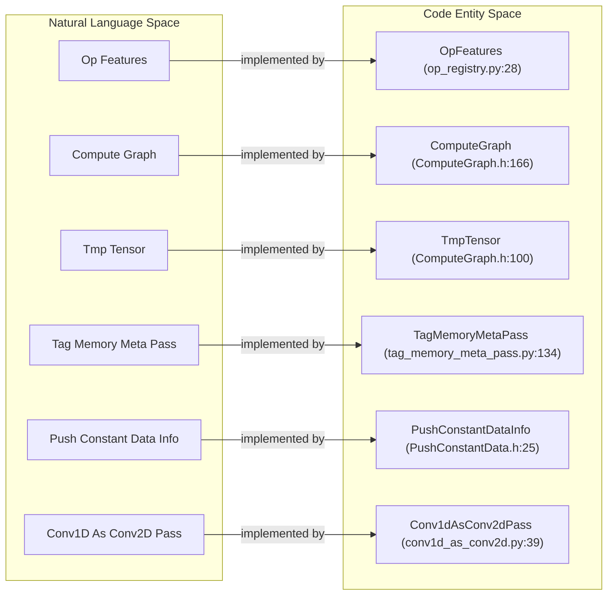
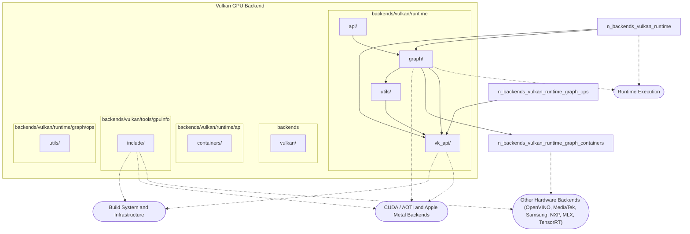
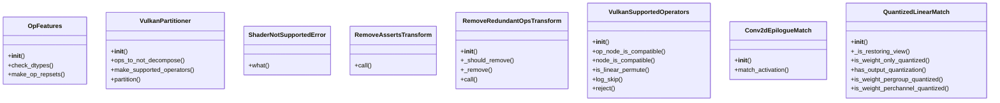
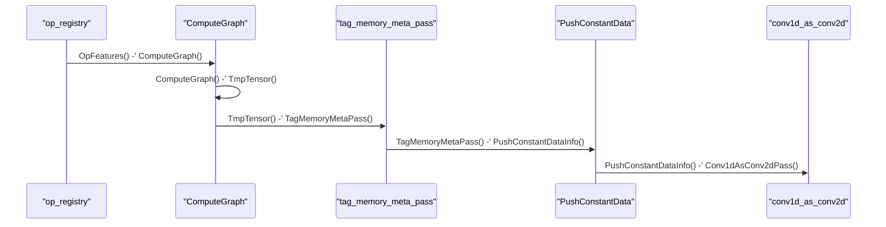

# 3-Source Context Packet (`git` + `CBM` + `llm-wiki`) for `5.2-vulkan-gpu-backend` — Vulkan GPU Backend

- **Target Wiki File**: `wiki/5.2-vulkan-gpu-backend.md`
- **Archetype**: `Leaf Technical Spec Page`
- **Parent Page**: `5-backend-delegation-architecture`
- **Summary**: Architectural specification and implementation reference for Vulkan GPU Backend (40 relevant source files). Primary code entities: `CommandBuffer`, `begin`, `bind_descriptors`, `bind_pipeline`, `OpFeatures`.
- **Valid `[[wikilink]]` Neighbours**: `[[5-backend-delegation-architecture|Backend Delegation Architecture]]`, `[[1.1-getting-started|Getting Started]]`, `[[1.2-export-api-and-recipe-system|Export API and Recipe System]]`, `[[2.2-kernel-libraries-and-selective-build|Kernel Libraries and Selective Build]]`, `[[2.3-schema-generation-and-flatbuffers|Schema Generation and FlatBuffers]]`, `[[3.4-program-emission-and-serialization|Program Emission and Serialization]]`, `[[3.5-verification-and-dialect-system|Verification and Dialect System]]`, `[[4-quantization-systems|Quantization Systems]]`

## 1. Relevant Source Files (`git` + `CBM`, use verbatim in `<details>`)
- `[backends/vulkan/runtime/vk_api/Command.cpp](backends/vulkan/runtime/vk_api/Command.cpp)`
- `[backends/vulkan/op_registry.py](backends/vulkan/op_registry.py)`
- `[backends/vulkan/runtime/utils/VecUtils.h](backends/vulkan/runtime/utils/VecUtils.h)`
- `[backends/vulkan/runtime/graph/ComputeGraph.h](backends/vulkan/runtime/graph/ComputeGraph.h)`
- `[backends/vulkan/runtime/vk_api/DispatchGrid.cpp](backends/vulkan/runtime/vk_api/DispatchGrid.cpp)`
- `[backends/vulkan/runtime/api/containers/StagingBuffer.h](backends/vulkan/runtime/api/containers/StagingBuffer.h)`
- `[backends/vulkan/tools/gpuinfo/include/stats.h](backends/vulkan/tools/gpuinfo/include/stats.h)`
- `[backends/vulkan/runtime/graph/ops/utils/ShaderNameUtils.cpp](backends/vulkan/runtime/graph/ops/utils/ShaderNameUtils.cpp)`
- `[backends/vulkan/runtime/api/Context.h](backends/vulkan/runtime/api/Context.h)`
- `[backends/vulkan/runtime/vk_api/Exception.h](backends/vulkan/runtime/vk_api/Exception.h)`
- `[backends/vulkan/_passes/tag_memory_meta_pass.py](backends/vulkan/_passes/tag_memory_meta_pass.py)`
- `[backends/vulkan/runtime/graph/containers/PushConstantData.h](backends/vulkan/runtime/graph/containers/PushConstantData.h)`
- `[backends/vulkan/partitioner/vulkan_partitioner.py](backends/vulkan/partitioner/vulkan_partitioner.py)`
- `[backends/vulkan/runtime/graph/ComputeGraph.cpp](backends/vulkan/runtime/graph/ComputeGraph.cpp)`
- `[backends/vulkan/_passes/conv1d_as_conv2d.py](backends/vulkan/_passes/conv1d_as_conv2d.py)`
- `[backends/vulkan/_passes/fuse_quantized_ops.py](backends/vulkan/_passes/fuse_quantized_ops.py)`
- `[backends/vulkan/patterns/quantized_linear.py](backends/vulkan/patterns/quantized_linear.py)`
- `[backends/vulkan/_passes/fold_qdq.py](backends/vulkan/_passes/fold_qdq.py)`
- `[backends/vulkan/_passes/remove_redundant_ops.py](backends/vulkan/_passes/remove_redundant_ops.py)`
- `[backends/vulkan/_passes/fuse_patterns.py](backends/vulkan/_passes/fuse_patterns.py)`
- `[backends/vulkan/_passes/insert_dtype_promotion.py](backends/vulkan/_passes/insert_dtype_promotion.py)`
- `[backends/vulkan/_passes/remove_asserts.py](backends/vulkan/_passes/remove_asserts.py)`
- `[backends/vulkan/patterns/conv2d_with_epilogue.py](backends/vulkan/patterns/conv2d_with_epilogue.py)`
- `[backends/vulkan/_passes/replace_instance_norm.py](backends/vulkan/_passes/replace_instance_norm.py)`
- `[backends/vulkan/_passes/squeeze_unsqueeze_inputs.py](backends/vulkan/_passes/squeeze_unsqueeze_inputs.py)`
- `[backends/vulkan/runtime/VulkanBackend.cpp](backends/vulkan/runtime/VulkanBackend.cpp)`
- `[backends/vulkan/runtime/graph/ops/DynamicDispatchNode.cpp](backends/vulkan/runtime/graph/ops/DynamicDispatchNode.cpp)`
- `[backends/vulkan/__init__.py](backends/vulkan/__init__.py)`
- `[backends/vulkan/README.md](backends/vulkan/README.md)`
- `[docs/source/backends/vulkan/vulkan-op-support-table.csv](docs/source/backends/vulkan/vulkan-op-support-table.csv)`

## 2. Grounded Code Symbols (`CBM`, use verbatim for `[file:start-end]()` pill citations)
- `OpFeatures` (Class) @ `[backends/vulkan/op_registry.py:28-129]()` [fan-in=92, fan-out=0] — 
- `ComputeGraph` (Class) @ `[backends/vulkan/runtime/graph/ComputeGraph.h:166-1340]()` [fan-in=0, fan-out=0] — /* * This is the core data structure used to execute Vulkan models in graph mode. * As opposed to ATen/eager mode where a command buffer is encoded every * infe
- `TmpTensor` (Class) @ `[backends/vulkan/runtime/graph/ComputeGraph.h:100-152]()` [fan-in=0, fan-out=0] — /* * This struct is used to recycle the memory of temporary tensors that are * created during the execution of a node. Upon construction, this struct will * che
- `TagMemoryMetaPass` (Class) @ `[backends/vulkan/_passes/tag_memory_meta_pass.py:134-549]()` [fan-in=0, fan-out=0] — Operator implementations in the Vulkan delegate may require that input and output tensors use a specific representation. Representation in this case refers to a
- `PushConstantDataInfo` (Class) @ `[backends/vulkan/runtime/graph/containers/PushConstantData.h:25-80]()` [fan-in=0, fan-out=0] — /* * Represents a push constant data entry * Which is either shared pointer to a tensor's uniform data with an attribute * Or data with a maximum size of 16 byt
- `Conv1dAsConv2dPass` (Class) @ `[backends/vulkan/_passes/conv1d_as_conv2d.py:39-175]()` [fan-in=0, fan-out=0] — Rewrite eligible 1-D convolutions into a 2-D convolution over a singleton height dimension. Transposed 1-D convolutions, which have no shader of their own, are 
- `RemoveRedundantOpsTransform` (Class) @ `[backends/vulkan/_passes/remove_redundant_ops.py:21-90]()` [fan-in=1, fan-out=0] — Trim certain operators to reduce unnecessary overhead.
- `FoldQDQPass` (Class) @ `[backends/vulkan/_passes/fold_qdq.py:14-40]()` [fan-in=0, fan-out=0] — Erase Q/DQ chain introduced by PT2E quantization workflow. It is assumed that all valid quant op patterns have already been fused before this pass.
- `RemoveAssertsTransform` (Class) @ `[backends/vulkan/_passes/remove_asserts.py:22-41]()` [fan-in=1, fan-out=0] — Remove operators which perform assertions. These are not possible to execute in Vulkan since GLSL shaders cannot abort execution at runtime. Therefore, remove t
- `FoldForceFp16CastsPass` (Class) @ `[backends/vulkan/_passes/remove_redundant_ops.py:93-148]()` [fan-in=0, fan-out=0] — Under `force_fp16` every fp32 tensor runs as fp16, so a cast between the two copies identical data (a Blit_Half_to_Half per call). Consumers of an fp16 -> fp32 
- `Conv2dEpilogueMatch` (Class) @ `[backends/vulkan/patterns/conv2d_with_epilogue.py:92-183]()` [fan-in=1, fan-out=0] — Matches activation(residual_op(conv(...), residual [* scale])) and activation(conv(...)), where the activation and the per-channel scale of the residual are opt
- `InsertDtypePromotionPass` (Class) @ `[backends/vulkan/_passes/insert_dtype_promotion.py:44-102]()` [fan-in=0, fan-out=0] — Insert _to_copy nodes before binary ops when the two tensor inputs have different dtypes, promoting both to a common dtype.
- `VulkanPartitioner` (Class) @ `[backends/vulkan/partitioner/vulkan_partitioner.py:470-619]()` [fan-in=3, fan-out=0] — 
- `StagingBuffer` (Class) @ `[backends/vulkan/runtime/api/containers/StagingBuffer.h:34-169]()` [fan-in=1, fan-out=0] — 
- `ShaderNotSupportedError` (Class) @ `[backends/vulkan/runtime/vk_api/Exception.h:91-104]()` [fan-in=2, fan-out=0] — 
- `ReplaceInstanceNormPass` (Class) @ `[backends/vulkan/_passes/replace_instance_norm.py:24-106]()` [fan-in=0, fan-out=0] — Replace ``aten._native_batch_norm_legit.no_stats`` with ``aten.native_group_norm`` using one group per channel. Without this, an instance norm is a graph break.
- `PrepackCacheHash` (Class) @ `[backends/vulkan/runtime/graph/ComputeGraph.h:218-225]()` [fan-in=0, fan-out=0] — 
- `is_valid_scalar_type` (Class) @ `[backends/vulkan/runtime/graph/ComputeGraph.h:41-41]()` [fan-in=0, fan-out=0] — 
- `is_valid_scalar_type<bool>` (Class) @ `[backends/vulkan/runtime/graph/ComputeGraph.h:50-50]()` [fan-in=0, fan-out=0] — 
- `is_valid_scalar_type<double>` (Class) @ `[backends/vulkan/runtime/graph/ComputeGraph.h:47-47]()` [fan-in=0, fan-out=0] — 
- `is_valid_scalar_type<int64_t>` (Class) @ `[backends/vulkan/runtime/graph/ComputeGraph.h:44-44]()` [fan-in=0, fan-out=0] — 
- `vec` (Class) @ `[backends/vulkan/runtime/utils/VecUtils.h:237-291]()` [fan-in=0, fan-out=0] — 

## 3. Grounded Source Code Excerpts (`git` Working Tree)
### `OpFeatures` in `[backends/vulkan/op_registry.py:28-43]()`
```python
class OpFeatures:
    __slots__ = [
        # Dtype-related slots:
        "inputs_dtypes",  # DtypeSetList for input tensor dtype constraints
        "outputs_dtypes",  # DtypeSetList for output tensor dtype constraints
        # Storage-related slots:
        # Sets of possible (storage types, memory layouts) to use for the input tensor(s)
        "inputs_storage",
        # Sets of possible (storage types, memory layouts) to use for the output tensor(s)
        "outputs_storage",
        # bool indicating if the operator has a resize function, which allows it to
        # support models with dynamic shape
        "supports_resize",
        # bool indicating if the operator supports tensors with more than 4 dimensions
        "supports_highdim",
        # bool indicating if the operator handles its own prepacking. If this is True,
```

### `ComputeGraph` in `[backends/vulkan/runtime/graph/ComputeGraph.h:166-181]()`
```cpp
class ComputeGraph final {
 public:
  explicit ComputeGraph(GraphConfig config);

  ComputeGraph(ComputeGraph&&) = default;
  ComputeGraph& operator=(ComputeGraph&&) = default;

  ~ComputeGraph();

 private:
  GraphConfig config_;
  vkapi::DescriptorPoolConfig prepack_descriptor_counts_;
  vkapi::DescriptorPoolConfig execute_descriptor_counts_;

  std::unique_ptr<api::Context> context_;
```

### `TmpTensor` in `[backends/vulkan/runtime/graph/ComputeGraph.h:100-115]()`
```cpp
struct TmpTensor {
  ComputeGraph* graph_p;
  int64_t sobj_idx;
  ValueRef vref;

  //
  // Match all available overloads of `add_tensor`
  //

  TmpTensor(
      ComputeGraph* const graph_ptr,
      const std::vector<int64_t>& sizes,
      const vkapi::ScalarType dtype,
      const utils::StorageType storage_type,
      const utils::GPUMemoryLayout memory_layout);
```

### `TagMemoryMetaPass` in `[backends/vulkan/_passes/tag_memory_meta_pass.py:134-149]()`
```python
class TagMemoryMetaPass(ExportPass):
    """
    Operator implementations in the Vulkan delegate may require that input and output
    tensors use a specific representation. Representation in this case refers to a
    combination of storage type (buffer or texture) and memory layout (width, height, or
    channels packed).

    The tag memory metadata pass is responsible for marking each tensor in the graph
    with the appropriate representation to use. It is also responsible for inserting
    operators to transition argument tensors to a required/compatible representation if
    a mismatch has been detected.
    """

    def __init__(
        self,
        texture_limits: utils.ImageExtents,
```

### `PushConstantDataInfo` in `[backends/vulkan/runtime/graph/containers/PushConstantData.h:25-40]()`
```cpp
class PushConstantDataInfo {
  std::shared_ptr<api::vTensor::UniformData> tensorUniformData;
  union Payload {
    struct {
      api::vTensor::Attribute attr;
    };
    struct {
      uint8_t data[16];
      uint32_t dataSize;
    };
  };

  Payload payload_;
  // The value in a compute graph that this push constant data is associated
  // with, if any.
  ValueRef value_ = kDummyValueRef;
```


## 4. Linked Official Docs (`llm-wiki` / `RAG`)
- **XNNPACK CPU Backend** (`wiki/5.6-xnnpack-cpu-backend.md`, score=124.592, shared_symbols=[]): # XNNPACK CPU Backend ↑ [[5-backend-delegation-architecture|Backend Delegation Architecture]] > Architectural specification and implementation reference for XNNPACK CPU Backend (36 relevant source files). Primary code entities: `ChannelsLastTaggedReshapePass`, `_is_nhwc`, `call`, `can_be_converted_to_nhwc`, `InputTypeToIndex`. <details> <summary>Relevant 
- **Backend Delegation Architecture** (`wiki/5-backend-delegation-architecture.md`, score=117.629, shared_symbols=['OpFeatures', 'PushConstantDataInfo']): # Backend Delegation Architecture > Architectural specification and implementation reference for Backend Delegation Architecture (40 relevant source files). Primary code entities: `CommandBuffer`, `begin`, `bind_descriptors`, `bind_pipeline`, `NodeVisitor`. <details> <summary>Relevant source files</summary> The following files were used as context for gen
- **Partitioning and Operator Support** (`wiki/5.1-partitioning-and-operator-support.md`, score=106.223, shared_symbols=[]): # Partitioning and Operator Support ↑ [[5-backend-delegation-architecture|Backend Delegation Architecture]] > Architectural specification and implementation reference for Partitioning and Operator Support (17 relevant source files). Primary code entities: `MethodProgramsPartitionerSpec`, `_`, `_create_partitions`, `_create_partitions_in_graph_module`, `Gro
- **Qualcomm QNN Backend** (`wiki/5.3-qualcomm-qnn-backend.md`, score=106.223, shared_symbols=[]): # Qualcomm QNN Backend ↑ [[5-backend-delegation-architecture|Backend Delegation Architecture]] > Architectural specification and implementation reference for Qualcomm QNN Backend (40 relevant source files). Primary code entities: `NodeVisitor`, `__init__`, `define_custom_tensor_wrapper`, `define_node`, `ConvertMhaToSha`. <details> <summary>Relevant source
- **Cadence DSP Backend** (`wiki/5.5-cadence-dsp-backend.md`, score=106.223, shared_symbols=[]): # Cadence DSP Backend ↑ [[5-backend-delegation-architecture|Backend Delegation Architecture]] > Architectural specification and implementation reference for Cadence DSP Backend (36 relevant source files). Primary code entities: `QuantFusionPass`, `__init__`, `call`, `QuantizedInputWrapper`, `MemoryPlanningAlgo`. <details> <summary>Relevant source files</s
- **Other Hardware Backends (OpenVINO, MediaTek, Samsung, NXP, MLX, TensorRT)** (`wiki/5.8-other-backends.md`, score=96.799, shared_symbols=[]): # Other Hardware Backends (OpenVINO, MediaTek, Samsung, NXP, MLX, TensorRT) ↑ [[5-backend-delegation-architecture|Backend Delegation Architecture]] > Architectural specification and implementation reference for Other Hardware Backends (OpenVINO, MediaTek, Samsung, NXP, MLX, TensorRT) (40 relevant source files). Primary code entities: `ConstantData`, `add`,

## 5. Pre-Verified DeepWiki v1.9.9.5 Mermaid Diagrams
### Natural Language Space <-> Code Entity Space


### Subsystem Architecture Flowchart


### Class Hierarchy Diagram


### Call Sequence Diagram


## 6. DeepWiki v1.9.9.5 Authoring Checklist for `wiki/5.2-vulkan-gpu-backend.md`
1. Keep YAML frontmatter at top (`id`, `title`, `parent`, `sources`, `linked_docs`, `bridge_symbols`).
2. Keep `<details><summary>Relevant source files</summary>` block immediately after `# Title`.
3. Start with `## Purpose and Scope`, then numbered `## 1. ...`, `## 2. ...` sections separated by `---`.
4. Include at least 2 ```mermaid``` diagrams (including a `Natural Language Space` <-> `Code Entity Space` mapping).
5. Cite code entities inline using `[path/to/file.ext:start-end]()` and end every `##` section with `Sources: [file:start-end]()`.
6. Run `deepwiki_cli.py build --enrich-only ...` and `deepwiki_cli.py validate ...` after editing.
