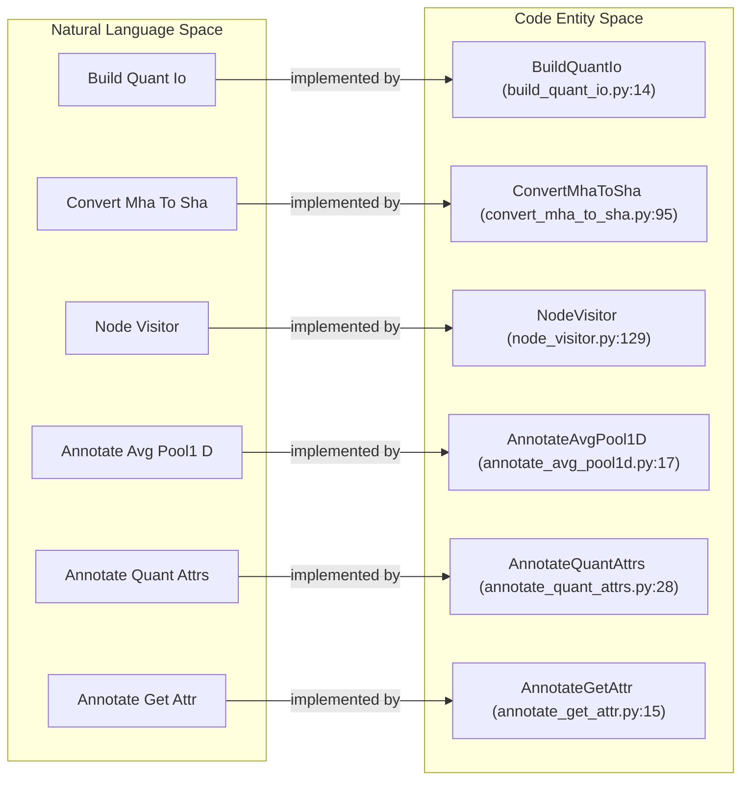
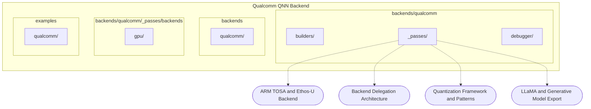
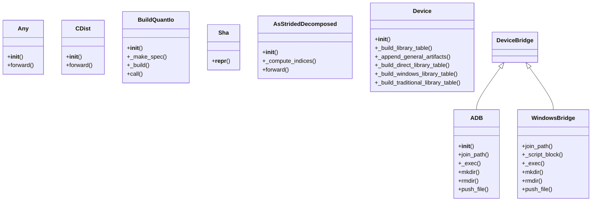
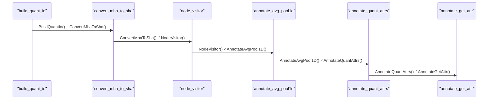

# 3-Source Context Packet (`git` + `CBM` + `llm-wiki`) for `5.3-qualcomm-qnn-backend` — Qualcomm QNN Backend

- **Target Wiki File**: `wiki/5.3-qualcomm-qnn-backend.md`
- **Archetype**: `Leaf Technical Spec Page`
- **Parent Page**: `5-backend-delegation-architecture`
- **Summary**: Architectural specification and implementation reference for Qualcomm QNN Backend (40 relevant source files). Primary code entities: `NodeVisitor`, `__init__`, `define_custom_tensor_wrapper`, `define_node`, `ConvertMhaToSha`.
- **Valid `[[wikilink]]` Neighbours**: `[[5-backend-delegation-architecture|Backend Delegation Architecture]]`, `[[1.1-getting-started|Getting Started]]`, `[[1.2-export-api-and-recipe-system|Export API and Recipe System]]`, `[[2.2-kernel-libraries-and-selective-build|Kernel Libraries and Selective Build]]`, `[[2.3-schema-generation-and-flatbuffers|Schema Generation and FlatBuffers]]`, `[[3.4-program-emission-and-serialization|Program Emission and Serialization]]`, `[[3.5-verification-and-dialect-system|Verification and Dialect System]]`, `[[4-quantization-systems|Quantization Systems]]`

## 1. Relevant Source Files (`git` + `CBM`, use verbatim in `<details>`)
- `[backends/qualcomm/builders/node_visitor.py](backends/qualcomm/builders/node_visitor.py)`
- `[backends/qualcomm/_passes/convert_mha_to_sha.py](backends/qualcomm/_passes/convert_mha_to_sha.py)`
- `[backends/qualcomm/_passes/annotate_quant_attrs.py](backends/qualcomm/_passes/annotate_quant_attrs.py)`
- `[backends/qualcomm/_passes/annotate_avg_pool1d.py](backends/qualcomm/_passes/annotate_avg_pool1d.py)`
- `[backends/qualcomm/_passes/annotate_get_attr.py](backends/qualcomm/_passes/annotate_get_attr.py)`
- `[backends/qualcomm/_passes/annotate_stack.py](backends/qualcomm/_passes/annotate_stack.py)`
- `[backends/qualcomm/_passes/annotate_unbind.py](backends/qualcomm/_passes/annotate_unbind.py)`
- `[backends/qualcomm/_passes/convert_linear_to_conv2d.py](backends/qualcomm/_passes/convert_linear_to_conv2d.py)`
- `[backends/qualcomm/_passes/build_quant_io.py](backends/qualcomm/_passes/build_quant_io.py)`
- `[backends/qualcomm/_passes/canonicalize_conv.py](backends/qualcomm/_passes/canonicalize_conv.py)`
- `[backends/qualcomm/_passes/convert_complex_stft.py](backends/qualcomm/_passes/convert_complex_stft.py)`
- `[backends/qualcomm/_passes/decompose_as_strided.py](backends/qualcomm/_passes/decompose_as_strided.py)`
- `[backends/qualcomm/__init__.py](backends/qualcomm/__init__.py)`
- `[backends/qualcomm/_passes/convert_bmm_to_matmul.py](backends/qualcomm/_passes/convert_bmm_to_matmul.py)`
- `[backends/qualcomm/_passes/decompose_any.py](backends/qualcomm/_passes/decompose_any.py)`
- `[backends/qualcomm/_passes/decompose_atan2.py](backends/qualcomm/_passes/decompose_atan2.py)`
- `[backends/qualcomm/_passes/convert_square_to_pow.py](backends/qualcomm/_passes/convert_square_to_pow.py)`
- `[backends/qualcomm/_passes/decompose_col_im.py](backends/qualcomm/_passes/decompose_col_im.py)`
- `[backends/qualcomm/_passes/decompose_diagonal.py](backends/qualcomm/_passes/decompose_diagonal.py)`
- `[backends/qualcomm/_passes/decompose_acos.py](backends/qualcomm/_passes/decompose_acos.py)`
- `[backends/qualcomm/_passes/decompose_addmm.py](backends/qualcomm/_passes/decompose_addmm.py)`
- `[backends/qualcomm/export_utils.py](backends/qualcomm/export_utils.py)`
- `[backends/qualcomm/_passes/decompose_cdist.py](backends/qualcomm/_passes/decompose_cdist.py)`
- `[backends/qualcomm/_passes/utils.py](backends/qualcomm/_passes/utils.py)`
- `[backends/qualcomm/_passes/__init__.py](backends/qualcomm/_passes/__init__.py)`
- `[backends/qualcomm/_passes/decompose_hyperbolic_variants.py](backends/qualcomm/_passes/decompose_hyperbolic_variants.py)`
- `[backends/qualcomm/_passes/backends/gpu/qnn_gpu_pass_manager.py](backends/qualcomm/_passes/backends/gpu/qnn_gpu_pass_manager.py)`
- `[backends/qualcomm/_passes/qnn_pass_manager.py](backends/qualcomm/_passes/qnn_pass_manager.py)`
- `[backends/qualcomm/README.md](backends/qualcomm/README.md)`
- `[backends/qualcomm/setup.md](backends/qualcomm/setup.md)`

## 2. Grounded Code Symbols (`CBM`, use verbatim for `[file:start-end]()` pill citations)
- `BuildQuantIo` (Class) @ `[backends/qualcomm/_passes/build_quant_io.py:14-53]()` [fan-in=2, fan-out=0] — To make lowering process correct, the pass assign the correct quantized dtype to spec of call_delegate.
- `ConvertMhaToSha` (Class) @ `[backends/qualcomm/_passes/convert_mha_to_sha.py:95-626]()` [fan-in=0, fan-out=0] — b=batch, e=emb=h*d, h=heads, d=head_size, s=seq_len, p=past, c=s+p i[bse] ─┬─ q[bse] ─ [bhsd] ─ RoPE ─ [bhsd] ───────────────────── qk[bhsc] ─ mask ─ softmax ─ 
- `NodeVisitor` (Class) @ `[backends/qualcomm/builders/node_visitor.py:129-614]()` [fan-in=0, fan-out=0] — Node visitor pattern for visiting nodes in an edge IR graph
- `AnnotateAvgPool1D` (Class) @ `[backends/qualcomm/_passes/annotate_avg_pool1d.py:17-64]()` [fan-in=0, fan-out=0] — Add "quant_attrs" to graph nodes' meta from the QDQ information generated after quantization process. avg_pool1d and adaptive_avg_pool1d get decomposed to: unsq
- `AnnotateQuantAttrs` (Class) @ `[backends/qualcomm/_passes/annotate_quant_attrs.py:28-139]()` [fan-in=0, fan-out=0] — Add "quant_attrs" to graph nodes' meta from the QDQ information generated after quantization process.
- `AnnotateGetAttr` (Class) @ `[backends/qualcomm/_passes/annotate_get_attr.py:15-54]()` [fan-in=0, fan-out=0] — Annotates quantization attributes for `get_attr` nodes. In passes such as `CanonicalizeConv`, `ConvertLinearToConv2d`, `LiftConstantScalarOperands`, and others,
- `AnnotateStack` (Class) @ `[backends/qualcomm/_passes/annotate_stack.py:15-42]()` [fan-in=0, fan-out=0] — Add "quant_attrs" to graph nodes' meta from the QDQ information generated after quantization process.
- `AnnotateUnbind` (Class) @ `[backends/qualcomm/_passes/annotate_unbind.py:15-40]()` [fan-in=0, fan-out=0] — Add "quant_attrs" to graph nodes' meta from the QDQ information generated after quantization process.
- `ConvertLinearToConv2d` (Class) @ `[backends/qualcomm/_passes/convert_linear_to_conv2d.py:32-340]()` [fan-in=0, fan-out=0] — Replace linear with an equivalent 1x1 convolution using call_function nodes.
- `AsStridedDecomposed` (Class) @ `[backends/qualcomm/_passes/decompose_as_strided.py:17-51]()` [fan-in=1, fan-out=0] — Decompose as_strided into flatten + index_select + reshape. as_strided reinterprets memory layout using size/stride/storage_offset. We precompute the linear ind
- `CanonicalizeConv` (Class) @ `[backends/qualcomm/_passes/canonicalize_conv.py:41-201]()` [fan-in=0, fan-out=0] — 1. QNN does not support dilation on TransposeConvND Dilate the kernel manually for math-equivalent operation 2. Conv1d is not supported by QNN. Change it to inp
- `ConvParamIdx` (Class) @ `[backends/qualcomm/_passes/canonicalize_conv.py:23-38]()` [fan-in=0, fan-out=0] — Spec for `aten.convolution` (https://docs.pytorch.org/docs/stable/torch.compiler_ir.html) convolution(Tensor input, Tensor weight, Tensor? bias, SymInt[] stride
- `ConvertComplexStft` (Class) @ `[backends/qualcomm/_passes/convert_complex_stft.py:13-116]()` [fan-in=0, fan-out=0] — Rewrite a complex-valued stft into its real-valued form so the QNN Stft op, whose output is real with the real/imaginary parts in the last dimension, can consum
- `DecomposeAsStrided` (Class) @ `[backends/qualcomm/_passes/decompose_as_strided.py:54-226]()` [fan-in=0, fan-out=0] — Decompose aten.as_strided into supported QNN primitives. as_strided creates a view of a tensor with specified size, stride, and storage_offset. Since QNN has no
- `ConvertBmmToMatmul` (Class) @ `[backends/qualcomm/_passes/convert_bmm_to_matmul.py:17-83]()` [fan-in=0, fan-out=0] — Replace bmm to matmul, because bmm is eqaul to matmul in QNN. Handle missing quantization tag for bmm op.
- `Sha` (Class) @ `[backends/qualcomm/_passes/convert_mha_to_sha.py:87-92]()` [fan-in=2, fan-out=0] — 
- `DecomposeAny` (Class) @ `[backends/qualcomm/_passes/decompose_any.py:32-69]()` [fan-in=0, fan-out=0] — Decompose for math equivalent op.
- `DecomposeAtan2` (Class) @ `[backends/qualcomm/_passes/decompose_atan2.py:15-210]()` [fan-in=0, fan-out=0] — Decompose atan2(y, x) with full piecewise definition: atan2(y, x) = atan(y/x) if x > 0 atan(y/x) + π if x < 0, y >= 0 atan(y/x) - π if x < 0, y < 0 +π/2 if x = 
- `ConvertSquareToPow` (Class) @ `[backends/qualcomm/_passes/convert_square_to_pow.py:13-38]()` [fan-in=0, fan-out=0] — Convert square to pow with a scalar value of 2. This allows LiftConstantScalarOperands to lift the scalar into a scalar. Otherwise, the square op will be conver
- `DecomposeColIm` (Class) @ `[backends/qualcomm/_passes/decompose_col_im.py:16-273]()` [fan-in=0, fan-out=0] — Decompose im2col(unfold) to pad + index_select + space_to_depth + view_copy Decompose col2im(fold) to view_copy + pixel_shuffle
- `ADB` (Class) @ `[backends/qualcomm/export_utils.py:335-382]()` [fan-in=1, fan-out=0] — Talk to a remote Android/OE-Linux device over adb.
- `Device` (Class) @ `[backends/qualcomm/export_utils.py:468-910]()` [fan-in=1, fan-out=0] — A wrapper class for communicating with a device: either a remote Android/OE-Linux device over adb, or a Windows-on-Snapdragon device on which the CLI already ru

## 3. Grounded Source Code Excerpts (`git` Working Tree)
### `BuildQuantIo` in `[backends/qualcomm/_passes/build_quant_io.py:14-29]()`
```python
class BuildQuantIo(ExportPass):
    """
    To make lowering process correct, the pass assign the correct quantized dtype to spec of call_delegate.
    """

    def __init__(self):
        super(BuildQuantIo, self).__init__()

    def _make_spec(self, x):
        if isinstance(x, torch.Tensor):
            return TensorSpec.from_tensor(x)
        elif isinstance(x, (int, bool, float)):
            return x
        else:
            return None
```

### `ConvertMhaToSha` in `[backends/qualcomm/_passes/convert_mha_to_sha.py:95-110]()`
```python
class ConvertMhaToSha(ExportPass):
    """
    b=batch, e=emb=h*d, h=heads, d=head_size, s=seq_len, p=past, c=s+p

    i[bse] ─┬─ q[bse] ─ [bhsd] ─ RoPE ─ [bhsd] ───────────────────── qk[bhsc] ─ mask ─ softmax ─ qkv[bhsd] ─ [bse] ─ o[bse]
            ├─ k[bse] ─ [bhsd] ─ RoPE ─ [bhds] ─ k_cat[bhdc] ─(k_exp)─┘                           │
            │                     past_k[bhdp] ──┘                                                │
            └─ v[bse] ─ [bhsd] ───────────────── v_cat[bhcd] ─(v_exp)-────────────────────────────┘
                                  past_v[bhpd] ──┘
    """

    def __init__(
        self,
        edge_program: torch.export.ExportedProgram,
        verbose=False,
    ):
```

### `NodeVisitor` in `[backends/qualcomm/builders/node_visitor.py:129-144]()`
```python
class NodeVisitor:
    """
    Node visitor pattern for visiting nodes in an edge IR graph
    """

    def __init__(
        self,
        external_ids,
        edge_program: torch.export.ExportedProgram,
        enable_tensor_dump,
        is_qnn_partitioner=True,
        backend_type=None,
    ) -> None:
        # is_qnn_partitioner: True for the real qnn_partitioner / qnn_preprocess
        # flows, where external_ids is built from the program being processed so
        # graph-input ids resolve correctly.
```

### `AnnotateAvgPool1D` in `[backends/qualcomm/_passes/annotate_avg_pool1d.py:17-32]()`
```python
class AnnotateAvgPool1D(ExportPass):
    """
    Add "quant_attrs" to graph nodes' meta from the QDQ information
    generated after quantization process.
    avg_pool1d and adaptive_avg_pool1d get decomposed to:
        unsqueeze -> avg_pool2d/adaptive_avg_pool2d -> squeeze
    """

    _SOURCE_OPS = [
        torch.ops.aten.avg_pool1d.default,
        torch.avg_pool1d,
        torch.ops.aten.adaptive_avg_pool1d.default,
        torch.adaptive_avg_pool1d,
        torch.nn.modules.pooling.AvgPool1d,
    ]
```

### `AnnotateQuantAttrs` in `[backends/qualcomm/_passes/annotate_quant_attrs.py:28-43]()`
```python
class AnnotateQuantAttrs(ExportPass):
    """
    Add "quant_attrs" to graph nodes' meta from the QDQ information
    generated after quantization process.
    """

    def __init__(
        self,
        edge_program: torch.export.ExportedProgram,
        skip_advanced_requant: bool = False,
    ):
        super(AnnotateQuantAttrs, self).__init__()
        self.edge_program = edge_program
        self.skip_advanced_requant = skip_advanced_requant
        self.skip_requant_allowlist = {
            exir_ops.edge.aten.sigmoid.default,
```


## 4. Linked Official Docs (`llm-wiki` / `RAG`)
- **Backend Delegation Architecture** (`wiki/5-backend-delegation-architecture.md`, score=137.715, shared_symbols=['define_tensor', 'get_tensor']): # Backend Delegation Architecture > Architectural specification and implementation reference for Backend Delegation Architecture (40 relevant source files). Primary code entities: `CommandBuffer`, `begin`, `bind_descriptors`, `bind_pipeline`, `NodeVisitor`. <details> <summary>Relevant source files</summary> The following files were used as context for gen
- **Partitioning and Operator Support** (`wiki/5.1-partitioning-and-operator-support.md`, score=123.333, shared_symbols=[]): # Partitioning and Operator Support ↑ [[5-backend-delegation-architecture|Backend Delegation Architecture]] > Architectural specification and implementation reference for Partitioning and Operator Support (17 relevant source files). Primary code entities: `MethodProgramsPartitionerSpec`, `_`, `_create_partitions`, `_create_partitions_in_graph_module`, `Gro
- **Vulkan GPU Backend** (`wiki/5.2-vulkan-gpu-backend.md`, score=123.333, shared_symbols=[]): # Vulkan GPU Backend ↑ [[5-backend-delegation-architecture|Backend Delegation Architecture]] > Architectural specification and implementation reference for Vulkan GPU Backend (40 relevant source files). Primary code entities: `CommandBuffer`, `begin`, `bind_descriptors`, `bind_pipeline`, `OpFeatures`. <details> <summary>Relevant source files</summary> Th
- **ARM TOSA and Ethos-U Backend** (`wiki/5.4-arm-tosa-and-ethos-u-backend.md`, score=123.333, shared_symbols=[]): # ARM TOSA and Ethos-U Backend ↑ [[5-backend-delegation-architecture|Backend Delegation Architecture]] > Architectural specification and implementation reference for ARM TOSA and Ethos-U Backend (40 relevant source files). Primary code entities: `TosaArg`, `__init__`, `__process_list`, `__process_node`, `InsertTableOpsPass`. <details> <summary>Relevant so
- **Backend-Specific Quantization** (`wiki/4.2-backend-specific-quantization.md`, score=107.297, shared_symbols=[]): # Backend-Specific Quantization ↑ [[4-quantization-systems|Quantization Systems]] > Architectural specification and implementation reference for Backend-Specific Quantization (35 relevant source files). Primary code entities: `NodeFinder`, `find_nodes`, `PatternCheck`, `check_pattern`, `EthosUQuantizer`. <details> <summary>Relevant source files</summary> 
- **ExecuTorch DeepWiki** (`wiki/index.md`, score=103.184, shared_symbols=[]): # ExecuTorch DeepWiki Generated from `home-jason-Project-deepwiki-executorch` at commit `b3b565b5b62f` (2026-11-15T15:02:11+00:00). ## Pages - [[1-overview|Overview]] — Architectural specification and implementation reference for Overview (10 relevant source files). Primary code entities: `Module`, `MethodHolder`, `PlannedMemory`, `EdgeProgramManager`, `_

## 5. Pre-Verified DeepWiki v1.9.9.5 Mermaid Diagrams
### Natural Language Space <-> Code Entity Space


### Subsystem Architecture Flowchart


### Class Hierarchy Diagram


### Call Sequence Diagram


## 6. DeepWiki v1.9.9.5 Authoring Checklist for `wiki/5.3-qualcomm-qnn-backend.md`
1. Keep YAML frontmatter at top (`id`, `title`, `parent`, `sources`, `linked_docs`, `bridge_symbols`).
2. Keep `<details><summary>Relevant source files</summary>` block immediately after `# Title`.
3. Start with `## Purpose and Scope`, then numbered `## 1. ...`, `## 2. ...` sections separated by `---`.
4. Include at least 2 ```mermaid``` diagrams (including a `Natural Language Space` <-> `Code Entity Space` mapping).
5. Cite code entities inline using `[path/to/file.ext:start-end]()` and end every `##` section with `Sources: [file:start-end]()`.
6. Run `deepwiki_cli.py build --enrich-only ...` and `deepwiki_cli.py validate ...` after editing.
