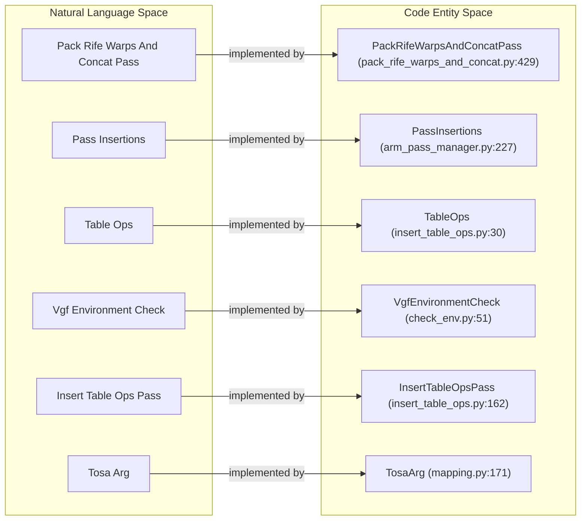
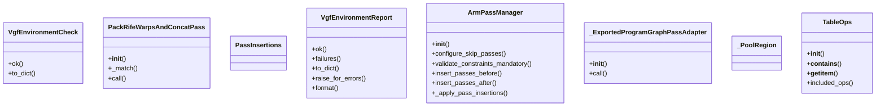
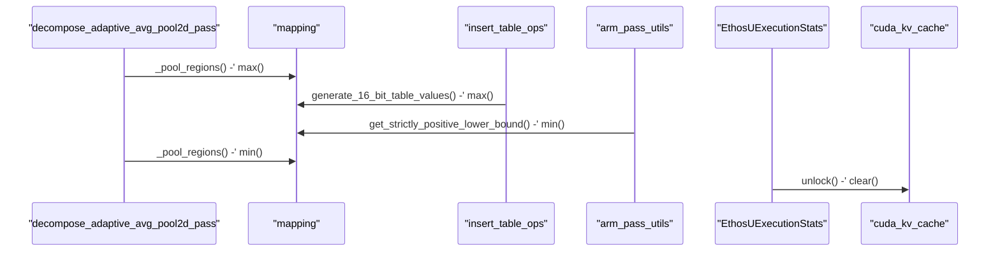

# 3-Source Context Packet (`git` + `CBM` + `llm-wiki`) for `5.4-arm-tosa-and-ethos-u-backend` — ARM TOSA and Ethos-U Backend

- **Target Wiki File**: `wiki/5.4-arm-tosa-and-ethos-u-backend.md`
- **Archetype**: `Leaf Technical Spec Page`
- **Parent Page**: `5-backend-delegation-architecture`
- **Summary**: Architectural specification and implementation reference for ARM TOSA and Ethos-U Backend (40 relevant source files). Primary code entities: `TosaArg`, `__init__`, `__process_list`, `__process_node`, `InsertTableOpsPass`.
- **Valid `[[wikilink]]` Neighbours**: `[[5-backend-delegation-architecture|Backend Delegation Architecture]]`, `[[1.1-getting-started|Getting Started]]`, `[[1.2-export-api-and-recipe-system|Export API and Recipe System]]`, `[[2.2-kernel-libraries-and-selective-build|Kernel Libraries and Selective Build]]`, `[[2.3-schema-generation-and-flatbuffers|Schema Generation and FlatBuffers]]`, `[[3.4-program-emission-and-serialization|Program Emission and Serialization]]`, `[[3.5-verification-and-dialect-system|Verification and Dialect System]]`, `[[4-quantization-systems|Quantization Systems]]`

## 1. Relevant Source Files (`git` + `CBM`, use verbatim in `<details>`)
- `[backends/arm/tosa/mapping.py](backends/arm/tosa/mapping.py)`
- `[backends/arm/_passes/insert_table_ops.py](backends/arm/_passes/insert_table_ops.py)`
- `[backends/arm/_passes/arm_pass.py](backends/arm/_passes/arm_pass.py)`
- `[backends/arm/_passes/arm_pass_manager.py](backends/arm/_passes/arm_pass_manager.py)`
- `[examples/arm/ethos-u-setup/arm-none-eabi-clang-random-device.h](examples/arm/ethos-u-setup/arm-none-eabi-clang-random-device.h)`
- `[backends/arm/_passes/arm_pass_utils.py](backends/arm/_passes/arm_pass_utils.py)`
- `[backends/arm/_passes/cast_int64_pass.py](backends/arm/_passes/cast_int64_pass.py)`
- `[backends/arm/_passes/decompose_adaptive_avg_pool2d_pass.py](backends/arm/_passes/decompose_adaptive_avg_pool2d_pass.py)`
- `[backends/arm/_passes/accumulate_index_put_pass.py](backends/arm/_passes/accumulate_index_put_pass.py)`
- `[backends/arm/_passes/_debug_passes.py](backends/arm/_passes/_debug_passes.py)`
- `[backends/arm/_passes/convert_int64_output_ops_to_int32.py](backends/arm/_passes/convert_int64_output_ops_to_int32.py)`
- `[examples/arm/QAT_example/rife_vgf/passes/pack_rife_warps_and_concat.py](examples/arm/QAT_example/rife_vgf/passes/pack_rife_warps_and_concat.py)`
- `[examples/arm/executor_runner/arm_executor_runner.cpp](examples/arm/executor_runner/arm_executor_runner.cpp)`
- `[backends/arm/__init__.py](backends/arm/__init__.py)`
- `[backends/arm/_passes/aten_to_tosa_data_layout.py](backends/arm/_passes/aten_to_tosa_data_layout.py)`
- `[backends/arm/_passes/broadcast_args_pass.py](backends/arm/_passes/broadcast_args_pass.py)`
- `[backends/arm/runtime/EthosUExecutionStats.h](backends/arm/runtime/EthosUExecutionStats.h)`
- `[backends/arm/_passes/aten_to_tosa_activation_functions.py](backends/arm/_passes/aten_to_tosa_activation_functions.py)`
- `[backends/arm/_passes/canonicalize_gather_pass.py](backends/arm/_passes/canonicalize_gather_pass.py)`
- `[backends/arm/operators/node_visitor.py](backends/arm/operators/node_visitor.py)`
- `[backends/arm/_passes/cast_int_comparison_inputs_pass.py](backends/arm/_passes/cast_int_comparison_inputs_pass.py)`
- `[backends/arm/_passes/canonicalize_view_copy_permute_pass.py](backends/arm/_passes/canonicalize_view_copy_permute_pass.py)`
- `[backends/arm/_passes/decompose_choose_qparams_symmetric_pass.py](backends/arm/_passes/decompose_choose_qparams_symmetric_pass.py)`
- `[backends/arm/_passes/cast_to_int32_pass.py](backends/arm/_passes/cast_to_int32_pass.py)`
- `[backends/arm/_passes/constant_folding_pass.py](backends/arm/_passes/constant_folding_pass.py)`
- `[backends/arm/_passes/control_flow_const_inline.py](backends/arm/_passes/control_flow_const_inline.py)`
- `[backends/arm/_passes/decompose_adaptive_max_pool2d_pass.py](backends/arm/_passes/decompose_adaptive_max_pool2d_pass.py)`
- `[backends/arm/vgf/check_env.py](backends/arm/vgf/check_env.py)`
- `[backends/arm/MODELS.md](backends/arm/MODELS.md)`
- `[backends/arm/README.md](backends/arm/README.md)`

## 2. Grounded Code Symbols (`CBM`, use verbatim for `[file:start-end]()` pill citations)
- `PackRifeWarpsAndConcatPass` (Class) @ `[examples/arm/QAT_example/rife_vgf/passes/pack_rife_warps_and_concat.py:429-646]()` [fan-in=7, fan-out=0] — Pack four private RIFE warps and their C28 concat into one C32 shader. Fuse compatible block0 head resizing and state preparation into the shader. Reorder block
- `PassInsertions` (Class) @ `[backends/arm/_passes/arm_pass_manager.py:227-231]()` [fan-in=4, fan-out=0] — Holds lists of passes to be inserted before and after a target pass.
- `TableOps` (Class) @ `[backends/arm/_passes/insert_table_ops.py:30-159]()` [fan-in=1, fan-out=0] — Helper class for finding the corresponding table operator for a given Node.
- `VgfEnvironmentCheck` (Class) @ `[backends/arm/vgf/check_env.py:51-71]()` [fan-in=7, fan-out=0] — One VGF environment preflight result.
- `InsertTableOpsPass` (Class) @ `[backends/arm/_passes/insert_table_ops.py:162-431]()` [fan-in=0, fan-out=0] — For ops in self.table_ops they need to be serialized as a TOSA TABLE. This pass replaces these edge ops with a tosa._table(input: Tensor, target_str: str) where
- `TosaArg` (Class) @ `[backends/arm/tosa/mapping.py:171-338]()` [fan-in=0, fan-out=0] — Capture and normalize TOSA operator arguments. Use this to convert FX nodes, sequences, and numeric literals into a consistent structure suitable for TOSA seria
- `TosaSpecialDtype` (Class) @ `[backends/arm/tosa/mapping.py:34-79]()` [fan-in=0, fan-out=0] — Special TOSA dtypes not natively expressed in PyTorch.
- `ArmOpTargetedPass` (Class) @ `[backends/arm/_passes/arm_pass.py:250-319]()` [fan-in=0, fan-out=0] — Base class for passes that only transform selected operators. Subclasses set ``target_ops`` to the call_function targets they can transform. If the current grap
- `ArmPass` (Class) @ `[backends/arm/_passes/arm_pass.py:27-247]()` [fan-in=0, fan-out=0] — Base class for Arm passes.
- `CastInt64BuffersToInt32Pass` (Class) @ `[backends/arm/_passes/cast_int64_pass.py:24-239]()` [fan-in=0, fan-out=0] — Cast int64 buffers and lifted tensor constants to int32 when in range. With the int64 extension under PRO-INT, a buffer whose users all compute in int64, compar
- `DecomposeAdaptiveAvgPool2dPass` (Class) @ `[backends/arm/_passes/decompose_adaptive_avg_pool2d_pass.py:53-558]()` [fan-in=0, fan-out=0] — Decompose static-shape topology-changing AdaptiveAvgPool2d cases. Static shapes use directly representable pooling regions. See ``adaptive_avg_pool2d.md`` for i
- `PrintGraphModuleCodePass` (Class) @ `[backends/arm/_passes/_debug_passes.py:34-59]()` [fan-in=0, fan-out=0] — This pass prints the graph module's code to stdout for debugging purposes. Example output: [arm_pass_manager.py:305] def forward(self, x, y): x, y, = fx_pytree.
- `VisualizePass` (Class) @ `[backends/arm/_passes/_debug_passes.py:18-31]()` [fan-in=0, fan-out=0] — This pass visualizes the graph at the point of insertion in the pass manager.
- `AccumulateIndexPutPass` (Class) @ `[backends/arm/_passes/accumulate_index_put_pass.py:35-65]()` [fan-in=0, fan-out=0] — This pass adjusts the values arg when the accumulate arg is set to true for the index_put op.
- `VgfEnvironmentReport` (Class) @ `[backends/arm/vgf/check_env.py:75-114]()` [fan-in=4, fan-out=0] — Structured VGF preflight report.
- `ConvertInt64OutputOpsToInt32Pass` (Class) @ `[backends/arm/_passes/convert_int64_output_ops_to_int32.py:34-512]()` [fan-in=0, fan-out=0] — Rewrite or remove operations that produce int64 outputs. Convert them to int32 where possible. Currently, this pass handles casting, argmax, argmin and topk ope
- `RunnerContext` (Class) @ `[examples/arm/executor_runner/arm_executor_runner.cpp:618-653]()` [fan-in=0, fan-out=0] — /// Holds all state needed for setup and run phases
- `BroadcastArgsPass` (Class) @ `[backends/arm/_passes/broadcast_args_pass.py:22-90]()` [fan-in=0, fan-out=0] — Pass to manually broadcast arguments by inserting repeats. This is done when more than one arg needs broadcasting.
- `EthosUStatsBuffer` (Class) @ `[backends/arm/runtime/EthosUExecutionStats.h:111-156]()` [fan-in=0, fan-out=0] — // Appends from concurrent invocations are synchronized. Read the records only // after those invocations have completed.
- `ArmPassManager` (Class) @ `[backends/arm/_passes/arm_pass_manager.py:306-906]()` [fan-in=1, fan-out=0] — 
- `_ExportedProgramGraphPassAdapter` (Class) @ `[backends/arm/_passes/arm_pass_manager.py:245-280]()` [fan-in=1, fan-out=0] — 
- `CanonicalizeGatherPass` (Class) @ `[backends/arm/_passes/canonicalize_gather_pass.py:14-203]()` [fan-in=0, fan-out=0] — Canonicalize gather so it can be lowered to TOSA.GATHER via the backend dialect. This pass is intended to run only for nodes already gated by GatherSupported. G

## 3. Grounded Source Code Excerpts (`git` Working Tree)
### `PackRifeWarpsAndConcatPass` in `[examples/arm/QAT_example/rife_vgf/passes/pack_rife_warps_and_concat.py:429-444]()`
```python
class PackRifeWarpsAndConcatPass(ArmPass):
    """Pack four private RIFE warps and their C28 concat into one C32 shader.

    Fuse compatible block0 head resizing and state preparation into the shader.
    Reorder block0 output channels during export so each PixelShuffle read
    accesses 13 contiguous channels. Keep sampling quantization boundaries.
    Four zero weight columns make the following convolution ignore padding.
    Unsupported graphs are left unchanged.

    """

    _passes_required_after: set[type[ExportPass]] = set()

    def __init__(self, exported_program: ExportedProgram | None = None):
        super().__init__()
        self.exported_program = exported_program
```

### `PassInsertions` in `[backends/arm/_passes/arm_pass_manager.py:227-231]()`
```python
class PassInsertions:
    """Holds lists of passes to be inserted before and after a target pass."""

    before_passes: list = field(default_factory=list)
    after_passes: list = field(default_factory=list)
```

### `TableOps` in `[backends/arm/_passes/insert_table_ops.py:30-45]()`
```python
class TableOps:
    """Helper class for finding the corresponding table operator for a given
    Node.
    """

    # Targets that follow a straigtforward one-to-one mapping to their table op
    unary_table_ops: Dict[EdgeOpOverload, Callable[[torch.Tensor], torch.Tensor]] = {
        exir_ops.edge.aten.ceil.default: torch.ceil,
        exir_ops.edge.aten.erf.default: torch.erf,
        exir_ops.edge.aten.exp.default: torch.exp,
        exir_ops.edge.aten.expm1.default: torch.expm1,
        exir_ops.edge.aten.erfinv.default: torch.erfinv,
        exir_ops.edge.aten.floor.default: torch.floor,
        exir_ops.edge.aten.log.default: torch.log,
        exir_ops.edge.aten.log1p.default: torch.log1p,
        exir_ops.edge.aten.log10.default: torch.log10,
```

### `VgfEnvironmentCheck` in `[backends/arm/vgf/check_env.py:51-66]()`
```python
class VgfEnvironmentCheck:
    """One VGF environment preflight result."""

    name: str
    status: str
    detail: str
    action: str | None = None

    @property
    def ok(self) -> bool:
        """Return True when the check did not fail."""
        return self.status != STATUS_FAIL

    def to_dict(self) -> dict[str, str | None]:
        """Return the check as a JSON-serializable dictionary."""
        return {
```

### `InsertTableOpsPass` in `[backends/arm/_passes/insert_table_ops.py:162-177]()`
```python
class InsertTableOpsPass(ArmPass):
    """For ops in self.table_ops they need to be serialized as a TOSA TABLE.

    This pass replaces these edge ops with a tosa._table(input: Tensor,
    target_str: str) where target_str == str(node.target). When lowering the
    _table node target_str will be used to find the corresponding torch operator
    which will be used to produce the table values in operators/op_table.py.

    """

    _passes_required_after: Set[Type[ExportPass]] = set()

    def __init__(self, exported_program: ExportedProgram) -> None:
        super().__init__()
        self.exported_program = exported_program
        self.table_ops = TableOps(exported_program)
```


## 4. Linked Official Docs (`llm-wiki` / `RAG`)
- **Backend Delegation Architecture** (`wiki/5-backend-delegation-architecture.md`, score=175.771, shared_symbols=['register_buffer']): # Backend Delegation Architecture > Architectural specification and implementation reference for Backend Delegation Architecture (40 relevant source files). Primary code entities: `CommandBuffer`, `begin`, `bind_descriptors`, `bind_pipeline`, `NodeVisitor`. <details> <summary>Relevant source files</summary> The following files were used as context for gen
- **Embedded (Zephyr, ESP32, Pico2) and WebAssembly/WebGPU Targets** (`wiki/9.4-embedded-and-web-targets.md`, score=144.784, shared_symbols=['PackRifeWarpsAndConcatPass']): # Embedded (Zephyr, ESP32, Pico2) and WebAssembly/WebGPU Targets ↑ [[9-mobile-and-platform-extensions|Mobile and Platform Extensions]] > Architectural specification and implementation reference for Embedded (Zephyr, ESP32, Pico2) and WebAssembly/WebGPU Targets (40 relevant source files). Primary code entities: `BindingSpec`, `ComputePipelineBundle`, `opera
- **Mobile and Platform Extensions** (`wiki/9-mobile-and-platform-extensions.md`, score=128.878, shared_symbols=['PackRifeWarpsAndConcatPass']): # Mobile and Platform Extensions > Architectural specification and implementation reference for Mobile and Platform Extensions (40 relevant source files). Primary code entities: `BindingSpec`, `ComputePipelineBundle`, `operator=`, `Storage`, `~Storage`. <details> <summary>Relevant source files</summary> The following files were used as context for generat
- **ExecuTorch DeepWiki** (`wiki/index.md`, score=119.076, shared_symbols=[]): # ExecuTorch DeepWiki Generated from `home-jason-Project-deepwiki-executorch` at commit `b3b565b5b62f` (2026-11-15T15:02:11+00:00). ## Pages - [[1-overview|Overview]] — Architectural specification and implementation reference for Overview (10 relevant source files). Primary code entities: `Module`, `MethodHolder`, `PlannedMemory`, `EdgeProgramManager`, `_
- **Partitioning and Operator Support** (`wiki/5.1-partitioning-and-operator-support.md`, score=116.53, shared_symbols=[]): # Partitioning and Operator Support ↑ [[5-backend-delegation-architecture|Backend Delegation Architecture]] > Architectural specification and implementation reference for Partitioning and Operator Support (17 relevant source files). Primary code entities: `MethodProgramsPartitionerSpec`, `_`, `_create_partitions`, `_create_partitions_in_graph_module`, `Gro
- **Vulkan GPU Backend** (`wiki/5.2-vulkan-gpu-backend.md`, score=116.53, shared_symbols=[]): # Vulkan GPU Backend ↑ [[5-backend-delegation-architecture|Backend Delegation Architecture]] > Architectural specification and implementation reference for Vulkan GPU Backend (40 relevant source files). Primary code entities: `CommandBuffer`, `begin`, `bind_descriptors`, `bind_pipeline`, `OpFeatures`. <details> <summary>Relevant source files</summary> Th

## 5. Pre-Verified DeepWiki v1.9.9.5 Mermaid Diagrams
### Natural Language Space <-> Code Entity Space


### Subsystem Architecture Flowchart

```mermaid
flowchart TD
  subgraph sub_this["ARM TOSA and Ethos-U Backend"]
    subgraph sg_0["backends/arm"]
      n_backends_arm_tosa["tosa/"]
      n_backends_arm__passes["_passes/"]
      n_backends_arm_runtime["runtime/"]
      n_backends_arm_operators["operators/"]
      n_backends_arm_vgf["vgf/"]
      n_backends_arm_cmake["cmake/"]
      n_backends_arm_debug["debug/"]
    end
    subgraph sg_1["examples/arm"]
      n_examples_arm_ethos_u_setup["ethos-u-setup/"]
      n_examples_arm_executor_runner["executor_runner/"]
    end
    subgraph sg_2["examples/arm/QAT_example/rife_vgf"]
      n_examples_arm_QAT_example_rife_vgf_passes["passes/"]
    end
    subgraph sg_3["backends"]
      n_backends_arm["arm/"]
    end
    subgraph sg_4["examples"]
      n_examples_arm["arm/"]
    end
  end
  n_page_2_build_system_and_infrastructure(["Build System and Infrastructure"])
  n_page_6_1_llama_model_export(["LLaMA and Generative Model Export"])
  n_page_6_model_export_and_llm_support(["Model Export and LLM Support"])
  n_page_8_runtime_execution(["Runtime Execution"])
  n_examples_arm_ethos_u_setup -.-> n_page_6_model_export_and_llm_support
  n_examples_arm_executor_runner -.-> n_page_8_runtime_execution
  n_backends_arm__passes -.-> n_page_6_1_llama_model_export
  n_examples_arm_executor_runner -.-> n_page_2_build_system_and_infrastructure
  n_examples_arm_ethos_u_setup -.-> n_page_6_1_llama_model_export
  n_backends_arm_runtime -.-> n_page_6_model_export_and_llm_support
  n_backends_arm__passes --> n_backends_arm_tosa
  n_backends_arm__passes -.-> n_page_6_model_export_and_llm_support
```


### Class Hierarchy Diagram


### Call Sequence Diagram


## 6. DeepWiki v1.9.9.5 Authoring Checklist for `wiki/5.4-arm-tosa-and-ethos-u-backend.md`
1. Keep YAML frontmatter at top (`id`, `title`, `parent`, `sources`, `linked_docs`, `bridge_symbols`).
2. Keep `<details><summary>Relevant source files</summary>` block immediately after `# Title`.
3. Start with `## Purpose and Scope`, then numbered `## 1. ...`, `## 2. ...` sections separated by `---`.
4. Include at least 2 ```mermaid``` diagrams (including a `Natural Language Space` <-> `Code Entity Space` mapping).
5. Cite code entities inline using `[path/to/file.ext:start-end]()` and end every `##` section with `Sources: [file:start-end]()`.
6. Run `deepwiki_cli.py build --enrich-only ...` and `deepwiki_cli.py validate ...` after editing.
