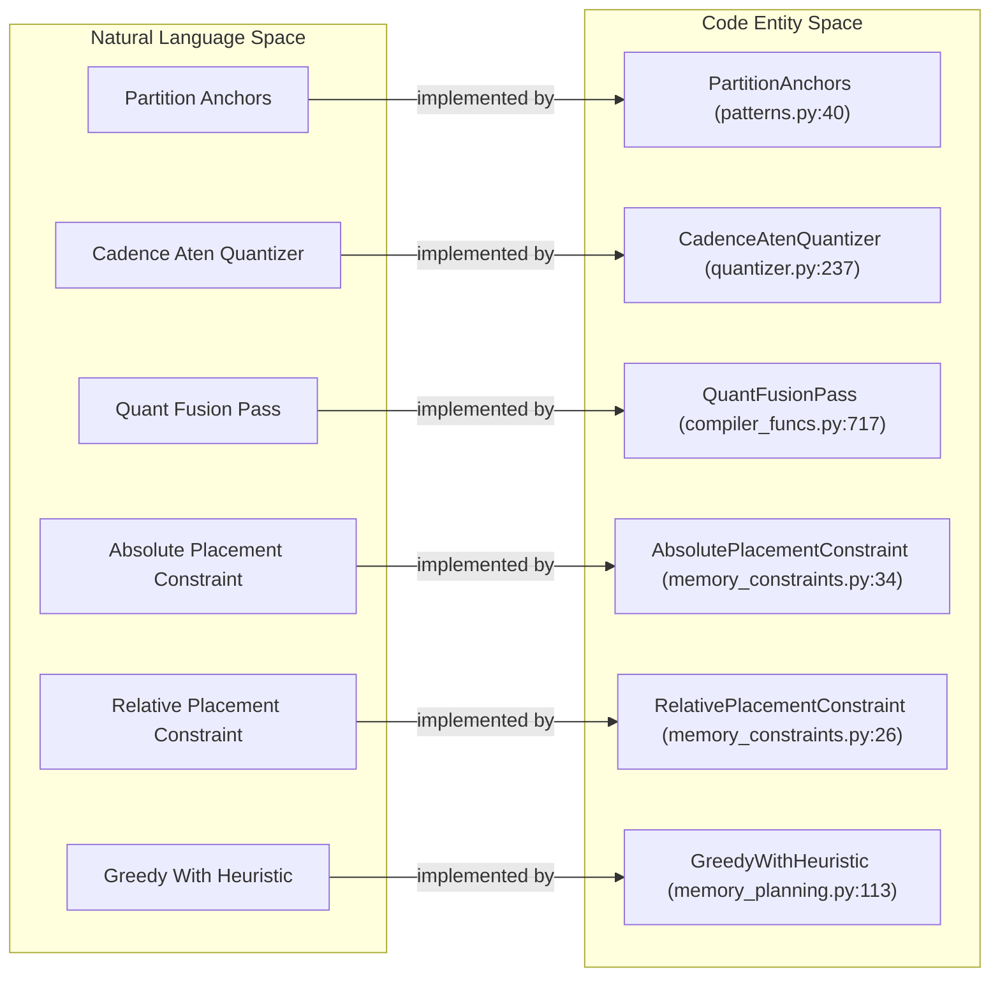
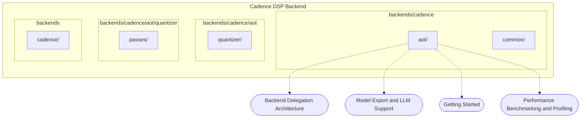
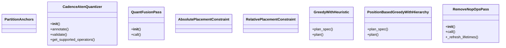
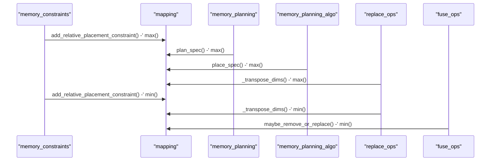

# 3-Source Context Packet (`git` + `CBM` + `llm-wiki`) for `5.5-cadence-dsp-backend` — Cadence DSP Backend

- **Target Wiki File**: `wiki/5.5-cadence-dsp-backend.md`
- **Archetype**: `Leaf Technical Spec Page`
- **Parent Page**: `5-backend-delegation-architecture`
- **Summary**: Architectural specification and implementation reference for Cadence DSP Backend (36 relevant source files). Primary code entities: `QuantFusionPass`, `__init__`, `call`, `QuantizedInputWrapper`, `MemoryPlanningAlgo`.
- **Valid `[[wikilink]]` Neighbours**: `[[5-backend-delegation-architecture|Backend Delegation Architecture]]`, `[[1.1-getting-started|Getting Started]]`, `[[1.2-export-api-and-recipe-system|Export API and Recipe System]]`, `[[2.2-kernel-libraries-and-selective-build|Kernel Libraries and Selective Build]]`, `[[2.3-schema-generation-and-flatbuffers|Schema Generation and FlatBuffers]]`, `[[3.4-program-emission-and-serialization|Program Emission and Serialization]]`, `[[3.5-verification-and-dialect-system|Verification and Dialect System]]`, `[[4-quantization-systems|Quantization Systems]]`

## 1. Relevant Source Files (`git` + `CBM`, use verbatim in `<details>`)
- `[backends/cadence/aot/compiler_funcs.py](backends/cadence/aot/compiler_funcs.py)`
- `[backends/cadence/aot/memory_planning_algo.py](backends/cadence/aot/memory_planning_algo.py)`
- `[backends/cadence/aot/memory_planning.py](backends/cadence/aot/memory_planning.py)`
- `[backends/cadence/aot/memory_constraints.py](backends/cadence/aot/memory_constraints.py)`
- `[backends/cadence/aot/compiler.py](backends/cadence/aot/compiler.py)`
- `[backends/cadence/aot/fuse_ops.py](backends/cadence/aot/fuse_ops.py)`
- `[backends/cadence/aot/ref_implementations.py](backends/cadence/aot/ref_implementations.py)`
- `[backends/cadence/aot/decompose_ops.py](backends/cadence/aot/decompose_ops.py)`
- `[backends/cadence/aot/quantizer/quantizer.py](backends/cadence/aot/quantizer/quantizer.py)`
- `[backends/cadence/aot/quantizer/fusion_pass.py](backends/cadence/aot/quantizer/fusion_pass.py)`
- `[backends/cadence/aot/passes.py](backends/cadence/aot/passes.py)`
- `[backends/cadence/aot/pass_utils.py](backends/cadence/aot/pass_utils.py)`
- `[backends/cadence/aot/compiler_utils.py](backends/cadence/aot/compiler_utils.py)`
- `[backends/cadence/aot/remove_ops.py](backends/cadence/aot/remove_ops.py)`
- `[backends/cadence/aot/replace_ops.py](backends/cadence/aot/replace_ops.py)`
- `[backends/cadence/aot/quantizer/patterns.py](backends/cadence/aot/quantizer/patterns.py)`
- `[backends/cadence/aot/reorder_ops.py](backends/cadence/aot/reorder_ops.py)`
- `[backends/cadence/aot/__init__.py](backends/cadence/aot/__init__.py)`
- `[backends/cadence/aot/utils.py](backends/cadence/aot/utils.py)`
- `[backends/cadence/aot/quantizer/pattern_utils.py](backends/cadence/aot/quantizer/pattern_utils.py)`
- `[backends/cadence/aot/ops_registrations.py](backends/cadence/aot/ops_registrations.py)`
- `[backends/cadence/aot/export_example.py](backends/cadence/aot/export_example.py)`
- `[backends/cadence/aot/quantizer/passes/fuse_ops.py](backends/cadence/aot/quantizer/passes/fuse_ops.py)`
- `[backends/cadence/aot/simplify_ops.py](backends/cadence/aot/simplify_ops.py)`
- `[backends/cadence/aot/graph_builder.py](backends/cadence/aot/graph_builder.py)`
- `[backends/cadence/aot/weight_packing.py](backends/cadence/aot/weight_packing.py)`
- `[backends/cadence/aot/to_out_var_pass.py](backends/cadence/aot/to_out_var_pass.py)`
- `[backends/cadence/aot/type_dispatch.py](backends/cadence/aot/type_dispatch.py)`
- `[backends/cadence/README.md](backends/cadence/README.md)`
- `[docs/source/backends-cadence.md](docs/source/backends-cadence.md)`

## 2. Grounded Code Symbols (`CBM`, use verbatim for `[file:start-end]()` pill citations)
- `PartitionAnchors` (Class) @ `[backends/cadence/aot/quantizer/patterns.py:40-71]()` [fan-in=20, fan-out=0] — All fields except output are lists of (node, args_index) pair, where node is from the given partition and node.args[args_index] is an input to the partition. As
- `CadenceAtenQuantizer` (Class) @ `[backends/cadence/aot/quantizer/quantizer.py:237-338]()` [fan-in=10, fan-out=0] — 
- `QuantFusionPass` (Class) @ `[backends/cadence/aot/compiler_funcs.py:717-758]()` [fan-in=2, fan-out=0] — Iterates patterns, finds anchor ops in the converted graph, and calls pattern.fuse() to replace dq-op-q subgraphs with fused ops. ``exported_program`` is option
- `AbsolutePlacementConstraint` (Class) @ `[backends/cadence/aot/memory_constraints.py:34-40]()` [fan-in=1, fan-out=0] — Information on placement constraint memory id and offset.
- `RelativePlacementConstraint` (Class) @ `[backends/cadence/aot/memory_constraints.py:26-30]()` [fan-in=1, fan-out=0] — Information of source node and offset used for views.
- `GreedyWithHeuristic` (Class) @ `[backends/cadence/aot/memory_planning.py:113-193]()` [fan-in=1, fan-out=0] — Greedy tensor placement with the heuristics from arxiv.org/pdf/2001.03288.pdf.
- `PositionBasedGreedyWithHierarchy` (Class) @ `[backends/cadence/aot/memory_planning.py:62-110]()` [fan-in=1, fan-out=0] — Greedily place tensor in the fastest memory available.
- `RemoveNopOpsPass` (Class) @ `[backends/cadence/aot/memory_planning.py:372-451]()` [fan-in=1, fan-out=0] — Erase the cat/slice/select nop nodes once memory planning is done. These ops never touch data. A cat is only rewritten to its nop form once memory planning can 
- `QuantizedInputWrapper` (Class) @ `[backends/cadence/aot/compiler_funcs.py:329-475]()` [fan-in=0, fan-out=0] — Wrapper that allows a quantized model to accept quantized inputs. If no input_names or quant_args are provided, the wrapper passes inputs through unchanged (no 
- `QuantizedOutputWrapper` (Class) @ `[backends/cadence/aot/compiler_funcs.py:478-533]()` [fan-in=0, fan-out=0] — Wrapper that quantizes a model's output(s) so they produce quantized tensors. Mirrors QuantizedInputWrapper: the wrapper adds a quantize_per_tensor after each o
- `MemoryPlanningAlgo` (Class) @ `[backends/cadence/aot/memory_planning_algo.py:83-342]()` [fan-in=0, fan-out=0] — Callable memory planning algorithm interface.
- `GenerateCatNopConstraints` (Class) @ `[backends/cadence/aot/memory_constraints.py:395-573]()` [fan-in=0, fan-out=0] — For cat op where the concatenation is along the outermost dimension, generate contiguity constraints for all the input tensors, and mark the cat nop.
- `GenerateMemConstraints` (Class) @ `[backends/cadence/aot/memory_constraints.py:695-727]()` [fan-in=0, fan-out=0] — # The class to generate all the constraints that will be passed on to the memory # planning algorithm.
- `GenerateMemoryViewConstraints` (Class) @ `[backends/cadence/aot/memory_constraints.py:576-589]()` [fan-in=0, fan-out=0] — For memory.view ops, where input and output use the same underlying memory, generate input output colocation constraints.
- `GenerateSliceAndSelectNopConstraints` (Class) @ `[backends/cadence/aot/memory_constraints.py:592-684]()` [fan-in=0, fan-out=0] — For slice ops, where the slice is along the outermost dimension, generate an offset-based location constraint. Also optimize select ops, since select op is noth
- `MemConstraints` (Class) @ `[backends/cadence/aot/memory_constraints.py:43-327]()` [fan-in=0, fan-out=0] — This class contains all the tensor placement constraints that we create during memory planning. We have two types of placement constraints: 1. Relative placemen
- `FuseBatchNormWithConv` (Class) @ `[backends/cadence/aot/fuse_ops.py:213-358]()` [fan-in=0, fan-out=0] — This pass fuses a conv op with batchnorm if the following two conditions are met: 1. The only user of conv op should be batchnorm; 2. Only the first element fro
- `FuseFullThenReshapePass` (Class) @ `[backends/cadence/aot/fuse_ops.py:824-874]()` [fan-in=0, fan-out=0] — A pass that fuses a chain of full and reshape-like operations into a single full operation.
- `FuseMMWithAdd` (Class) @ `[backends/cadence/aot/fuse_ops.py:63-210]()` [fan-in=0, fan-out=0] — Fuses mm -> add patterns into addmm. Given a graph of the form: X = aten.mm(A, B) Y = aten.add(X, C) Fuse X and Y into a single addmm node, after making sure th
- `FuseMulScalarIntoDequantPass` (Class) @ `[backends/cadence/aot/fuse_ops.py:618-664]()` [fan-in=0, fan-out=0] — Looks for the pattern where aten.mul.Scalar is multiplying the outputs of dequantize. If found, updates the dequant scale to reflect the multiplication and remo
- `FuseMulTensorIntoDequantPass` (Class) @ `[backends/cadence/aot/fuse_ops.py:750-810]()` [fan-in=0, fan-out=0] — Looks for the pattern where aten.mul is multiplying the outputs of dequantize and aten.full, or vice versa. If found, updates the dequant scale to reflect the m
- `FuseMulTensorIntoQuantPass` (Class) @ `[backends/cadence/aot/fuse_ops.py:667-747]()` [fan-in=0, fan-out=0] — Looks for the pattern where aten.mul.Tensor is followed by quant node. If found, updates the quant scale to reflect the multiplication and removes the mul node.

## 3. Grounded Source Code Excerpts (`git` Working Tree)
### `PartitionAnchors` in `[backends/cadence/aot/quantizer/patterns.py:40-55]()`
```python
class PartitionAnchors:
    """
    All fields except output are lists of (node, args_index) pair, where node is from
    the given partition and node.args[args_index] is an input to the partition. Assumes
    a single output.

    Quantizer uses inputs, weights and biases for quantization annotation. The others
    field contains tensor inputs that aren't quantized, and the literals fields contains
    is used for other types of input values as well as handling default parameters.
    """

    # Inputs can share quantization parameters
    inputs: List[
        Union[
            Tuple[fx.Node, Union[int, Tuple[int, int]]],
            Tuple[
```

### `CadenceAtenQuantizer` in `[backends/cadence/aot/quantizer/quantizer.py:237-252]()`
```python
class CadenceAtenQuantizer(Quantizer):
    def __init__(
        self, pattern: QuantizationPattern, quantization_config: QuantizationConfig
    ) -> None:
        super().__init__()
        self.pattern = pattern
        self.quantization_config = quantization_config

    def annotate(self, model: torch.fx.GraphModule) -> torch.fx.GraphModule:
        fused_partitions = find_sequential_partitions_aten(
            model,
            self.pattern.partition_types(),
        )

        input_act_qspec = self.quantization_config.input_activation
        weight_qspec = self.quantization_config.weight
```

### `QuantFusionPass` in `[backends/cadence/aot/compiler_funcs.py:717-732]()`
```python
class QuantFusionPass(PassBase):
    """
    Iterates patterns, finds anchor ops in the converted graph, and calls
    pattern.fuse() to replace dq-op-q subgraphs with fused ops.

    ``exported_program`` is optional but required for per-channel weights:
    fusion has to read the weight scale vector and materialize the derived
    qparam tensors, and by this point both live in the program's constants
    rather than in the graph.
    """

    def __init__(
        self,
        patterns: Sequence[object],
        exported_program: Optional[ExportedProgram] = None,
    ) -> None:
```

### `AbsolutePlacementConstraint` in `[backends/cadence/aot/memory_constraints.py:34-40]()`
```python
class AbsolutePlacementConstraint:
    """Information on placement constraint memory id and offset."""

    pinned_memory_id: int

    # If offset is None, then the tensor can be placed anywhere in the memory id.
    offset: Optional[int] = None
```

### `RelativePlacementConstraint` in `[backends/cadence/aot/memory_constraints.py:26-30]()`
```python
class RelativePlacementConstraint:
    """Information of source node and offset used for views."""

    source: torch.fx.Node
    offset: int = 0
```


## 4. Linked Official Docs (`llm-wiki` / `RAG`)
- **Partitioning and Operator Support** (`wiki/5.1-partitioning-and-operator-support.md`, score=112.758, shared_symbols=[]): # Partitioning and Operator Support ↑ [[5-backend-delegation-architecture|Backend Delegation Architecture]] > Architectural specification and implementation reference for Partitioning and Operator Support (17 relevant source files). Primary code entities: `MethodProgramsPartitionerSpec`, `_`, `_create_partitions`, `_create_partitions_in_graph_module`, `Gro
- **Vulkan GPU Backend** (`wiki/5.2-vulkan-gpu-backend.md`, score=112.758, shared_symbols=[]): # Vulkan GPU Backend ↑ [[5-backend-delegation-architecture|Backend Delegation Architecture]] > Architectural specification and implementation reference for Vulkan GPU Backend (40 relevant source files). Primary code entities: `CommandBuffer`, `begin`, `bind_descriptors`, `bind_pipeline`, `OpFeatures`. <details> <summary>Relevant source files</summary> Th
- **ARM TOSA and Ethos-U Backend** (`wiki/5.4-arm-tosa-and-ethos-u-backend.md`, score=112.758, shared_symbols=[]): # ARM TOSA and Ethos-U Backend ↑ [[5-backend-delegation-architecture|Backend Delegation Architecture]] > Architectural specification and implementation reference for ARM TOSA and Ethos-U Backend (40 relevant source files). Primary code entities: `TosaArg`, `__init__`, `__process_list`, `__process_node`, `InsertTableOpsPass`. <details> <summary>Relevant so
- **Backend Delegation Architecture** (`wiki/5-backend-delegation-architecture.md`, score=112.292, shared_symbols=['PartitionAnchors']): # Backend Delegation Architecture > Architectural specification and implementation reference for Backend Delegation Architecture (40 relevant source files). Primary code entities: `CommandBuffer`, `begin`, `bind_descriptors`, `bind_pipeline`, `NodeVisitor`. <details> <summary>Relevant source files</summary> The following files were used as context for gen
- **Backend-Specific Quantization** (`wiki/4.2-backend-specific-quantization.md`, score=103.07, shared_symbols=['CadenceAtenQuantizer', 'PartitionAnchors']): # Backend-Specific Quantization ↑ [[4-quantization-systems|Quantization Systems]] > Architectural specification and implementation reference for Backend-Specific Quantization (35 relevant source files). Primary code entities: `NodeFinder`, `find_nodes`, `PatternCheck`, `check_pattern`, `EthosUQuantizer`. <details> <summary>Relevant source files</summary> 
- **Quantization Systems** (`wiki/4-quantization-systems.md`, score=101.775, shared_symbols=['PartitionAnchors']): # Quantization Systems > Architectural specification and implementation reference for Quantization Systems (38 relevant source files). Primary code entities: `NeonQuantizeTraits<int8_t>`, `clamp_scalar`, `narrow_and_saturate`, `store`, `QuantizeInputs`. <details> <summary>Relevant source files</summary> The following files were used as context for generat

## 5. Pre-Verified DeepWiki v1.9.9.5 Mermaid Diagrams
### Natural Language Space <-> Code Entity Space


### Subsystem Architecture Flowchart


### Class Hierarchy Diagram


### Call Sequence Diagram


## 6. DeepWiki v1.9.9.5 Authoring Checklist for `wiki/5.5-cadence-dsp-backend.md`
1. Keep YAML frontmatter at top (`id`, `title`, `parent`, `sources`, `linked_docs`, `bridge_symbols`).
2. Keep `<details><summary>Relevant source files</summary>` block immediately after `# Title`.
3. Start with `## Purpose and Scope`, then numbered `## 1. ...`, `## 2. ...` sections separated by `---`.
4. Include at least 2 ```mermaid``` diagrams (including a `Natural Language Space` <-> `Code Entity Space` mapping).
5. Cite code entities inline using `[path/to/file.ext:start-end]()` and end every `##` section with `Sources: [file:start-end]()`.
6. Run `deepwiki_cli.py build --enrich-only ...` and `deepwiki_cli.py validate ...` after editing.
