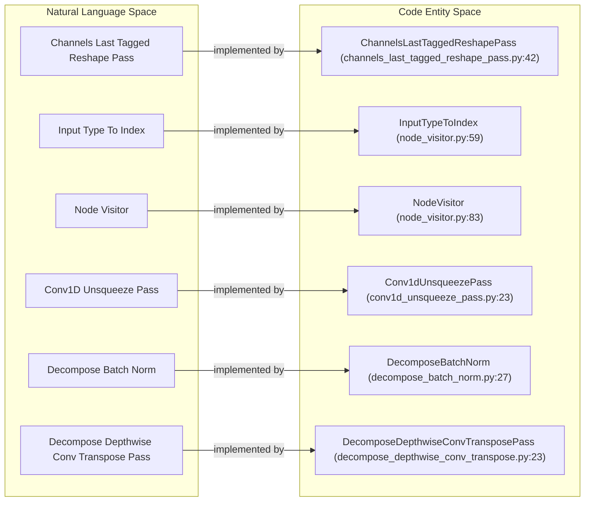
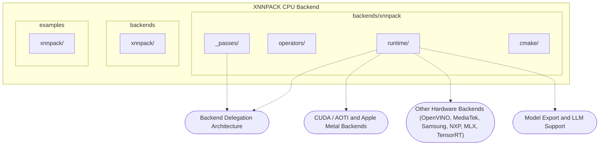
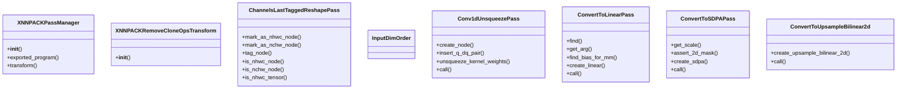
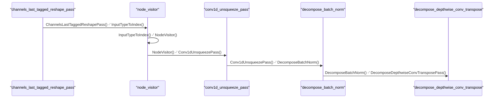

# 3-Source Context Packet (`git` + `CBM` + `llm-wiki`) for `5.6-xnnpack-cpu-backend` — XNNPACK CPU Backend

- **Target Wiki File**: `wiki/5.6-xnnpack-cpu-backend.md`
- **Archetype**: `Leaf Technical Spec Page`
- **Parent Page**: `5-backend-delegation-architecture`
- **Summary**: Architectural specification and implementation reference for XNNPACK CPU Backend (36 relevant source files). Primary code entities: `ChannelsLastTaggedReshapePass`, `_is_nhwc`, `call`, `can_be_converted_to_nhwc`, `InputTypeToIndex`.
- **Valid `[[wikilink]]` Neighbours**: `[[5-backend-delegation-architecture|Backend Delegation Architecture]]`, `[[1.1-getting-started|Getting Started]]`, `[[1.2-export-api-and-recipe-system|Export API and Recipe System]]`, `[[2.2-kernel-libraries-and-selective-build|Kernel Libraries and Selective Build]]`, `[[2.3-schema-generation-and-flatbuffers|Schema Generation and FlatBuffers]]`, `[[3.4-program-emission-and-serialization|Program Emission and Serialization]]`, `[[3.5-verification-and-dialect-system|Verification and Dialect System]]`, `[[4-quantization-systems|Quantization Systems]]`

## 1. Relevant Source Files (`git` + `CBM`, use verbatim in `<details>`)
- `[backends/xnnpack/_passes/channels_last_tagged_reshape_pass.py](backends/xnnpack/_passes/channels_last_tagged_reshape_pass.py)`
- `[backends/xnnpack/operators/node_visitor.py](backends/xnnpack/operators/node_visitor.py)`
- `[backends/xnnpack/_passes/conv1d_unsqueeze_pass.py](backends/xnnpack/_passes/conv1d_unsqueeze_pass.py)`
- `[backends/xnnpack/_passes/convert_to_linear.py](backends/xnnpack/_passes/convert_to_linear.py)`
- `[backends/xnnpack/_passes/__init__.py](backends/xnnpack/_passes/__init__.py)`
- `[backends/xnnpack/_passes/convert_to_sdpa.py](backends/xnnpack/_passes/convert_to_sdpa.py)`
- `[backends/xnnpack/_passes/decompose_batch_norm.py](backends/xnnpack/_passes/decompose_batch_norm.py)`
- `[backends/xnnpack/_passes/decompose_depthwise_conv_transpose.py](backends/xnnpack/_passes/decompose_depthwise_conv_transpose.py)`
- `[backends/xnnpack/runtime/XNNWeightsCache.h](backends/xnnpack/runtime/XNNWeightsCache.h)`
- `[backends/xnnpack/_passes/convert_to_upsample_bilinear2d.py](backends/xnnpack/_passes/convert_to_upsample_bilinear2d.py)`
- `[backends/xnnpack/_passes/fuse_activation_pass.py](backends/xnnpack/_passes/fuse_activation_pass.py)`
- `[backends/xnnpack/_passes/decompose_cat.py](backends/xnnpack/_passes/decompose_cat.py)`
- `[backends/xnnpack/_passes/fuse_batch_norm.py](backends/xnnpack/_passes/fuse_batch_norm.py)`
- `[backends/xnnpack/_passes/fuse_pad_into_conv_pass.py](backends/xnnpack/_passes/fuse_pad_into_conv_pass.py)`
- `[backends/xnnpack/_passes/fold_computed_params.py](backends/xnnpack/_passes/fold_computed_params.py)`
- `[backends/xnnpack/__init__.py](backends/xnnpack/__init__.py)`
- `[backends/xnnpack/_passes/remove_redundant_copy_pass.py](backends/xnnpack/_passes/remove_redundant_copy_pass.py)`
- `[backends/xnnpack/_passes/insert_pad_qdq.py](backends/xnnpack/_passes/insert_pad_qdq.py)`
- `[backends/xnnpack/_passes/prelu_reshape_pass.py](backends/xnnpack/_passes/prelu_reshape_pass.py)`
- `[backends/xnnpack/_passes/remove_noop_expand_copy_pass.py](backends/xnnpack/_passes/remove_noop_expand_copy_pass.py)`
- `[backends/xnnpack/_passes/propagate_custom_meta_pass.py](backends/xnnpack/_passes/propagate_custom_meta_pass.py)`
- `[backends/xnnpack/_passes/rewrite_fp16_silu.py](backends/xnnpack/_passes/rewrite_fp16_silu.py)`
- `[backends/xnnpack/_passes/xnnpack_pass.py](backends/xnnpack/_passes/xnnpack_pass.py)`
- `[backends/xnnpack/operators/op_abs.py](backends/xnnpack/operators/op_abs.py)`
- `[backends/xnnpack/operators/op_add.py](backends/xnnpack/operators/op_add.py)`
- `[backends/xnnpack/operators/op_addmm.py](backends/xnnpack/operators/op_addmm.py)`
- `[backends/xnnpack/operators/op_avg_pooling2d.py](backends/xnnpack/operators/op_avg_pooling2d.py)`
- `[backends/xnnpack/runtime/XNNCompiler.cpp](backends/xnnpack/runtime/XNNCompiler.cpp)`
- `[backends/xnnpack/README.md](backends/xnnpack/README.md)`
- `[examples/xnnpack/README.md](examples/xnnpack/README.md)`

## 2. Grounded Code Symbols (`CBM`, use verbatim for `[file:start-end]()` pill citations)
- `ChannelsLastTaggedReshapePass` (Class) @ `[backends/xnnpack/_passes/channels_last_tagged_reshape_pass.py:42-753]()` [fan-in=0, fan-out=0] — # TODO(T151254305) use subgraph_rewriter
- `InputTypeToIndex` (Class) @ `[backends/xnnpack/operators/node_visitor.py:59-70]()` [fan-in=0, fan-out=0] — Mapping from input type to the arg index of a node
- `NodeVisitor` (Class) @ `[backends/xnnpack/operators/node_visitor.py:83-752]()` [fan-in=0, fan-out=0] — Node visitor pattern for visiting nodes in an edge IR graph and serializing them using the xnnpack serialization schema defined
- `Conv1dUnsqueezePass` (Class) @ `[backends/xnnpack/_passes/conv1d_unsqueeze_pass.py:23-206]()` [fan-in=0, fan-out=0] — This pass is used to change conv1d ops into conv2d since xnnpack only supports 2d convolution. This is done by modifying the graph to do the following: 1) unsqu
- `DecomposeBatchNorm` (Class) @ `[backends/xnnpack/_passes/decompose_batch_norm.py:27-294]()` [fan-in=0, fan-out=0] — Decompose batchnorm operators into 1x1 depthwise convolution.
- `DecomposeDepthwiseConvTransposePass` (Class) @ `[backends/xnnpack/_passes/decompose_depthwise_conv_transpose.py:23-230]()` [fan-in=0, fan-out=0] — Lower a depthwise transposed conv (groups == in_channels == out_channels) with stride s > 1 into s*s depthwise convs on the low-resolution input, a channel conc
- `DecomposeConcatenate` (Class) @ `[backends/xnnpack/_passes/decompose_cat.py:23-109]()` [fan-in=0, fan-out=0] — XNNPACK's Concatenate operation only supports concatenation for <= 5 tensors at a time. As a result, to support concatenates with > 5 tensors, we can decompose 
- `FuseActivationPass` (Class) @ `[backends/xnnpack/_passes/fuse_activation_pass.py:18-108]()` [fan-in=0, fan-out=0] — Some activations like ReLU and hardtanh can be fused with certain operators preceding it. In the case of fusion, we can instead delete the relu node and embed t
- `FuseBatchNormPass` (Class) @ `[backends/xnnpack/_passes/fuse_batch_norm.py:28-294]()` [fan-in=0, fan-out=0] — BatchNorm can be implemented using 1x1 Depthwise Convolution. However, doing so will increase memory usage since we serialize new weights to represent the convo
- `FusePadIntoConvPass` (Class) @ `[backends/xnnpack/_passes/fuse_pad_into_conv_pass.py:16-101]()` [fan-in=0, fan-out=0] — Folds a zero-valued constant_pad_nd on the two spatial dims into the convolution that consumes it. XNNPACK convolutions take independent top / right / bottom / 
- `FoldComputedParamsPass` (Class) @ `[backends/xnnpack/_passes/fold_computed_params.py:19-82]()` [fan-in=0, fan-out=0] — Folds the nodes that the partitioner tagged with COMPUTED_PARAM_TAG, which compute a GEMM weight or bias from params, into a param holding the result.
- `InsertPadQDQPass` (Class) @ `[backends/xnnpack/_passes/insert_pad_qdq.py:20-88]()` [fan-in=0, fan-out=0] — Inserts implicit quantize/dequantize pairs after constant_pad_nd nodes that sit in a quantized context (input is a dequantize node), so the pad can be serialize
- `PReLUReshapePass` (Class) @ `[backends/xnnpack/_passes/prelu_reshape_pass.py:18-75]()` [fan-in=0, fan-out=0] — This pass is used to modify the args of a PReLU node to make it compatible with running via XNNPACK delegate. If there is only one parameter in the weight tenso
- `RemoveNoopExpandCopyPass` (Class) @ `[backends/xnnpack/_passes/remove_noop_expand_copy_pass.py:13-59]()` [fan-in=0, fan-out=0] — Remove ``expand_copy`` nodes that do not change tensor shape or dtype. In static XNNPACK export flows, shape-specialization can turn an expand into a materializ
- `InputDimOrder` (Class) @ `[backends/xnnpack/_passes/channels_last_tagged_reshape_pass.py:36-38]()` [fan-in=0, fan-out=0] — 
- `PropagateCustomMetaPass` (Class) @ `[backends/xnnpack/_passes/propagate_custom_meta_pass.py:13-44]()` [fan-in=0, fan-out=0] — Pass to propagate node.meta['custom'] from parent nodes to their q/dq child nodes. For all quantize/dequantize nodes in the graph, if the parent node has a node
- `RewriteFp16SiluPass` (Class) @ `[backends/xnnpack/_passes/rewrite_fp16_silu.py:12-44]()` [fan-in=0, fan-out=0] — Rewrite preserved FP16 SiLU into FP16 sigmoid and multiply.
- `ConvertToLinearPass` (Class) @ `[backends/xnnpack/_passes/convert_to_linear.py:30-201]()` [fan-in=0, fan-out=0] — 
- `XNNPACKPass` (Class) @ `[backends/xnnpack/_passes/xnnpack_pass.py:11-22]()` [fan-in=0, fan-out=0] — An abstract interface for XNNPACK backend passes.
- `XNNPACKPassManager` (Class) @ `[backends/xnnpack/_passes/__init__.py:67-128]()` [fan-in=0, fan-out=0] — 
- `XNNPACKRemoveCloneOpsTransform` (Class) @ `[backends/xnnpack/_passes/__init__.py:62-64]()` [fan-in=0, fan-out=0] — 
- `ConvertToSDPAPass` (Class) @ `[backends/xnnpack/_passes/convert_to_sdpa.py:24-114]()` [fan-in=0, fan-out=0] — 

## 3. Grounded Source Code Excerpts (`git` Working Tree)
### `ChannelsLastTaggedReshapePass` in `[backends/xnnpack/_passes/channels_last_tagged_reshape_pass.py:42-57]()`
```python
class ChannelsLastTaggedReshapePass(XNNPACKPass):
    """
    This pass is Internal to XNNPACK only! It is meant to give a new representation
    of the edge graph to be consumed by XNNPACK Preprocess. All added operators
    will be consumed by delegate and turned to delegate blobs.

    Edge IR graph pass to add operator stubs that signal a change in
    memory format from contiguous to channels last. This is to help with
    XNNPACK Delegate to add transpose nodes to change input memory format
    at runtime and run operators in Channels Last Format.

    During this pass, nhwc nodes are not converted back to nchw immediately.
    Instead, they are tagged as nhwc, and this tag is propagated to their
    children which are also kept in nwhc format until a node which requires
    converting back to nchw is encountered.
```

### `InputTypeToIndex` in `[backends/xnnpack/operators/node_visitor.py:59-70]()`
```python
class InputTypeToIndex:
    """
    Mapping from input type to the arg index of a node
    """

    node_input: int
    node_weight: int

    def __init__(self, node_input: int, node_weight: int, node_bias=None):
        self.node_input = node_input
        self.node_weight = node_weight
        self.node_bias = node_bias
```

### `NodeVisitor` in `[backends/xnnpack/operators/node_visitor.py:83-98]()`
```python
class NodeVisitor:
    """
    Node visitor pattern for visiting nodes in an edge IR graph and
    serializing them using the xnnpack serialization schema defined
    """

    def __init__(
        self,
        exported_program: ExportedProgram,
        external_ids: Dict,
        named_data_store: NamedDataStore,
    ) -> None:
        self._external_ids = external_ids or {}
        self._exported_program = exported_program or None
        self._named_data_store = named_data_store
```

### `Conv1dUnsqueezePass` in `[backends/xnnpack/_passes/conv1d_unsqueeze_pass.py:23-38]()`
```python
class Conv1dUnsqueezePass(XNNPACKPass):
    """
    This pass is used to change conv1d ops into conv2d since xnnpack only
    supports 2d convolution. This is done by modifying the graph to do the
    following:
    1) unsqueeze the convolution's input from 3d to 4d
    2) perform a conv2d (with a modified version of the original conv1d args)
    3) squeeze the output back down to 3d.
    """

    def create_node(
        self,
        graph: torch.fx.Graph,
        op_target: OpOverload,
        args: tuple = (),
        kwargs: Optional[dict] = None,
```

### `DecomposeBatchNorm` in `[backends/xnnpack/_passes/decompose_batch_norm.py:27-42]()`
```python
class DecomposeBatchNorm(XNNPACKPass):
    """
    Decompose batchnorm operators into 1x1 depthwise convolution.
    """

    BATCH_NORM_OPS = {
        exir_ops.edge.aten.native_batch_norm.default,
        exir_ops.edge.aten._native_batch_norm_legit_no_training.default,
    }

    @staticmethod
    def can_decompose_batch_norm(  # noqa: C901
        node: torch.fx.Node,
        exported_program: torch.export.ExportedProgram,
        why: WhyNoPartition | None = None,
    ) -> bool:
```


## 4. Linked Official Docs (`llm-wiki` / `RAG`)
- **Vulkan GPU Backend** (`wiki/5.2-vulkan-gpu-backend.md`, score=139.492, shared_symbols=[]): # Vulkan GPU Backend ↑ [[5-backend-delegation-architecture|Backend Delegation Architecture]] > Architectural specification and implementation reference for Vulkan GPU Backend (40 relevant source files). Primary code entities: `CommandBuffer`, `begin`, `bind_descriptors`, `bind_pipeline`, `OpFeatures`. <details> <summary>Relevant source files</summary> Th
- **Cadence DSP Backend** (`wiki/5.5-cadence-dsp-backend.md`, score=136.34, shared_symbols=[]): # Cadence DSP Backend ↑ [[5-backend-delegation-architecture|Backend Delegation Architecture]] > Architectural specification and implementation reference for Cadence DSP Backend (36 relevant source files). Primary code entities: `QuantFusionPass`, `__init__`, `call`, `QuantizedInputWrapper`, `MemoryPlanningAlgo`. <details> <summary>Relevant source files</s
- **Partitioning and Operator Support** (`wiki/5.1-partitioning-and-operator-support.md`, score=135.412, shared_symbols=[]): # Partitioning and Operator Support ↑ [[5-backend-delegation-architecture|Backend Delegation Architecture]] > Architectural specification and implementation reference for Partitioning and Operator Support (17 relevant source files). Primary code entities: `MethodProgramsPartitionerSpec`, `_`, `_create_partitions`, `_create_partitions_in_graph_module`, `Gro
- **ARM TOSA and Ethos-U Backend** (`wiki/5.4-arm-tosa-and-ethos-u-backend.md`, score=135.412, shared_symbols=[]): # ARM TOSA and Ethos-U Backend ↑ [[5-backend-delegation-architecture|Backend Delegation Architecture]] > Architectural specification and implementation reference for ARM TOSA and Ethos-U Backend (40 relevant source files). Primary code entities: `TosaArg`, `__init__`, `__process_list`, `__process_node`, `InsertTableOpsPass`. <details> <summary>Relevant so
- **CUDA / AOTI and Apple Metal Backends** (`wiki/5.7-cuda-aoti-and-apple-metal-backends.md`, score=135.412, shared_symbols=[]): # CUDA / AOTI and Apple Metal Backends ↑ [[5-backend-delegation-architecture|Backend Delegation Architecture]] > Architectural specification and implementation reference for CUDA / AOTI and Apple Metal Backends (40 relevant source files). Primary code entities: `empty`, `empty_like`, `empty_strided`, `DeviceTraits<c10::DeviceType::CPU>`, `allocate`. <deta
- **Qualcomm QNN Backend** (`wiki/5.3-qualcomm-qnn-backend.md`, score=129.914, shared_symbols=['define_tensor']): # Qualcomm QNN Backend ↑ [[5-backend-delegation-architecture|Backend Delegation Architecture]] > Architectural specification and implementation reference for Qualcomm QNN Backend (40 relevant source files). Primary code entities: `NodeVisitor`, `__init__`, `define_custom_tensor_wrapper`, `define_node`, `ConvertMhaToSha`. <details> <summary>Relevant source

## 5. Pre-Verified DeepWiki v1.9.9.5 Mermaid Diagrams
### Natural Language Space <-> Code Entity Space


### Subsystem Architecture Flowchart


### Class Hierarchy Diagram


### Call Sequence Diagram


## 6. DeepWiki v1.9.9.5 Authoring Checklist for `wiki/5.6-xnnpack-cpu-backend.md`
1. Keep YAML frontmatter at top (`id`, `title`, `parent`, `sources`, `linked_docs`, `bridge_symbols`).
2. Keep `<details><summary>Relevant source files</summary>` block immediately after `# Title`.
3. Start with `## Purpose and Scope`, then numbered `## 1. ...`, `## 2. ...` sections separated by `---`.
4. Include at least 2 ```mermaid``` diagrams (including a `Natural Language Space` <-> `Code Entity Space` mapping).
5. Cite code entities inline using `[path/to/file.ext:start-end]()` and end every `##` section with `Sources: [file:start-end]()`.
6. Run `deepwiki_cli.py build --enrich-only ...` and `deepwiki_cli.py validate ...` after editing.
