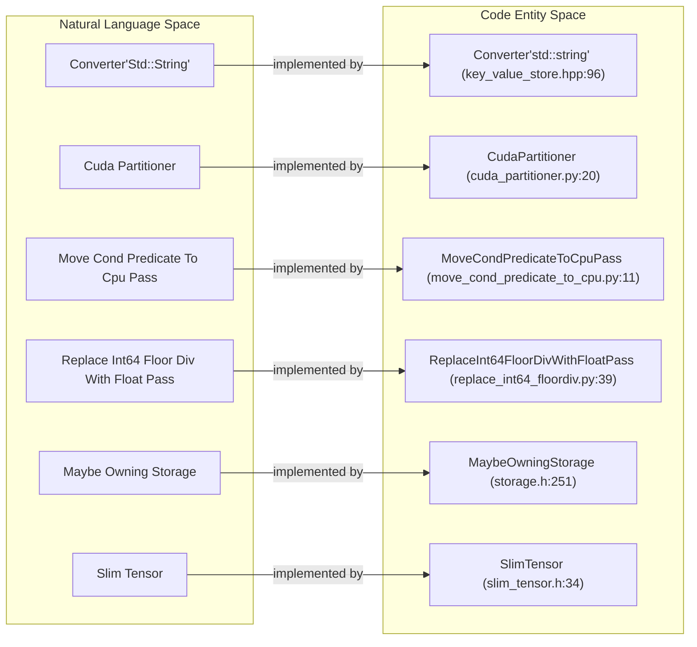
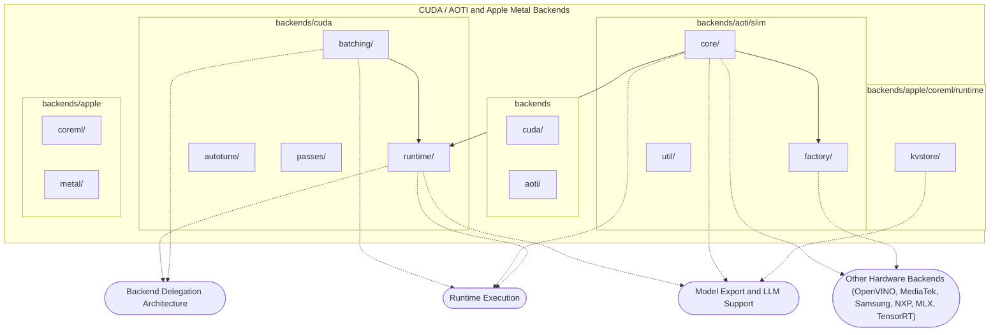
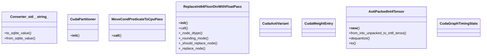
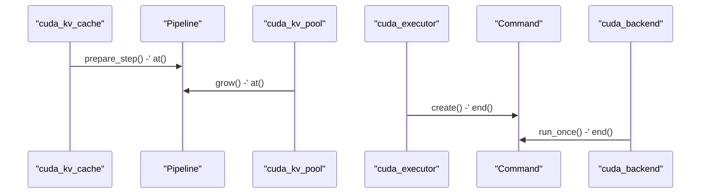

# 3-Source Context Packet (`git` + `CBM` + `llm-wiki`) for `5.7-cuda-aoti-and-apple-metal-backends` — CUDA / AOTI and Apple Metal Backends

- **Target Wiki File**: `wiki/5.7-cuda-aoti-and-apple-metal-backends.md`
- **Archetype**: `Leaf Technical Spec Page`
- **Parent Page**: `5-backend-delegation-architecture`
- **Summary**: Architectural specification and implementation reference for CUDA / AOTI and Apple Metal Backends (40 relevant source files). Primary code entities: `empty`, `empty_like`, `empty_strided`, `DeviceTraits<c10::DeviceType::CPU>`, `allocate`.
- **Valid `[[wikilink]]` Neighbours**: `[[5-backend-delegation-architecture|Backend Delegation Architecture]]`, `[[1.1-getting-started|Getting Started]]`, `[[1.2-export-api-and-recipe-system|Export API and Recipe System]]`, `[[2.2-kernel-libraries-and-selective-build|Kernel Libraries and Selective Build]]`, `[[2.3-schema-generation-and-flatbuffers|Schema Generation and FlatBuffers]]`, `[[3.4-program-emission-and-serialization|Program Emission and Serialization]]`, `[[3.5-verification-and-dialect-system|Verification and Dialect System]]`, `[[4-quantization-systems|Quantization Systems]]`

## 1. Relevant Source Files (`git` + `CBM`, use verbatim in `<details>`)
- `[backends/aoti/slim/factory/empty.h](backends/aoti/slim/factory/empty.h)`
- `[backends/aoti/slim/core/storage.h](backends/aoti/slim/core/storage.h)`
- `[backends/aoti/slim/core/slim_tensor.h](backends/aoti/slim/core/slim_tensor.h)`
- `[backends/cuda/cuda_backend.py](backends/cuda/cuda_backend.py)`
- `[backends/cuda/runtime/cuda_kv_cache.cpp](backends/cuda/runtime/cuda_kv_cache.cpp)`
- `[backends/aoti/slim/util/shared_ptr.h](backends/aoti/slim/util/shared_ptr.h)`
- `[backends/cuda/batching/cuda_executor.cpp](backends/cuda/batching/cuda_executor.cpp)`
- `[backends/cuda/autotune/cuda_graph_timing.py](backends/cuda/autotune/cuda_graph_timing.py)`
- `[backends/cuda/runtime/cuda_weight_cache.cpp](backends/cuda/runtime/cuda_weight_cache.cpp)`
- `[backends/cuda/aoti_packed_int4_tensor.py](backends/cuda/aoti_packed_int4_tensor.py)`
- `[backends/cuda/cuda_weight_collector.py](backends/cuda/cuda_weight_collector.py)`
- `[backends/cuda/merge_ptes.py](backends/cuda/merge_ptes.py)`
- `[backends/cuda/autotune/launch_params.py](backends/cuda/autotune/launch_params.py)`
- `[backends/cuda/cuda_partitioner.py](backends/cuda/cuda_partitioner.py)`
- `[backends/cuda/autotune/inputs.py](backends/cuda/autotune/inputs.py)`
- `[backends/cuda/dp4a_planar_int5_tensor.py](backends/cuda/dp4a_planar_int5_tensor.py)`
- `[backends/cuda/passes/lower_offgraph_kv.py](backends/cuda/passes/lower_offgraph_kv.py)`
- `[backends/cuda/dp4a_planar_int6_tensor.py](backends/cuda/dp4a_planar_int6_tensor.py)`
- `[backends/cuda/coalesced_int4_tensor.py](backends/cuda/coalesced_int4_tensor.py)`
- `[backends/cuda/batching/cuda_executor.h](backends/cuda/batching/cuda_executor.h)`
- `[backends/cuda/runtime/cuda_backend.cpp](backends/cuda/runtime/cuda_backend.cpp)`
- `[backends/cuda/batching/step_plan.h](backends/cuda/batching/step_plan.h)`
- `[backends/cuda/__init__.py](backends/cuda/__init__.py)`
- `[backends/cuda/passes/replace_int64_floordiv.py](backends/cuda/passes/replace_int64_floordiv.py)`
- `[backends/cuda/runtime/cuda_mutable_state.cpp](backends/cuda/runtime/cuda_mutable_state.cpp)`
- `[backends/apple/coreml/runtime/kvstore/key_value_store.hpp](backends/apple/coreml/runtime/kvstore/key_value_store.hpp)`
- `[backends/cuda/passes/move_cond_predicate_to_cpu.py](backends/cuda/passes/move_cond_predicate_to_cpu.py)`
- `[backends/cuda/runtime/cuda_kv_pool.cpp](backends/cuda/runtime/cuda_kv_pool.cpp)`
- `[backends/cuda/rocm.md](backends/cuda/rocm.md)`
- `[backends/cuda/runtime/aoti_cuda_shims.lib.md](backends/cuda/runtime/aoti_cuda_shims.lib.md)`

## 2. Grounded Code Symbols (`CBM`, use verbatim for `[file:start-end]()` pill citations)
- `Converter<std::string>` (Class) @ `[backends/apple/coreml/runtime/kvstore/key_value_store.hpp:96-106]()` [fan-in=70, fan-out=0] — 
- `CudaPartitioner` (Class) @ `[backends/cuda/cuda_partitioner.py:20-53]()` [fan-in=25, fan-out=0] — CUDA partitioner driven by AOTInductor backend. This partitioner adds a target_device compile spec to enable device info propagation. The PropagateDevicePass wi
- `MoveCondPredicateToCpuPass` (Class) @ `[backends/cuda/passes/move_cond_predicate_to_cpu.py:11-94]()` [fan-in=10, fan-out=0] — A pass that moves the predicate of torch.cond to CPU if the predicate is a constantbuffer. This is useful for models that use the predicate as a constant buffer
- `ReplaceInt64FloorDivWithFloatPass` (Class) @ `[backends/cuda/passes/replace_int64_floordiv.py:39-153]()` [fan-in=8, fan-out=0] — Pass to rewrite integer floor-division into a float64-domain floor. Matches ``floor_divide.default`` and the floor-mode ``div.Tensor_mode`` / ``div.Scalar_mode`
- `MaybeOwningStorage` (Class) @ `[backends/aoti/slim/core/storage.h:251-418]()` [fan-in=0, fan-out=0] — /** * MaybeOwningStorage - A storage class that manages tensor data memory. * * This class provides owning memory storage for tensor data on CPU. * Owning stora
- `SlimTensor` (Class) @ `[backends/aoti/slim/core/slim_tensor.h:34-607]()` [fan-in=0, fan-out=0] — /** * SlimTensor - A lightweight tensor class for AOTI-driven ET backends runtime. * */
- `ParkedTensorsNotRestored` (Class) @ `[backends/cuda/autotune/cuda_graph_timing.py:186-190]()` [fan-in=1, fan-out=0] — Model tensors parked on the CPU could not be moved back to the GPU. Never treated as a timing failure: compiling on would package empty weights.
- `CudaBackend` (Class) @ `[backends/cuda/cuda_backend.py:920-1592]()` [fan-in=0, fan-out=0] — CudaBackend is a backend that compiles a model to run on CUDA devices. It uses the AOTInductor compiler to generate optimized CUDA kernels for the model's opera
- `_CompilePatch` (Class) @ `[backends/cuda/cuda_backend.py:145-181]()` [fan-in=0, fan-out=0] — A patch of Inductor that changes behavior only for the threads inside ``scope()``. ``install`` applies the patch and returns the function that removes it. The p
- `CudaAotiVariant` (Class) @ `[backends/cuda/cuda_weight_collector.py:54-60]()` [fan-in=2, fan-out=0] — One AOTI shared library and its CUDA runtime-selection metadata.
- `AotiPackedInt4Tensor` (Class) @ `[backends/cuda/aoti_packed_int4_tensor.py:18-108]()` [fan-in=1, fan-out=0] — Symmetric groupwise INT4 weight consumed by AOTI Triton kernels. Linears use ``triton::int4_matmul`` by default; a fixed-shape caller can select ``triton::int4_
- `CudaCellCache` (Class) @ `[backends/cuda/runtime/cuda_kv_cache.cpp:288-800]()` [fan-in=0, fan-out=0] — // Many sequences over one pool of per-token cells on one CUDA device. // // The neutral base owns the cell table: placement, ownership, and the verbs a // runn
- `CudaSequenceKVCache` (Class) @ `[backends/cuda/runtime/cuda_kv_cache.cpp:99-253]()` [fan-in=0, fan-out=0] — // One sequence's KV storage on one CUDA device. // // The neutral base owns the logical length, admission and rewind; the pool // owns the bytes and the AOTI b
- `CudaAotiMetadata` (Class) @ `[backends/cuda/cuda_weight_collector.py:64-68]()` [fan-in=1, fan-out=0] — CUDA AOTI native and fallback variants sharing one weight manifest.
- `CudaPteInput` (Class) @ `[backends/cuda/merge_ptes.py:52-56]()` [fan-in=1, fan-out=0] — One CUDA PTE input and its optional external tensor data.
- `CudaWeightCollector` (Class) @ `[backends/cuda/cuda_weight_collector.py:379-641]()` [fan-in=0, fan-out=0] — Collect one global ``(device, FQN) -> value`` store for all methods.
- `InvalidLaunchParam` (Class) @ `[backends/cuda/autotune/launch_params.py:82-83]()` [fan-in=0, fan-out=0] — Raised by a launch function for a candidate that is illegal for its inputs.
- `CheckOffGraphKVStepWidthPass` (Class) @ `[backends/cuda/passes/lower_offgraph_kv.py:496-563]()` [fan-in=1, fan-out=0] — Check the declared step width against the delegated program. The runtime reads each step's token count from input ``input`` at ``dim`` of the delegate. That ind
- `CudaCoalescedInt4Tensor` (Class) @ `[backends/cuda/coalesced_int4_tensor.py:112-238]()` [fan-in=1, fan-out=0] — INT4 weight, uint8 scale + per-256 fp16 step, uint8 zero + per-256 fp16 step. ExecuTorch-internal; see the module docstring. Mirrors torchao ``Int4Tensor``'s da
- `CudaDp4aPlanarInt5Tensor` (Class) @ `[backends/cuda/dp4a_planar_int5_tensor.py:177-318]()` [fan-in=0, fan-out=0] — Dp4a-planar 5-bit weight (ql/qh split bit-planes + per-group scale/zero), asymmetric. ExecuTorch-internal; see the module docstring. The CUDA decode/prefill dis
- `CudaDp4aPlanarInt6Tensor` (Class) @ `[backends/cuda/dp4a_planar_int6_tensor.py:185-302]()` [fan-in=0, fan-out=0] — Dp4a-planar 6-bit weight (ql/qh split bit-planes + per-group scale), symmetric. ExecuTorch-internal; see the module docstring. The CUDA decode/prefill dispatch 
- `CudaExecutorOptions` (Class) @ `[backends/cuda/batching/cuda_executor.h:69-78]()` [fan-in=0, fan-out=0] — // Process-wide CUDA backend options create() sets before the methods load.

## 3. Grounded Source Code Excerpts (`git` Working Tree)
### `Converter<std::string>` in `[backends/apple/coreml/runtime/kvstore/key_value_store.hpp:96-106]()`
```cpp
struct Converter<std::string> {
    static constexpr sqlite::StorageType storage_type = StorageType::Text;
    
    static inline sqlite::Value to_sqlite_value(const std::string& value) {
        return value;
    }
    
    static inline std::string from_sqlite_value(const UnOwnedValue& value) {
        return std::string(std::get<sqlite::UnOwnedString>(value).data);
    }
};
```

### `CudaPartitioner` in `[backends/cuda/cuda_partitioner.py:20-35]()`
```python
class CudaPartitioner(AotiPartitioner):
    """
    CUDA partitioner driven by AOTInductor backend.

    This partitioner adds a target_device compile spec to enable device info
    propagation. The PropagateDevicePass will read this spec and mark delegate
    output tensors with CUDA device type, which flows through to serialization.
    """

    def __init__(
        self,
        compile_spec: List[CompileSpec],
    ) -> None:
        """
        Initialize the CUDA partitioner.
```

### `MoveCondPredicateToCpuPass` in `[backends/cuda/passes/move_cond_predicate_to_cpu.py:11-26]()`
```python
class MoveCondPredicateToCpuPass:
    """
    A pass that moves the predicate of torch.cond to CPU if the predicate is a constantbuffer.
    This is useful for models that use the predicate as a constant buffer, such as an `initialized` flag for cross attention kv cache.

    This saves ~50us per torch.cond call on RTX 5080.

    Example:
    ```
    class CrossAttentionWithCache(torch.nn.Module):
        def __init__(self, hidden_size):
            super().__init__()
            self.k_proj = torch.nn.Linear(hidden_size, hidden_size)
            self.v_proj = torch.nn.Linear(hidden_size, hidden_size)
            self.q_proj = torch.nn.Linear(hidden_size, hidden_size)
            self.out_proj = torch.nn.Linear(hidden_size, hidden_size)
```

### `ReplaceInt64FloorDivWithFloatPass` in `[backends/cuda/passes/replace_int64_floordiv.py:39-54]()`
```python
class ReplaceInt64FloorDivWithFloatPass(PassBase):
    # Work around an AOTInductor/Inductor CUDA miscompile of integer
    # (int64) floor-division: fused/broadcast int64 floor_divide is mis-lowered
    # (truncation instead of floor; cross-division term bleed under dynamic shapes).
    # TODO(gasoonjia): remove this pass once the upstream issue solved.
    # Upstream issue: https://github.com/pytorch/pytorch/issues/186164
    """
    Pass to rewrite integer floor-division into a float64-domain floor.

    Matches ``floor_divide.default`` and the floor-mode ``div.Tensor_mode`` /
    ``div.Scalar_mode`` overloads on integer operands, and replaces each with
    ``floor(a.to(float64) / b.to(float64)).to(orig_int_dtype)`` built from edge
    dialect ops. Float floor-division and non-integer nodes are left untouched.
    """

    def __init__(self):
```

### `MaybeOwningStorage` in `[backends/aoti/slim/core/storage.h:251-266]()`
```cpp
class MaybeOwningStorage {
 public:
  /// Constructs owning storage with allocated memory.
  /// @param device The device for storage (CPU or CUDA).
  /// @param nbytes Number of bytes to allocate.
  MaybeOwningStorage(const c10::Device& device, size_t nbytes)
      : device_(device), capacity_(nbytes), is_owning_(true) {
    if (device.is_cpu()) {
      data_ = DeviceTraits<c10::DeviceType::CPU>::allocate(nbytes, device);
      deleter_ = DeviceTraits<c10::DeviceType::CPU>::free;
    } else if (device.is_cuda()) {
      data_ = DeviceTraits<c10::DeviceType::CUDA>::allocate(nbytes, device);
      deleter_ = DeviceTraits<c10::DeviceType::CUDA>::free;
    } else {
      ET_CHECK_MSG(false, "Unsupported device type: %s", device.str().c_str());
    }
```


## 4. Linked Official Docs (`llm-wiki` / `RAG`)
- **Backend Delegation Architecture** (`wiki/5-backend-delegation-architecture.md`, score=144.995, shared_symbols=['CudaPartitioner']): # Backend Delegation Architecture > Architectural specification and implementation reference for Backend Delegation Architecture (40 relevant source files). Primary code entities: `CommandBuffer`, `begin`, `bind_descriptors`, `bind_pipeline`, `NodeVisitor`. <details> <summary>Relevant source files</summary> The following files were used as context for gen
- **Partitioning and Operator Support** (`wiki/5.1-partitioning-and-operator-support.md`, score=122.036, shared_symbols=[]): # Partitioning and Operator Support ↑ [[5-backend-delegation-architecture|Backend Delegation Architecture]] > Architectural specification and implementation reference for Partitioning and Operator Support (17 relevant source files). Primary code entities: `MethodProgramsPartitionerSpec`, `_`, `_create_partitions`, `_create_partitions_in_graph_module`, `Gro
- **Vulkan GPU Backend** (`wiki/5.2-vulkan-gpu-backend.md`, score=122.036, shared_symbols=[]): # Vulkan GPU Backend ↑ [[5-backend-delegation-architecture|Backend Delegation Architecture]] > Architectural specification and implementation reference for Vulkan GPU Backend (40 relevant source files). Primary code entities: `CommandBuffer`, `begin`, `bind_descriptors`, `bind_pipeline`, `OpFeatures`. <details> <summary>Relevant source files</summary> Th
- **Qualcomm QNN Backend** (`wiki/5.3-qualcomm-qnn-backend.md`, score=122.036, shared_symbols=[]): # Qualcomm QNN Backend ↑ [[5-backend-delegation-architecture|Backend Delegation Architecture]] > Architectural specification and implementation reference for Qualcomm QNN Backend (40 relevant source files). Primary code entities: `NodeVisitor`, `__init__`, `define_custom_tensor_wrapper`, `define_node`, `ConvertMhaToSha`. <details> <summary>Relevant source
- **Other Hardware Backends (OpenVINO, MediaTek, Samsung, NXP, MLX, TensorRT)** (`wiki/5.8-other-backends.md`, score=116.895, shared_symbols=[]): # Other Hardware Backends (OpenVINO, MediaTek, Samsung, NXP, MLX, TensorRT) ↑ [[5-backend-delegation-architecture|Backend Delegation Architecture]] > Architectural specification and implementation reference for Other Hardware Backends (OpenVINO, MediaTek, Samsung, NXP, MLX, TensorRT) (40 relevant source files). Primary code entities: `ConstantData`, `add`,
- **ExecuTorch DeepWiki** (`wiki/index.md`, score=116.588, shared_symbols=[]): # ExecuTorch DeepWiki Generated from `home-jason-Project-deepwiki-executorch` at commit `b3b565b5b62f` (2026-11-15T15:02:11+00:00). ## Pages - [[1-overview|Overview]] — Architectural specification and implementation reference for Overview (10 relevant source files). Primary code entities: `Module`, `MethodHolder`, `PlannedMemory`, `EdgeProgramManager`, `_

## 5. Pre-Verified DeepWiki v1.9.9.5 Mermaid Diagrams
### Natural Language Space <-> Code Entity Space


### Subsystem Architecture Flowchart


### Class Hierarchy Diagram


### Call Sequence Diagram


## 6. DeepWiki v1.9.9.5 Authoring Checklist for `wiki/5.7-cuda-aoti-and-apple-metal-backends.md`
1. Keep YAML frontmatter at top (`id`, `title`, `parent`, `sources`, `linked_docs`, `bridge_symbols`).
2. Keep `<details><summary>Relevant source files</summary>` block immediately after `# Title`.
3. Start with `## Purpose and Scope`, then numbered `## 1. ...`, `## 2. ...` sections separated by `---`.
4. Include at least 2 ```mermaid``` diagrams (including a `Natural Language Space` <-> `Code Entity Space` mapping).
5. Cite code entities inline using `[path/to/file.ext:start-end]()` and end every `##` section with `Sources: [file:start-end]()`.
6. Run `deepwiki_cli.py build --enrich-only ...` and `deepwiki_cli.py validate ...` after editing.
