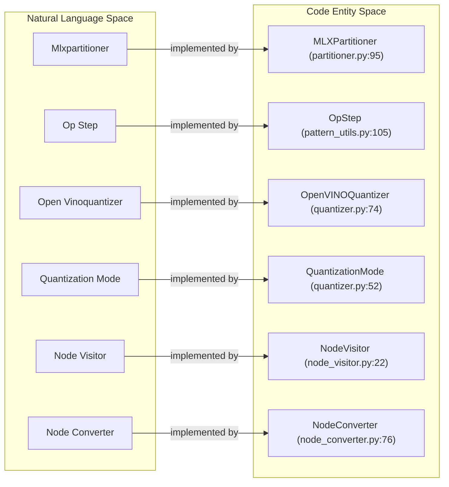
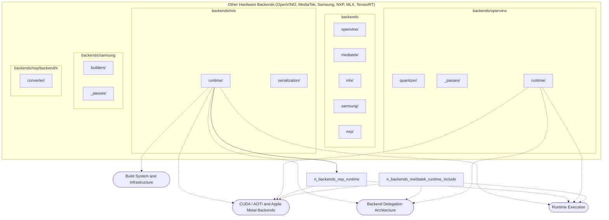
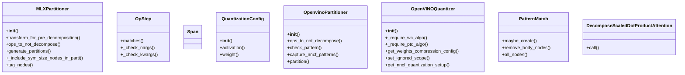
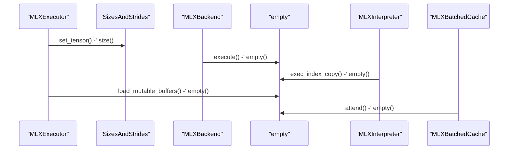

# 3-Source Context Packet (`git` + `CBM` + `llm-wiki`) for `5.8-other-backends` — Other Hardware Backends (OpenVINO, MediaTek, Samsung, NXP, MLX, TensorRT)

- **Target Wiki File**: `wiki/5.8-other-backends.md`
- **Archetype**: `Leaf Technical Spec Page`
- **Parent Page**: `5-backend-delegation-architecture`
- **Summary**: Architectural specification and implementation reference for Other Hardware Backends (OpenVINO, MediaTek, Samsung, NXP, MLX, TensorRT) (40 relevant source files). Primary code entities: `ConstantData`, `add`, `get`, `set`, `Interpreter`.
- **Valid `[[wikilink]]` Neighbours**: `[[5-backend-delegation-architecture|Backend Delegation Architecture]]`, `[[1.1-getting-started|Getting Started]]`, `[[1.2-export-api-and-recipe-system|Export API and Recipe System]]`, `[[2.2-kernel-libraries-and-selective-build|Kernel Libraries and Selective Build]]`, `[[2.3-schema-generation-and-flatbuffers|Schema Generation and FlatBuffers]]`, `[[3.4-program-emission-and-serialization|Program Emission and Serialization]]`, `[[3.5-verification-and-dialect-system|Verification and Dialect System]]`, `[[4-quantization-systems|Quantization Systems]]`

## 1. Relevant Source Files (`git` + `CBM`, use verbatim in `<details>`)
- `[backends/mlx/runtime/MLXExecutor.h](backends/mlx/runtime/MLXExecutor.h)`
- `[backends/mlx/runtime/MLXInterpreter.h](backends/mlx/runtime/MLXInterpreter.h)`
- `[backends/openvino/partitioner.py](backends/openvino/partitioner.py)`
- `[backends/openvino/quantizer/quantizer.py](backends/openvino/quantizer/quantizer.py)`
- `[backends/samsung/builders/node_visitor.py](backends/samsung/builders/node_visitor.py)`
- `[backends/openvino/preprocess.py](backends/openvino/preprocess.py)`
- `[backends/openvino/_passes/fold_constant_cumsum_pass.py](backends/openvino/_passes/fold_constant_cumsum_pass.py)`
- `[backends/nxp/backend/ir/converter/node_converter.py](backends/nxp/backend/ir/converter/node_converter.py)`
- `[backends/openvino/_passes/decompose_floor_divide_pass.py](backends/openvino/_passes/decompose_floor_divide_pass.py)`
- `[backends/openvino/runtime/OpenvinoBackend.cpp](backends/openvino/runtime/OpenvinoBackend.cpp)`
- `[backends/openvino/quantizer/observers.py](backends/openvino/quantizer/observers.py)`
- `[backends/openvino/_passes/cast_reduction_input_pass.py](backends/openvino/_passes/cast_reduction_input_pass.py)`
- `[backends/mediatek/preprocess.py](backends/mediatek/preprocess.py)`
- `[backends/mediatek/quantizer/qconfig.py](backends/mediatek/quantizer/qconfig.py)`
- `[backends/openvino/runtime/OpenvinoApi.h](backends/openvino/runtime/OpenvinoApi.h)`
- `[backends/mediatek/partitioner.py](backends/mediatek/partitioner.py)`
- `[backends/openvino/runtime/OpenvinoBackend.h](backends/openvino/runtime/OpenvinoBackend.h)`
- `[backends/openvino/__init__.py](backends/openvino/__init__.py)`
- `[backends/mlx/pattern_utils.py](backends/mlx/pattern_utils.py)`
- `[backends/nxp/runtime/NeutronBackend.cpp](backends/nxp/runtime/NeutronBackend.cpp)`
- `[backends/mlx/partitioner.py](backends/mlx/partitioner.py)`
- `[backends/mediatek/_passes/decompose_scaled_dot_product_attention.py](backends/mediatek/_passes/decompose_scaled_dot_product_attention.py)`
- `[backends/mediatek/runtime/include/NeuronBufferAllocator.h](backends/mediatek/runtime/include/NeuronBufferAllocator.h)`
- `[backends/mlx/runtime/MLXBatchedCache.h](backends/mlx/runtime/MLXBatchedCache.h)`
- `[backends/mlx/runtime/MLXBackend.cpp](backends/mlx/runtime/MLXBackend.cpp)`
- `[backends/samsung/_passes/annotate_qparams.py](backends/samsung/_passes/annotate_qparams.py)`
- `[backends/mlx/pte_inspector.py](backends/mlx/pte_inspector.py)`
- `[backends/openvino/_passes/__init__.py](backends/openvino/_passes/__init__.py)`
- `[backends/openvino/README.md](backends/openvino/README.md)`
- `[backends/mediatek/README.md](backends/mediatek/README.md)`

## 2. Grounded Code Symbols (`CBM`, use verbatim for `[file:start-end]()` pill citations)
- `MLXPartitioner` (Class) @ `[backends/mlx/partitioner.py:95-386]()` [fan-in=23, fan-out=0] — Partitioner for the MLX delegate. Analyzes an EdgeIR graph and partitions supported operations for delegation to MLX.
- `OpStep` (Class) @ `[backends/mlx/pattern_utils.py:105-193]()` [fan-in=17, fan-out=0] — One step in a backward walk through the graph. Used with walk_back() to define pattern chains. Supports both exact op matching and predicate-based matching. Att
- `OpenVINOQuantizer` (Class) @ `[backends/openvino/quantizer/quantizer.py:74-616]()` [fan-in=3, fan-out=0] — Implementation of the Torch AO quantizer which annotates models with quantization annotations optimally for the inference via OpenVINO.
- `QuantizationMode` (Class) @ `[backends/openvino/quantizer/quantizer.py:52-71]()` [fan-in=0, fan-out=0] — Defines special quantization modes. - INT8_SYM: INT8 symmetric quantization for both activations and weights. - INT8_MIXED: INT8 asymmetric quantization for act
- `NodeVisitor` (Class) @ `[backends/samsung/builders/node_visitor.py:22-85]()` [fan-in=0, fan-out=0] — Node visitor pattern for visiting nodes in an edge IR graph
- `NodeConverter` (Class) @ `[backends/nxp/backend/ir/converter/node_converter.py:76-538]()` [fan-in=0, fan-out=0] — Classes which implement conversion of torch.Node to TFLite should inherit from this class and overwrite the 'convert()' method.
- `FoldConstantCumsumPass` (Class) @ `[backends/openvino/_passes/fold_constant_cumsum_pass.py:108-161]()` [fan-in=0, fan-out=0] — Replace an integer cumsum that reads only constants with its result. With an integer cumsum over a constant, OpenVINO's CPU plugin (2025.1 to 2026.4) gives wron
- `DecomposeFloorDividePass` (Class) @ `[backends/openvino/_passes/decompose_floor_divide_pass.py:48-106]()` [fan-in=0, fan-out=0] — Decompose div with rounding_mode='floor' for correct semantics. ExecuTorch decomposes floor_divide into aten.div.Tensor_mode with rounding_mode='floor'. OpenVIN
- `PatternMatch` (Class) @ `[backends/mlx/pattern_utils.py:299-360]()` [fan-in=2, fan-out=0] — Base class for pattern match results. Subclasses should: 1. Add fields for captured values (input nodes, constants, etc.) 2. Implement maybe_create() classmetho
- `CastReductionInputPass` (Class) @ `[backends/openvino/_passes/cast_reduction_input_pass.py:18-45]()` [fan-in=0, fan-out=0] — Cast the input of cumsum and prod to the dtype of their result. PyTorch reduces bool and integer tensors in int64, but OpenVINO keeps a narrower type for these 
- `OpenvinoPartitioner` (Class) @ `[backends/openvino/partitioner.py:240-388]()` [fan-in=3, fan-out=0] — 
- `INT4WeightObserver` (Class) @ `[backends/openvino/quantizer/observers.py:165-187]()` [fan-in=0, fan-out=0] — OpenVINO INT4 Weight Compression observer.
- `INT8WeightObserver` (Class) @ `[backends/openvino/quantizer/observers.py:190-206]()` [fan-in=0, fan-out=0] — OpenVINO INT8 Weight Compression per channel observer.
- `WeightObserverBase` (Class) @ `[backends/openvino/quantizer/observers.py:46-162]()` [fan-in=0, fan-out=0] — Base implementation of an NNCF observer that defines the rules for compressing layer weights into the OpenVINO representation.
- `QuantizationConfig` (Class) @ `[backends/mediatek/quantizer/qconfig.py:30-44]()` [fan-in=5, fan-out=0] — 
- `Span` (Class) @ `[backends/mlx/runtime/MLXBatchedCache.h:241-246]()` [fan-in=7, fan-out=0] — 
- `DlCloser` (Class) @ `[backends/openvino/runtime/OpenvinoApi.h:136-138]()` [fan-in=0, fan-out=0] — // Defined in OpenvinoBackend.cpp, where the platform's loader API is included.
- `ov_dimension_t` (Class) @ `[backends/openvino/runtime/OpenvinoApi.h:35-38]()` [fan-in=0, fan-out=0] — // Reproduced from openvino/c/ov_dimension.h and ov_partial_shape.h.
- `ov_shape_t` (Class) @ `[backends/openvino/runtime/OpenvinoApi.h:29-32]()` [fan-in=0, fan-out=0] — // Value types reproduced from openvino/c/ov_shape.h and ov_common.h. // These are stable C ABI — pinned via version constraint in pyproject.toml.
- `DecomposeScaledDotProductAttention` (Class) @ `[backends/mediatek/_passes/decompose_scaled_dot_product_attention.py:23-79]()` [fan-in=1, fan-out=0] — Decompose the single SDPA operator.
- `MLXOperatorSupport` (Class) @ `[backends/mlx/partitioner.py:45-92]()` [fan-in=1, fan-out=0] — Determines which operators are supported by the MLX delegate. Uses MLXProgramBuilder to determine support - this ensures the partitioner uses the exact same log
- `NeutronExecutorchConfig` (Class) @ `[backends/nxp/runtime/NeutronBackend.cpp:78-95]()` [fan-in=0, fan-out=0] — // Aggregate neutron model handle and data structures into one.

## 3. Grounded Source Code Excerpts (`git` Working Tree)
### `MLXPartitioner` in `[backends/mlx/partitioner.py:95-110]()`
```python
class MLXPartitioner(Partitioner):
    """
    Partitioner for the MLX delegate.

    Analyzes an EdgeIR graph and partitions supported operations
    for delegation to MLX.
    """

    def __init__(self, compile_specs: List[CompileSpec] | None = None) -> None:
        self.compile_specs = compile_specs or []
        self.delegation_spec = DelegationSpec(MLXBackend.__name__, self.compile_specs)
        self.partition_tags: Dict[str, DelegationSpec] = {}
        # Last (program, result) pair returned by ops_to_not_decompose(). exir
        # asks the same partitioner the same question about the same program
        # object twice in a row (_program.py calls it once directly and once
        # through _can_skip_using_EDGE_DO_NOT_DECOMP), and answering costs a
```

### `OpStep` in `[backends/mlx/pattern_utils.py:105-120]()`
```python
class OpStep:
    """
    One step in a backward walk through the graph.

    Used with walk_back() to define pattern chains. Supports both exact op
    matching and predicate-based matching.

    Attributes:
        op: Specific op to match (e.g., torch.ops.aten.rsqrt.default)
        predicate: Alternative to op - a function that returns True for matching nodes
        optional: If True, skip this step if it doesn't match
        repeat: If True, match this step 0 or more times (like regex *)
        require_single_user: If True (default), only match nodes with exactly one user
        nargs: Number of args required. Can be:
               - int: minimum number of args (default 1, since we advance via args[0])
               - tuple (min, max): range of args required (inclusive)
```

### `OpenVINOQuantizer` in `[backends/openvino/quantizer/quantizer.py:74-89]()`
```python
class OpenVINOQuantizer(Quantizer):
    """
    Implementation of the Torch AO quantizer which annotates models with quantization annotations
    optimally for the inference via OpenVINO.
    """

    WEIGHTS_ONLY_COMPRESSION_MODES = {
        QuantizationMode.INT4WO_SYM: "int4_sym",
        QuantizationMode.INT4WO_ASYM: "int4_asym",
        QuantizationMode.INT8WO_SYM: "int8_sym",
        QuantizationMode.INT8WO_ASYM: "int8_asym",
    }

    def __init__(
        self,
        *,
```

### `QuantizationMode` in `[backends/openvino/quantizer/quantizer.py:52-67]()`
```python
class QuantizationMode(Enum):
    """
    Defines special quantization modes.

    - INT8_SYM: INT8 symmetric quantization for both activations and weights.
    - INT8_MIXED: INT8 asymmetric quantization for activations, symmetric for weights.
    - INT8_TRANSFORMER: Optimized INT8 quantization for transformer-based models
    - INT8WO_SYM: INT8 symmetric quantization for weights only.
    - INT8WO_ASYM: INT8 asymmetric quantization for weights only.
    - INT4WO_SYM: INT4 symmetric quantization for weights only.
    - INT4WO_ASYM: INT4 asymmetric quantization for weights only
    """

    INT8_SYM = "int8_sym"
    INT8_MIXED = "int8_mixed"
    INT8_TRANSFORMER = "int8_transformer"
```

### `NodeVisitor` in `[backends/samsung/builders/node_visitor.py:22-37]()`
```python
class NodeVisitor:
    """
    Node visitor pattern for visiting nodes in an edge IR graph
    """

    def __init__(self, exported_program: ExportedProgram) -> None:
        self._exported_program = exported_program or None

    @property
    def exported_program(self) -> ExportedProgram:
        return self._exported_program

    def define_node(self, node: torch.fx.Node, enn_graph: EnnGraph) -> bool:
        raise NotImplementedError("NodeVisitor must be extended!")

    def define_tensor(
```


## 4. Linked Official Docs (`llm-wiki` / `RAG`)
- **Backend Delegation Architecture** (`wiki/5-backend-delegation-architecture.md`, score=163.409, shared_symbols=['MLXPartitioner', 'OpStep']): # Backend Delegation Architecture > Architectural specification and implementation reference for Backend Delegation Architecture (40 relevant source files). Primary code entities: `CommandBuffer`, `begin`, `bind_descriptors`, `bind_pipeline`, `NodeVisitor`. <details> <summary>Relevant source files</summary> The following files were used as context for gen
- **CUDA / AOTI and Apple Metal Backends** (`wiki/5.7-cuda-aoti-and-apple-metal-backends.md`, score=130.386, shared_symbols=[]): # CUDA / AOTI and Apple Metal Backends ↑ [[5-backend-delegation-architecture|Backend Delegation Architecture]] > Architectural specification and implementation reference for CUDA / AOTI and Apple Metal Backends (40 relevant source files). Primary code entities: `empty`, `empty_like`, `empty_strided`, `DeviceTraits<c10::DeviceType::CPU>`, `allocate`. <deta
- **Partitioning and Operator Support** (`wiki/5.1-partitioning-and-operator-support.md`, score=126.931, shared_symbols=[]): # Partitioning and Operator Support ↑ [[5-backend-delegation-architecture|Backend Delegation Architecture]] > Architectural specification and implementation reference for Partitioning and Operator Support (17 relevant source files). Primary code entities: `MethodProgramsPartitionerSpec`, `_`, `_create_partitions`, `_create_partitions_in_graph_module`, `Gro
- **ExecuTorch DeepWiki** (`wiki/index.md`, score=118.878, shared_symbols=[]): # ExecuTorch DeepWiki Generated from `home-jason-Project-deepwiki-executorch` at commit `b3b565b5b62f` (2026-11-15T15:02:11+00:00). ## Pages - [[1-overview|Overview]] — Architectural specification and implementation reference for Overview (10 relevant source files). Primary code entities: `Module`, `MethodHolder`, `PlannedMemory`, `EdgeProgramManager`, `_
- **Vulkan GPU Backend** (`wiki/5.2-vulkan-gpu-backend.md`, score=117.478, shared_symbols=[]): # Vulkan GPU Backend ↑ [[5-backend-delegation-architecture|Backend Delegation Architecture]] > Architectural specification and implementation reference for Vulkan GPU Backend (40 relevant source files). Primary code entities: `CommandBuffer`, `begin`, `bind_descriptors`, `bind_pipeline`, `OpFeatures`. <details> <summary>Relevant source files</summary> Th
- **Qualcomm QNN Backend** (`wiki/5.3-qualcomm-qnn-backend.md`, score=117.478, shared_symbols=[]): # Qualcomm QNN Backend ↑ [[5-backend-delegation-architecture|Backend Delegation Architecture]] > Architectural specification and implementation reference for Qualcomm QNN Backend (40 relevant source files). Primary code entities: `NodeVisitor`, `__init__`, `define_custom_tensor_wrapper`, `define_node`, `ConvertMhaToSha`. <details> <summary>Relevant source

## 5. Pre-Verified DeepWiki v1.9.9.5 Mermaid Diagrams
### Natural Language Space <-> Code Entity Space


### Subsystem Architecture Flowchart


### Class Hierarchy Diagram


### Call Sequence Diagram


## 6. DeepWiki v1.9.9.5 Authoring Checklist for `wiki/5.8-other-backends.md`
1. Keep YAML frontmatter at top (`id`, `title`, `parent`, `sources`, `linked_docs`, `bridge_symbols`).
2. Keep `<details><summary>Relevant source files</summary>` block immediately after `# Title`.
3. Start with `## Purpose and Scope`, then numbered `## 1. ...`, `## 2. ...` sections separated by `---`.
4. Include at least 2 ```mermaid``` diagrams (including a `Natural Language Space` <-> `Code Entity Space` mapping).
5. Cite code entities inline using `[path/to/file.ext:start-end]()` and end every `##` section with `Sources: [file:start-end]()`.
6. Run `deepwiki_cli.py build --enrich-only ...` and `deepwiki_cli.py validate ...` after editing.
