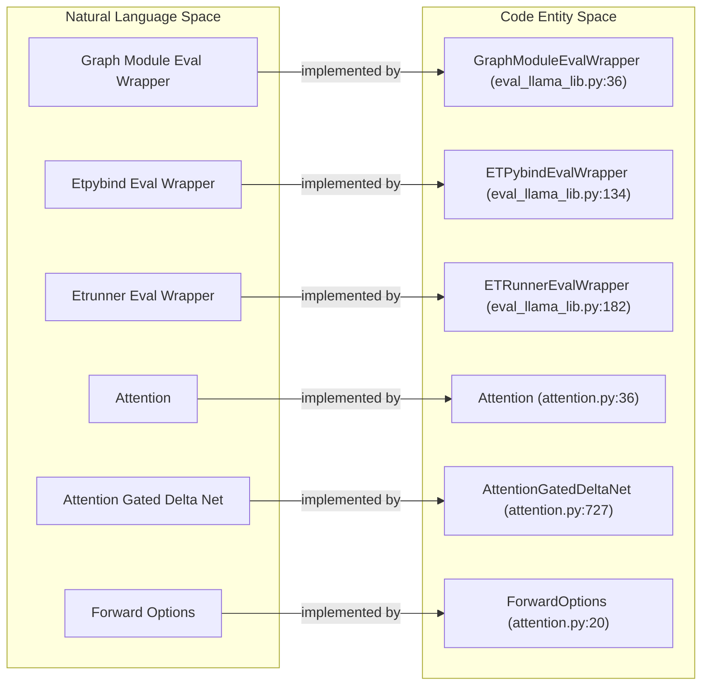
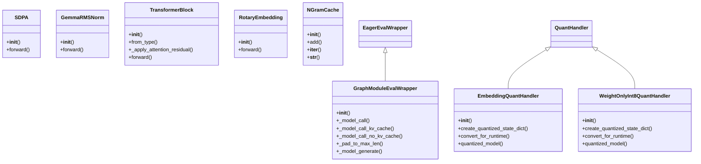
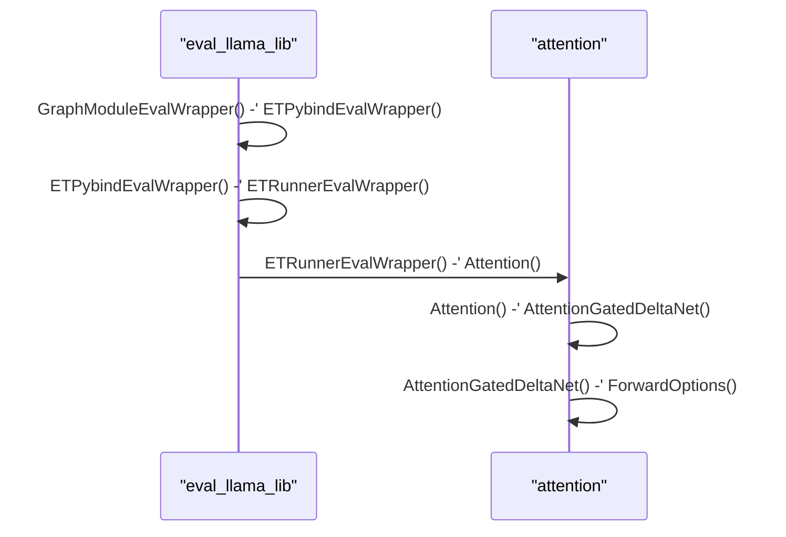

# 3-Source Context Packet (`git` + `CBM` + `llm-wiki`) for `6.1-llama-model-export` — LLaMA and Generative Model Export

- **Target Wiki File**: `wiki/6.1-llama-model-export.md`
- **Archetype**: `Leaf Technical Spec Page`
- **Parent Page**: `6-model-export-and-llm-support`
- **Summary**: Architectural specification and implementation reference for LLaMA and Generative Model Export (40 relevant source files). Primary code entities: `Attention`, `forward`, `AttentionGatedDeltaNet`, `__init__`, `ETPybindEvalWrapper`.
- **Valid `[[wikilink]]` Neighbours**: `[[6-model-export-and-llm-support|Model Export and LLM Support]]`, `[[1.1-getting-started|Getting Started]]`, `[[1.2-export-api-and-recipe-system|Export API and Recipe System]]`, `[[2.2-kernel-libraries-and-selective-build|Kernel Libraries and Selective Build]]`, `[[2.3-schema-generation-and-flatbuffers|Schema Generation and FlatBuffers]]`, `[[3.4-program-emission-and-serialization|Program Emission and Serialization]]`, `[[3.5-verification-and-dialect-system|Verification and Dialect System]]`, `[[4-quantization-systems|Quantization Systems]]`

## 1. Relevant Source Files (`git` + `CBM`, use verbatim in `<details>`)
- `[examples/models/llama/attention.py](examples/models/llama/attention.py)`
- `[examples/models/llama/eval_llama_lib.py](examples/models/llama/eval_llama_lib.py)`
- `[examples/models/llama/export_llama_lib.py](examples/models/llama/export_llama_lib.py)`
- `[examples/models/gemma4_31b/gemma4_31b_engine.cpp](examples/models/gemma4_31b/gemma4_31b_engine.cpp)`
- `[examples/models/llama/experimental/subclass.py](examples/models/llama/experimental/subclass.py)`
- `[examples/models/llama/llama_transformer.py](examples/models/llama/llama_transformer.py)`
- `[examples/models/qwen3_5_moe/qwen35_moe_engine.cpp](examples/models/qwen3_5_moe/qwen35_moe_engine.cpp)`
- `[examples/models/llama/evaluate/eager_eval.py](examples/models/llama/evaluate/eager_eval.py)`
- `[examples/models/llama/static_attention.py](examples/models/llama/static_attention.py)`
- `[examples/models/llama/__init__.py](examples/models/llama/__init__.py)`
- `[examples/models/llama/norm.py](examples/models/llama/norm.py)`
- `[examples/models/llama/rope.py](examples/models/llama/rope.py)`
- `[examples/models/llama/feed_forward.py](examples/models/llama/feed_forward.py)`
- `[examples/models/gemma4/export_gemma4.py](examples/models/gemma4/export_gemma4.py)`
- `[examples/models/llama/model.py](examples/models/llama/model.py)`
- `[examples/models/llama/lora.py](examples/models/llama/lora.py)`
- `[examples/models/llama/convert_weights.py](examples/models/llama/convert_weights.py)`
- `[examples/models/gemma4_31b/model.py](examples/models/gemma4_31b/model.py)`
- `[examples/models/qwen3_5_moe/model.py](examples/models/qwen3_5_moe/model.py)`
- `[examples/models/llama/eval_llama.py](examples/models/llama/eval_llama.py)`
- `[examples/models/llama/model_args.py](examples/models/llama/model_args.py)`
- `[examples/models/gemma4/text_decoder/gemma4_config.py](examples/models/gemma4/text_decoder/gemma4_config.py)`
- `[examples/models/llama/experimental/generate.py](examples/models/llama/experimental/generate.py)`
- `[examples/models/qwen3_5_moe/export.py](examples/models/qwen3_5_moe/export.py)`
- `[examples/models/gemma4/text_decoder/gemma4_attention.py](examples/models/gemma4/text_decoder/gemma4_attention.py)`
- `[examples/models/gemma4/runner/gemma4_runner.cpp](examples/models/gemma4/runner/gemma4_runner.cpp)`
- `[examples/models/llama/runner/static_attention_io_manager.h](examples/models/llama/runner/static_attention_io_manager.h)`
- `[examples/models/llama/source_transformation/quantize.py](examples/models/llama/source_transformation/quantize.py)`
- `[examples/models/llama/README.md](examples/models/llama/README.md)`
- `[examples/models/llama/UTILS.md](examples/models/llama/UTILS.md)`

## 2. Grounded Code Symbols (`CBM`, use verbatim for `[file:start-end]()` pill citations)
- `GraphModuleEvalWrapper` (Class) @ `[examples/models/llama/eval_llama_lib.py:36-131]()` [fan-in=3, fan-out=0] — A wrapper class for ExecuTorch py-binded integration with the lm-evaluation-harness library.
- `ETPybindEvalWrapper` (Class) @ `[examples/models/llama/eval_llama_lib.py:134-179]()` [fan-in=1, fan-out=0] — A wrapper class for ExecuTorch py-binded integration with the lm-evaluation-harness library.
- `ETRunnerEvalWrapper` (Class) @ `[examples/models/llama/eval_llama_lib.py:182-206]()` [fan-in=1, fan-out=0] — A wrapper class for ExecuTorch Runtime integration with the lm-evaluation-harness library.
- `Attention` (Class) @ `[examples/models/llama/attention.py:36-57]()` [fan-in=0, fan-out=0] — Abstract base class for attention mechanisms with unified interface.
- `AttentionGatedDeltaNet` (Class) @ `[examples/models/llama/attention.py:727-970]()` [fan-in=0, fan-out=0] — Qwen3.5 linear-attention (Gated DeltaNet) block with internal state.
- `ForwardOptions` (Class) @ `[examples/models/llama/attention.py:20-33]()` [fan-in=0, fan-out=0] — Optional parameters for `Attention.forward` (compative with Python 3.10 and plus).
- `SDPA` (Class) @ `[examples/models/llama/attention.py:147-178]()` [fan-in=5, fan-out=0] — 
- `EagerEvalWrapper` (Class) @ `[examples/models/llama/evaluate/eager_eval.py:21-93]()` [fan-in=1, fan-out=0] — A wrapper class based on GPTFast, providing integration with the lm-evaluation-harness library.
- `RotaryEmbedding` (Class) @ `[examples/models/llama/rope.py:119-131]()` [fan-in=2, fan-out=0] — # Wrap apply_rotary_emb in a module to enable it to be module swapped out.
- `GGMLInt4LinearWeight` (Class) @ `[examples/models/llama/experimental/subclass.py:303-413]()` [fan-in=0, fan-out=0] — A Tensor subclass that when applied to a weight used in a linear op/module, changes that linear op to a weight-only int4 quantized linear op with groupwise affi
- `QuantizedLinearWeightBase` (Class) @ `[examples/models/llama/experimental/subclass.py:137-300]()` [fan-in=0, fan-out=0] — *** LEGACY TORCHAO TENSOR SUBCLASS *** Note: this subclass no longer exists in torchao. No one should be importing or extending this subclass anymore. It is add
- `GemmaRMSNorm` (Class) @ `[examples/models/qwen3_5_moe/model.py:111-122]()` [fan-in=3, fan-out=0] — RMSNorm with unit offset: x * (1 + weight).
- `_HFAudioEncoderWithProjection` (Class) @ `[examples/models/gemma4/export_gemma4.py:97-127]()` [fan-in=1, fan-out=0] — Thin wrapper combining HF's Gemma4AudioModel + Gemma4MultimodalEmbedder. Loads audio_tower and embed_audio from HF's Gemma4ForConditionalGeneration, combines th
- `_HFVisionEncoderWithProjection` (Class) @ `[examples/models/gemma4/export_gemma4.py:283-342]()` [fan-in=1, fan-out=0] — Thin wrapper combining HF's Gemma4VisionModel + Gemma4MultimodalEmbedder. Calls sub-components directly instead of vision_tower.forward() because the top-level 
- `StaticAttention` (Class) @ `[examples/models/llama/static_attention.py:832-1623]()` [fan-in=0, fan-out=0] — An attention implementation meant for NPUs that require static shapes and are not flexible with tensor operations needed to perform KV cache updates. MHA/GQA is
- `Gemma4Attention` (Class) @ `[examples/models/gemma4_31b/model.py:206-355]()` [fan-in=1, fan-out=0] — Gemma 4 attention with QK-norm, per-layer head_dim, RoPE, KV cache, and SDPA. The same class handles both sliding and full attention; the per-layer config picks
- `RingKVCache` (Class) @ `[examples/models/gemma4_31b/model.py:65-102]()` [fan-in=1, fan-out=0] — Ring-buffer KV cache for sliding window attention. Sized to ``window_size * 2`` (not ``max_seq_len``), saving memory for long sequences. Positions wrap via modu
- `LoRALinear` (Class) @ `[examples/models/llama/lora.py:14-71]()` [fan-in=0, fan-out=0] — LoRA linear layer as introduced in `LoRA: Low-Rank Adaptation of Large Language Models <https://arxiv.org/abs/2106.09685>`.
- `FusedMoEExperts` (Class) @ `[examples/models/qwen3_5_moe/model.py:461-533]()` [fan-in=1, fan-out=0] — Expert weights stored as stacked tensors for the fused MoE Triton kernel. Before quantization: w1_weight [E, 2*inter, hidden] and w2_weight [E, hidden, inter] a
- `RMSNormGated` (Class) @ `[examples/models/qwen3_5_moe/model.py:125-137]()` [fan-in=1, fan-out=0] — RMSNorm(x) * silu(z) — used in GatedDeltaNet output.
- `RotaryEmbedding` (Class) @ `[examples/models/qwen3_5_moe/model.py:144-180]()` [fan-in=1, fan-out=0] — Partial RoPE — only rotates first `rotary_dim` dimensions of each head.
- `SwiGLU` (Class) @ `[examples/models/qwen3_5_moe/model.py:577-590]()` [fan-in=1, fan-out=0] — SwiGLU MLP with fused gate+up projection.

## 3. Grounded Source Code Excerpts (`git` Working Tree)
### `GraphModuleEvalWrapper` in `[examples/models/llama/eval_llama_lib.py:36-51]()`
```python
class GraphModuleEvalWrapper(EagerEvalWrapper):
    """
    A wrapper class for ExecuTorch py-binded integration with the
    lm-evaluation-harness library.
    """

    def __init__(
        self,
        model: torch.fx.GraphModule,
        tokenizer: Union[SentencePieceTokenizer, Tiktoken],
        max_seq_length: Optional[int] = None,
        use_kv_cache: bool = False,
        generate_full_logits: bool = False,
        enable_dynamic_shape: bool = True,
        device: Optional[str] = None,
    ):
```

### `ETPybindEvalWrapper` in `[examples/models/llama/eval_llama_lib.py:134-149]()`
```python
class ETPybindEvalWrapper(EagerEvalWrapper):
    """
    A wrapper class for ExecuTorch py-binded integration with the
    lm-evaluation-harness library.
    """

    def __init__(
        self,
        model: str,
        tokenizer: Union[SentencePieceTokenizer, Tiktoken],
        max_seq_length: Optional[int] = None,
    ):
        super().__init__(None, tokenizer, max_seq_length)  # pyre-ignore
        self._model = model  # Expects model to be path to a .pte file

        from executorch.extension.pybindings.portable_lib import _load_for_executorch
```

### `ETRunnerEvalWrapper` in `[examples/models/llama/eval_llama_lib.py:182-197]()`
```python
class ETRunnerEvalWrapper(EagerEvalWrapper):
    """
    A wrapper class for ExecuTorch Runtime integration with the
    lm-evaluation-harness library.
    """

    def __init__(
        self,
        model: str,
        tokenizer: Union[SentencePieceTokenizer, Tiktoken],
        tokenizer_bin: str,
        max_seq_length: Optional[int] = None,
    ):
        super().__init__(None, tokenizer, max_seq_length)  # pyre-ignore
        self._model = model
        self._tokenizer_bin = tokenizer_bin
```

### `Attention` in `[examples/models/llama/attention.py:36-51]()`
```python
class Attention(nn.Module, ABC):
    """Abstract base class for attention mechanisms with unified interface."""

    @abstractmethod
    def forward(
        self,
        x: torch.Tensor,
        freqs_cos: torch.Tensor,
        freqs_sin: torch.Tensor,
        **kwargs: ForwardOptions,
    ) -> Tuple[torch.Tensor, Optional[Any]]:
        """Forward pass for attention mechanism.

        Args:
            x: Input tensor of shape (batch_size, seq_len, dim)
            freqs_cos, freqs_sin: Rotary position embedding frequencies
```

### `AttentionGatedDeltaNet` in `[examples/models/llama/attention.py:727-742]()`
```python
class AttentionGatedDeltaNet(Attention):
    """Qwen3.5 linear-attention (Gated DeltaNet) block with internal state."""

    def __init__(
        self,
        args: ModelArgs,
        layer_id: int,
        rope: Rope,
        **_kwargs: Any,
    ):
        super().__init__()
        del rope  # DeltaNet layers do not use RoPE.

        self.hidden_size = args.dim
        self.max_batch_size = args.max_batch_size
        self.layer_id = layer_id
```


## 4. Linked Official Docs (`llm-wiki` / `RAG`)
- **Model Export and LLM Support** (`wiki/6-model-export-and-llm-support.md`, score=155.589, shared_symbols=['Attention', 'GraphModuleEvalWrapper', 'SDPA']): # Model Export and LLM Support > Architectural specification and implementation reference for Model Export and LLM Support (40 relevant source files). Primary code entities: `MuseGlimmerImageSpan`, `MuseGlimmerPreparationSpec`, `MuseGlimmerPreparedInput`, `Backing`, `RequestHandle`. <details> <summary>Relevant source files</summary> The following files we
- **ExecuTorch DeepWiki** (`wiki/index.md`, score=119.729, shared_symbols=[]): # ExecuTorch DeepWiki Generated from `home-jason-Project-deepwiki-executorch` at commit `b3b565b5b62f` (2026-11-15T15:02:11+00:00). ## Pages - [[1-overview|Overview]] — Architectural specification and implementation reference for Overview (10 relevant source files). Primary code entities: `Module`, `MethodHolder`, `PlannedMemory`, `EdgeProgramManager`, `_
- **Multimodal and Audio Models** (`wiki/6.4-multimodal-and-audio-models.md`, score=114.244, shared_symbols=[]): # Multimodal and Audio Models ↑ [[6-model-export-and-llm-support|Model Export and LLM Support]] > Architectural specification and implementation reference for Multimodal and Audio Models (36 relevant source files). Primary code entities: `LlavaEdgeManager`, `export`, `create_llava_config_from_args`, `export_all`, `Llava`. <details> <summary>Relevant sourc
- **Core Runtime Architecture** (`wiki/8.1-core-runtime-architecture.md`, score=114.244, shared_symbols=[]): # Core Runtime Architecture ↑ [[8-runtime-execution|Runtime Execution]] > Architectural specification and implementation reference for Core Runtime Architecture (38 relevant source files). Primary code entities: `ET_CHECK_MSG`, `execute`, `execute_instruction`, `experimental_reset_execution`, `ArrayRef`. <details> <summary>Relevant source files</summary> 
- **Runtime Execution** (`wiki/8-runtime-execution.md`, score=114.244, shared_symbols=[]): # Runtime Execution > Architectural specification and implementation reference for Runtime Execution (39 relevant source files). Primary code entities: `ET_CHECK_MSG`, `execute`, `execute_instruction`, `experimental_reset_execution`, `ArrayRef`. <details> <summary>Relevant source files</summary> The following files were used as context for generating this
- **Model and Backend Testing Framework** (`wiki/7.2-model-and-backend-testing-framework.md`, score=102.008, shared_symbols=['Attention']): # Model and Backend Testing Framework ↑ [[7-testing-and-cicd-infrastructure|Testing and CI/CD Infrastructure]] > Architectural specification and implementation reference for Model and Backend Testing Framework (40 relevant source files). Primary code entities: `MuseGlimmerImageSpan`, `MuseGlimmerPreparationSpec`, `MuseGlimmerPreparedInput`, `Backing`, `Bac

## 5. Pre-Verified DeepWiki v1.9.9.5 Mermaid Diagrams
### Natural Language Space <-> Code Entity Space


### Subsystem Architecture Flowchart

```mermaid
flowchart TD
  subgraph sub_this["LLaMA and Generative Model Export"]
    subgraph sg_0["examples/models"]
      n_examples_models_llama["llama/"]
      n_examples_models_gemma4_31b["gemma4_31b/"]
      n_examples_models_qwen3_5_moe["qwen3_5_moe/"]
      n_examples_models_gemma4["gemma4/"]
    end
    subgraph sg_1["examples/models/llama"]
      n_examples_models_llama_experimental["experimental/"]
      n_examples_models_llama_evaluate["evaluate/"]
      n_examples_models_llama_runner["runner/"]
      n_examples_models_llama_source_transformation["source_transformation/"]
      n_examples_models_llama_config["config/"]
      n_examples_models_llama_params["params/"]
    end
    subgraph sg_2["examples/models/gemma4"]
      n_examples_models_gemma4_text_decoder["text_decoder/"]
      n_examples_models_gemma4_runner["runner/"]
    end
  end
  n_page_5_4_arm_tosa_and_ethos_u_backend(["ARM TOSA and Ethos-U Backend"])
  n_page_5_backend_delegation_architecture(["Backend Delegation Architecture"])
  n_page_6_model_export_and_llm_support(["Model Export and LLM Support"])
  n_page_8_runtime_execution(["Runtime Execution"])
  n_examples_models_llama_runner -.-> n_page_6_model_export_and_llm_support
  n_examples_models_llama_runner -.-> n_page_8_runtime_execution
  n_examples_models_llama --> n_examples_models_llama_evaluate
  n_examples_models_gemma4_31b --> n_examples_models_llama_runner
  n_examples_models_gemma4_31b -.-> n_page_8_runtime_execution
  n_examples_models_llama_runner --> n_examples_models_qwen3_5_moe
  n_examples_models_llama_runner -.-> n_page_5_4_arm_tosa_and_ethos_u_backend
  n_examples_models_qwen3_5_moe -.-> n_page_8_runtime_execution
  n_examples_models_gemma4_runner -.-> n_page_8_runtime_execution
  n_examples_models_llama --> n_examples_models_llama_source_transformation
  n_examples_models_llama -.-> n_page_5_backend_delegation_architecture
  n_examples_models_gemma4_runner --> n_examples_models_llama_runner
  n_examples_models_gemma4_runner -.-> n_page_6_model_export_and_llm_support
  n_examples_models_qwen3_5_moe -.-> n_page_6_model_export_and_llm_support
  n_examples_models_qwen3_5_moe -.-> n_page_5_backend_delegation_architecture
  n_examples_models_gemma4_31b -.-> n_page_5_backend_delegation_architecture
  n_examples_models_gemma4_text_decoder -.-> n_page_5_backend_delegation_architecture
  n_examples_models_llama_source_transformation -.-> n_page_5_backend_delegation_architecture
```


### Class Hierarchy Diagram


### Call Sequence Diagram


## 6. DeepWiki v1.9.9.5 Authoring Checklist for `wiki/6.1-llama-model-export.md`
1. Keep YAML frontmatter at top (`id`, `title`, `parent`, `sources`, `linked_docs`, `bridge_symbols`).
2. Keep `<details><summary>Relevant source files</summary>` block immediately after `# Title`.
3. Start with `## Purpose and Scope`, then numbered `## 1. ...`, `## 2. ...` sections separated by `---`.
4. Include at least 2 ```mermaid``` diagrams (including a `Natural Language Space` <-> `Code Entity Space` mapping).
5. Cite code entities inline using `[path/to/file.ext:start-end]()` and end every `##` section with `Sources: [file:start-end]()`.
6. Run `deepwiki_cli.py build --enrich-only ...` and `deepwiki_cli.py validate ...` after editing.
