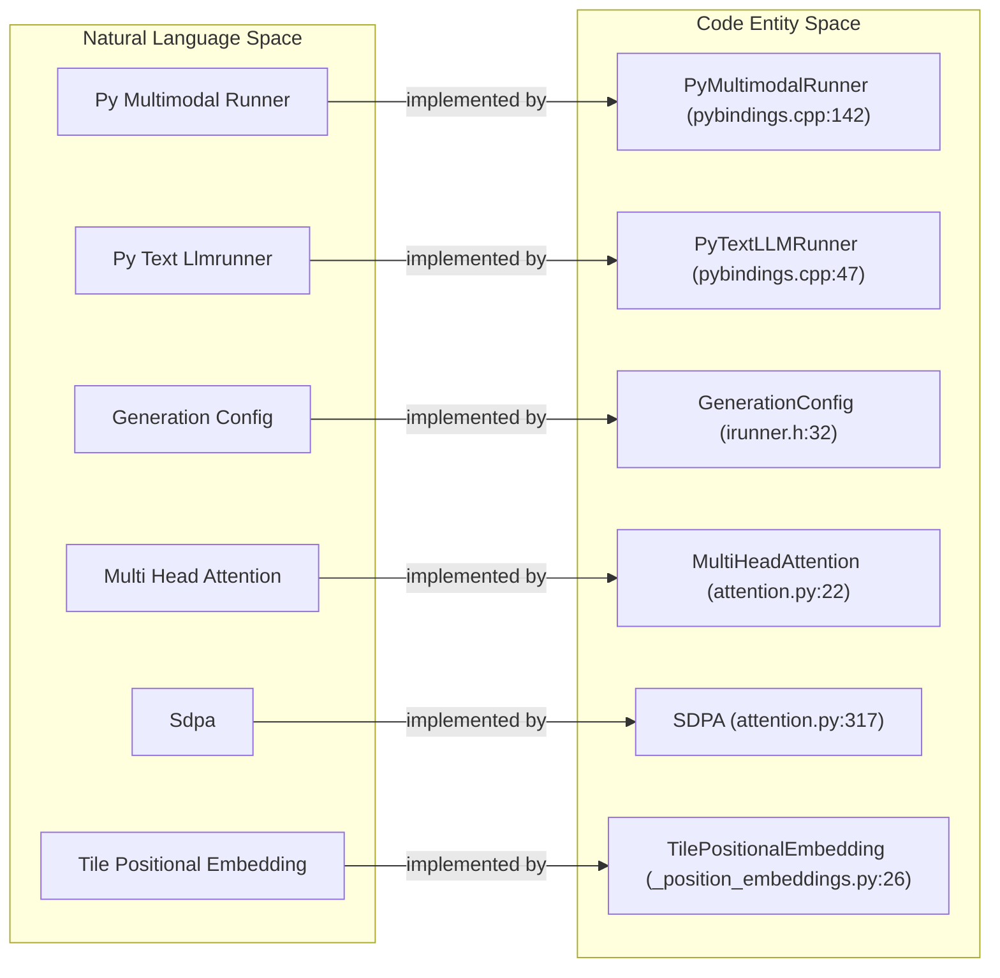
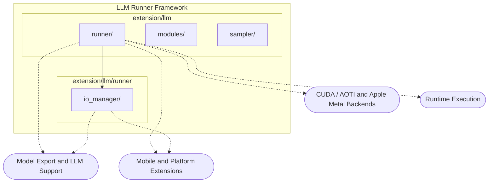
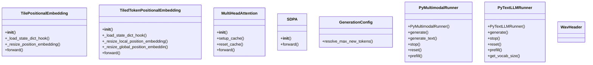
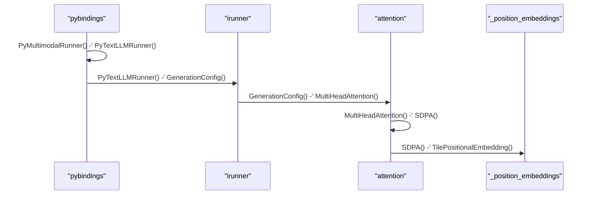

# 3-Source Context Packet (`git` + `CBM` + `llm-wiki`) for `6.2-llm-runner-framework` — LLM Runner Framework

- **Target Wiki File**: `wiki/6.2-llm-runner-framework.md`
- **Archetype**: `Leaf Technical Spec Page`
- **Parent Page**: `6-model-export-and-llm-support`
- **Summary**: Architectural specification and implementation reference for LLM Runner Framework (36 relevant source files). Primary code entities: `check_vocab_size`, `read_int_method`, `read_int_tensor_method`, `read_required_positive_int`, `MultimodalPrefiller`.
- **Valid `[[wikilink]]` Neighbours**: `[[6-model-export-and-llm-support|Model Export and LLM Support]]`, `[[1.1-getting-started|Getting Started]]`, `[[1.2-export-api-and-recipe-system|Export API and Recipe System]]`, `[[2.2-kernel-libraries-and-selective-build|Kernel Libraries and Selective Build]]`, `[[2.3-schema-generation-and-flatbuffers|Schema Generation and FlatBuffers]]`, `[[3.4-program-emission-and-serialization|Program Emission and Serialization]]`, `[[3.5-verification-and-dialect-system|Verification and Dialect System]]`, `[[4-quantization-systems|Quantization Systems]]`

## 1. Relevant Source Files (`git` + `CBM`, use verbatim in `<details>`)
- `[extension/llm/runner/model_metadata.h](extension/llm/runner/model_metadata.h)`
- `[extension/llm/runner/multimodal_prefiller.cpp](extension/llm/runner/multimodal_prefiller.cpp)`
- `[extension/llm/runner/pybindings.cpp](extension/llm/runner/pybindings.cpp)`
- `[extension/llm/runner/llm_runner_helper.cpp](extension/llm/runner/llm_runner_helper.cpp)`
- `[extension/llm/runner/irunner.h](extension/llm/runner/irunner.h)`
- `[extension/llm/runner/util.h](extension/llm/runner/util.h)`
- `[extension/llm/runner/multimodal_input.h](extension/llm/runner/multimodal_input.h)`
- `[extension/llm/runner/wav_loader.h](extension/llm/runner/wav_loader.h)`
- `[extension/llm/runner/__init__.py](extension/llm/runner/__init__.py)`
- `[extension/llm/runner/audio.h](extension/llm/runner/audio.h)`
- `[extension/llm/runner/image.h](extension/llm/runner/image.h)`
- `[extension/llm/runner/multimodal_runner.cpp](extension/llm/runner/multimodal_runner.cpp)`
- `[extension/llm/runner/constants.h](extension/llm/runner/constants.h)`
- `[extension/llm/runner/image_prefiller.h](extension/llm/runner/image_prefiller.h)`
- `[extension/llm/runner/stats.h](extension/llm/runner/stats.h)`
- `[extension/llm/runner/text_llm_runner.cpp](extension/llm/runner/text_llm_runner.cpp)`
- `[extension/llm/runner/llm_session.h](extension/llm/runner/llm_session.h)`
- `[extension/llm/modules/attention.py](extension/llm/modules/attention.py)`
- `[extension/llm/modules/_position_embeddings.py](extension/llm/modules/_position_embeddings.py)`
- `[extension/llm/runner/llm_runner_helper.h](extension/llm/runner/llm_runner_helper.h)`
- `[extension/llm/runner/multimodal_decoder_runner.h](extension/llm/runner/multimodal_decoder_runner.h)`
- `[extension/llm/runner/io_manager/io_manager.h](extension/llm/runner/io_manager/io_manager.h)`
- `[extension/llm/runner/io_manager/targets.bzl](extension/llm/runner/io_manager/targets.bzl)`
- `[extension/llm/runner/multimodal_prefiller.h](extension/llm/runner/multimodal_prefiller.h)`
- `[extension/llm/runner/text_token_generator.h](extension/llm/runner/text_token_generator.h)`
- `[extension/llm/runner/multimodal_runner.h](extension/llm/runner/multimodal_runner.h)`
- `[extension/llm/runner/text_decoder_runner.cpp](extension/llm/runner/text_decoder_runner.cpp)`
- `[extension/llm/runner/targets.bzl](extension/llm/runner/targets.bzl)`
- `[extension/llm/runner/README.md](extension/llm/runner/README.md)`
- `[extension/llm/modules/README.md](extension/llm/modules/README.md)`

## 2. Grounded Code Symbols (`CBM`, use verbatim for `[file:start-end]()` pill citations)
- `PyMultimodalRunner` (Class) @ `[extension/llm/runner/pybindings.cpp:142-252]()` [fan-in=0, fan-out=0] — // Python wrapper class for MultimodalRunner
- `PyTextLLMRunner` (Class) @ `[extension/llm/runner/pybindings.cpp:47-139]()` [fan-in=0, fan-out=0] — // Python wrapper class for TextLLMRunner
- `GenerationConfig` (Class) @ `[extension/llm/runner/irunner.h:32-113]()` [fan-in=0, fan-out=0] — // Configuration struct for generation parameters, fields should be sorted in // alphabetic order
- `MultiHeadAttention` (Class) @ `[extension/llm/modules/attention.py:22-314]()` [fan-in=1, fan-out=0] — NOTE: copied from Torchtune's mha.py. Should be mostly 1:1 except that SDPA is factored out so that it can be swapped for more efficient ExecuTorch-defined SDPA
- `SDPA` (Class) @ `[extension/llm/modules/attention.py:317-376]()` [fan-in=1, fan-out=0] — TorchTune's SDPA which can be optimized and can be swapped out for a more efficient implementations.
- `TilePositionalEmbedding` (Class) @ `[extension/llm/modules/_position_embeddings.py:26-211]()` [fan-in=1, fan-out=0] — Positional embedding for tiles, different for every tile, same for every token within a tile. Notice that tile is different from patch (token). For details, ple
- `TiledTokenPositionalEmbedding` (Class) @ `[extension/llm/modules/_position_embeddings.py:214-653]()` [fan-in=1, fan-out=0] — Token positional embedding for tiled images, different for every tile, different for every token. There are two positional embeddings in this module: * local_to
- `WavHeader` (Class) @ `[extension/llm/runner/wav_loader.h:31-48]()` [fan-in=0, fan-out=0] — 
- `load` (Method) @ `[extension/llm/runner/multimodal_prefiller.cpp:255-278]()` [fan-in=43, fan-out=5] — /** * Load the Module for encoder prefill purpose. * @return The error code. */
- `time_in_ms` (Function) @ `[extension/llm/runner/util.h:225-236]()` [fan-in=31, fan-out=0] — ()
- `load_wav_audio_data` (Function) @ `[extension/llm/runner/wav_loader.h:220-310]()` [fan-in=9, fan-out=8] — /// Load and decode audio samples from a WAV file, returning normalized floats. /// Reads the file only once.
- `MultimodalInput` (Function) @ `[extension/llm/runner/multimodal_input.h:29-368]()` [fan-in=11, fan-out=0] — /** * A generic class to hold either image, text, or audio data for multimodal * inputs. This allows the generate() API to take a std::vector of these objects *
- `read_int_method` (Function) @ `[extension/llm/runner/model_metadata.h:48-65]()` [fan-in=7, fan-out=4] — // Read a named int constant method: nullopt if absent, the value if present, // Error::InvalidProgram if it does not evaluate to a single int.
- `read_required_positive_int` (Function) @ `[extension/llm/runner/model_metadata.h:94-107]()` [fan-in=8, fan-out=2] — // A required int constant that must be present and positive.
- `read_int_tensor_method` (Function) @ `[extension/llm/runner/model_metadata.h:68-91]()` [fan-in=5, fan-out=6] — // Read a required int32 tensor constant.
- `print_report` (Function) @ `[extension/llm/runner/stats.h:172-260]()` [fan-in=15, fan-out=1] — (const Stats& stats)
- `get_eos_ids` (Function) @ `[extension/llm/runner/llm_runner_helper.cpp:157-183]()` [fan-in=9, fan-out=4] — ( tokenizers::Tokenizer* tokenizer, Module* module)
- `is_method_loaded` (Method) @ `[extension/llm/runner/multimodal_prefiller.cpp:284-301]()` [fan-in=3, fan-out=5] — /** * Check if the required methods in the Module is loaded. * @return True if the Module is loaded, false otherwise. */
- `prefill` (Method) @ `[extension/llm/runner/multimodal_prefiller.cpp:37-249]()` [fan-in=0, fan-out=11] — /** * Prefill an LLM Module with the given multimodal input. * @param input The multimodal input (text, image or audio) to the multimodal * LLM. * @param start_
- `get_rss_bytes` (Function) @ `[extension/llm/runner/util.h:245-258]()` [fan-in=6, fan-out=0] — // Returns the current RSS in bytes. Returns 0 if not supported. // RSS: Resident Set Size, the amount of memory currently in the RAM for this // process. These
- `load_wav_header` (Function) @ `[extension/llm/runner/wav_loader.h:210-216]()` [fan-in=2, fan-out=8] — /// Parse a WAV header from a file path.
- `convert_to_bfloat16` (Function) @ `[extension/llm/runner/util.h:309-328]()` [fan-in=3, fan-out=3] — /** * Helper function to convert a float tensor to bfloat16. * Creates a new tensor with bfloat16 dtype and copies/converts the data. */

## 3. Grounded Source Code Excerpts (`git` Working Tree)
### `PyMultimodalRunner` in `[extension/llm/runner/pybindings.cpp:142-157]()`
```cpp
class PyMultimodalRunner {
 public:
  // Constructor that takes a tokenizer path
  PyMultimodalRunner(
      const std::string& model_path,
      const std::string& tokenizer_path,
      std::optional<const std::string> data_path = std::nullopt) {
    // Load tokenizer using the helper function
    auto tokenizer =
        load_tokenizer(tokenizer_path, nullptr, std::nullopt, 0, 0);
    if (!tokenizer) {
      throw std::runtime_error(
          "Failed to load tokenizer from: " + tokenizer_path);
    }

    // Create multimodal runner using the helper function
```

### `PyTextLLMRunner` in `[extension/llm/runner/pybindings.cpp:47-62]()`
```cpp
class PyTextLLMRunner {
 public:
  // Constructor that takes a tokenizer path
  PyTextLLMRunner(
      const std::string& model_path,
      const std::string& tokenizer_path,
      std::optional<const std::string> data_path = std::nullopt) {
    // Load tokenizer using the helper function
    auto tokenizer =
        load_tokenizer(tokenizer_path, nullptr, std::nullopt, 0, 0);
    if (!tokenizer) {
      throw std::runtime_error(
          "Failed to load tokenizer from: " + tokenizer_path);
    }

    // Create text llm runner using the helper function
```

### `GenerationConfig` in `[extension/llm/runner/irunner.h:32-47]()`
```cpp
struct GenerationConfig {
  // Whether to echo the input prompt in the output
  bool echo = true;

  // Reserved grammar definition for constrained decoding.
  // Currently ignored by in-tree runners.
  std::string grammar;

  // Reserved grammar format (e.g. "json_schema", "regex", "lark", or "gbnf").
  // Currently ignored by in-tree runners.
  std::string grammar_type;

  // Whether to ignore EOS token and continue generating until max_new_tokens
  bool ignore_eos = false;

  // Maximum number of new tokens to generate
```

### `MultiHeadAttention` in `[extension/llm/modules/attention.py:22-37]()`
```python
class MultiHeadAttention(nn.Module):
    """
    NOTE: copied from Torchtune's mha.py. Should be mostly 1:1 except
    that SDPA is factored out so that it can be swapped for more
    efficient ExecuTorch-defined SDPA ops.

    Multi-headed attention layer with support for grouped query
    attention (GQA) introduced in https://arxiv.org/abs/2305.13245v1.

    GQA is a version of multiheaded attention (MHA) which uses fewer
    key/value heads than query heads by grouping n query heads for each
    key and value head. Multi-Query Attention is an extreme
    version where we have a single key and value head shared by all
    query heads.

    Following is an example of MHA, GQA and MQA with num_heads = 4
```

### `SDPA` in `[extension/llm/modules/attention.py:317-332]()`
```python
class SDPA(nn.Module):
    """
    TorchTune's SDPA which can be optimized and can be swapped
    out for a more efficient implementations.
    """

    def __init__(
        self,
        num_kv_heads: int,
        num_heads: int,
        head_dim: int,
        attn_dropout: float,
        is_causal: bool,
        attention_fn,
        kv_cache,
    ) -> None:
```


## 4. Linked Official Docs (`llm-wiki` / `RAG`)
- **Model Export and LLM Support** (`wiki/6-model-export-and-llm-support.md`, score=137.854, shared_symbols=['SDPA', 'check_vocab_size', 'read_int_method', 'read_int_tensor_method', 'read_required_positive_int', 'time_in_ms']): # Model Export and LLM Support > Architectural specification and implementation reference for Model Export and LLM Support (40 relevant source files). Primary code entities: `MuseGlimmerImageSpan`, `MuseGlimmerPreparationSpec`, `MuseGlimmerPreparedInput`, `Backing`, `RequestHandle`. <details> <summary>Relevant source files</summary> The following files we
- **LLaMA and Generative Model Export** (`wiki/6.1-llama-model-export.md`, score=118.902, shared_symbols=['SDPA', 'check_vocab_size', 'read_int_method', 'read_int_tensor_method', 'read_required_positive_int']): # LLaMA and Generative Model Export ↑ [[6-model-export-and-llm-support|Model Export and LLM Support]] > Architectural specification and implementation reference for LLaMA and Generative Model Export (40 relevant source files). Primary code entities: `Attention`, `forward`, `AttentionGatedDeltaNet`, `__init__`, `ETPybindEvalWrapper`. <details> <summary>Rel
- **Custom Operators and Extensions** (`wiki/6.3-custom-operators-and-extensions.md`, score=115.742, shared_symbols=[]): # Custom Operators and Extensions ↑ [[6-model-export-and-llm-support|Model Export and LLM Support]] > Architectural specification and implementation reference for Custom Operators and Extensions (39 relevant source files). Primary code entities: `gated_delta_rule_out_boxed`, `ChunkScratch`, `elems`, `view`, `MaybeQuantizedMatrixData`. <details> <summary>R
- **Multimodal and Audio Models** (`wiki/6.4-multimodal-and-audio-models.md`, score=115.742, shared_symbols=[]): # Multimodal and Audio Models ↑ [[6-model-export-and-llm-support|Model Export and LLM Support]] > Architectural specification and implementation reference for Multimodal and Audio Models (36 relevant source files). Primary code entities: `LlavaEdgeManager`, `export`, `create_llava_config_from_args`, `export_all`, `Llava`. <details> <summary>Relevant sourc
- **Mobile and Platform Extensions** (`wiki/9-mobile-and-platform-extensions.md`, score=115.742, shared_symbols=[]): # Mobile and Platform Extensions > Architectural specification and implementation reference for Mobile and Platform Extensions (40 relevant source files). Primary code entities: `BindingSpec`, `ComputePipelineBundle`, `operator=`, `Storage`, `~Storage`. <details> <summary>Relevant source files</summary> The following files were used as context for generat
- **ExecuTorch DeepWiki** (`wiki/index.md`, score=108.316, shared_symbols=[]): # ExecuTorch DeepWiki Generated from `home-jason-Project-deepwiki-executorch` at commit `b3b565b5b62f` (2026-11-15T15:02:11+00:00). ## Pages - [[1-overview|Overview]] — Architectural specification and implementation reference for Overview (10 relevant source files). Primary code entities: `Module`, `MethodHolder`, `PlannedMemory`, `EdgeProgramManager`, `_

## 5. Pre-Verified DeepWiki v1.9.9.5 Mermaid Diagrams
### Natural Language Space <-> Code Entity Space


### Subsystem Architecture Flowchart


### Class Hierarchy Diagram


### Call Sequence Diagram


## 6. DeepWiki v1.9.9.5 Authoring Checklist for `wiki/6.2-llm-runner-framework.md`
1. Keep YAML frontmatter at top (`id`, `title`, `parent`, `sources`, `linked_docs`, `bridge_symbols`).
2. Keep `<details><summary>Relevant source files</summary>` block immediately after `# Title`.
3. Start with `## Purpose and Scope`, then numbered `## 1. ...`, `## 2. ...` sections separated by `---`.
4. Include at least 2 ```mermaid``` diagrams (including a `Natural Language Space` <-> `Code Entity Space` mapping).
5. Cite code entities inline using `[path/to/file.ext:start-end]()` and end every `##` section with `Sources: [file:start-end]()`.
6. Run `deepwiki_cli.py build --enrich-only ...` and `deepwiki_cli.py validate ...` after editing.
