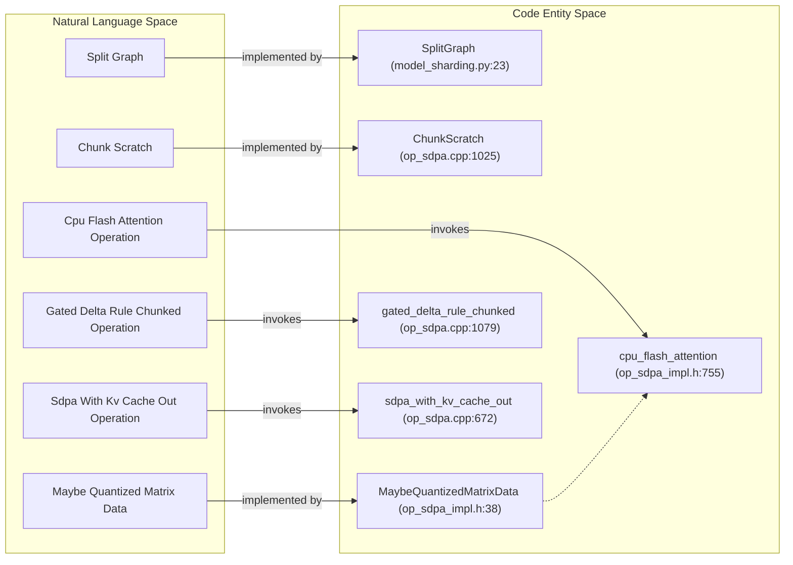
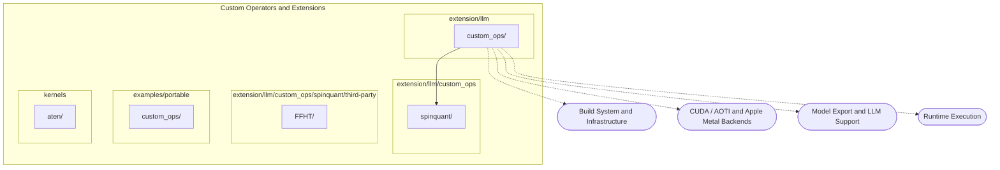
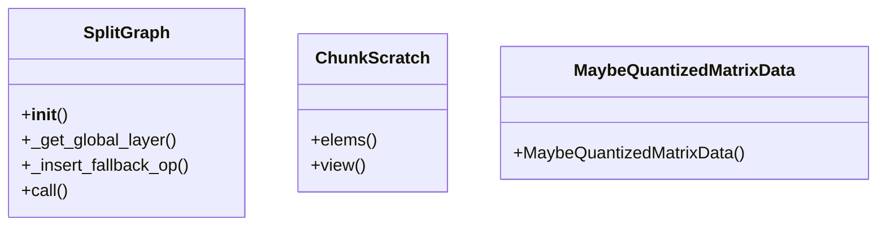
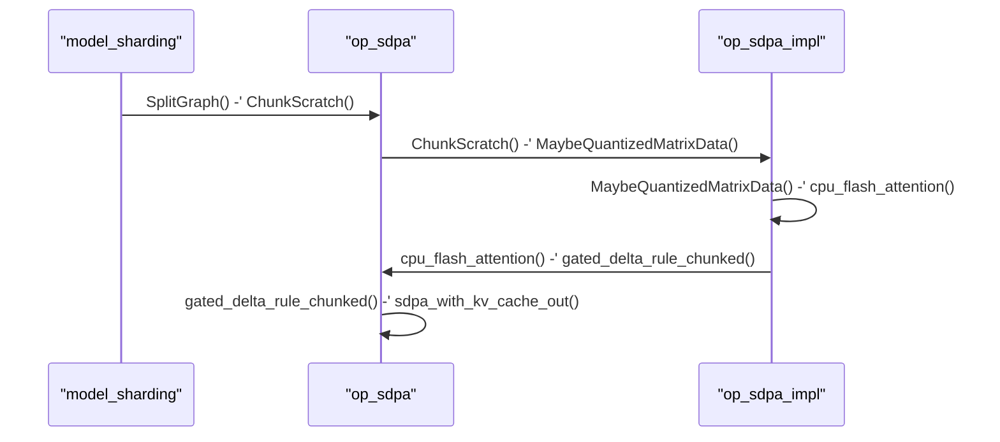

# 3-Source Context Packet (`git` + `CBM` + `llm-wiki`) for `6.3-custom-operators-and-extensions` — Custom Operators and Extensions

- **Target Wiki File**: `wiki/6.3-custom-operators-and-extensions.md`
- **Archetype**: `Leaf Technical Spec Page`
- **Parent Page**: `6-model-export-and-llm-support`
- **Summary**: Architectural specification and implementation reference for Custom Operators and Extensions (39 relevant source files). Primary code entities: `gated_delta_rule_out_boxed`, `ChunkScratch`, `elems`, `view`, `MaybeQuantizedMatrixData`.
- **Valid `[[wikilink]]` Neighbours**: `[[6-model-export-and-llm-support|Model Export and LLM Support]]`, `[[1.1-getting-started|Getting Started]]`, `[[1.2-export-api-and-recipe-system|Export API and Recipe System]]`, `[[2.2-kernel-libraries-and-selective-build|Kernel Libraries and Selective Build]]`, `[[2.3-schema-generation-and-flatbuffers|Schema Generation and FlatBuffers]]`, `[[3.4-program-emission-and-serialization|Program Emission and Serialization]]`, `[[3.5-verification-and-dialect-system|Verification and Dialect System]]`, `[[4-quantization-systems|Quantization Systems]]`

## 1. Relevant Source Files (`git` + `CBM`, use verbatim in `<details>`)
- `[extension/llm/custom_ops/op_sdpa.cpp](extension/llm/custom_ops/op_sdpa.cpp)`
- `[extension/llm/custom_ops/op_sdpa_impl.h](extension/llm/custom_ops/op_sdpa_impl.h)`
- `[extension/llm/custom_ops/model_sharding.py](extension/llm/custom_ops/model_sharding.py)`
- `[extension/llm/custom_ops/custom_ops.py](extension/llm/custom_ops/custom_ops.py)`
- `[extension/llm/custom_ops/op_moe.cpp](extension/llm/custom_ops/op_moe.cpp)`
- `[extension/llm/custom_ops/bench_gated_delta_rule.py](extension/llm/custom_ops/bench_gated_delta_rule.py)`
- `[extension/llm/custom_ops/CMakeLists.txt](extension/llm/custom_ops/CMakeLists.txt)`
- `[extension/llm/custom_ops/op_sdpa_aot.cpp](extension/llm/custom_ops/op_sdpa_aot.cpp)`
- `[extension/llm/custom_ops/__init__.py](extension/llm/custom_ops/__init__.py)`
- `[extension/llm/custom_ops/op_fast_hadamard_transform.cpp](extension/llm/custom_ops/op_fast_hadamard_transform.cpp)`
- `[extension/llm/custom_ops/op_fallback.cpp](extension/llm/custom_ops/op_fallback.cpp)`
- `[extension/llm/custom_ops/op_fallback.py](extension/llm/custom_ops/op_fallback.py)`
- `[extension/llm/custom_ops/op_fallback.h](extension/llm/custom_ops/op_fallback.h)`
- `[extension/llm/custom_ops/op_fast_hadamard_transform_aten.cpp](extension/llm/custom_ops/op_fast_hadamard_transform_aten.cpp)`
- `[extension/llm/custom_ops/op_update_cache.cpp](extension/llm/custom_ops/op_update_cache.cpp)`
- `[extension/llm/custom_ops/op_tile_crop.cpp](extension/llm/custom_ops/op_tile_crop.cpp)`
- `[extension/llm/custom_ops/op_fast_hadamard_transform.h](extension/llm/custom_ops/op_fast_hadamard_transform.h)`
- `[extension/llm/custom_ops/op_moe_aot.cpp](extension/llm/custom_ops/op_moe_aot.cpp)`
- `[extension/llm/custom_ops/op_moe.h](extension/llm/custom_ops/op_moe.h)`
- `[extension/llm/custom_ops/op_sdpa.h](extension/llm/custom_ops/op_sdpa.h)`
- `[extension/llm/custom_ops/op_tile_crop_aot.cpp](extension/llm/custom_ops/op_tile_crop_aot.cpp)`
- `[extension/llm/custom_ops/op_tile_crop.h](extension/llm/custom_ops/op_tile_crop.h)`
- `[extension/llm/custom_ops/spinquant/fast_hadamard_transform.h](extension/llm/custom_ops/spinquant/fast_hadamard_transform.h)`
- `[extension/llm/custom_ops/op_tile_crop_aot.py](extension/llm/custom_ops/op_tile_crop_aot.py)`
- `[extension/llm/custom_ops/preprocess_custom_ops.py](extension/llm/custom_ops/preprocess_custom_ops.py)`
- `[extension/llm/custom_ops/op_update_cache.h](extension/llm/custom_ops/op_update_cache.h)`
- `[extension/llm/custom_ops/spinquant/third-party/FFHT/fht_avx.c](extension/llm/custom_ops/spinquant/third-party/FFHT/fht_avx.c)`
- `[extension/llm/custom_ops/spinquant/third-party/FFHT/fht_sse.c](extension/llm/custom_ops/spinquant/third-party/FFHT/fht_sse.c)`
- `[extension/llm/custom_ops/spinquant/README.md](extension/llm/custom_ops/spinquant/README.md)`
- `[docs/source/kernel-library-custom-aten-kernel.md](docs/source/kernel-library-custom-aten-kernel.md)`

## 2. Grounded Code Symbols (`CBM`, use verbatim for `[file:start-end]()` pill citations)
- `SplitGraph` (Class) @ `[extension/llm/custom_ops/model_sharding.py:23-100]()` [fan-in=1, fan-out=0] — Class to split the model to multiple partitions. Because there is limited memory on the device, it could not load all llama model in one pte.
- `ChunkScratch` (Class) @ `[extension/llm/custom_ops/op_sdpa.cpp:1025-1076]()` [fan-in=0, fan-out=0] — // One worker's scratch for the chunked kernel, carved from a single arena so // there is one allocate_temp for the whole op and disjoint per-worker slabs. // D
- `MaybeQuantizedMatrixData` (Class) @ `[extension/llm/custom_ops/op_sdpa_impl.h:38-63]()` [fan-in=0, fan-out=0] — 
- `cpu_flash_attention` (Function) @ `[extension/llm/custom_ops/op_sdpa_impl.h:755-1367]()` [fan-in=0, fan-out=26] — /** * @brief Implements Flash Attention algorithm on CPU * * This function computes scaled dot-product attention with optimizations for CPU. * It supports both 
- `gated_delta_rule_chunked` (Function) @ `[extension/llm/custom_ops/op_sdpa.cpp:1079-1419]()` [fan-in=1, fan-out=16] — // T != 1 (prefill) route. See gated_delta_rule_recurrence for kScalarDecay.
- `sdpa_with_kv_cache_out` (Function) @ `[extension/llm/custom_ops/op_sdpa.cpp:672-712]()` [fan-in=3, fan-out=5] — /* Input params @param[in] q_projected Projected query with query weights. Format [n_layers, batch size, seq_len, num heads, head dim] @param[in] k_projected Pr
- `update_cache` (Function) @ `[extension/llm/custom_ops/op_sdpa.cpp:282-339]()` [fan-in=1, fan-out=9] — // TODO: seq_length is not yet used for copy
- `gated_delta_rule_recurrence` (Function) @ `[extension/llm/custom_ops/op_sdpa.cpp:813-1009]()` [fan-in=1, fan-out=8] — // Shared full-sequence recurrence: streams the K x V state twice per token (see // the two-pass comments inline). Used by the T==1 decode path and as the exact
- `fht_double` (Function) @ `[extension/llm/custom_ops/spinquant/third-party/FFHT/fht_avx.c:19546-19671]()` [fan-in=1, fan-out=30] — (double *buf, int log_n)
- `fht_float` (Function) @ `[extension/llm/custom_ops/spinquant/third-party/FFHT/fht_avx.c:10081-10206]()` [fan-in=1, fan-out=30] — (float *buf, int log_n)
- `gated_delta_rule_out` (Function) @ `[extension/llm/custom_ops/op_sdpa.cpp:1540-1638]()` [fan-in=3, fan-out=12] — ( RuntimeContext& ctx, const Tensor& query, const Tensor& key, const Tensor& value, const Tensor& decay, const
- `fht_double` (Function) @ `[extension/llm/custom_ops/spinquant/third-party/FFHT/fht_sse.c:26090-26215]()` [fan-in=0, fan-out=30] — (double *buf, int log_n)
- `fht_float` (Function) @ `[extension/llm/custom_ops/spinquant/third-party/FFHT/fht_sse.c:13828-13953]()` [fan-in=0, fan-out=30] — (float *buf, int log_n)
- `update_cache_impl` (Function) @ `[extension/llm/custom_ops/op_update_cache.cpp:91-207]()` [fan-in=2, fan-out=10] — // Helper function for the actual update operation
- `quantized_moe_ffn_out` (Function) @ `[extension/llm/custom_ops/op_moe.cpp:394-728]()` [fan-in=1, fan-out=16] — ( KernelRuntimeContext& ctx, const Tensor& x, const Tensor& gate_weight, const Tensor& expert_bias, const Tens
- `custom_sdpa_out` (Function) @ `[extension/llm/custom_ops/op_sdpa.cpp:641-655]()` [fan-in=2, fan-out=1] — /* Input params @param[in] q_projected Projected query with query weights. Format [n_layers, batch size, seq_len, num heads, head dim] @param[in] k_projected Pr
- `gated_delta_rule_chunked_is_safe` (Function) @ `[extension/llm/custom_ops/op_sdpa.cpp:1433-1465]()` [fan-in=1, fan-out=3] — // The chunked prefill kernel takes std::log(decay); a non-positive decay would // yield -inf/NaN (eg * eg_inv becomes 0 * inf) that poisons the whole head's //
- `_exp_reduce_sum_fusion_kernel` (Function) @ `[extension/llm/custom_ops/op_sdpa_impl.h:580-620]()` [fan-in=1, fan-out=3] — // 1) out = exp(a - val) // 2) val = sum(out)
- `_mul_reduce_max_fusion_kernel` (Function) @ `[extension/llm/custom_ops/op_sdpa_impl.h:624-654]()` [fan-in=1, fan-out=3] — // 1) out = a * scale // 2) max = max(out)
- `chunk_scratch_align` (Function) @ `[extension/llm/custom_ops/op_sdpa.cpp:1017-1020]()` [fan-in=2, fan-out=0] — // Round a float count up to a 64-byte (16-float) boundary so each per-worker // scratch slab is cache-line aligned (avoids false sharing between workers).
- `_validate_cross_attn_cache_params` (Function) @ `[extension/llm/custom_ops/custom_ops.py:623-635]()` [fan-in=2, fan-out=0] — # Expecting cache shape: (B, H, S_max, D), value shape (B, H, S, D) where S <= S_max
- `fast_hadamard_transform_out` (Function) @ `[extension/llm/custom_ops/op_fast_hadamard_transform.cpp:19-97]()` [fan-in=2, fan-out=13] — ( RuntimeContext& ctx, const Tensor& mat, Tensor& out)

## 3. Grounded Source Code Excerpts (`git` Working Tree)
### `SplitGraph` in `[extension/llm/custom_ops/model_sharding.py:23-38]()`
```python
class SplitGraph(ExportPass):
    """
    Class to split the model to multiple partitions.
    Because there is limited memory on the device, it could
    not load all llama model in one pte.
    """

    def __init__(
        self,
        shard_layers: List[int],
        pattern=r"layers\.(\d+)",
        layer_prefix_offsets: dict = None,
    ):
        super().__init__()
        self.shard_layers = shard_layers
        self.pattern = pattern
```

### `ChunkScratch` in `[extension/llm/custom_ops/op_sdpa.cpp:1025-1040]()`
```cpp
struct ChunkScratch {
  float* gc; // [CHUNK_SIZE, D]  cumulative log-decay
  float* eg; // [CHUNK_SIZE, D]  exp(gc)
  float* eg_inv; // [CHUNK_SIZE, D]  exp(-gc)
  float* w; // [CHUNK_SIZE, K]  WY pseudo-keys
  float* u; // [CHUNK_SIZE, V]  WY pseudo-values
  float* pv; // [CHUNK_SIZE, V]  u - w @ S
  float* Aqk; // [CHUNK_SIZE, CHUNK_SIZE]
  float* A; // [CHUNK_SIZE, CHUNK_SIZE]  k.k -> UT inverse (beta-folded)
  float* de; // [CHUNK_SIZE]  decay from row r to chunk end

  // Floats needed by one worker. Single source of truth for sizing + carving.
  static int64_t
  elems(int64_t k_head_dim, int64_t v_head_dim, int64_t decay_channels) {
    return 3 *
        chunk_scratch_align(CHUNK_SIZE * decay_channels) + // gc,eg,eg_inv
```

### `MaybeQuantizedMatrixData` in `[extension/llm/custom_ops/op_sdpa_impl.h:38-53]()`
```cpp
struct MaybeQuantizedMatrixData {
  const void* data{nullptr};
  const int8_t* zero_points{nullptr};
  const float* scales{nullptr};
  int64_t m = 0, n = 0;
  const int64_t zero_points_stride{1};
  const int64_t scales_stride{1};
  ScalarType dtype{ScalarType::Float};
  MaybeQuantizedMatrixData() = default;
  MaybeQuantizedMatrixData(
      const void* data_,
      const int8_t* zero_points_,
      const float* scales_,
      int64_t m_,
      int64_t n_,
      int64_t qparams_stride,
```

### `cpu_flash_attention` in `[extension/llm/custom_ops/op_sdpa_impl.h:755-770]()`
```cpp
template <typename scalar_t, int64_t q_split_size, int64_t kv_split_size>
void cpu_flash_attention(
    RuntimeContext& ctx,
    Tensor& output,
    const Tensor& query,
    const Tensor& key,
    const Tensor& value,
    double dropout_p,
    bool is_causal,
    const optional<Tensor>& attn_mask,
    const optional<double>& scale,
    const optional<Tensor>& q_zero_points,
    const optional<Tensor>& q_scales,
    const optional<Tensor>& k_zero_points,
    const optional<Tensor>& k_scales,
    const optional<Tensor>& v_zero_points,
```

### `gated_delta_rule_chunked` in `[extension/llm/custom_ops/op_sdpa.cpp:1079-1094]()`
```cpp
template <bool kScalarDecay>
void gated_delta_rule_chunked(
    RuntimeContext& ctx,
    const Tensor& query,
    const Tensor& key,
    const Tensor& value,
    const Tensor& decay,
    const Tensor& beta,
    const Tensor& initial_state,
    Tensor& out,
    Tensor& final_state_out) {
  constexpr int64_t decay_channel_stride = kScalarDecay ? 0 : 1;
  const auto batch_size = query.size(0);
  const auto num_query_heads = query.size(1);
  const auto num_kv_heads = key.size(1);
  const auto query_heads_per_kv = num_query_heads / num_kv_heads;
```


## 4. Linked Official Docs (`llm-wiki` / `RAG`)
- **Model Export and LLM Support** (`wiki/6-model-export-and-llm-support.md`, score=164.207, shared_symbols=[]): # Model Export and LLM Support > Architectural specification and implementation reference for Model Export and LLM Support (40 relevant source files). Primary code entities: `MuseGlimmerImageSpan`, `MuseGlimmerPreparationSpec`, `MuseGlimmerPreparedInput`, `Backing`, `RequestHandle`. <details> <summary>Relevant source files</summary> The following files we
- **LLM Runner Framework** (`wiki/6.2-llm-runner-framework.md`, score=163.402, shared_symbols=[]): # LLM Runner Framework ↑ [[6-model-export-and-llm-support|Model Export and LLM Support]] > Architectural specification and implementation reference for LLM Runner Framework (36 relevant source files). Primary code entities: `check_vocab_size`, `read_int_method`, `read_int_tensor_method`, `read_required_positive_int`, `MultimodalPrefiller`. <details> <summ
- **Multimodal and Audio Models** (`wiki/6.4-multimodal-and-audio-models.md`, score=163.402, shared_symbols=[]): # Multimodal and Audio Models ↑ [[6-model-export-and-llm-support|Model Export and LLM Support]] > Architectural specification and implementation reference for Multimodal and Audio Models (36 relevant source files). Primary code entities: `LlavaEdgeManager`, `export`, `create_llava_config_from_args`, `export_all`, `Llava`. <details> <summary>Relevant sourc
- **Build System and Infrastructure** (`wiki/2-build-system-and-infrastructure.md`, score=163.402, shared_symbols=[]): # Build System and Infrastructure > Architectural specification and implementation reference for Build System and Infrastructure (38 relevant source files). Primary code entities: `CMakeCache`, `__post_init__`, `_is_truthy`, `get`, `_executorch_add_windows_anchor`. <details> <summary>Relevant source files</summary> The following files were used as context
- **LLaMA and Generative Model Export** (`wiki/6.1-llama-model-export.md`, score=144.827, shared_symbols=[]): # LLaMA and Generative Model Export ↑ [[6-model-export-and-llm-support|Model Export and LLM Support]] > Architectural specification and implementation reference for LLaMA and Generative Model Export (40 relevant source files). Primary code entities: `Attention`, `forward`, `AttentionGatedDeltaNet`, `__init__`, `ETPybindEvalWrapper`. <details> <summary>Rel
- **ExecuTorch DeepWiki** (`wiki/index.md`, score=140.485, shared_symbols=[]): # ExecuTorch DeepWiki Generated from `home-jason-Project-deepwiki-executorch` at commit `b3b565b5b62f` (2026-11-15T15:02:11+00:00). ## Pages - [[1-overview|Overview]] — Architectural specification and implementation reference for Overview (10 relevant source files). Primary code entities: `Module`, `MethodHolder`, `PlannedMemory`, `EdgeProgramManager`, `_

## 5. Pre-Verified DeepWiki v1.9.9.5 Mermaid Diagrams
### Natural Language Space <-> Code Entity Space


### Subsystem Architecture Flowchart


### Class Hierarchy Diagram


### Call Sequence Diagram


## 6. DeepWiki v1.9.9.5 Authoring Checklist for `wiki/6.3-custom-operators-and-extensions.md`
1. Keep YAML frontmatter at top (`id`, `title`, `parent`, `sources`, `linked_docs`, `bridge_symbols`).
2. Keep `<details><summary>Relevant source files</summary>` block immediately after `# Title`.
3. Start with `## Purpose and Scope`, then numbered `## 1. ...`, `## 2. ...` sections separated by `---`.
4. Include at least 2 ```mermaid``` diagrams (including a `Natural Language Space` <-> `Code Entity Space` mapping).
5. Cite code entities inline using `[path/to/file.ext:start-end]()` and end every `##` section with `Sources: [file:start-end]()`.
6. Run `deepwiki_cli.py build --enrich-only ...` and `deepwiki_cli.py validate ...` after editing.
