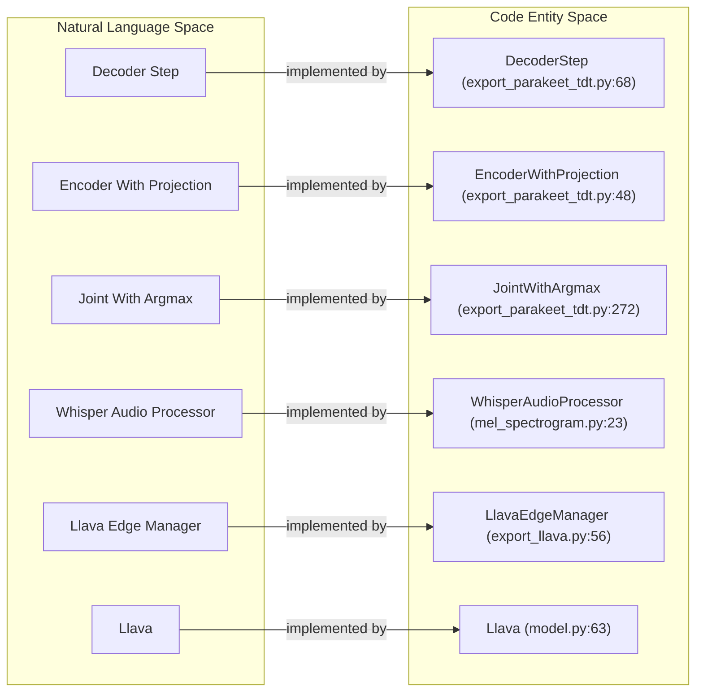
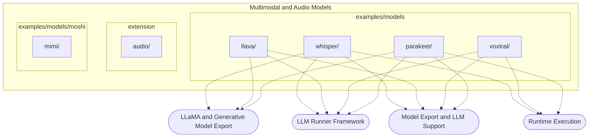
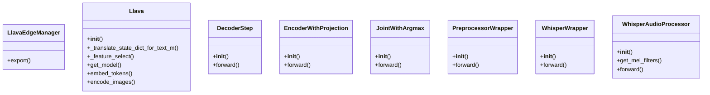
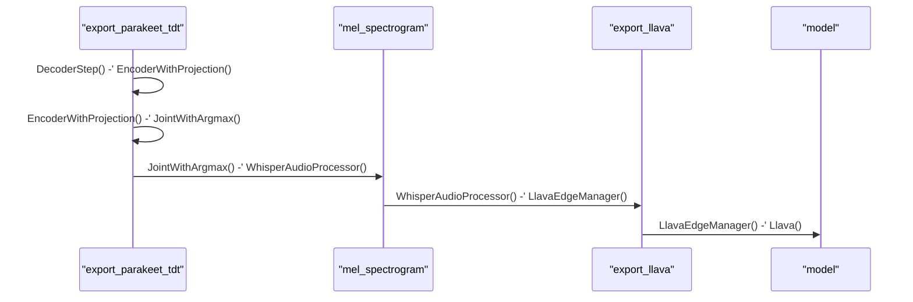

# 3-Source Context Packet (`git` + `CBM` + `llm-wiki`) for `6.4-multimodal-and-audio-models` — Multimodal and Audio Models

- **Target Wiki File**: `wiki/6.4-multimodal-and-audio-models.md`
- **Archetype**: `Leaf Technical Spec Page`
- **Parent Page**: `6-model-export-and-llm-support`
- **Summary**: Architectural specification and implementation reference for Multimodal and Audio Models (36 relevant source files). Primary code entities: `LlavaEdgeManager`, `export`, `create_llava_config_from_args`, `export_all`, `Llava`.
- **Valid `[[wikilink]]` Neighbours**: `[[6-model-export-and-llm-support|Model Export and LLM Support]]`, `[[1.1-getting-started|Getting Started]]`, `[[1.2-export-api-and-recipe-system|Export API and Recipe System]]`, `[[2.2-kernel-libraries-and-selective-build|Kernel Libraries and Selective Build]]`, `[[2.3-schema-generation-and-flatbuffers|Schema Generation and FlatBuffers]]`, `[[3.4-program-emission-and-serialization|Program Emission and Serialization]]`, `[[3.5-verification-and-dialect-system|Verification and Dialect System]]`, `[[4-quantization-systems|Quantization Systems]]`

## 1. Relevant Source Files (`git` + `CBM`, use verbatim in `<details>`)
- `[examples/models/llava/export_llava.py](examples/models/llava/export_llava.py)`
- `[examples/models/llava/model.py](examples/models/llava/model.py)`
- `[examples/models/parakeet/parakeet_transcriber.cpp](examples/models/parakeet/parakeet_transcriber.cpp)`
- `[examples/models/parakeet/export_parakeet_tdt.py](examples/models/parakeet/export_parakeet_tdt.py)`
- `[examples/models/whisper/model.py](examples/models/whisper/model.py)`
- `[examples/models/llava/main.cpp](examples/models/llava/main.cpp)`
- `[examples/models/llava/__init__.py](examples/models/llava/__init__.py)`
- `[extension/audio/mel_spectrogram.py](extension/audio/mel_spectrogram.py)`
- `[examples/models/voxtral/multimodal.cpp](examples/models/voxtral/multimodal.cpp)`
- `[examples/models/llava/targets.bzl](examples/models/llava/targets.bzl)`
- `[examples/models/parakeet/parakeet_helper_protocol.h](examples/models/parakeet/parakeet_helper_protocol.h)`
- `[examples/models/parakeet/parakeet_transcriber.h](examples/models/parakeet/parakeet_transcriber.h)`
- `[examples/models/whisper/main.cpp](examples/models/whisper/main.cpp)`
- `[examples/models/whisper/__init__.py](examples/models/whisper/__init__.py)`
- `[examples/models/parakeet/parakeet_helper_protocol.cpp](examples/models/parakeet/parakeet_helper_protocol.cpp)`
- `[examples/models/parakeet/benchmark.ps1](examples/models/parakeet/benchmark.ps1)`
- `[examples/models/parakeet/parakeet_helper.cpp](examples/models/parakeet/parakeet_helper.cpp)`
- `[examples/models/parakeet/main.cpp](examples/models/parakeet/main.cpp)`
- `[examples/models/parakeet/timestamp_utils.cpp](examples/models/parakeet/timestamp_utils.cpp)`
- `[examples/models/parakeet/tokenizer_utils.cpp](examples/models/parakeet/tokenizer_utils.cpp)`
- `[examples/models/parakeet/types.h](examples/models/parakeet/types.h)`
- `[extension/audio/targets.bzl](extension/audio/targets.bzl)`
- `[examples/models/parakeet/quantize.py](examples/models/parakeet/quantize.py)`
- `[examples/models/parakeet/timestamp_utils.h](examples/models/parakeet/timestamp_utils.h)`
- `[examples/models/parakeet/tokenizer_utils.h](examples/models/parakeet/tokenizer_utils.h)`
- `[examples/models/llava/README.md](examples/models/llava/README.md)`
- `[examples/models/whisper/README.md](examples/models/whisper/README.md)`
- `[examples/models/voxtral/README.md](examples/models/voxtral/README.md)`
- `[examples/models/parakeet/README.md](examples/models/parakeet/README.md)`
- `[extension/audio/README.md](extension/audio/README.md)`

## 2. Grounded Code Symbols (`CBM`, use verbatim for `[file:start-end]()` pill citations)
- `DecoderStep` (Class) @ `[examples/models/parakeet/export_parakeet_tdt.py:68-85]()` [fan-in=1, fan-out=0] — Single decoder RNN step that outputs projected features for the joint network.
- `EncoderWithProjection` (Class) @ `[examples/models/parakeet/export_parakeet_tdt.py:48-65]()` [fan-in=1, fan-out=0] — Encoder that outputs projected features ready for the joint network.
- `JointWithArgmax` (Class) @ `[examples/models/parakeet/export_parakeet_tdt.py:272-284]()` [fan-in=1, fan-out=0] — Joint network that returns token and duration indices directly.
- `WhisperAudioProcessor` (Class) @ `[extension/audio/mel_spectrogram.py:23-188]()` [fan-in=1, fan-out=0] — r""" Computes Mel spectrograms from mono audio input. Same as HuggingFace WhisperFeatureExtractor, but implemented in PyTorch Args: feature_size (`int`, default
- `LlavaEdgeManager` (Class) @ `[examples/models/llava/export_llava.py:56-69]()` [fan-in=1, fan-out=0] — 
- `Llava` (Class) @ `[examples/models/llava/model.py:63-301]()` [fan-in=1, fan-out=0] — 
- `PreprocessorWrapper` (Class) @ `[examples/models/parakeet/export_parakeet_tdt.py:287-297]()` [fan-in=1, fan-out=0] — 
- `LlavaModel` (Class) @ `[examples/models/llava/model.py:304-415]()` [fan-in=0, fan-out=0] — 
- `WhisperWrapper` (Class) @ `[examples/models/whisper/model.py:14-24]()` [fan-in=1, fan-out=0] — 
- `DecodeLoopProfile` (Class) @ `[examples/models/parakeet/parakeet_transcriber.cpp:73-90]()` [fan-in=0, fan-out=0] — 
- `MethodTiming` (Class) @ `[examples/models/parakeet/parakeet_transcriber.cpp:53-71]()` [fan-in=0, fan-out=0] — 
- `WhisperModel` (Class) @ `[examples/models/whisper/model.py:27-43]()` [fan-in=0, fan-out=0] — 
- `AudioDescriptor` (Class) @ `[examples/models/parakeet/parakeet_helper_protocol.h:21-26]()` [fan-in=0, fan-out=0] — 
- `Request` (Class) @ `[examples/models/parakeet/parakeet_helper_protocol.h:34-42]()` [fan-in=0, fan-out=0] — 
- `TranscribeRequest` (Class) @ `[examples/models/parakeet/parakeet_helper_protocol.h:28-32]()` [fan-in=0, fan-out=0] — 
- `ParakeetTranscriber` (Class) @ `[examples/models/parakeet/parakeet_transcriber.h:57-92]()` [fan-in=0, fan-out=0] — 
- `TimestampOutputMode` (Class) @ `[examples/models/parakeet/parakeet_transcriber.h:28-36]()` [fan-in=0, fan-out=0] — 
- `TranscribeConfig` (Class) @ `[examples/models/parakeet/parakeet_transcriber.h:40-43]()` [fan-in=0, fan-out=0] — 
- `TranscribeResult` (Class) @ `[examples/models/parakeet/parakeet_transcriber.h:45-53]()` [fan-in=0, fan-out=0] — 
- `TextWithOffsets` (Class) @ `[examples/models/parakeet/types.h:24-28]()` [fan-in=0, fan-out=0] — 
- `TokenWithTextInfo` (Class) @ `[examples/models/parakeet/types.h:14-22]()` [fan-in=0, fan-out=0] — 
- `export` (Method) @ `[examples/models/llava/export_llava.py:57-69]()` [fan-in=33, fan-out=1] — (self)

## 3. Grounded Source Code Excerpts (`git` Working Tree)
### `DecoderStep` in `[examples/models/parakeet/export_parakeet_tdt.py:68-83]()`
```python
class DecoderStep(torch.nn.Module):
    """Single decoder RNN step that outputs projected features for the joint network."""

    def __init__(self, decoder, joint):
        super().__init__()
        self.decoder = decoder
        self.project_prednet = joint.project_prednet
        self.pred_hidden = decoder.pred_hidden
        self.pred_rnn_layers = getattr(decoder, "pred_rnn_layers", 2)

    def forward(
        self, token: torch.Tensor, h: torch.Tensor, c: torch.Tensor
    ) -> tuple[torch.Tensor, torch.Tensor, torch.Tensor]:
        # Run decoder RNN step
        g, new_state = self.decoder.predict(y=token, state=[h, c], add_sos=False)
        # Project decoder output: [B, 1, pred_hidden] -> [B, 1, joint_hidden]
```

### `EncoderWithProjection` in `[examples/models/parakeet/export_parakeet_tdt.py:48-63]()`
```python
class EncoderWithProjection(torch.nn.Module):
    """Encoder that outputs projected features ready for the joint network."""

    def __init__(self, encoder, joint):
        super().__init__()
        self.encoder = encoder
        self.project_encoder = joint.project_encoder

    def forward(
        self, audio_signal: torch.Tensor, length: torch.Tensor
    ) -> tuple[torch.Tensor, torch.Tensor]:
        # Run encoder: [B, feat_in, T_mel] -> [B, enc_dim, T_enc]
        encoded, enc_len = self.encoder(audio_signal=audio_signal, length=length)
        # Transpose: [B, enc_dim, T_enc] -> [B, T_enc, enc_dim]
        encoded_t = encoded.transpose(1, 2)
        # Project: [B, T_enc, enc_dim] -> [B, T_enc, joint_hidden]
```

### `JointWithArgmax` in `[examples/models/parakeet/export_parakeet_tdt.py:272-284]()`
```python
class JointWithArgmax(torch.nn.Module):
    """Joint network that returns token and duration indices directly."""

    def __init__(self, joint, num_token_classes):
        super().__init__()
        self.joint = joint
        self.num_token_classes = num_token_classes

    def forward(self, f, g):
        logits = self.joint.joint_after_projection(f, g).squeeze()
        token_id = logits[: self.num_token_classes].argmax()
        duration_idx = logits[self.num_token_classes :].argmax()
        return token_id, duration_idx
```

### `WhisperAudioProcessor` in `[extension/audio/mel_spectrogram.py:23-38]()`
```python
class WhisperAudioProcessor(nn.Module):
    r"""
    Computes Mel spectrograms from mono audio input.
    Same as HuggingFace WhisperFeatureExtractor, but implemented in PyTorch

    Args:
        feature_size (`int`, defaults to 80):
            The feature dimension of the extracted features.
        sampling_rate (`int`, defaults to 16000):
            The sampling rate at which the audio files should be digitalized expressed in hertz (Hz).
        hop_length (`int`, defaults to 160):
            Length of the overlaping windows for the STFT used to obtain the Mel Frequency coefficients.
        chunk_length (`int`, defaults to 30):
            The maximum number of chuncks of `sampling_rate` samples used to trim and pad longer or shorter audio
            sequences.
        n_fft (`int`, defaults to 400):
```

### `LlavaEdgeManager` in `[examples/models/llava/export_llava.py:56-69]()`
```python
class LlavaEdgeManager(LLMEdgeManager):
    def export(self) -> "LlavaEdgeManager":
        dynamic_shape = self._get_dynamic_shape()
        # 1. torch.nn.attention.sdpa_kernel([SDPBackend.MATH]) is for bypassing the dynamo error when tracing
        # 2. torch.no_grad() is for getting rid of the dropout (not sure why training ops will show up)
        with torch.nn.attention.sdpa_kernel([SDPBackend.MATH]), torch.no_grad():
            self.export_program = torch.export.export(
                self.model,
                self.example_inputs,
                dynamic_shapes=dynamic_shape,
                strict=False,
            )
            self.pre_autograd_graph_module = self.export_program.module()
        return self
```


## 4. Linked Official Docs (`llm-wiki` / `RAG`)
- **Model Export and LLM Support** (`wiki/6-model-export-and-llm-support.md`, score=149.482, shared_symbols=['embed_tokens']): # Model Export and LLM Support > Architectural specification and implementation reference for Model Export and LLM Support (40 relevant source files). Primary code entities: `MuseGlimmerImageSpan`, `MuseGlimmerPreparationSpec`, `MuseGlimmerPreparedInput`, `Backing`, `RequestHandle`. <details> <summary>Relevant source files</summary> The following files we
- **ExecuTorch DeepWiki** (`wiki/index.md`, score=110.904, shared_symbols=[]): # ExecuTorch DeepWiki Generated from `home-jason-Project-deepwiki-executorch` at commit `b3b565b5b62f` (2026-11-15T15:02:11+00:00). ## Pages - [[1-overview|Overview]] — Architectural specification and implementation reference for Overview (10 relevant source files). Primary code entities: `Module`, `MethodHolder`, `PlannedMemory`, `EdgeProgramManager`, `_
- **LLM Runner Framework** (`wiki/6.2-llm-runner-framework.md`, score=95.266, shared_symbols=[]): # LLM Runner Framework ↑ [[6-model-export-and-llm-support|Model Export and LLM Support]] > Architectural specification and implementation reference for LLM Runner Framework (36 relevant source files). Primary code entities: `check_vocab_size`, `read_int_method`, `read_int_tensor_method`, `read_required_positive_int`, `MultimodalPrefiller`. <details> <summ
- **Custom Operators and Extensions** (`wiki/6.3-custom-operators-and-extensions.md`, score=95.266, shared_symbols=[]): # Custom Operators and Extensions ↑ [[6-model-export-and-llm-support|Model Export and LLM Support]] > Architectural specification and implementation reference for Custom Operators and Extensions (39 relevant source files). Primary code entities: `gated_delta_rule_out_boxed`, `ChunkScratch`, `elems`, `view`, `MaybeQuantizedMatrixData`. <details> <summary>R
- **Runtime Execution** (`wiki/8-runtime-execution.md`, score=95.266, shared_symbols=[]): # Runtime Execution > Architectural specification and implementation reference for Runtime Execution (39 relevant source files). Primary code entities: `ET_CHECK_MSG`, `execute`, `execute_instruction`, `experimental_reset_execution`, `ArrayRef`. <details> <summary>Relevant source files</summary> The following files were used as context for generating this
- **Export API and Recipe System** (`wiki/1.2-export-api-and-recipe-system.md`, score=92.127, shared_symbols=[]): # Export API and Recipe System ↑ [[1-overview|Overview]] > Architectural specification and implementation reference for Export API and Recipe System (37 relevant source files). Primary code entities: `AOQuantizationConfig`, `ExportRecipe`, `_assert_scalar_fields_agree`, `_collect_lowering_fields`, `ExportSession`. <details> <summary>Relevant source files<

## 5. Pre-Verified DeepWiki v1.9.9.5 Mermaid Diagrams
### Natural Language Space <-> Code Entity Space


### Subsystem Architecture Flowchart


### Class Hierarchy Diagram


### Call Sequence Diagram


## 6. DeepWiki v1.9.9.5 Authoring Checklist for `wiki/6.4-multimodal-and-audio-models.md`
1. Keep YAML frontmatter at top (`id`, `title`, `parent`, `sources`, `linked_docs`, `bridge_symbols`).
2. Keep `<details><summary>Relevant source files</summary>` block immediately after `# Title`.
3. Start with `## Purpose and Scope`, then numbered `## 1. ...`, `## 2. ...` sections separated by `---`.
4. Include at least 2 ```mermaid``` diagrams (including a `Natural Language Space` <-> `Code Entity Space` mapping).
5. Cite code entities inline using `[path/to/file.ext:start-end]()` and end every `##` section with `Sources: [file:start-end]()`.
6. Run `deepwiki_cli.py build --enrich-only ...` and `deepwiki_cli.py validate ...` after editing.
