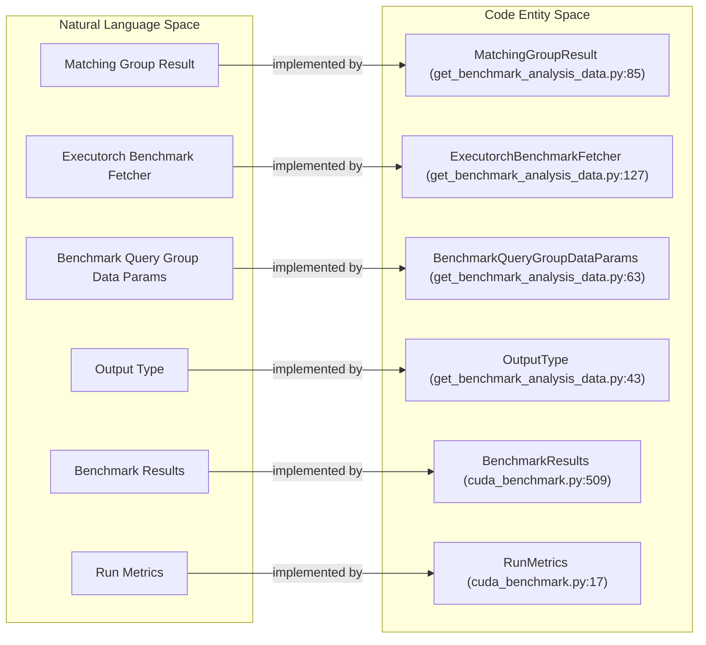
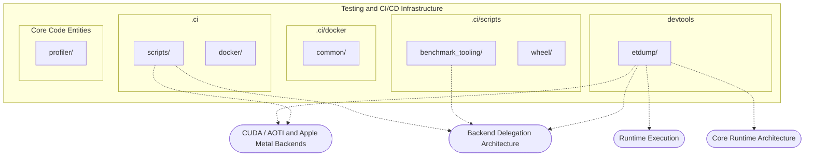
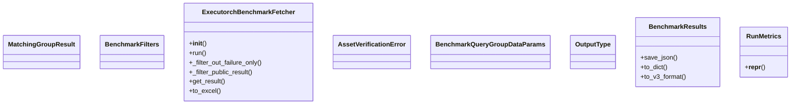
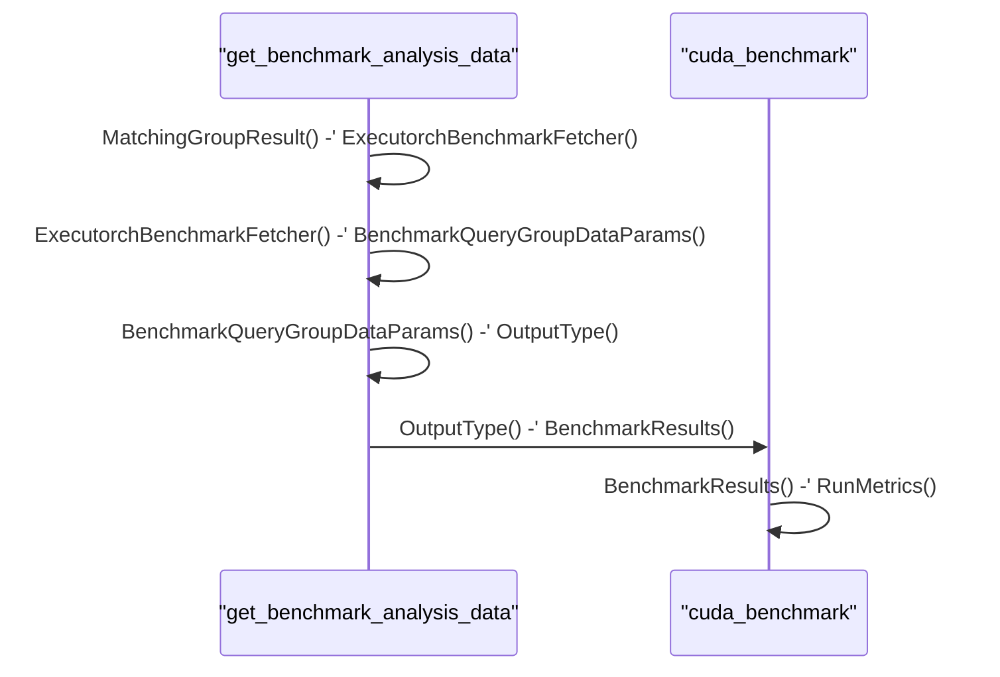

# 3-Source Context Packet (`git` + `CBM` + `llm-wiki`) for `7-testing-and-cicd-infrastructure` — Testing and CI/CD Infrastructure

- **Target Wiki File**: `wiki/7-testing-and-cicd-infrastructure.md`
- **Archetype**: `Parent Hub Page`
- **Parent Page**: `None (Top-Level Chapter)`
- **Summary**: Architectural specification and implementation reference for Testing and CI/CD Infrastructure (36 relevant source files). Primary code entities: `BenchmarkResults`, `save_json`, `to_dict`, `to_v3_format`, `BenchmarkFilters`.
- **Valid `[[wikilink]]` Neighbours**: `[[1-overview|Overview]]`, `[[7.1-cicd-workflows-and-validation|CI/CD Workflows and Validation]]`, `[[7.2-model-and-backend-testing-framework|Model and Backend Testing Framework]]`, `[[7.3-performance-benchmarking-and-profiling|Performance Benchmarking and Profiling]]`, `[[1.1-getting-started|Getting Started]]`, `[[1.2-export-api-and-recipe-system|Export API and Recipe System]]`, `[[2.2-kernel-libraries-and-selective-build|Kernel Libraries and Selective Build]]`, `[[2.3-schema-generation-and-flatbuffers|Schema Generation and FlatBuffers]]`

## 1. Relevant Source Files (`git` + `CBM`, use verbatim in `<details>`)
- `[.ci/scripts/cuda_benchmark.py](.ci/scripts/cuda_benchmark.py)`
- `[.ci/scripts/benchmark_tooling/get_benchmark_analysis_data.py](.ci/scripts/benchmark_tooling/get_benchmark_analysis_data.py)`
- `[.ci/docker/common/zephyr_sdk_release_proxy.py](.ci/docker/common/zephyr_sdk_release_proxy.py)`
- `[.ci/scripts/muse_glimmer_batching_workload.h](.ci/scripts/muse_glimmer_batching_workload.h)`
- `[devtools/etdump/etdump_flatcc.cpp](devtools/etdump/etdump_flatcc.cpp)`
- `[.ci/scripts/gather_benchmark_configs.py](.ci/scripts/gather_benchmark_configs.py)`
- `[devtools/etdump/schema_flatcc.py](devtools/etdump/schema_flatcc.py)`
- `[profiler/parse_profiler_results.py](profiler/parse_profiler_results.py)`
- `[.ci/scripts/utils.sh](.ci/scripts/utils.sh)`
- `[devtools/etdump/etdump_flatcc.h](devtools/etdump/etdump_flatcc.h)`
- `[devtools/etdump/etdump_filter.h](devtools/etdump/etdump_filter.h)`
- `[.ci/scripts/zephyr-utils.sh](.ci/scripts/zephyr-utils.sh)`
- `[devtools/etdump/data_sinks/buffer_data_sink.h](devtools/etdump/data_sinks/buffer_data_sink.h)`
- `[.ci/scripts/wheel/export_native.py](.ci/scripts/wheel/export_native.py)`
- `[devtools/etdump/data_sinks/file_data_sink.h](devtools/etdump/data_sinks/file_data_sink.h)`
- `[devtools/etdump/data_sinks/data_sink_base.h](devtools/etdump/data_sinks/data_sink_base.h)`
- `[.ci/scripts/benchmark_tooling/analyze_benchmark_stability.py](.ci/scripts/benchmark_tooling/analyze_benchmark_stability.py)`
- `[devtools/etdump/serialize.py](devtools/etdump/serialize.py)`
- `[devtools/etdump/data_sinks/file_data_sink.cpp](devtools/etdump/data_sinks/file_data_sink.cpp)`
- `[.ci/scripts/setup-vulkan-linux-deps.sh](.ci/scripts/setup-vulkan-linux-deps.sh)`
- `[.ci/scripts/gather_test_models.py](.ci/scripts/gather_test_models.py)`
- `[.github/workflows/pending_user_response.py](.github/workflows/pending_user_response.py)`
- `[devtools/etdump/etdump_filter.cpp](devtools/etdump/etdump_filter.cpp)`
- `[.ci/scripts/setup-samsung-linux-deps.sh](.ci/scripts/setup-samsung-linux-deps.sh)`
- `[.ci/scripts/muse_glimmer_batching_smoke.cpp](.ci/scripts/muse_glimmer_batching_smoke.cpp)`
- `[devtools/etdump/emitter.cpp](devtools/etdump/emitter.cpp)`
- `[.ci/docker/common/utils.sh](.ci/docker/common/utils.sh)`
- `[.ci/scripts/setup-macos.sh](.ci/scripts/setup-macos.sh)`
- `[.ci/docker/README.md](.ci/docker/README.md)`
- `[.ci/scripts/benchmark_tooling/README.md](.ci/scripts/benchmark_tooling/README.md)`

## 2. Grounded Code Symbols (`CBM`, use verbatim for `[file:start-end]()` pill citations)
- `MatchingGroupResult` (Class) @ `[.ci/scripts/benchmark_tooling/get_benchmark_analysis_data.py:85-95]()` [fan-in=7, fan-out=0] — Container for benchmark results grouped by category. Attributes: category: Category name (e.g., 'private', 'public') data: List of benchmark data for this categ
- `ExecutorchBenchmarkFetcher` (Class) @ `[.ci/scripts/benchmark_tooling/get_benchmark_analysis_data.py:127-690]()` [fan-in=2, fan-out=0] — Fetch and process benchmark data from HUD API for ExecutorchBenchmark. This class provides methods to: 1. Fetch all benchmark data for a specified time range 2.
- `BenchmarkQueryGroupDataParams` (Class) @ `[.ci/scripts/benchmark_tooling/get_benchmark_analysis_data.py:63-81]()` [fan-in=1, fan-out=0] — Parameters for querying benchmark data from HUD API. Attributes: repo: Repository name (e.g., "pytorch/executorch") benchmark_name: Name of the benchmark (e.g.,
- `OutputType` (Class) @ `[.ci/scripts/benchmark_tooling/get_benchmark_analysis_data.py:43-59]()` [fan-in=1, fan-out=0] — Enumeration of supported output formats for benchmark data. Values: EXCEL: Export data to Excel spreadsheets PRINT: Print data to console (default) CSV: Export 
- `BenchmarkResults` (Class) @ `[.ci/scripts/cuda_benchmark.py:509-663]()` [fan-in=1, fan-out=0] — Summary of benchmark results.
- `RunMetrics` (Class) @ `[.ci/scripts/cuda_benchmark.py:17-40]()` [fan-in=1, fan-out=0] — Metrics from a single run.
- `MetricStats` (Class) @ `[.ci/scripts/cuda_benchmark.py:429-505]()` [fan-in=0, fan-out=0] — Statistics for a single metric with operations.
- `EvidenceExecutor` (Class) @ `[.ci/scripts/muse_glimmer_batching_workload.h:103-151]()` [fan-in=0, fan-out=0] — // Counts distinct owners only after the forwarded executor call succeeds.
- `RequestCallbacks` (Class) @ `[.ci/scripts/muse_glimmer_batching_workload.h:272-276]()` [fan-in=0, fan-out=0] — // Submission runs on the caller; text/terminal hooks run on delivery. Captured // state must outlive run_requests. Hooks must be bounded and must not throw.
- `ETDumpFilter` (Class) @ `[devtools/etdump/etdump_filter.h:32-101]()` [fan-in=1, fan-out=0] — /** * ETDumpFilter is a class that filters intermediate output based on output's * name by full regex filtering, or delegate debug indices by range-based * filt
- `PROFILE_EVENT_ENUM` (Class) @ `[devtools/etdump/schema_flatcc.py:105-109]()` [fan-in=0, fan-out=0] — # Note the differing value style is a result of ETDump string
- `BenchmarkFilters` (Class) @ `[.ci/scripts/benchmark_tooling/get_benchmark_analysis_data.py:99-102]()` [fan-in=2, fan-out=0] — 
- `BufferDataSink` (Class) @ `[devtools/etdump/data_sinks/buffer_data_sink.h:24-124]()` [fan-in=0, fan-out=0] — /** * BufferDataSink is a concrete implementation of the DataSinkBase class, * designed to store debug data in a pre-allocated, user-owned buffer. This * class 
- `DataSinkBase` (Class) @ `[devtools/etdump/data_sinks/data_sink_base.h:24-58]()` [fan-in=0, fan-out=0] — /** * DataSinkBase is an abstract class that users can inherit and implement * to customize the storage and management of debug data in ETDumpGen. This * class 
- `FileDataSink` (Class) @ `[devtools/etdump/data_sinks/file_data_sink.h:28-92]()` [fan-in=0, fan-out=0] — /** * FileDataSink is a concrete implementation of the DataSinkBase class, * designed to facilitate the direct writing of data to a file. It is * particularly u
- `AssetVerificationError` (Class) @ `[.ci/docker/common/zephyr_sdk_release_proxy.py:51-52]()` [fan-in=1, fan-out=0] — 
- `DisabledConfig` (Class) @ `[.ci/scripts/gather_benchmark_configs.py:102-104]()` [fan-in=1, fan-out=0] — 
- `SdkProxyHandler` (Class) @ `[.ci/docker/common/zephyr_sdk_release_proxy.py:182-246]()` [fan-in=0, fan-out=0] — 
- `BatchEvidence` (Class) @ `[.ci/scripts/muse_glimmer_batching_workload.h:79-100]()` [fan-in=0, fan-out=0] — 
- `Inflight` (Class) @ `[.ci/scripts/muse_glimmer_batching_workload.h:172-192]()` [fan-in=0, fan-out=0] — 
- `RequestOptions` (Class) @ `[.ci/scripts/muse_glimmer_batching_workload.h:35-42]()` [fan-in=0, fan-out=0] — 
- `RequestResult` (Class) @ `[.ci/scripts/muse_glimmer_batching_workload.h:243-246]()` [fan-in=0, fan-out=0] — 

## 3. Grounded Source Code Excerpts (`git` Working Tree)
### `MatchingGroupResult` in `[.ci/scripts/benchmark_tooling/get_benchmark_analysis_data.py:85-95]()`
```python
class MatchingGroupResult:
    """
    Container for benchmark results grouped by category.

    Attributes:
        category: Category name (e.g., 'private', 'public')
        data: List of benchmark data for this category
    """

    category: str
    data: list
```

### `ExecutorchBenchmarkFetcher` in `[.ci/scripts/benchmark_tooling/get_benchmark_analysis_data.py:127-142]()`
```python
class ExecutorchBenchmarkFetcher:
    """
    Fetch and process benchmark data from HUD API for ExecutorchBenchmark.

    This class provides methods to:
    1. Fetch all benchmark data for a specified time range
    2. Get all private device info within the time range
    3. Filter the private device data if filter is provided
    4. Then use the filtered private device data to find matched the public device data using [model, backend, device, arch]
    3. Export results in various formats (JSON, DataFrame, Excel, CSV)

    Usage:
        fetcher = ExecutorchBenchmarkFetcher()
        fetcher.run(start_time, end_time)
        fetcher.output_data(OutputType.EXCEL, output_dir="./results")
    """
```

### `BenchmarkQueryGroupDataParams` in `[.ci/scripts/benchmark_tooling/get_benchmark_analysis_data.py:63-78]()`
```python
class BenchmarkQueryGroupDataParams:
    """
    Parameters for querying benchmark data from HUD API.

    Attributes:
        repo: Repository name (e.g., "pytorch/executorch")
        benchmark_name: Name of the benchmark (e.g., "ExecuTorch")
        start_time: ISO8601 formatted start time
        end_time: ISO8601 formatted end time
        group_table_by_fields: Fields to group tables by
        group_row_by_fields: Fields to group rows by
    """

    repo: str
    benchmark_name: str
    start_time: str
```

### `OutputType` in `[.ci/scripts/benchmark_tooling/get_benchmark_analysis_data.py:43-58]()`
```python
class OutputType(Enum):
    """
    Enumeration of supported output formats for benchmark data.

    Values:
        EXCEL: Export data to Excel spreadsheets
        PRINT: Print data to console (default)
        CSV: Export data to CSV files
        JSON: Export data to JSON files
        DF: Return data as pandas DataFrames
    """

    EXCEL = "excel"
    PRINT = "print"
    CSV = "csv"
    JSON = "json"
```

### `BenchmarkResults` in `[.ci/scripts/cuda_benchmark.py:509-524]()`
```python
class BenchmarkResults:
    """Summary of benchmark results."""

    model_name: str
    total_runs: int
    trimmed_runs: int
    discarded_runs: int
    generated_tokens: int

    # Metrics
    throughput: MetricStats
    prefill_throughput: MetricStats
    model_load_time: MetricStats
    total_inference_time: MetricStats
    encoder_time: MetricStats
    generation_time: MetricStats
```


## 4. Linked Official Docs (`llm-wiki` / `RAG`)
- **CI/CD Workflows and Validation** (`wiki/7.1-cicd-workflows-and-validation.md`, score=211.691, shared_symbols=['BenchmarkFilters', 'ExecutorchBenchmarkFetcher', 'MatchingGroupResult']): # CI/CD Workflows and Validation ↑ [[7-testing-and-cicd-infrastructure|Testing and CI/CD Infrastructure]] > Architectural specification and implementation reference for CI/CD Workflows and Validation (31 relevant source files). Primary code entities: `BenchmarkResults`, `save_json`, `to_dict`, `to_v3_format`, `BenchmarkFilters`. <details> <summary>Relevan
- **ExecuTorch DeepWiki** (`wiki/index.md`, score=143.46, shared_symbols=[]): # ExecuTorch DeepWiki Generated from `home-jason-Project-deepwiki-executorch` at commit `b3b565b5b62f` (2026-11-15T15:02:11+00:00). ## Pages - [[1-overview|Overview]] — Architectural specification and implementation reference for Overview (10 relevant source files). Primary code entities: `Module`, `MethodHolder`, `PlannedMemory`, `EdgeProgramManager`, `_
- **CUDA / AOTI and Apple Metal Backends** (`wiki/5.7-cuda-aoti-and-apple-metal-backends.md`, score=108.096, shared_symbols=['Float', 'Tensor', 'Value']): # CUDA / AOTI and Apple Metal Backends ↑ [[5-backend-delegation-architecture|Backend Delegation Architecture]] > Architectural specification and implementation reference for CUDA / AOTI and Apple Metal Backends (40 relevant source files). Primary code entities: `empty`, `empty_like`, `empty_strided`, `DeviceTraits<c10::DeviceType::CPU>`, `allocate`. <deta
- **Backend Delegation Architecture** (`wiki/5-backend-delegation-architecture.md`, score=105.096, shared_symbols=['Tensor']): # Backend Delegation Architecture > Architectural specification and implementation reference for Backend Delegation Architecture (40 relevant source files). Primary code entities: `CommandBuffer`, `begin`, `bind_descriptors`, `bind_pipeline`, `NodeVisitor`. <details> <summary>Relevant source files</summary> The following files were used as context for gen
- **Overview** (`wiki/1-overview.md`, score=104.929, shared_symbols=['Tensor']): # Overview > Architectural specification and implementation reference for Overview (10 relevant source files). Primary code entities: `Module`, `MethodHolder`, `PlannedMemory`, `EdgeProgramManager`, `__init__`. <details> <summary>Relevant source files</summary> The following files were used as context for generating this wiki page: - [extension/module/mo
- **Performance Benchmarking and Profiling** (`wiki/7.3-performance-benchmarking-and-profiling.md`, score=104.034, shared_symbols=['Float']): # Performance Benchmarking and Profiling ↑ [[7-testing-and-cicd-infrastructure|Testing and CI/CD Infrastructure]] > Architectural specification and implementation reference for Performance Benchmarking and Profiling (36 relevant source files). Primary code entities: `Allocator`, `MemAllocation`, `MemEvent`, `ProfileData`, `ETDumpGen`. <details> <summary>R

## 5. Pre-Verified DeepWiki v1.9.9.5 Mermaid Diagrams
### Natural Language Space <-> Code Entity Space


### Subsystem Architecture Flowchart


### Class Hierarchy Diagram


### Call Sequence Diagram


## 6. DeepWiki v1.9.9.5 Authoring Checklist for `wiki/7-testing-and-cicd-infrastructure.md`
1. Keep YAML frontmatter at top (`id`, `title`, `parent`, `sources`, `linked_docs`, `bridge_symbols`).
2. Keep `<details><summary>Relevant source files</summary>` block immediately after `# Title`.
3. Start with `## Purpose and Scope`, then numbered `## 1. ...`, `## 2. ...` sections separated by `---`.
4. Include at least 2 ```mermaid``` diagrams (including a `Natural Language Space` <-> `Code Entity Space` mapping).
5. Cite code entities inline using `[path/to/file.ext:start-end]()` and end every `##` section with `Sources: [file:start-end]()`.
6. Run `deepwiki_cli.py build --enrich-only ...` and `deepwiki_cli.py validate ...` after editing.
