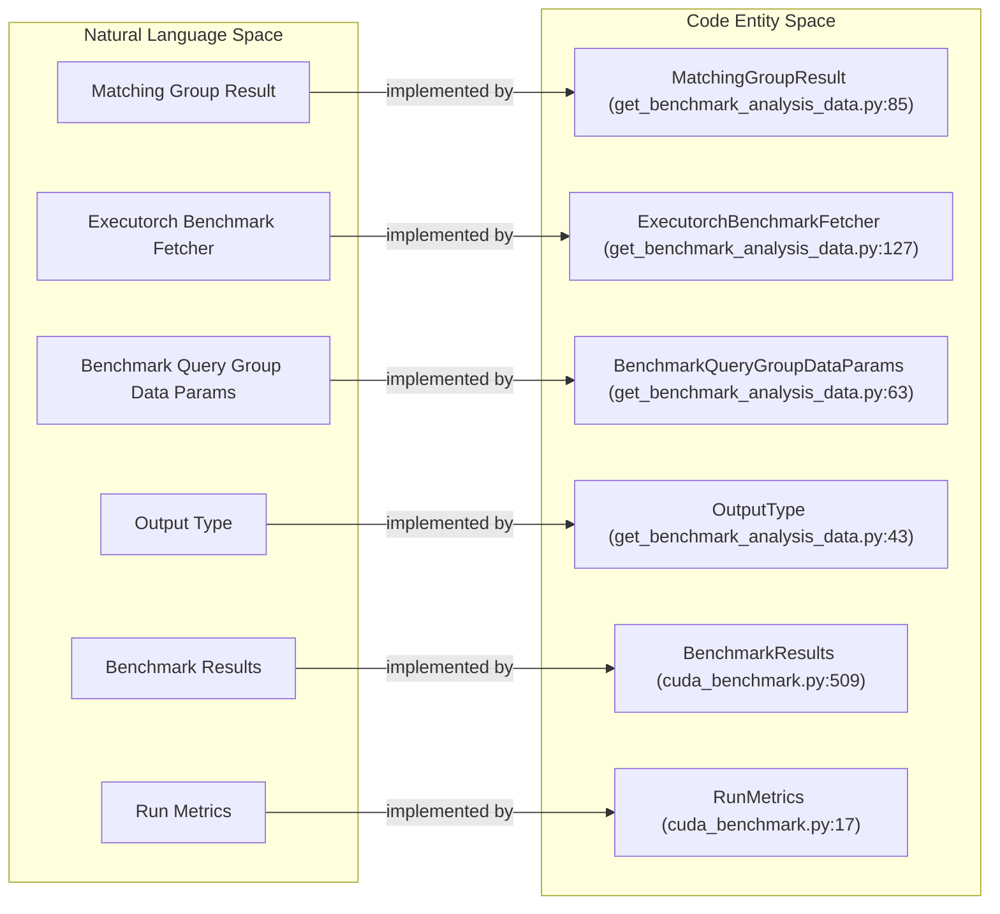
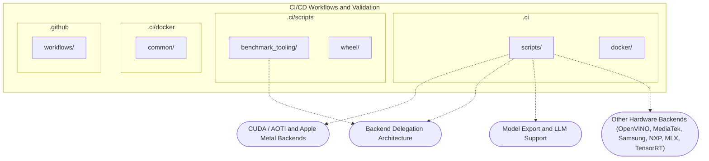
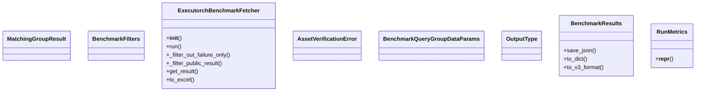
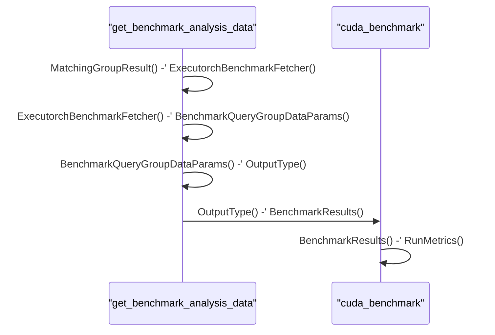

# 3-Source Context Packet (`git` + `CBM` + `llm-wiki`) for `7.1-cicd-workflows-and-validation` — CI/CD Workflows and Validation

- **Target Wiki File**: `wiki/7.1-cicd-workflows-and-validation.md`
- **Archetype**: `Leaf Technical Spec Page`
- **Parent Page**: `7-testing-and-cicd-infrastructure`
- **Summary**: Architectural specification and implementation reference for CI/CD Workflows and Validation (31 relevant source files). Primary code entities: `BenchmarkResults`, `save_json`, `to_dict`, `to_v3_format`, `BenchmarkFilters`.
- **Valid `[[wikilink]]` Neighbours**: `[[7-testing-and-cicd-infrastructure|Testing and CI/CD Infrastructure]]`, `[[1.1-getting-started|Getting Started]]`, `[[1.2-export-api-and-recipe-system|Export API and Recipe System]]`, `[[2.2-kernel-libraries-and-selective-build|Kernel Libraries and Selective Build]]`, `[[2.3-schema-generation-and-flatbuffers|Schema Generation and FlatBuffers]]`, `[[3.4-program-emission-and-serialization|Program Emission and Serialization]]`, `[[3.5-verification-and-dialect-system|Verification and Dialect System]]`, `[[4-quantization-systems|Quantization Systems]]`

## 1. Relevant Source Files (`git` + `CBM`, use verbatim in `<details>`)
- `[.ci/scripts/cuda_benchmark.py](.ci/scripts/cuda_benchmark.py)`
- `[.ci/scripts/benchmark_tooling/get_benchmark_analysis_data.py](.ci/scripts/benchmark_tooling/get_benchmark_analysis_data.py)`
- `[.ci/docker/common/zephyr_sdk_release_proxy.py](.ci/docker/common/zephyr_sdk_release_proxy.py)`
- `[.ci/scripts/muse_glimmer_batching_workload.h](.ci/scripts/muse_glimmer_batching_workload.h)`
- `[.ci/scripts/gather_benchmark_configs.py](.ci/scripts/gather_benchmark_configs.py)`
- `[.ci/scripts/utils.sh](.ci/scripts/utils.sh)`
- `[.ci/scripts/zephyr-utils.sh](.ci/scripts/zephyr-utils.sh)`
- `[.ci/scripts/wheel/export_native.py](.ci/scripts/wheel/export_native.py)`
- `[.ci/scripts/benchmark_tooling/analyze_benchmark_stability.py](.ci/scripts/benchmark_tooling/analyze_benchmark_stability.py)`
- `[.ci/scripts/setup-vulkan-linux-deps.sh](.ci/scripts/setup-vulkan-linux-deps.sh)`
- `[.ci/scripts/gather_test_models.py](.ci/scripts/gather_test_models.py)`
- `[.github/workflows/pending_user_response.py](.github/workflows/pending_user_response.py)`
- `[.ci/scripts/setup-samsung-linux-deps.sh](.ci/scripts/setup-samsung-linux-deps.sh)`
- `[.ci/scripts/muse_glimmer_batching_smoke.cpp](.ci/scripts/muse_glimmer_batching_smoke.cpp)`
- `[.ci/docker/common/utils.sh](.ci/docker/common/utils.sh)`
- `[.ci/scripts/setup-macos.sh](.ci/scripts/setup-macos.sh)`
- `[.ci/scripts/build-qnn-sdk.sh](.ci/scripts/build-qnn-sdk.sh)`
- `[.ci/scripts/setup-mediatek-deps.sh](.ci/scripts/setup-mediatek-deps.sh)`
- `[.ci/scripts/setup-xtensa-tools.sh](.ci/scripts/setup-xtensa-tools.sh)`
- `[.ci/scripts/build_llama_android.sh](.ci/scripts/build_llama_android.sh)`
- `[.ci/scripts/export_model_artifact.sh](.ci/scripts/export_model_artifact.sh)`
- `[.ci/scripts/setup-emscripten.sh](.ci/scripts/setup-emscripten.sh)`
- `[.ci/scripts/build-mediatek-sdk.sh](.ci/scripts/build-mediatek-sdk.sh)`
- `[.ci/scripts/cuda_benchmark_from_e2e.sh](.ci/scripts/cuda_benchmark_from_e2e.sh)`
- `[.ci/scripts/download_hf_hub.sh](.ci/scripts/download_hf_hub.sh)`
- `[.ci/scripts/esp_idf_mirror.py](.ci/scripts/esp_idf_mirror.py)`
- `[.ci/scripts/setup-conda.sh](.ci/scripts/setup-conda.sh)`
- `[.ci/scripts/test-cuda-build.sh](.ci/scripts/test-cuda-build.sh)`
- `[.ci/docker/README.md](.ci/docker/README.md)`
- `[.ci/scripts/benchmark_tooling/README.md](.ci/scripts/benchmark_tooling/README.md)`

## 2. Grounded Code Symbols (`CBM`, use verbatim for `[file:start-end]()` pill citations)
- `MatchingGroupResult` (Class) @ `[.ci/scripts/benchmark_tooling/get_benchmark_analysis_data.py:85-95]()` [fan-in=7, fan-out=0] — Container for benchmark results grouped by category. Attributes: category: Category name (e.g., 'private', 'public') data: List of benchmark data for this categ
- `ExecutorchBenchmarkFetcher` (Class) @ `[.ci/scripts/benchmark_tooling/get_benchmark_analysis_data.py:127-690]()` [fan-in=2, fan-out=0] — Fetch and process benchmark data from HUD API for ExecutorchBenchmark. This class provides methods to: 1. Fetch all benchmark data for a specified time range 2.
- `BenchmarkQueryGroupDataParams` (Class) @ `[.ci/scripts/benchmark_tooling/get_benchmark_analysis_data.py:63-81]()` [fan-in=1, fan-out=0] — Parameters for querying benchmark data from HUD API. Attributes: repo: Repository name (e.g., "pytorch/executorch") benchmark_name: Name of the benchmark (e.g.,
- `OutputType` (Class) @ `[.ci/scripts/benchmark_tooling/get_benchmark_analysis_data.py:43-59]()` [fan-in=1, fan-out=0] — Enumeration of supported output formats for benchmark data. Values: EXCEL: Export data to Excel spreadsheets PRINT: Print data to console (default) CSV: Export 
- `BenchmarkResults` (Class) @ `[.ci/scripts/cuda_benchmark.py:509-663]()` [fan-in=1, fan-out=0] — Summary of benchmark results.
- `RunMetrics` (Class) @ `[.ci/scripts/cuda_benchmark.py:17-40]()` [fan-in=1, fan-out=0] — Metrics from a single run.
- `MetricStats` (Class) @ `[.ci/scripts/cuda_benchmark.py:429-505]()` [fan-in=0, fan-out=0] — Statistics for a single metric with operations.
- `EvidenceExecutor` (Class) @ `[.ci/scripts/muse_glimmer_batching_workload.h:103-151]()` [fan-in=0, fan-out=0] — // Counts distinct owners only after the forwarded executor call succeeds.
- `RequestCallbacks` (Class) @ `[.ci/scripts/muse_glimmer_batching_workload.h:272-276]()` [fan-in=0, fan-out=0] — // Submission runs on the caller; text/terminal hooks run on delivery. Captured // state must outlive run_requests. Hooks must be bounded and must not throw.
- `BenchmarkFilters` (Class) @ `[.ci/scripts/benchmark_tooling/get_benchmark_analysis_data.py:99-102]()` [fan-in=2, fan-out=0] — 
- `AssetVerificationError` (Class) @ `[.ci/docker/common/zephyr_sdk_release_proxy.py:51-52]()` [fan-in=1, fan-out=0] — 
- `DisabledConfig` (Class) @ `[.ci/scripts/gather_benchmark_configs.py:102-104]()` [fan-in=1, fan-out=0] — 
- `SdkProxyHandler` (Class) @ `[.ci/docker/common/zephyr_sdk_release_proxy.py:182-246]()` [fan-in=0, fan-out=0] — 
- `BatchEvidence` (Class) @ `[.ci/scripts/muse_glimmer_batching_workload.h:79-100]()` [fan-in=0, fan-out=0] — 
- `Inflight` (Class) @ `[.ci/scripts/muse_glimmer_batching_workload.h:172-192]()` [fan-in=0, fan-out=0] — 
- `RequestOptions` (Class) @ `[.ci/scripts/muse_glimmer_batching_workload.h:35-42]()` [fan-in=0, fan-out=0] — 
- `RequestResult` (Class) @ `[.ci/scripts/muse_glimmer_batching_workload.h:243-246]()` [fan-in=0, fan-out=0] — 
- `Add` (Class) @ `[.ci/scripts/wheel/export_native.py:17-19]()` [fan-in=1, fan-out=0] — 
- `get_result` (Method) @ `[.ci/scripts/benchmark_tooling/get_benchmark_analysis_data.py:231-238]()` [fan-in=6, fan-out=1] — Get a deep copy of the benchmark results. Returns: Dictionary containing benchmark results grouped by category
- `generate_compatible_configs` (Function) @ `[.ci/scripts/gather_benchmark_configs.py:146-208]()` [fan-in=6, fan-out=1] — Generate a list of compatible benchmark configurations for a given model name and target OS. Args: model_name (str): The name of the model to generate configura
- `retry` (Function) @ `[.ci/scripts/utils.sh:15-17]()` [fan-in=9, fan-out=1] — 
- `output_data` (Method) @ `[.ci/scripts/benchmark_tooling/get_benchmark_analysis_data.py:282-325]()` [fan-in=0, fan-out=6] — Generate output in the specified format. Supports multiple output formats: - PRINT: Print results to console - JSON: Export to JSON files - DF: Return as pandas

## 3. Grounded Source Code Excerpts (`git` Working Tree)
### `MatchingGroupResult` in `[.ci/scripts/benchmark_tooling/get_benchmark_analysis_data.py:85-95]()`
```python
class MatchingGroupResult:
    """
    Container for benchmark results grouped by category.

    Attributes:
        category: Category name (e.g., 'private', 'public')
        data: List of benchmark data for this category
    """

    category: str
    data: list
```

### `ExecutorchBenchmarkFetcher` in `[.ci/scripts/benchmark_tooling/get_benchmark_analysis_data.py:127-142]()`
```python
class ExecutorchBenchmarkFetcher:
    """
    Fetch and process benchmark data from HUD API for ExecutorchBenchmark.

    This class provides methods to:
    1. Fetch all benchmark data for a specified time range
    2. Get all private device info within the time range
    3. Filter the private device data if filter is provided
    4. Then use the filtered private device data to find matched the public device data using [model, backend, device, arch]
    3. Export results in various formats (JSON, DataFrame, Excel, CSV)

    Usage:
        fetcher = ExecutorchBenchmarkFetcher()
        fetcher.run(start_time, end_time)
        fetcher.output_data(OutputType.EXCEL, output_dir="./results")
    """
```

### `BenchmarkQueryGroupDataParams` in `[.ci/scripts/benchmark_tooling/get_benchmark_analysis_data.py:63-78]()`
```python
class BenchmarkQueryGroupDataParams:
    """
    Parameters for querying benchmark data from HUD API.

    Attributes:
        repo: Repository name (e.g., "pytorch/executorch")
        benchmark_name: Name of the benchmark (e.g., "ExecuTorch")
        start_time: ISO8601 formatted start time
        end_time: ISO8601 formatted end time
        group_table_by_fields: Fields to group tables by
        group_row_by_fields: Fields to group rows by
    """

    repo: str
    benchmark_name: str
    start_time: str
```

### `OutputType` in `[.ci/scripts/benchmark_tooling/get_benchmark_analysis_data.py:43-58]()`
```python
class OutputType(Enum):
    """
    Enumeration of supported output formats for benchmark data.

    Values:
        EXCEL: Export data to Excel spreadsheets
        PRINT: Print data to console (default)
        CSV: Export data to CSV files
        JSON: Export data to JSON files
        DF: Return data as pandas DataFrames
    """

    EXCEL = "excel"
    PRINT = "print"
    CSV = "csv"
    JSON = "json"
```

### `BenchmarkResults` in `[.ci/scripts/cuda_benchmark.py:509-524]()`
```python
class BenchmarkResults:
    """Summary of benchmark results."""

    model_name: str
    total_runs: int
    trimmed_runs: int
    discarded_runs: int
    generated_tokens: int

    # Metrics
    throughput: MetricStats
    prefill_throughput: MetricStats
    model_load_time: MetricStats
    total_inference_time: MetricStats
    encoder_time: MetricStats
    generation_time: MetricStats
```


## 4. Linked Official Docs (`llm-wiki` / `RAG`)
- **Testing and CI/CD Infrastructure** (`wiki/7-testing-and-cicd-infrastructure.md`, score=180.675, shared_symbols=['MatchingGroupResult', 'generate_compatible_configs', 'get_result']): # Testing and CI/CD Infrastructure > Architectural specification and implementation reference for Testing and CI/CD Infrastructure (36 relevant source files). Primary code entities: `BenchmarkResults`, `save_json`, `to_dict`, `to_v3_format`, `BenchmarkFilters`. <details> <summary>Relevant source files</summary> The following files were used as context for
- **ExecuTorch DeepWiki** (`wiki/index.md`, score=141.909, shared_symbols=[]): # ExecuTorch DeepWiki Generated from `home-jason-Project-deepwiki-executorch` at commit `b3b565b5b62f` (2026-11-15T15:02:11+00:00). ## Pages - [[1-overview|Overview]] — Architectural specification and implementation reference for Overview (10 relevant source files). Primary code entities: `Module`, `MethodHolder`, `PlannedMemory`, `EdgeProgramManager`, `_
- **Model and Backend Testing Framework** (`wiki/7.2-model-and-backend-testing-framework.md`, score=110.484, shared_symbols=[]): # Model and Backend Testing Framework ↑ [[7-testing-and-cicd-infrastructure|Testing and CI/CD Infrastructure]] > Architectural specification and implementation reference for Model and Backend Testing Framework (40 relevant source files). Primary code entities: `MuseGlimmerImageSpan`, `MuseGlimmerPreparationSpec`, `MuseGlimmerPreparedInput`, `Backing`, `Bac
- **Backend Delegation Architecture** (`wiki/5-backend-delegation-architecture.md`, score=110.484, shared_symbols=[]): # Backend Delegation Architecture > Architectural specification and implementation reference for Backend Delegation Architecture (40 relevant source files). Primary code entities: `CommandBuffer`, `begin`, `bind_descriptors`, `bind_pipeline`, `NodeVisitor`. <details> <summary>Relevant source files</summary> The following files were used as context for gen
- **CUDA / AOTI and Apple Metal Backends** (`wiki/5.7-cuda-aoti-and-apple-metal-backends.md`, score=110.484, shared_symbols=[]): # CUDA / AOTI and Apple Metal Backends ↑ [[5-backend-delegation-architecture|Backend Delegation Architecture]] > Architectural specification and implementation reference for CUDA / AOTI and Apple Metal Backends (40 relevant source files). Primary code entities: `empty`, `empty_like`, `empty_strided`, `DeviceTraits<c10::DeviceType::CPU>`, `allocate`. <deta
- **Overview** (`wiki/1-overview.md`, score=101.99, shared_symbols=[]): # Overview > Architectural specification and implementation reference for Overview (10 relevant source files). Primary code entities: `Module`, `MethodHolder`, `PlannedMemory`, `EdgeProgramManager`, `__init__`. <details> <summary>Relevant source files</summary> The following files were used as context for generating this wiki page: - [extension/module/mo

## 5. Pre-Verified DeepWiki v1.9.9.5 Mermaid Diagrams
### Natural Language Space <-> Code Entity Space


### Subsystem Architecture Flowchart


### Class Hierarchy Diagram


### Call Sequence Diagram


## 6. DeepWiki v1.9.9.5 Authoring Checklist for `wiki/7.1-cicd-workflows-and-validation.md`
1. Keep YAML frontmatter at top (`id`, `title`, `parent`, `sources`, `linked_docs`, `bridge_symbols`).
2. Keep `<details><summary>Relevant source files</summary>` block immediately after `# Title`.
3. Start with `## Purpose and Scope`, then numbered `## 1. ...`, `## 2. ...` sections separated by `---`.
4. Include at least 2 ```mermaid``` diagrams (including a `Natural Language Space` <-> `Code Entity Space` mapping).
5. Cite code entities inline using `[path/to/file.ext:start-end]()` and end every `##` section with `Sources: [file:start-end]()`.
6. Run `deepwiki_cli.py build --enrich-only ...` and `deepwiki_cli.py validate ...` after editing.
