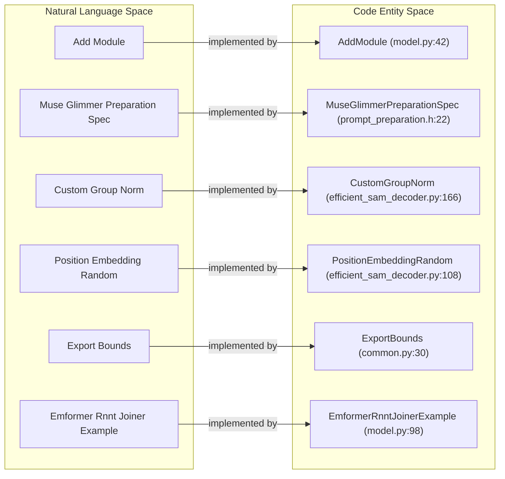
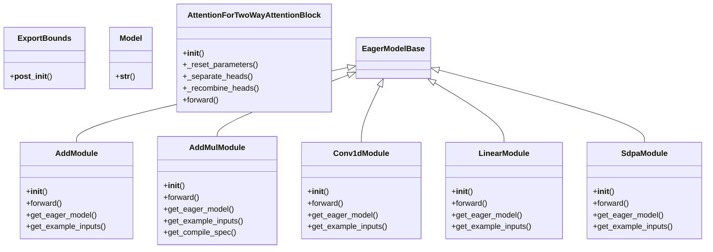
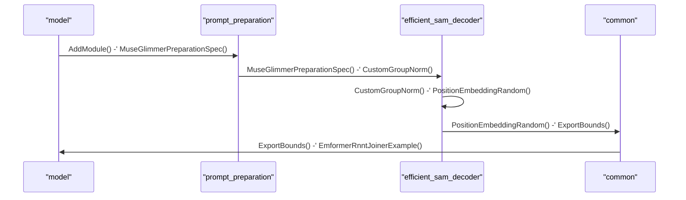

# 3-Source Context Packet (`git` + `CBM` + `llm-wiki`) for `7.2-model-and-backend-testing-framework` — Model and Backend Testing Framework

- **Target Wiki File**: `wiki/7.2-model-and-backend-testing-framework.md`
- **Archetype**: `Leaf Technical Spec Page`
- **Parent Page**: `7-testing-and-cicd-infrastructure`
- **Summary**: Architectural specification and implementation reference for Model and Backend Testing Framework (40 relevant source files). Primary code entities: `MuseGlimmerImageSpan`, `MuseGlimmerPreparationSpec`, `MuseGlimmerPreparedInput`, `Backing`, `Backend`.
- **Valid `[[wikilink]]` Neighbours**: `[[7-testing-and-cicd-infrastructure|Testing and CI/CD Infrastructure]]`, `[[1.1-getting-started|Getting Started]]`, `[[1.2-export-api-and-recipe-system|Export API and Recipe System]]`, `[[2.2-kernel-libraries-and-selective-build|Kernel Libraries and Selective Build]]`, `[[2.3-schema-generation-and-flatbuffers|Schema Generation and FlatBuffers]]`, `[[3.4-program-emission-and-serialization|Program Emission and Serialization]]`, `[[3.5-verification-and-dialect-system|Verification and Dialect System]]`, `[[4-quantization-systems|Quantization Systems]]`

## 1. Relevant Source Files (`git` + `CBM`, use verbatim in `<details>`)
- `[examples/models/muse-glimmer/runtime/prompt_preparation.h](examples/models/muse-glimmer/runtime/prompt_preparation.h)`
- `[examples/models/__init__.py](examples/models/__init__.py)`
- `[examples/models/codegen/__init__.py](examples/models/codegen/__init__.py)`
- `[examples/models/deeplab_v3/model.py](examples/models/deeplab_v3/model.py)`
- `[examples/models/muse-glimmer/runtime/cuda_dflash_executor.cpp](examples/models/muse-glimmer/runtime/cuda_dflash_executor.cpp)`
- `[examples/models/deit_tiny/model.py](examples/models/deit_tiny/model.py)`
- `[examples/models/checkpoint.py](examples/models/checkpoint.py)`
- `[examples/models/gemma4_31b/gemma4_31b_engine.cpp](examples/models/gemma4_31b/gemma4_31b_engine.cpp)`
- `[examples/models/muse-glimmer/runtime/mlx_executor.cpp](examples/models/muse-glimmer/runtime/mlx_executor.cpp)`
- `[examples/models/efficient_sam/efficient_sam_core/efficient_sam_decoder.py](examples/models/efficient_sam/efficient_sam_core/efficient_sam_decoder.py)`
- `[examples/models/qwen3_5_moe/qwen35_moe_engine.cpp](examples/models/qwen3_5_moe/qwen35_moe_engine.cpp)`
- `[examples/models/emformer_rnnt/model.py](examples/models/emformer_rnnt/model.py)`
- `[examples/models/edsr/model.py](examples/models/edsr/model.py)`
- `[examples/models/efficient_sam/efficient_sam_core/efficient_sam_encoder.py](examples/models/efficient_sam/efficient_sam_core/efficient_sam_encoder.py)`
- `[examples/models/codegen/convert_weight.py](examples/models/codegen/convert_weight.py)`
- `[examples/models/parakeet/parakeet_transcriber.cpp](examples/models/parakeet/parakeet_transcriber.cpp)`
- `[examples/models/supertonic/runtime/supertonic_runner.cpp](examples/models/supertonic/runtime/supertonic_runner.cpp)`
- `[examples/models/efficient_sam/efficient_sam_core/efficient_sam.py](examples/models/efficient_sam/efficient_sam_core/efficient_sam.py)`
- `[examples/models/llava/export_llava.py](examples/models/llava/export_llava.py)`
- `[examples/models/llava/model.py](examples/models/llava/model.py)`
- `[examples/models/supertonic/export/common.py](examples/models/supertonic/export/common.py)`
- `[examples/models/llama/static_attention.py](examples/models/llama/static_attention.py)`
- `[examples/models/voxtral_tts/voxtral_tts_runner.cpp](examples/models/voxtral_tts/voxtral_tts_runner.cpp)`
- `[examples/models/efficient_sam/efficient_sam_core/two_way_transformer.py](examples/models/efficient_sam/efficient_sam_core/two_way_transformer.py)`
- `[examples/models/muse-glimmer/runtime/prompt_preparation.cpp](examples/models/muse-glimmer/runtime/prompt_preparation.cpp)`
- `[examples/models/toy_model/model.py](examples/models/toy_model/model.py)`
- `[examples/models/deeplab_v3/__init__.py](examples/models/deeplab_v3/__init__.py)`
- `[examples/models/dinov2/main.cpp](examples/models/dinov2/main.cpp)`
- `[examples/models/deepseek-r1-distill-llama-8B/README.md](examples/models/deepseek-r1-distill-llama-8B/README.md)`
- `[examples/models/dinov2/README.md](examples/models/dinov2/README.md)`

## 2. Grounded Code Symbols (`CBM`, use verbatim for `[file:start-end]()` pill citations)
- `AddModule` (Class) @ `[examples/models/toy_model/model.py:42-54]()` [fan-in=18, fan-out=0] — 
- `MuseGlimmerPreparationSpec` (Class) @ `[examples/models/muse-glimmer/runtime/prompt_preparation.h:22-33]()` [fan-in=0, fan-out=0] — // One instance per executor. Sharing this immutable value with the CPU preparer // binds its payloads to that exact executor, not just compatible tensor shapes
- `CustomGroupNorm` (Class) @ `[examples/models/efficient_sam/efficient_sam_core/efficient_sam_decoder.py:166-191]()` [fan-in=1, fan-out=0] — # TODO: Remove CustomGroupNorm implementation once issue #6817 is resolved
- `PositionEmbeddingRandom` (Class) @ `[examples/models/efficient_sam/efficient_sam_core/efficient_sam_decoder.py:108-162]()` [fan-in=1, fan-out=0] — Positional encoding using random spatial frequencies.
- `ExportBounds` (Class) @ `[examples/models/supertonic/export/common.py:30-44]()` [fan-in=9, fan-out=0] — 
- `EmformerRnntJoinerExample` (Class) @ `[examples/models/emformer_rnnt/model.py:98-112]()` [fan-in=1, fan-out=0] — This is a wrapper for validating joiner for the Emformer RNN-T architecture. It does not reflect the actual usage such as beam search, but rather an example for
- `EmformerRnntPredictorExample` (Class) @ `[examples/models/emformer_rnnt/model.py:62-76]()` [fan-in=1, fan-out=0] — This is a wrapper for validating predictor for the Emformer RNN-T architecture. It does not reflect the actual usage such as beam search, but rather an example 
- `EmformerRnntTranscriberExample` (Class) @ `[examples/models/emformer_rnnt/model.py:27-41]()` [fan-in=1, fan-out=0] — This is a wrapper for validating transcriber for the Emformer RNN-T architecture. It does not reflect the actual usage such as beam search, but rather an exampl
- `Model` (Class) @ `[examples/models/__init__.py:11-55]()` [fan-in=3, fan-out=0] — 
- `ImageEncoderViT` (Class) @ `[examples/models/efficient_sam/efficient_sam_core/efficient_sam_encoder.py:183-261]()` [fan-in=1, fan-out=0] — # Image encoder for efficient SAM.
- `PatchEmbed` (Class) @ `[examples/models/efficient_sam/efficient_sam_core/efficient_sam_encoder.py:32-54]()` [fan-in=1, fan-out=0] — 2D Image to Patch Embedding
- `AttentionForTwoWayAttentionBlock` (Class) @ `[examples/models/efficient_sam/efficient_sam_core/two_way_transformer.py:194-268]()` [fan-in=2, fan-out=0] — An attention layer that allows for downscaling the size of the embedding after projection to queries, keys, and values.
- `Backend` (Class) @ `[examples/models/__init__.py:58-65]()` [fan-in=0, fan-out=0] — 
- `StaticAttention` (Class) @ `[examples/models/llama/static_attention.py:832-1623]()` [fan-in=0, fan-out=0] — An attention implementation meant for NPUs that require static shapes and are not flexible with tensor operations needed to perform KV cache updates. MHA/GQA is
- `MuseGlimmerImageSpan` (Class) @ `[examples/models/muse-glimmer/runtime/prompt_preparation.h:35-38]()` [fan-in=0, fan-out=0] — 
- `MuseGlimmerPreparedInput` (Class) @ `[examples/models/muse-glimmer/runtime/prompt_preparation.h:42-86]()` [fan-in=0, fan-out=0] — 
- `Backing` (Class) @ `[examples/models/muse-glimmer/runtime/prompt_preparation.h:62-81]()` [fan-in=0, fan-out=0] — 
- `Conv1dModule` (Class) @ `[examples/models/toy_model/model.py:93-107]()` [fan-in=6, fan-out=0] — 
- `LinearModule` (Class) @ `[examples/models/toy_model/model.py:27-39]()` [fan-in=6, fan-out=0] — 
- `CodeGenModel` (Class) @ `[examples/models/codegen/__init__.py:8-10]()` [fan-in=0, fan-out=0] — 
- `DeepLabV3ResNet101Model` (Class) @ `[examples/models/deeplab_v3/model.py:36-50]()` [fan-in=0, fan-out=0] — 
- `DeepLabV3ResNet50Model` (Class) @ `[examples/models/deeplab_v3/model.py:19-33]()` [fan-in=0, fan-out=0] — 

## 3. Grounded Source Code Excerpts (`git` Working Tree)
### `AddModule` in `[examples/models/toy_model/model.py:42-54]()`
```python
class AddModule(torch.nn.Module, EagerModelBase):
    def __init__(self):
        super().__init__()

    def forward(self, x, y):
        z = x + y
        return z

    def get_eager_model(self) -> torch.nn.Module:
        return self

    def get_example_inputs(self):
        return (torch.ones(1), torch.ones(1))
```

### `MuseGlimmerPreparationSpec` in `[examples/models/muse-glimmer/runtime/prompt_preparation.h:22-33]()`
```cpp
struct MuseGlimmerPreparationSpec final {
  const aten::ScalarType activation_dtype;
  const int32_t hidden_dim;
  const int32_t max_context_length;
  const int32_t max_forward_tokens;
  const int32_t vocab_size;
  const bool has_vision;
  const int64_t max_soft_tokens;
  const MuseGlimmerImageLimits image_limits;
  const batching::Token bos_id = 200000;
  const batching::Token patch_id = 200092;
};
```

### `CustomGroupNorm` in `[examples/models/efficient_sam/efficient_sam_core/efficient_sam_decoder.py:166-181]()`
```python
class CustomGroupNorm(nn.Module):
    def __init__(self, num_groups, num_channels, eps=1e-5, affine=True):
        """Custom Group Normalization."""
        super(CustomGroupNorm, self).__init__()
        self.num_groups = num_groups
        self.num_channels = num_channels
        self.eps = eps
        self.affine = affine

        if self.affine:
            self.weight = nn.Parameter(torch.ones(num_channels))
            self.bias = nn.Parameter(torch.zeros(num_channels))

    def forward(self, x):
        N, C, *rest = x.shape
        G = self.num_groups
```

### `PositionEmbeddingRandom` in `[examples/models/efficient_sam/efficient_sam_core/efficient_sam_decoder.py:108-123]()`
```python
class PositionEmbeddingRandom(nn.Module):
    """
    Positional encoding using random spatial frequencies.
    """

    def __init__(self, num_pos_feats: int) -> None:
        super().__init__()
        self.register_buffer(
            "positional_encoding_gaussian_matrix", torch.randn((2, num_pos_feats))
        )

    def _pe_encoding(self, coords: torch.Tensor) -> torch.Tensor:
        """Positionally encode points that are normalized to [0,1]."""
        # assuming coords are in [0, 1]^2 square and have d_1 x ... x d_n x 2 shape
        coords = 2 * coords - 1
        coords = coords @ self.positional_encoding_gaussian_matrix
```

### `ExportBounds` in `[examples/models/supertonic/export/common.py:30-44]()`
```python
class ExportBounds:
    text_max: int = 512
    latent_max: int = 512

    def __post_init__(self) -> None:
        for name, value in (
            ("text", self.text_max),
            ("latent", self.latent_max),
        ):
            if value < 2:
                raise ValueError(f"{name} maximum must be at least 2")
            if value > MAX_MODEL_POSITIONS:
                raise ValueError(
                    f"{name} maximum must not exceed {MAX_MODEL_POSITIONS}"
                )
```


## 4. Linked Official Docs (`llm-wiki` / `RAG`)
- **Model Export and LLM Support** (`wiki/6-model-export-and-llm-support.md`, score=197.73, shared_symbols=['Attention', 'ExportBounds', 'Model']): # Model Export and LLM Support > Architectural specification and implementation reference for Model Export and LLM Support (40 relevant source files). Primary code entities: `MuseGlimmerImageSpan`, `MuseGlimmerPreparationSpec`, `MuseGlimmerPreparedInput`, `Backing`, `RequestHandle`. <details> <summary>Relevant source files</summary> The following files we
- **Testing and CI/CD Infrastructure** (`wiki/7-testing-and-cicd-infrastructure.md`, score=138.886, shared_symbols=['AddModule', 'Model']): # Testing and CI/CD Infrastructure > Architectural specification and implementation reference for Testing and CI/CD Infrastructure (36 relevant source files). Primary code entities: `BenchmarkResults`, `save_json`, `to_dict`, `to_v3_format`, `BenchmarkFilters`. <details> <summary>Relevant source files</summary> The following files were used as context for
- **CI/CD Workflows and Validation** (`wiki/7.1-cicd-workflows-and-validation.md`, score=125.485, shared_symbols=['Model']): # CI/CD Workflows and Validation ↑ [[7-testing-and-cicd-infrastructure|Testing and CI/CD Infrastructure]] > Architectural specification and implementation reference for CI/CD Workflows and Validation (31 relevant source files). Primary code entities: `BenchmarkResults`, `save_json`, `to_dict`, `to_v3_format`, `BenchmarkFilters`. <details> <summary>Relevan
- **Performance Benchmarking and Profiling** (`wiki/7.3-performance-benchmarking-and-profiling.md`, score=125.485, shared_symbols=['Model']): # Performance Benchmarking and Profiling ↑ [[7-testing-and-cicd-infrastructure|Testing and CI/CD Infrastructure]] > Architectural specification and implementation reference for Performance Benchmarking and Profiling (36 relevant source files). Primary code entities: `Allocator`, `MemAllocation`, `MemEvent`, `ProfileData`, `ETDumpGen`. <details> <summary>R
- **Core Runtime Architecture** (`wiki/8.1-core-runtime-architecture.md`, score=125.485, shared_symbols=['Model']): # Core Runtime Architecture ↑ [[8-runtime-execution|Runtime Execution]] > Architectural specification and implementation reference for Core Runtime Architecture (38 relevant source files). Primary code entities: `ET_CHECK_MSG`, `execute`, `execute_instruction`, `experimental_reset_execution`, `ArrayRef`. <details> <summary>Relevant source files</summary> 
- **ExecuTorch DeepWiki** (`wiki/index.md`, score=122.663, shared_symbols=[]): # ExecuTorch DeepWiki Generated from `home-jason-Project-deepwiki-executorch` at commit `b3b565b5b62f` (2026-11-15T15:02:11+00:00). ## Pages - [[1-overview|Overview]] — Architectural specification and implementation reference for Overview (10 relevant source files). Primary code entities: `Module`, `MethodHolder`, `PlannedMemory`, `EdgeProgramManager`, `_

## 5. Pre-Verified DeepWiki v1.9.9.5 Mermaid Diagrams
### Natural Language Space <-> Code Entity Space


### Subsystem Architecture Flowchart

```mermaid
flowchart TD
  subgraph sub_this["Model and Backend Testing Framework"]
    subgraph sg_0["examples/models/muse-glimmer"]
      n_examples_models_muse_glimmer_runtime["runtime/"]
    end
    subgraph sg_1["examples"]
      n_examples_models["models/"]
    end
    subgraph sg_2["examples/models"]
      n_examples_models_codegen["codegen/"]
      n_examples_models_deeplab_v3["deeplab_v3/"]
      n_examples_models_deit_tiny["deit_tiny/"]
      n_examples_models_gemma4_31b["gemma4_31b/"]
      n_examples_models_qwen3_5_moe["qwen3_5_moe/"]
      n_examples_models_emformer_rnnt["emformer_rnnt/"]
      n_examples_models_edsr["edsr/"]
    end
    subgraph sg_3["examples/models/efficient_sam"]
      n_examples_models_efficient_sam_efficient_sam_core["efficient_sam_core/"]
    end
    subgraph sg_4["examples/models/supertonic"]
      n_examples_models_supertonic_runtime["runtime/"]
      n_examples_models_supertonic_export["export/"]
    end
  end
  n_page_5_4_arm_tosa_and_ethos_u_backend(["ARM TOSA and Ethos-U Backend"])
  n_page_5_7_cuda_aoti_and_apple_metal_backends(["CUDA / AOTI and Apple Metal Backends"])
  n_page_6_1_llama_model_export(["LLaMA and Generative Model Export"])
  n_page_8_runtime_execution(["Runtime Execution"])
  n_examples_models_muse_glimmer_runtime -.-> n_page_6_1_llama_model_export
  n_examples_models_muse_glimmer_runtime -.-> n_page_8_runtime_execution
  n_examples_models_muse_glimmer_runtime -.-> n_page_5_4_arm_tosa_and_ethos_u_backend
  n_examples_models_voxtral_tts -.-> n_page_6_1_llama_model_export
  n_examples_models_voxtral_tts -.-> n_page_8_runtime_execution
  n_examples_models_muse_glimmer_runtime -.-> n_page_5_7_cuda_aoti_and_apple_metal_backends
  n_examples_models_gemma4_31b -.-> n_page_6_1_llama_model_export
  n_examples_models_qwen3_5_moe -.-> n_page_6_1_llama_model_export
  n_examples_models_gemma4_31b -.-> n_page_8_runtime_execution
  n_examples_models_supertonic_runtime -.-> n_page_6_1_llama_model_export
  n_examples_models_muse_glimmer_runtime --> n_examples_models_voxtral_tts
  n_examples_models_supertonic_runtime -.-> n_page_5_4_arm_tosa_and_ethos_u_backend
  n_examples_models_qwen3_5_moe -.-> n_page_8_runtime_execution
  n_examples_models_supertonic_runtime -.-> n_page_8_runtime_execution
  n_examples_models_voxtral_tts -.-> n_page_5_4_arm_tosa_and_ethos_u_backend
  n_examples_models_dinov2 -.-> n_page_8_runtime_execution
  n_examples_models_muse_glimmer_runtime --> n_examples_models_parakeet
  n_examples_models_muse_glimmer_runtime --> n_examples_models_supertonic_runtime
  n_examples_models_llava -.-> n_page_6_1_llama_model_export
```


### Class Hierarchy Diagram


### Call Sequence Diagram


## 6. DeepWiki v1.9.9.5 Authoring Checklist for `wiki/7.2-model-and-backend-testing-framework.md`
1. Keep YAML frontmatter at top (`id`, `title`, `parent`, `sources`, `linked_docs`, `bridge_symbols`).
2. Keep `<details><summary>Relevant source files</summary>` block immediately after `# Title`.
3. Start with `## Purpose and Scope`, then numbered `## 1. ...`, `## 2. ...` sections separated by `---`.
4. Include at least 2 ```mermaid``` diagrams (including a `Natural Language Space` <-> `Code Entity Space` mapping).
5. Cite code entities inline using `[path/to/file.ext:start-end]()` and end every `##` section with `Sources: [file:start-end]()`.
6. Run `deepwiki_cli.py build --enrich-only ...` and `deepwiki_cli.py validate ...` after editing.
