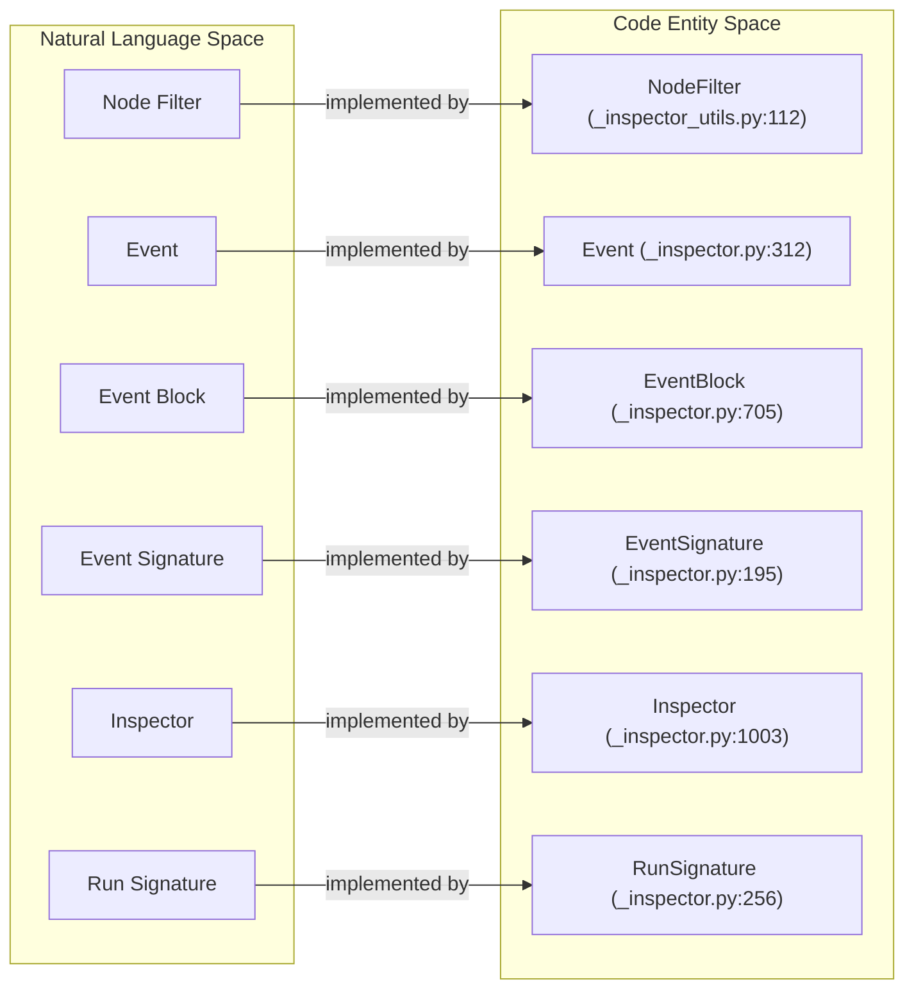
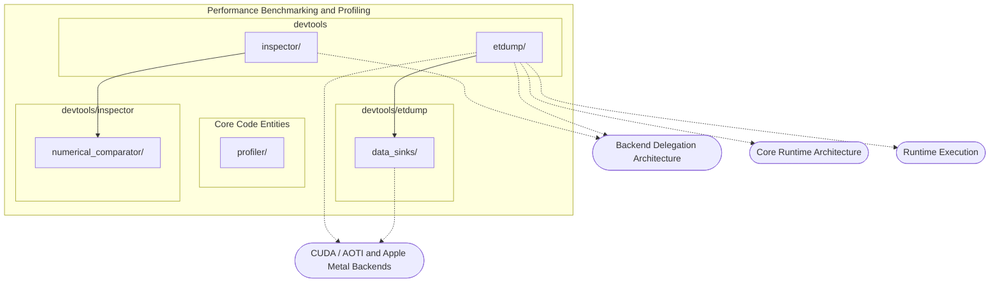
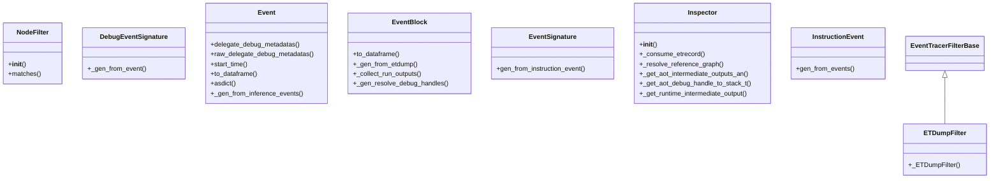
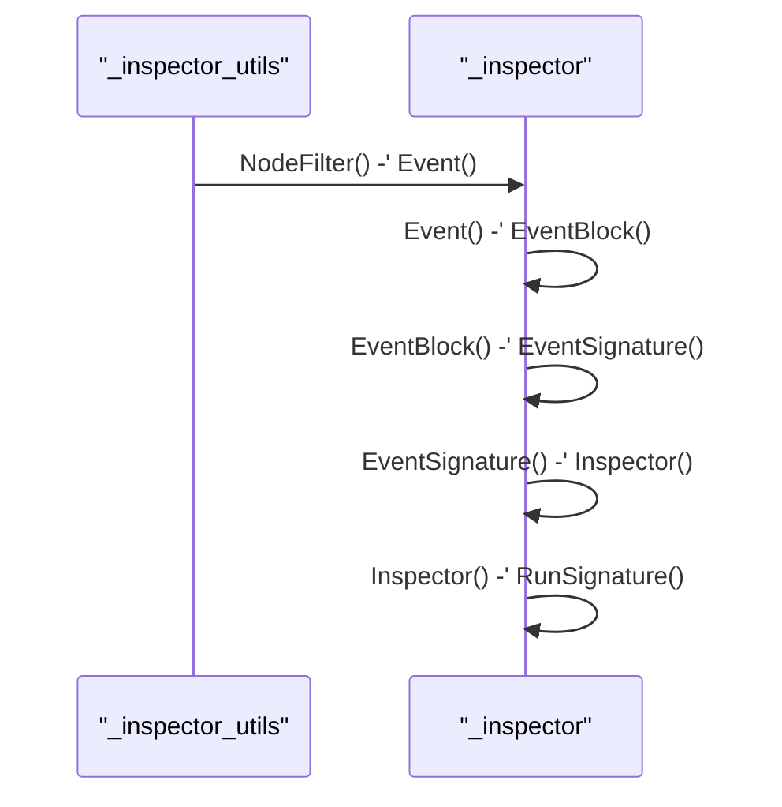

# 3-Source Context Packet (`git` + `CBM` + `llm-wiki`) for `7.3-performance-benchmarking-and-profiling` — Performance Benchmarking and Profiling

- **Target Wiki File**: `wiki/7.3-performance-benchmarking-and-profiling.md`
- **Archetype**: `Leaf Technical Spec Page`
- **Parent Page**: `7-testing-and-cicd-infrastructure`
- **Summary**: Architectural specification and implementation reference for Performance Benchmarking and Profiling (36 relevant source files). Primary code entities: `Allocator`, `MemAllocation`, `MemEvent`, `ProfileData`, `ETDumpGen`.
- **Valid `[[wikilink]]` Neighbours**: `[[7-testing-and-cicd-infrastructure|Testing and CI/CD Infrastructure]]`, `[[1.1-getting-started|Getting Started]]`, `[[1.2-export-api-and-recipe-system|Export API and Recipe System]]`, `[[2.2-kernel-libraries-and-selective-build|Kernel Libraries and Selective Build]]`, `[[2.3-schema-generation-and-flatbuffers|Schema Generation and FlatBuffers]]`, `[[3.4-program-emission-and-serialization|Program Emission and Serialization]]`, `[[3.5-verification-and-dialect-system|Verification and Dialect System]]`, `[[4-quantization-systems|Quantization Systems]]`

## 1. Relevant Source Files (`git` + `CBM`, use verbatim in `<details>`)
- `[profiler/parse_profiler_results.py](profiler/parse_profiler_results.py)`
- `[devtools/etdump/etdump_flatcc.cpp](devtools/etdump/etdump_flatcc.cpp)`
- `[devtools/etdump/schema_flatcc.py](devtools/etdump/schema_flatcc.py)`
- `[devtools/etdump/data_sinks/buffer_data_sink.h](devtools/etdump/data_sinks/buffer_data_sink.h)`
- `[devtools/inspector/_inspector.py](devtools/inspector/_inspector.py)`
- `[devtools/etdump/data_sinks/data_sink_base.h](devtools/etdump/data_sinks/data_sink_base.h)`
- `[devtools/inspector/_inspector_utils.py](devtools/inspector/_inspector_utils.py)`
- `[devtools/etdump/data_sinks/file_data_sink.h](devtools/etdump/data_sinks/file_data_sink.h)`
- `[devtools/etdump/etdump_filter.h](devtools/etdump/etdump_filter.h)`
- `[devtools/etdump/etdump_flatcc.h](devtools/etdump/etdump_flatcc.h)`
- `[profiler/profiler_results_cli.py](profiler/profiler_results_cli.py)`
- `[devtools/etdump/data_sinks/file_data_sink.cpp](devtools/etdump/data_sinks/file_data_sink.cpp)`
- `[devtools/etdump/data_sinks/buffer_data_sink.cpp](devtools/etdump/data_sinks/buffer_data_sink.cpp)`
- `[devtools/etdump/etdump_filter.cpp](devtools/etdump/etdump_filter.cpp)`
- `[devtools/etdump/emitter.cpp](devtools/etdump/emitter.cpp)`
- `[devtools/etdump/serialize.py](devtools/etdump/serialize.py)`
- `[devtools/etdump/emitter.h](devtools/etdump/emitter.h)`
- `[devtools/etdump/data_sinks/targets.bzl](devtools/etdump/data_sinks/targets.bzl)`
- `[devtools/inspector/_intermediate_output_capturer.py](devtools/inspector/_intermediate_output_capturer.py)`
- `[devtools/inspector/numerical_comparator/numerical_comparator_base.py](devtools/inspector/numerical_comparator/numerical_comparator_base.py)`
- `[devtools/etdump/targets.bzl](devtools/etdump/targets.bzl)`
- `[devtools/inspector/numerical_comparator/l1_numerical_comparator.py](devtools/inspector/numerical_comparator/l1_numerical_comparator.py)`
- `[devtools/inspector/numerical_comparator/mse_numerical_comparator.py](devtools/inspector/numerical_comparator/mse_numerical_comparator.py)`
- `[devtools/etdump/utils.h](devtools/etdump/utils.h)`
- `[devtools/inspector/numerical_comparator/snr_numerical_comparator.py](devtools/inspector/numerical_comparator/snr_numerical_comparator.py)`
- `[devtools/inspector/__init__.py](devtools/inspector/__init__.py)`
- `[devtools/inspector/inspector_cli.py](devtools/inspector/inspector_cli.py)`
- `[devtools/inspector/vgf_neural_statistics.py](devtools/inspector/vgf_neural_statistics.py)`
- `[docs/source/devtools-overview.md](docs/source/devtools-overview.md)`
- `[docs/source/devtools-tutorial.md](docs/source/devtools-tutorial.md)`

## 2. Grounded Code Symbols (`CBM`, use verbatim for `[file:start-end]()` pill citations)
- `NodeFilter` (Class) @ `[devtools/inspector/_inspector_utils.py:112-131]()` [fan-in=2, fan-out=0] — A class used to filter nodes based on extensible criteria. Attributes: metadata_key (str): The key to look for in the node's metadata. op_type (str): The operat
- `Event` (Class) @ `[devtools/inspector/_inspector.py:312-701]()` [fan-in=1, fan-out=0] — An Event corresponds to an operator instance with perf data retrieved from the runtime and other metadata from `ETRecord`. Args: name: Name of the profiling `Ev
- `EventBlock` (Class) @ `[devtools/inspector/_inspector.py:705-1000]()` [fan-in=1, fan-out=0] — r""" An `EventBlock` contains a collection of events associated with a particular profiling/debugging block retrieved from the runtime. Each `EventBlock` repres
- `EventSignature` (Class) @ `[devtools/inspector/_inspector.py:195-251]()` [fan-in=1, fan-out=0] — Note that (profile_event_signature, debug_event_signature) are sufficient signature identifiers. instruction_id is extracted from the signatures (equivalent in 
- `Inspector` (Class) @ `[devtools/inspector/_inspector.py:1003-1712]()` [fan-in=1, fan-out=0] — APIs for examining model architecture and performance stats. Public Attributes: event_blocks: List["EventBlocks"]. Structured data from ETDump (correlated with 
- `RunSignature` (Class) @ `[devtools/inspector/_inspector.py:256-266]()` [fan-in=1, fan-out=0] — Args: name: Name of the run events: List of EventSignatures that correspond to the run bundled_input_index: Index of the bundled input used to generate the debu
- `BufferDataSink` (Class) @ `[devtools/etdump/data_sinks/buffer_data_sink.h:24-124]()` [fan-in=0, fan-out=0] — /** * BufferDataSink is a concrete implementation of the DataSinkBase class, * designed to store debug data in a pre-allocated, user-owned buffer. This * class 
- `PROFILE_EVENT_ENUM` (Class) @ `[devtools/etdump/schema_flatcc.py:105-109]()` [fan-in=0, fan-out=0] — # Note the differing value style is a result of ETDump string
- `NodeData` (Class) @ `[devtools/inspector/_inspector_utils.py:96-109]()` [fan-in=1, fan-out=0] — Each node in the graph is an instance of NodeData, which contains: - source: A string indicating the origin of the node (either FROM_AOT or FROM_RUNTIME). - deb
- `DataSinkBase` (Class) @ `[devtools/etdump/data_sinks/data_sink_base.h:24-58]()` [fan-in=0, fan-out=0] — /** * DataSinkBase is an abstract class that users can inherit and implement * to customize the storage and management of debug data in ETDumpGen. This * class 
- `ETDumpFilter` (Class) @ `[devtools/etdump/etdump_filter.h:32-101]()` [fan-in=1, fan-out=0] — /** * ETDumpFilter is a class that filters intermediate output based on output's * name by full regex filtering, or delegate debug indices by range-based * filt
- `FileDataSink` (Class) @ `[devtools/etdump/data_sinks/file_data_sink.h:28-92]()` [fan-in=0, fan-out=0] — /** * FileDataSink is a concrete implementation of the DataSinkBase class, * designed to facilitate the direct writing of data to a file. It is * particularly u
- `IntermediateOutputCapturer` (Class) @ `[devtools/inspector/_intermediate_output_capturer.py:18-62]()` [fan-in=0, fan-out=0] — A class that captures intermediate outputs from a PyTorch graph module. Attributes: module (GraphModule): The graph module to capture outputs from. node_filters
- `MSEComparator` (Class) @ `[devtools/inspector/numerical_comparator/mse_numerical_comparator.py:19-37]()` [fan-in=1, fan-out=0] — Mean Squared Error comparator for numerical discrepancy detection.
- `NumericalComparatorBase` (Class) @ `[devtools/inspector/numerical_comparator/numerical_comparator_base.py:32-281]()` [fan-in=0, fan-out=0] — Base class for numerical comparison with optional preprocessing. This class provides a framework for comparing intermediate outputs between AOT (Ahead-of-Time) 
- `DebugEventSignature` (Class) @ `[devtools/inspector/_inspector.py:171-190]()` [fan-in=1, fan-out=0] — 
- `InstructionEvent` (Class) @ `[devtools/inspector/_inspector.py:97-142]()` [fan-in=1, fan-out=0] — 
- `InstructionEventSignature` (Class) @ `[devtools/inspector/_inspector.py:88-92]()` [fan-in=1, fan-out=0] — 
- `PerfData` (Class) @ `[devtools/inspector/_inspector.py:282-308]()` [fan-in=1, fan-out=0] — 
- `ProfileEventSignature` (Class) @ `[devtools/inspector/_inspector.py:147-166]()` [fan-in=1, fan-out=0] — 
- `L1Comparator` (Class) @ `[devtools/inspector/numerical_comparator/l1_numerical_comparator.py:19-35]()` [fan-in=0, fan-out=0] — L1 (sum of absolute differences) comparator for numerical discrepancy detection.
- `Allocator` (Class) @ `[profiler/parse_profiler_results.py:65-67]()` [fan-in=0, fan-out=0] — 

## 3. Grounded Source Code Excerpts (`git` Working Tree)
### `NodeFilter` in `[devtools/inspector/_inspector_utils.py:112-127]()`
```python
class NodeFilter:
    """
    A class used to filter nodes based on extensible criteria.
    Attributes:
        metadata_key (str): The key to look for in the node's metadata.
        op_type (str): The operation code to match.
        exclude_ops (List[str]): A list of operations to exclude from the filter.
    """

    def __init__(self, metadata_key: str, op_type: str, exclude_ops: List[str] = None):
        self.metadata_key = metadata_key
        self.op_type = op_type
        self.exclude_ops = exclude_ops

    def matches(self, node: torch.fx.Node) -> bool:
        return (
```

### `Event` in `[devtools/inspector/_inspector.py:312-327]()`
```python
class Event:
    """
    An Event corresponds to an operator instance with perf data retrieved from the runtime and other metadata from `ETRecord`.

    Args:
        name: Name of the profiling `Event`, empty if no profiling event.
        perf_data: Performance data associated with the event retrived from the runtime (available attributes: p10, p50, p90, avg, min and max).
        op_type: List of op types corresponding to the event.
        delegate_debug_identifier: Supplemental identifier used in combination with instruction id.
        debug_handles: Debug handles in the model graph to which this event is correlated.
        num_outputs: Indicates the number of outputs generated by the node.
                     Right now only used for call_delegate nodes that output more than one tensor.
        stack_trace: A dictionary mapping the name of each associated op to its stack trace.
        module_hierarchy: A dictionary mapping the name of each associated op to its module hierarchy.
        is_delegated_op: Whether or not the event was delegated.
        delegate_backend_name: Name of the backend this event was delegated to.
```

### `EventBlock` in `[devtools/inspector/_inspector.py:705-720]()`
```python
class EventBlock:
    r"""
    An `EventBlock` contains a collection of events associated with a particular profiling/debugging block retrieved from the runtime.
    Each `EventBlock` represents a pattern of execution. For example, model initiation and loading lives in a single `EventBlock`.
    If there's a control flow, each branch will be represented by a separate `EventBlock`.

    Args:
        name: Name of the profiling/debugging block.
        events: List of `Event`\ s associated with the profiling/debugging block.

        bundled_input_idx: Index of the Bundled Input that this EventBlock corresponds to.
        run_output: Run output extracted from the encapsulated Events
    """

    name: str
    events: List[Event] = dataclasses.field(default_factory=list)
```

### `EventSignature` in `[devtools/inspector/_inspector.py:195-210]()`
```python
class EventSignature:
    """
    Note that (profile_event_signature, debug_event_signature) are sufficient
    signature identifiers.

    instruction_id is extracted from the signatures (equivalent in both) and
    surfaced for convenience
    """

    instruction_id: int
    profile_event_signature: Optional[ProfileEventSignature] = None
    debug_event_signature: Optional[DebugEventSignature] = None

    @staticmethod
    def gen_from_instruction_event(
        instruction_event: InstructionEvent,
```

### `Inspector` in `[devtools/inspector/_inspector.py:1003-1018]()`
```python
class Inspector:
    """
    APIs for examining model architecture and performance stats.

    Public Attributes:
        event_blocks: List["EventBlocks"]. Structured data from ETDump (correlated with ETRecord if provided).

    Private Attributes:
        _etrecord: Optional[ETRecord]. File under etrecord_path deserialized into an object.
    """

    def __init__(
        self,
        etdump_path: Optional[str] = None,
        etdump_data: Optional[bytes] = None,
        etrecord: Optional[Union[ETRecord, str]] = None,
```


## 4. Linked Official Docs (`llm-wiki` / `RAG`)
- **Developer Tools (DevTools: ETDump, ETRecord, Inspector)** (`wiki/8.3-developer-tools-devtools.md`, score=150.613, shared_symbols=['Float']): # Developer Tools (DevTools: ETDump, ETRecord, Inspector) ↑ [[8-runtime-execution|Runtime Execution]] > Architectural specification and implementation reference for Developer Tools (DevTools: ETDump, ETRecord, Inspector) (38 relevant source files). Primary code entities: `DelegatePartitionProvenance`, `__hash__`, `ETRecord`, `__init__`, `ETDumpGen`. <deta
- **Testing and CI/CD Infrastructure** (`wiki/7-testing-and-cicd-infrastructure.md`, score=141.711, shared_symbols=[]): # Testing and CI/CD Infrastructure > Architectural specification and implementation reference for Testing and CI/CD Infrastructure (36 relevant source files). Primary code entities: `BenchmarkResults`, `save_json`, `to_dict`, `to_v3_format`, `BenchmarkFilters`. <details> <summary>Relevant source files</summary> The following files were used as context for
- **Schema Generation and FlatBuffers** (`wiki/2.3-schema-generation-and-flatbuffers.md`, score=111.665, shared_symbols=[]): # Schema Generation and FlatBuffers ↑ [[2-build-system-and-infrastructure|Build System and Infrastructure]] > Architectural specification and implementation reference for Schema Generation and FlatBuffers (36 relevant source files). Primary code entities: `Call`, `Sample`, `SampleSet`, `_SetDecoder`, `PTEFile`. <details> <summary>Relevant source files</su
- **ExecuTorch DeepWiki** (`wiki/index.md`, score=96.93, shared_symbols=[]): # ExecuTorch DeepWiki Generated from `home-jason-Project-deepwiki-executorch` at commit `b3b565b5b62f` (2026-11-15T15:02:11+00:00). ## Pages - [[1-overview|Overview]] — Architectural specification and implementation reference for Overview (10 relevant source files). Primary code entities: `Module`, `MethodHolder`, `PlannedMemory`, `EdgeProgramManager`, `_
- **CI/CD Workflows and Validation** (`wiki/7.1-cicd-workflows-and-validation.md`, score=84.765, shared_symbols=[]): # CI/CD Workflows and Validation ↑ [[7-testing-and-cicd-infrastructure|Testing and CI/CD Infrastructure]] > Architectural specification and implementation reference for CI/CD Workflows and Validation (31 relevant source files). Primary code entities: `BenchmarkResults`, `save_json`, `to_dict`, `to_v3_format`, `BenchmarkFilters`. <details> <summary>Relevan
- **Model and Backend Testing Framework** (`wiki/7.2-model-and-backend-testing-framework.md`, score=84.765, shared_symbols=[]): # Model and Backend Testing Framework ↑ [[7-testing-and-cicd-infrastructure|Testing and CI/CD Infrastructure]] > Architectural specification and implementation reference for Model and Backend Testing Framework (40 relevant source files). Primary code entities: `MuseGlimmerImageSpan`, `MuseGlimmerPreparationSpec`, `MuseGlimmerPreparedInput`, `Backing`, `Bac

## 5. Pre-Verified DeepWiki v1.9.9.5 Mermaid Diagrams
### Natural Language Space <-> Code Entity Space


### Subsystem Architecture Flowchart


### Class Hierarchy Diagram


### Call Sequence Diagram


## 6. DeepWiki v1.9.9.5 Authoring Checklist for `wiki/7.3-performance-benchmarking-and-profiling.md`
1. Keep YAML frontmatter at top (`id`, `title`, `parent`, `sources`, `linked_docs`, `bridge_symbols`).
2. Keep `<details><summary>Relevant source files</summary>` block immediately after `# Title`.
3. Start with `## Purpose and Scope`, then numbered `## 1. ...`, `## 2. ...` sections separated by `---`.
4. Include at least 2 ```mermaid``` diagrams (including a `Natural Language Space` <-> `Code Entity Space` mapping).
5. Cite code entities inline using `[path/to/file.ext:start-end]()` and end every `##` section with `Sources: [file:start-end]()`.
6. Run `deepwiki_cli.py build --enrich-only ...` and `deepwiki_cli.py validate ...` after editing.
