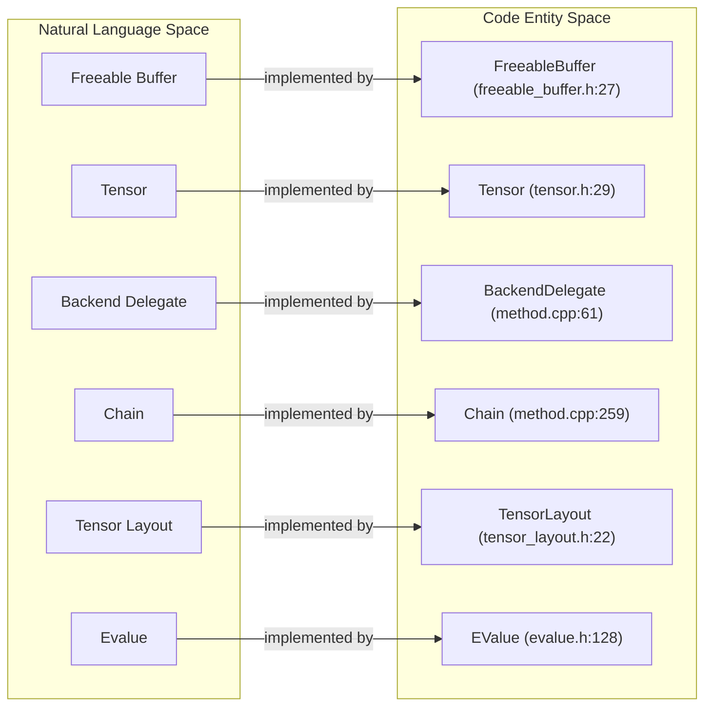
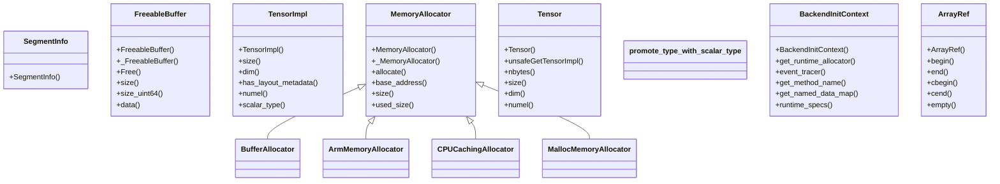
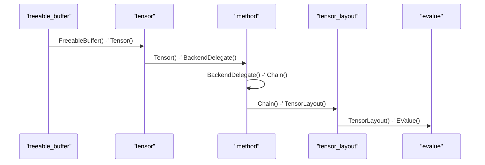

# 3-Source Context Packet (`git` + `CBM` + `llm-wiki`) for `8-runtime-execution` — Runtime Execution

- **Target Wiki File**: `wiki/8-runtime-execution.md`
- **Archetype**: `Parent Hub Page`
- **Parent Page**: `None (Top-Level Chapter)`
- **Summary**: Architectural specification and implementation reference for Runtime Execution (39 relevant source files). Primary code entities: `ET_CHECK_MSG`, `execute`, `execute_instruction`, `experimental_reset_execution`, `ArrayRef`.
- **Valid `[[wikilink]]` Neighbours**: `[[1-overview|Overview]]`, `[[8.1-core-runtime-architecture|Core Runtime Architecture]]`, `[[8.2-kernel-registration-and-dispatch|Kernel Registration and Dispatch]]`, `[[8.3-developer-tools-devtools|Developer Tools (DevTools: ETDump, ETRecord, Inspector)]]`, `[[1.2-export-api-and-recipe-system|Export API and Recipe System]]`, `[[2.3-schema-generation-and-flatbuffers|Schema Generation and FlatBuffers]]`, `[[3-exir-core-system|EXIR Core System]]`, `[[3.1-program-structure-and-compilation-flow|Program Structure and Compilation Flow]]`

## 1. Relevant Source Files (`git` + `CBM`, use verbatim in `<details>`)
- `[runtime/executor/method.cpp](runtime/executor/method.cpp)`
- `[runtime/core/array_ref.h](runtime/core/array_ref.h)`
- `[runtime/core/result.h](runtime/core/result.h)`
- `[runtime/core/portable_type/tensor.h](runtime/core/portable_type/tensor.h)`
- `[runtime/executor/method_meta.cpp](runtime/executor/method_meta.cpp)`
- `[runtime/core/tensor_layout.h](runtime/core/tensor_layout.h)`
- `[runtime/core/evalue.h](runtime/core/evalue.h)`
- `[runtime/executor/memory_manager.h](runtime/executor/memory_manager.h)`
- `[runtime/executor/method_meta.h](runtime/executor/method_meta.h)`
- `[runtime/executor/platform_memory_allocator.h](runtime/executor/platform_memory_allocator.h)`
- `[runtime/executor/method.h](runtime/executor/method.h)`
- `[runtime/executor/program.h](runtime/executor/program.h)`
- `[runtime/executor/pte_data_map.h](runtime/executor/pte_data_map.h)`
- `[runtime/executor/tensor_parser_exec_aten.cpp](runtime/executor/tensor_parser_exec_aten.cpp)`
- `[runtime/core/portable_type/tensor_impl.h](runtime/core/portable_type/tensor_impl.h)`
- `[runtime/executor/program.cpp](runtime/executor/program.cpp)`
- `[runtime/executor/tensor_parser.h](runtime/executor/tensor_parser.h)`
- `[runtime/executor/tensor_parser_aten.cpp](runtime/executor/tensor_parser_aten.cpp)`
- `[runtime/core/freeable_buffer.h](runtime/core/freeable_buffer.h)`
- `[runtime/platform/runtime.cpp](runtime/platform/runtime.cpp)`
- `[runtime/executor/merged_data_map.h](runtime/executor/merged_data_map.h)`
- `[runtime/core/data_loader.h](runtime/core/data_loader.h)`
- `[runtime/core/memory_allocator.h](runtime/core/memory_allocator.h)`
- `[kernels/portable/cpu/scalar_utils.h](kernels/portable/cpu/scalar_utils.h)`
- `[runtime/executor/program_validation.cpp](runtime/executor/program_validation.cpp)`
- `[runtime/executor/pte_data_map.cpp](runtime/executor/pte_data_map.cpp)`
- `[runtime/backend/backend_init_context.h](runtime/backend/backend_init_context.h)`
- `[devtools/bundled_program/bundled_program.cpp](devtools/bundled_program/bundled_program.cpp)`
- `[kernels/portable/README.md](kernels/portable/README.md)`
- `[devtools/bundled_program/schema/README.md](devtools/bundled_program/schema/README.md)`

## 2. Grounded Code Symbols (`CBM`, use verbatim for `[file:start-end]()` pill citations)
- `FreeableBuffer` (Class) @ `[runtime/core/freeable_buffer.h:27-270]()` [fan-in=6, fan-out=0] — /** * A read-only buffer than can be freed. */
- `Tensor` (Class) @ `[runtime/core/portable_type/tensor.h:29-178]()` [fan-in=1, fan-out=0] — /** * A minimal Tensor type whose API is a source compatible subset of at::Tensor. * * NOTE: Instances of this class do not own the TensorImpl given to it, * wh
- `BackendDelegate` (Class) @ `[runtime/executor/method.cpp:61-254]()` [fan-in=0, fan-out=0] — /** * Runtime state for a backend delegate. */
- `Chain` (Class) @ `[runtime/executor/method.cpp:259-267]()` [fan-in=0, fan-out=0] — /** * Runtime state for a chain of instructions. */
- `TensorLayout` (Class) @ `[runtime/core/tensor_layout.h:22-90]()` [fan-in=0, fan-out=0] — /** * Describes the layout of a tensor. */
- `EValue` (Class) @ `[runtime/core/evalue.h:128-705]()` [fan-in=0, fan-out=0] — // Aggregate typing system similar to IValue only slimmed down with less // functionality, no dependencies on atomic, and fewer supported types to better // sui
- `TensorImpl` (Class) @ `[runtime/core/portable_type/tensor_impl.h:60-302]()` [fan-in=2, fan-out=0] — /** * Manages the storage behind an ETensor (torch::executor::Tensor). * * Note that instances of this class do not own the arrays given to it * (sizes/strides/
- `MemoryManager` (Class) @ `[runtime/executor/memory_manager.h:32-138]()` [fan-in=0, fan-out=0] — /** * A container class for allocators used during Method load and execution. * * This class consolidates all dynamic memory needs for Method load and * executi
- `MethodMeta` (Class) @ `[runtime/executor/method_meta.h:155-326]()` [fan-in=0, fan-out=0] — /** * Describes a a method in an ExecuTorch program. * * The program used to create a MethodMeta object must outlive the MethodMeta. * It is separate from Metho
- `TensorInfo` (Class) @ `[runtime/executor/method_meta.h:36-146]()` [fan-in=0, fan-out=0] — /** * Metadata about a specific tensor of an ExecuTorch Program. * * The program used to create the MethodMeta object that created this * TensorInfo must outliv
- `PlatformMemoryAllocator` (Class) @ `[runtime/executor/platform_memory_allocator.h:30-121]()` [fan-in=0, fan-out=0] — /** * PlatformMemoryAllocator is a memory allocator that uses a linked list to * manage allocated nodes. It overrides the allocate method of MemoryAllocator * u
- `Method` (Class) @ `[runtime/executor/method.h:63-451]()` [fan-in=0, fan-out=0] — /** * An executable method of an executorch program. Maps to a python method like * `forward()` on the original nn.Module. */
- `Program` (Class) @ `[runtime/executor/program.h:48-354]()` [fan-in=0, fan-out=0] — /** * A deserialized ExecuTorch program binary. */
- `SegmentInfo` (Class) @ `[runtime/core/data_loader.h:32-80]()` [fan-in=7, fan-out=0] — 
- `PteDataMap` (Class) @ `[runtime/executor/pte_data_map.h:56-147]()` [fan-in=0, fan-out=0] — /** * A NamedDataMap implementation for Flatbuffer-serialized named data * originating from a PTE file. */
- `TensorParser` (Class) @ `[runtime/executor/tensor_parser_exec_aten.cpp:25-45]()` [fan-in=0, fan-out=0] — // Provides access to private Program methods.
- `NamedData` (Class) @ `[runtime/executor/tensor_parser.h:31-34]()` [fan-in=0, fan-out=0] — /// Data structure to hold key and data buffer for external data used /// in a method.
- `DeviceTypeMapping` (Class) @ `[runtime/executor/tensor_parser_aten.cpp:36-39]()` [fan-in=0, fan-out=0] — // Maps a serialized DeviceType to its ATen counterpart. Kept as a table so // validation and conversion share one source of truth and a new device only // need
- `MemoryAllocator` (Class) @ `[runtime/core/memory_allocator.h:38-238]()` [fan-in=1, fan-out=0] — /** * A class that does simple allocation based on a size and returns the pointer * to the memory address. It bookmarks a buffer with certain size. The * alloca
- `ArrayRef` (Class) @ `[runtime/core/array_ref.h:58-190]()` [fan-in=0, fan-out=0] — 
- `DataLoader` (Class) @ `[runtime/core/data_loader.h:27-195]()` [fan-in=0, fan-out=0] — /** * Loads from a data source. * * See //executorch/extension/data_loader for common implementations. */
- `Result` (Class) @ `[runtime/core/result.h:49-180]()` [fan-in=0, fan-out=0] — 

## 3. Grounded Source Code Excerpts (`git` Working Tree)
### `FreeableBuffer` in `[runtime/core/freeable_buffer.h:27-42]()`
```cpp
class FreeableBuffer final {
 public:
  // Callback signature for the function that does the freeing.
  using FreeFn = void (*)(void* context, void* data, size_t size);
  using FreeUInt64SizeFn =
      void (*)(void* context, uint64_t data_uint64, uint64_t size);
  /// DEPRECATED: Use FreeUInt64SizeFn instead.
  using FreeUInt64Fn ET_DEPRECATED =
      void (*)(void* context, uint64_t data_uint64, size_t size);

 private:
  using LegacyFreeUInt64Fn =
      void (*)(void* context, uint64_t data_uint64, size_t size);

  // Forward declare types.
  struct PointerData {
```

### `Tensor` in `[runtime/core/portable_type/tensor.h:29-44]()`
```cpp
class Tensor {
 public:
  /// The type used for elements of `sizes()`.
  using SizesType = TensorImpl::SizesType;
  /// The type used for elements of `dim_order()`.
  using DimOrderType = TensorImpl::DimOrderType;
  /// The type used for elements of `strides()`.
  using StridesType = TensorImpl::StridesType;

  Tensor() = delete;
  explicit constexpr Tensor(TensorImpl* impl) : impl_(impl) {}

  /**
   * Returns a pointer to the underlying TensorImpl.
   *
   * NOTE: Clients should be wary of operating on the TensorImpl
```

### `BackendDelegate` in `[runtime/executor/method.cpp:61-76]()`
```cpp
class BackendDelegate final {
 public:
  /**
   * Initializes an already-allocated BackendDelegate from its serialized
   * representation.
   *
   * @param[in] delegate The serialized backend delegate to load.
   * @param[in] program The serialized program to load from.
   * @param[in] backend_init_context The context pointer to pass to the
   *     backend's init() method.
   * @param[out] out The BackendDelegate to initialize.
   *
   * @returns Error::Ok if the initialization succeeded, or an error otherwise.
   */
  static Error Init(
      const executorch_flatbuffer::BackendDelegate& delegate,
```

### `Chain` in `[runtime/executor/method.cpp:259-267]()`
```cpp
struct Chain {
  /// Pointer to the associated flatbuffer chain.
  const executorch_flatbuffer::Chain* s_chain_;

  /// Each entry is a list of parameters for a kernel or delegate call.
  Span<InstructionArgs> argument_lists_;
  /// Each instruction will have one kernel (not for delegate).
  OpFunction* kernels_;
};
```

### `TensorLayout` in `[runtime/core/tensor_layout.h:22-37]()`
```cpp
class TensorLayout final {
 public:
  TensorLayout() = delete;

  /**
   * Creates a TensorLayout from the given parameters.
   *
   * @param[in] sizes The sizes of the tensor. Note: the span passed here must
   * outlive the TensorLayout and all copies of it.
   * @param[in] dim_order The dim order of the tensor. Note: the span passed
   * here must outlive the TensorLayout and all copies of it.
   * @param[in] scalar_type The scalar type of the tensor.
   * @return A Result containing the TensorLayout on success, or an error.
   */
  static executorch::runtime::Result<const TensorLayout> create(
      Span<const int32_t> sizes,
```


## 4. Linked Official Docs (`llm-wiki` / `RAG`)
- **Core Runtime Architecture** (`wiki/8.1-core-runtime-architecture.md`, score=125.663, shared_symbols=['ArrayRef', 'EValue', 'FreeableBuffer', 'MemoryAllocator', 'SegmentInfo', 'Tensor', 'TensorImpl', 'back']): # Core Runtime Architecture ↑ [[8-runtime-execution|Runtime Execution]] > Architectural specification and implementation reference for Core Runtime Architecture (38 relevant source files). Primary code entities: `ET_CHECK_MSG`, `execute`, `execute_instruction`, `experimental_reset_execution`, `ArrayRef`. <details> <summary>Relevant source files</summary> 
- **ExecuTorch DeepWiki** (`wiki/index.md`, score=89.804, shared_symbols=[]): # ExecuTorch DeepWiki Generated from `home-jason-Project-deepwiki-executorch` at commit `b3b565b5b62f` (2026-11-15T15:02:11+00:00). ## Pages - [[1-overview|Overview]] — Architectural specification and implementation reference for Overview (10 relevant source files). Primary code entities: `Module`, `MethodHolder`, `PlannedMemory`, `EdgeProgramManager`, `_
- **Getting Started** (`wiki/1.1-getting-started.md`, score=61.581, shared_symbols=['ArrayRef', 'Tensor', 'back']): # Getting Started ↑ [[1-overview|Overview]] > Architectural specification and implementation reference for Getting Started (22 relevant source files). Primary code entities: `cu134_requirements`, `get_torch_url`, `get_torchao_version`, `install_optional_example_requirements`, `EventTraceManager`. <details> <summary>Relevant source files</summary> The fol
- **Mobile and Platform Extensions** (`wiki/9-mobile-and-platform-extensions.md`, score=59.832, shared_symbols=['EValue', 'Tensor']): # Mobile and Platform Extensions > Architectural specification and implementation reference for Mobile and Platform Extensions (40 relevant source files). Primary code entities: `BindingSpec`, `ComputePipelineBundle`, `operator=`, `Storage`, `~Storage`. <details> <summary>Relevant source files</summary> The following files were used as context for generat
- **Developer Tools (DevTools: ETDump, ETRecord, Inspector)** (`wiki/8.3-developer-tools-devtools.md`, score=59.285, shared_symbols=['ArrayRef', 'back']): # Developer Tools (DevTools: ETDump, ETRecord, Inspector) ↑ [[8-runtime-execution|Runtime Execution]] > Architectural specification and implementation reference for Developer Tools (DevTools: ETDump, ETRecord, Inspector) (38 relevant source files). Primary code entities: `DelegatePartitionProvenance`, `__hash__`, `ETRecord`, `__init__`, `ETDumpGen`. <deta
- **Python Bindings and Dependencies** (`wiki/2.4-python-bindings-and-dependencies.md`, score=58.332, shared_symbols=['Tensor']): # Python Bindings and Dependencies ↑ [[2-build-system-and-infrastructure|Build System and Infrastructure]] > Architectural specification and implementation reference for Python Bindings and Dependencies (15 relevant source files). Primary code entities: `BorrowedInput`, `torch_storage`, `validate`, `PyExecuTorchResult`, `DLPackHolder`. <details> <summary>

## 5. Pre-Verified DeepWiki v1.9.9.5 Mermaid Diagrams
### Natural Language Space <-> Code Entity Space


### Subsystem Architecture Flowchart

```mermaid
flowchart TD
  subgraph sub_this["Runtime Execution"]
    subgraph sg_0["runtime"]
      n_runtime_executor["executor/"]
      n_runtime_core["core/"]
      n_runtime_platform["platform/"]
      n_runtime_backend["backend/"]
    end
    subgraph sg_1["runtime/core"]
      n_runtime_core_portable_type["portable_type/"]
    end
    subgraph sg_2["kernels/portable"]
      n_kernels_portable_cpu["cpu/"]
    end
    subgraph sg_3["devtools"]
      n_devtools_bundled_program["bundled_program/"]
      n_devtools_backend_debug["backend_debug/"]
    end
    subgraph sg_4["kernels"]
      n_kernels_portable["portable/"]
    end
  end
  n_page_2_build_system_and_infrastructure(["Build System and Infrastructure"])
  n_page_5_7_cuda_aoti_and_apple_metal_backends(["CUDA / AOTI and Apple Metal Backends"])
  n_page_6_model_export_and_llm_support(["Model Export and LLM Support"])
  n_page_9_mobile_and_platform_extensions(["Mobile and Platform Extensions"])
  n_runtime_core -.-> n_page_9_mobile_and_platform_extensions
  n_runtime_core -.-> n_page_2_build_system_and_infrastructure
  n_runtime_executor -.-> n_page_2_build_system_and_infrastructure
  n_runtime_executor -.-> n_page_9_mobile_and_platform_extensions
  n_runtime_core -.-> n_page_6_model_export_and_llm_support
  n_runtime_executor -.-> n_page_5_7_cuda_aoti_and_apple_metal_backends
  n_runtime_executor -.-> n_page_6_model_export_and_llm_support
  n_runtime_core -.-> n_page_5_7_cuda_aoti_and_apple_metal_backends
  n_runtime_core_portable_type -.-> n_page_9_mobile_and_platform_extensions
  n_runtime_core_portable_type -.-> n_page_6_model_export_and_llm_support
  n_runtime_core_portable_type -.-> n_page_2_build_system_and_infrastructure
  n_devtools_bundled_program -.-> n_page_5_7_cuda_aoti_and_apple_metal_backends
```


### Class Hierarchy Diagram


### Call Sequence Diagram


## 6. DeepWiki v1.9.9.5 Authoring Checklist for `wiki/8-runtime-execution.md`
1. Keep YAML frontmatter at top (`id`, `title`, `parent`, `sources`, `linked_docs`, `bridge_symbols`).
2. Keep `<details><summary>Relevant source files</summary>` block immediately after `# Title`.
3. Start with `## Purpose and Scope`, then numbered `## 1. ...`, `## 2. ...` sections separated by `---`.
4. Include at least 2 ```mermaid``` diagrams (including a `Natural Language Space` <-> `Code Entity Space` mapping).
5. Cite code entities inline using `[path/to/file.ext:start-end]()` and end every `##` section with `Sources: [file:start-end]()`.
6. Run `deepwiki_cli.py build --enrich-only ...` and `deepwiki_cli.py validate ...` after editing.
