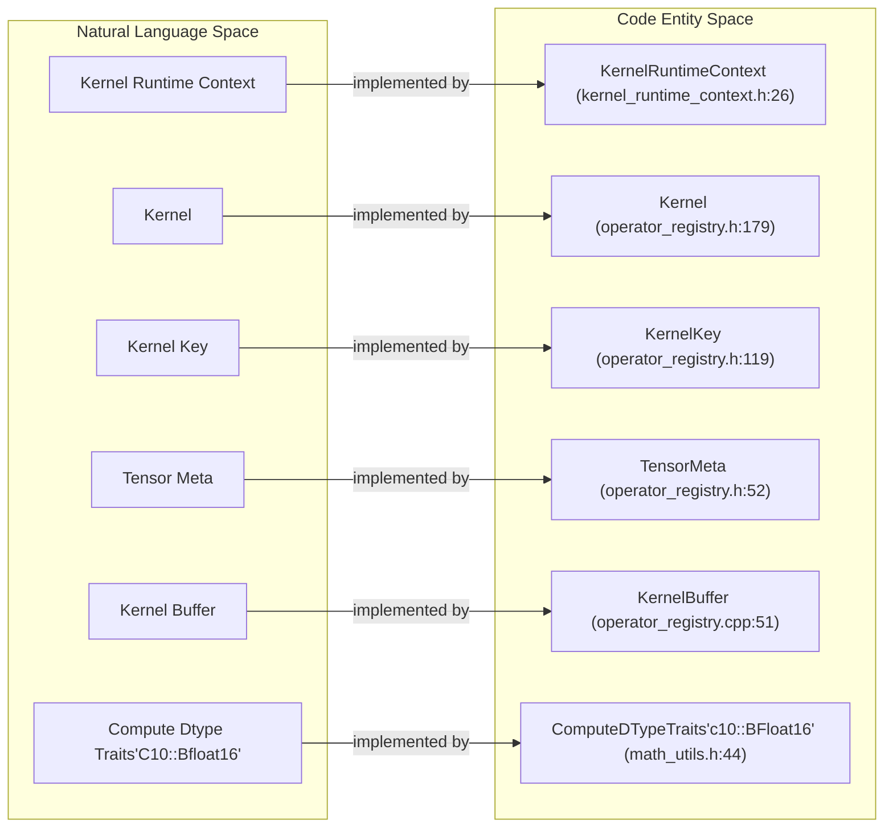
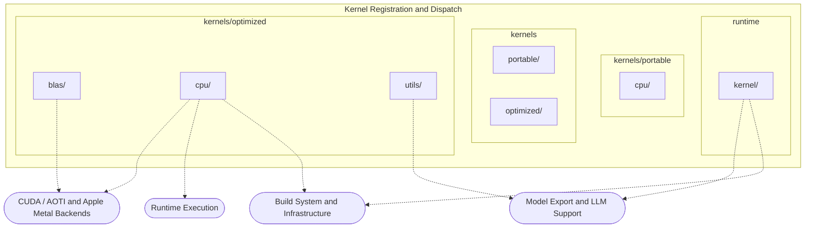
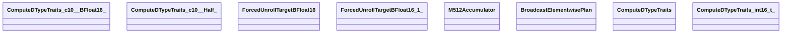
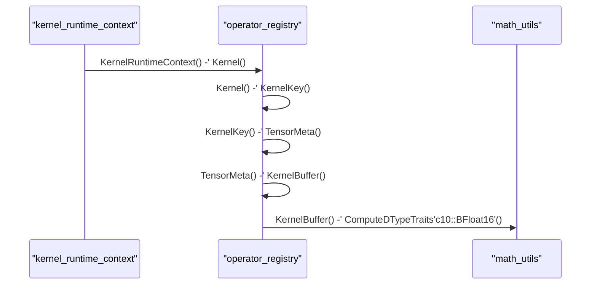

# 3-Source Context Packet (`git` + `CBM` + `llm-wiki`) for `8.2-kernel-registration-and-dispatch` — Kernel Registration and Dispatch

- **Target Wiki File**: `wiki/8.2-kernel-registration-and-dispatch.md`
- **Archetype**: `Leaf Technical Spec Page`
- **Parent Page**: `8-runtime-execution`
- **Summary**: Architectural specification and implementation reference for Kernel Registration and Dispatch (36 relevant source files). Primary code entities: `KernelRuntimeContext`, `allocate_temp`, `fail`, `Kernel`, `KernelKey`.
- **Valid `[[wikilink]]` Neighbours**: `[[8-runtime-execution|Runtime Execution]]`, `[[1.2-export-api-and-recipe-system|Export API and Recipe System]]`, `[[2.3-schema-generation-and-flatbuffers|Schema Generation and FlatBuffers]]`, `[[3-exir-core-system|EXIR Core System]]`, `[[3.1-program-structure-and-compilation-flow|Program Structure and Compilation Flow]]`, `[[3.2-graph-transformation-pass-system|Graph Transformation Pass System]]`, `[[3.3-memory-planning-and-allocation|Memory Planning and Allocation]]`, `[[3.4-program-emission-and-serialization|Program Emission and Serialization]]`

## 1. Relevant Source Files (`git` + `CBM`, use verbatim in `<details>`)
- `[runtime/kernel/kernel_runtime_context.h](runtime/kernel/kernel_runtime_context.h)`
- `[runtime/kernel/operator_registry.h](runtime/kernel/operator_registry.h)`
- `[runtime/kernel/operator_registry.cpp](runtime/kernel/operator_registry.cpp)`
- `[runtime/kernel/kernel_includes.h](runtime/kernel/kernel_includes.h)`
- `[runtime/kernel/thread_parallel_interface.h](runtime/kernel/thread_parallel_interface.h)`
- `[runtime/kernel/targets.bzl](runtime/kernel/targets.bzl)`
- `[kernels/portable/cpu/scalar_utils.h](kernels/portable/cpu/scalar_utils.h)`
- `[kernels/portable/__init__.py](kernels/portable/__init__.py)`
- `[kernels/optimized/blas/BlasKernel.cpp](kernels/optimized/blas/BlasKernel.cpp)`
- `[kernels/portable/cpu/op__adaptive_avg_pool2d.cpp](kernels/portable/cpu/op__adaptive_avg_pool2d.cpp)`
- `[kernels/portable/cpu/op__device_copy.cpp](kernels/portable/cpu/op__device_copy.cpp)`
- `[kernels/portable/cpu/math_constants.h](kernels/portable/cpu/math_constants.h)`
- `[kernels/portable/cpu/op__clone_dim_order.cpp](kernels/portable/cpu/op__clone_dim_order.cpp)`
- `[kernels/portable/cpu/op__conj_physical.cpp](kernels/portable/cpu/op__conj_physical.cpp)`
- `[kernels/portable/cpu/op__empty_dim_order.cpp](kernels/portable/cpu/op__empty_dim_order.cpp)`
- `[kernels/portable/cpu/op__to_dim_order_copy.cpp](kernels/portable/cpu/op__to_dim_order_copy.cpp)`
- `[kernels/portable/cpu/op_abs.cpp](kernels/portable/cpu/op_abs.cpp)`
- `[kernels/portable/cpu/op_acos.cpp](kernels/portable/cpu/op_acos.cpp)`
- `[kernels/portable/cpu/op_add.cpp](kernels/portable/cpu/op_add.cpp)`
- `[kernels/portable/cpu/op_acosh.cpp](kernels/portable/cpu/op_acosh.cpp)`
- `[kernels/optimized/cpu/binary_ops.h](kernels/optimized/cpu/binary_ops.h)`
- `[kernels/optimized/utils/math_utils.h](kernels/optimized/utils/math_utils.h)`
- `[kernels/portable/cpu/op_addmm.cpp](kernels/portable/cpu/op_addmm.cpp)`
- `[kernels/portable/cpu/op_allclose.cpp](kernels/portable/cpu/op_allclose.cpp)`
- `[kernels/portable/cpu/op_alias_copy.cpp](kernels/portable/cpu/op_alias_copy.cpp)`
- `[kernels/portable/cpu/op_amax.cpp](kernels/portable/cpu/op_amax.cpp)`
- `[kernels/portable/cpu/op_any.cpp](kernels/portable/cpu/op_any.cpp)`
- `[kernels/portable/cpu/op_amin.cpp](kernels/portable/cpu/op_amin.cpp)`
- `[kernels/portable/README.md](kernels/portable/README.md)`
- `[docs/source/kernel-library-overview.md](docs/source/kernel-library-overview.md)`

## 2. Grounded Code Symbols (`CBM`, use verbatim for `[file:start-end]()` pill citations)
- `KernelRuntimeContext` (Class) @ `[runtime/kernel/kernel_runtime_context.h:26-108]()` [fan-in=0, fan-out=0] — /** * Runtime state and functionality for kernel implementations. * * NOTE: Will not be passed to operators if running in ATen mode as those * operators do not 
- `Kernel` (Class) @ `[runtime/kernel/operator_registry.h:179-198]()` [fan-in=0, fan-out=0] — /** * Struct that bundles a kernel key, a function and an op name together. An * `Operator` may have more than one `Kernel` (maximum kMaxNumOfKernelPerOp) and *
- `KernelKey` (Class) @ `[runtime/kernel/operator_registry.h:119-171]()` [fan-in=0, fan-out=0] — /** * Describes which dtype & dim order specialized kernel to be bound to an * operator. * * Kernel key data is a string with the format: * * "v<version>/<tenso
- `TensorMeta` (Class) @ `[runtime/kernel/operator_registry.h:52-95]()` [fan-in=0, fan-out=0] — /** * Dtype and dim order metadata for a Tensor argument to an operator. * Used by the Executor to hold the tensor metadata info and retrieve kernel. */
- `KernelBuffer` (Class) @ `[runtime/kernel/operator_registry.cpp:51-53]()` [fan-in=0, fan-out=0] — // Data that backs the kernel table. Since Kernel has a custom default // constructor (implicitly, because it contains KernelKey, which has a custom // ctor), s
- `ComputeDTypeTraits<c10::BFloat16>` (Class) @ `[kernels/optimized/utils/math_utils.h:44-46]()` [fan-in=9, fan-out=0] — 
- `M512Accumulator` (Class) @ `[kernels/optimized/blas/BlasKernel.cpp:688-690]()` [fan-in=0, fan-out=0] — // GCC drops vector type attributes on direct std::array<__m512, ...> // instantiations and promotes that warning to an error in CI.
- `ComputeDTypeTraits<c10::Half>` (Class) @ `[kernels/optimized/utils/math_utils.h:48-50]()` [fan-in=6, fan-out=0] — 
- `OperatorName` (Class) @ `[runtime/kernel/kernel_includes.h:35-47]()` [fan-in=0, fan-out=0] — 
- `promote_type_with_scalar_type` (Class) @ `[kernels/portable/cpu/scalar_utils.h:84-126]()` [fan-in=0, fan-out=0] — 
- `ForcedUnrollTargetBFloat16` (Class) @ `[kernels/optimized/blas/BlasKernel.cpp:258-265]()` [fan-in=0, fan-out=0] — 
- `ForcedUnrollTargetBFloat16<1>` (Class) @ `[kernels/optimized/blas/BlasKernel.cpp:268-274]()` [fan-in=0, fan-out=0] — 
- `BroadcastElementwisePlan` (Class) @ `[kernels/optimized/cpu/binary_ops.h:212-218]()` [fan-in=0, fan-out=0] — 
- `ComputeDTypeTraits` (Class) @ `[kernels/optimized/utils/math_utils.h:21-23]()` [fan-in=0, fan-out=0] — 
- `ComputeDTypeTraits<int16_t>` (Class) @ `[kernels/optimized/utils/math_utils.h:30-32]()` [fan-in=0, fan-out=0] — 
- `ComputeDTypeTraits<int8_t>` (Class) @ `[kernels/optimized/utils/math_utils.h:39-41]()` [fan-in=0, fan-out=0] — 
- `ComputeDTypeTraits<uint16_t>` (Class) @ `[kernels/optimized/utils/math_utils.h:26-28]()` [fan-in=0, fan-out=0] — 
- `ComputeDTypeTraits<uint8_t>` (Class) @ `[kernels/optimized/utils/math_utils.h:35-37]()` [fan-in=0, fan-out=0] — 
- `fail` (Method) @ `[runtime/kernel/kernel_runtime_context.h:56-58]()` [fan-in=25, fan-out=0] — /** * Tells the runtime that the kernel call has failed. Prefer this over * ET_CHECK_*(), which fatally panics the process/system. * * If this is not called, th
- `get_scalar_dtype` (Function) @ `[kernels/portable/cpu/scalar_utils.h:56-67]()` [fan-in=19, fan-out=0] — /** * Returns the dtype associated with a Scalar that reflects the category * of value stored by the Scalar. */
- `extract_scalar` (Function) @ `[kernels/portable/cpu/scalar_utils.h:248-262]()` [fan-in=17, fan-out=0] — /** * Extracts a boolean value from a Scalar. * * @param[in] scalar The source of the value to extract. * @param[out] out_val The extracted value, on success. *
- `promote_type_with_scalar` (Function) @ `[kernels/portable/cpu/scalar_utils.h:137-171]()` [fan-in=14, fan-out=0] — /** * Implement type promotion between a tensor's ScalarType with a Scalar. * If the Scalar contains a value in the same category of the tensor's * ScalarType, 

## 3. Grounded Source Code Excerpts (`git` Working Tree)
### `KernelRuntimeContext` in `[runtime/kernel/kernel_runtime_context.h:26-41]()`
```cpp
class KernelRuntimeContext {
 public:
  /**
   * Construct a new kernel runtime context.
   *
   * KernelRuntimeContext does not take ownership
   * of these pointers, so they must outlive the context instance.
   *
   * @param[in] event_tracer The optional EventTracer to use for
   *     profiling/debugging
   * @param[in] temp_allocator The optional MemoryAllocator used to allocate
   *     temporary memory for the kernel. If not provided, an error will be
   *     returned when calling allocate_temp.
   */
  KernelRuntimeContext(
      EventTracer* event_tracer = nullptr,
```

### `Kernel` in `[runtime/kernel/operator_registry.h:179-194]()`
```cpp
struct Kernel {
  const char* name_;
  // String representation of kernel key, with the same format as
  // KernelKey.to_string_representation()
  // Data is not owned by the Kernel struct.
  KernelKey kernel_key_;
  OpFunction op_;
  /**
   * We are doing a copy of the string pointer instead of duplicating the string
   * itself, we require the lifetime of the operator name to be at least as long
   * as the operator registry.
   */
  constexpr explicit Kernel(const char* name, OpFunction func)
      : name_(name), op_(func) {}

  constexpr explicit Kernel(const char* name, KernelKey key, OpFunction func)
```

### `KernelKey` in `[runtime/kernel/operator_registry.h:119-134]()`
```cpp
struct KernelKey {
 public:
  /**
   * Creates a fallback (non-specialized) kernel key: this kernel can be used
   * for all input tensor dtypes and dim orders if the specialized kernel is not
   * registered.
   */
  constexpr KernelKey() = default;

  /**
   * Creates a specialized (non-fallback) kernel key that matches a specific
   * set of input tensor dtypes and dim orders. See the class comment for the
   * expected format of `kernel_key_data`.
   */
  /* implicit */ constexpr KernelKey(const char* kernel_key_data)
      : kernel_key_data_(kernel_key_data) {}
```

### `TensorMeta` in `[runtime/kernel/operator_registry.h:52-67]()`
```cpp
struct TensorMeta {
  executorch::aten::ScalarType dtype_;
  Span<executorch::aten::DimOrderType> dim_order_;

  TensorMeta() = default;
  TensorMeta(
      executorch::aten::ScalarType dtype,
      Span<executorch::aten::DimOrderType> order)
      : dtype_(dtype), dim_order_(order) {}

  bool operator==(const TensorMeta& other) const {
    return this->equals(other);
  }

  bool operator!=(const TensorMeta& other) const {
    return !this->equals(other);
```

### `KernelBuffer` in `[runtime/kernel/operator_registry.cpp:51-53]()`
```cpp
struct alignas(Kernel) KernelBuffer {
  uint8_t data[sizeof(Kernel)];
};
```


## 4. Linked Official Docs (`llm-wiki` / `RAG`)
- **Kernel Libraries and Selective Build** (`wiki/2.2-kernel-libraries-and-selective-build.md`, score=117.145, shared_symbols=[]): # Kernel Libraries and Selective Build ↑ [[2-build-system-and-infrastructure|Build System and Infrastructure]] > Architectural specification and implementation reference for Kernel Libraries and Selective Build (31 relevant source files). Primary code entities: `KernelType`, `ScalarType`, `_dump_yaml`, `_get_et_kernel_metadata_from_ops_yaml`, `IOMetaData`.
- **Model Export and LLM Support** (`wiki/6-model-export-and-llm-support.md`, score=105.101, shared_symbols=['allocate_temp']): # Model Export and LLM Support > Architectural specification and implementation reference for Model Export and LLM Support (40 relevant source files). Primary code entities: `MuseGlimmerImageSpan`, `MuseGlimmerPreparationSpec`, `MuseGlimmerPreparedInput`, `Backing`, `RequestHandle`. <details> <summary>Relevant source files</summary> The following files we
- **Developer Tools (DevTools: ETDump, ETRecord, Inspector)** (`wiki/8.3-developer-tools-devtools.md`, score=103.601, shared_symbols=[]): # Developer Tools (DevTools: ETDump, ETRecord, Inspector) ↑ [[8-runtime-execution|Runtime Execution]] > Architectural specification and implementation reference for Developer Tools (DevTools: ETDump, ETRecord, Inspector) (38 relevant source files). Primary code entities: `DelegatePartitionProvenance`, `__hash__`, `ETRecord`, `__init__`, `ETDumpGen`. <deta
- **CUDA / AOTI and Apple Metal Backends** (`wiki/5.7-cuda-aoti-and-apple-metal-backends.md`, score=103.601, shared_symbols=[]): # CUDA / AOTI and Apple Metal Backends ↑ [[5-backend-delegation-architecture|Backend Delegation Architecture]] > Architectural specification and implementation reference for CUDA / AOTI and Apple Metal Backends (40 relevant source files). Primary code entities: `empty`, `empty_like`, `empty_strided`, `DeviceTraits<c10::DeviceType::CPU>`, `allocate`. <deta
- **Runtime Execution** (`wiki/8-runtime-execution.md`, score=103.487, shared_symbols=['allocate_temp', 'get_scalar_dtype']): # Runtime Execution > Architectural specification and implementation reference for Runtime Execution (39 relevant source files). Primary code entities: `ET_CHECK_MSG`, `execute`, `execute_instruction`, `experimental_reset_execution`, `ArrayRef`. <details> <summary>Relevant source files</summary> The following files were used as context for generating this
- **ExecuTorch DeepWiki** (`wiki/index.md`, score=101.294, shared_symbols=[]): # ExecuTorch DeepWiki Generated from `home-jason-Project-deepwiki-executorch` at commit `b3b565b5b62f` (2026-11-15T15:02:11+00:00). ## Pages - [[1-overview|Overview]] — Architectural specification and implementation reference for Overview (10 relevant source files). Primary code entities: `Module`, `MethodHolder`, `PlannedMemory`, `EdgeProgramManager`, `_

## 5. Pre-Verified DeepWiki v1.9.9.5 Mermaid Diagrams
### Natural Language Space <-> Code Entity Space


### Subsystem Architecture Flowchart


### Class Hierarchy Diagram


### Call Sequence Diagram


## 6. DeepWiki v1.9.9.5 Authoring Checklist for `wiki/8.2-kernel-registration-and-dispatch.md`
1. Keep YAML frontmatter at top (`id`, `title`, `parent`, `sources`, `linked_docs`, `bridge_symbols`).
2. Keep `<details><summary>Relevant source files</summary>` block immediately after `# Title`.
3. Start with `## Purpose and Scope`, then numbered `## 1. ...`, `## 2. ...` sections separated by `---`.
4. Include at least 2 ```mermaid``` diagrams (including a `Natural Language Space` <-> `Code Entity Space` mapping).
5. Cite code entities inline using `[path/to/file.ext:start-end]()` and end every `##` section with `Sources: [file:start-end]()`.
6. Run `deepwiki_cli.py build --enrich-only ...` and `deepwiki_cli.py validate ...` after editing.
