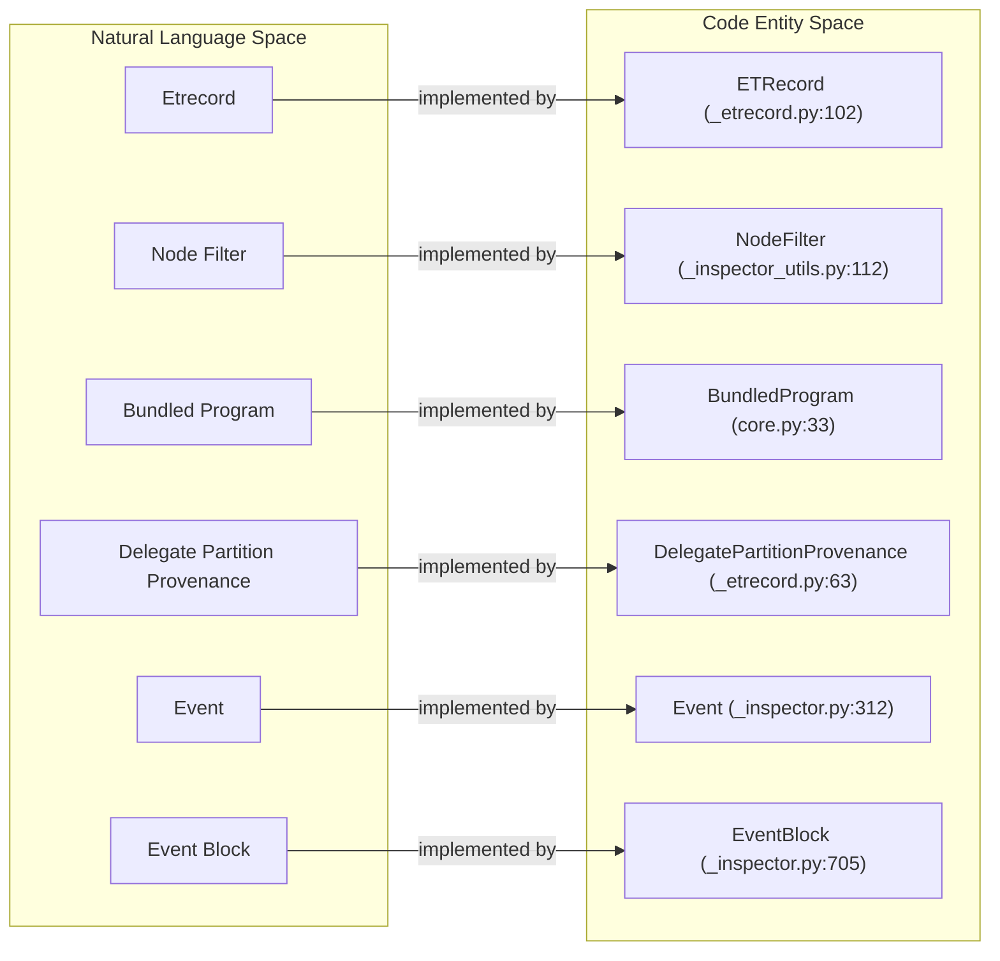
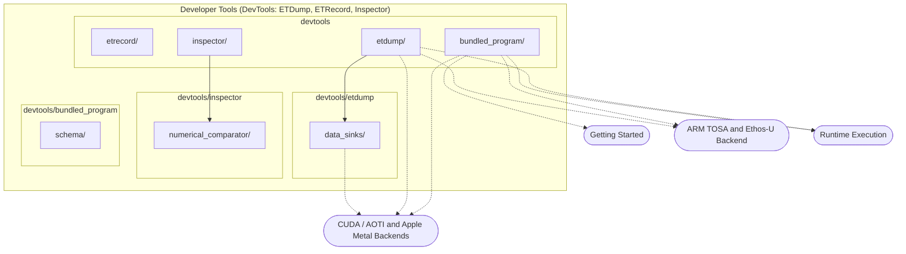
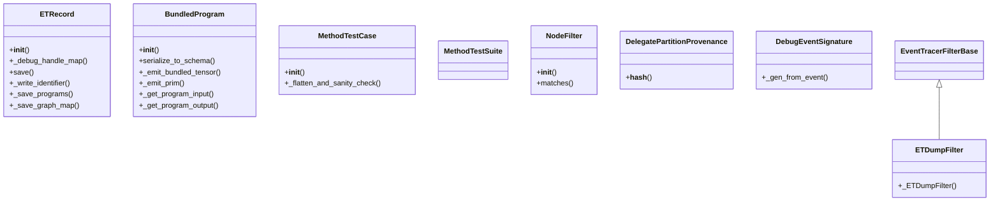
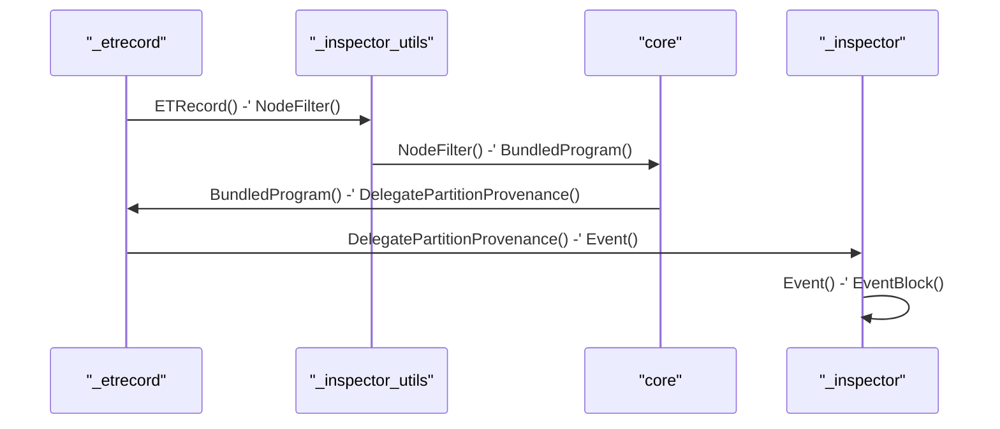

# 3-Source Context Packet (`git` + `CBM` + `llm-wiki`) for `8.3-developer-tools-devtools` — Developer Tools (DevTools: ETDump, ETRecord, Inspector)

- **Target Wiki File**: `wiki/8.3-developer-tools-devtools.md`
- **Archetype**: `Leaf Technical Spec Page`
- **Parent Page**: `8-runtime-execution`
- **Summary**: Architectural specification and implementation reference for Developer Tools (DevTools: ETDump, ETRecord, Inspector) (38 relevant source files). Primary code entities: `DelegatePartitionProvenance`, `__hash__`, `ETRecord`, `__init__`, `ETDumpGen`.
- **Valid `[[wikilink]]` Neighbours**: `[[8-runtime-execution|Runtime Execution]]`, `[[1.1-getting-started|Getting Started]]`, `[[1.2-export-api-and-recipe-system|Export API and Recipe System]]`, `[[2.2-kernel-libraries-and-selective-build|Kernel Libraries and Selective Build]]`, `[[2.3-schema-generation-and-flatbuffers|Schema Generation and FlatBuffers]]`, `[[3.4-program-emission-and-serialization|Program Emission and Serialization]]`, `[[3.5-verification-and-dialect-system|Verification and Dialect System]]`, `[[4-quantization-systems|Quantization Systems]]`

## 1. Relevant Source Files (`git` + `CBM`, use verbatim in `<details>`)
- `[devtools/etrecord/_etrecord.py](devtools/etrecord/_etrecord.py)`
- `[devtools/etdump/etdump_flatcc.cpp](devtools/etdump/etdump_flatcc.cpp)`
- `[devtools/inspector/_inspector.py](devtools/inspector/_inspector.py)`
- `[devtools/inspector/_inspector_utils.py](devtools/inspector/_inspector_utils.py)`
- `[devtools/etdump/schema_flatcc.py](devtools/etdump/schema_flatcc.py)`
- `[devtools/etdump/data_sinks/buffer_data_sink.h](devtools/etdump/data_sinks/buffer_data_sink.h)`
- `[devtools/bundled_program/bundled_program.cpp](devtools/bundled_program/bundled_program.cpp)`
- `[devtools/etdump/etdump_filter.h](devtools/etdump/etdump_filter.h)`
- `[devtools/etdump/etdump_flatcc.h](devtools/etdump/etdump_flatcc.h)`
- `[devtools/etdump/data_sinks/data_sink_base.h](devtools/etdump/data_sinks/data_sink_base.h)`
- `[devtools/etdump/data_sinks/file_data_sink.h](devtools/etdump/data_sinks/file_data_sink.h)`
- `[devtools/etdump/data_sinks/file_data_sink.cpp](devtools/etdump/data_sinks/file_data_sink.cpp)`
- `[devtools/bundled_program/core.py](devtools/bundled_program/core.py)`
- `[devtools/etdump/etdump_filter.cpp](devtools/etdump/etdump_filter.cpp)`
- `[devtools/etdump/emitter.cpp](devtools/etdump/emitter.cpp)`
- `[devtools/etdump/data_sinks/buffer_data_sink.cpp](devtools/etdump/data_sinks/buffer_data_sink.cpp)`
- `[devtools/inspector/_intermediate_output_capturer.py](devtools/inspector/_intermediate_output_capturer.py)`
- `[devtools/etdump/serialize.py](devtools/etdump/serialize.py)`
- `[devtools/etdump/emitter.h](devtools/etdump/emitter.h)`
- `[devtools/inspector/numerical_comparator/numerical_comparator_base.py](devtools/inspector/numerical_comparator/numerical_comparator_base.py)`
- `[devtools/etdump/data_sinks/targets.bzl](devtools/etdump/data_sinks/targets.bzl)`
- `[devtools/bundled_program/config.py](devtools/bundled_program/config.py)`
- `[devtools/etdump/targets.bzl](devtools/etdump/targets.bzl)`
- `[devtools/etdump/utils.h](devtools/etdump/utils.h)`
- `[devtools/inspector/numerical_comparator/l1_numerical_comparator.py](devtools/inspector/numerical_comparator/l1_numerical_comparator.py)`
- `[devtools/inspector/numerical_comparator/mse_numerical_comparator.py](devtools/inspector/numerical_comparator/mse_numerical_comparator.py)`
- `[devtools/bundled_program/bundled_program.h](devtools/bundled_program/bundled_program.h)`
- `[devtools/inspector/numerical_comparator/snr_numerical_comparator.py](devtools/inspector/numerical_comparator/snr_numerical_comparator.py)`
- `[devtools/bundled_program/schema/README.md](devtools/bundled_program/schema/README.md)`
- `[docs/source/devtools-overview.md](docs/source/devtools-overview.md)`

## 2. Grounded Code Symbols (`CBM`, use verbatim for `[file:start-end]()` pill citations)
- `ETRecord` (Class) @ `[devtools/etrecord/_etrecord.py:102-560]()` [fan-in=7, fan-out=0] — 
- `NodeFilter` (Class) @ `[devtools/inspector/_inspector_utils.py:112-131]()` [fan-in=2, fan-out=0] — A class used to filter nodes based on extensible criteria. Attributes: metadata_key (str): The key to look for in the node's metadata. op_type (str): The operat
- `BundledProgram` (Class) @ `[devtools/bundled_program/core.py:33-395]()` [fan-in=4, fan-out=0] — Bundled program contains all information needed to execute and verify the program on device. Public Attributes: method_test_suites: All test suites for verifyin
- `DelegatePartitionProvenance` (Class) @ `[devtools/etrecord/_etrecord.py:63-99]()` [fan-in=1, fan-out=0] — Backend-agnostic provenance for one emitted delegate partition. ``instruction_id`` is local to ``method_name`` and identifies the emitted ``executorch_call_dele
- `Event` (Class) @ `[devtools/inspector/_inspector.py:312-701]()` [fan-in=1, fan-out=0] — An Event corresponds to an operator instance with perf data retrieved from the runtime and other metadata from `ETRecord`. Args: name: Name of the profiling `Ev
- `EventBlock` (Class) @ `[devtools/inspector/_inspector.py:705-1000]()` [fan-in=1, fan-out=0] — r""" An `EventBlock` contains a collection of events associated with a particular profiling/debugging block retrieved from the runtime. Each `EventBlock` repres
- `EventSignature` (Class) @ `[devtools/inspector/_inspector.py:195-251]()` [fan-in=1, fan-out=0] — Note that (profile_event_signature, debug_event_signature) are sufficient signature identifiers. instruction_id is extracted from the signatures (equivalent in 
- `Inspector` (Class) @ `[devtools/inspector/_inspector.py:1003-1712]()` [fan-in=1, fan-out=0] — APIs for examining model architecture and performance stats. Public Attributes: event_blocks: List["EventBlocks"]. Structured data from ETDump (correlated with 
- `RunSignature` (Class) @ `[devtools/inspector/_inspector.py:256-266]()` [fan-in=1, fan-out=0] — Args: name: Name of the run events: List of EventSignatures that correspond to the run bundled_input_index: Index of the bundled input used to generate the debu
- `NodeData` (Class) @ `[devtools/inspector/_inspector_utils.py:96-109]()` [fan-in=1, fan-out=0] — Each node in the graph is an instance of NodeData, which contains: - source: A string indicating the origin of the node (either FROM_AOT or FROM_RUNTIME). - deb
- `ETDumpFilter` (Class) @ `[devtools/etdump/etdump_filter.h:32-101]()` [fan-in=1, fan-out=0] — /** * ETDumpFilter is a class that filters intermediate output based on output's * name by full regex filtering, or delegate debug indices by range-based * filt
- `BufferDataSink` (Class) @ `[devtools/etdump/data_sinks/buffer_data_sink.h:24-124]()` [fan-in=0, fan-out=0] — /** * BufferDataSink is a concrete implementation of the DataSinkBase class, * designed to store debug data in a pre-allocated, user-owned buffer. This * class 
- `PROFILE_EVENT_ENUM` (Class) @ `[devtools/etdump/schema_flatcc.py:105-109]()` [fan-in=0, fan-out=0] — # Note the differing value style is a result of ETDump string
- `MethodTestCase` (Class) @ `[devtools/bundled_program/config.py:49-107]()` [fan-in=3, fan-out=0] — Test case with inputs and expected outputs The expected_outputs are optional and only required if the user wants to verify model outputs after execution.
- `MethodTestSuite` (Class) @ `[devtools/bundled_program/config.py:111-120]()` [fan-in=3, fan-out=0] — All test info related to verify method Attributes: method_name: Name of the method to be verified. test_cases: All test cases for verifying the method.
- `DataSinkBase` (Class) @ `[devtools/etdump/data_sinks/data_sink_base.h:24-58]()` [fan-in=0, fan-out=0] — /** * DataSinkBase is an abstract class that users can inherit and implement * to customize the storage and management of debug data in ETDumpGen. This * class 
- `FileDataSink` (Class) @ `[devtools/etdump/data_sinks/file_data_sink.h:28-92]()` [fan-in=0, fan-out=0] — /** * FileDataSink is a concrete implementation of the DataSinkBase class, * designed to facilitate the direct writing of data to a file. It is * particularly u
- `IntermediateOutputCapturer` (Class) @ `[devtools/inspector/_intermediate_output_capturer.py:18-62]()` [fan-in=0, fan-out=0] — A class that captures intermediate outputs from a PyTorch graph module. Attributes: module (GraphModule): The graph module to capture outputs from. node_filters
- `DebugEventSignature` (Class) @ `[devtools/inspector/_inspector.py:171-190]()` [fan-in=1, fan-out=0] — 
- `InstructionEvent` (Class) @ `[devtools/inspector/_inspector.py:97-142]()` [fan-in=1, fan-out=0] — 
- `InstructionEventSignature` (Class) @ `[devtools/inspector/_inspector.py:88-92]()` [fan-in=1, fan-out=0] — 
- `PerfData` (Class) @ `[devtools/inspector/_inspector.py:282-308]()` [fan-in=1, fan-out=0] — 

## 3. Grounded Source Code Excerpts (`git` Working Tree)
### `ETRecord` in `[devtools/etrecord/_etrecord.py:102-117]()`
```python
class ETRecord:
    def __init__(
        self,
        exported_program: Optional[ExportedProgram] = None,
        export_graph_id: Optional[int] = None,
        edge_dialect_program: Optional[
            Union[ExportedProgram, Dict[str, ExportedProgram]]
        ] = None,
        graph_map: Optional[Dict[str, ExportedProgram]] = None,
        _debug_handle_map: Optional[Dict[int, Union[int, List[int]]]] = None,
        _delegate_map: Optional[
            Dict[str, Dict[int, Dict[str, Union[str, _DelegateDebugIdentifierMap]]]]
        ] = None,
        _instruction_id_to_num_outs_map: Optional[
            Dict[str, Dict[int, Union[int, List[int]]]]
        ] = None,
```

### `NodeFilter` in `[devtools/inspector/_inspector_utils.py:112-127]()`
```python
class NodeFilter:
    """
    A class used to filter nodes based on extensible criteria.
    Attributes:
        metadata_key (str): The key to look for in the node's metadata.
        op_type (str): The operation code to match.
        exclude_ops (List[str]): A list of operations to exclude from the filter.
    """

    def __init__(self, metadata_key: str, op_type: str, exclude_ops: List[str] = None):
        self.metadata_key = metadata_key
        self.op_type = op_type
        self.exclude_ops = exclude_ops

    def matches(self, node: torch.fx.Node) -> bool:
        return (
```

### `BundledProgram` in `[devtools/bundled_program/core.py:33-48]()`
```python
class BundledProgram:
    """
    Bundled program contains all information needed to execute and verify the program on device.

    Public Attributes:
        method_test_suites: All test suites for verifying methods.
        executorch_program: ExecutorchProgram-like variable, containing the Program to be verified by method_test_suites, including
                            ExecutorchProgram, MultiMethodExecutorchProgram or ExecutorchProgramManager.
    """

    def __init__(
        self,
        executorch_program: Optional[
            Union[
                ExecutorchProgram,
                ExecutorchProgramManager,
```

### `DelegatePartitionProvenance` in `[devtools/etrecord/_etrecord.py:63-78]()`
```python
class DelegatePartitionProvenance:
    """Backend-agnostic provenance for one emitted delegate partition.

    ``instruction_id`` is local to ``method_name`` and identifies the emitted
    ``executorch_call_delegate`` instruction. ``source_debug_handles`` contains
    the debug handles of call_function nodes in the delegate's original lowered
    graph. Handles are de-duplicated in encounter order, and may be empty; nodes
    without debug handles are omitted.

    ``delegate_debug_map`` provides backend-operation debug ID -> source debug
    handles. IDs are canonical strings (including numeric IDs) for consistent
    results before and after ETRecord JSON serialization. The map is read-only
    and may be empty when a backend provides no operation-level identifiers.

    The same source debug handle may appear in multiple partitions. Consumers
    must treat provenance as a many-to-many relationship.
```

### `Event` in `[devtools/inspector/_inspector.py:312-327]()`
```python
class Event:
    """
    An Event corresponds to an operator instance with perf data retrieved from the runtime and other metadata from `ETRecord`.

    Args:
        name: Name of the profiling `Event`, empty if no profiling event.
        perf_data: Performance data associated with the event retrived from the runtime (available attributes: p10, p50, p90, avg, min and max).
        op_type: List of op types corresponding to the event.
        delegate_debug_identifier: Supplemental identifier used in combination with instruction id.
        debug_handles: Debug handles in the model graph to which this event is correlated.
        num_outputs: Indicates the number of outputs generated by the node.
                     Right now only used for call_delegate nodes that output more than one tensor.
        stack_trace: A dictionary mapping the name of each associated op to its stack trace.
        module_hierarchy: A dictionary mapping the name of each associated op to its module hierarchy.
        is_delegated_op: Whether or not the event was delegated.
        delegate_backend_name: Name of the backend this event was delegated to.
```


## 4. Linked Official Docs (`llm-wiki` / `RAG`)
- **Performance Benchmarking and Profiling** (`wiki/7.3-performance-benchmarking-and-profiling.md`, score=150.246, shared_symbols=['BundledProgram', 'ETRecord', 'Float']): # Performance Benchmarking and Profiling ↑ [[7-testing-and-cicd-infrastructure|Testing and CI/CD Infrastructure]] > Architectural specification and implementation reference for Performance Benchmarking and Profiling (36 relevant source files). Primary code entities: `Allocator`, `MemAllocation`, `MemEvent`, `ProfileData`, `ETDumpGen`. <details> <summary>R
- **Runtime Execution** (`wiki/8-runtime-execution.md`, score=132.73, shared_symbols=['ETRecord']): # Runtime Execution > Architectural specification and implementation reference for Runtime Execution (39 relevant source files). Primary code entities: `ET_CHECK_MSG`, `execute`, `execute_instruction`, `experimental_reset_execution`, `ArrayRef`. <details> <summary>Relevant source files</summary> The following files were used as context for generating this
- **Testing and CI/CD Infrastructure** (`wiki/7-testing-and-cicd-infrastructure.md`, score=114.79, shared_symbols=['ETRecord']): # Testing and CI/CD Infrastructure > Architectural specification and implementation reference for Testing and CI/CD Infrastructure (36 relevant source files). Primary code entities: `BenchmarkResults`, `save_json`, `to_dict`, `to_v3_format`, `BenchmarkFilters`. <details> <summary>Relevant source files</summary> The following files were used as context for
- **ExecuTorch DeepWiki** (`wiki/index.md`, score=113.89, shared_symbols=['ETRecord']): # ExecuTorch DeepWiki Generated from `home-jason-Project-deepwiki-executorch` at commit `b3b565b5b62f` (2026-11-15T15:02:11+00:00). ## Pages - [[1-overview|Overview]] — Architectural specification and implementation reference for Overview (10 relevant source files). Primary code entities: `Module`, `MethodHolder`, `PlannedMemory`, `EdgeProgramManager`, `_
- **Core Runtime Architecture** (`wiki/8.1-core-runtime-architecture.md`, score=101.776, shared_symbols=['ETRecord']): # Core Runtime Architecture ↑ [[8-runtime-execution|Runtime Execution]] > Architectural specification and implementation reference for Core Runtime Architecture (38 relevant source files). Primary code entities: `ET_CHECK_MSG`, `execute`, `execute_instruction`, `experimental_reset_execution`, `ArrayRef`. <details> <summary>Relevant source files</summary> 
- **Kernel Registration and Dispatch** (`wiki/8.2-kernel-registration-and-dispatch.md`, score=89.687, shared_symbols=['ETRecord']): # Kernel Registration and Dispatch ↑ [[8-runtime-execution|Runtime Execution]] > Architectural specification and implementation reference for Kernel Registration and Dispatch (36 relevant source files). Primary code entities: `KernelRuntimeContext`, `allocate_temp`, `fail`, `Kernel`, `KernelKey`. <details> <summary>Relevant source files</summary> The fol

## 5. Pre-Verified DeepWiki v1.9.9.5 Mermaid Diagrams
### Natural Language Space <-> Code Entity Space


### Subsystem Architecture Flowchart


### Class Hierarchy Diagram


### Call Sequence Diagram


## 6. DeepWiki v1.9.9.5 Authoring Checklist for `wiki/8.3-developer-tools-devtools.md`
1. Keep YAML frontmatter at top (`id`, `title`, `parent`, `sources`, `linked_docs`, `bridge_symbols`).
2. Keep `<details><summary>Relevant source files</summary>` block immediately after `# Title`.
3. Start with `## Purpose and Scope`, then numbered `## 1. ...`, `## 2. ...` sections separated by `---`.
4. Include at least 2 ```mermaid``` diagrams (including a `Natural Language Space` <-> `Code Entity Space` mapping).
5. Cite code entities inline using `[path/to/file.ext:start-end]()` and end every `##` section with `Sources: [file:start-end]()`.
6. Run `deepwiki_cli.py build --enrich-only ...` and `deepwiki_cli.py validate ...` after editing.
