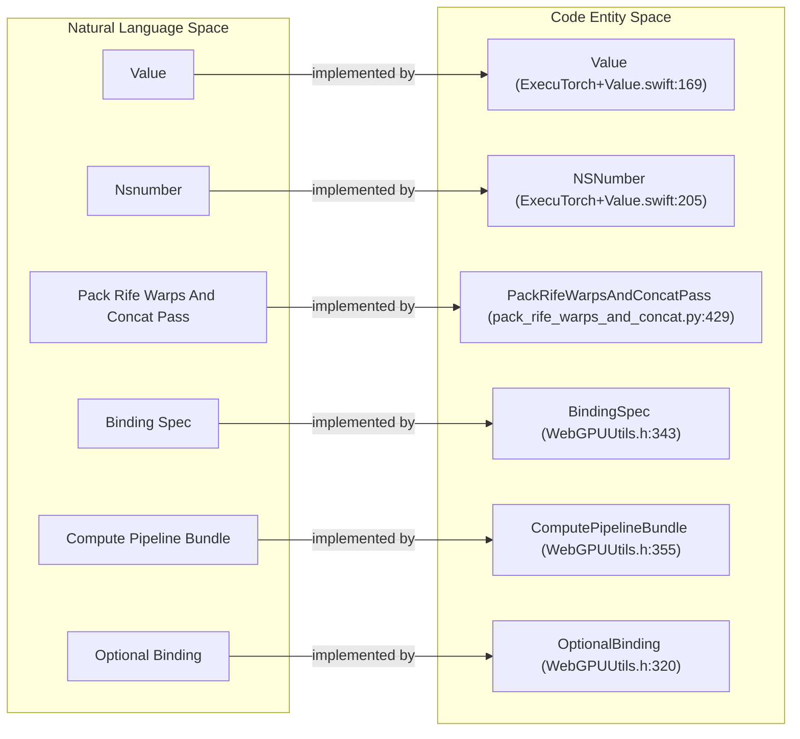
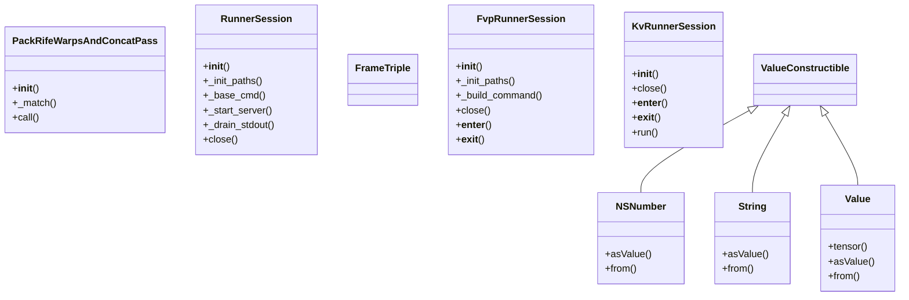
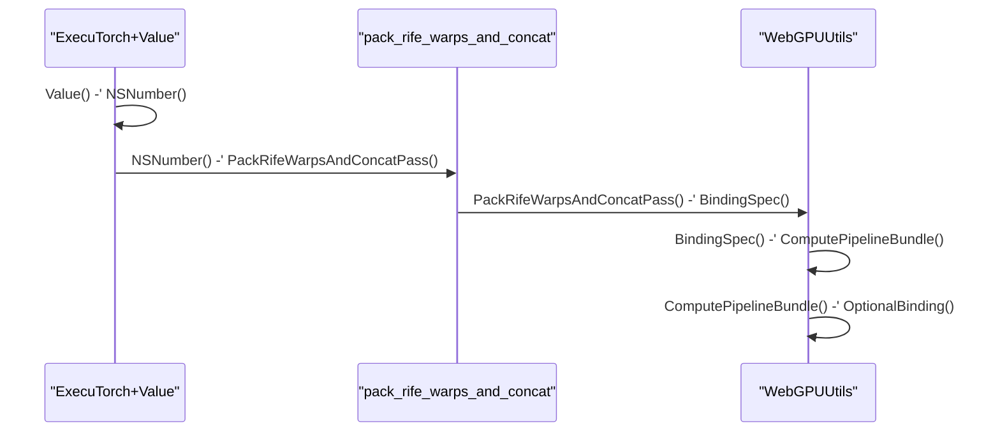

# 3-Source Context Packet (`git` + `CBM` + `llm-wiki`) for `9-mobile-and-platform-extensions` — Mobile and Platform Extensions

- **Target Wiki File**: `wiki/9-mobile-and-platform-extensions.md`
- **Archetype**: `Parent Hub Page`
- **Parent Page**: `None (Top-Level Chapter)`
- **Summary**: Architectural specification and implementation reference for Mobile and Platform Extensions (40 relevant source files). Primary code entities: `BindingSpec`, `ComputePipelineBundle`, `operator=`, `Storage`, `~Storage`.
- **Valid `[[wikilink]]` Neighbours**: `[[1-overview|Overview]]`, `[[9.1-android-extension|Android Extension (Java/Kotlin & JNI)]]`, `[[9.2-apple-ios-macos-extension|Apple iOS/macOS Extension (Swift & Objective-C)]]`, `[[9.3-high-level-module-and-on-device-training|High-Level Module API, Tensor & On-Device Training]]`, `[[9.4-embedded-and-web-targets|Embedded (Zephyr, ESP32, Pico2) and WebAssembly/WebGPU Targets]]`, `[[1.1-getting-started|Getting Started]]`, `[[1.2-export-api-and-recipe-system|Export API and Recipe System]]`, `[[2.2-kernel-libraries-and-selective-build|Kernel Libraries and Selective Build]]`

## 1. Relevant Source Files (`git` + `CBM`, use verbatim in `<details>`)
- `[backends/webgpu/runtime/WebGPUUtils.h](backends/webgpu/runtime/WebGPUUtils.h)`
- `[extension/tensor/tensor_ptr.cpp](extension/tensor/tensor_ptr.cpp)`
- `[examples/arm/ethos-u-setup/arm-none-eabi-clang-random-device.h](examples/arm/ethos-u-setup/arm-none-eabi-clang-random-device.h)`
- `[backends/webgpu/runtime/WebGPUGraph.cpp](backends/webgpu/runtime/WebGPUGraph.cpp)`
- `[extension/android/jni/jni_layer_image.cpp](extension/android/jni/jni_layer_image.cpp)`
- `[examples/espressif/camera_stream/main/camera_stream.cpp](examples/espressif/camera_stream/main/camera_stream.cpp)`
- `[extension/tensor/tensor_ptr_maker.h](extension/tensor/tensor_ptr_maker.h)`
- `[examples/raspberry_pi/setup.sh](examples/raspberry_pi/setup.sh)`
- `[extension/module/module.cpp](extension/module/module.cpp)`
- `[extension/module/module.h](extension/module/module.h)`
- `[examples/arm/QAT_example/rife_vgf/passes/pack_rife_warps_and_concat.py](examples/arm/QAT_example/rife_vgf/passes/pack_rife_warps_and_concat.py)`
- `[examples/arm/executor_runner/arm_executor_runner.cpp](examples/arm/executor_runner/arm_executor_runner.cpp)`
- `[backends/webgpu/runtime/WebGPUDispatchMath.h](backends/webgpu/runtime/WebGPUDispatchMath.h)`
- `[backends/webgpu/runtime/WebGPUDevice.cpp](backends/webgpu/runtime/WebGPUDevice.cpp)`
- `[extension/android/executorch_android/android_test_setup.sh](extension/android/executorch_android/android_test_setup.sh)`
- `[extension/android/executorch_android/src/main/java/org/pytorch/executorch/EValue.kt](extension/android/executorch_android/src/main/java/org/pytorch/executorch/EValue.kt)`
- `[extension/android/jni/jni_layer.cpp](extension/android/jni/jni_layer.cpp)`
- `[extension/android/executorch_android/src/main/java/org/pytorch/executorch/extension/llm/LlmModule.kt](extension/android/executorch_android/src/main/java/org/pytorch/executorch/extension/llm/LlmModule.kt)`
- `[examples/arm/QAT_example/qat_loop.py](examples/arm/QAT_example/qat_loop.py)`
- `[examples/arm/visualize.py](examples/arm/visualize.py)`
- `[examples/espressif/executor_runner/esp_executor_runner.cpp](examples/espressif/executor_runner/esp_executor_runner.cpp)`
- `[examples/arm/smollm2_example_ethos_u/generate_sampled.py](examples/arm/smollm2_example_ethos_u/generate_sampled.py)`
- `[extension/android/executorch_android/src/main/java/org/pytorch/executorch/Module.kt](extension/android/executorch_android/src/main/java/org/pytorch/executorch/Module.kt)`
- `[examples/arm/custom_operators.py](examples/arm/custom_operators.py)`
- `[backends/webgpu/scripts/gen_wgsl_headers.py](backends/webgpu/scripts/gen_wgsl_headers.py)`
- `[extension/apple/ExecuTorch/Exported/ExecuTorch+Value.swift](extension/apple/ExecuTorch/Exported/ExecuTorch+Value.swift)`
- `[extension/android/executorch_android/src/main/java/org/pytorch/executorch/Tensor.kt](extension/android/executorch_android/src/main/java/org/pytorch/executorch/Tensor.kt)`
- `[examples/arm/smollm2_example_vgf/generate_sampled.py](examples/arm/smollm2_example_vgf/generate_sampled.py)`
- `[extension/android/README.md](extension/android/README.md)`
- `[backends/webgpu/README.md](backends/webgpu/README.md)`

## 2. Grounded Code Symbols (`CBM`, use verbatim for `[file:start-end]()` pill citations)
- `Value` (Class) @ `[extension/apple/ExecuTorch/Exported/ExecuTorch+Value.swift:169-173]()` [fan-in=29, fan-out=0] — 
- `NSNumber` (Class) @ `[extension/apple/ExecuTorch/Exported/ExecuTorch+Value.swift:205-212]()` [fan-in=25, fan-out=0] — 
- `PackRifeWarpsAndConcatPass` (Class) @ `[examples/arm/QAT_example/rife_vgf/passes/pack_rife_warps_and_concat.py:429-646]()` [fan-in=7, fan-out=0] — Pack four private RIFE warps and their C28 concat into one C32 shader. Fuse compatible block0 head resizing and state preparation into the shader. Reorder block
- `BindingSpec` (Class) @ `[backends/webgpu/runtime/WebGPUUtils.h:343-348]()` [fan-in=0, fan-out=0] — // One compute-shader binding: a bind-group-layout entry + its bind-group // entry share every field except `type` (layout) vs `buffer`/`size` (bind).
- `ComputePipelineBundle` (Class) @ `[backends/webgpu/runtime/WebGPUUtils.h:355-391]()` [fan-in=0, fan-out=0] — // Owns the shader module, bind-group layout, and pipeline layout, releasing // them on destruction. `pipeline` and `bind_group` are NOT released here — // ever
- `OptionalBinding` (Class) @ `[backends/webgpu/runtime/WebGPUUtils.h:320-324]()` [fan-in=0, fan-out=0] — // Resolves an optional tensor arg (bias/mask/affine) to the binding to use: // the real tensor's buffer+size if present, else a zero-filled dummy. Caller // re
- `Storage` (Class) @ `[extension/tensor/tensor_ptr.cpp:35-66]()` [fan-in=0, fan-out=0] — /** * A structure that consolidates the metadata (sizes, dim_order, strides) and * the data buffer associated with a Tensor. Since Tensor does not own * the mem
- `ScopedBitmapLock` (Class) @ `[extension/android/jni/jni_layer_image.cpp:128-189]()` [fan-in=0, fan-out=0] — // Locks an ARGB_8888 bitmap for the lifetime of the scope. Android stores that // format as RGBA bytes in memory, so it maps to ColorFormat::RGBA.
- `TensorPtrMaker` (Class) @ `[extension/tensor/tensor_ptr_maker.h:26-163]()` [fan-in=0, fan-out=0] — /** * A helper class for creating TensorPtr instances from raw data and tensor * properties. Note that the TensorPtr created by this class does not own the * da
- `FvpRunnerSession` (Class) @ `[examples/arm/smollm2_example_ethos_u/generate_sampled.py:353-583]()` [fan-in=3, fan-out=0] — Manage a temporary semihosting workspace for repeated FVP runs.
- `RunnerSession` (Class) @ `[examples/arm/smollm2_example_vgf/generate_sampled.py:24-225]()` [fan-in=4, fan-out=0] — Manage one executor_runner instance for prompt-by-prompt sampling. This wrapper hides the temporary input/output files expected by `executor_runner` and optiona
- `Module` (Class) @ `[extension/module/module.h:51-791]()` [fan-in=0, fan-out=0] — /** * A facade class for loading programs and executing methods within them. */
- `RunnerContext` (Class) @ `[examples/arm/executor_runner/arm_executor_runner.cpp:618-653]()` [fan-in=0, fan-out=0] — /// Holds all state needed for setup and run phases
- `DispatchGrid` (Class) @ `[backends/webgpu/runtime/WebGPUDispatchMath.h:71-76]()` [fan-in=0, fan-out=0] — // Adaptive 1D->2D dispatch grid. `count_x`/`count_y` are the dispatch dims; // `stride_x` (= count_x * wg_size) lets the shader decode a flat index as // `gid.
- `KvFvpRunnerSession` (Class) @ `[examples/arm/smollm2_example_ethos_u/generate_sampled.py:586-654]()` [fan-in=2, fan-out=0] — Step-wise FVP runner for KV-cache exports.
- `KvRunnerSession` (Class) @ `[examples/arm/smollm2_example_vgf/generate_sampled.py:228-267]()` [fan-in=3, fan-out=0] — Step-wise runner for KV-cache exports.
- `EValue` (Class) @ `[extension/android/executorch_android/src/main/java/org/pytorch/executorch/EValue.kt:34-209]()` [fan-in=0, fan-out=0] — /** * Java representation of an ExecuTorch value, which is implemented as tagged union that can be one * of the supported types: https://pytorch.org/docs/stable
- `LlmModule` (Class) @ `[extension/android/executorch_android/src/main/java/org/pytorch/executorch/extension/llm/LlmModule.kt:27-898]()` [fan-in=0, fan-out=0] — /** * LlmModule is a wrapper around the Executorch LLM. It provides a simple interface to generate text * from the model. * * Warning: These APIs are experiment
- `EncodeRgbaBiasToTosaCustomPass` (Class) @ `[examples/arm/custom_operators.py:296-369]()` [fan-in=1, fan-out=0] — Rewrite the RGBA library op to `tosa.CUSTOM` with image resources.
- `EncodeScaleAddToTosaCustomPass` (Class) @ `[examples/arm/custom_operators.py:237-293]()` [fan-in=1, fan-out=0] — Rewrite the library op to a `tosa.CUSTOM` node with shader payload. This pass is the bridge between the user-visible library op and the Arm custom-shader loweri
- `RunnerContext` (Class) @ `[examples/espressif/executor_runner/esp_executor_runner.cpp:441-468]()` [fan-in=0, fan-out=0] — /// Holds all state needed for setup and run phases
- `MapCallbackData` (Class) @ `[backends/webgpu/runtime/WebGPUGraph.cpp:1758-1760]()` [fan-in=0, fan-out=0] — 

## 3. Grounded Source Code Excerpts (`git` Working Tree)
### `Value` in `[extension/apple/ExecuTorch/Exported/ExecuTorch+Value.swift:169-173]()`
```swift
extension Value: ValueConstructible, ValueSequenceConstructible {
  public static func from(_ value: Value) throws -> Self {
    value as! Self
  }
}
```

### `NSNumber` in `[extension/apple/ExecuTorch/Exported/ExecuTorch+Value.swift:205-212]()`
```swift
extension NSNumber: ValueConstructible, ValueSequenceConstructible {
  public static func from(_ value: Value) throws -> Self {
    guard let scalar = value.scalar as? Self else {
      throw Error(code: .invalidType, description: "Value is not a scalar")
    }
    return scalar
  }
}
```

### `PackRifeWarpsAndConcatPass` in `[examples/arm/QAT_example/rife_vgf/passes/pack_rife_warps_and_concat.py:429-444]()`
```python
class PackRifeWarpsAndConcatPass(ArmPass):
    """Pack four private RIFE warps and their C28 concat into one C32 shader.

    Fuse compatible block0 head resizing and state preparation into the shader.
    Reorder block0 output channels during export so each PixelShuffle read
    accesses 13 contiguous channels. Keep sampling quantization boundaries.
    Four zero weight columns make the following convolution ignore padding.
    Unsupported graphs are left unchanged.

    """

    _passes_required_after: set[type[ExportPass]] = set()

    def __init__(self, exported_program: ExportedProgram | None = None):
        super().__init__()
        self.exported_program = exported_program
```

### `BindingSpec` in `[backends/webgpu/runtime/WebGPUUtils.h:343-348]()`
```cpp
struct BindingSpec {
  uint32_t binding;
  WGPUBufferBindingType type;
  WGPUBuffer buffer;
  uint64_t size;
};
```

### `ComputePipelineBundle` in `[backends/webgpu/runtime/WebGPUUtils.h:355-370]()`
```cpp
struct ComputePipelineBundle {
  WGPUShaderModule shader = nullptr;
  WGPUBindGroupLayout bind_group_layout = nullptr;
  WGPUPipelineLayout pipeline_layout = nullptr;
  WGPUComputePipeline pipeline = nullptr;
  WGPUBindGroup bind_group = nullptr;

  ComputePipelineBundle() = default;
  ComputePipelineBundle(const ComputePipelineBundle&) = delete;
  ComputePipelineBundle& operator=(const ComputePipelineBundle&) = delete;
  ComputePipelineBundle& operator=(ComputePipelineBundle&&) = delete;

  ComputePipelineBundle(ComputePipelineBundle&& other) noexcept
      : shader(other.shader),
        bind_group_layout(other.bind_group_layout),
        pipeline_layout(other.pipeline_layout),
```


## 4. Linked Official Docs (`llm-wiki` / `RAG`)
- **Embedded (Zephyr, ESP32, Pico2) and WebAssembly/WebGPU Targets** (`wiki/9.4-embedded-and-web-targets.md`, score=138.655, shared_symbols=['FrameTriple', 'Module', 'PackRifeWarpsAndConcatPass', 'Tensor']): # Embedded (Zephyr, ESP32, Pico2) and WebAssembly/WebGPU Targets ↑ [[9-mobile-and-platform-extensions|Mobile and Platform Extensions]] > Architectural specification and implementation reference for Embedded (Zephyr, ESP32, Pico2) and WebAssembly/WebGPU Targets (40 relevant source files). Primary code entities: `BindingSpec`, `ComputePipelineBundle`, `opera
- **ExecuTorch DeepWiki** (`wiki/index.md`, score=99.23, shared_symbols=[]): # ExecuTorch DeepWiki Generated from `home-jason-Project-deepwiki-executorch` at commit `b3b565b5b62f` (2026-11-15T15:02:11+00:00). ## Pages - [[1-overview|Overview]] — Architectural specification and implementation reference for Overview (10 relevant source files). Primary code entities: `Module`, `MethodHolder`, `PlannedMemory`, `EdgeProgramManager`, `_
- **Android Extension (Java/Kotlin & JNI)** (`wiki/9.1-android-extension.md`, score=90.679, shared_symbols=['EValue', 'LlmModule', 'Module', 'Tensor']): # Android Extension (Java/Kotlin & JNI) ↑ [[9-mobile-and-platform-extensions|Mobile and Platform Extensions]] > Architectural specification and implementation reference for Android Extension (Java/Kotlin & JNI) (33 relevant source files). Primary code entities: `Java_org_pytorch_executorch_extension_image_ImageProcessor_nativeComputeLetterboxPadding`, `Jav
- **ARM TOSA and Ethos-U Backend** (`wiki/5.4-arm-tosa-and-ethos-u-backend.md`, score=87.494, shared_symbols=['Module', 'PackRifeWarpsAndConcatPass', 'Tensor']): # ARM TOSA and Ethos-U Backend ↑ [[5-backend-delegation-architecture|Backend Delegation Architecture]] > Architectural specification and implementation reference for ARM TOSA and Ethos-U Backend (40 relevant source files). Primary code entities: `TosaArg`, `__init__`, `__process_list`, `__process_node`, `InsertTableOpsPass`. <details> <summary>Relevant so
- **Apple iOS/macOS Extension (Swift & Objective-C)** (`wiki/9.2-apple-ios-macos-extension.md`, score=85.79, shared_symbols=['Module', 'NSNumber', 'String', 'Tensor', 'Value']): # Apple iOS/macOS Extension (Swift & Objective-C) ↑ [[9-mobile-and-platform-extensions|Mobile and Platform Extensions]] > Architectural specification and implementation reference for Apple iOS/macOS Extension (Swift & Objective-C) (26 relevant source files). Primary code entities: `AnyTensor`, `asValue`, `from`, `Array`, `==`. <details> <summary>Relevant 
- **High-Level Module API, Tensor & On-Device Training** (`wiki/9.3-high-level-module-and-on-device-training.md`, score=84.124, shared_symbols=['Module', 'Tensor']): # High-Level Module API, Tensor & On-Device Training ↑ [[9-mobile-and-platform-extensions|Mobile and Platform Extensions]] > Architectural specification and implementation reference for High-Level Module API, Tensor & On-Device Training (37 relevant source files). Primary code entities: `Storage`, `operator=`, `~Storage`, `Module`, `execute`. <details> <s

## 5. Pre-Verified DeepWiki v1.9.9.5 Mermaid Diagrams
### Natural Language Space <-> Code Entity Space


### Subsystem Architecture Flowchart

```mermaid
flowchart TD
  subgraph sub_this["Mobile and Platform Extensions"]
    subgraph sg_0["backends/webgpu"]
      n_backends_webgpu_runtime["runtime/"]
      n_backends_webgpu_scripts["scripts/"]
    end
    subgraph sg_1["extension"]
      n_extension_tensor["tensor/"]
      n_extension_module["module/"]
    end
    subgraph sg_2["examples/arm"]
      n_examples_arm_ethos_u_setup["ethos-u-setup/"]
      n_examples_arm_executor_runner["executor_runner/"]
      n_examples_arm_QAT_example["QAT_example/"]
      n_examples_arm_smollm2_example_ethos_u["smollm2_example_ethos_u/"]
      n_examples_arm_smollm2_example_vgf["smollm2_example_vgf/"]
    end
    subgraph sg_3["extension/android"]
      n_extension_android_jni["jni/"]
      n_extension_android_executorch_android["executorch_android/"]
    end
    subgraph sg_4["examples/espressif/camera_stream"]
      n_examples_espressif_camera_stream_main["main/"]
    end
  end
  n_page_2_build_system_and_infrastructure(["Build System and Infrastructure"])
  n_page_6_model_export_and_llm_support(["Model Export and LLM Support"])
  n_page_8_runtime_execution(["Runtime Execution"])
  n_page_9_1_android_extension(["Android Extension (Java/Kotlin & JNI)"])
  n_examples_espressif_executor_runner -.-> n_page_8_runtime_execution
  n_examples_arm_ethos_u_setup -.-> n_page_6_model_export_and_llm_support
  n_extension_android_jni -.-> n_page_9_1_android_extension
  n_extension_tensor -.-> n_page_8_runtime_execution
  n_examples_arm_executor_runner -.-> n_page_8_runtime_execution
  n_extension_tensor -.-> n_page_2_build_system_and_infrastructure
  n_extension_android_jni -.-> n_page_8_runtime_execution
  n_extension_module -.-> n_page_8_runtime_execution
  n_examples_arm_executor_runner -.-> n_page_2_build_system_and_infrastructure
  n_extension_module -.-> n_page_6_model_export_and_llm_support
  n_extension_tensor -.-> n_page_6_model_export_and_llm_support
  n_extension_android_jni -.-> n_page_2_build_system_and_infrastructure
  n_examples_espressif_camera_stream_main -.-> n_page_6_model_export_and_llm_support
  n_extension_android_jni -.-> n_page_6_model_export_and_llm_support
```


### Class Hierarchy Diagram


### Call Sequence Diagram


## 6. DeepWiki v1.9.9.5 Authoring Checklist for `wiki/9-mobile-and-platform-extensions.md`
1. Keep YAML frontmatter at top (`id`, `title`, `parent`, `sources`, `linked_docs`, `bridge_symbols`).
2. Keep `<details><summary>Relevant source files</summary>` block immediately after `# Title`.
3. Start with `## Purpose and Scope`, then numbered `## 1. ...`, `## 2. ...` sections separated by `---`.
4. Include at least 2 ```mermaid``` diagrams (including a `Natural Language Space` <-> `Code Entity Space` mapping).
5. Cite code entities inline using `[path/to/file.ext:start-end]()` and end every `##` section with `Sources: [file:start-end]()`.
6. Run `deepwiki_cli.py build --enrich-only ...` and `deepwiki_cli.py validate ...` after editing.
