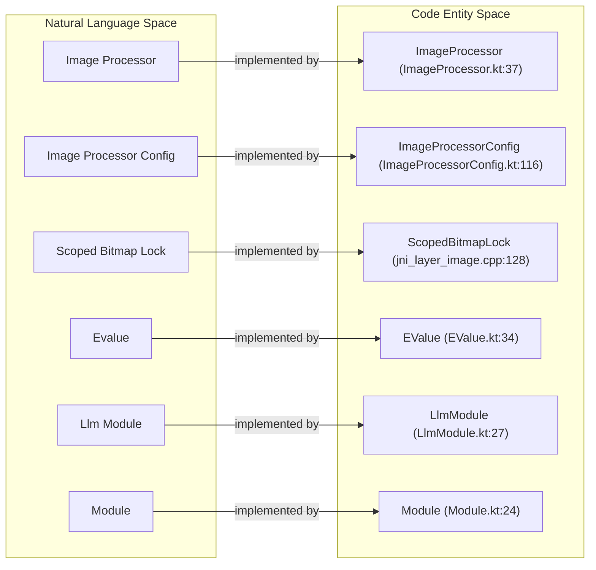
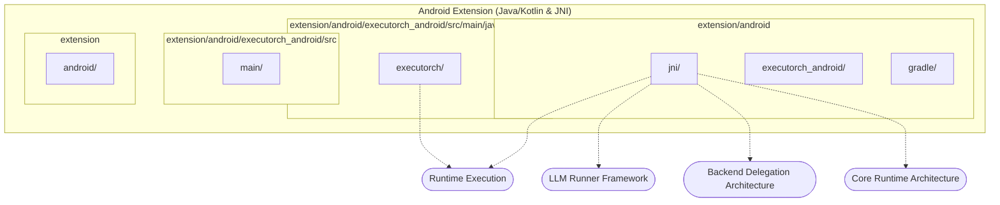
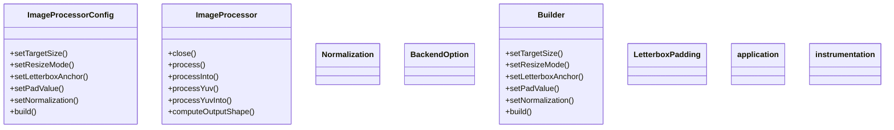
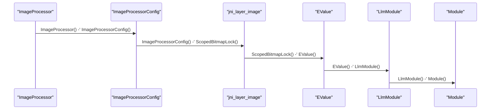

# 3-Source Context Packet (`git` + `CBM` + `llm-wiki`) for `9.1-android-extension` — Android Extension (Java/Kotlin & JNI)

- **Target Wiki File**: `wiki/9.1-android-extension.md`
- **Archetype**: `Leaf Technical Spec Page`
- **Parent Page**: `9-mobile-and-platform-extensions`
- **Summary**: Architectural specification and implementation reference for Android Extension (Java/Kotlin & JNI) (33 relevant source files). Primary code entities: `Java_org_pytorch_executorch_extension_image_ImageProcessor_nativeComputeLetterboxPadding`, `Java_org_pytorch_executorch_extension_image_ImageProcessor_nativeComputeOutputShape`, `Java_org_pytorch_executorch_extension_image_ImageProcessor_nativeCreate`, `Java_org_pytorch_executorch_extension_image_ImageProcessor_nativeDestroy`, `JNI_OnLoad`.
- **Valid `[[wikilink]]` Neighbours**: `[[9-mobile-and-platform-extensions|Mobile and Platform Extensions]]`, `[[1.1-getting-started|Getting Started]]`, `[[1.2-export-api-and-recipe-system|Export API and Recipe System]]`, `[[2.2-kernel-libraries-and-selective-build|Kernel Libraries and Selective Build]]`, `[[2.3-schema-generation-and-flatbuffers|Schema Generation and FlatBuffers]]`, `[[3.4-program-emission-and-serialization|Program Emission and Serialization]]`, `[[3.5-verification-and-dialect-system|Verification and Dialect System]]`, `[[4-quantization-systems|Quantization Systems]]`

## 1. Relevant Source Files (`git` + `CBM`, use verbatim in `<details>`)
- `[extension/android/jni/jni_layer_image.cpp](extension/android/jni/jni_layer_image.cpp)`
- `[extension/android/jni/jni_layer.cpp](extension/android/jni/jni_layer.cpp)`
- `[extension/android/executorch_android/src/main/java/org/pytorch/executorch/EValue.kt](extension/android/executorch_android/src/main/java/org/pytorch/executorch/EValue.kt)`
- `[extension/android/executorch_android/src/main/java/org/pytorch/executorch/extension/llm/LlmModule.kt](extension/android/executorch_android/src/main/java/org/pytorch/executorch/extension/llm/LlmModule.kt)`
- `[extension/android/executorch_android/src/main/java/org/pytorch/executorch/Module.kt](extension/android/executorch_android/src/main/java/org/pytorch/executorch/Module.kt)`
- `[extension/android/executorch_android/src/main/java/org/pytorch/executorch/Tensor.kt](extension/android/executorch_android/src/main/java/org/pytorch/executorch/Tensor.kt)`
- `[extension/android/jni/jni_layer_llama.cpp](extension/android/jni/jni_layer_llama.cpp)`
- `[extension/android/executorch_android/android_test_setup.sh](extension/android/executorch_android/android_test_setup.sh)`
- `[extension/android/executorch_android/src/main/AndroidManifest.xml](extension/android/executorch_android/src/main/AndroidManifest.xml)`
- `[extension/android/jni/jni_layer_training.cpp](extension/android/jni/jni_layer_training.cpp)`
- `[extension/android/jni/jni_layer_asr.cpp](extension/android/jni/jni_layer_asr.cpp)`
- `[extension/android/gradle/libs.versions.toml](extension/android/gradle/libs.versions.toml)`
- `[extension/android/jni/jni_helper.cpp](extension/android/jni/jni_helper.cpp)`
- `[extension/android/jni/jni_layer_runtime.cpp](extension/android/jni/jni_layer_runtime.cpp)`
- `[extension/android/jni/jni_helper.h](extension/android/jni/jni_helper.h)`
- `[extension/android/executorch_android/src/main/java/org/pytorch/executorch/extension/image/ImageProcessor.kt](extension/android/executorch_android/src/main/java/org/pytorch/executorch/extension/image/ImageProcessor.kt)`
- `[extension/android/gradlew](extension/android/gradlew)`
- `[extension/android/jni/log.h](extension/android/jni/log.h)`
- `[extension/android/executorch_android/src/main/java/org/pytorch/executorch/BackendOptionsMap.kt](extension/android/executorch_android/src/main/java/org/pytorch/executorch/BackendOptionsMap.kt)`
- `[extension/android/executorch_android/src/main/java/org/pytorch/executorch/ExecutorchRuntimeException.kt](extension/android/executorch_android/src/main/java/org/pytorch/executorch/ExecutorchRuntimeException.kt)`
- `[extension/android/executorch_android/src/main/java/org/pytorch/executorch/extension/image/ImageProcessorConfig.kt](extension/android/executorch_android/src/main/java/org/pytorch/executorch/extension/image/ImageProcessorConfig.kt)`
- `[extension/android/executorch_android/src/main/java/org/pytorch/executorch/DType.kt](extension/android/executorch_android/src/main/java/org/pytorch/executorch/DType.kt)`
- `[extension/android/executorch_android/src/main/java/org/pytorch/executorch/ExecuTorchRuntime.kt](extension/android/executorch_android/src/main/java/org/pytorch/executorch/ExecuTorchRuntime.kt)`
- `[extension/android/executorch_android/src/main/java/org/pytorch/executorch/extension/llm/LlmModuleConfig.kt](extension/android/executorch_android/src/main/java/org/pytorch/executorch/extension/llm/LlmModuleConfig.kt)`
- `[extension/android/jni/jni_layer_constants.h](extension/android/jni/jni_layer_constants.h)`
- `[extension/android/executorch_android/src/main/java/org/pytorch/executorch/MethodMetadata.kt](extension/android/executorch_android/src/main/java/org/pytorch/executorch/MethodMetadata.kt)`
- `[extension/android/jni/log.cpp](extension/android/jni/log.cpp)`
- `[extension/android/jni/selective_jni.buck.bzl](extension/android/jni/selective_jni.buck.bzl)`
- `[extension/android/README.md](extension/android/README.md)`
- `[docs/source/using-executorch-android.md](docs/source/using-executorch-android.md)`

## 2. Grounded Code Symbols (`CBM`, use verbatim for `[file:start-end]()` pill citations)
- `ImageProcessor` (Class) @ `[extension/android/executorch_android/src/main/java/org/pytorch/executorch/extension/image/ImageProcessor.kt:37-361]()` [fan-in=22, fan-out=0] — /** * Converts camera frames and bitmaps into the normalized `[1, 3, H, W]` float tensors vision models * expect, replacing the hand-rolled resize/normalize loo
- `ImageProcessorConfig` (Class) @ `[extension/android/executorch_android/src/main/java/org/pytorch/executorch/extension/image/ImageProcessorConfig.kt:116-167]()` [fan-in=23, fan-out=0] — /** * Configuration for [ImageProcessor]. * * Warning: These APIs are experimental and subject to change without notice * * @property targetWidth Width of the p
- `ScopedBitmapLock` (Class) @ `[extension/android/jni/jni_layer_image.cpp:128-189]()` [fan-in=0, fan-out=0] — // Locks an ARGB_8888 bitmap for the lifetime of the scope. Android stores that // format as RGBA bytes in memory, so it maps to ColorFormat::RGBA.
- `EValue` (Class) @ `[extension/android/executorch_android/src/main/java/org/pytorch/executorch/EValue.kt:34-209]()` [fan-in=0, fan-out=0] — /** * Java representation of an ExecuTorch value, which is implemented as tagged union that can be one * of the supported types: https://pytorch.org/docs/stable
- `LlmModule` (Class) @ `[extension/android/executorch_android/src/main/java/org/pytorch/executorch/extension/llm/LlmModule.kt:27-898]()` [fan-in=0, fan-out=0] — /** * LlmModule is a wrapper around the Executorch LLM. It provides a simple interface to generate text * from the model. * * Warning: These APIs are experiment
- `Module` (Class) @ `[extension/android/executorch_android/src/main/java/org/pytorch/executorch/Module.kt:24-325]()` [fan-in=0, fan-out=0] — /** * Java wrapper for ExecuTorch Module. * * Warning: These APIs are experimental and subject to change without notice */
- `Tensor` (Class) @ `[extension/android/executorch_android/src/main/java/org/pytorch/executorch/Tensor.kt:43-837]()` [fan-in=0, fan-out=0] — /** * Representation of an ExecuTorch Tensor. Behavior is similar to PyTorch's tensor objects. * * Most tensors will be constructed as `Tensor.fromBlob(data, sh
- `TensorHybrid` (Class) @ `[extension/android/jni/jni_layer_training.cpp:33-43]()` [fan-in=0, fan-out=0] — // Forward declarations from jni_layer.cpp
- `AsrCallbackCache` (Class) @ `[extension/android/jni/jni_layer_asr.cpp:52-55]()` [fan-in=0, fan-out=0] — // Global cached JNI references for callback (shared across threads)
- `AsrModuleHandle` (Class) @ `[extension/android/jni/jni_layer_asr.cpp:35-38]()` [fan-in=0, fan-out=0] — // Handle struct that holds both the ASR runner and optional preprocessor
- `Normalization` (Class) @ `[extension/android/executorch_android/src/main/java/org/pytorch/executorch/extension/image/ImageProcessorConfig.kt:68-102]()` [fan-in=2, fan-out=0] — /** * Per-channel RGB normalization, applied as `(pixel * scaleFactor - mean[c]) / * standardDeviation[c]`. * * @property scaleFactor Scale applied to the raw 0
- `BackendOption` (Class) @ `[extension/android/executorch_android/src/main/java/org/pytorch/executorch/BackendOptionsMap.kt:14-14]()` [fan-in=1, fan-out=0] — /** A single backend option: an integer [value] for [key]. */
- `JExecutorchRuntimeException` (Class) @ `[extension/android/jni/jni_helper.h:53-57]()` [fan-in=0, fan-out=0] — // Define the JavaClass wrapper
- `Builder` (Class) @ `[extension/android/executorch_android/src/main/java/org/pytorch/executorch/extension/image/ImageProcessorConfig.kt:131-166]()` [fan-in=1, fan-out=0] — /** Builder class for ImageProcessorConfig for Java interoperability. */
- `LetterboxPadding` (Class) @ `[extension/android/executorch_android/src/main/java/org/pytorch/executorch/extension/image/ImageProcessorConfig.kt:175-175]()` [fan-in=1, fan-out=0] — /** * Offset of the resized content within the letterboxed output, in pixels. * * @property x The left offset of the resized content. * @property y The top offs
- `BackendOptionsMap` (Class) @ `[extension/android/executorch_android/src/main/java/org/pytorch/executorch/BackendOptionsMap.kt:29-58]()` [fan-in=0, fan-out=0] — /** * A map of backend name -> backend options, passed to [Module.load] to configure ExecuTorch * backends at model-load (delegate-init) time. Mirrors the iOS `
- `ExecutorchRuntimeException` (Class) @ `[extension/android/executorch_android/src/main/java/org/pytorch/executorch/ExecutorchRuntimeException.kt:17-151]()` [fan-in=0, fan-out=0] — /** * Base exception for all ExecuTorch runtime errors. Each instance carries an integer error code * corresponding to the native `runtime/core/error.h` values,
- `DType` (Class) @ `[extension/android/executorch_android/src/main/java/org/pytorch/executorch/DType.kt:18-77]()` [fan-in=0, fan-out=0] — /** * Codes representing tensor data types. * * Warning: These APIs are experimental and subject to change without notice */
- `ImageOrientation` (Class) @ `[extension/android/executorch_android/src/main/java/org/pytorch/executorch/extension/image/ImageProcessorConfig.kt:35-41]()` [fan-in=0, fan-out=0] — /** * EXIF orientation of the source image. The pipeline rotates the content upright before resizing. * Only the four rotation codes are supported (no mirrored 
- `LetterboxAnchor` (Class) @ `[extension/android/executorch_android/src/main/java/org/pytorch/executorch/extension/image/ImageProcessorConfig.kt:23-27]()` [fan-in=0, fan-out=0] — /** Where letterboxed content sits within the padded canvas. */
- `ResizeMode` (Class) @ `[extension/android/executorch_android/src/main/java/org/pytorch/executorch/extension/image/ImageProcessorConfig.kt:14-20]()` [fan-in=0, fan-out=0] — /** How the source image is fitted to the target dimensions. */
- `YuvFormat` (Class) @ `[extension/android/executorch_android/src/main/java/org/pytorch/executorch/extension/image/ImageProcessorConfig.kt:44-48]()` [fan-in=0, fan-out=0] — /** Chroma layout of semi-planar YUV input. */

## 3. Grounded Source Code Excerpts (`git` Working Tree)
### `ImageProcessor` in `[extension/android/executorch_android/src/main/java/org/pytorch/executorch/extension/image/ImageProcessor.kt:37-52]()`
```kotlin
@Experimental
class ImageProcessor(val config: ImageProcessorConfig) : Closeable {

  private val nativeHandle = AtomicLong(0L)

  init {
    val handle =
        nativeCreate(
            config.targetWidth,
            config.targetHeight,
            config.resizeMode.ordinal,
            config.letterboxAnchor.ordinal,
            config.padValue,
            config.normalization.scaleFactor,
            config.normalization.mean,
            config.normalization.standardDeviation,
```

### `ImageProcessorConfig` in `[extension/android/executorch_android/src/main/java/org/pytorch/executorch/extension/image/ImageProcessorConfig.kt:116-131]()`
```kotlin
@Experimental
data class ImageProcessorConfig(
    val targetWidth: Int = 224,
    val targetHeight: Int = 224,
    val resizeMode: ResizeMode = ResizeMode.STRETCH,
    val letterboxAnchor: LetterboxAnchor = LetterboxAnchor.CENTER,
    val padValue: Float = 0.0f,
    val normalization: Normalization = Normalization.zeroToOne(),
) {
  init {
    require(targetWidth > 0) { "targetWidth must be positive" }
    require(targetHeight > 0) { "targetHeight must be positive" }
  }

  /** Builder class for ImageProcessorConfig for Java interoperability. */
  class Builder {
```

### `ScopedBitmapLock` in `[extension/android/jni/jni_layer_image.cpp:128-143]()`
```cpp
class ScopedBitmapLock {
 public:
  ScopedBitmapLock(JNIEnv* env, jobject bitmap) : env_(env), bitmap_(bitmap) {
    if (AndroidBitmap_getInfo(env, bitmap, &info_) !=
        ANDROID_BITMAP_RESULT_SUCCESS) {
      setExecutorchPendingException(
          env,
          static_cast<uint32_t>(Error::InvalidArgument),
          "Failed to read Bitmap info");
      return;
    }
    if (info_.format != ANDROID_BITMAP_FORMAT_RGBA_8888) {
      setExecutorchPendingException(
          env,
          static_cast<uint32_t>(Error::InvalidArgument),
          "Bitmap must be ARGB_8888");
```

### `EValue` in `[extension/android/executorch_android/src/main/java/org/pytorch/executorch/EValue.kt:34-49]()`
```kotlin
@Experimental
@DoNotStrip
class EValue
@DoNotStrip
private constructor(
    // JNI reads this field by name via GetFieldID("mTypeCode")
    @JvmField @DoNotStrip val mTypeCode: Int
) {

  // JNI accesses this field by name via GetFieldID("mData"), requires @JvmField for direct field
  // access
  @JvmField @DoNotStrip var mData: Any? = null

  private val typeNames = arrayOf("None", "Tensor", "String", "Double", "Int", "Bool")

  val isNone: Boolean
```

### `LlmModule` in `[extension/android/executorch_android/src/main/java/org/pytorch/executorch/extension/llm/LlmModule.kt:27-42]()`
```kotlin
@Experimental
class LlmModule
private constructor(
    modelType: Int,
    modulePath: String,
    tokenizerPath: String,
    temperature: Float,
    dataFiles: List<String>,
    numBos: Int,
    numEos: Int,
    loadMode: Int,
) : Closeable {

  private val mHybridData: HybridData
  private val mLock = ReentrantLock()
  @Volatile private var mDestroyed = false
```


## 4. Linked Official Docs (`llm-wiki` / `RAG`)
- **Mobile and Platform Extensions** (`wiki/9-mobile-and-platform-extensions.md`, score=264.441, shared_symbols=['EValue', 'ImageProcessor', 'ImageProcessorConfig', 'LlmModule', 'Module', 'Tensor']): # Mobile and Platform Extensions > Architectural specification and implementation reference for Mobile and Platform Extensions (40 relevant source files). Primary code entities: `BindingSpec`, `ComputePipelineBundle`, `operator=`, `Storage`, `~Storage`. <details> <summary>Relevant source files</summary> The following files were used as context for generat
- **ExecuTorch DeepWiki** (`wiki/index.md`, score=251.915, shared_symbols=[]): # ExecuTorch DeepWiki Generated from `home-jason-Project-deepwiki-executorch` at commit `b3b565b5b62f` (2026-11-15T15:02:11+00:00). ## Pages - [[1-overview|Overview]] — Architectural specification and implementation reference for Overview (10 relevant source files). Primary code entities: `Module`, `MethodHolder`, `PlannedMemory`, `EdgeProgramManager`, `_
- **Apple iOS/macOS Extension (Swift & Objective-C)** (`wiki/9.2-apple-ios-macos-extension.md`, score=227.045, shared_symbols=['ImageProcessor', 'ImageProcessorConfig', 'Module', 'Tensor']): # Apple iOS/macOS Extension (Swift & Objective-C) ↑ [[9-mobile-and-platform-extensions|Mobile and Platform Extensions]] > Architectural specification and implementation reference for Apple iOS/macOS Extension (Swift & Objective-C) (26 relevant source files). Primary code entities: `AnyTensor`, `asValue`, `from`, `Array`, `==`. <details> <summary>Relevant 
- **Working with Computer Vision Models** (`raw/executorch/working-with-cv-models.md`, score=184.067, shared_symbols=['EValue', 'ImageProcessor', 'ImageProcessorConfig', 'Module', 'Tensor']): (working-with-cv-models)= # Working with Computer Vision Models Computer vision deployments depend on the boundary between the app and the exported program being precise. Before exporting, write down the tensor contract that your app will satisfy: - input shape, including whether the model expects `NCHW` (`[batch, channels, height, width]`) or `NHWC` (`[b
- **Core Runtime Architecture** (`wiki/8.1-core-runtime-architecture.md`, score=169.375, shared_symbols=['EValue', 'Module', 'Tensor']): # Core Runtime Architecture ↑ [[8-runtime-execution|Runtime Execution]] > Architectural specification and implementation reference for Core Runtime Architecture (38 relevant source files). Primary code entities: `ET_CHECK_MSG`, `execute`, `execute_instruction`, `experimental_reset_execution`, `ArrayRef`. <details> <summary>Relevant source files</summary> 
- **High-Level Module API, Tensor & On-Device Training** (`wiki/9.3-high-level-module-and-on-device-training.md`, score=167.875, shared_symbols=['Module', 'Tensor']): # High-Level Module API, Tensor & On-Device Training ↑ [[9-mobile-and-platform-extensions|Mobile and Platform Extensions]] > Architectural specification and implementation reference for High-Level Module API, Tensor & On-Device Training (37 relevant source files). Primary code entities: `Storage`, `operator=`, `~Storage`, `Module`, `execute`. <details> <s

## 5. Pre-Verified DeepWiki v1.9.9.5 Mermaid Diagrams
### Natural Language Space <-> Code Entity Space


### Subsystem Architecture Flowchart


### Class Hierarchy Diagram


### Call Sequence Diagram


## 6. DeepWiki v1.9.9.5 Authoring Checklist for `wiki/9.1-android-extension.md`
1. Keep YAML frontmatter at top (`id`, `title`, `parent`, `sources`, `linked_docs`, `bridge_symbols`).
2. Keep `<details><summary>Relevant source files</summary>` block immediately after `# Title`.
3. Start with `## Purpose and Scope`, then numbered `## 1. ...`, `## 2. ...` sections separated by `---`.
4. Include at least 2 ```mermaid``` diagrams (including a `Natural Language Space` <-> `Code Entity Space` mapping).
5. Cite code entities inline using `[path/to/file.ext:start-end]()` and end every `##` section with `Sources: [file:start-end]()`.
6. Run `deepwiki_cli.py build --enrich-only ...` and `deepwiki_cli.py validate ...` after editing.
