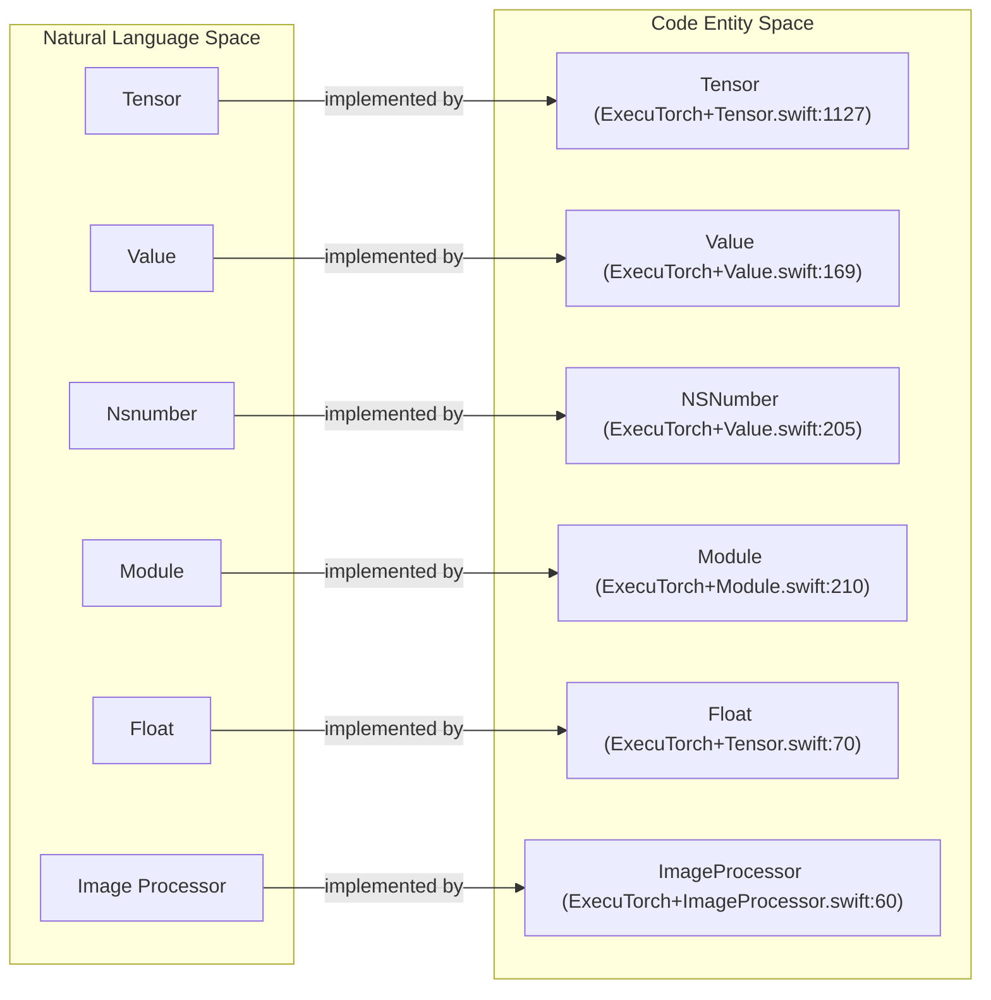
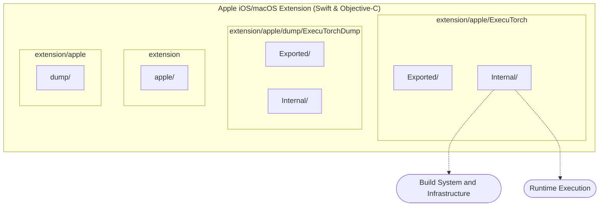
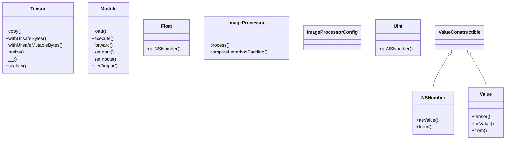
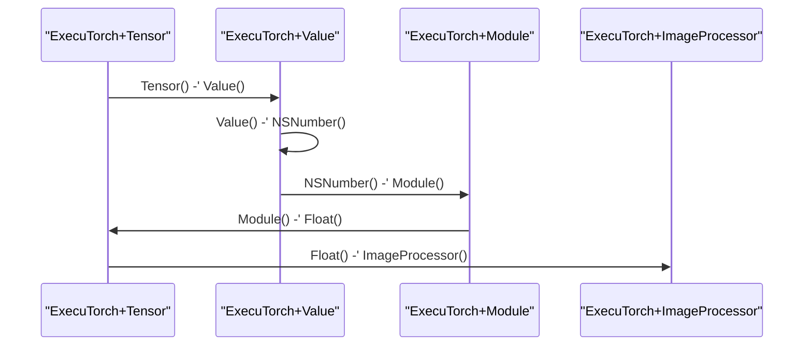

# 3-Source Context Packet (`git` + `CBM` + `llm-wiki`) for `9.2-apple-ios-macos-extension` — Apple iOS/macOS Extension (Swift & Objective-C)

- **Target Wiki File**: `wiki/9.2-apple-ios-macos-extension.md`
- **Archetype**: `Leaf Technical Spec Page`
- **Parent Page**: `9-mobile-and-platform-extensions`
- **Summary**: Architectural specification and implementation reference for Apple iOS/macOS Extension (Swift & Objective-C) (26 relevant source files). Primary code entities: `AnyTensor`, `asValue`, `from`, `Array`, `==`.
- **Valid `[[wikilink]]` Neighbours**: `[[9-mobile-and-platform-extensions|Mobile and Platform Extensions]]`, `[[1.1-getting-started|Getting Started]]`, `[[1.2-export-api-and-recipe-system|Export API and Recipe System]]`, `[[2.2-kernel-libraries-and-selective-build|Kernel Libraries and Selective Build]]`, `[[2.3-schema-generation-and-flatbuffers|Schema Generation and FlatBuffers]]`, `[[3.4-program-emission-and-serialization|Program Emission and Serialization]]`, `[[3.5-verification-and-dialect-system|Verification and Dialect System]]`, `[[4-quantization-systems|Quantization Systems]]`

## 1. Relevant Source Files (`git` + `CBM`, use verbatim in `<details>`)
- `[extension/apple/ExecuTorch/Exported/ExecuTorch+Value.swift](extension/apple/ExecuTorch/Exported/ExecuTorch+Value.swift)`
- `[extension/apple/ExecuTorch/Exported/ExecuTorch+Tensor.swift](extension/apple/ExecuTorch/Exported/ExecuTorch+Tensor.swift)`
- `[extension/apple/ExecuTorch/Exported/ExecuTorch+Module.swift](extension/apple/ExecuTorch/Exported/ExecuTorch+Module.swift)`
- `[extension/apple/ExecuTorch/Exported/ExecuTorch+ImageProcessor.swift](extension/apple/ExecuTorch/Exported/ExecuTorch+ImageProcessor.swift)`
- `[extension/apple/ExecuTorch/Exported/ExecuTorchImageProcessor.h](extension/apple/ExecuTorch/Exported/ExecuTorchImageProcessor.h)`
- `[extension/apple/ExecuTorch/Exported/ExecuTorch.h](extension/apple/ExecuTorch/Exported/ExecuTorch.h)`
- `[extension/apple/ExecuTorch/Exported/ExecuTorchBackendOption.h](extension/apple/ExecuTorch/Exported/ExecuTorchBackendOption.h)`
- `[extension/apple/ExecuTorch/Exported/ExecuTorchError.m](extension/apple/ExecuTorch/Exported/ExecuTorchError.m)`
- `[extension/apple/ExecuTorch/Exported/ExecuTorchBackendOptionsMap.h](extension/apple/ExecuTorch/Exported/ExecuTorchBackendOptionsMap.h)`
- `[extension/apple/ExecuTorch/Exported/ExecuTorchError.h](extension/apple/ExecuTorch/Exported/ExecuTorchError.h)`
- `[extension/apple/ExecuTorch/Exported/ExecuTorchEventTracer.h](extension/apple/ExecuTorch/Exported/ExecuTorchEventTracer.h)`
- `[extension/apple/ExecuTorch/Exported/ExecuTorchLog.h](extension/apple/ExecuTorch/Exported/ExecuTorchLog.h)`
- `[extension/apple/ExecuTorch/Exported/ExecuTorchModule.h](extension/apple/ExecuTorch/Exported/ExecuTorchModule.h)`
- `[extension/apple/ExecuTorch/Exported/ExecuTorchTensor.h](extension/apple/ExecuTorch/Exported/ExecuTorchTensor.h)`
- `[extension/apple/ExecuTorch/Internal/ExecuTorchUtils.h](extension/apple/ExecuTorch/Internal/ExecuTorchUtils.h)`
- `[extension/apple/ExecuTorch/Exported/ExecuTorchValue.h](extension/apple/ExecuTorch/Exported/ExecuTorchValue.h)`
- `[extension/apple/ExecuTorch/Internal/ExecuTorchBackendOptionsMap+Internal.h](extension/apple/ExecuTorch/Internal/ExecuTorchBackendOptionsMap+Internal.h)`
- `[extension/apple/dump/ExecuTorchDump/Exported/ExecuTorchDump.h](extension/apple/dump/ExecuTorchDump/Exported/ExecuTorchDump.h)`
- `[extension/apple/dump/ExecuTorchDump/Exported/ExecuTorchDumpError.h](extension/apple/dump/ExecuTorchDump/Exported/ExecuTorchDumpError.h)`
- `[extension/apple/dump/ExecuTorchDump/Exported/ExecuTorchDumpTracer.h](extension/apple/dump/ExecuTorchDump/Exported/ExecuTorchDumpTracer.h)`
- `[extension/apple/dump/ExecuTorchDump/Internal/ExecuTorchDumpTracer+Internal.h](extension/apple/dump/ExecuTorchDump/Internal/ExecuTorchDumpTracer+Internal.h)`
- `[docs/source/using-executorch-ios.md](docs/source/using-executorch-ios.md)`
- `[extension/apple/BUCK](extension/apple/BUCK)`
- `[extension/apple/CMakeLists.txt](extension/apple/CMakeLists.txt)`
- `[extension/apple/dump/BUCK](extension/apple/dump/BUCK)`
- `[extension/apple/dump/CMakeLists.txt](extension/apple/dump/CMakeLists.txt)`

## 2. Grounded Code Symbols (`CBM`, use verbatim for `[file:start-end]()` pill citations)
- `Tensor` (Class) @ `[extension/apple/ExecuTorch/Exported/ExecuTorch+Tensor.swift:1127-1131]()` [fan-in=61, fan-out=0] — 
- `Value` (Class) @ `[extension/apple/ExecuTorch/Exported/ExecuTorch+Value.swift:169-173]()` [fan-in=29, fan-out=0] — 
- `NSNumber` (Class) @ `[extension/apple/ExecuTorch/Exported/ExecuTorch+Value.swift:205-212]()` [fan-in=25, fan-out=0] — 
- `Module` (Class) @ `[extension/apple/ExecuTorch/Exported/ExecuTorch+Module.swift:210-327]()` [fan-in=14, fan-out=0] — 
- `Float` (Class) @ `[extension/apple/ExecuTorch/Exported/ExecuTorch+Tensor.swift:70-75]()` [fan-in=9, fan-out=0] — 
- `ImageProcessor` (Class) @ `[extension/apple/ExecuTorch/Exported/ExecuTorch+ImageProcessor.swift:60-113]()` [fan-in=7, fan-out=0] — 
- `ImageProcessorConfig` (Class) @ `[extension/apple/ExecuTorch/Exported/ExecuTorch+ImageProcessor.swift:29-58]()` [fan-in=7, fan-out=0] — 
- `UInt` (Class) @ `[extension/apple/ExecuTorch/Exported/ExecuTorch+Tensor.swift:112-117]()` [fan-in=6, fan-out=0] — 
- `Scalar` (Interface) @ `[extension/apple/ExecuTorch/Exported/ExecuTorch+Tensor.swift:21-26]()` [fan-in=0, fan-out=0] — /// A protocol that types conform to in order to be used as tensor element types. /// Provides the mapping from the Swift type to the underlying `DataType`.
- `String` (Class) @ `[extension/apple/ExecuTorch/Exported/ExecuTorch+Value.swift:196-203]()` [fan-in=5, fan-out=0] — 
- `ValueConvertible` (Interface) @ `[extension/apple/ExecuTorch/Exported/ExecuTorch+Value.swift:37-40]()` [fan-in=0, fan-out=0] — /// A protocol that provides a uniform way to convert different Swift types /// into a `Value`.
- `Int` (Class) @ `[extension/apple/ExecuTorch/Exported/ExecuTorch+Tensor.swift:63-68]()` [fan-in=4, fan-out=0] — 
- `ExecuTorchImageLetterboxPadding` (Class) @ `[extension/apple/ExecuTorch/Exported/ExecuTorchImageProcessor.h:28-31]()` [fan-in=0, fan-out=0] — /// Per-side letterbox padding in pixels: `x` is the left/right pad and `y` the /// top/bottom pad of the resized content.
- `Array` (Class) @ `[extension/apple/ExecuTorch/Exported/ExecuTorch+Value.swift:363-367]()` [fan-in=3, fan-out=0] — 
- `Int` (Class) @ `[extension/apple/ExecuTorch/Exported/ExecuTorch+Value.swift:274-284]()` [fan-in=3, fan-out=0] — 
- `Int16` (Class) @ `[extension/apple/ExecuTorch/Exported/ExecuTorch+Tensor.swift:42-47]()` [fan-in=2, fan-out=0] — 
- `Int32` (Class) @ `[extension/apple/ExecuTorch/Exported/ExecuTorch+Tensor.swift:49-54]()` [fan-in=2, fan-out=0] — 
- `Int64` (Class) @ `[extension/apple/ExecuTorch/Exported/ExecuTorch+Tensor.swift:56-61]()` [fan-in=2, fan-out=0] — 
- `UInt8` (Class) @ `[extension/apple/ExecuTorch/Exported/ExecuTorch+Tensor.swift:28-33]()` [fan-in=2, fan-out=0] — 
- `Int8` (Class) @ `[extension/apple/ExecuTorch/Exported/ExecuTorch+Tensor.swift:35-40]()` [fan-in=1, fan-out=0] — 
- `UInt16` (Class) @ `[extension/apple/ExecuTorch/Exported/ExecuTorch+Tensor.swift:91-96]()` [fan-in=1, fan-out=0] — 
- `UInt32` (Class) @ `[extension/apple/ExecuTorch/Exported/ExecuTorch+Tensor.swift:98-103]()` [fan-in=1, fan-out=0] — 

## 3. Grounded Source Code Excerpts (`git` Working Tree)
### `Tensor` in `[extension/apple/ExecuTorch/Exported/ExecuTorch+Tensor.swift:1127-1131]()`
```swift
extension Tensor: CustomStringConvertible {
  public var description: String {
    self.anyTensor.description
  }
}
```

### `Value` in `[extension/apple/ExecuTorch/Exported/ExecuTorch+Value.swift:169-173]()`
```swift
extension Value: ValueConstructible, ValueSequenceConstructible {
  public static func from(_ value: Value) throws -> Self {
    value as! Self
  }
}
```

### `NSNumber` in `[extension/apple/ExecuTorch/Exported/ExecuTorch+Value.swift:205-212]()`
```swift
extension NSNumber: ValueConstructible, ValueSequenceConstructible {
  public static func from(_ value: Value) throws -> Self {
    guard let scalar = value.scalar as? Self else {
      throw Error(code: .invalidType, description: "Value is not a scalar")
    }
    return scalar
  }
}
```

### `Module` in `[extension/apple/ExecuTorch/Exported/ExecuTorch+Module.swift:210-225]()`
```swift
public extension Module {
  /// Sets a single input value for a method at the specified index.
  ///
  /// - Parameters:
  ///   - value: The input as a `ValueConvertible`.
  ///   - method: The method name.
  ///   - index: Zero-based input index.
  /// - Throws: If setting the input fails.
  func setInput(_ value: ValueConvertible, for method: String, at index: Int) throws {
    try __setInput(value.asValue(), forMethod: method, at: index)
  }

  /// Sets a single input value for a method at index 0.
  ///
  /// - Parameters:
  ///   - value: The input as a `ValueConvertible`.
```

### `Float` in `[extension/apple/ExecuTorch/Exported/ExecuTorch+Tensor.swift:70-75]()`
```swift
extension Float: Scalar {
  /// The `DataType` corresponding to `Float`, which is `.float`.
  public static var dataType: DataType { .float }
  /// Returns the value as an `NSNumber`.
  public func asNSNumber() -> NSNumber { NSNumber(value: self) }
}
```


## 4. Linked Official Docs (`llm-wiki` / `RAG`)
- **Mobile and Platform Extensions** (`wiki/9-mobile-and-platform-extensions.md`, score=119.219, shared_symbols=['ImageProcessor', 'ImageProcessorConfig', 'Module', 'NSNumber', 'String', 'Tensor', 'Value']): # Mobile and Platform Extensions > Architectural specification and implementation reference for Mobile and Platform Extensions (40 relevant source files). Primary code entities: `BindingSpec`, `ComputePipelineBundle`, `operator=`, `Storage`, `~Storage`. <details> <summary>Relevant source files</summary> The following files were used as context for generat
- **Using ExecuTorch on iOS** (`raw/executorch/using-executorch-ios.md`, score=103.645, shared_symbols=['Float', 'Module', 'NSNumber', 'Tensor', 'Value']): # Using ExecuTorch on iOS ExecuTorch supports both iOS and macOS via Objective-C, Swift, and C++. ExecuTorch also provides backends to leverage Core ML and MLX for hardware-accelerated execution on Apple platforms. ## Integration The ExecuTorch Runtime for iOS and macOS (ARM64) is distributed as a collection of prebuilt [.xcframework](https://developer.ap
- **Android Extension (Java/Kotlin & JNI)** (`wiki/9.1-android-extension.md`, score=102.263, shared_symbols=['Array', 'Float', 'ImageProcessor', 'ImageProcessorConfig', 'Module', 'Tensor']): # Android Extension (Java/Kotlin & JNI) ↑ [[9-mobile-and-platform-extensions|Mobile and Platform Extensions]] > Architectural specification and implementation reference for Android Extension (Java/Kotlin & JNI) (33 relevant source files). Primary code entities: `Java_org_pytorch_executorch_extension_image_ImageProcessor_nativeComputeLetterboxPadding`, `Jav
- **ExecuTorch DeepWiki** (`wiki/index.md`, score=93.929, shared_symbols=[]): # ExecuTorch DeepWiki Generated from `home-jason-Project-deepwiki-executorch` at commit `b3b565b5b62f` (2026-11-15T15:02:11+00:00). ## Pages - [[1-overview|Overview]] — Architectural specification and implementation reference for Overview (10 relevant source files). Primary code entities: `Module`, `MethodHolder`, `PlannedMemory`, `EdgeProgramManager`, `_
- **Working with Computer Vision Models** (`raw/executorch/working-with-cv-models.md`, score=84.744, shared_symbols=['Float', 'ImageProcessor', 'ImageProcessorConfig', 'Module', 'Tensor']): (working-with-cv-models)= # Working with Computer Vision Models Computer vision deployments depend on the boundary between the app and the exported program being precise. Before exporting, write down the tensor contract that your app will satisfy: - input shape, including whether the model expects `NCHW` (`[batch, channels, height, width]`) or `NHWC` (`[b
- **High-Level Module API, Tensor & On-Device Training** (`wiki/9.3-high-level-module-and-on-device-training.md`, score=68.26, shared_symbols=['Module', 'Tensor']): # High-Level Module API, Tensor & On-Device Training ↑ [[9-mobile-and-platform-extensions|Mobile and Platform Extensions]] > Architectural specification and implementation reference for High-Level Module API, Tensor & On-Device Training (37 relevant source files). Primary code entities: `Storage`, `operator=`, `~Storage`, `Module`, `execute`. <details> <s

## 5. Pre-Verified DeepWiki v1.9.9.5 Mermaid Diagrams
### Natural Language Space <-> Code Entity Space


### Subsystem Architecture Flowchart


### Class Hierarchy Diagram


### Call Sequence Diagram


## 6. DeepWiki v1.9.9.5 Authoring Checklist for `wiki/9.2-apple-ios-macos-extension.md`
1. Keep YAML frontmatter at top (`id`, `title`, `parent`, `sources`, `linked_docs`, `bridge_symbols`).
2. Keep `<details><summary>Relevant source files</summary>` block immediately after `# Title`.
3. Start with `## Purpose and Scope`, then numbered `## 1. ...`, `## 2. ...` sections separated by `---`.
4. Include at least 2 ```mermaid``` diagrams (including a `Natural Language Space` <-> `Code Entity Space` mapping).
5. Cite code entities inline using `[path/to/file.ext:start-end]()` and end every `##` section with `Sources: [file:start-end]()`.
6. Run `deepwiki_cli.py build --enrich-only ...` and `deepwiki_cli.py validate ...` after editing.
