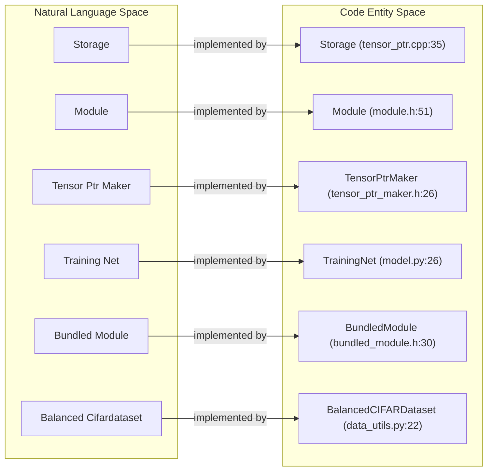
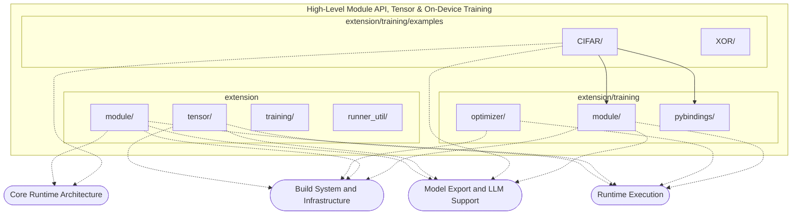
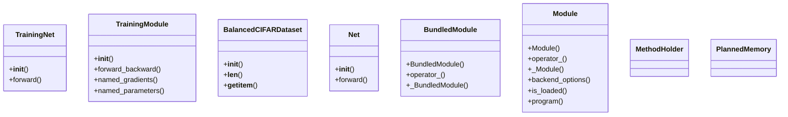
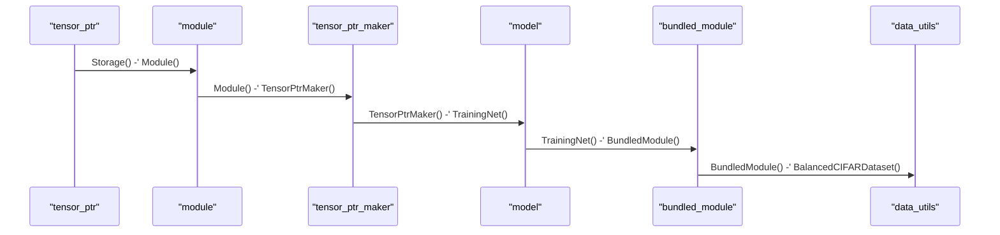

# 3-Source Context Packet (`git` + `CBM` + `llm-wiki`) for `9.3-high-level-module-and-on-device-training` — High-Level Module API, Tensor & On-Device Training

- **Target Wiki File**: `wiki/9.3-high-level-module-and-on-device-training.md`
- **Archetype**: `Leaf Technical Spec Page`
- **Parent Page**: `9-mobile-and-platform-extensions`
- **Summary**: Architectural specification and implementation reference for High-Level Module API, Tensor & On-Device Training (37 relevant source files). Primary code entities: `Storage`, `operator=`, `~Storage`, `Module`, `execute`.
- **Valid `[[wikilink]]` Neighbours**: `[[9-mobile-and-platform-extensions|Mobile and Platform Extensions]]`, `[[1.1-getting-started|Getting Started]]`, `[[1.2-export-api-and-recipe-system|Export API and Recipe System]]`, `[[2.2-kernel-libraries-and-selective-build|Kernel Libraries and Selective Build]]`, `[[2.3-schema-generation-and-flatbuffers|Schema Generation and FlatBuffers]]`, `[[3.4-program-emission-and-serialization|Program Emission and Serialization]]`, `[[3.5-verification-and-dialect-system|Verification and Dialect System]]`, `[[4-quantization-systems|Quantization Systems]]`

## 1. Relevant Source Files (`git` + `CBM`, use verbatim in `<details>`)
- `[extension/tensor/tensor_ptr.cpp](extension/tensor/tensor_ptr.cpp)`
- `[extension/module/module.cpp](extension/module/module.cpp)`
- `[extension/module/module.h](extension/module/module.h)`
- `[extension/tensor/tensor_ptr_maker.h](extension/tensor/tensor_ptr_maker.h)`
- `[extension/module/ptn_module.cpp](extension/module/ptn_module.cpp)`
- `[extension/tensor/tensor_accessor.h](extension/tensor/tensor_accessor.h)`
- `[extension/module/bundled_module.h](extension/module/bundled_module.h)`
- `[extension/module/ptn_module.h](extension/module/ptn_module.h)`
- `[extension/module/bundled_module.cpp](extension/module/bundled_module.cpp)`
- `[extension/tensor/tensor_ptr_maker.cpp](extension/tensor/tensor_ptr_maker.cpp)`
- `[extension/module/targets.bzl](extension/module/targets.bzl)`
- `[extension/training/examples/CIFAR/data_utils.py](extension/training/examples/CIFAR/data_utils.py)`
- `[extension/tensor/targets.bzl](extension/tensor/targets.bzl)`
- `[extension/tensor/tensor.h](extension/tensor/tensor.h)`
- `[extension/tensor/tensor_ptr.h](extension/tensor/tensor_ptr.h)`
- `[extension/training/optimizer/adamw.cpp](extension/training/optimizer/adamw.cpp)`
- `[extension/training/examples/CIFAR/model.py](extension/training/examples/CIFAR/model.py)`
- `[extension/training/__init__.py](extension/training/__init__.py)`
- `[extension/training/examples/XOR/model.py](extension/training/examples/XOR/model.py)`
- `[extension/training/module/training_module.cpp](extension/training/module/training_module.cpp)`
- `[extension/training/examples/CIFAR/export.py](extension/training/examples/CIFAR/export.py)`
- `[extension/training/pybindings/_training_lib.cpp](extension/training/pybindings/_training_lib.cpp)`
- `[extension/training/optimizer/sgd.cpp](extension/training/optimizer/sgd.cpp)`
- `[extension/training/examples/CIFAR/train.cpp](extension/training/examples/CIFAR/train.cpp)`
- `[extension/runner_util/inputs.h](extension/runner_util/inputs.h)`
- `[extension/training/pybindings/_training_module.py](extension/training/pybindings/_training_module.py)`
- `[extension/training/examples/CIFAR/main.py](extension/training/examples/CIFAR/main.py)`
- `[extension/training/examples/CIFAR/train_utils.py](extension/training/examples/CIFAR/train_utils.py)`
- `[extension/training/README.md](extension/training/README.md)`
- `[extension/training/examples/CIFAR/README.md](extension/training/examples/CIFAR/README.md)`

## 2. Grounded Code Symbols (`CBM`, use verbatim for `[file:start-end]()` pill citations)
- `Storage` (Class) @ `[extension/tensor/tensor_ptr.cpp:35-66]()` [fan-in=0, fan-out=0] — /** * A structure that consolidates the metadata (sizes, dim_order, strides) and * the data buffer associated with a Tensor. Since Tensor does not own * the mem
- `Module` (Class) @ `[extension/module/module.h:51-791]()` [fan-in=0, fan-out=0] — /** * A facade class for loading programs and executing methods within them. */
- `TensorPtrMaker` (Class) @ `[extension/tensor/tensor_ptr_maker.h:26-163]()` [fan-in=0, fan-out=0] — /** * A helper class for creating TensorPtr instances from raw data and tensor * properties. Note that the TensorPtr created by this class does not own the * da
- `TrainingNet` (Class) @ `[extension/training/examples/XOR/model.py:26-34]()` [fan-in=4, fan-out=0] — # On device training requires the loss to be embedded in the model (and be the first output). # We wrap the original model here and add the loss calculation. Th
- `BundledModule` (Class) @ `[extension/module/bundled_module.h:30-130]()` [fan-in=0, fan-out=0] — /** * A facade class for loading bundled programs and executing methods within * them. */
- `BalancedCIFARDataset` (Class) @ `[extension/training/examples/CIFAR/data_utils.py:22-79]()` [fan-in=1, fan-out=0] — Custom dataset class to load balanced CIFAR-10 data from binary file.
- `Net` (Class) @ `[extension/training/examples/XOR/model.py:14-21]()` [fan-in=1, fan-out=0] — # Basic Net for XOR
- `ModelWithLoss` (Class) @ `[extension/training/examples/CIFAR/model.py:49-73]()` [fan-in=0, fan-out=0] — NOTE: A wrapper class that combines a model and the loss function into a single module. Used for capturing the entire computational graph, i.e. forward pass and
- `MethodHolder` (Class) @ `[extension/module/module.h:752-757]()` [fan-in=0, fan-out=0] — 
- `PlannedMemory` (Class) @ `[extension/module/module.h:730-739]()` [fan-in=0, fan-out=0] — 
- `PtnHookRegistry` (Class) @ `[extension/module/ptn_module.cpp:17-21]()` [fan-in=0, fan-out=0] — 
- `BufferCleanup` (Class) @ `[extension/runner_util/inputs.h:27-58]()` [fan-in=0, fan-out=0] — /** * RAII helper that frees a set of buffers when destroyed. Movable. */
- `PrepareInputTensorsOptions` (Class) @ `[extension/runner_util/inputs.h:61-75]()` [fan-in=0, fan-out=0] — /// Defines options for `prepare_input_tensors()`.
- `TensorAccessor` (Class) @ `[extension/tensor/tensor_accessor.h:68-116]()` [fan-in=0, fan-out=0] — 
- `TensorAccessor<T, 1>` (Class) @ `[extension/tensor/tensor_accessor.h:123-159]()` [fan-in=0, fan-out=0] — 
- `TensorAccessorBase` (Class) @ `[extension/tensor/tensor_accessor.h:23-57]()` [fan-in=0, fan-out=0] — 
- `PtnFileSource` (Class) @ `[extension/module/ptn_module.h:77-85]()` [fan-in=0, fan-out=0] — 
- `PtnHooks` (Class) @ `[extension/module/ptn_module.h:90-94]()` [fan-in=0, fan-out=0] — 
- `PtnModule` (Class) @ `[extension/module/ptn_module.h:41-75]()` [fan-in=0, fan-out=0] — 
- `CIFAR10Model` (Class) @ `[extension/training/examples/CIFAR/model.py:14-46]()` [fan-in=0, fan-out=0] — 
- `TrainingModule` (Class) @ `[extension/training/pybindings/_training_module.py:22-72]()` [fan-in=2, fan-out=0] — 
- `PySGD` (Class) @ `[extension/training/pybindings/_training_lib.cpp:30-121]()` [fan-in=0, fan-out=0] — 

## 3. Grounded Source Code Excerpts (`git` Working Tree)
### `Storage` in `[extension/tensor/tensor_ptr.cpp:35-50]()`
```cpp
struct Storage final {
  executorch::aten::TensorImpl tensor_impl;
  executorch::aten::Tensor tensor;
  std::vector<executorch::aten::SizesType> sizes;
  std::vector<executorch::aten::DimOrderType> dim_order;
  std::vector<executorch::aten::StridesType> strides;
  std::function<void(void*)> deleter;

  Storage(
      executorch::aten::TensorImpl&& tensor_impl,
      std::vector<executorch::aten::SizesType>&& sizes,
      std::vector<executorch::aten::DimOrderType>&& dim_order,
      std::vector<executorch::aten::StridesType>&& strides,
      std::function<void(void*)>&& deleter)
      : tensor_impl(std::move(tensor_impl)),
        tensor(&this->tensor_impl),
```

### `Module` in `[extension/module/module.h:51-66]()`
```cpp
class Module {
 public:
  /**
   * Enum to define loading behavior.
   */
  enum class LoadMode {
    /// Load the whole file as a buffer.
    File,
    /// Use mmap to load pages into memory.
    Mmap,
    /// Use memory locking and handle errors.
    MmapUseMlock,
    /// Use memory locking and ignore errors.
    MmapUseMlockIgnoreErrors,
    /// Use mmap with madvise(MADV_WILLNEED | MADV_SEQUENTIAL) hints.
    MmapUseMadvise,
```

### `TensorPtrMaker` in `[extension/tensor/tensor_ptr_maker.h:26-41]()`
```cpp
class TensorPtrMaker final {
 public:
  // This class may have non-copyable members in the future.
  TensorPtrMaker(const TensorPtrMaker&) = delete;
  TensorPtrMaker& operator=(const TensorPtrMaker&) = delete;
  // But it is movable.
  TensorPtrMaker(TensorPtrMaker&&) = default;
  TensorPtrMaker& operator=(TensorPtrMaker&&) = default;

  /**
   * Sets the scalar type of the tensor elements.
   *
   * @param type The scalar type (e.g., float, int, bool).
   * @return Rvalue to this TensorPtrMaker for method chaining.
   */
  TensorPtrMaker&& type(executorch::aten::ScalarType type) {
```

### `TrainingNet` in `[extension/training/examples/XOR/model.py:26-34]()`
```python
class TrainingNet(nn.Module):
    def __init__(self, net):
        super().__init__()
        self.net = net
        self.loss = nn.CrossEntropyLoss()

    def forward(self, input, label):
        pred = self.net(input)
        return self.loss(pred, label), pred.detach().argmax(dim=1)
```

### `BundledModule` in `[extension/module/bundled_module.h:30-45]()`
```cpp
class BundledModule : public Module {
 public:
  /**
   * Constructs an instance with the bundled program buffer pointer.
   *
   * This constructor reads the program from bundled program buffer to load the
   * module with data loader. The bundled program pointer is preserved so that
   * the portion outside of program is accessible.
   *
   * @param[in] bundled_program_ptr A DataLoader used for loading program data.
   * @param[in] memory_allocator A MemoryAllocator used for memory management.
   * @param[in] temp_allocator A MemoryAllocator to use when allocating
   * temporary data during kernel or delegate execution.
   * @param[in] event_tracer A EventTracer used for tracking and logging events.
   * @param[in] data_map_loader A DataLoader used for loading external weights.
   */
```


## 4. Linked Official Docs (`llm-wiki` / `RAG`)
- **Mobile and Platform Extensions** (`wiki/9-mobile-and-platform-extensions.md`, score=88.712, shared_symbols=['Module', 'TrainingNet', 'from_blob', 'make_tensor_ptr']): # Mobile and Platform Extensions > Architectural specification and implementation reference for Mobile and Platform Extensions (40 relevant source files). Primary code entities: `BindingSpec`, `ComputePipelineBundle`, `operator=`, `Storage`, `~Storage`. <details> <summary>Relevant source files</summary> The following files were used as context for generat
- **ExecuTorch DeepWiki** (`wiki/index.md`, score=75.529, shared_symbols=[]): # ExecuTorch DeepWiki Generated from `home-jason-Project-deepwiki-executorch` at commit `b3b565b5b62f` (2026-11-15T15:02:11+00:00). ## Pages - [[1-overview|Overview]] — Architectural specification and implementation reference for Overview (10 relevant source files). Primary code entities: `Module`, `MethodHolder`, `PlannedMemory`, `EdgeProgramManager`, `_
- **Android Extension (Java/Kotlin & JNI)** (`wiki/9.1-android-extension.md`, score=71.45, shared_symbols=['Module']): # Android Extension (Java/Kotlin & JNI) ↑ [[9-mobile-and-platform-extensions|Mobile and Platform Extensions]] > Architectural specification and implementation reference for Android Extension (Java/Kotlin & JNI) (33 relevant source files). Primary code entities: `Java_org_pytorch_executorch_extension_image_ImageProcessor_nativeComputeLetterboxPadding`, `Jav
- **Apple iOS/macOS Extension (Swift & Objective-C)** (`wiki/9.2-apple-ios-macos-extension.md`, score=71.45, shared_symbols=['Module']): # Apple iOS/macOS Extension (Swift & Objective-C) ↑ [[9-mobile-and-platform-extensions|Mobile and Platform Extensions]] > Architectural specification and implementation reference for Apple iOS/macOS Extension (Swift & Objective-C) (26 relevant source files). Primary code entities: `AnyTensor`, `asValue`, `from`, `Array`, `==`. <details> <summary>Relevant 
- **Embedded (Zephyr, ESP32, Pico2) and WebAssembly/WebGPU Targets** (`wiki/9.4-embedded-and-web-targets.md`, score=71.45, shared_symbols=['Module']): # Embedded (Zephyr, ESP32, Pico2) and WebAssembly/WebGPU Targets ↑ [[9-mobile-and-platform-extensions|Mobile and Platform Extensions]] > Architectural specification and implementation reference for Embedded (Zephyr, ESP32, Pico2) and WebAssembly/WebGPU Targets (40 relevant source files). Primary code entities: `BindingSpec`, `ComputePipelineBundle`, `opera
- **Python Bindings and Dependencies** (`wiki/2.4-python-bindings-and-dependencies.md`, score=66.107, shared_symbols=['Module']): # Python Bindings and Dependencies ↑ [[2-build-system-and-infrastructure|Build System and Infrastructure]] > Architectural specification and implementation reference for Python Bindings and Dependencies (15 relevant source files). Primary code entities: `BorrowedInput`, `torch_storage`, `validate`, `PyExecuTorchResult`, `DLPackHolder`. <details> <summary>

## 5. Pre-Verified DeepWiki v1.9.9.5 Mermaid Diagrams
### Natural Language Space <-> Code Entity Space


### Subsystem Architecture Flowchart


### Class Hierarchy Diagram


### Call Sequence Diagram


## 6. DeepWiki v1.9.9.5 Authoring Checklist for `wiki/9.3-high-level-module-and-on-device-training.md`
1. Keep YAML frontmatter at top (`id`, `title`, `parent`, `sources`, `linked_docs`, `bridge_symbols`).
2. Keep `<details><summary>Relevant source files</summary>` block immediately after `# Title`.
3. Start with `## Purpose and Scope`, then numbered `## 1. ...`, `## 2. ...` sections separated by `---`.
4. Include at least 2 ```mermaid``` diagrams (including a `Natural Language Space` <-> `Code Entity Space` mapping).
5. Cite code entities inline using `[path/to/file.ext:start-end]()` and end every `##` section with `Sources: [file:start-end]()`.
6. Run `deepwiki_cli.py build --enrich-only ...` and `deepwiki_cli.py validate ...` after editing.
