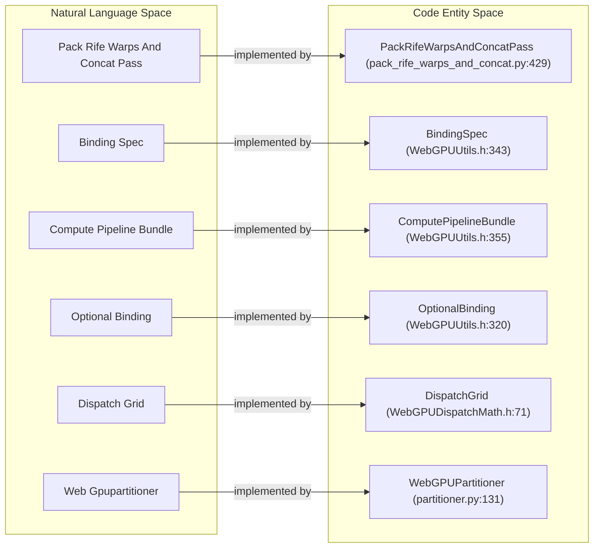
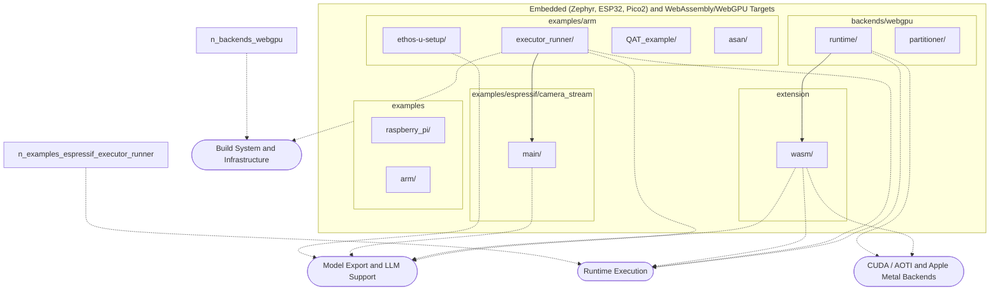
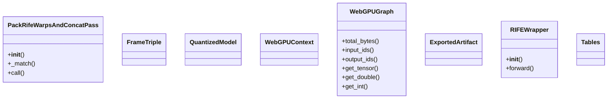
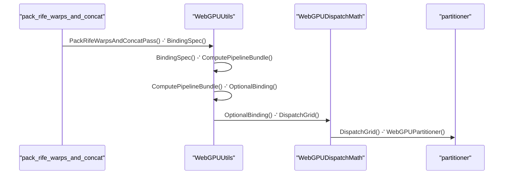

# 3-Source Context Packet (`git` + `CBM` + `llm-wiki`) for `9.4-embedded-and-web-targets` — Embedded (Zephyr, ESP32, Pico2) and WebAssembly/WebGPU Targets

- **Target Wiki File**: `wiki/9.4-embedded-and-web-targets.md`
- **Archetype**: `Leaf Technical Spec Page`
- **Parent Page**: `9-mobile-and-platform-extensions`
- **Summary**: Architectural specification and implementation reference for Embedded (Zephyr, ESP32, Pico2) and WebAssembly/WebGPU Targets (40 relevant source files). Primary code entities: `BindingSpec`, `ComputePipelineBundle`, `operator=`, `acquire_scratch`, `add_compute_dispatch`.
- **Valid `[[wikilink]]` Neighbours**: `[[9-mobile-and-platform-extensions|Mobile and Platform Extensions]]`, `[[1.1-getting-started|Getting Started]]`, `[[1.2-export-api-and-recipe-system|Export API and Recipe System]]`, `[[2.2-kernel-libraries-and-selective-build|Kernel Libraries and Selective Build]]`, `[[2.3-schema-generation-and-flatbuffers|Schema Generation and FlatBuffers]]`, `[[3.4-program-emission-and-serialization|Program Emission and Serialization]]`, `[[3.5-verification-and-dialect-system|Verification and Dialect System]]`, `[[4-quantization-systems|Quantization Systems]]`

## 1. Relevant Source Files (`git` + `CBM`, use verbatim in `<details>`)
- `[backends/webgpu/runtime/WebGPUUtils.h](backends/webgpu/runtime/WebGPUUtils.h)`
- `[backends/webgpu/runtime/WebGPUGraph.cpp](backends/webgpu/runtime/WebGPUGraph.cpp)`
- `[examples/arm/ethos-u-setup/arm-none-eabi-clang-random-device.h](examples/arm/ethos-u-setup/arm-none-eabi-clang-random-device.h)`
- `[backends/webgpu/runtime/WebGPUDevice.cpp](backends/webgpu/runtime/WebGPUDevice.cpp)`
- `[backends/webgpu/runtime/WebGPUDispatchMath.h](backends/webgpu/runtime/WebGPUDispatchMath.h)`
- `[extension/wasm/wasm_bindings.cpp](extension/wasm/wasm_bindings.cpp)`
- `[backends/webgpu/partitioner/partitioner.py](backends/webgpu/partitioner/partitioner.py)`
- `[examples/espressif/camera_stream/main/camera_stream.cpp](examples/espressif/camera_stream/main/camera_stream.cpp)`
- `[backends/webgpu/runtime/WebGPUDelegateHeader.cpp](backends/webgpu/runtime/WebGPUDelegateHeader.cpp)`
- `[examples/raspberry_pi/setup.sh](examples/raspberry_pi/setup.sh)`
- `[backends/webgpu/runtime/WebGPUQueryPool.cpp](backends/webgpu/runtime/WebGPUQueryPool.cpp)`
- `[backends/webgpu/runtime/WebGPUGraph.h](backends/webgpu/runtime/WebGPUGraph.h)`
- `[examples/arm/QAT_example/rife_vgf/passes/pack_rife_warps_and_concat.py](examples/arm/QAT_example/rife_vgf/passes/pack_rife_warps_and_concat.py)`
- `[backends/webgpu/runtime/WebGPUBackend.h](backends/webgpu/runtime/WebGPUBackend.h)`
- `[examples/arm/executor_runner/arm_executor_runner.cpp](examples/arm/executor_runner/arm_executor_runner.cpp)`
- `[backends/webgpu/runtime/WebGPUExecutionOptions.h](backends/webgpu/runtime/WebGPUExecutionOptions.h)`
- `[backends/webgpu/runtime/WebGPUDelegateHeader.h](backends/webgpu/runtime/WebGPUDelegateHeader.h)`
- `[backends/webgpu/CMakeLists.txt](backends/webgpu/CMakeLists.txt)`
- `[backends/webgpu/runtime/WebGPUDevice.h](backends/webgpu/runtime/WebGPUDevice.h)`
- `[backends/webgpu/__init__.py](backends/webgpu/__init__.py)`
- `[backends/webgpu/runtime/WebGPUQueryPool.h](backends/webgpu/runtime/WebGPUQueryPool.h)`
- `[extension/wasm/tokenizers/tokenizers.cpp](extension/wasm/tokenizers/tokenizers.cpp)`
- `[backends/webgpu/runtime/WebGPUBackend.cpp](backends/webgpu/runtime/WebGPUBackend.cpp)`
- `[examples/arm/QAT_example/qat_loop.py](examples/arm/QAT_example/qat_loop.py)`
- `[backends/webgpu/runtime/ops/TensorMeta.h](backends/webgpu/runtime/ops/TensorMeta.h)`
- `[examples/arm/visualize.py](examples/arm/visualize.py)`
- `[examples/espressif/executor_runner/esp_executor_runner.cpp](examples/espressif/executor_runner/esp_executor_runner.cpp)`
- `[backends/webgpu/runtime/WebGPUShaderRegistry.h](backends/webgpu/runtime/WebGPUShaderRegistry.h)`
- `[extension/wasm/README.md](extension/wasm/README.md)`
- `[backends/webgpu/README.md](backends/webgpu/README.md)`

## 2. Grounded Code Symbols (`CBM`, use verbatim for `[file:start-end]()` pill citations)
- `PackRifeWarpsAndConcatPass` (Class) @ `[examples/arm/QAT_example/rife_vgf/passes/pack_rife_warps_and_concat.py:429-646]()` [fan-in=7, fan-out=0] — Pack four private RIFE warps and their C28 concat into one C32 shader. Fuse compatible block0 head resizing and state preparation into the shader. Reorder block
- `BindingSpec` (Class) @ `[backends/webgpu/runtime/WebGPUUtils.h:343-348]()` [fan-in=0, fan-out=0] — // One compute-shader binding: a bind-group-layout entry + its bind-group // entry share every field except `type` (layout) vs `buffer`/`size` (bind).
- `ComputePipelineBundle` (Class) @ `[backends/webgpu/runtime/WebGPUUtils.h:355-391]()` [fan-in=0, fan-out=0] — // Owns the shader module, bind-group layout, and pipeline layout, releasing // them on destruction. `pipeline` and `bind_group` are NOT released here — // ever
- `OptionalBinding` (Class) @ `[backends/webgpu/runtime/WebGPUUtils.h:320-324]()` [fan-in=0, fan-out=0] — // Resolves an optional tensor arg (bias/mask/affine) to the binding to use: // the real tensor's buffer+size if present, else a zero-filled dummy. Caller // re
- `DispatchGrid` (Class) @ `[backends/webgpu/runtime/WebGPUDispatchMath.h:71-76]()` [fan-in=0, fan-out=0] — // Adaptive 1D->2D dispatch grid. `count_x`/`count_y` are the dispatch dims; // `stride_x` (= count_x * wg_size) lets the shader decode a flat index as // `gid.
- `WebGPUPartitioner` (Class) @ `[backends/webgpu/partitioner/partitioner.py:131-214]()` [fan-in=0, fan-out=0] — WebGPU frontend for the Vulkan partitioning and serialization path.
- `ConstantSource` (Class) @ `[backends/webgpu/runtime/WebGPUGraph.h:118-122]()` [fan-in=0, fan-out=0] — // CPU-side record for a prepack-routed constant; mirrors Vulkan's TensorRef // (sizes + a data reference, not a live GPU tensor). The prepack node is the // so
- `InputData` (Class) @ `[backends/webgpu/runtime/WebGPUGraph.h:49-54]()` [fan-in=0, fan-out=0] — // Host-side view of one graph input, passed to copy_inputs.
- `OutputData` (Class) @ `[backends/webgpu/runtime/WebGPUGraph.h:58-62]()` [fan-in=0, fan-out=0] — // Host destination for a graph output. host_is_fp32 gates the fp16->fp32 widen // on readback (mirrors InputData's guard on the copy_inputs narrow path).
- `RunnerContext` (Class) @ `[examples/arm/executor_runner/arm_executor_runner.cpp:618-653]()` [fan-in=0, fan-out=0] — /// Holds all state needed for setup and run phases
- `MapCallbackData` (Class) @ `[backends/webgpu/runtime/WebGPUGraph.cpp:1758-1760]()` [fan-in=0, fan-out=0] — 
- `ScopedBindGroup` (Class) @ `[backends/webgpu/runtime/WebGPUGraph.cpp:70-93]()` [fan-in=0, fan-out=0] — 
- `ScopedBindGroupLayout` (Class) @ `[backends/webgpu/runtime/WebGPUGraph.cpp:50-68]()` [fan-in=0, fan-out=0] — 
- `ScopedComputePipeline` (Class) @ `[backends/webgpu/runtime/WebGPUGraph.cpp:95-115]()` [fan-in=0, fan-out=0] — 
- `ScopedComputePipelineRef` (Class) @ `[backends/webgpu/runtime/WebGPUGraph.cpp:117-139]()` [fan-in=0, fan-out=0] — 
- `ShaderDuration` (Class) @ `[backends/webgpu/runtime/WebGPUQueryPool.h:23-31]()` [fan-in=0, fan-out=0] — // Per-dispatch GPU timing; mirrors Vulkan QueryPool ShaderDuration.
- `WebGPUQueryPool` (Class) @ `[backends/webgpu/runtime/WebGPUQueryPool.h:34-84]()` [fan-in=0, fan-out=0] — // GPU timestamp-query pool; re-port of Vulkan vk_api/QueryPool.
- `AdapterResult` (Class) @ `[backends/webgpu/runtime/WebGPUDevice.cpp:24-26]()` [fan-in=0, fan-out=0] — 
- `DeviceResult` (Class) @ `[backends/webgpu/runtime/WebGPUDevice.cpp:28-30]()` [fan-in=0, fan-out=0] — 
- `random_device` (Class) @ `[examples/arm/ethos-u-setup/arm-none-eabi-clang-random-device.h:12-32]()` [fan-in=0, fan-out=0] — 
- `DispatchRange` (Class) @ `[backends/webgpu/runtime/WebGPUDispatchMath.h:83-86]()` [fan-in=0, fan-out=0] — 
- `DispatchRouteRegistry` (Class) @ `[backends/webgpu/runtime/WebGPUDispatchMath.h:126-203]()` [fan-in=0, fan-out=0] — 

## 3. Grounded Source Code Excerpts (`git` Working Tree)
### `PackRifeWarpsAndConcatPass` in `[examples/arm/QAT_example/rife_vgf/passes/pack_rife_warps_and_concat.py:429-444]()`
```python
class PackRifeWarpsAndConcatPass(ArmPass):
    """Pack four private RIFE warps and their C28 concat into one C32 shader.

    Fuse compatible block0 head resizing and state preparation into the shader.
    Reorder block0 output channels during export so each PixelShuffle read
    accesses 13 contiguous channels. Keep sampling quantization boundaries.
    Four zero weight columns make the following convolution ignore padding.
    Unsupported graphs are left unchanged.

    """

    _passes_required_after: set[type[ExportPass]] = set()

    def __init__(self, exported_program: ExportedProgram | None = None):
        super().__init__()
        self.exported_program = exported_program
```

### `BindingSpec` in `[backends/webgpu/runtime/WebGPUUtils.h:343-348]()`
```cpp
struct BindingSpec {
  uint32_t binding;
  WGPUBufferBindingType type;
  WGPUBuffer buffer;
  uint64_t size;
};
```

### `ComputePipelineBundle` in `[backends/webgpu/runtime/WebGPUUtils.h:355-370]()`
```cpp
struct ComputePipelineBundle {
  WGPUShaderModule shader = nullptr;
  WGPUBindGroupLayout bind_group_layout = nullptr;
  WGPUPipelineLayout pipeline_layout = nullptr;
  WGPUComputePipeline pipeline = nullptr;
  WGPUBindGroup bind_group = nullptr;

  ComputePipelineBundle() = default;
  ComputePipelineBundle(const ComputePipelineBundle&) = delete;
  ComputePipelineBundle& operator=(const ComputePipelineBundle&) = delete;
  ComputePipelineBundle& operator=(ComputePipelineBundle&&) = delete;

  ComputePipelineBundle(ComputePipelineBundle&& other) noexcept
      : shader(other.shader),
        bind_group_layout(other.bind_group_layout),
        pipeline_layout(other.pipeline_layout),
```

### `OptionalBinding` in `[backends/webgpu/runtime/WebGPUUtils.h:320-324]()`
```cpp
struct OptionalBinding {
  WGPUBuffer buffer;
  uint64_t nbytes;
  WGPUBuffer owned_dummy; // non-null only when a dummy was allocated
};
```

### `DispatchGrid` in `[backends/webgpu/runtime/WebGPUDispatchMath.h:71-76]()`
```cpp
struct DispatchGrid {
  uint32_t wg_size;
  uint32_t count_x;
  uint32_t count_y;
  uint32_t stride_x;
};
```


## 4. Linked Official Docs (`llm-wiki` / `RAG`)
- **Mobile and Platform Extensions** (`wiki/9-mobile-and-platform-extensions.md`, score=192.992, shared_symbols=['PackRifeWarpsAndConcatPass']): # Mobile and Platform Extensions > Architectural specification and implementation reference for Mobile and Platform Extensions (40 relevant source files). Primary code entities: `BindingSpec`, `ComputePipelineBundle`, `operator=`, `Storage`, `~Storage`. <details> <summary>Relevant source files</summary> The following files were used as context for generat
- **ExecuTorch DeepWiki** (`wiki/index.md`, score=161.77, shared_symbols=[]): # ExecuTorch DeepWiki Generated from `home-jason-Project-deepwiki-executorch` at commit `b3b565b5b62f` (2026-11-15T15:02:11+00:00). ## Pages - [[1-overview|Overview]] — Architectural specification and implementation reference for Overview (10 relevant source files). Primary code entities: `Module`, `MethodHolder`, `PlannedMemory`, `EdgeProgramManager`, `_
- **ARM TOSA and Ethos-U Backend** (`wiki/5.4-arm-tosa-and-ethos-u-backend.md`, score=159.089, shared_symbols=['PackRifeWarpsAndConcatPass']): # ARM TOSA and Ethos-U Backend ↑ [[5-backend-delegation-architecture|Backend Delegation Architecture]] > Architectural specification and implementation reference for ARM TOSA and Ethos-U Backend (40 relevant source files). Primary code entities: `TosaArg`, `__init__`, `__process_list`, `__process_node`, `InsertTableOpsPass`. <details> <summary>Relevant so
- **Android Extension (Java/Kotlin & JNI)** (`wiki/9.1-android-extension.md`, score=116.981, shared_symbols=[]): # Android Extension (Java/Kotlin & JNI) ↑ [[9-mobile-and-platform-extensions|Mobile and Platform Extensions]] > Architectural specification and implementation reference for Android Extension (Java/Kotlin & JNI) (33 relevant source files). Primary code entities: `Java_org_pytorch_executorch_extension_image_ImageProcessor_nativeComputeLetterboxPadding`, `Jav
- **Apple iOS/macOS Extension (Swift & Objective-C)** (`wiki/9.2-apple-ios-macos-extension.md`, score=116.981, shared_symbols=[]): # Apple iOS/macOS Extension (Swift & Objective-C) ↑ [[9-mobile-and-platform-extensions|Mobile and Platform Extensions]] > Architectural specification and implementation reference for Apple iOS/macOS Extension (Swift & Objective-C) (26 relevant source files). Primary code entities: `AnyTensor`, `asValue`, `from`, `Array`, `==`. <details> <summary>Relevant 
- **High-Level Module API, Tensor & On-Device Training** (`wiki/9.3-high-level-module-and-on-device-training.md`, score=116.981, shared_symbols=[]): # High-Level Module API, Tensor & On-Device Training ↑ [[9-mobile-and-platform-extensions|Mobile and Platform Extensions]] > Architectural specification and implementation reference for High-Level Module API, Tensor & On-Device Training (37 relevant source files). Primary code entities: `Storage`, `operator=`, `~Storage`, `Module`, `execute`. <details> <s

## 5. Pre-Verified DeepWiki v1.9.9.5 Mermaid Diagrams
### Natural Language Space <-> Code Entity Space


### Subsystem Architecture Flowchart


### Class Hierarchy Diagram


### Call Sequence Diagram


## 6. DeepWiki v1.9.9.5 Authoring Checklist for `wiki/9.4-embedded-and-web-targets.md`
1. Keep YAML frontmatter at top (`id`, `title`, `parent`, `sources`, `linked_docs`, `bridge_symbols`).
2. Keep `<details><summary>Relevant source files</summary>` block immediately after `# Title`.
3. Start with `## Purpose and Scope`, then numbered `## 1. ...`, `## 2. ...` sections separated by `---`.
4. Include at least 2 ```mermaid``` diagrams (including a `Natural Language Space` <-> `Code Entity Space` mapping).
5. Cite code entities inline using `[path/to/file.ext:start-end]()` and end every `##` section with `Sources: [file:start-end]()`.
6. Run `deepwiki_cli.py build --enrich-only ...` and `deepwiki_cli.py validate ...` after editing.
