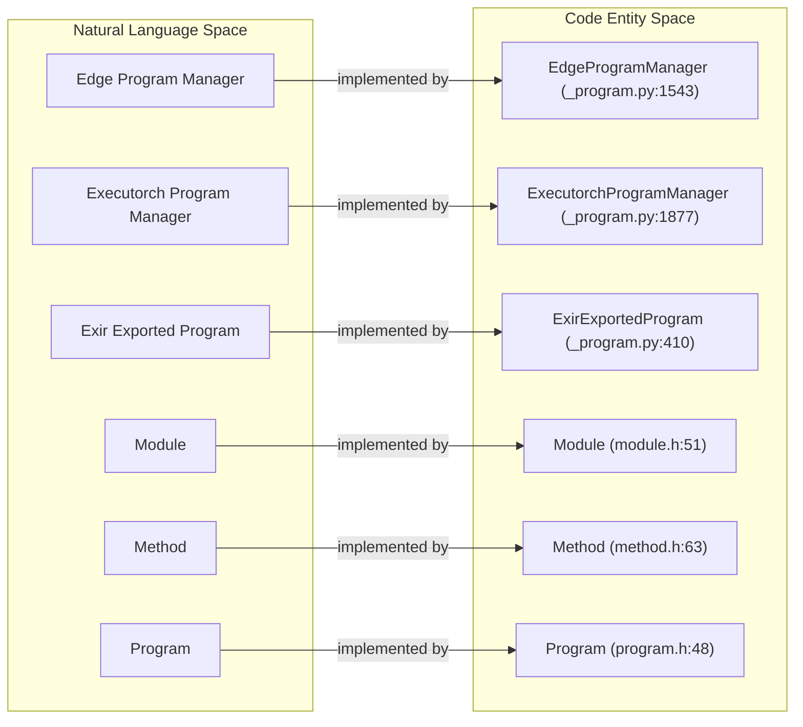
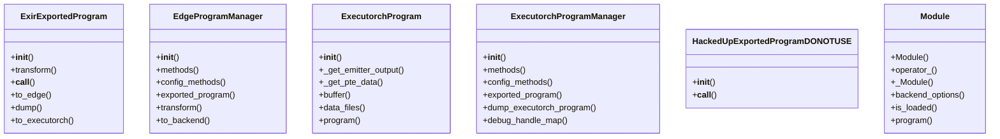

# Overview

> Architectural specification and implementation reference for Overview (10 relevant source files). Primary code entities: `Module`, `MethodHolder`, `PlannedMemory`, `EdgeProgramManager`, `__init__`.

Relevant source files

The following files were used as context for generating this wiki page:

- [extension/module/module.h](extension/module/module.h)
- [exir/program/_program.py](exir/program/_program.py)
- [runtime/executor/program.h](runtime/executor/program.h)
- [runtime/executor/method.h](runtime/executor/method.h)
- [README.md](README.md)
- [CONTRIBUTING.md](CONTRIBUTING.md)
- [docs/source/intro-how-it-works.md](docs/source/intro-how-it-works.md)
- [docs/source/intro-overview.md](docs/source/intro-overview.md)
- [docs/source/intro-section.md](docs/source/intro-section.md)
- [docs/source/getting-started-architecture.md](docs/source/getting-started-architecture.md)
- [tools/cmake/cmake_cache.py](tools/cmake/cmake_cache.py)
- [tools/cmake/Utils.cmake](tools/cmake/Utils.cmake)
- [exir/passes/memory_planning_pass.py](exir/passes/memory_planning_pass.py)
- [kernels/quantized/cpu/op_quantize.cpp](kernels/quantized/cpu/op_quantize.cpp)
- [exir/passes/quantize_io_pass.py](exir/passes/quantize_io_pass.py)
- [backends/vulkan/runtime/vk_api/Command.cpp](backends/vulkan/runtime/vk_api/Command.cpp)
- [backends/qualcomm/builders/node_visitor.py](backends/qualcomm/builders/node_visitor.py)
- [examples/models/muse-glimmer/runtime/prompt_preparation.h](examples/models/muse-glimmer/runtime/prompt_preparation.h)
- [extension/llm/serving/serving_runtime.cpp](extension/llm/serving/serving_runtime.cpp)
- [.ci/scripts/cuda_benchmark.py](.ci/scripts/cuda_benchmark.py)
- [.ci/scripts/benchmark_tooling/get_benchmark_analysis_data.py](.ci/scripts/benchmark_tooling/get_benchmark_analysis_data.py)
- [runtime/executor/method.cpp](runtime/executor/method.cpp)
- [runtime/core/array_ref.h](runtime/core/array_ref.h)
- [backends/webgpu/runtime/WebGPUUtils.h](backends/webgpu/runtime/WebGPUUtils.h)

**ExecuTorch** comprises **10202 indexed code files**, **85820 symbols**, and **20476 inter-file dependency edges** [README.md:1-30]().

**Scope**: This page provides a high-level architecture overview, compilation/execution lifecycle, and subsystem navigation map. For detailed technical specifications on each layer:
- **Build System and Infrastructure**: See [[2-build-system-and-infrastructure|Build System and Infrastructure]].
- **EXIR Core System**: See [[3-exir-core-system|EXIR Core System]].
- **Quantization Systems**: See [[4-quantization-systems|Quantization Systems]].
- **Backend Delegation Architecture**: See [[5-backend-delegation-architecture|Backend Delegation Architecture]].
- **Model Export and LLM Support**: See [[6-model-export-and-llm-support|Model Export and LLM Support]].
- **Testing and CI/CD Infrastructure**: See [[7-testing-and-cicd-infrastructure|Testing and CI/CD Infrastructure]].
- **Runtime Execution**: See [[8-runtime-execution|Runtime Execution]].
- **Mobile and Platform Extensions**: See [[9-mobile-and-platform-extensions|Mobile and Platform Extensions]].
- **Glossary**: See [[10-glossary|Glossary]].

Sources: [extension/module/module.h](), [exir/program/_program.py](), [runtime/executor/program.h](), [runtime/executor/method.h]()

---

## 1. Architecture Overview & System Component Map

This diagram maps the repository's high-level architectural chapters and subsystems to their primary modules:

```mermaid
flowchart TD
  subgraph n_2_build_system_and_infrastructure["Build System and Infrastructure"]
    n_2_1_cmake_configuration_and_targets["CMake Configuration and Targets"]
    n_2_2_kernel_libraries_and_selective_build["Kernel Libraries and Selective Build"]
    n_2_3_schema_generation_and_flatbuffers["Schema Generation and FlatBuffers"]
    n_2_4_python_bindings_and_dependencies["Python Bindings and Dependencies"]
    n_2_5_buck2_and_shim_build_layer["Buck2 and Shim Build Layer"]
  end
  subgraph n_3_exir_core_system["EXIR Core System"]
    n_3_1_program_structure_and_compilation_flow["Program Structure and Compilation Flow"]
    n_3_2_graph_transformation_pass_system["Graph Transformation Pass System"]
    n_3_3_memory_planning_and_allocation["Memory Planning and Allocation"]
    n_3_4_program_emission_and_serialization["Program Emission and Serialization"]
    n_3_5_verification_and_dialect_system["Verification and Dialect System"]
  end
  subgraph n_4_quantization_systems["Quantization Systems"]
    n_4_1_quantization_framework_and_patterns["Quantization Framework and Patterns"]
    n_4_2_backend_specific_quantization["Backend-Specific Quantization"]
  end
  subgraph n_5_backend_delegation_architecture["Backend Delegation Architecture"]
    n_5_1_partitioning_and_operator_support["Partitioning and Operator Support"]
    n_5_2_vulkan_gpu_backend["Vulkan GPU Backend"]
    n_5_3_qualcomm_qnn_backend["Qualcomm QNN Backend"]
    n_5_4_arm_tosa_and_ethos_u_backend["ARM TOSA and Ethos-U Backend"]
    n_5_5_cadence_dsp_backend["Cadence DSP Backend"]
    n_5_6_xnnpack_cpu_backend["XNNPACK CPU Backend"]
  end
  subgraph n_6_model_export_and_llm_support["Model Export and LLM Support"]
    n_6_1_llama_model_export["LLaMA and Generative Model Export"]
    n_6_2_llm_runner_framework["LLM Runner Framework"]
    n_6_3_custom_operators_and_extensions["Custom Operators and Extensions"]
    n_6_4_multimodal_and_audio_models["Multimodal and Audio Models"]
  end
  subgraph n_7_testing_and_cicd_infrastructure["Testing and CI/CD Infrastructure"]
    n_7_1_cicd_workflows_and_validation["CI/CD Workflows and Validation"]
    n_7_2_model_and_backend_testing_framework["Model and Backend Testing Framework"]
    n_7_3_performance_benchmarking_and_profiling["Performance Benchmarking and Profiling"]
  end
  subgraph n_8_runtime_execution["Runtime Execution"]
    n_8_1_core_runtime_architecture["Core Runtime Architecture"]
    n_8_2_kernel_registration_and_dispatch["Kernel Registration and Dispatch"]
    n_8_3_developer_tools_devtools["Developer Tools (DevTools: ETDump, ETRecord, Inspector)"]
  end
  subgraph n_9_mobile_and_platform_extensions["Mobile and Platform Extensions"]
    n_9_1_android_extension["Android Extension (Java/Kotlin & JNI)"]
    n_9_2_apple_ios_macos_extension["Apple iOS/macOS Extension (Swift & Objective-C)"]
    n_9_3_high_level_module_and_on_device_training["High-Level Module API, Tensor & On-Device Training"]
    n_9_4_embedded_and_web_targets["Embedded (Zephyr, ESP32, Pico2) and WebAssembly/WebGPU Targets"]
  end
  n_2_1_cmake_configuration_and_targets ==> n_5_2_vulkan_gpu_backend
  n_2_1_cmake_configuration_and_targets --> n_2_2_kernel_libraries_and_selective_build
  n_2_2_kernel_libraries_and_selective_build --> n_5_2_vulkan_gpu_backend
  n_2_1_cmake_configuration_and_targets --> n_9_2_apple_ios_macos_extension
  n_2_1_cmake_configuration_and_targets --> n_5_6_xnnpack_cpu_backend
  n_2_1_cmake_configuration_and_targets --> n_9_4_embedded_and_web_targets
  n_5_2_vulkan_gpu_backend --> n_9_4_embedded_and_web_targets
  n_2_1_cmake_configuration_and_targets --> n_4_2_backend_specific_quantization
  n_2_1_cmake_configuration_and_targets --> n_5_3_qualcomm_qnn_backend
  n_2_2_kernel_libraries_and_selective_build --> n_5_6_xnnpack_cpu_backend
  n_5_2_vulkan_gpu_backend --> n_5_6_xnnpack_cpu_backend
  n_2_1_cmake_configuration_and_targets --> n_2_5_buck2_and_shim_build_layer
```

### Core Concept to Code Entity Mapping

### Core Compilation & Runtime Class Hierarchy

### Architectural Principles (from Official Documentation)

- **Glossary** ([wiki/10-glossary.md]()): # Glossary > Architectural specification and implementation reference for Glossary (10 relevant source files). Primary code entities: `CaptureConfig`, `EdgeCompileConfig`, `ExecutorchBackendConfig`, `BoxedEvalueList`, `checkUnwrappedVals`. 
 
Relevant source files
 The following files were used as context for generating this wiki page: - [exir/capture/_
- **Export API and Recipe System** ([wiki/1.2-export-api-and-recipe-system.md]()): # Export API and Recipe System ↑ [[1-overview|Overview]] > Architectural specification and implementation reference for Export API and Recipe System (37 relevant source files). Primary code entities: `AOQuantizationConfig`, `ExportRecipe`, `_assert_scalar_fields_agree`, `_collect_lowering_fields`, `ExportSession`. 
 
Relevant source files
 The following
- **Python Bindings and Dependencies** ([wiki/2.4-python-bindings-and-dependencies.md]()): # Python Bindings and Dependencies ↑ [[2-build-system-and-infrastructure|Build System and Infrastructure]] > Architectural specification and implementation reference for Python Bindings and Dependencies (15 relevant source files). Primary code entities: `BorrowedInput`, `torch_storage`, `validate`, `PyExecuTorchResult`, `DLPackHolder`. 
 
Relevant source files</
- **Program Structure and Compilation Flow** ([wiki/3.1-program-structure-and-compilation-flow.md]()): # Program Structure and Compilation Flow ↑ [[3-exir-core-system|EXIR Core System]] > Architectural specification and implementation reference for Program Structure and Compilation Flow (12 relevant source files). Primary code entities: `CaptureConfig`, `EdgeCompileConfig`, `ExecutorchBackendConfig`, `EdgeProgramManager`, `__init__`. 
 
Relevant source files</sum

Sources: [wiki/10-glossary.md](), [wiki/1.2-export-api-and-recipe-system.md](), [wiki/2.4-python-bindings-and-dependencies.md](), [wiki/3.1-program-structure-and-compilation-flow.md]()

---

## 2. Subsystem Catalog & Navigation Matrix

| Section | Page | Files | Parent Chapter | Primary Focus & Code Entities |
|---|---|---|---|---|
| `1.1` | [[1.1-getting-started|Getting Started]] | 22 | [[1-overview|Overview]] | Architectural specification and implementation reference for Getting Started (22 relevant source files). Primary code entities: `cu134_requirements`,  |
| `1.2` | [[1.2-export-api-and-recipe-system|Export API and Recipe System]] | 37 | [[1-overview|Overview]] | Architectural specification and implementation reference for Export API and Recipe System (37 relevant source files). Primary code entities: `AOQuanti |
| `2` | [[2-build-system-and-infrastructure|Build System and Infrastructure]] | 38 | **Top-Level Chapter** | Architectural specification and implementation reference for Build System and Infrastructure (38 relevant source files). Primary code entities: `CMake |
| `2.1` | [[2.1-cmake-configuration-and-targets|CMake Configuration and Targets]] | 17 | [[2-build-system-and-infrastructure|Build System and Infrastructure]] | Architectural specification and implementation reference for CMake Configuration and Targets (17 relevant source files). Primary code entities: `CMake |
| `2.2` | [[2.2-kernel-libraries-and-selective-build|Kernel Libraries and Selective Build]] | 31 | [[2-build-system-and-infrastructure|Build System and Infrastructure]] | Architectural specification and implementation reference for Kernel Libraries and Selective Build (31 relevant source files). Primary code entities: ` |
| `2.3` | [[2.3-schema-generation-and-flatbuffers|Schema Generation and FlatBuffers]] | 36 | [[2-build-system-and-infrastructure|Build System and Infrastructure]] | Architectural specification and implementation reference for Schema Generation and FlatBuffers (36 relevant source files). Primary code entities: `Cal |
| `2.4` | [[2.4-python-bindings-and-dependencies|Python Bindings and Dependencies]] | 15 | [[2-build-system-and-infrastructure|Build System and Infrastructure]] | Architectural specification and implementation reference for Python Bindings and Dependencies (15 relevant source files). Primary code entities: `Borr |
| `2.5` | [[2.5-buck2-and-shim-build-layer|Buck2 and Shim Build Layer]] | 30 | [[2-build-system-and-infrastructure|Build System and Infrastructure]] | Architectural specification and implementation reference for Buck2 and Shim Build Layer (30 relevant source files). Primary code entities: `ggml_ci_la |
| `3` | [[3-exir-core-system|EXIR Core System]] | 40 | **Top-Level Chapter** | Architectural specification and implementation reference for EXIR Core System (40 relevant source files). Primary code entities: `EdgeProgramManager`, |
| `3.1` | [[3.1-program-structure-and-compilation-flow|Program Structure and Compilation Flow]] | 12 | [[3-exir-core-system|EXIR Core System]] | Architectural specification and implementation reference for Program Structure and Compilation Flow (12 relevant source files). Primary code entities: |
| `3.2` | [[3.2-graph-transformation-pass-system|Graph Transformation Pass System]] | 30 | [[3-exir-core-system|EXIR Core System]] | Architectural specification and implementation reference for Graph Transformation Pass System (30 relevant source files). Primary code entities: `Memo |
| `3.3` | [[3.3-memory-planning-and-allocation|Memory Planning and Allocation]] | 5 | [[3-exir-core-system|EXIR Core System]] | Architectural specification and implementation reference for Memory Planning and Allocation (5 relevant source files). Primary code entities: `MemoryP |
| `3.4` | [[3.4-program-emission-and-serialization|Program Emission and Serialization]] | 35 | [[3-exir-core-system|EXIR Core System]] | Architectural specification and implementation reference for Program Emission and Serialization (35 relevant source files). Primary code entities: `_A |
| `3.5` | [[3.5-verification-and-dialect-system|Verification and Dialect System]] | 34 | [[3-exir-core-system|EXIR Core System]] | Architectural specification and implementation reference for Verification and Dialect System (34 relevant source files). Primary code entities: `Inter |
| `4` | [[4-quantization-systems|Quantization Systems]] | 38 | **Top-Level Chapter** | Architectural specification and implementation reference for Quantization Systems (38 relevant source files). Primary code entities: `NeonQuantizeTrai |
| `4.1` | [[4.1-quantization-framework-and-patterns|Quantization Framework and Patterns]] | 35 | [[4-quantization-systems|Quantization Systems]] | Architectural specification and implementation reference for Quantization Framework and Patterns (35 relevant source files). Primary code entities: `C |
| `4.2` | [[4.2-backend-specific-quantization|Backend-Specific Quantization]] | 35 | [[4-quantization-systems|Quantization Systems]] | Architectural specification and implementation reference for Backend-Specific Quantization (35 relevant source files). Primary code entities: `NodeFin |
| `5` | [[5-backend-delegation-architecture|Backend Delegation Architecture]] | 40 | **Top-Level Chapter** | Architectural specification and implementation reference for Backend Delegation Architecture (40 relevant source files). Primary code entities: `Comma |
| `5.1` | [[5.1-partitioning-and-operator-support|Partitioning and Operator Support]] | 17 | [[5-backend-delegation-architecture|Backend Delegation Architecture]] | Architectural specification and implementation reference for Partitioning and Operator Support (17 relevant source files). Primary code entities: `Met |
| `5.2` | [[5.2-vulkan-gpu-backend|Vulkan GPU Backend]] | 40 | [[5-backend-delegation-architecture|Backend Delegation Architecture]] | Architectural specification and implementation reference for Vulkan GPU Backend (40 relevant source files). Primary code entities: `CommandBuffer`, `b |
| `5.3` | [[5.3-qualcomm-qnn-backend|Qualcomm QNN Backend]] | 40 | [[5-backend-delegation-architecture|Backend Delegation Architecture]] | Architectural specification and implementation reference for Qualcomm QNN Backend (40 relevant source files). Primary code entities: `NodeVisitor`, `_ |
| `5.4` | [[5.4-arm-tosa-and-ethos-u-backend|ARM TOSA and Ethos-U Backend]] | 40 | [[5-backend-delegation-architecture|Backend Delegation Architecture]] | Architectural specification and implementation reference for ARM TOSA and Ethos-U Backend (40 relevant source files). Primary code entities: `TosaArg` |
| `5.5` | [[5.5-cadence-dsp-backend|Cadence DSP Backend]] | 36 | [[5-backend-delegation-architecture|Backend Delegation Architecture]] | Architectural specification and implementation reference for Cadence DSP Backend (36 relevant source files). Primary code entities: `QuantFusionPass`, |
| `5.6` | [[5.6-xnnpack-cpu-backend|XNNPACK CPU Backend]] | 36 | [[5-backend-delegation-architecture|Backend Delegation Architecture]] | Architectural specification and implementation reference for XNNPACK CPU Backend (36 relevant source files). Primary code entities: `ChannelsLastTagge |
| `5.7` | [[5.7-cuda-aoti-and-apple-metal-backends|CUDA / AOTI and Apple Metal Backends]] | 40 | [[5-backend-delegation-architecture|Backend Delegation Architecture]] | Architectural specification and implementation reference for CUDA / AOTI and Apple Metal Backends (40 relevant source files). Primary code entities: ` |
| `5.8` | [[5.8-other-backends|Other Hardware Backends (OpenVINO, MediaTek, Samsung, NXP, MLX, TensorRT)]] | 40 | [[5-backend-delegation-architecture|Backend Delegation Architecture]] | Architectural specification and implementation reference for Other Hardware Backends (OpenVINO, MediaTek, Samsung, NXP, MLX, TensorRT) (40 relevant so |
| `6` | [[6-model-export-and-llm-support|Model Export and LLM Support]] | 40 | **Top-Level Chapter** | Architectural specification and implementation reference for Model Export and LLM Support (40 relevant source files). Primary code entities: `MuseGlim |
| `6.1` | [[6.1-llama-model-export|LLaMA and Generative Model Export]] | 40 | [[6-model-export-and-llm-support|Model Export and LLM Support]] | Architectural specification and implementation reference for LLaMA and Generative Model Export (40 relevant source files). Primary code entities: `Att |
| `6.2` | [[6.2-llm-runner-framework|LLM Runner Framework]] | 36 | [[6-model-export-and-llm-support|Model Export and LLM Support]] | Architectural specification and implementation reference for LLM Runner Framework (36 relevant source files). Primary code entities: `check_vocab_size |
| `6.3` | [[6.3-custom-operators-and-extensions|Custom Operators and Extensions]] | 39 | [[6-model-export-and-llm-support|Model Export and LLM Support]] | Architectural specification and implementation reference for Custom Operators and Extensions (39 relevant source files). Primary code entities: `gated |
| `6.4` | [[6.4-multimodal-and-audio-models|Multimodal and Audio Models]] | 36 | [[6-model-export-and-llm-support|Model Export and LLM Support]] | Architectural specification and implementation reference for Multimodal and Audio Models (36 relevant source files). Primary code entities: `LlavaEdge |
| `7` | [[7-testing-and-cicd-infrastructure|Testing and CI/CD Infrastructure]] | 36 | **Top-Level Chapter** | Architectural specification and implementation reference for Testing and CI/CD Infrastructure (36 relevant source files). Primary code entities: `Benc |
| `7.1` | [[7.1-cicd-workflows-and-validation|CI/CD Workflows and Validation]] | 31 | [[7-testing-and-cicd-infrastructure|Testing and CI/CD Infrastructure]] | Architectural specification and implementation reference for CI/CD Workflows and Validation (31 relevant source files). Primary code entities: `Benchm |
| `7.2` | [[7.2-model-and-backend-testing-framework|Model and Backend Testing Framework]] | 40 | [[7-testing-and-cicd-infrastructure|Testing and CI/CD Infrastructure]] | Architectural specification and implementation reference for Model and Backend Testing Framework (40 relevant source files). Primary code entities: `M |
| `7.3` | [[7.3-performance-benchmarking-and-profiling|Performance Benchmarking and Profiling]] | 36 | [[7-testing-and-cicd-infrastructure|Testing and CI/CD Infrastructure]] | Architectural specification and implementation reference for Performance Benchmarking and Profiling (36 relevant source files). Primary code entities: |
| `8` | [[8-runtime-execution|Runtime Execution]] | 39 | **Top-Level Chapter** | Architectural specification and implementation reference for Runtime Execution (39 relevant source files). Primary code entities: `ET_CHECK_MSG`, `exe |
| `8.1` | [[8.1-core-runtime-architecture|Core Runtime Architecture]] | 38 | [[8-runtime-execution|Runtime Execution]] | Architectural specification and implementation reference for Core Runtime Architecture (38 relevant source files). Primary code entities: `ET_CHECK_MS |
| `8.2` | [[8.2-kernel-registration-and-dispatch|Kernel Registration and Dispatch]] | 36 | [[8-runtime-execution|Runtime Execution]] | Architectural specification and implementation reference for Kernel Registration and Dispatch (36 relevant source files). Primary code entities: `Kern |
| `8.3` | [[8.3-developer-tools-devtools|Developer Tools (DevTools: ETDump, ETRecord, Inspector)]] | 38 | [[8-runtime-execution|Runtime Execution]] | Architectural specification and implementation reference for Developer Tools (DevTools: ETDump, ETRecord, Inspector) (38 relevant source files). Prima |
| `9` | [[9-mobile-and-platform-extensions|Mobile and Platform Extensions]] | 40 | **Top-Level Chapter** | Architectural specification and implementation reference for Mobile and Platform Extensions (40 relevant source files). Primary code entities: `Bindin |
| `9.1` | [[9.1-android-extension|Android Extension (Java/Kotlin & JNI)]] | 33 | [[9-mobile-and-platform-extensions|Mobile and Platform Extensions]] | Architectural specification and implementation reference for Android Extension (Java/Kotlin & JNI) (33 relevant source files). Primary code entities:  |
| `9.2` | [[9.2-apple-ios-macos-extension|Apple iOS/macOS Extension (Swift & Objective-C)]] | 26 | [[9-mobile-and-platform-extensions|Mobile and Platform Extensions]] | Architectural specification and implementation reference for Apple iOS/macOS Extension (Swift & Objective-C) (26 relevant source files). Primary code  |
| `9.3` | [[9.3-high-level-module-and-on-device-training|High-Level Module API, Tensor & On-Device Training]] | 37 | [[9-mobile-and-platform-extensions|Mobile and Platform Extensions]] | Architectural specification and implementation reference for High-Level Module API, Tensor & On-Device Training (37 relevant source files). Primary co |
| `9.4` | [[9.4-embedded-and-web-targets|Embedded (Zephyr, ESP32, Pico2) and WebAssembly/WebGPU Targets]] | 40 | [[9-mobile-and-platform-extensions|Mobile and Platform Extensions]] | Architectural specification and implementation reference for Embedded (Zephyr, ESP32, Pico2) and WebAssembly/WebGPU Targets (40 relevant source files) |
| `10` | [[10-glossary|Glossary]] | 10 | **Top-Level Chapter** | Architectural specification and implementation reference for Glossary (10 relevant source files). Primary code entities: `CaptureConfig`, `EdgeCompile |

---

## 3. Language Breakdown & Repository Statistics

| Language | Indexed File Count |
|---|---|
| `Python` | 4700 |
| `C++` | 1802 |
| `C` | 1226 |
| `YAML` | 349 |
| `Bash` | 260 |
| `JavaScript` | 71 |
| `Kotlin` | 43 |
| `Swift` | 41 |
| `CSS` | 10 |
| `TOML` | 8 |

---

## 4. Primary Entry Points

- `ci.docker.common.zephyr_sdk_release_proxy.main` in [.ci/docker/common/zephyr_sdk_release_proxy.py]()
- `ci.scripts.benchmark_tooling.analyze_benchmark_stability.main` in [.ci/scripts/benchmark_tooling/analyze_benchmark_stability.py]()
- `ci.scripts.cuda_benchmark.main` in [.ci/scripts/cuda_benchmark.py]()
- `ci.scripts.esp_idf_mirror.main` in [.ci/scripts/esp_idf_mirror.py]()
- `ci.scripts.muse_glimmer_batching_smoke.main` in [.ci/scripts/muse_glimmer_batching_smoke.cpp]()
- `ci.scripts.wheel.export_native.main` in [.ci/scripts/wheel/export_native.py]()
- `ci.scripts.wheel.install_cuda_redist.main` in [.ci/scripts/wheel/install_cuda_redist.py]()
- `github.scripts.bloaty_diff.main` in [.github/scripts/bloaty_diff.py]()
- `github.scripts.check_labels.main` in [.github/scripts/check_labels.py]()
- `github.scripts.cherry_pick.main` in [.github/scripts/cherry_pick.py]()
- `github.scripts.docathon-label-sync.main` in [.github/scripts/docathon-label-sync.py]()
- `github.scripts.extract_benchmark_results.main` in [.github/scripts/extract_benchmark_results.py]()
- `github.scripts.filter_cuda_matrix.main` in [.github/scripts/filter_cuda_matrix.py]()
- `github.scripts.propose_ghstack_orig_pr.main` in [.github/scripts/propose_ghstack_orig_pr.py]()
- `github.scripts.trymerge.main` in [.github/scripts/trymerge.py]()
- `github.scripts.update_pytorch_pin.main` in [.github/scripts/update_pytorch_pin.py]()
- `github.workflows.pending_user_response.main` in [.github/workflows/pending_user_response.py]()
- `backends.arm.cmsis_pack.scripts.generate_components.main` in [backends/arm/cmsis_pack/scripts/generate_components.py]()
- `backends.arm.cmsis_pack.scripts.generate_register_all_kernels.main` in [backends/arm/cmsis_pack/scripts/generate_register_all_kernels.py]()
- `backends.arm.scripts.aot_arm_compiler.main` in [backends/arm/scripts/aot_arm_compiler.py]()

Sources: [.ci/docker/common/zephyr_sdk_release_proxy.py](), [.ci/scripts/benchmark_tooling/analyze_benchmark_stability.py](), [.ci/scripts/cuda_benchmark.py](), [.ci/scripts/esp_idf_mirror.py](), [.ci/scripts/muse_glimmer_batching_smoke.cpp]()

## Sub-pages

- [[1.1-getting-started|Getting Started]]
- [[1.2-export-api-and-recipe-system|Export API and Recipe System]]

## Related pages

- [[1.1-getting-started|Getting Started]]
- [[1.2-export-api-and-recipe-system|Export API and Recipe System]]

## Sources

- [`extension/module/module.h`](https://github.com/pytorch/executorch/blob/main/extension/module/module.h)
- [`exir/program/_program.py`](https://github.com/pytorch/executorch/blob/main/exir/program/_program.py)
- [`runtime/executor/program.h`](https://github.com/pytorch/executorch/blob/main/runtime/executor/program.h)
- [`runtime/executor/method.h`](https://github.com/pytorch/executorch/blob/main/runtime/executor/method.h)
- [`README.md`](https://github.com/pytorch/executorch/blob/main/README.md)
- [`CONTRIBUTING.md`](https://github.com/pytorch/executorch/blob/main/CONTRIBUTING.md)
- [`docs/source/intro-how-it-works.md`](https://github.com/pytorch/executorch/blob/main/docs/source/intro-how-it-works.md)
- [`docs/source/intro-overview.md`](https://github.com/pytorch/executorch/blob/main/docs/source/intro-overview.md)
- [`docs/source/intro-section.md`](https://github.com/pytorch/executorch/blob/main/docs/source/intro-section.md)
- [`docs/source/getting-started-architecture.md`](https://github.com/pytorch/executorch/blob/main/docs/source/getting-started-architecture.md)

## Dynamic Knowledge Links (Code Graph ↔ LLM-Wiki / RAG)

### Linked Architecture & Design Documents

| Document | Match Channel | Score | Shared Code Symbols |
|---|---|---|---|
| [[3.1-program-structure-and-compilation-flow|Program Structure and Compilation Flow]] | `bm25+entity(6)` | `73.116` | `EdgeProgramManager`, `ExirExportedProgram`, `Module`, `to_edge`, `to_edge_transform_and_lower` |
| [[1.2-export-api-and-recipe-system|Export API and Recipe System]] | `bm25+entity(5)` | `62.483` | `EdgeProgramManager`, `ExirExportedProgram`, `Module`, `to_edge`, `transform` |
| [[3-exir-core-system|EXIR Core System]] | `bm25+entity(3)` | `58.344` | `Module`, `to_edge`, `to_edge_transform_and_lower` |
| [[index|ExecuTorch DeepWiki]] | `bm25` | `54.097` | *(lexical/graph match)* |
| [[3.3-memory-planning-and-allocation|Memory Planning and Allocation]] | `bm25+entity(2)` | `53.582` | `EdgeProgramManager`, `Module` |
| [[3.2-graph-transformation-pass-system|Graph Transformation Pass System]] | `wikilink:3.1-program-structure-and-compilation-flow+entity(2)` | `35.058` | `EdgeProgramManager`, `Module` |

### High-Centrality Bridge Symbols (CBM Graph)

| Symbol | Kind | Source Location | Fan-In / Fan-Out |
|---|---|---|---|
| `EdgeProgramManager` | Class | [exir/program/_program.py:1543-1874]() | in: `4` / out: `0` |
| `ExecutorchProgramManager` | Class | [exir/program/_program.py:1877-2072]() | in: `1` / out: `0` |
| `ExirExportedProgram` | Class | [exir/program/_program.py:410-494]() | in: `5` / out: `0` |
| `Module` | Class | [extension/module/module.h:51-791]() | in: `0` / out: `0` |
| `Method` | Class | [runtime/executor/method.h:63-451]() | in: `0` / out: `0` |
| `Program` | Class | [runtime/executor/program.h:48-354]() | in: `0` / out: `0` |

Sources: [exir/program/_program.py:1543-1874](), [exir/program/_program.py:1877-2072](), [exir/program/_program.py:410-494](), [extension/module/module.h:51-791]()

### Cross-Subsystem Coupling

- [[8-runtime-execution|Runtime Execution]] — call/import coupling weight `14.0`
- [[9-mobile-and-platform-extensions|Mobile and Platform Extensions]] — call/import coupling weight `12.0`
- [[8.1-core-runtime-architecture|Core Runtime Architecture]] — call/import coupling weight `12.0`
- [[9.3-high-level-module-and-on-device-training|High-Level Module API, Tensor & On-Device Training]] — call/import coupling weight `11.0`
- [[6.1-llama-model-export|LLaMA and Generative Model Export]] — call/import coupling weight `6.0`
- [[2.3-schema-generation-and-flatbuffers|Schema Generation and FlatBuffers]] — call/import coupling weight `5.0`
