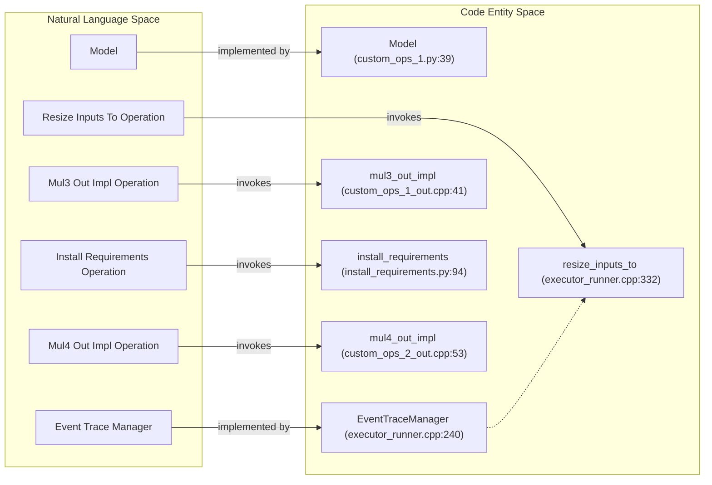
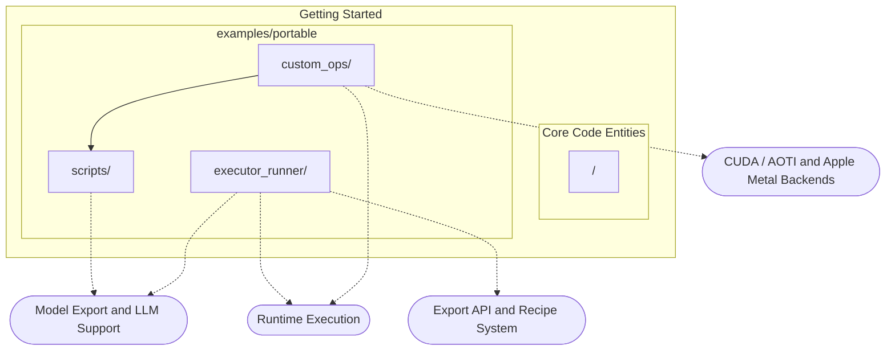
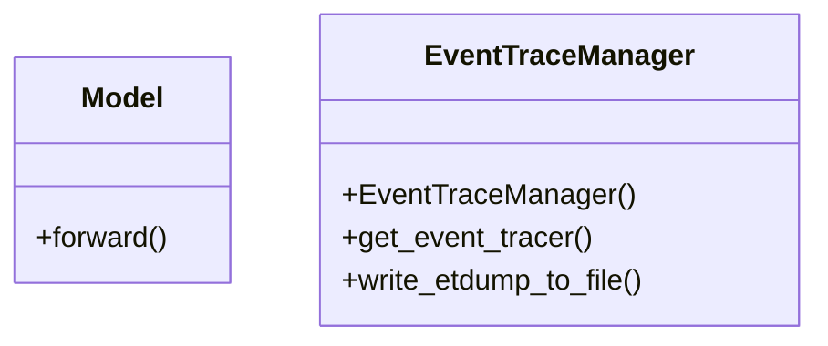
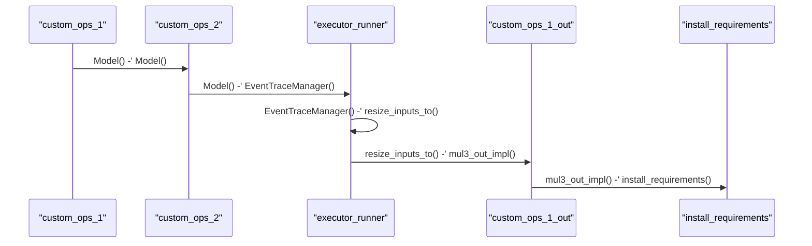

# Getting Started

↑ [[1-overview|Overview]]

> Architectural specification and implementation reference for Getting Started (22 relevant source files). Primary code entities: `cu134_requirements`, `get_torch_url`, `get_torchao_version`, `install_optional_example_requirements`, `EventTraceManager`.

<details>
<summary>Relevant source files</summary>

The following files were used as context for generating this wiki page:

- [install_requirements.py](install_requirements.py)
- [examples/portable/executor_runner/executor_runner.cpp](examples/portable/executor_runner/executor_runner.cpp)
- [install_executorch.py](install_executorch.py)
- [examples/portable/custom_ops/custom_ops_1.py](examples/portable/custom_ops/custom_ops_1.py)
- [examples/portable/custom_ops/custom_ops_2.py](examples/portable/custom_ops/custom_ops_2.py)
- [examples/portable/custom_ops/custom_ops_1_out.cpp](examples/portable/custom_ops/custom_ops_1_out.cpp)
- [examples/portable/custom_ops/custom_ops_2.cpp](examples/portable/custom_ops/custom_ops_2.cpp)
- [examples/portable/custom_ops/custom_ops_2_out.cpp](examples/portable/custom_ops/custom_ops_2_out.cpp)
- [examples/portable/custom_ops/targets.bzl](examples/portable/custom_ops/targets.bzl)
- [examples/portable/executor_runner/targets.bzl](examples/portable/executor_runner/targets.bzl)
- [examples/portable/scripts/export_and_delegate.py](examples/portable/scripts/export_and_delegate.py)
- [examples/portable/scripts/export.py](examples/portable/scripts/export.py)
- [docs/source/getting-started-architecture.md](docs/source/getting-started-architecture.md)
- [docs/source/getting-started-setup.rst](docs/source/getting-started-setup.rst)
- [docs/source/getting-started.md](docs/source/getting-started.md)
- [docs/source/using-executorch-android.md](docs/source/using-executorch-android.md)
- [docs/source/using-executorch-building-from-source.md](docs/source/using-executorch-building-from-source.md)
- [docs/source/using-executorch-cpp.md](docs/source/using-executorch-cpp.md)
- [examples/portable/custom_ops/BUCK](examples/portable/custom_ops/BUCK)
- [examples/portable/custom_ops/CMakeLists.txt](examples/portable/custom_ops/CMakeLists.txt)
- [examples/portable/executor_runner/BUCK](examples/portable/executor_runner/BUCK)
- [examples/portable/scripts/BUCK](examples/portable/scripts/BUCK)

</details>

## Purpose and Scope

Architectural specification and implementation reference for Getting Started (22 relevant source files). Primary code entities: `cu134_requirements`, `get_torch_url`, `get_torchao_version`, `install_optional_example_requirements`, `EventTraceManager`.

Primary code entities analyzed on this page include `Model` ([examples/portable/custom_ops/custom_ops_1.py:39-41]()), `Model` ([examples/portable/custom_ops/custom_ops_2.py:19-21]()), `EventTraceManager` ([examples/portable/executor_runner/executor_runner.cpp:240-287]()), `resize_inputs_to` ([examples/portable/executor_runner/executor_runner.cpp:332-381]()), `mul3_out_impl` ([examples/portable/custom_ops/custom_ops_1_out.cpp:41-52]()).

For the parent architectural layer, see [[1-overview|Overview]]. Related sibling subsystems: [[1.2-export-api-and-recipe-system|Export API and Recipe System]].

Sources: [examples/portable/custom_ops/custom_ops_1.py:39-41](), [examples/portable/custom_ops/custom_ops_2.py:19-21](), [examples/portable/executor_runner/executor_runner.cpp:240-287](), [examples/portable/executor_runner/executor_runner.cpp:332-381]()

---

## 1. High-Level Architecture and Data Flow

### Natural Language Space to Code Entity Space Mapping

The following diagram maps domain concepts in this subsystem to their concrete code entities:



### Subsystem Component & Dependency Flow



Cross-subsystem call and import edges connect **Getting Started** with [[8-runtime-execution|Runtime Execution]] (coupling `24.0`), [[8.1-core-runtime-architecture|Core Runtime Architecture]] (coupling `19.0`), [[6-model-export-and-llm-support|Model Export and LLM Support]] (coupling `10.0`), [[7.2-model-and-backend-testing-framework|Model and Backend Testing Framework]] (coupling `10.0`), [[1.2-export-api-and-recipe-system|Export API and Recipe System]] (coupling `6.0`).

| Module Directory | Files | Primary Code Entities | Source Citations |
|---|---|---|---|
| `examples/portable/custom_ops` | 8 | `Model`, `Model`, `mul3_out_impl`, `mul4_out_impl` | [examples/portable/custom_ops/custom_ops_1.py:39-41]() [examples/portable/custom_ops/custom_ops_2.py:19-21]() |
| `examples/portable/executor_runner` | 3 | `EventTraceManager`, `resize_inputs_to`, `get_event_tracer`, `try_load_file` | [examples/portable/executor_runner/executor_runner.cpp:240-287]() [examples/portable/executor_runner/executor_runner.cpp:332-381]() |
| `examples/portable/scripts` | 3 | `export_and_lower_partitioned_graph`, `export_and_lower_the_whole_graph`, `export_composite_module_with_lower_graph`, `main` | [examples/portable/scripts/export_and_delegate.py:105-153]() [examples/portable/scripts/export_and_delegate.py:156-190]() |
| `.` | 2 | `install_requirements`, `pushd`, `install_optional_example_requirements`, `get_torch_url` | [install_requirements.py:94-210]() [install_executorch.py:32-39]() |

Sources: [examples/portable/custom_ops/custom_ops_1.py:39-41](), [examples/portable/custom_ops/custom_ops_2.py:19-21](), [examples/portable/executor_runner/executor_runner.cpp:240-287](), [examples/portable/executor_runner/executor_runner.cpp:332-381](), [examples/portable/custom_ops/custom_ops_1_out.cpp:41-52]()

---

## 2. Core Data Structures and Implementation Details

### Class and Entity Relationship Diagram



### `Model` (Class)

- **Source Location**: [examples/portable/custom_ops/custom_ops_1.py:39-41]()
- **Declaration**: `Class Model`
- **Graph Centrality**: fan-in `1` callers, fan-out `0` callees
- **Responsibility**: # example model

```python
// examples/portable/custom_ops/custom_ops_1.py:39-41
class Model(torch.nn.Module):
    def forward(self, a):
        return torch.ops.my_ops.mul3.default(a)
```

### `Model` (Class)

- **Source Location**: [examples/portable/custom_ops/custom_ops_2.py:19-21]()
- **Declaration**: `Class Model`
- **Graph Centrality**: fan-in `1` callers, fan-out `0` callees
- **Responsibility**: # example model

```python
// examples/portable/custom_ops/custom_ops_2.py:19-21
class Model(torch.nn.Module):
    def forward(self, a):
        return torch.ops.my_ops.mul4.default(a)
```

### `EventTraceManager` (Class)

- **Source Location**: [examples/portable/executor_runner/executor_runner.cpp:240-287]()
- **Declaration**: `Class EventTraceManager`
- **Graph Centrality**: fan-in `0` callers, fan-out `0` callees
- **Responsibility**: /// Helper to manage resources for ETDump generation

```cpp
// examples/portable/executor_runner/executor_runner.cpp:240-255
class EventTraceManager {
 public:
  EventTraceManager() : event_tracer_ptr_(nullptr) {
#ifdef ET_EVENT_TRACER_ENABLED
    event_tracer_ptr_ = std::make_shared<executorch::etdump::ETDumpGen>();
#endif // ET_EVENT_TRACER_ENABLED
  }

  EventTracer* get_event_tracer() const {
    return event_tracer_ptr_.get();
  };

  Error write_etdump_to_file() const {
    EventTracer* const event_tracer_ptr = get_event_tracer();
    if (!event_tracer_ptr) {
      return Error::NotSupported;
```

### `resize_inputs_to` (Function)

- **Source Location**: [examples/portable/executor_runner/executor_runner.cpp:332-381]()
- **Declaration**: `(Method& method, const std::string& shapes_spec)`
- **Graph Centrality**: fan-in `1` callers, fan-out `5` callees
- **Responsibility**: /** * Resize the method's inputs to the shapes given by --input_shapes. * * Without this, a model exported with dynamic shapes can only ever be run at * its upper bound, because prepare_input_tensors() sizes every input from the * bound recorded in the method metadata. Several classes of backend bug are * invisible at 

### `mul3_out_impl` (Function)

- **Source Location**: [examples/portable/custom_ops/custom_ops_1_out.cpp:41-52]()
- **Declaration**: `( ET_UNUSED KernelRuntimeContext& ctx, const Tensor& in, Tensor& out)`
- **Graph Centrality**: fan-in `0` callers, fan-out `2` callees
- **Responsibility**: // mul3.out(Tensor input, *, Tensor(a!) output) -> Tensor(a!) // ExecuTorch-compatible function signature, with a KernelRuntimeContext.

### `install_requirements` (Function)

- **Source Location**: [install_requirements.py:94-210]()
- **Declaration**: `(use_pytorch_nightly)`
- **Graph Centrality**: fan-in `2` callers, fan-out `6` callees

Sources: [examples/portable/custom_ops/custom_ops_1.py:39-41](), [examples/portable/custom_ops/custom_ops_2.py:19-21](), [examples/portable/executor_runner/executor_runner.cpp:240-287](), [examples/portable/executor_runner/executor_runner.cpp:332-381](), [examples/portable/custom_ops/custom_ops_1_out.cpp:41-52]()

---

## 3. Execution and Call Flow

The sequence diagram below traces the runtime/compile-time call chain across components in this module:



Sources: [examples/portable/custom_ops/custom_ops_1.py:39-41](), [examples/portable/custom_ops/custom_ops_2.py:19-21](), [examples/portable/executor_runner/executor_runner.cpp:240-287](), [examples/portable/executor_runner/executor_runner.cpp:332-381](), [examples/portable/custom_ops/custom_ops_1_out.cpp:41-52]()

---

## 4. Key API and Symbol Reference

| Code Entity | Kind | Location | Fan-In / Out | Role & Signature |
|---|---|---|---|---|
| `Model` | Class | [examples/portable/custom_ops/custom_ops_1.py:39-41]() | `1` / `0` | # example model |
| `Model` | Class | [examples/portable/custom_ops/custom_ops_2.py:19-21]() | `1` / `0` | # example model |
| `EventTraceManager` | Class | [examples/portable/executor_runner/executor_runner.cpp:240-287]() | `0` / `0` | /// Helper to manage resources for ETDump generation |
| `resize_inputs_to` | Function | [examples/portable/executor_runner/executor_runner.cpp:332-381]() | `1` / `5` | /** |
| `mul3_out_impl` | Function | [examples/portable/custom_ops/custom_ops_1_out.cpp:41-52]() | `0` / `2` | // mul3.out(Tensor input, *, Tensor(a!) output) -> Tensor(a!) |
| `install_requirements` | Function | [install_requirements.py:94-210]() | `2` / `6` | (use_pytorch_nightly) |
| `mul4_out_impl` | Function | [examples/portable/custom_ops/custom_ops_2_out.cpp:53-59]() | `0` / `2` | // mul4.out(Tensor input, *, Tensor(a!) output) -> Tensor(a!) |
| `pushd` | Function | [install_executorch.py:32-39]() | `0` / `0` | Change the current directory to new_dir and yield. When exiting the context, change back to the original direc |
| `install_optional_example_requirements` | Function | [install_requirements.py:213-267]() | `3` / `3` | (use_pytorch_nightly) |
| `mul4_impl` | Function | [examples/portable/custom_ops/custom_ops_2.cpp:18-24]() | `0` / `1` | // mul4(Tensor input) -> Tensor |
| `get_event_tracer` | Method | [examples/portable/executor_runner/executor_runner.cpp:248-250]() | `3` / `1` | () |
| `export_and_lower_partitioned_graph` | Function | [examples/portable/scripts/export_and_delegate.py:105-153]() | `0` / `2` | Model: |
| `export_and_lower_the_whole_graph` | Function | [examples/portable/scripts/export_and_delegate.py:156-190]() | `0` / `2` | AddMulModule: |
| `export_composite_module_with_lower_graph` | Function | [examples/portable/scripts/export_and_delegate.py:39-102]() | `0` / `2` | AddMulModule: |
| `get_torch_url` | Function | [install_requirements.py:58-62]() | `2` / `2` | () |
| `torchao_from_source` | Function | [install_requirements.py:41-45]() | `3` / `0` | () |
| `try_load_file` | Function | [examples/portable/executor_runner/executor_runner.cpp:290-305]() | `1` / `3` | (const std::filesystem::path& path) |
| `cu134_requirements` | Function | [install_requirements.py:65-76]() | `2` / `1` | (torch_url, include_domains=False) |
| `get_torchao_version` | Function | [install_requirements.py:48-55]() | `2` / `1` | (torch_url) |
| `write_etdump_to_file` | Method | [examples/portable/executor_runner/executor_runner.cpp:252-283]() | `1` / `2` | () |
| `load_input_files` | Function | [examples/portable/executor_runner/executor_runner.cpp:157-194]() | `1` / `2` | ( const std::vector<std::string>& file_paths, std::vector<std::string>& inputs_storage, std::vector<std::pair< |
| `check_preconditions` | Function | [examples/portable/custom_ops/custom_ops_1_out.cpp:19-36]() | `1` / `3` | (const Tensor& in, Tensor& out) |

Sources: [examples/portable/custom_ops/custom_ops_1.py:39-41](), [examples/portable/custom_ops/custom_ops_2.py:19-21](), [examples/portable/executor_runner/executor_runner.cpp:240-287](), [examples/portable/executor_runner/executor_runner.cpp:332-381](), [examples/portable/custom_ops/custom_ops_1_out.cpp:41-52](), [install_requirements.py:94-210]()

---

## 5. Official Documentation and Design Context

The following linked documentation sections from `llm-wiki` (`raw/`) provide additional architectural context, tutorials, and design invariants for this subsystem:

- **ExecuTorch DeepWiki** ([wiki/index.md](), score `103.2279`) (sections: `ExecuTorch DeepWiki`, `Pages`): # ExecuTorch DeepWiki Generated from `home-jason-Project-deepwiki-executorch` at commit `b3b565b5b62f` (2026-11-15T15:02:11+00:00). ## Pages - [[1-overview|Overview]] — Architectural specification and implementation reference for Overview (10 relevant source files). Primary code entities: `Module`, `MethodHolder`, `PlannedMemory`, `EdgeProgramManager`, `__init__`. - [[1.1-getting-started|Getting Started]] — Architect
- **Overview** ([wiki/1-overview.md](), score `76.3008`) (sections: `Overview`, `1. Architecture Overview & System Component Map`, `Core Concept to Code Entity Mapping`, `Architectural Principles (from Official Documentation)`): # Overview > Architectural specification and implementation reference for Overview (10 relevant source files). Primary code entities: `Module`, `MethodHolder`, `PlannedMemory`, `EdgeProgramManager`, `__init__`. <details> <summary>Relevant source files</summary> The following files were used as context for generating this wiki page: - [extension/module/module.h](extension/module/module.h) - [exir/program/_program.py](
- **Core Runtime Architecture** ([wiki/8.1-core-runtime-architecture.md](), score `62.1032`) (sections: `Core Runtime Architecture`, `Purpose and Scope`, `1. High-Level Architecture and Data Flow`, `Natural Language Space to Code Entity Space Mapping`): # Core Runtime Architecture ↑ [[8-runtime-execution|Runtime Execution]] > Architectural specification and implementation reference for Core Runtime Architecture (38 relevant source files). Primary code entities: `ET_CHECK_MSG`, `execute`, `execute_instruction`, `experimental_reset_execution`, `ArrayRef`. <details> <summary>Relevant source files</summary> The following files were used as context for generating this wi
- **Python Bindings and Dependencies** ([wiki/2.4-python-bindings-and-dependencies.md](), score `60.1228`) (sections: `Python Bindings and Dependencies`, `Purpose and Scope`, `1. High-Level Architecture and Data Flow`, `Natural Language Space to Code Entity Space Mapping`): # Python Bindings and Dependencies ↑ [[2-build-system-and-infrastructure|Build System and Infrastructure]] > Architectural specification and implementation reference for Python Bindings and Dependencies (15 relevant source files). Primary code entities: `BorrowedInput`, `torch_storage`, `validate`, `PyExecuTorchResult`, `DLPackHolder`. <details> <summary>Relevant source files</summary> The following files were used a

Sources: [wiki/index.md](), [wiki/1-overview.md](), [wiki/8.1-core-runtime-architecture.md](), [wiki/2.4-python-bindings-and-dependencies.md]()

## Related pages

- [[1-overview|Overview]]
- [[1.2-export-api-and-recipe-system|Export API and Recipe System]]
- [[2.3-schema-generation-and-flatbuffers|Schema Generation and FlatBuffers]]
- [[3-exir-core-system|EXIR Core System]]
- [[3.1-program-structure-and-compilation-flow|Program Structure and Compilation Flow]]
- [[3.2-graph-transformation-pass-system|Graph Transformation Pass System]]
- [[3.3-memory-planning-and-allocation|Memory Planning and Allocation]]
- [[3.4-program-emission-and-serialization|Program Emission and Serialization]]

## Related documents

- `wiki/index.md` — ExecuTorch DeepWiki (score 103.2279, via bm25)
- `wiki/1-overview.md` — Overview (score 76.3008, via bm25)
- `wiki/8.1-core-runtime-architecture.md` — Core Runtime Architecture (score 62.1032, via bm25)
- `wiki/2.4-python-bindings-and-dependencies.md` — Python Bindings and Dependencies (score 60.1228, via bm25)
- `wiki/6.3-custom-operators-and-extensions.md` — Custom Operators and Extensions (score 58.9401, via bm25)

## Sources

- [`install_requirements.py`](https://github.com/pytorch/executorch/blob/main/install_requirements.py)
- [`examples/portable/executor_runner/executor_runner.cpp`](https://github.com/pytorch/executorch/blob/main/examples/portable/executor_runner/executor_runner.cpp)
- [`install_executorch.py`](https://github.com/pytorch/executorch/blob/main/install_executorch.py)
- [`examples/portable/custom_ops/custom_ops_1.py`](https://github.com/pytorch/executorch/blob/main/examples/portable/custom_ops/custom_ops_1.py)
- [`examples/portable/custom_ops/custom_ops_2.py`](https://github.com/pytorch/executorch/blob/main/examples/portable/custom_ops/custom_ops_2.py)
- [`examples/portable/custom_ops/custom_ops_1_out.cpp`](https://github.com/pytorch/executorch/blob/main/examples/portable/custom_ops/custom_ops_1_out.cpp)
- [`examples/portable/custom_ops/custom_ops_2.cpp`](https://github.com/pytorch/executorch/blob/main/examples/portable/custom_ops/custom_ops_2.cpp)
- [`examples/portable/custom_ops/custom_ops_2_out.cpp`](https://github.com/pytorch/executorch/blob/main/examples/portable/custom_ops/custom_ops_2_out.cpp)
- [`examples/portable/custom_ops/targets.bzl`](https://github.com/pytorch/executorch/blob/main/examples/portable/custom_ops/targets.bzl)
- [`examples/portable/executor_runner/targets.bzl`](https://github.com/pytorch/executorch/blob/main/examples/portable/executor_runner/targets.bzl)
- [`examples/portable/scripts/export_and_delegate.py`](https://github.com/pytorch/executorch/blob/main/examples/portable/scripts/export_and_delegate.py)
- [`examples/portable/scripts/export.py`](https://github.com/pytorch/executorch/blob/main/examples/portable/scripts/export.py)
- [`docs/source/getting-started-architecture.md`](https://github.com/pytorch/executorch/blob/main/docs/source/getting-started-architecture.md)
- [`docs/source/getting-started-setup.rst`](https://github.com/pytorch/executorch/blob/main/docs/source/getting-started-setup.rst)
- [`docs/source/getting-started.md`](https://github.com/pytorch/executorch/blob/main/docs/source/getting-started.md)
- [`docs/source/using-executorch-android.md`](https://github.com/pytorch/executorch/blob/main/docs/source/using-executorch-android.md)
- [`docs/source/using-executorch-building-from-source.md`](https://github.com/pytorch/executorch/blob/main/docs/source/using-executorch-building-from-source.md)
- [`docs/source/using-executorch-cpp.md`](https://github.com/pytorch/executorch/blob/main/docs/source/using-executorch-cpp.md)
- [`examples/portable/custom_ops/BUCK`](https://github.com/pytorch/executorch/blob/main/examples/portable/custom_ops/BUCK)
- [`examples/portable/custom_ops/CMakeLists.txt`](https://github.com/pytorch/executorch/blob/main/examples/portable/custom_ops/CMakeLists.txt)
- [`examples/portable/executor_runner/BUCK`](https://github.com/pytorch/executorch/blob/main/examples/portable/executor_runner/BUCK)
- [`examples/portable/scripts/BUCK`](https://github.com/pytorch/executorch/blob/main/examples/portable/scripts/BUCK)


## Dynamic Knowledge Links (Code Graph ↔ LLM-Wiki / RAG)

### Linked Architecture & Design Documents

| Document | Match Channel | Score | Shared Code Symbols |
|---|---|---|---|
| [[1.2-export-api-and-recipe-system|Export API and Recipe System]] | `wikilink:1.1-getting-started+entity(1)` | `127.196` | `Model` |
| [[8-runtime-execution|Runtime Execution]] | `wikilink:1.1-getting-started+entity(1)` | `127.196` | `Model` |
| [[6-model-export-and-llm-support|Model Export and LLM Support]] | `wikilink:1.1-getting-started+entity(1)` | `127.196` | `Model` |
| [[index|ExecuTorch DeepWiki]] | `bm25` | `103.228` | *(lexical/graph match)* |
| [[1-overview|Overview]] | `bm25+entity(2)` | `79.301` | `Model`, `get_event_tracer` |
| [[8.1-core-runtime-architecture|Core Runtime Architecture]] | `bm25+entity(1)` | `63.603` | `Model` |

### High-Centrality Bridge Symbols (CBM Graph)

| Symbol | Kind | Source Location | Fan-In / Fan-Out |
|---|---|---|---|
| `Model` | Class | [examples/portable/custom_ops/custom_ops_1.py:39-41]() | in: `1` / out: `0` |
| `Model` | Class | [examples/portable/custom_ops/custom_ops_2.py:19-21]() | in: `1` / out: `0` |
| `EventTraceManager` | Class | [examples/portable/executor_runner/executor_runner.cpp:240-287]() | in: `0` / out: `0` |
| `resize_inputs_to` | Function | [examples/portable/executor_runner/executor_runner.cpp:332-381]() | in: `1` / out: `5` |
| `mul3_out_impl` | Function | [examples/portable/custom_ops/custom_ops_1_out.cpp:41-52]() | in: `0` / out: `2` |
| `install_requirements` | Function | [install_requirements.py:94-210]() | in: `2` / out: `6` |

Sources: [examples/portable/custom_ops/custom_ops_1.py:39-41](), [examples/portable/custom_ops/custom_ops_2.py:19-21](), [examples/portable/executor_runner/executor_runner.cpp:240-287](), [examples/portable/executor_runner/executor_runner.cpp:332-381]()

### Cross-Subsystem Coupling

- [[8-runtime-execution|Runtime Execution]] — call/import coupling weight `24.0`
- [[8.1-core-runtime-architecture|Core Runtime Architecture]] — call/import coupling weight `19.0`
- [[6-model-export-and-llm-support|Model Export and LLM Support]] — call/import coupling weight `10.0`
- [[7.2-model-and-backend-testing-framework|Model and Backend Testing Framework]] — call/import coupling weight `10.0`
- [[1.2-export-api-and-recipe-system|Export API and Recipe System]] — call/import coupling weight `6.0`
- [[8.3-developer-tools-devtools|Developer Tools (DevTools: ETDump, ETRecord, Inspector)]] — call/import coupling weight `6.0`
