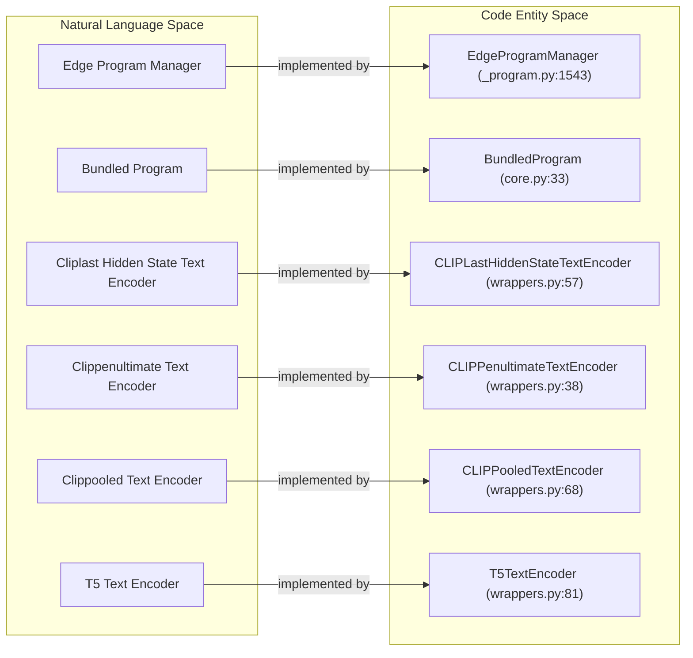
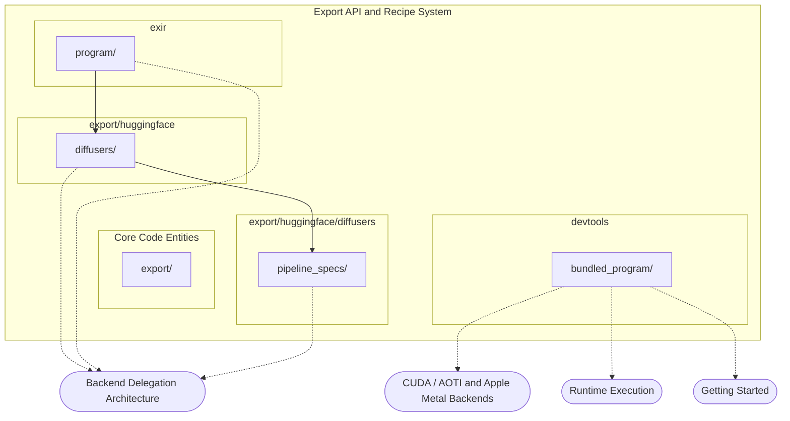
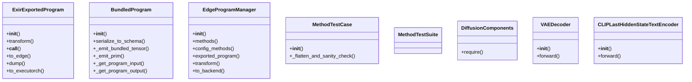
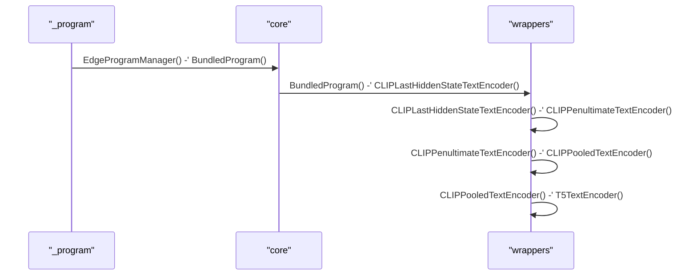

# Export API and Recipe System

↑ [[1-overview|Overview]]

> Architectural specification and implementation reference for Export API and Recipe System (37 relevant source files). Primary code entities: `AOQuantizationConfig`, `ExportRecipe`, `_assert_scalar_fields_agree`, `_collect_lowering_fields`, `ExportSession`.

<details>
<summary>Relevant source files</summary>

The following files were used as context for generating this wiki page:

- [export/recipe.py](export/recipe.py)
- [export/export.py](export/export.py)
- [export/stages.py](export/stages.py)
- [export/huggingface/diffusers/wrappers.py](export/huggingface/diffusers/wrappers.py)
- [export/recipe_registry.py](export/recipe_registry.py)
- [devtools/bundled_program/bundled_program.cpp](devtools/bundled_program/bundled_program.cpp)
- [exir/program/_program.py](exir/program/_program.py)
- [export/huggingface/diffusers/config.py](export/huggingface/diffusers/config.py)
- [export/huggingface/diffusers/pipeline_specs/base.py](export/huggingface/diffusers/pipeline_specs/base.py)
- [export/recipe_provider.py](export/recipe_provider.py)
- [export/huggingface/diffusers/pipeline_specs/flux.py](export/huggingface/diffusers/pipeline_specs/flux.py)
- [devtools/bundled_program/core.py](devtools/bundled_program/core.py)
- [export/huggingface/diffusers/pipeline_specs/sd15.py](export/huggingface/diffusers/pipeline_specs/sd15.py)
- [export/huggingface/diffusers/pipeline_specs/sdxl.py](export/huggingface/diffusers/pipeline_specs/sdxl.py)
- [export/huggingface/diffusers/export.py](export/huggingface/diffusers/export.py)
- [export/huggingface/diffusers/pipeline_specs/_stable_diffusion.py](export/huggingface/diffusers/pipeline_specs/_stable_diffusion.py)
- [export/__init__.py](export/__init__.py)
- [export/huggingface/__init__.py](export/huggingface/__init__.py)
- [export/huggingface/diffusers/backends.py](export/huggingface/diffusers/backends.py)
- [export/types.py](export/types.py)
- [export/huggingface/diffusers/pipeline_discovery.py](export/huggingface/diffusers/pipeline_discovery.py)
- [devtools/bundled_program/config.py](devtools/bundled_program/config.py)
- [export/huggingface/diffusers/__init__.py](export/huggingface/diffusers/__init__.py)
- [export/target_recipes.py](export/target_recipes.py)
- [devtools/bundled_program/bundled_program.h](devtools/bundled_program/bundled_program.h)
- [export/huggingface/diffusers/pipeline_specs/__init__.py](export/huggingface/diffusers/pipeline_specs/__init__.py)
- [devtools/bundled_program/schema/bundled_program_schema.py](devtools/bundled_program/schema/bundled_program_schema.py)
- [export/utils.py](export/utils.py)
- [docs/source/export-overview.md](docs/source/export-overview.md)
- [docs/source/export-to-executorch-api-reference.rst](docs/source/export-to-executorch-api-reference.rst)
- [devtools/bundled_program/schema/README.md](devtools/bundled_program/schema/README.md)
- [export/BUCK](export/BUCK)
- [devtools/bundled_program/BUCK](devtools/bundled_program/BUCK)
- [devtools/bundled_program/CMakeLists.txt](devtools/bundled_program/CMakeLists.txt)
- [devtools/bundled_program/schema/BUCK](devtools/bundled_program/schema/BUCK)

</details>

## Purpose and Scope

Architectural specification and implementation reference for Export API and Recipe System (37 relevant source files). Primary code entities: `AOQuantizationConfig`, `ExportRecipe`, `_assert_scalar_fields_agree`, `_collect_lowering_fields`, `ExportSession`.

Primary code entities analyzed on this page include `EdgeProgramManager` ([exir/program/_program.py:1543-1874]()), `BundledProgram` ([devtools/bundled_program/core.py:33-395]()), `CLIPLastHiddenStateTextEncoder` ([export/huggingface/diffusers/wrappers.py:57-65]()), `CLIPPenultimateTextEncoder` ([export/huggingface/diffusers/wrappers.py:38-54]()), `CLIPPooledTextEncoder` ([export/huggingface/diffusers/wrappers.py:68-78]()).

For the parent architectural layer, see [[1-overview|Overview]]. Related sibling subsystems: [[1.1-getting-started|Getting Started]].

Sources: [exir/program/_program.py:1543-1874](), [devtools/bundled_program/core.py:33-395](), [export/huggingface/diffusers/wrappers.py:57-65](), [export/huggingface/diffusers/wrappers.py:38-54]()

---

## 1. High-Level Architecture and Data Flow

### Natural Language Space to Code Entity Space Mapping

The following diagram maps domain concepts in this subsystem to their concrete code entities:



### Subsystem Component & Dependency Flow



Cross-subsystem call and import edges connect **Export API and Recipe System** with [[5.7-cuda-aoti-and-apple-metal-backends|CUDA / AOTI and Apple Metal Backends]] (coupling `12.0`), [[5.4-arm-tosa-and-ethos-u-backend|ARM TOSA and Ethos-U Backend]] (coupling `11.0`), [[9-mobile-and-platform-extensions|Mobile and Platform Extensions]] (coupling `10.0`), [[9.4-embedded-and-web-targets|Embedded (Zephyr, ESP32, Pico2) and WebAssembly/WebGPU Targets]] (coupling `10.0`), [[8-runtime-execution|Runtime Execution]] (coupling `10.0`).

| Module Directory | Files | Primary Code Entities | Source Citations |
|---|---|---|---|
| `export` | 10 | `ExportSession`, `AOQuantizationConfig`, `LoweringRecipe`, `QuantizationRecipe` | [export/export.py:112-759]() [export/recipe.py:119-129]() |
| `devtools/bundled_program` | 6 | `BundledProgram`, `MethodTestCase`, `MethodTestSuite`, `ErrorStats` | [devtools/bundled_program/core.py:33-395]() [devtools/bundled_program/config.py:49-107]() |
| `export/huggingface/diffusers` | 6 | `CLIPLastHiddenStateTextEncoder`, `CLIPPenultimateTextEncoder`, `CLIPPooledTextEncoder`, `T5TextEncoder` | [export/huggingface/diffusers/wrappers.py:57-65]() [export/huggingface/diffusers/wrappers.py:38-54]() |
| `export/huggingface/diffusers/pipeline_specs` | 6 | `DiffusionComponents`, `DiffusionModelInfo`, `ResolvedDiffusionPipeline`, `DiffusionPipelineExportSpec` | [export/huggingface/diffusers/pipeline_specs/base.py:25-36]() [export/huggingface/diffusers/pipeline_specs/base.py:92-120]() |
| `devtools/bundled_program/schema` | 5 | `BundledMethodTestCase`, `BundledMethodTestSuite`, `BundledProgram`, `Tensor` | [devtools/bundled_program/schema/bundled_program_schema.py:59-69]() [devtools/bundled_program/schema/bundled_program_schema.py:73-82]() |
| `exir/program` | 1 | `EdgeProgramManager`, `ExecutorchProgramManager`, `ExirExportedProgram`, `ExecutorchProgram` | [exir/program/_program.py:1543-1874]() [exir/program/_program.py:1877-2072]() |
| `export/huggingface` | 1 | *(build / config)* | [export/huggingface/__init__.py]() |

Sources: [exir/program/_program.py:1543-1874](), [devtools/bundled_program/core.py:33-395](), [export/huggingface/diffusers/wrappers.py:57-65](), [export/huggingface/diffusers/wrappers.py:38-54](), [export/huggingface/diffusers/wrappers.py:68-78]()

---

## 2. Core Data Structures and Implementation Details

### Class and Entity Relationship Diagram



### `EdgeProgramManager` (Class)

- **Source Location**: [exir/program/_program.py:1543-1874]()
- **Declaration**: `Class EdgeProgramManager`
- **Graph Centrality**: fan-in `4` callers, fan-out `0` callees
- **Responsibility**: Package of one or more `ExportedPrograms` in Edge dialect. Designed to simplify lowering to ExecuTorch. See: https://pytorch.org/executorch/main/ir-exir Allows easy applications of transforms across a collection of exported programs including the delegation of subgraphs. Manages the second link in the lowering chain of

```python
// exir/program/_program.py:1543-1558
class EdgeProgramManager:
    """
    Package of one or more `ExportedPrograms` in Edge dialect. Designed to simplify
    lowering to ExecuTorch. See: https://pytorch.org/executorch/main/ir-exir

    Allows easy applications of transforms across a collection of exported programs
    including the delegation of subgraphs.

    Manages the second link in the lowering chain of ATen -> Edge -> ExecuTorch.
    """

    def __init__(
        self,
        edge_programs: Union[ExportedProgram, Dict[str, ExportedProgram]],
        constant_methods: Optional[Dict[str, Any]] = None,
        compile_config: Optional[EdgeCompileConfig] = None,
```

### `BundledProgram` (Class)

- **Source Location**: [devtools/bundled_program/core.py:33-395]()
- **Declaration**: `Class BundledProgram`
- **Graph Centrality**: fan-in `4` callers, fan-out `0` callees
- **Responsibility**: Bundled program contains all information needed to execute and verify the program on device. Public Attributes: method_test_suites: All test suites for verifying methods. executorch_program: ExecutorchProgram-like variable, containing the Program to be verified by method_test_suites, including ExecutorchProgram, MultiM

```python
// devtools/bundled_program/core.py:33-48
class BundledProgram:
    """
    Bundled program contains all information needed to execute and verify the program on device.

    Public Attributes:
        method_test_suites: All test suites for verifying methods.
        executorch_program: ExecutorchProgram-like variable, containing the Program to be verified by method_test_suites, including
                            ExecutorchProgram, MultiMethodExecutorchProgram or ExecutorchProgramManager.
    """

    def __init__(
        self,
        executorch_program: Optional[
            Union[
                ExecutorchProgram,
                ExecutorchProgramManager,
```

### `CLIPLastHiddenStateTextEncoder` (Class)

- **Source Location**: [export/huggingface/diffusers/wrappers.py:57-65]()
- **Declaration**: `Class CLIPLastHiddenStateTextEncoder`
- **Graph Centrality**: fan-in `2` callers, fan-out `0` callees
- **Responsibility**: Return the final CLIP hidden state used by Stable Diffusion 1.x.

```python
// export/huggingface/diffusers/wrappers.py:57-65
class CLIPLastHiddenStateTextEncoder(torch.nn.Module):
    """Return the final CLIP hidden state used by Stable Diffusion 1.x."""

    def __init__(self, model: torch.nn.Module) -> None:
        super().__init__()
        self.model = model

    def forward(self, input_ids: torch.Tensor) -> torch.Tensor:
        return self.model(input_ids).last_hidden_state
```

### `CLIPPenultimateTextEncoder` (Class)

- **Source Location**: [export/huggingface/diffusers/wrappers.py:38-54]()
- **Declaration**: `Class CLIPPenultimateTextEncoder`
- **Graph Centrality**: fan-in `2` callers, fan-out `0` callees
- **Responsibility**: Return CLIP's penultimate hidden state and optional projected pool.

### `CLIPPooledTextEncoder` (Class)

- **Source Location**: [export/huggingface/diffusers/wrappers.py:68-78]()
- **Declaration**: `Class CLIPPooledTextEncoder`
- **Graph Centrality**: fan-in `2` callers, fan-out `0` callees
- **Responsibility**: Return the pooled CLIP representation used by FLUX.

### `combine` (Method)

- **Source Location**: [export/recipe.py:370-397]()
- **Declaration**: `( cls, recipes: List[\"ExportRecipe\"], recipe_name: Optional[str] = None )`
- **Graph Centrality**: fan-in `52` callers, fan-out `1` callees
- **Responsibility**: Combine multiple ExportRecipe objects into a single recipe. Args: recipes: List of ExportRecipe objects to combine recipe_name: Optional name for the combined recipe Returns: A new ExportRecipe that combines all input recipes Example: recipe1 = ExportRecipe.get_recipe(CoreMLRecipeType.FP32) recipe2 = ExportRecipe.get_r

Sources: [exir/program/_program.py:1543-1874](), [devtools/bundled_program/core.py:33-395](), [export/huggingface/diffusers/wrappers.py:57-65](), [export/huggingface/diffusers/wrappers.py:38-54](), [export/huggingface/diffusers/wrappers.py:68-78]()

---

## 3. Execution and Call Flow

The sequence diagram below traces the runtime/compile-time call chain across components in this module:



Sources: [exir/program/_program.py:1543-1874](), [devtools/bundled_program/core.py:33-395](), [export/huggingface/diffusers/wrappers.py:57-65](), [export/huggingface/diffusers/wrappers.py:38-54](), [export/huggingface/diffusers/wrappers.py:68-78]()

---

## 4. Key API and Symbol Reference

| Code Entity | Kind | Location | Fan-In / Out | Role & Signature |
|---|---|---|---|---|
| `EdgeProgramManager` | Class | [exir/program/_program.py:1543-1874]() | `4` / `0` | Package of one or more `ExportedPrograms` in Edge dialect. Designed to simplify |
| `BundledProgram` | Class | [devtools/bundled_program/core.py:33-395]() | `4` / `0` | Bundled program contains all information needed to execute and verify the program on device. |
| `CLIPLastHiddenStateTextEncoder` | Class | [export/huggingface/diffusers/wrappers.py:57-65]() | `2` / `0` | Return the final CLIP hidden state used by Stable Diffusion 1.x. |
| `CLIPPenultimateTextEncoder` | Class | [export/huggingface/diffusers/wrappers.py:38-54]() | `2` / `0` | Return CLIP's penultimate hidden state and optional projected pool. |
| `CLIPPooledTextEncoder` | Class | [export/huggingface/diffusers/wrappers.py:68-78]() | `2` / `0` | Return the pooled CLIP representation used by FLUX. |
| `T5TextEncoder` | Class | [export/huggingface/diffusers/wrappers.py:81-89]() | `2` / `0` | Return T5's final hidden state. |
| `ExportSession` | Class | [export/export.py:112-759]() | `1` / `0` | Manages the export process for ExecuTorch models. |
| `DiffusionComponents` | Class | [export/huggingface/diffusers/pipeline_specs/base.py:25-36]() | `3` / `0` | Components loaded from one Diffusers pipeline. |
| `AOQuantizationConfig` | Class | [export/recipe.py:119-129]() | `1` / `0` | Configuration for torchao quantization with optional filter function. |
| `LoweringRecipe` | Class | [export/recipe.py:203-238]() | `1` / `0` | Configuration recipe for lowering and partitioning. |
| `QuantizationRecipe` | Class | [export/recipe.py:133-199]() | `1` / `0` | Configuration recipe for quantization. |
| `_CombineAccumulator` | Class | [export/recipe.py:242-270]() | `1` / `0` | Private accumulator used by ExportRecipe._collect_recipe_fields. |
| `BoundedFluxPosEmbed` | Class | [export/huggingface/diffusers/wrappers.py:92-134]() | `1` / `0` | Select precomputed FLUX RoPE values for static or bounded dynamic IDs. |
| `FluxDenoiser` | Class | [export/huggingface/diffusers/wrappers.py:153-180]() | `1` / `0` | Flatten the keyword-heavy Diffusers FLUX transformer interface. |
| `ExecutorchStage` | Class | [export/stages.py:364-403]() | `1` / `0` | Convert to ExecutorchProgramManager. |
| `QuantizeStage` | Class | [export/stages.py:496-674]() | `1` / `0` | Optional stage: Perform post-training quantization on the model. |
| `SourceTransformStage` | Class | [export/stages.py:406-493]() | `1` / `0` | Apply source transformations and optional AO quantization to the model. |
| `TorchExportStage` | Class | [export/stages.py:143-215]() | `1` / `0` | Purpose: Export PyTorch model to ExportedProgram. |
| `ExportRecipe` | Class | [export/recipe.py:277-741]() | `0` / `0` | Configuration recipe for the export process. |
| `Mode` | Class | [export/recipe.py:105-115]() | `0` / `0` | Export mode enumeration. |
| `RecipeType` | Class | [export/recipe.py:87-102]() | `0` / `0` | Base recipe type class that backends can extend to define their own recipe types. |
| `RecipeTypeMeta` | Class | [export/recipe.py:81-84]() | `0` / `0` | Metaclass that combines EnumMeta and ABCMeta |

Sources: [exir/program/_program.py:1543-1874](), [devtools/bundled_program/core.py:33-395](), [export/huggingface/diffusers/wrappers.py:57-65](), [export/huggingface/diffusers/wrappers.py:38-54](), [export/huggingface/diffusers/wrappers.py:68-78](), [export/huggingface/diffusers/wrappers.py:81-89]()

---

## 5. Official Documentation and Design Context

The following linked documentation sections from `llm-wiki` (`raw/`) provide additional architectural context, tutorials, and design invariants for this subsystem:

- **ExecuTorch DeepWiki** ([wiki/index.md](), score `93.0912`) (sections: `ExecuTorch DeepWiki`, `Pages`): # ExecuTorch DeepWiki Generated from `home-jason-Project-deepwiki-executorch` at commit `b3b565b5b62f` (2026-11-15T15:02:11+00:00). ## Pages - [[1-overview|Overview]] — Architectural specification and implementation reference for Overview (10 relevant source files). Primary code entities: `Module`, `MethodHolder`, `PlannedMemory`, `EdgeProgramManager`, `__init__`. - [[1.1-getting-started|Getting Started]] — Architect
- **LLM Runner Framework** ([wiki/6.2-llm-runner-framework.md](), score `80.6592`) (sections: `LLM Runner Framework`, `Purpose and Scope`, `1. High-Level Architecture and Data Flow`, `Natural Language Space to Code Entity Space Mapping`): # LLM Runner Framework ↑ [[6-model-export-and-llm-support|Model Export and LLM Support]] > Architectural specification and implementation reference for LLM Runner Framework (36 relevant source files). Primary code entities: `check_vocab_size`, `read_int_method`, `read_int_tensor_method`, `read_required_positive_int`, `MultimodalPrefiller`. <details> <summary>Relevant source files</summary> The following files were us
- **Overview** ([wiki/1-overview.md](), score `76.8423`) (sections: `Overview`, `1. Architecture Overview & System Component Map`, `Core Concept to Code Entity Mapping`, `Architectural Principles (from Official Documentation)`): # Overview > Architectural specification and implementation reference for Overview (10 relevant source files). Primary code entities: `Module`, `MethodHolder`, `PlannedMemory`, `EdgeProgramManager`, `__init__`. <details> <summary>Relevant source files</summary> The following files were used as context for generating this wiki page: - [extension/module/module.h](extension/module/module.h) - [exir/program/_program.py](
- **Multimodal and Audio Models** ([wiki/6.4-multimodal-and-audio-models.md](), score `73.1032`) (sections: `Multimodal and Audio Models`, `Purpose and Scope`, `1. High-Level Architecture and Data Flow`, `Natural Language Space to Code Entity Space Mapping`): # Multimodal and Audio Models ↑ [[6-model-export-and-llm-support|Model Export and LLM Support]] > Architectural specification and implementation reference for Multimodal and Audio Models (36 relevant source files). Primary code entities: `LlavaEdgeManager`, `export`, `create_llava_config_from_args`, `export_all`, `Llava`. <details> <summary>Relevant source files</summary> The following files were used as context for 

Sources: [wiki/index.md](), [wiki/6.2-llm-runner-framework.md](), [wiki/1-overview.md](), [wiki/6.4-multimodal-and-audio-models.md]()

## Related pages

- [[1-overview|Overview]]
- [[1.1-getting-started|Getting Started]]
- [[2.3-schema-generation-and-flatbuffers|Schema Generation and FlatBuffers]]
- [[3-exir-core-system|EXIR Core System]]
- [[3.1-program-structure-and-compilation-flow|Program Structure and Compilation Flow]]
- [[3.2-graph-transformation-pass-system|Graph Transformation Pass System]]
- [[3.3-memory-planning-and-allocation|Memory Planning and Allocation]]
- [[3.4-program-emission-and-serialization|Program Emission and Serialization]]

## Related documents

- `wiki/index.md` — ExecuTorch DeepWiki (score 93.0912, via bm25)
- `wiki/6.2-llm-runner-framework.md` — LLM Runner Framework (score 80.6592, via bm25)
- `wiki/1-overview.md` — Overview (score 76.8423, via bm25)
- `wiki/6.4-multimodal-and-audio-models.md` — Multimodal and Audio Models (score 73.1032, via bm25)
- `wiki/6-model-export-and-llm-support.md` — Model Export and LLM Support (score 70.3342, via bm25)

## Sources

- [`export/recipe.py`](https://github.com/pytorch/executorch/blob/main/export/recipe.py)
- [`export/export.py`](https://github.com/pytorch/executorch/blob/main/export/export.py)
- [`export/stages.py`](https://github.com/pytorch/executorch/blob/main/export/stages.py)
- [`export/huggingface/diffusers/wrappers.py`](https://github.com/pytorch/executorch/blob/main/export/huggingface/diffusers/wrappers.py)
- [`export/recipe_registry.py`](https://github.com/pytorch/executorch/blob/main/export/recipe_registry.py)
- [`devtools/bundled_program/bundled_program.cpp`](https://github.com/pytorch/executorch/blob/main/devtools/bundled_program/bundled_program.cpp)
- [`exir/program/_program.py`](https://github.com/pytorch/executorch/blob/main/exir/program/_program.py)
- [`export/huggingface/diffusers/config.py`](https://github.com/pytorch/executorch/blob/main/export/huggingface/diffusers/config.py)
- [`export/huggingface/diffusers/pipeline_specs/base.py`](https://github.com/pytorch/executorch/blob/main/export/huggingface/diffusers/pipeline_specs/base.py)
- [`export/recipe_provider.py`](https://github.com/pytorch/executorch/blob/main/export/recipe_provider.py)
- [`export/huggingface/diffusers/pipeline_specs/flux.py`](https://github.com/pytorch/executorch/blob/main/export/huggingface/diffusers/pipeline_specs/flux.py)
- [`devtools/bundled_program/core.py`](https://github.com/pytorch/executorch/blob/main/devtools/bundled_program/core.py)
- [`export/huggingface/diffusers/pipeline_specs/sd15.py`](https://github.com/pytorch/executorch/blob/main/export/huggingface/diffusers/pipeline_specs/sd15.py)
- [`export/huggingface/diffusers/pipeline_specs/sdxl.py`](https://github.com/pytorch/executorch/blob/main/export/huggingface/diffusers/pipeline_specs/sdxl.py)
- [`export/huggingface/diffusers/export.py`](https://github.com/pytorch/executorch/blob/main/export/huggingface/diffusers/export.py)
- [`export/huggingface/diffusers/pipeline_specs/_stable_diffusion.py`](https://github.com/pytorch/executorch/blob/main/export/huggingface/diffusers/pipeline_specs/_stable_diffusion.py)
- [`export/__init__.py`](https://github.com/pytorch/executorch/blob/main/export/__init__.py)
- [`export/huggingface/__init__.py`](https://github.com/pytorch/executorch/blob/main/export/huggingface/__init__.py)
- [`export/huggingface/diffusers/backends.py`](https://github.com/pytorch/executorch/blob/main/export/huggingface/diffusers/backends.py)
- [`export/types.py`](https://github.com/pytorch/executorch/blob/main/export/types.py)
- [`export/huggingface/diffusers/pipeline_discovery.py`](https://github.com/pytorch/executorch/blob/main/export/huggingface/diffusers/pipeline_discovery.py)
- [`devtools/bundled_program/config.py`](https://github.com/pytorch/executorch/blob/main/devtools/bundled_program/config.py)
- [`export/huggingface/diffusers/__init__.py`](https://github.com/pytorch/executorch/blob/main/export/huggingface/diffusers/__init__.py)
- [`export/target_recipes.py`](https://github.com/pytorch/executorch/blob/main/export/target_recipes.py)
- [`devtools/bundled_program/bundled_program.h`](https://github.com/pytorch/executorch/blob/main/devtools/bundled_program/bundled_program.h)
- [`export/huggingface/diffusers/pipeline_specs/__init__.py`](https://github.com/pytorch/executorch/blob/main/export/huggingface/diffusers/pipeline_specs/__init__.py)
- [`devtools/bundled_program/schema/bundled_program_schema.py`](https://github.com/pytorch/executorch/blob/main/devtools/bundled_program/schema/bundled_program_schema.py)
- [`export/utils.py`](https://github.com/pytorch/executorch/blob/main/export/utils.py)
- [`docs/source/export-overview.md`](https://github.com/pytorch/executorch/blob/main/docs/source/export-overview.md)
- [`docs/source/export-to-executorch-api-reference.rst`](https://github.com/pytorch/executorch/blob/main/docs/source/export-to-executorch-api-reference.rst)
- [`devtools/bundled_program/schema/README.md`](https://github.com/pytorch/executorch/blob/main/devtools/bundled_program/schema/README.md)
- [`export/BUCK`](https://github.com/pytorch/executorch/blob/main/export/BUCK)
- [`devtools/bundled_program/BUCK`](https://github.com/pytorch/executorch/blob/main/devtools/bundled_program/BUCK)
- [`devtools/bundled_program/CMakeLists.txt`](https://github.com/pytorch/executorch/blob/main/devtools/bundled_program/CMakeLists.txt)
- [`devtools/bundled_program/schema/BUCK`](https://github.com/pytorch/executorch/blob/main/devtools/bundled_program/schema/BUCK)
- [`devtools/bundled_program/schema/bundled_program_schema.fbs`](https://github.com/pytorch/executorch/blob/main/devtools/bundled_program/schema/bundled_program_schema.fbs)
- [`devtools/bundled_program/schema/scalar_type.fbs`](https://github.com/pytorch/executorch/blob/main/devtools/bundled_program/schema/scalar_type.fbs)


## Dynamic Knowledge Links (Code Graph ↔ LLM-Wiki / RAG)

### Linked Architecture & Design Documents

| Document | Match Channel | Score | Shared Code Symbols |
|---|---|---|---|
| [[1.1-getting-started|Getting Started]] | `wikilink:1.2-export-api-and-recipe-system+entity(1)` | `106.348` | `EdgeProgramManager` |
| [[5.7-cuda-aoti-and-apple-metal-backends|CUDA / AOTI and Apple Metal Backends]] | `wikilink:1.2-export-api-and-recipe-system` | `104.848` | *(lexical/graph match)* |
| [[5.4-arm-tosa-and-ethos-u-backend|ARM TOSA and Ethos-U Backend]] | `wikilink:1.2-export-api-and-recipe-system` | `104.848` | *(lexical/graph match)* |
| [[index|ExecuTorch DeepWiki]] | `bm25` | `93.091` | *(lexical/graph match)* |
| [[6.2-llm-runner-framework|LLM Runner Framework]] | `bm25` | `80.659` | *(lexical/graph match)* |
| [[1-overview|Overview]] | `bm25+entity(2)` | `79.842` | `EdgeProgramManager`, `ExirExportedProgram` |

### High-Centrality Bridge Symbols (CBM Graph)

| Symbol | Kind | Source Location | Fan-In / Fan-Out |
|---|---|---|---|
| `EdgeProgramManager` | Class | [exir/program/_program.py:1543-1874]() | in: `4` / out: `0` |
| `BundledProgram` | Class | [devtools/bundled_program/core.py:33-395]() | in: `4` / out: `0` |
| `CLIPLastHiddenStateTextEncoder` | Class | [export/huggingface/diffusers/wrappers.py:57-65]() | in: `2` / out: `0` |
| `CLIPPenultimateTextEncoder` | Class | [export/huggingface/diffusers/wrappers.py:38-54]() | in: `2` / out: `0` |
| `CLIPPooledTextEncoder` | Class | [export/huggingface/diffusers/wrappers.py:68-78]() | in: `2` / out: `0` |
| `T5TextEncoder` | Class | [export/huggingface/diffusers/wrappers.py:81-89]() | in: `2` / out: `0` |

Sources: [exir/program/_program.py:1543-1874](), [devtools/bundled_program/core.py:33-395](), [export/huggingface/diffusers/wrappers.py:57-65](), [export/huggingface/diffusers/wrappers.py:38-54]()

### Cross-Subsystem Coupling

- [[5.7-cuda-aoti-and-apple-metal-backends|CUDA / AOTI and Apple Metal Backends]] — call/import coupling weight `12.0`
- [[5.4-arm-tosa-and-ethos-u-backend|ARM TOSA and Ethos-U Backend]] — call/import coupling weight `11.0`
- [[9-mobile-and-platform-extensions|Mobile and Platform Extensions]] — call/import coupling weight `10.0`
- [[9.4-embedded-and-web-targets|Embedded (Zephyr, ESP32, Pico2) and WebAssembly/WebGPU Targets]] — call/import coupling weight `10.0`
- [[8-runtime-execution|Runtime Execution]] — call/import coupling weight `10.0`
- [[8.1-core-runtime-architecture|Core Runtime Architecture]] — call/import coupling weight `10.0`
