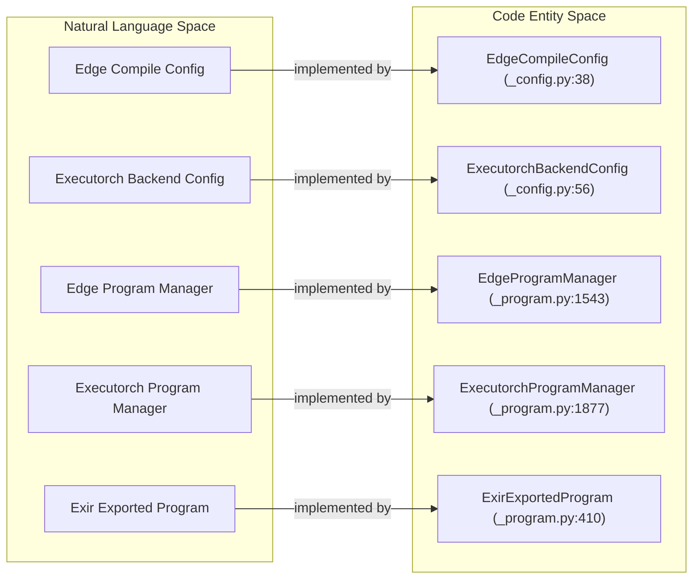
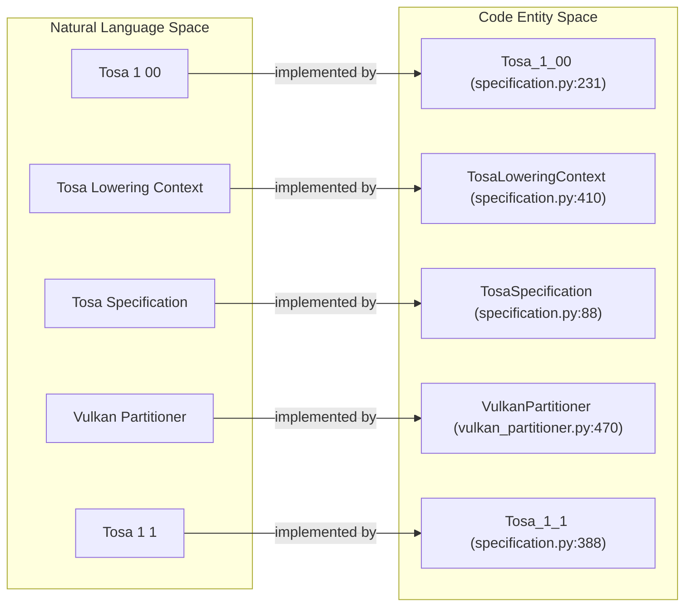
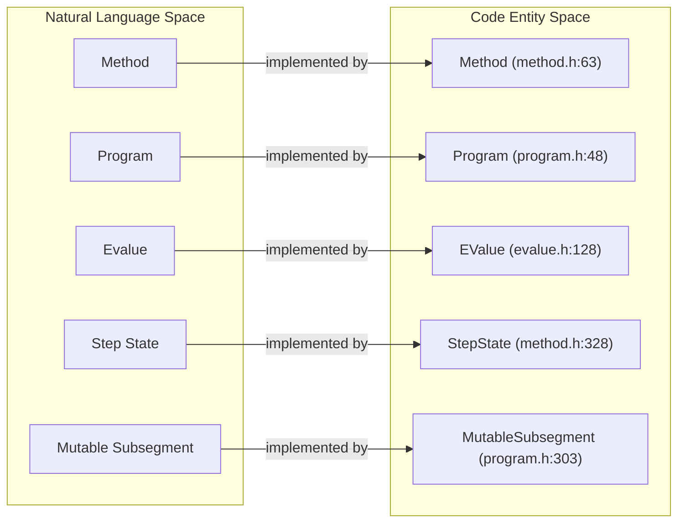

# Glossary

> Architectural specification and implementation reference for Glossary (10 relevant source files). Primary code entities: `CaptureConfig`, `EdgeCompileConfig`, `ExecutorchBackendConfig`, `BoxedEvalueList`, `checkUnwrappedVals`.

Relevant source files

The following files were used as context for generating this wiki page:

- [exir/capture/_config.py](exir/capture/_config.py)
- [runtime/core/evalue.h](runtime/core/evalue.h)
- [exir/program/_program.py](exir/program/_program.py)
- [backends/vulkan/partitioner/vulkan_partitioner.py](backends/vulkan/partitioner/vulkan_partitioner.py)
- [backends/arm/tosa/specification.py](backends/arm/tosa/specification.py)
- [runtime/executor/program.h](runtime/executor/program.h)
- [runtime/executor/method.h](runtime/executor/method.h)
- [devtools/etdump/etdump_flatcc.h](devtools/etdump/etdump_flatcc.h)
- [docs/source/ir-exir.md](docs/source/ir-exir.md)
- [docs/source/backends-overview.md](docs/source/backends-overview.md)

## Purpose and Scope

This page provides definitions and technical context for codebase-specific terms, jargon, abbreviations, file formats, and domain concepts used throughout the repository. Every concept is mapped directly to its concrete implementation in the **Code Entity Space**.

---

## 1. Core Compilation, IR & Graph Concepts

Intermediate representations, graph lowering managers, dialect verifiers, and serialization formats.

### `EdgeCompileConfig` (Edge Compile Config)

Core class defined in `exir/capture/_config.py`.

**Code Entities:**
- `EdgeCompileConfig` (`Class EdgeCompileConfig`): [exir/capture/_config.py:38-51]() (fan-in `58`, fan-out `0`).

### `ExecutorchBackendConfig` (Executorch Backend Config)

Core class defined in `exir/capture/_config.py`.

**Code Entities:**
- `ExecutorchBackendConfig` (`Class ExecutorchBackendConfig`): [exir/capture/_config.py:56-140]() (fan-in `31`, fan-out `0`).

### `EdgeProgramManager` (Edge Program Manager)

Package of one or more `ExportedPrograms` in Edge dialect. Designed to simplify lowering to ExecuTorch. See: https://pytorch.org/executorch/main/ir-exir Allows easy applications of transforms across a collection of exported programs including the delegation of

**Code Entities:**
- `EdgeProgramManager` (`Class EdgeProgramManager`): [exir/program/_program.py:1543-1874]() (fan-in `4`, fan-out `0`).

### `ExecutorchProgramManager` (Executorch Program Manager)

Package of one or more `ExportedPrograms` in Execution dialect. Designed to simplify lowering to ExecuTorch. See: https://pytorch.org/executorch/main/ir-exir When the ExecutorchProgramManager is constructed the ExportedPrograms in execution dialect are used to

**Code Entities:**
- `ExecutorchProgramManager` (`Class ExecutorchProgramManager`): [exir/program/_program.py:1877-2072]() (fan-in `1`, fan-out `0`).

### `ExirExportedProgram` (Exir Exported Program)

Core class defined in `exir/program/_program.py`.

**Code Entities:**
- `ExirExportedProgram` (`Class ExirExportedProgram`): [exir/program/_program.py:410-494]() (fan-in `5`, fan-out `0`).

### `HackedUpExportedProgramDONOTUSE` (Hacked Up Exported Program Donotuse)

Core class defined in `exir/program/_program.py`.

**Code Entities:**
- `HackedUpExportedProgramDONOTUSE` (`Class HackedUpExportedProgramDONOTUSE`): [exir/program/_program.py:325-406]() (fan-in `1`, fan-out `0`).

### Diagram: Natural Language Space to Code Entity Space (Core Compilation)

Sources: [exir/capture/_config.py:38-51](), [exir/capture/_config.py:56-140](), [exir/program/_program.py:1543-1874](), [exir/program/_program.py:1877-2072](), [exir/program/_program.py:410-494]()

---

## 2. Backend Delegation, Partitioning & Hardware Formats

Graph partitioning interfaces, capability specifications, and hardware accelerator delegates.

### `Tosa_1_00` (Tosa 1 00)

Provide TOSA 1.00 profile and extension semantics. This variant validates profiles (``INT``, ``FP``), the optional ``8k`` level, and allowed extensions based on the selected profiles. Attributes: profiles (List[str]): Selected profiles, e.g., ``["INT"]`` or ``

**Code Entities:**
- `Tosa_1_00` (`Class Tosa_1_00`): [backends/arm/tosa/specification.py:231-385]() (fan-in `2`, fan-out `0`).

### `TosaSpecification` (Tosa Specification)

Represent a TOSA specification. A specification includes a semantic version, one or more profiles, and optional extensions and levels (for example ``8k``). The encoded form follows ``TOSA-<major>.<minor>.<patch>+<PROFILE>[+<LEVEL>][+<EXT>...]``. Profiles use u

**Code Entities:**
- `TosaSpecification` (`Class TosaSpecification`): [backends/arm/tosa/specification.py:88-228]() (fan-in `0`, fan-out `0`).

### `TosaLoweringContext` (Tosa Lowering Context)

Manage the TOSA specification context for lowering. For now, only the active ``TosaSpecification`` is tracked, but this can be extended to carry additional lowering policies or configuration. Attributes: tosa_spec_var (contextvars.ContextVar): Context variable

**Code Entities:**
- `TosaLoweringContext` (`Class TosaLoweringContext`): [backends/arm/tosa/specification.py:410-460]() (fan-in `0`, fan-out `0`).

### `VulkanPartitioner` (Vulkan Partitioner)

Core class defined in `backends/vulkan/partitioner/vulkan_partitioner.py`.

**Code Entities:**
- `VulkanPartitioner` (`Class VulkanPartitioner`): [backends/vulkan/partitioner/vulkan_partitioner.py:470-619]() (fan-in `3`, fan-out `0`).

### `Tosa_1_1` (Tosa 1 1)

Core class defined in `backends/arm/tosa/specification.py`.

**Code Entities:**
- `Tosa_1_1` (`Class Tosa_1_1`): [backends/arm/tosa/specification.py:388-407]() (fan-in `1`, fan-out `0`).

### `VulkanSupportedOperators` (Vulkan Supported Operators)

Core class defined in `backends/vulkan/partitioner/vulkan_partitioner.py`.

**Code Entities:**
- `VulkanSupportedOperators` (`Class VulkanSupportedOperators`): [backends/vulkan/partitioner/vulkan_partitioner.py:70-376]() (fan-in `1`, fan-out `0`).

### Diagram: Natural Language Space to Code Entity Space (Backend Delegation)

Sources: [backends/arm/tosa/specification.py:231-385](), [backends/arm/tosa/specification.py:88-228](), [backends/arm/tosa/specification.py:410-460](), [backends/vulkan/partitioner/vulkan_partitioner.py:470-619](), [backends/arm/tosa/specification.py:388-407]()

---

## 3. Runtime Execution, Memory & Serialization Entities

On-device execution engines, tagged value unions, memory allocators, data loaders, and profiling tools.

### `Method` (Method)

/** * An executable method of an executorch program. Maps to a python method like * `forward()` on the original nn.Module. */

**Code Entities:**
- `Method` (`Class Method`): [runtime/executor/method.h:63-451]() (fan-in `0`, fan-out `0`).

### `Program` (Program)

/** * A deserialized ExecuTorch program binary. */

**Code Entities:**
- `Program` (`Class Program`): [runtime/executor/program.h:48-354]() (fan-in `0`, fan-out `0`).

### `EValue` (Evalue)

// Aggregate typing system similar to IValue only slimmed down with less // functionality, no dependencies on atomic, and fewer supported types to better // suit embedded systems (ie no intrusive ptr)

**Code Entities:**
- `EValue` (`Class EValue`): [runtime/core/evalue.h:128-705]() (fan-in `0`, fan-out `0`).

### `StepState` (Step State)

Core class defined in `runtime/executor/method.h`.

**Code Entities:**
- `StepState` (`Class StepState`): [runtime/executor/method.h:328-331]() (fan-in `0`, fan-out `0`).

### `MutableSubsegment` (Mutable Subsegment)

Core class defined in `runtime/executor/program.h`.

**Code Entities:**
- `MutableSubsegment` (`Class MutableSubsegment`): [runtime/executor/program.h:303-306]() (fan-in `0`, fan-out `0`).

### `ETDumpStaticAllocator` (Etdump Static Allocator)

Core class defined in `devtools/etdump/etdump_flatcc.h`.

**Code Entities:**
- `ETDumpStaticAllocator` (`Class ETDumpStaticAllocator`): [devtools/etdump/etdump_flatcc.h:32-65]() (fan-in `0`, fan-out `0`).

### Diagram: Natural Language Space to Code Entity Space (Runtime Execution)

Sources: [runtime/executor/method.h:63-451](), [runtime/executor/program.h:48-354](), [runtime/core/evalue.h:128-705](), [runtime/executor/method.h:328-331](), [runtime/executor/program.h:303-306]()

## Related pages

- [[1-overview|Overview]]
- [[1.1-getting-started|Getting Started]]
- [[1.2-export-api-and-recipe-system|Export API and Recipe System]]
- [[2.2-kernel-libraries-and-selective-build|Kernel Libraries and Selective Build]]
- [[2.3-schema-generation-and-flatbuffers|Schema Generation and FlatBuffers]]
- [[3.4-program-emission-and-serialization|Program Emission and Serialization]]
- [[3.5-verification-and-dialect-system|Verification and Dialect System]]
- [[4-quantization-systems|Quantization Systems]]

## Related documents

- `wiki/index.md` — ExecuTorch DeepWiki (score 100.752, via bm25)
- `wiki/1-overview.md` — Overview (score 91.6403, via bm25)
- `wiki/3.1-program-structure-and-compilation-flow.md` — Program Structure and Compilation Flow (score 82.0437, via bm25)
- `wiki/5.1-partitioning-and-operator-support.md` — Partitioning and Operator Support (score 75.1695, via bm25)
- `wiki/5-backend-delegation-architecture.md` — Backend Delegation Architecture (score 73.3574, via bm25)

## Sources

- [`exir/capture/_config.py`](https://github.com/pytorch/executorch/blob/main/exir/capture/_config.py)
- [`runtime/core/evalue.h`](https://github.com/pytorch/executorch/blob/main/runtime/core/evalue.h)
- [`exir/program/_program.py`](https://github.com/pytorch/executorch/blob/main/exir/program/_program.py)
- [`backends/vulkan/partitioner/vulkan_partitioner.py`](https://github.com/pytorch/executorch/blob/main/backends/vulkan/partitioner/vulkan_partitioner.py)
- [`backends/arm/tosa/specification.py`](https://github.com/pytorch/executorch/blob/main/backends/arm/tosa/specification.py)
- [`runtime/executor/program.h`](https://github.com/pytorch/executorch/blob/main/runtime/executor/program.h)
- [`runtime/executor/method.h`](https://github.com/pytorch/executorch/blob/main/runtime/executor/method.h)
- [`devtools/etdump/etdump_flatcc.h`](https://github.com/pytorch/executorch/blob/main/devtools/etdump/etdump_flatcc.h)
- [`docs/source/ir-exir.md`](https://github.com/pytorch/executorch/blob/main/docs/source/ir-exir.md)
- [`docs/source/backends-overview.md`](https://github.com/pytorch/executorch/blob/main/docs/source/backends-overview.md)

## Dynamic Knowledge Links (Code Graph ↔ LLM-Wiki / RAG)

### Linked Architecture & Design Documents

| Document | Match Channel | Score | Shared Code Symbols |
|---|---|---|---|
| [[index|ExecuTorch DeepWiki]] | `bm25` | `100.752` | *(lexical/graph match)* |
| [[1-overview|Overview]] | `bm25+entity(6)` | `100.64` | `EdgeCompileConfig`, `EdgeProgramManager`, `ExecutorchBackendConfig`, `ExirExportedProgram`, `to_edge` |
| [[3.1-program-structure-and-compilation-flow|Program Structure and Compilation Flow]] | `bm25+entity(6)` | `91.044` | `EdgeCompileConfig`, `EdgeProgramManager`, `ExecutorchBackendConfig`, `ExirExportedProgram`, `to_edge` |
| [[5.1-partitioning-and-operator-support|Partitioning and Operator Support]] | `bm25+entity(1)` | `76.669` | `EdgeProgramManager` |
| [[5-backend-delegation-architecture|Backend Delegation Architecture]] | `bm25` | `73.357` | *(lexical/graph match)* |
| [[1.2-export-api-and-recipe-system|Export API and Recipe System]] | `wikilink:10-glossary+entity(4)` | `59.909` | `EdgeCompileConfig`, `EdgeProgramManager`, `ExirExportedProgram`, `to_edge` |

### High-Centrality Bridge Symbols (CBM Graph)

| Symbol | Kind | Source Location | Fan-In / Fan-Out |
|---|---|---|---|
| `EdgeCompileConfig` | Class | [exir/capture/_config.py:38-51]() | in: `58` / out: `0` |
| `ExecutorchBackendConfig` | Class | [exir/capture/_config.py:56-140]() | in: `31` / out: `0` |
| `EdgeProgramManager` | Class | [exir/program/_program.py:1543-1874]() | in: `4` / out: `0` |
| `Tosa_1_00` | Class | [backends/arm/tosa/specification.py:231-385]() | in: `2` / out: `0` |
| `ExecutorchProgramManager` | Class | [exir/program/_program.py:1877-2072]() | in: `1` / out: `0` |
| `EValue` | Class | [runtime/core/evalue.h:128-705]() | in: `0` / out: `0` |

Sources: [exir/capture/_config.py:38-51](), [exir/capture/_config.py:56-140](), [exir/program/_program.py:1543-1874](), [backends/arm/tosa/specification.py:231-385]()

### Cross-Subsystem Coupling

- [[5-backend-delegation-architecture|Backend Delegation Architecture]] — call/import coupling weight `29.0`
- [[5.2-vulkan-gpu-backend|Vulkan GPU Backend]] — call/import coupling weight `27.0`
- [[9-mobile-and-platform-extensions|Mobile and Platform Extensions]] — call/import coupling weight `24.0`
- [[6.1-llama-model-export|LLaMA and Generative Model Export]] — call/import coupling weight `23.0`
- [[9.4-embedded-and-web-targets|Embedded (Zephyr, ESP32, Pico2) and WebAssembly/WebGPU Targets]] — call/import coupling weight `22.0`
- [[8-runtime-execution|Runtime Execution]] — call/import coupling weight `17.0`
