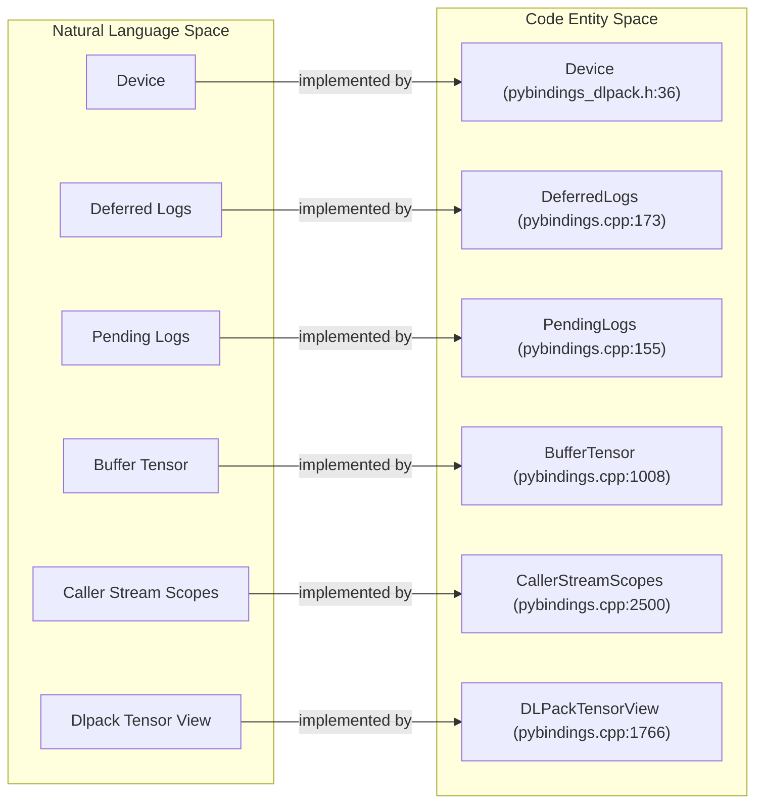
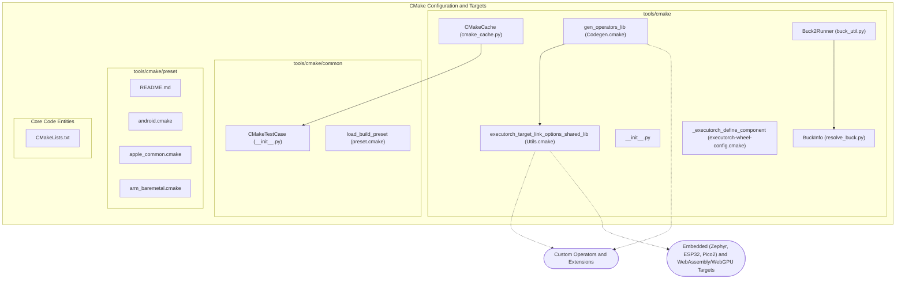
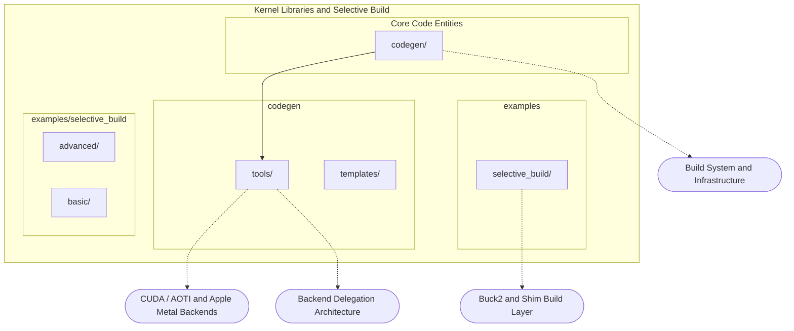
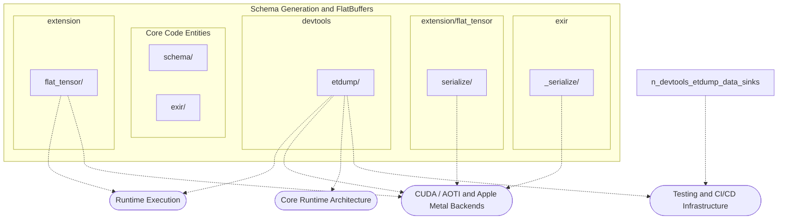
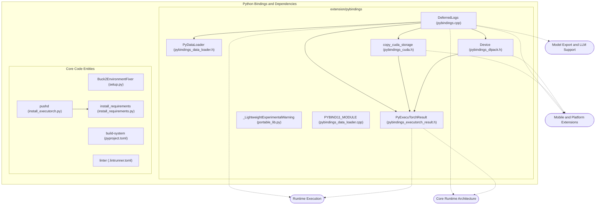
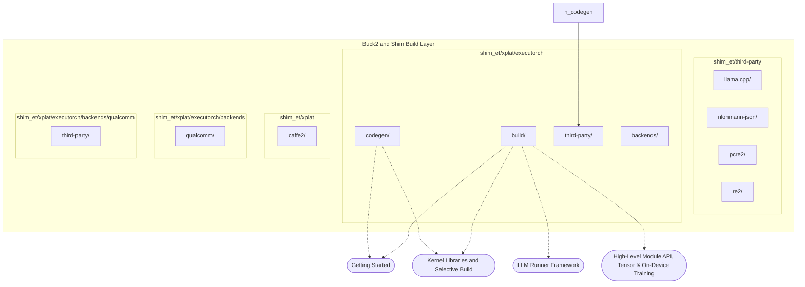

# Build System and Infrastructure

> Architectural specification and implementation reference for Build System and Infrastructure (38 relevant source files). Primary code entities: `CMakeCache`, `__post_init__`, `_is_truthy`, `get`, `_executorch_add_windows_anchor`.

Relevant source files

The following files were used as context for generating this wiki page:

- [tools/cmake/cmake_cache.py](tools/cmake/cmake_cache.py)
- [tools/cmake/Utils.cmake](tools/cmake/Utils.cmake)
- [tools/cmake/common/__init__.py](tools/cmake/common/__init__.py)
- [tools/cmake/Codegen.cmake](tools/cmake/Codegen.cmake)
- [tools/cmake/buck_util.py](tools/cmake/buck_util.py)
- [extension/pybindings/pybindings.cpp](extension/pybindings/pybindings.cpp)
- [extension/pybindings/pybindings_executorch_result.h](extension/pybindings/pybindings_executorch_result.h)
- [codegen/gen.py](codegen/gen.py)
- [codegen/model.py](codegen/model.py)
- [tools/cmake/__init__.py](tools/cmake/__init__.py)
- [extension/pybindings/pybindings_data_loader.h](extension/pybindings/pybindings_data_loader.h)
- [tools/cmake/resolve_buck.py](tools/cmake/resolve_buck.py)
- [tools/cmake/common/preset.cmake](tools/cmake/common/preset.cmake)
- [codegen/api/unboxing.py](codegen/api/unboxing.py)
- [tools/cmake/executorch-wheel-config.cmake](tools/cmake/executorch-wheel-config.cmake)
- [codegen/api/custom_ops.py](codegen/api/custom_ops.py)
- [codegen/api/types/signatures.py](codegen/api/types/signatures.py)
- [extension/pybindings/pybindings_dlpack.h](extension/pybindings/pybindings_dlpack.h)
- [codegen/api/et_cpp.py](codegen/api/et_cpp.py)
- [codegen/api/types/types.py](codegen/api/types/types.py)
- [codegen/tools/selective_build.cpp](codegen/tools/selective_build.cpp)
- [codegen/tools/gen_oplist.py](codegen/tools/gen_oplist.py)
- [setup.py](setup.py)
- [pyproject.toml](pyproject.toml)
- [codegen/__init__.py](codegen/__init__.py)
- [codegen/api/__init__.py](codegen/api/__init__.py)
- [codegen/tools/merge_yaml.py](codegen/tools/merge_yaml.py)
- [codegen/parse.py](codegen/parse.py)
- [tools/cmake/preset/README.md](tools/cmake/preset/README.md)
- [schema/README.md](schema/README.md)
- [shim_et/README.md](shim_et/README.md)
- [extension/pybindings/README.md](extension/pybindings/README.md)
- [CMakeLists.txt](CMakeLists.txt)
- [tools/cmake/Test.cmake](tools/cmake/Test.cmake)
- [tools/cmake/executorch-config.cmake](tools/cmake/executorch-config.cmake)

## Purpose and Scope

This chapter covers **Build System and Infrastructure** across the repository, detailing the core abstractions, data structures, transformation pipelines, and runtime/build integrations that implement this layer.

**Scope**: This document provides an architectural hub for the following child subsystems:
- **CMake Configuration and Targets**: See [[2.1-cmake-configuration-and-targets|CMake Configuration and Targets]].
- **Kernel Libraries and Selective Build**: See [[2.2-kernel-libraries-and-selective-build|Kernel Libraries and Selective Build]].
- **Schema Generation and FlatBuffers**: See [[2.3-schema-generation-and-flatbuffers|Schema Generation and FlatBuffers]].
- **Python Bindings and Dependencies**: See [[2.4-python-bindings-and-dependencies|Python Bindings and Dependencies]].
- **Buck2 and Shim Build Layer**: See [[2.5-buck2-and-shim-build-layer|Buck2 and Shim Build Layer]].

Sources: [extension/pybindings/pybindings_dlpack.h:36-39](), [extension/pybindings/pybindings.cpp:173-189](), [extension/pybindings/pybindings.cpp:155-160](), [extension/pybindings/pybindings.cpp:1008-1338]()

---

## System Mapping: Natural Language Space to Code Entity Space

Sources: [extension/pybindings/pybindings_dlpack.h:36-39](), [extension/pybindings/pybindings.cpp:173-189](), [extension/pybindings/pybindings.cpp:155-160](), [extension/pybindings/pybindings.cpp:1008-1338](), [extension/pybindings/pybindings.cpp:2500-2530]()

---

## 1. CMake Configuration and Targets

Architectural specification and implementation reference for CMake Configuration and Targets (17 relevant source files). Primary code entities: `CMakeCache`, `__post_init__`, `_is_truthy`, `get`, `_executorch_add_windows_anchor`. [tools/cmake/cmake_cache.py:35-72](), [tools/cmake/cmake_cache.py:12-14](), [tools/cmake/common/__init__.py:71-143]()

### Primary Code Entities

- **`CMakeCache`** (Class in [tools/cmake/cmake_cache.py:35-72]()): Core implementation entity.
- **`CacheValue`** (Class in [tools/cmake/cmake_cache.py:12-14]()): Core implementation entity.
- **`CMakeTestCase`** (Class in [tools/cmake/common/__init__.py:71-143]()): Core implementation entity.
- **`Buck2Runner`** (Class in [tools/cmake/buck_util.py:27-42]()): Core implementation entity.
- **`executorch_target_link_options_shared_lib`** (Function in [tools/cmake/Utils.cmake:151-196]()): # Ensure that the load-time constructor functions run. By default, the linker # would remove them since there are no other references to them.
- **`gen_operators_lib`** (Function in [tools/cmake/Codegen.cmake:361-498]()): # Generate a runtime lib for registering operators in Executorch # # SHARED opts this library into being a shared object. It is opt-in because most # callers want the default stati

### CMake Configuration and Targets Architecture Flow

For details, see [[2.1-cmake-configuration-and-targets|CMake Configuration and Targets]].

Sources: [tools/cmake/cmake_cache.py:35-72](), [tools/cmake/cmake_cache.py:12-14](), [tools/cmake/common/__init__.py:71-143](), [tools/cmake/buck_util.py:27-42]()

---

## 2. Kernel Libraries and Selective Build

Architectural specification and implementation reference for Kernel Libraries and Selective Build (31 relevant source files). Primary code entities: `KernelType`, `ScalarType`, `_dump_yaml`, `_get_et_kernel_metadata_from_ops_yaml`, `IOMetaData`. [codegen/tools/selective_build.cpp:29-52](), [codegen/model.py:26-34](), [codegen/model.py:140-220]()

### Primary Code Entities

- **`IOMetaData`** (Class in [codegen/tools/selective_build.cpp:29-52]()): // Metadata for kernel call io variables. // dtype and dim_order will exist only if corresponding variable is Tensor.
- **`ScalarType`** (Class in [codegen/model.py:26-34]()): # TODO: Duplicated Subset from codegen.tool.gen_oplist, remove declaration in codegen
- **`ETKernelIndex`** (Class in [codegen/model.py:140-220]()): Core implementation entity.
- **`ETKernelKey`** (Class in [codegen/model.py:54-136]()): Core implementation entity.
- **`_get_io_metadata_for_program_operators`** (Function in [codegen/tools/selective_build.cpp:242-278]()): // expose IO metadatas for all operators in given program
- **`generate`** (Function in [codegen/gen.py:869-968]()): Generates the operator headers and registration sources into install_dir. The arguments match main()'s command-line flags; source_path is the directory holding the templates/ subdi

### Kernel Libraries and Selective Build Architecture Flow

For details, see [[2.2-kernel-libraries-and-selective-build|Kernel Libraries and Selective Build]].

Sources: [codegen/tools/selective_build.cpp:29-52](), [codegen/model.py:26-34](), [codegen/model.py:140-220](), [codegen/model.py:54-136]()

---

## 3. Schema Generation and FlatBuffers

Architectural specification and implementation reference for Schema Generation and FlatBuffers (36 relevant source files). Primary code entities: `Call`, `Sample`, `SampleSet`, `_SetDecoder`, `PTEFile`. [exir/_serialize/_program.py:58-67](), [exir/_serialize/_ptn_samples.py:58-65](), [exir/_serialize/_ptn_samples.py:69-73]()

### Primary Code Entities

- **`PTEFile`** (Class in [exir/_serialize/_program.py:58-67]()): Wraps together the data required to serialize into a PTE file.
- **`Call`** (Class in [exir/_serialize/_ptn_samples.py:58-65]()): One call of a method: positional inputs, and optionally what it produced.
- **`Sample`** (Class in [exir/_serialize/_ptn_samples.py:69-73]()): Calls run in order from the program's initial state, with no reset between.
- **`_ResourceFiles`** (Class in [exir/_serialize/_flatbuffer.py:125-153]()): Manages a collection of python resources that will be written to files.
- **`serialize_pte_binary`** (Function in [exir/_serialize/_program.py:383-564]()): Returns the runtime binary representation of the given Program. Args: pte_file: PTEFile class containing the program and segments. extract_delegate_segments: Whether to move delega
- **`from_bytes`** (Method in [exir/_serialize/_program.py:175-210]()): Tries to read an extended header from the provided data. Does not validate that the header is well-formed. Callers should use is_valid(). Args: data: The data to read from. Returns

### Schema Generation and FlatBuffers Architecture Flow

For details, see [[2.3-schema-generation-and-flatbuffers|Schema Generation and FlatBuffers]].

Sources: [exir/_serialize/_program.py:58-67](), [exir/_serialize/_ptn_samples.py:58-65](), [exir/_serialize/_ptn_samples.py:69-73](), [exir/_serialize/_flatbuffer.py:125-153]()

---

## 4. Python Bindings and Dependencies

Architectural specification and implementation reference for Python Bindings and Dependencies (15 relevant source files). Primary code entities: `BorrowedInput`, `torch_storage`, `validate`, `PyExecuTorchResult`, `DLPackHolder`. [extension/pybindings/pybindings_dlpack.h:36-39](), [extension/pybindings/pybindings.cpp:173-189](), [extension/pybindings/pybindings.cpp:155-160]()

### Primary Code Entities

- **`Device`** (Class in [extension/pybindings/pybindings_dlpack.h:36-39]()): Core implementation entity.
- **`DeferredLogs`** (Class in [extension/pybindings/pybindings.cpp:173-189]()): // Lines that Python's stderr must show but that were logged where Python cannot // be called: outside any binding call, or on a daemon thread. Python's main // thread writes the l
- **`PendingLogs`** (Class in [extension/pybindings/pybindings.cpp:155-160]()): // The lines kept for the current binding call; emit_log_message says when a // line is kept. Past the capacity the oldest are counted rather than kept, // since the newest are the
- **`BufferTensor`** (Class in [extension/pybindings/pybindings.cpp:1008-1338]()): /** Holds a Python buffer export and presents its metadata to ExecuTorch. */
- **`scalar_type`** (Method in [extension/pybindings/pybindings.cpp:1086-1088]()): ()
- **`end`** (Method in [extension/pybindings/pybindings.cpp:2644-2667]()): (bool refuse_out_of_order)

### Python Bindings and Dependencies Architecture Flow

For details, see [[2.4-python-bindings-and-dependencies|Python Bindings and Dependencies]].

Sources: [extension/pybindings/pybindings_dlpack.h:36-39](), [extension/pybindings/pybindings.cpp:173-189](), [extension/pybindings/pybindings.cpp:155-160](), [extension/pybindings/pybindings.cpp:1008-1338]()

---

## 5. Buck2 and Shim Build Layer

Architectural specification and implementation reference for Buck2 and Shim Build Layer (30 relevant source files). Primary code entities: `ggml_ci_labels`, `define_common_targets`, `_extract_prim_ops_from_lists`, `_get_headers`, `_get_prim_ops_registry_target`. [shim_et/xplat/executorch/build/runtime_wrapper.bzl:469-470](), [shim_et/xplat/executorch/third-party/glob_defs.bzl:86-92](), [shim_et/xplat/executorch/codegen/codegen.bzl:170-258]()

### Primary Code Entities

- **`get_aten_mode_options`** (Function in [shim_et/xplat/executorch/build/runtime_wrapper.bzl:469-470]()): ()
- **`glob`** (Function in [shim_et/xplat/executorch/third-party/glob_defs.bzl:86-92]()): (include, exclude = (), **kwargs)
- **`et_operator_library`** (Function in [shim_et/xplat/executorch/codegen/codegen.bzl:170-258]()): # Hide the dependency to caffe2 internally.
- **`is_xplat`** (Function in [shim_et/xplat/executorch/build/runtime_wrapper.bzl:35-36]()): ()

### Buck2 and Shim Build Layer Architecture Flow

For details, see [[2.5-buck2-and-shim-build-layer|Buck2 and Shim Build Layer]].

Sources: [shim_et/xplat/executorch/build/runtime_wrapper.bzl:469-470](), [shim_et/xplat/executorch/third-party/glob_defs.bzl:86-92](), [shim_et/xplat/executorch/codegen/codegen.bzl:170-258](), [shim_et/xplat/executorch/build/runtime_wrapper.bzl:35-36]()

---

## Official Documentation & Architectural References

- **Python Bindings and Dependencies** ([wiki/2.4-python-bindings-and-dependencies.md]()): # Python Bindings and Dependencies ↑ [[2-build-system-and-infrastructure|Build System and Infrastructure]] > Architectural specification and implementation reference for Python Bindings and Dependencies (15 relevant source files). Primary code entities: `BorrowedInput`, `torch_storage`, `validate`, `PyExecuTorchResult`, `DLPackHolder`. 
 
Rel
- **ExecuTorch DeepWiki** ([wiki/index.md]()): # ExecuTorch DeepWiki Generated from `home-jason-Project-deepwiki-executorch` at commit `b3b565b5b62f` (2026-11-15T15:02:11+00:00). ## Pages - [[1-overview|Overview]] — Architectural specification and implementation reference for Overview (10 relevant source files). Primary code entities: `Module`, `MethodHolder`, `PlannedMemory`, `EdgeProgramManager`, `__in
- **CMake Configuration and Targets** ([wiki/2.1-cmake-configuration-and-targets.md]()): # CMake Configuration and Targets ↑ [[2-build-system-and-infrastructure|Build System and Infrastructure]] > Architectural specification and implementation reference for CMake Configuration and Targets (17 relevant source files). Primary code entities: `CMakeCache`, `__post_init__`, `_is_truthy`, `get`, `_executorch_add_windows_anchor`. 
 
Rel
- **Embedded (Zephyr, ESP32, Pico2) and WebAssembly/WebGPU Targets** ([wiki/9.4-embedded-and-web-targets.md]()): # Embedded (Zephyr, ESP32, Pico2) and WebAssembly/WebGPU Targets ↑ [[9-mobile-and-platform-extensions|Mobile and Platform Extensions]] > Architectural specification and implementation reference for Embedded (Zephyr, ESP32, Pico2) and WebAssembly/WebGPU Targets (40 relevant source files). Primary code entities: `BindingSpec`, `ComputePipelineBundle`, `operato

Sources: [wiki/2.4-python-bindings-and-dependencies.md](), [wiki/index.md](), [wiki/2.1-cmake-configuration-and-targets.md](), [wiki/9.4-embedded-and-web-targets.md]()

## Sub-pages

- [[2.1-cmake-configuration-and-targets|CMake Configuration and Targets]]
- [[2.2-kernel-libraries-and-selective-build|Kernel Libraries and Selective Build]]
- [[2.3-schema-generation-and-flatbuffers|Schema Generation and FlatBuffers]]
- [[2.4-python-bindings-and-dependencies|Python Bindings and Dependencies]]
- [[2.5-buck2-and-shim-build-layer|Buck2 and Shim Build Layer]]

## Related pages

- [[1-overview|Overview]]
- [[2.1-cmake-configuration-and-targets|CMake Configuration and Targets]]
- [[2.2-kernel-libraries-and-selective-build|Kernel Libraries and Selective Build]]
- [[2.3-schema-generation-and-flatbuffers|Schema Generation and FlatBuffers]]
- [[2.4-python-bindings-and-dependencies|Python Bindings and Dependencies]]
- [[2.5-buck2-and-shim-build-layer|Buck2 and Shim Build Layer]]
- [[1.1-getting-started|Getting Started]]
- [[1.2-export-api-and-recipe-system|Export API and Recipe System]]

## Related documents

- `wiki/2.4-python-bindings-and-dependencies.md` — Python Bindings and Dependencies (score 132.2332, via bm25)
- `wiki/index.md` — ExecuTorch DeepWiki (score 90.2095, via bm25)
- `wiki/2.1-cmake-configuration-and-targets.md` — CMake Configuration and Targets (score 80.3505, via bm25)
- `wiki/9.4-embedded-and-web-targets.md` — Embedded (Zephyr, ESP32, Pico2) and WebAssembly/WebGPU Targets (score 69.104, via bm25)
- `wiki/9-mobile-and-platform-extensions.md` — Mobile and Platform Extensions (score 66.2718, via bm25)

## Sources

- [`tools/cmake/cmake_cache.py`](https://github.com/pytorch/executorch/blob/main/tools/cmake/cmake_cache.py)
- [`tools/cmake/Utils.cmake`](https://github.com/pytorch/executorch/blob/main/tools/cmake/Utils.cmake)
- [`tools/cmake/common/__init__.py`](https://github.com/pytorch/executorch/blob/main/tools/cmake/common/__init__.py)
- [`tools/cmake/Codegen.cmake`](https://github.com/pytorch/executorch/blob/main/tools/cmake/Codegen.cmake)
- [`tools/cmake/buck_util.py`](https://github.com/pytorch/executorch/blob/main/tools/cmake/buck_util.py)
- [`extension/pybindings/pybindings.cpp`](https://github.com/pytorch/executorch/blob/main/extension/pybindings/pybindings.cpp)
- [`extension/pybindings/pybindings_executorch_result.h`](https://github.com/pytorch/executorch/blob/main/extension/pybindings/pybindings_executorch_result.h)
- [`codegen/gen.py`](https://github.com/pytorch/executorch/blob/main/codegen/gen.py)
- [`codegen/model.py`](https://github.com/pytorch/executorch/blob/main/codegen/model.py)
- [`tools/cmake/__init__.py`](https://github.com/pytorch/executorch/blob/main/tools/cmake/__init__.py)
- [`extension/pybindings/pybindings_data_loader.h`](https://github.com/pytorch/executorch/blob/main/extension/pybindings/pybindings_data_loader.h)
- [`tools/cmake/resolve_buck.py`](https://github.com/pytorch/executorch/blob/main/tools/cmake/resolve_buck.py)
- [`tools/cmake/common/preset.cmake`](https://github.com/pytorch/executorch/blob/main/tools/cmake/common/preset.cmake)
- [`codegen/api/unboxing.py`](https://github.com/pytorch/executorch/blob/main/codegen/api/unboxing.py)
- [`tools/cmake/executorch-wheel-config.cmake`](https://github.com/pytorch/executorch/blob/main/tools/cmake/executorch-wheel-config.cmake)
- [`codegen/api/custom_ops.py`](https://github.com/pytorch/executorch/blob/main/codegen/api/custom_ops.py)
- [`codegen/api/types/signatures.py`](https://github.com/pytorch/executorch/blob/main/codegen/api/types/signatures.py)
- [`extension/pybindings/pybindings_dlpack.h`](https://github.com/pytorch/executorch/blob/main/extension/pybindings/pybindings_dlpack.h)
- [`codegen/api/et_cpp.py`](https://github.com/pytorch/executorch/blob/main/codegen/api/et_cpp.py)
- [`codegen/api/types/types.py`](https://github.com/pytorch/executorch/blob/main/codegen/api/types/types.py)
- [`codegen/tools/selective_build.cpp`](https://github.com/pytorch/executorch/blob/main/codegen/tools/selective_build.cpp)
- [`codegen/tools/gen_oplist.py`](https://github.com/pytorch/executorch/blob/main/codegen/tools/gen_oplist.py)
- [`setup.py`](https://github.com/pytorch/executorch/blob/main/setup.py)
- [`pyproject.toml`](https://github.com/pytorch/executorch/blob/main/pyproject.toml)
- [`codegen/__init__.py`](https://github.com/pytorch/executorch/blob/main/codegen/__init__.py)
- [`codegen/api/__init__.py`](https://github.com/pytorch/executorch/blob/main/codegen/api/__init__.py)
- [`codegen/tools/merge_yaml.py`](https://github.com/pytorch/executorch/blob/main/codegen/tools/merge_yaml.py)
- [`codegen/parse.py`](https://github.com/pytorch/executorch/blob/main/codegen/parse.py)
- [`tools/cmake/preset/README.md`](https://github.com/pytorch/executorch/blob/main/tools/cmake/preset/README.md)
- [`schema/README.md`](https://github.com/pytorch/executorch/blob/main/schema/README.md)
- [`shim_et/README.md`](https://github.com/pytorch/executorch/blob/main/shim_et/README.md)
- [`extension/pybindings/README.md`](https://github.com/pytorch/executorch/blob/main/extension/pybindings/README.md)
- [`CMakeLists.txt`](https://github.com/pytorch/executorch/blob/main/CMakeLists.txt)
- [`tools/cmake/Test.cmake`](https://github.com/pytorch/executorch/blob/main/tools/cmake/Test.cmake)
- [`tools/cmake/executorch-config.cmake`](https://github.com/pytorch/executorch/blob/main/tools/cmake/executorch-config.cmake)
- [`tools/cmake/preset/android.cmake`](https://github.com/pytorch/executorch/blob/main/tools/cmake/preset/android.cmake)
- [`tools/cmake/preset/apple_common.cmake`](https://github.com/pytorch/executorch/blob/main/tools/cmake/preset/apple_common.cmake)
- [`tools/cmake/preset/arm_baremetal.cmake`](https://github.com/pytorch/executorch/blob/main/tools/cmake/preset/arm_baremetal.cmake)

## Dynamic Knowledge Links (Code Graph ↔ LLM-Wiki / RAG)

### Linked Architecture & Design Documents

| Document | Match Channel | Score | Shared Code Symbols |
|---|---|---|---|
| [[2.4-python-bindings-and-dependencies|Python Bindings and Dependencies]] | `bm25+entity(1)` | `133.733` | `PyExecuTorchResult` |
| [[index|ExecuTorch DeepWiki]] | `bm25` | `90.21` | *(lexical/graph match)* |
| [[2.1-cmake-configuration-and-targets|CMake Configuration and Targets]] | `bm25+entity(1)` | `81.85` | `PyExecuTorchResult` |
| [[2.2-kernel-libraries-and-selective-build|Kernel Libraries and Selective Build]] | `wikilink:2-build-system-and-infrastructure+entity(3)` | `71.063` | `ETKernelIndex`, `ETKernelKey`, `PyExecuTorchResult` |
| [[2.5-buck2-and-shim-build-layer|Buck2 and Shim Build Layer]] | `wikilink:2-build-system-and-infrastructure+entity(2)` | `69.563` | `ETKernelIndex`, `PyExecuTorchResult` |
| [[9.4-embedded-and-web-targets|Embedded (Zephyr, ESP32, Pico2) and WebAssembly/WebGPU Targets]] | `bm25` | `69.104` | *(lexical/graph match)* |

### High-Centrality Bridge Symbols (CBM Graph)

| Symbol | Kind | Source Location | Fan-In / Fan-Out |
|---|---|---|---|
| `Device` | Class | [extension/pybindings/pybindings_dlpack.h:36-39]() | in: `11` / out: `0` |
| `DeferredLogs` | Class | [extension/pybindings/pybindings.cpp:173-189]() | in: `2` / out: `0` |
| `PendingLogs` | Class | [extension/pybindings/pybindings.cpp:155-160]() | in: `1` / out: `0` |
| `BufferTensor` | Class | [extension/pybindings/pybindings.cpp:1008-1338]() | in: `0` / out: `0` |
| `CallerStreamScopes` | Class | [extension/pybindings/pybindings.cpp:2500-2530]() | in: `0` / out: `0` |
| `DLPackTensorView` | Class | [extension/pybindings/pybindings.cpp:1766-2139]() | in: `0` / out: `0` |

Sources: [extension/pybindings/pybindings_dlpack.h:36-39](), [extension/pybindings/pybindings.cpp:173-189](), [extension/pybindings/pybindings.cpp:155-160](), [extension/pybindings/pybindings.cpp:1008-1338]()

### Cross-Subsystem Coupling

- [[8.1-core-runtime-architecture|Core Runtime Architecture]] — call/import coupling weight `174.0`
- [[8-runtime-execution|Runtime Execution]] — call/import coupling weight `106.0`
- [[6-model-export-and-llm-support|Model Export and LLM Support]] — call/import coupling weight `60.0`
- [[9-mobile-and-platform-extensions|Mobile and Platform Extensions]] — call/import coupling weight `51.0`
- [[9.3-high-level-module-and-on-device-training|High-Level Module API, Tensor & On-Device Training]] — call/import coupling weight `48.0`
- [[6.3-custom-operators-and-extensions|Custom Operators and Extensions]] — call/import coupling weight `38.0`
