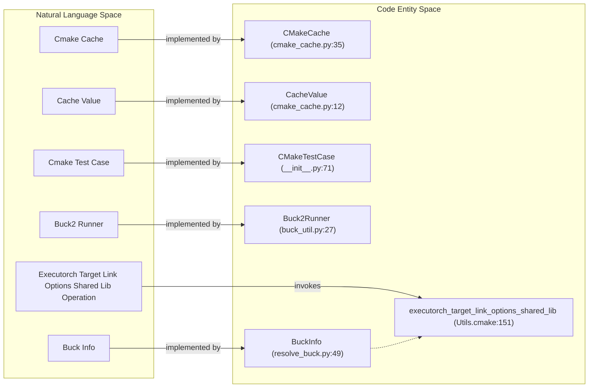
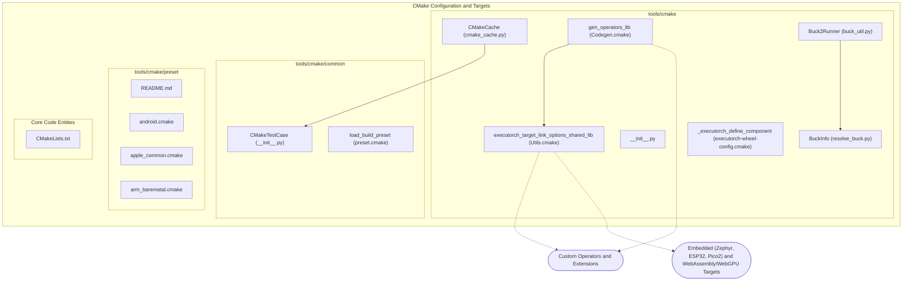
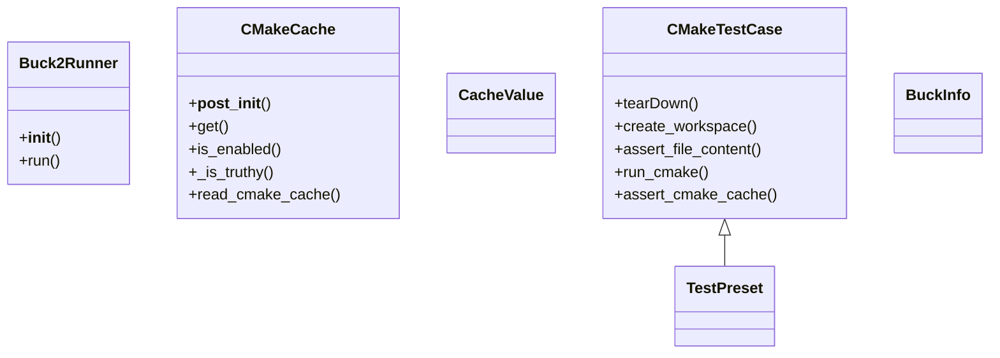
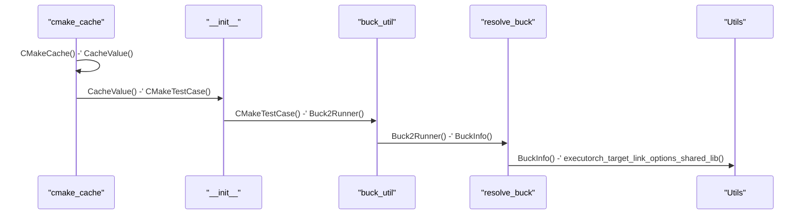

# CMake Configuration and Targets

↑ [[2-build-system-and-infrastructure|Build System and Infrastructure]]

> Architectural specification and implementation reference for CMake Configuration and Targets (17 relevant source files). Primary code entities: `CMakeCache`, `__post_init__`, `_is_truthy`, `get`, `_executorch_add_windows_anchor`.

<details>
<summary>Relevant source files</summary>

The following files were used as context for generating this wiki page:

- [tools/cmake/cmake_cache.py](tools/cmake/cmake_cache.py)
- [tools/cmake/Utils.cmake](tools/cmake/Utils.cmake)
- [tools/cmake/common/__init__.py](tools/cmake/common/__init__.py)
- [tools/cmake/Codegen.cmake](tools/cmake/Codegen.cmake)
- [tools/cmake/buck_util.py](tools/cmake/buck_util.py)
- [tools/cmake/__init__.py](tools/cmake/__init__.py)
- [tools/cmake/resolve_buck.py](tools/cmake/resolve_buck.py)
- [tools/cmake/common/preset.cmake](tools/cmake/common/preset.cmake)
- [tools/cmake/executorch-wheel-config.cmake](tools/cmake/executorch-wheel-config.cmake)
- [tools/cmake/preset/README.md](tools/cmake/preset/README.md)
- [docs/source/using-executorch-building-from-source.md](docs/source/using-executorch-building-from-source.md)
- [CMakeLists.txt](CMakeLists.txt)
- [tools/cmake/Test.cmake](tools/cmake/Test.cmake)
- [tools/cmake/executorch-config.cmake](tools/cmake/executorch-config.cmake)
- [tools/cmake/preset/android.cmake](tools/cmake/preset/android.cmake)
- [tools/cmake/preset/apple_common.cmake](tools/cmake/preset/apple_common.cmake)
- [tools/cmake/preset/arm_baremetal.cmake](tools/cmake/preset/arm_baremetal.cmake)

</details>

## Purpose and Scope

Architectural specification and implementation reference for CMake Configuration and Targets (17 relevant source files). Primary code entities: `CMakeCache`, `__post_init__`, `_is_truthy`, `get`, `_executorch_add_windows_anchor`.

Primary code entities analyzed on this page include `CMakeCache` ([tools/cmake/cmake_cache.py:35-72]()), `CacheValue` ([tools/cmake/cmake_cache.py:12-14]()), `CMakeTestCase` ([tools/cmake/common/__init__.py:71-143]()), `Buck2Runner` ([tools/cmake/buck_util.py:27-42]()), `BuckInfo` ([tools/cmake/resolve_buck.py:49-50]()).

For the parent architectural layer, see [[2-build-system-and-infrastructure|Build System and Infrastructure]]. Related sibling subsystems: [[2.2-kernel-libraries-and-selective-build|Kernel Libraries and Selective Build]], [[2.3-schema-generation-and-flatbuffers|Schema Generation and FlatBuffers]], [[2.4-python-bindings-and-dependencies|Python Bindings and Dependencies]], [[2.5-buck2-and-shim-build-layer|Buck2 and Shim Build Layer]].

Sources: [tools/cmake/cmake_cache.py:35-72](), [tools/cmake/cmake_cache.py:12-14](), [tools/cmake/common/__init__.py:71-143](), [tools/cmake/buck_util.py:27-42]()

---

## 1. High-Level Architecture and Data Flow

### Natural Language Space to Code Entity Space Mapping

The following diagram maps domain concepts in this subsystem to their concrete code entities:



### Subsystem Component & Dependency Flow



Cross-subsystem call and import edges connect **CMake Configuration and Targets** with [[6.3-custom-operators-and-extensions|Custom Operators and Extensions]] (coupling `5.0`), [[9.4-embedded-and-web-targets|Embedded (Zephyr, ESP32, Pico2) and WebAssembly/WebGPU Targets]] (coupling `2.0`).

| Module Directory | Files | Primary Code Entities | Source Citations |
|---|---|---|---|
| `tools/cmake` | 9 | `CMakeCache`, `CacheValue`, `Buck2Runner`, `BuckInfo` | [tools/cmake/cmake_cache.py:35-72]() [tools/cmake/cmake_cache.py:12-14]() |
| `tools/cmake/preset` | 4 | *(build / config)* | [tools/cmake/preset/README.md]() |
| `tools/cmake/common` | 2 | `CMakeTestCase`, `_create_file_tree`, `load_build_preset`, `announce_configured_options` | [tools/cmake/common/__init__.py:71-143]() [tools/cmake/common/__init__.py:55-68]() |
| `.` | 1 | *(build / config)* | [CMakeLists.txt]() |

Sources: [tools/cmake/cmake_cache.py:35-72](), [tools/cmake/cmake_cache.py:12-14](), [tools/cmake/common/__init__.py:71-143](), [tools/cmake/buck_util.py:27-42](), [tools/cmake/resolve_buck.py:49-50]()

---

## 2. Core Data Structures and Implementation Details

### Class and Entity Relationship Diagram



### `CMakeCache` (Class)

- **Source Location**: [tools/cmake/cmake_cache.py:35-72]()
- **Declaration**: `Class CMakeCache`
- **Graph Centrality**: fan-in `0` callers, fan-out `0` callees

```python
// tools/cmake/cmake_cache.py:35-50
class CMakeCache:
    # The path to the CMakeCache.txt file.
    cache_path: str

    def __post_init__(self):
        self.cache = CMakeCache.read_cmake_cache(cache_path=self.cache_path)

    def get(self, var: str) -> Optional[CacheValue]:
        return self.cache.get(var)

    def is_enabled(self, var: str, fallback: bool = False) -> bool:
        definition = self.get(var)
        if definition is None:
            return fallback
        return CMakeCache._is_truthy(definition.value)
```

### `CacheValue` (Class)

- **Source Location**: [tools/cmake/cmake_cache.py:12-14]()
- **Declaration**: `Class CacheValue`
- **Graph Centrality**: fan-in `0` callers, fan-out `0` callees

```python
// tools/cmake/cmake_cache.py:12-14
class CacheValue:
    value_type: str
    value: str
```

### `CMakeTestCase` (Class)

- **Source Location**: [tools/cmake/common/__init__.py:71-143]()
- **Declaration**: `Class CMakeTestCase`
- **Graph Centrality**: fan-in `0` callers, fan-out `0` callees

```python
// tools/cmake/common/__init__.py:71-86
class CMakeTestCase(unittest.TestCase):

    def tearDown(self) -> None:
        super().tearDown()

        if self.workspace and not _keep_workspace():
            shutil.rmtree(self.workspace)
            self.assertFalse(os.path.exists(self.workspace))

    def create_workspace(self, tree: Dict[Any, Any]) -> None:
        self.workspace = tempfile.mkdtemp()
        if _keep_workspace():
            print("created workspace", self.workspace)

        # Copy testable tree
        this_file_dir = os.path.dirname(os.path.abspath(__file__))
```

### `Buck2Runner` (Class)

- **Source Location**: [tools/cmake/buck_util.py:27-42]()
- **Declaration**: `Class Buck2Runner`
- **Graph Centrality**: fan-in `0` callers, fan-out `0` callees

### `BuckInfo` (Class)

- **Source Location**: [tools/cmake/resolve_buck.py:49-50]()
- **Declaration**: `Class BuckInfo`
- **Graph Centrality**: fan-in `0` callers, fan-out `0` callees

### `executorch_target_link_options_shared_lib` (Function)

- **Source Location**: [tools/cmake/Utils.cmake:151-196]()
- **Declaration**: `Function executorch_target_link_options_shared_lib`
- **Graph Centrality**: fan-in `2` callers, fan-out `0` callees
- **Responsibility**: # Ensure that the load-time constructor functions run. By default, the linker # would remove them since there are no other references to them.

Sources: [tools/cmake/cmake_cache.py:35-72](), [tools/cmake/cmake_cache.py:12-14](), [tools/cmake/common/__init__.py:71-143](), [tools/cmake/buck_util.py:27-42](), [tools/cmake/resolve_buck.py:49-50]()

---

## 3. Execution and Call Flow

The sequence diagram below traces the runtime/compile-time call chain across components in this module:



Sources: [tools/cmake/cmake_cache.py:35-72](), [tools/cmake/cmake_cache.py:12-14](), [tools/cmake/common/__init__.py:71-143](), [tools/cmake/buck_util.py:27-42](), [tools/cmake/resolve_buck.py:49-50]()

---

## 4. Key API and Symbol Reference

| Code Entity | Kind | Location | Fan-In / Out | Role & Signature |
|---|---|---|---|---|
| `CMakeCache` | Class | [tools/cmake/cmake_cache.py:35-72]() | `0` / `0` | — |
| `CacheValue` | Class | [tools/cmake/cmake_cache.py:12-14]() | `0` / `0` | — |
| `CMakeTestCase` | Class | [tools/cmake/common/__init__.py:71-143]() | `0` / `0` | — |
| `Buck2Runner` | Class | [tools/cmake/buck_util.py:27-42]() | `0` / `0` | — |
| `BuckInfo` | Class | [tools/cmake/resolve_buck.py:49-50]() | `0` / `0` | — |
| `executorch_target_link_options_shared_lib` | Function | [tools/cmake/Utils.cmake:151-196]() | `2` / `0` | # Ensure that the load-time constructor functions run. By default, the linker |
| `gen_operators_lib` | Function | [tools/cmake/Codegen.cmake:361-498]() | `1` / `0` | # Generate a runtime lib for registering operators in Executorch |
| `gen_selected_prim_ops_lib` | Function | [tools/cmake/Codegen.cmake:157-227]() | `1` / `0` | # Generate a prim ops registration library. By default the library includes only |
| `generate_bindings_for_kernels` | Function | [tools/cmake/Codegen.cmake:234-313]() | `1` / `0` | # Codegen for registering kernels. Kernels are defined in functions_yaml and |
| `_executorch_add_windows_anchor` | Function | [tools/cmake/Utils.cmake:523-541]() | `0` / `0` | # Mark a library as one the wheel ships, so it finds its siblings wherever it |
| `add_torch_to_cmake_prefix_path` | Function | [tools/cmake/Utils.cmake:264-271]() | `0` / `0` | # Add the Torch CMake configuration to CMAKE_PREFIX_PATH so that find_package |
| `executorch_add_pybind_module` | Function | [tools/cmake/Utils.cmake:764-792]() | `0` / `0` | # These Python extensions remain SHARED because other ET targets link them. On |
| `executorch_add_shared_library` | Function | [tools/cmake/Utils.cmake:726-758]() | `0` / `0` | # Create and install a shared library composed from dependency libraries. The |
| `executorch_kernel_link_options` | Function | [tools/cmake/Utils.cmake:51-59]() | `0` / `0` | # This is the funtion to use -Wl, --whole-archive to link static library NB: |
| `executorch_macos_kernel_link_options` | Function | [tools/cmake/Utils.cmake:62-67]() | `0` / `0` | # Same as executorch_kernel_link_options but it's for MacOS linker |
| `executorch_move_interface_include_directories_to_build_time_only` | Function | [tools/cmake/Utils.cmake:315-331]() | `0` / `0` | # Modify ${targetName}'s INTERFACE_INCLUDE_DIRECTORIES by wrapping each entry in |
| `executorch_msvc_kernel_link_options` | Function | [tools/cmake/Utils.cmake:70-75]() | `0` / `0` | # Same as executorch_kernel_link_options but it's for MSVC linker |
| `executorch_target_copy_mlx_metallib` | Function | [tools/cmake/Utils.cmake:361-379]() | `0` / `0` | # ----------------------------------------------------------------------------- |
| `executorch_target_link_shared_runtime` | Function | [tools/cmake/Utils.cmake:394-396]() | `0` / `0` | # Make a target resolve the ExecuTorch runtime from libexecutorch.so. |
| `executorch_target_retain_shared_library` | Function | [tools/cmake/Utils.cmake:405-503]() | `0` / `0` | # Put a shared library on a consumer's link line and keep it there. |
| `executorch_target_shared_runtime_path` | Function | [tools/cmake/Utils.cmake:609-678]() | `0` / `0` | # Give a target a runtime search path that reaches libexecutorch.so in both |
| `executorch_target_soname_policy` | Function | [tools/cmake/Utils.cmake:692-721]() | `0` / `0` | # Apply the SONAME policy for a library the project ships. |

Sources: [tools/cmake/cmake_cache.py:35-72](), [tools/cmake/cmake_cache.py:12-14](), [tools/cmake/common/__init__.py:71-143](), [tools/cmake/buck_util.py:27-42](), [tools/cmake/resolve_buck.py:49-50](), [tools/cmake/Utils.cmake:151-196]()

---

## 5. Official Documentation and Design Context

The following linked documentation sections from `llm-wiki` (`raw/`) provide additional architectural context, tutorials, and design invariants for this subsystem:

- **Build System and Infrastructure** ([wiki/2-build-system-and-infrastructure.md](), score `152.0446`) (sections: `Build System and Infrastructure`, `Purpose and Scope`, `System Mapping: Natural Language Space to Code Entity Space`, `1. CMake Configuration and Targets`): # Build System and Infrastructure > Architectural specification and implementation reference for Build System and Infrastructure (38 relevant source files). Primary code entities: `CMakeCache`, `__post_init__`, `_is_truthy`, `get`, `_executorch_add_windows_anchor`. <details> <summary>Relevant source files</summary> The following files were used as context for generating this wiki page: - [tools/cmake/cmake_cache.py](
- **ExecuTorch DeepWiki** ([wiki/index.md](), score `127.9339`) (sections: `ExecuTorch DeepWiki`, `Pages`): # ExecuTorch DeepWiki Generated from `home-jason-Project-deepwiki-executorch` at commit `b3b565b5b62f` (2026-11-15T15:02:11+00:00). ## Pages - [[1-overview|Overview]] — Architectural specification and implementation reference for Overview (10 relevant source files). Primary code entities: `Module`, `MethodHolder`, `PlannedMemory`, `EdgeProgramManager`, `__init__`. - [[1.1-getting-started|Getting Started]] — Architect
- **Buck2 and Shim Build Layer** ([wiki/2.5-buck2-and-shim-build-layer.md](), score `104.1932`) (sections: `Buck2 and Shim Build Layer`, `Purpose and Scope`, `1. High-Level Architecture and Data Flow`, `Natural Language Space to Code Entity Space Mapping`): # Buck2 and Shim Build Layer ↑ [[2-build-system-and-infrastructure|Build System and Infrastructure]] > Architectural specification and implementation reference for Buck2 and Shim Build Layer (30 relevant source files). Primary code entities: `ggml_ci_labels`, `define_common_targets`, `_extract_prim_ops_from_lists`, `_get_headers`, `_get_prim_ops_registry_target`. <details> <summary>Relevant source files</summary> The
- **Kernel Registration** ([kernel-library-custom-aten-kernel.md](), score `86.2322`) (sections: `Kernel Registration`, `Overview`, `Kernel Libraries`, `First-party kernel libraries:`): # Kernel Registration ## Overview At the last stage of [ExecuTorch model exporting](export-overview.md), we lower the operators in the dialect to the _out variants_ of the [core ATen operators](ir-ops-set-definition.md). Then we serialize these operator names into the model artifact. During runtime execution, for each operator name we will need to find the actual _kernels_, i.e., the C++ functions that do the heavy-l

Sources: [wiki/2-build-system-and-infrastructure.md](), [wiki/index.md](), [wiki/2.5-buck2-and-shim-build-layer.md](), [kernel-library-custom-aten-kernel.md]()

## Related pages

- [[2-build-system-and-infrastructure|Build System and Infrastructure]]
- [[1.1-getting-started|Getting Started]]
- [[1.2-export-api-and-recipe-system|Export API and Recipe System]]
- [[2.2-kernel-libraries-and-selective-build|Kernel Libraries and Selective Build]]
- [[2.3-schema-generation-and-flatbuffers|Schema Generation and FlatBuffers]]
- [[3.4-program-emission-and-serialization|Program Emission and Serialization]]
- [[3.5-verification-and-dialect-system|Verification and Dialect System]]
- [[4-quantization-systems|Quantization Systems]]

## Related documents

- `wiki/2-build-system-and-infrastructure.md` — Build System and Infrastructure (score 152.0446, via bm25)
- `wiki/index.md` — ExecuTorch DeepWiki (score 127.9339, via bm25)
- `wiki/2.5-buck2-and-shim-build-layer.md` — Buck2 and Shim Build Layer (score 104.1932, via bm25)
- `raw/executorch/kernel-library-custom-aten-kernel.md` — Kernel Registration (score 86.2322, via bm25)
- `wiki/2.2-kernel-libraries-and-selective-build.md` — Kernel Libraries and Selective Build (score 85.4552, via bm25)

## Sources

- [`tools/cmake/cmake_cache.py`](https://github.com/pytorch/executorch/blob/main/tools/cmake/cmake_cache.py)
- [`tools/cmake/Utils.cmake`](https://github.com/pytorch/executorch/blob/main/tools/cmake/Utils.cmake)
- [`tools/cmake/common/__init__.py`](https://github.com/pytorch/executorch/blob/main/tools/cmake/common/__init__.py)
- [`tools/cmake/Codegen.cmake`](https://github.com/pytorch/executorch/blob/main/tools/cmake/Codegen.cmake)
- [`tools/cmake/buck_util.py`](https://github.com/pytorch/executorch/blob/main/tools/cmake/buck_util.py)
- [`tools/cmake/__init__.py`](https://github.com/pytorch/executorch/blob/main/tools/cmake/__init__.py)
- [`tools/cmake/resolve_buck.py`](https://github.com/pytorch/executorch/blob/main/tools/cmake/resolve_buck.py)
- [`tools/cmake/common/preset.cmake`](https://github.com/pytorch/executorch/blob/main/tools/cmake/common/preset.cmake)
- [`tools/cmake/executorch-wheel-config.cmake`](https://github.com/pytorch/executorch/blob/main/tools/cmake/executorch-wheel-config.cmake)
- [`tools/cmake/preset/README.md`](https://github.com/pytorch/executorch/blob/main/tools/cmake/preset/README.md)
- [`docs/source/using-executorch-building-from-source.md`](https://github.com/pytorch/executorch/blob/main/docs/source/using-executorch-building-from-source.md)
- [`CMakeLists.txt`](https://github.com/pytorch/executorch/blob/main/CMakeLists.txt)
- [`tools/cmake/Test.cmake`](https://github.com/pytorch/executorch/blob/main/tools/cmake/Test.cmake)
- [`tools/cmake/executorch-config.cmake`](https://github.com/pytorch/executorch/blob/main/tools/cmake/executorch-config.cmake)
- [`tools/cmake/preset/android.cmake`](https://github.com/pytorch/executorch/blob/main/tools/cmake/preset/android.cmake)
- [`tools/cmake/preset/apple_common.cmake`](https://github.com/pytorch/executorch/blob/main/tools/cmake/preset/apple_common.cmake)
- [`tools/cmake/preset/arm_baremetal.cmake`](https://github.com/pytorch/executorch/blob/main/tools/cmake/preset/arm_baremetal.cmake)


## Dynamic Knowledge Links (Code Graph ↔ LLM-Wiki / RAG)

### Linked Architecture & Design Documents

| Document | Match Channel | Score | Shared Code Symbols |
|---|---|---|---|
| [[2-build-system-and-infrastructure|Build System and Infrastructure]] | `bm25` | `152.045` | *(lexical/graph match)* |
| [[index|ExecuTorch DeepWiki]] | `bm25` | `127.934` | *(lexical/graph match)* |
| [[2.3-schema-generation-and-flatbuffers|Schema Generation and FlatBuffers]] | `wikilink:2.1-cmake-configuration-and-targets` | `104.88` | *(lexical/graph match)* |
| [[2.4-python-bindings-and-dependencies|Python Bindings and Dependencies]] | `wikilink:2.1-cmake-configuration-and-targets` | `104.88` | *(lexical/graph match)* |
| [[6.3-custom-operators-and-extensions|Custom Operators and Extensions]] | `wikilink:2.1-cmake-configuration-and-targets` | `104.88` | *(lexical/graph match)* |
| [[2.5-buck2-and-shim-build-layer|Buck2 and Shim Build Layer]] | `bm25` | `104.193` | *(lexical/graph match)* |

### High-Centrality Bridge Symbols (CBM Graph)

| Symbol | Kind | Source Location | Fan-In / Fan-Out |
|---|---|---|---|
| `CMakeCache` | Class | [tools/cmake/cmake_cache.py:35-72]() | in: `0` / out: `0` |
| `CacheValue` | Class | [tools/cmake/cmake_cache.py:12-14]() | in: `0` / out: `0` |
| `CMakeTestCase` | Class | [tools/cmake/common/__init__.py:71-143]() | in: `0` / out: `0` |
| `Buck2Runner` | Class | [tools/cmake/buck_util.py:27-42]() | in: `0` / out: `0` |
| `BuckInfo` | Class | [tools/cmake/resolve_buck.py:49-50]() | in: `0` / out: `0` |
| `executorch_target_link_options_shared_lib` | Function | [tools/cmake/Utils.cmake:151-196]() | in: `2` / out: `0` |

Sources: [tools/cmake/cmake_cache.py:35-72](), [tools/cmake/cmake_cache.py:12-14](), [tools/cmake/common/__init__.py:71-143](), [tools/cmake/buck_util.py:27-42]()

### Cross-Subsystem Coupling

- [[6.3-custom-operators-and-extensions|Custom Operators and Extensions]] — call/import coupling weight `5.0`
- [[9.4-embedded-and-web-targets|Embedded (Zephyr, ESP32, Pico2) and WebAssembly/WebGPU Targets]] — call/import coupling weight `2.0`
