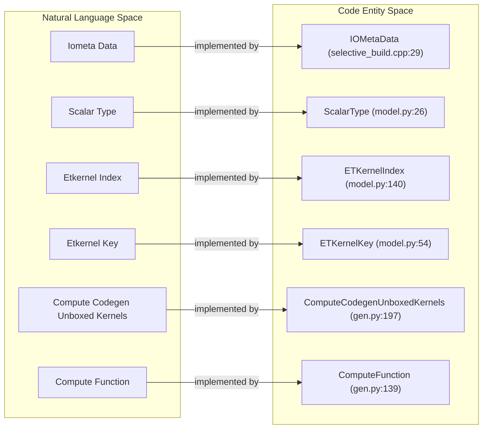
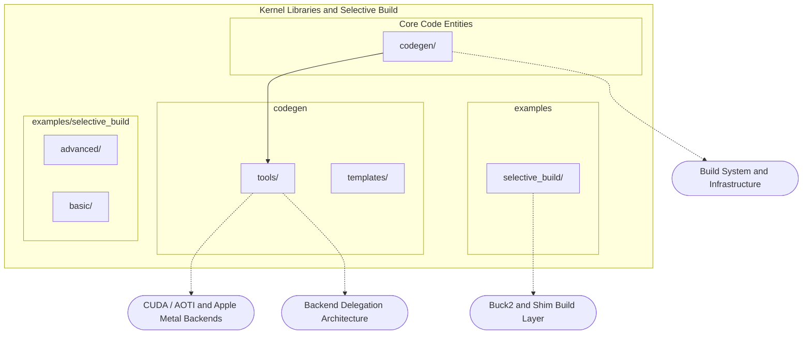
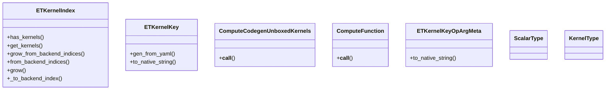
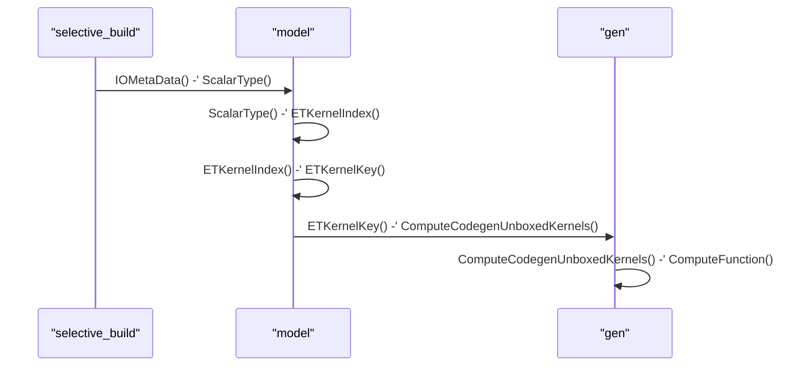

# Kernel Libraries and Selective Build

↑ [[2-build-system-and-infrastructure|Build System and Infrastructure]]

> Architectural specification and implementation reference for Kernel Libraries and Selective Build (31 relevant source files). Primary code entities: `KernelType`, `ScalarType`, `_dump_yaml`, `_get_et_kernel_metadata_from_ops_yaml`, `IOMetaData`.

<details>
<summary>Relevant source files</summary>

The following files were used as context for generating this wiki page:

- [codegen/tools/gen_oplist.py](codegen/tools/gen_oplist.py)
- [codegen/tools/selective_build.cpp](codegen/tools/selective_build.cpp)
- [codegen/gen.py](codegen/gen.py)
- [codegen/tools/merge_yaml.py](codegen/tools/merge_yaml.py)
- [codegen/model.py](codegen/model.py)
- [codegen/tools/gen_all_oplist.py](codegen/tools/gen_all_oplist.py)
- [codegen/tools/combine_prim_ops_headers.py](codegen/tools/combine_prim_ops_headers.py)
- [codegen/tools/gen_max_kernel_num.py](codegen/tools/gen_max_kernel_num.py)
- [codegen/tools/__init__.py](codegen/tools/__init__.py)
- [codegen/tools/gen_ops_def.py](codegen/tools/gen_ops_def.py)
- [codegen/tools/gen_selected_prim_ops.py](codegen/tools/gen_selected_prim_ops.py)
- [codegen/tools/gen_selected_op_variants.py](codegen/tools/gen_selected_op_variants.py)
- [codegen/tools/yaml_util.py](codegen/tools/yaml_util.py)
- [codegen/tools/targets.bzl](codegen/tools/targets.bzl)
- [codegen/templates/Functions.h](codegen/templates/Functions.h)
- [codegen/parse.py](codegen/parse.py)
- [codegen/templates/NativeFunctions.h](codegen/templates/NativeFunctions.h)
- [codegen/templates/RegisterCodegenUnboxedKernels.cpp](codegen/templates/RegisterCodegenUnboxedKernels.cpp)
- [codegen/templates/RegisterDispatchKeyCustomOps.cpp](codegen/templates/RegisterDispatchKeyCustomOps.cpp)
- [codegen/templates/RegisterKernels.cpp](codegen/templates/RegisterKernels.cpp)
- [codegen/templates/RegisterKernels.h](codegen/templates/RegisterKernels.h)
- [codegen/templates/RegisterSchema.cpp](codegen/templates/RegisterSchema.cpp)
- [codegen/templates/aten_interned_strings.h](codegen/templates/aten_interned_strings.h)
- [examples/selective_build/targets.bzl](examples/selective_build/targets.bzl)
- [examples/selective_build/README.md](examples/selective_build/README.md)
- [docs/source/kernel-library-selective-build.md](docs/source/kernel-library-selective-build.md)
- [codegen/tools/BUCK](codegen/tools/BUCK)
- [codegen/tools/CMakeLists.txt](codegen/tools/CMakeLists.txt)
- [examples/selective_build/BUCK](examples/selective_build/BUCK)
- [examples/selective_build/advanced/CMakeLists.txt](examples/selective_build/advanced/CMakeLists.txt)
- [examples/selective_build/basic/CMakeLists.txt](examples/selective_build/basic/CMakeLists.txt)

</details>

## Purpose and Scope

Architectural specification and implementation reference for Kernel Libraries and Selective Build (31 relevant source files). Primary code entities: `KernelType`, `ScalarType`, `_dump_yaml`, `_get_et_kernel_metadata_from_ops_yaml`, `IOMetaData`.

Primary code entities analyzed on this page include `IOMetaData` ([codegen/tools/selective_build.cpp:29-52]()), `ScalarType` ([codegen/model.py:26-34]()), `ETKernelIndex` ([codegen/model.py:140-220]()), `ETKernelKey` ([codegen/model.py:54-136]()), `ComputeCodegenUnboxedKernels` ([codegen/gen.py:197-321]()).

For the parent architectural layer, see [[2-build-system-and-infrastructure|Build System and Infrastructure]]. Related sibling subsystems: [[2.1-cmake-configuration-and-targets|CMake Configuration and Targets]], [[2.3-schema-generation-and-flatbuffers|Schema Generation and FlatBuffers]], [[2.4-python-bindings-and-dependencies|Python Bindings and Dependencies]], [[2.5-buck2-and-shim-build-layer|Buck2 and Shim Build Layer]].

Sources: [codegen/tools/selective_build.cpp:29-52](), [codegen/model.py:26-34](), [codegen/model.py:140-220](), [codegen/model.py:54-136]()

---

## 1. High-Level Architecture and Data Flow

### Natural Language Space to Code Entity Space Mapping

The following diagram maps domain concepts in this subsystem to their concrete code entities:



### Subsystem Component & Dependency Flow



Cross-subsystem call and import edges connect **Kernel Libraries and Selective Build** with [[2.5-buck2-and-shim-build-layer|Buck2 and Shim Build Layer]] (coupling `6.0`), [[5.7-cuda-aoti-and-apple-metal-backends|CUDA / AOTI and Apple Metal Backends]] (coupling `4.0`), [[5-backend-delegation-architecture|Backend Delegation Architecture]] (coupling `4.0`), [[5.2-vulkan-gpu-backend|Vulkan GPU Backend]] (coupling `4.0`), [[2-build-system-and-infrastructure|Build System and Infrastructure]] (coupling `3.0`).

| Module Directory | Files | Primary Code Entities | Source Citations |
|---|---|---|---|
| `codegen/tools` | 14 | `IOMetaData`, `KernelType`, `ScalarType`, `KernelIOMetaDataComparsion` | [codegen/tools/selective_build.cpp:29-52]() [codegen/tools/gen_oplist.py:83-86]() |
| `codegen/templates` | 8 | `register_all_kernels`, `TORCH_LIBRARY_FRAGMENT` | [codegen/templates/RegisterKernels.cpp:19-30]() [codegen/templates/RegisterSchema.cpp:14-16]() |
| `codegen` | 3 | `ScalarType`, `ETKernelIndex`, `ETKernelKey`, `ComputeCodegenUnboxedKernels` | [codegen/model.py:26-34]() [codegen/model.py:140-220]() |
| `examples/selective_build` | 3 | `define_common_targets`, `define_selective_build_prim_ops_example` | [examples/selective_build/targets.bzl:116-281]() [examples/selective_build/targets.bzl:4-114]() |
| `examples/selective_build/advanced` | 1 | *(build / config)* | [examples/selective_build/advanced/CMakeLists.txt]() |
| `examples/selective_build/basic` | 1 | *(build / config)* | [examples/selective_build/basic/CMakeLists.txt]() |

Sources: [codegen/tools/selective_build.cpp:29-52](), [codegen/model.py:26-34](), [codegen/model.py:140-220](), [codegen/model.py:54-136](), [codegen/gen.py:197-321]()

---

## 2. Core Data Structures and Implementation Details

### Class and Entity Relationship Diagram



### `IOMetaData` (Class)

- **Source Location**: [codegen/tools/selective_build.cpp:29-52]()
- **Declaration**: `Class IOMetaData`
- **Graph Centrality**: fan-in `0` callers, fan-out `0` callees
- **Responsibility**: // Metadata for kernel call io variables. // dtype and dim_order will exist only if corresponding variable is Tensor.

```cpp
// codegen/tools/selective_build.cpp:29-44
struct IOMetaData {
  int kernel_type;
  int dtype;
  std::vector<unsigned int> dim_order;

  // Create tensor metadata. It records tensor's dtype and dim order.
  explicit IOMetaData(const executorch_flatbuffer::Tensor* t)
      : kernel_type(
            static_cast<int>(executorch_flatbuffer::KernelTypes::Tensor)),
        dtype(static_cast<int>(t->scalar_type())) {
    for (size_t i = 0; i < t->dim_order()->size(); i++) {
      dim_order.push_back(static_cast<unsigned int>(t->dim_order()->Get(i)));
    }
  }

  // Create metadata for non-tensor variable.
```

### `ScalarType` (Class)

- **Source Location**: [codegen/model.py:26-34]()
- **Declaration**: `Class ScalarType`
- **Graph Centrality**: fan-in `0` callers, fan-out `0` callees
- **Responsibility**: # TODO: Duplicated Subset from codegen.tool.gen_oplist, remove declaration in codegen

```python
// codegen/model.py:26-34
class ScalarType(IntEnum):
    Byte = 0
    Char = 1
    Short = 2
    Int = 3
    Long = 4
    Float = 6
    Double = 7
    Bool = 11
```

### `ETKernelIndex` (Class)

- **Source Location**: [codegen/model.py:140-220]()
- **Declaration**: `Class ETKernelIndex`
- **Graph Centrality**: fan-in `4` callers, fan-out `0` callees

```python
// codegen/model.py:140-155
class ETKernelIndex:
    index: dict[OperatorName, dict[ETKernelKey, BackendMetadata]]

    def has_kernels(self, g: NativeFunction | NativeFunctionsGroup) -> bool:
        m = self.get_kernels(g)
        return m is not None

    def get_kernels(
        self, g: NativeFunction | NativeFunctionsGroup
    ) -> dict[ETKernelKey, BackendMetadata]:
        if isinstance(g, NativeFunction):
            f = g
        elif isinstance(g, NativeFunctionsGroup):
            f = g.functional
        else:
            assert_never(g)
```

### `ETKernelKey` (Class)

- **Source Location**: [codegen/model.py:54-136]()
- **Declaration**: `Class ETKernelKey`
- **Graph Centrality**: fan-in `4` callers, fan-out `0` callees

### `ComputeCodegenUnboxedKernels` (Class)

- **Source Location**: [codegen/gen.py:197-321]()
- **Declaration**: `Class ComputeCodegenUnboxedKernels`
- **Graph Centrality**: fan-in `1` callers, fan-out `0` callees

### `_get_io_metadata_for_program_operators` (Function)

- **Source Location**: [codegen/tools/selective_build.cpp:242-278]()
- **Declaration**: `( const executorch_flatbuffer::Program* program)`
- **Graph Centrality**: fan-in `0` callers, fan-out `7` callees
- **Responsibility**: // expose IO metadatas for all operators in given program

Sources: [codegen/tools/selective_build.cpp:29-52](), [codegen/model.py:26-34](), [codegen/model.py:140-220](), [codegen/model.py:54-136](), [codegen/gen.py:197-321]()

---

## 3. Execution and Call Flow

The sequence diagram below traces the runtime/compile-time call chain across components in this module:



Sources: [codegen/tools/selective_build.cpp:29-52](), [codegen/model.py:26-34](), [codegen/model.py:140-220](), [codegen/model.py:54-136](), [codegen/gen.py:197-321]()

---

## 4. Key API and Symbol Reference

| Code Entity | Kind | Location | Fan-In / Out | Role & Signature |
|---|---|---|---|---|
| `IOMetaData` | Class | [codegen/tools/selective_build.cpp:29-52]() | `0` / `0` | // Metadata for kernel call io variables. |
| `ScalarType` | Class | [codegen/model.py:26-34]() | `0` / `0` | # TODO: Duplicated Subset from codegen.tool.gen_oplist, remove declaration in codegen |
| `ETKernelIndex` | Class | [codegen/model.py:140-220]() | `4` / `0` | — |
| `ETKernelKey` | Class | [codegen/model.py:54-136]() | `4` / `0` | — |
| `ComputeCodegenUnboxedKernels` | Class | [codegen/gen.py:197-321]() | `1` / `0` | — |
| `ComputeFunction` | Class | [codegen/gen.py:139-192]() | `1` / `0` | — |
| `ETKernelKeyOpArgMeta` | Class | [codegen/model.py:41-50]() | `1` / `0` | — |
| `KernelType` | Class | [codegen/tools/gen_oplist.py:83-86]() | `0` / `0` | — |
| `ScalarType` | Class | [codegen/tools/gen_oplist.py:60-80]() | `0` / `0` | — |
| `KernelIOMetaDataComparsion` | Class | [codegen/tools/selective_build.cpp:54-78]() | `0` / `0` | — |
| `BlankLineDumper` | Class | [codegen/tools/merge_yaml.py:21-26]() | `0` / `0` | — |
| `BlankLineDumper` | Class | [codegen/tools/yaml_util.py:10-15]() | `0` / `0` | — |
| `_get_io_metadata_for_program_operators` | Function | [codegen/tools/selective_build.cpp:242-278]() | `0` / `7` | // expose IO metadatas for all operators in given program |
| `generate` | Function | [codegen/gen.py:869-968]() | `1` / `4` | Generates the operator headers and registration sources into install_dir. |
| `gen_oplist` | Function | [codegen/tools/gen_oplist.py:216-286]() | `4` / `6` | ( output_path: Path, model_file_path: Optional[str] = None, ops_schema_yaml_path: Optional[str] = None, root_o |
| `_sig_decl_wrapper` | Function | [codegen/gen.py:82-95]() | `2` / `0` | A wrapper function to basically get `sig.decl(include_context=True)`. |
| `gen_headers` | Function | [codegen/gen.py:479-579]() | `1` / `2` | Generate headers. |
| `parse_yaml_files` | Function | [codegen/gen.py:799-866]() | `1` / `2` | Parses functions.yaml and custom_ops.yaml files. |
| `gen_all_oplist` | Function | [codegen/tools/gen_all_oplist.py:145-178]() | `1` / `3` | Combines selected_operators.yaml files into output_dir/selected_operators.yaml. |
| `gen_functions_declarations` | Function | [codegen/gen.py:394-445]() | `1` / `1` | Generates namespace separated C++ function API inline declaration/definitions. |
| `static_dispatch` | Function | [codegen/gen.py:98-133]() | `1` / `1` | For a given `NativeFunction`, find out the corresponding native function and dispatch to it. If zero or more t |
| `translate_native_yaml` | Function | [codegen/gen.py:643-739]() | `1` / `1` | Translates Executorch DSL dialect to use the same syntax as |

Sources: [codegen/tools/selective_build.cpp:29-52](), [codegen/model.py:26-34](), [codegen/model.py:140-220](), [codegen/model.py:54-136](), [codegen/gen.py:197-321](), [codegen/gen.py:139-192]()

---

## 5. Official Documentation and Design Context

The following linked documentation sections from `llm-wiki` (`raw/`) provide additional architectural context, tutorials, and design invariants for this subsystem:

- **Build System and Infrastructure** ([wiki/2-build-system-and-infrastructure.md](), score `118.8366`) (sections: `Build System and Infrastructure`, `Purpose and Scope`, `System Mapping: Natural Language Space to Code Entity Space`, `1. CMake Configuration and Targets`): # Build System and Infrastructure > Architectural specification and implementation reference for Build System and Infrastructure (38 relevant source files). Primary code entities: `CMakeCache`, `__post_init__`, `_is_truthy`, `get`, `_executorch_add_windows_anchor`. <details> <summary>Relevant source files</summary> The following files were used as context for generating this wiki page: - [tools/cmake/cmake_cache.py](
- **ExecuTorch DeepWiki** ([wiki/index.md](), score `103.9999`) (sections: `ExecuTorch DeepWiki`, `Pages`): # ExecuTorch DeepWiki Generated from `home-jason-Project-deepwiki-executorch` at commit `b3b565b5b62f` (2026-11-15T15:02:11+00:00). ## Pages - [[1-overview|Overview]] — Architectural specification and implementation reference for Overview (10 relevant source files). Primary code entities: `Module`, `MethodHolder`, `PlannedMemory`, `EdgeProgramManager`, `__init__`. - [[1.1-getting-started|Getting Started]] — Architect
- **Kernel Registration and Dispatch** ([wiki/8.2-kernel-registration-and-dispatch.md](), score `92.594`) (sections: `Kernel Registration and Dispatch`, `Purpose and Scope`, `1. High-Level Architecture and Data Flow`, `Natural Language Space to Code Entity Space Mapping`): # Kernel Registration and Dispatch ↑ [[8-runtime-execution|Runtime Execution]] > Architectural specification and implementation reference for Kernel Registration and Dispatch (36 relevant source files). Primary code entities: `KernelRuntimeContext`, `allocate_temp`, `fail`, `Kernel`, `KernelKey`. <details> <summary>Relevant source files</summary> The following files were used as context for generating this wiki page:
- **Buck2 and Shim Build Layer** ([wiki/2.5-buck2-and-shim-build-layer.md](), score `90.5924`) (sections: `Buck2 and Shim Build Layer`, `Purpose and Scope`, `1. High-Level Architecture and Data Flow`, `Natural Language Space to Code Entity Space Mapping`): # Buck2 and Shim Build Layer ↑ [[2-build-system-and-infrastructure|Build System and Infrastructure]] > Architectural specification and implementation reference for Buck2 and Shim Build Layer (30 relevant source files). Primary code entities: `ggml_ci_labels`, `define_common_targets`, `_extract_prim_ops_from_lists`, `_get_headers`, `_get_prim_ops_registry_target`. <details> <summary>Relevant source files</summary> The

Sources: [wiki/2-build-system-and-infrastructure.md](), [wiki/index.md](), [wiki/8.2-kernel-registration-and-dispatch.md](), [wiki/2.5-buck2-and-shim-build-layer.md]()

## Related pages

- [[2-build-system-and-infrastructure|Build System and Infrastructure]]
- [[1.2-export-api-and-recipe-system|Export API and Recipe System]]
- [[2.3-schema-generation-and-flatbuffers|Schema Generation and FlatBuffers]]
- [[3-exir-core-system|EXIR Core System]]
- [[3.1-program-structure-and-compilation-flow|Program Structure and Compilation Flow]]
- [[3.2-graph-transformation-pass-system|Graph Transformation Pass System]]
- [[3.3-memory-planning-and-allocation|Memory Planning and Allocation]]
- [[3.4-program-emission-and-serialization|Program Emission and Serialization]]

## Related documents

- `wiki/2-build-system-and-infrastructure.md` — Build System and Infrastructure (score 118.8366, via bm25)
- `wiki/index.md` — ExecuTorch DeepWiki (score 103.9999, via bm25)
- `wiki/8.2-kernel-registration-and-dispatch.md` — Kernel Registration and Dispatch (score 92.594, via bm25)
- `wiki/2.5-buck2-and-shim-build-layer.md` — Buck2 and Shim Build Layer (score 90.5924, via bm25)
- `raw/executorch/kernel-library-custom-aten-kernel.md` — Kernel Registration (score 72.2618, via bm25)

## Sources

- [`codegen/tools/gen_oplist.py`](https://github.com/pytorch/executorch/blob/main/codegen/tools/gen_oplist.py)
- [`codegen/tools/selective_build.cpp`](https://github.com/pytorch/executorch/blob/main/codegen/tools/selective_build.cpp)
- [`codegen/gen.py`](https://github.com/pytorch/executorch/blob/main/codegen/gen.py)
- [`codegen/tools/merge_yaml.py`](https://github.com/pytorch/executorch/blob/main/codegen/tools/merge_yaml.py)
- [`codegen/model.py`](https://github.com/pytorch/executorch/blob/main/codegen/model.py)
- [`codegen/tools/gen_all_oplist.py`](https://github.com/pytorch/executorch/blob/main/codegen/tools/gen_all_oplist.py)
- [`codegen/tools/combine_prim_ops_headers.py`](https://github.com/pytorch/executorch/blob/main/codegen/tools/combine_prim_ops_headers.py)
- [`codegen/tools/gen_max_kernel_num.py`](https://github.com/pytorch/executorch/blob/main/codegen/tools/gen_max_kernel_num.py)
- [`codegen/tools/__init__.py`](https://github.com/pytorch/executorch/blob/main/codegen/tools/__init__.py)
- [`codegen/tools/gen_ops_def.py`](https://github.com/pytorch/executorch/blob/main/codegen/tools/gen_ops_def.py)
- [`codegen/tools/gen_selected_prim_ops.py`](https://github.com/pytorch/executorch/blob/main/codegen/tools/gen_selected_prim_ops.py)
- [`codegen/tools/gen_selected_op_variants.py`](https://github.com/pytorch/executorch/blob/main/codegen/tools/gen_selected_op_variants.py)
- [`codegen/tools/yaml_util.py`](https://github.com/pytorch/executorch/blob/main/codegen/tools/yaml_util.py)
- [`codegen/tools/targets.bzl`](https://github.com/pytorch/executorch/blob/main/codegen/tools/targets.bzl)
- [`codegen/templates/Functions.h`](https://github.com/pytorch/executorch/blob/main/codegen/templates/Functions.h)
- [`codegen/parse.py`](https://github.com/pytorch/executorch/blob/main/codegen/parse.py)
- [`codegen/templates/NativeFunctions.h`](https://github.com/pytorch/executorch/blob/main/codegen/templates/NativeFunctions.h)
- [`codegen/templates/RegisterCodegenUnboxedKernels.cpp`](https://github.com/pytorch/executorch/blob/main/codegen/templates/RegisterCodegenUnboxedKernels.cpp)
- [`codegen/templates/RegisterDispatchKeyCustomOps.cpp`](https://github.com/pytorch/executorch/blob/main/codegen/templates/RegisterDispatchKeyCustomOps.cpp)
- [`codegen/templates/RegisterKernels.cpp`](https://github.com/pytorch/executorch/blob/main/codegen/templates/RegisterKernels.cpp)
- [`codegen/templates/RegisterKernels.h`](https://github.com/pytorch/executorch/blob/main/codegen/templates/RegisterKernels.h)
- [`codegen/templates/RegisterSchema.cpp`](https://github.com/pytorch/executorch/blob/main/codegen/templates/RegisterSchema.cpp)
- [`codegen/templates/aten_interned_strings.h`](https://github.com/pytorch/executorch/blob/main/codegen/templates/aten_interned_strings.h)
- [`examples/selective_build/targets.bzl`](https://github.com/pytorch/executorch/blob/main/examples/selective_build/targets.bzl)
- [`examples/selective_build/README.md`](https://github.com/pytorch/executorch/blob/main/examples/selective_build/README.md)
- [`docs/source/kernel-library-selective-build.md`](https://github.com/pytorch/executorch/blob/main/docs/source/kernel-library-selective-build.md)
- [`codegen/tools/BUCK`](https://github.com/pytorch/executorch/blob/main/codegen/tools/BUCK)
- [`codegen/tools/CMakeLists.txt`](https://github.com/pytorch/executorch/blob/main/codegen/tools/CMakeLists.txt)
- [`examples/selective_build/BUCK`](https://github.com/pytorch/executorch/blob/main/examples/selective_build/BUCK)
- [`examples/selective_build/advanced/CMakeLists.txt`](https://github.com/pytorch/executorch/blob/main/examples/selective_build/advanced/CMakeLists.txt)
- [`examples/selective_build/basic/CMakeLists.txt`](https://github.com/pytorch/executorch/blob/main/examples/selective_build/basic/CMakeLists.txt)


## Dynamic Knowledge Links (Code Graph ↔ LLM-Wiki / RAG)

### Linked Architecture & Design Documents

| Document | Match Channel | Score | Shared Code Symbols |
|---|---|---|---|
| [[2-build-system-and-infrastructure|Build System and Infrastructure]] | `bm25+entity(2)` | `121.837` | `ETKernelIndex`, `ETKernelKey` |
| [[index|ExecuTorch DeepWiki]] | `bm25` | `104.0` | *(lexical/graph match)* |
| [[2.1-cmake-configuration-and-targets|CMake Configuration and Targets]] | `wikilink:2.2-kernel-libraries-and-selective-build` | `101.535` | *(lexical/graph match)* |
| [[2.3-schema-generation-and-flatbuffers|Schema Generation and FlatBuffers]] | `wikilink:2.2-kernel-libraries-and-selective-build` | `101.535` | *(lexical/graph match)* |
| [[2.4-python-bindings-and-dependencies|Python Bindings and Dependencies]] | `wikilink:2.2-kernel-libraries-and-selective-build` | `101.535` | *(lexical/graph match)* |
| [[8.2-kernel-registration-and-dispatch|Kernel Registration and Dispatch]] | `bm25` | `92.594` | *(lexical/graph match)* |

### High-Centrality Bridge Symbols (CBM Graph)

| Symbol | Kind | Source Location | Fan-In / Fan-Out |
|---|---|---|---|
| `IOMetaData` | Class | [codegen/tools/selective_build.cpp:29-52]() | in: `0` / out: `0` |
| `ScalarType` | Class | [codegen/model.py:26-34]() | in: `0` / out: `0` |
| `ETKernelIndex` | Class | [codegen/model.py:140-220]() | in: `4` / out: `0` |
| `ETKernelKey` | Class | [codegen/model.py:54-136]() | in: `4` / out: `0` |
| `ComputeCodegenUnboxedKernels` | Class | [codegen/gen.py:197-321]() | in: `1` / out: `0` |
| `ComputeFunction` | Class | [codegen/gen.py:139-192]() | in: `1` / out: `0` |

Sources: [codegen/tools/selective_build.cpp:29-52](), [codegen/model.py:26-34](), [codegen/model.py:140-220](), [codegen/model.py:54-136]()

### Cross-Subsystem Coupling

- [[2.5-buck2-and-shim-build-layer|Buck2 and Shim Build Layer]] — call/import coupling weight `6.0`
- [[5.7-cuda-aoti-and-apple-metal-backends|CUDA / AOTI and Apple Metal Backends]] — call/import coupling weight `4.0`
- [[5-backend-delegation-architecture|Backend Delegation Architecture]] — call/import coupling weight `4.0`
- [[5.2-vulkan-gpu-backend|Vulkan GPU Backend]] — call/import coupling weight `4.0`
- [[2-build-system-and-infrastructure|Build System and Infrastructure]] — call/import coupling weight `3.0`
- [[1.2-export-api-and-recipe-system|Export API and Recipe System]] — call/import coupling weight `2.0`
